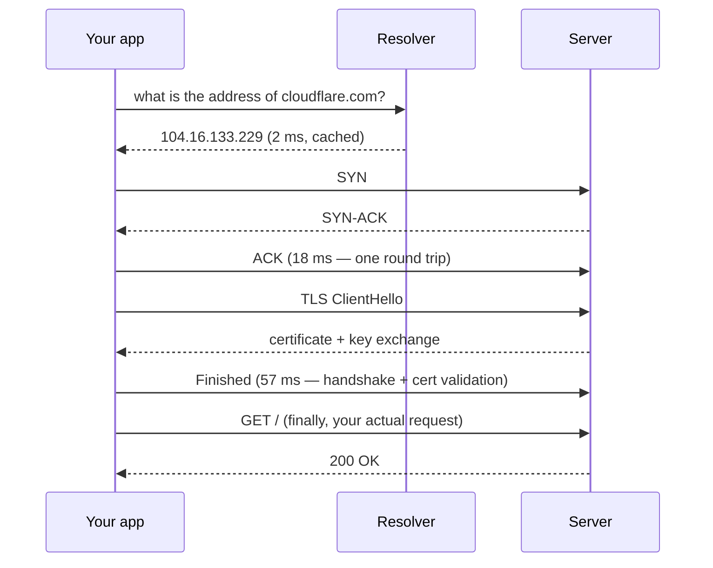
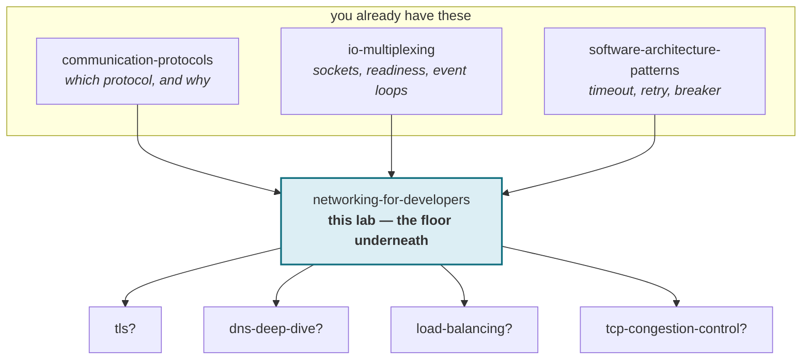

# Networking for developers — what happens between one line of code and a reply

> **Tell a friend:** Priya posts a parcel to Arjun in another city. Sometimes it
> comes back stamped "no such flat". Sometimes the courier says "nobody home".
> Sometimes it just vanishes and she never hears anything at all. Those three
> feel the same to Priya, but they have three different causes and three
> different fixes. When your code sends one request, it passes through six
> hands exactly like Priya's parcel, and every failure it hits is one of those
> three. This lab teaches you to read *which one* from the symptom alone, and
> to know whether trying again can possibly help.

The trainer for this lab is [`visualization.html`](visualization.html), also
published as [Why The Request Hung](https://claude.ai/code/artifact/cf035459-a3d8-4a72-9111-1c6680ba8605).
Six runnable experiments live in `NetLab.java`. Everything about how the lab
was built, and where it sits among your other labs, is in
[section 19](#19-about-this-lab) at the end.

---

# BEGINNER MODEL

## 1. Why does one line of code hide six systems?

> **In one breath:** You write one line. At least six independent systems take
> a turn before an answer comes back. Each can fail, and almost all of them fail
> as the same vague exception, or as nothing at all.

You write this:

```java
HttpResponse<String> res = client.send(request, ofString());
```

What could be simpler? And yet between `httpClient.send(request)` and a
response, at least six separate systems each do a job. Any one of them can
break. Almost all of them break in a way that reaches your code as a generic
exception. The worst ones reach your code as *nothing*: a thread that never
comes back.

Why does that matter? Because not understanding it produces a very specific
kind of stuck. The app team says "the network is flaky". The network team says
"nothing is wrong". Both are right, because neither can see the layer that
actually broke. Meanwhile the retry you added "to be safe" is making it worse.

## 2. What happens to Priya's parcel?

> **In one breath:** Priya knows Arjun's name but not his address. Her parcel
> passes through hands she never sees. When it fails, she gets one of three
> experiences, and only one of them tells her anything.

Priya wants to send a parcel to Arjun, who lives in another city.

She knows his **name**. She does not know his address. So first she has to
look it up. The directory she uses might be out of date, or slow, or might
simply not answer.

Once she has an address, the parcel goes through several pairs of hands: the
local post office, a sorting centre, a truck, a delivery office in Arjun's
city, and finally a courier at his door. She sees none of this.

Now the important part. When things go wrong, Priya gets one of three
experiences:

- The parcel comes back stamped **"no such address"**. Annoying, but she
  *learned something*. The address is wrong.
- The courier reports **"nobody home"**. Also useful. The building exists;
  the person was not in.
- **Nothing happens at all.** No parcel, no return, no message. Weeks pass.

That third case is the one that ruins her week. It is also the one that maps
most directly onto network debugging. Hold on to this: **those three outcomes
have completely different causes and completely different right responses.**
But if Priya only checks "did Arjun reply?", all three look identical.

Here is how far the lab goes, and what you can do after each layer:

| Layer | Sections | After it you can… |
|---|---|---|
| **Beginner** | 1–9 | name the six systems in the path and say what each one can break |
| **Intermediate** | 10 | walk one request phase by phase, with real timings |
| **Engineering** | 11–14 | diagnose nine failures from their symptoms, and measure them |
| **Production** | 15 | set timeouts and pools deliberately, and know what to watch |

## 3. Why not just send it, and retry if nothing comes back?

> **In one breath:** Retrying is the obvious fix for an unreliable thing. It is
> genuinely right for one class of problem, and quietly wrong for two others.

The obvious approach, and the one most code ships with:

```java
for (int attempt = 0; attempt < 3; attempt++) {
    try { return client.send(request, ofString()); }
    catch (Exception e) { /* try again */ }
}
```

Send it. If it fails, send it again. Networks are unreliable, and retrying is
what you do about unreliable things. This is not stupid. For one whole class
of problem it is exactly correct.

So what is wrong with it?

## 4. How does the retry make it worse?

> **In one breath:** The same catch block handles three different failures.
> One retry is free, one costs nine seconds for nothing, and one never runs at
> all because nothing ever throws.

Walk it through with real behaviour, all of it from this lab's experiments.

**Case A: the machine is up, but nothing is listening on your port.** Think
of Priya's parcel coming back stamped "no such flat". The failure arrives
fast. Three retries cost you almost nothing, and all three fail identically.

**Case B: a firewall is dropping your packets.** This is the parcel that
vanishes. The failure arrives only when your own patience runs out. With a
3-second timeout, three retries hold a thread for nine seconds and every one
fails for the same permanent reason.

| Case | What happened | Time to fail | Cost of three retries |
|---|---|---|---|
| A | nothing listening on the port | under 5 ms | almost nothing, same answer thrice |
| B | firewall dropping packets | 3,001 ms (timeout 3,000 ms) | 9 seconds of a held thread |

Same code. Same catch block. Same log line. One retry loop is free; the other
holds a thread for nine seconds and achieves nothing.

**And case C is worse than both.** A server accepts your connection and then
never answers. Arjun takes the parcel at the door and never opens it. Your
retry loop never even runs, because the first attempt *never throws*. There is
no exception to catch. The thread simply stops, on a connection that is
genuinely healthy and open.

> **🔮 Predict:** In case C the code *did* set a timeout: 2 seconds, on opening
> the connection. The connection opened in about 1 ms. So why did the request
> still hang forever instead of giving up at 2 seconds?
>
> <details><summary>Reveal</summary>
>
> **Because that timeout had already succeeded.** The setting is called a
> **connect timeout**, and the name is exact. It bounds the *handshake* and
> nothing else. The moment the connection is established, it has done its job
> and is spent. It never applies to anything that happens afterwards.
>
> Everything after the handshake is unbounded unless you bound it separately:
> sending the request, waiting for the server to think, receiving the response.
> Most code does not bound those, because "I set a timeout" feels like it
> covers the call.
>
> If you guessed "the server must have sent a byte", that is a real failure
> too, and you will meet it in section 10 as the slow drip. It is not this one.
>
> | Setting | What experiment 3 saw |
> |---|---|
> | connect timeout only | still waiting when the lab's 4-second watchdog gave up; would wait forever |
> | plus an 800 ms read timeout, same server | failed in 801 ms |
> </details>

So the naive fix fails in three distinct ways, and they point at one shared
cause. **The code cannot tell the difference between "refused", "ignored", and
"accepted then abandoned".** So it applies one response to three different
problems.

## 5. What do we actually need?

> **In one breath:** For any failed or slow request we need three things:
> which layer broke, whether retrying can help, and a hard ceiling on how long
> we will wait.

What we actually need, for any failed or slow request:

1. **Which layer broke.** Names, routing, the connection, trust, or the
   application at the far end.
2. **Whether retrying can possibly help.** Retrying a permanent failure is
   not neutral. It is expensive.
3. **A guaranteed upper bound on how long we wait**, even when nothing fails
   and nothing errors.

The rest of this lesson is those three.

## 6. What is the key idea?

> **In one breath:** The path is a stack of layers, each hiding the one below.
> That hiding is what makes one line of code possible. And each layer fails
> with its own signature, so the failure tells you where it happened.

Why is one line of code enough to reach a server across the world? Because the
path is **layered**. Each layer provides one guarantee to the layer above and
hides everything below it. Priya does not know about sorting centres; the
sorting centre does not know what is in the box.

That hiding is exactly what makes failures hard to read. But the layers leak
in a useful way. **How a request fails, meaning how long it took and which
exception came back, identifies the layer that broke.** Each layer fails with
a different signature.

Read the signature, and you skip the guessing.

## 7. Whose hands does the parcel pass through?

> **In one breath:** Follow Priya's parcel from the directory to Arjun's door.
> Each pair of hands has an engineer's name, one job, and one way of failing.

Let's walk the parcel through every hand, and name each hand as we get there.

### The directory: how does a name become an address?

Priya starts with a name. The directory turns it into an address. Your
machine does the same: it asks a configured **resolver** for the records
attached to a hostname, and it remembers the answer for as long as the answer
says it may.

Engineers call this **name resolution**, or **DNS**. An address for the older
kind of network address is an `A` record; an address for the newer, longer kind
is an `AAAA` record. Both come with a **time-to-live** (`TTL`), which is how
long your machine may reuse the answer before asking again.

Why does the directory exist as a separate step? To separate *who* from
*where*. Servers move and multiply; the name stays. Everything about deploys,
failover and blue-green rests on that separation.

Notice that this happens entirely *before* any of the protocol knowledge from
your communication-protocols lab applies. No socket exists yet.

### The address and the flat number: which machine, and which door?

The directory gives Priya a street address. But Arjun's building has many
flats, so she also needs his flat number.

The street address is the **IP address**. It routes a packet to a network
interface, meaning one machine. The flat number is the **port**. It selects
which listening process on that machine receives the packet. One machine runs
many services, so you need both: the address gets you to the building, the
port gets you to the right room.

### The knock: how do two machines agree to talk?

Before Priya hands anything over, the courier knocks: "Are you there?" "Yes."
"Good, here you go." Three short exchanges, and only then does the parcel move.

Engineers call this the **three-way handshake**. Your machine sends a small
"are you there?" packet called a `SYN`. The server replies "yes, and are you?"
with a `SYN-ACK`. Your machine answers "yes" with an `ACK`. That costs **one
round trip** before any of your data can move.

A **round trip** (`RTT`) is one message there and back. You met it in the
communication-protocols lab. It is repeated here because this lab makes it the
*unit of account*. Every connection cost below is quoted in round trips, not
milliseconds, because round trips are what stay true when you move regions.

Why does the handshake matter so much? Because it is the moment *reachability*
is established, and its failure carries the most diagnostic information of any
step in the path. That brings us to the two stamps.

### The two stamps: why is a fast failure good news?

Priya's first parcel came back the same afternoon, stamped "no such flat".
Her second parcel simply never came back. Which of those helped her more?

The first. It was a *reply*. Something at the far end read the address and
answered. Engineers call that reply a **reset** (`RST`), and the failure
"**refused**". The machine received your handshake and actively answered:
"I'm here, and nothing is listening on that port." Your code sees a
`ConnectException`, and it arrives in about one round trip.

The second parcel was **dropped**. A firewall or a wrong route discarded your
packets. Nobody answered anything. Your code sees a `SocketTimeoutException`,
and it arrives exactly when *your* timeout expires, because nothing else was
ever going to end the wait.

Why is this the single most useful distinction in the lab? Because a refusal
*proves the network path works*. The problem is the process or the port.
Silence proves nothing reached anything, and points at routing or a firewall.
The tell is the clock: **when elapsed time equals your configured timeout
almost exactly, nobody answered you.**

### The ID check: who is Arjun, really?

The courier reaches the door. Before handing over anything private, the
courier checks that the person is actually Arjun.

That is the **TLS handshake**. On top of the established connection, the two
sides agree on an encryption method, and your machine checks the server's
certificate against the list of authorities it trusts. Roughly one further
round trip with TLS 1.3.

Why does it matter for diagnosis? Because it happens *after* a successful
connection. Its failures are therefore never connectivity problems, however
much an `SSLHandshakeException` looks like one.

### The two stopwatches: why is one timeout not enough?

Priya has two separate worries. Will the courier reach the door at all? And
once there, will Arjun ever open the parcel? Two waits, two stopwatches.

The **connect timeout** bounds the handshake only. The **read timeout**
(`SO_TIMEOUT` on a socket) bounds *each individual read*, not the whole
request. They fail independently, and the gap between them is where services
hang.

Here is the sharp edge in the second one. A 30-second read timeout does
**not** mean the request takes at most 30 seconds. A server that sends one
byte every 29 seconds resets the stopwatch every time, and keeps your thread
alive forever.

### The courier on retainer: why keep the connection open?

Priya sends parcels to Arjun every week. Looking up the address, knocking, and
checking ID every single time is wasteful. So she keeps the same courier on
retainer, and he just goes straight to the door.

That is **connection reuse**, or **keep-alive**. The client holds established
connections in a **pool** between requests. A request that finds an idle one
skips name resolution and both handshakes. Setup is a per-*connection* cost,
not a per-*request* one, so reuse converts a fixed cost into an amortised one.

### The concierge who forgets you: what is a middlebox?

There is a third party in Priya's story that she never thinks about: the
building concierge who logs which couriers are expected. If a courier has not
been seen for a while, the concierge quietly crosses him off the list and
tells nobody.

Engineers call that a **middlebox**: a NAT gateway, a load balancer, a
firewall. It is neither you nor the server, but it holds state about your
connection anyway. It tracks active connections in a table, and **evicts
entries that have been idle too long, silently.** There is a third party, it
has an opinion, and it will not tell you.

### The numbers behind the story

Each hand above has a number from this lab's experiments. Read the last column
for what each number proves.

| Hand | Figure from this lab | What it proves |
|---|---|---|
| Directory (DNS) | `api.github.com` → `20.207.73.85`, TTL 56 seconds | your machine may reuse that answer for 56 seconds |
| Address and port | `20.207.73.85:443` | the machine, and the door where TLS-wrapped HTTP is expected |
| Round trip | loopback 0.117 ms; `8.8.8.8` 16.2 ms across 8 hops | a 138× difference, and it is not a defect, it is distance |
| Handshake | ~16 ms at the 16 ms RTT | one round trip before your request has begun |
| Refused vs dropped | refused in 0–4 ms; dropped in 3,001 ms against a 3,000 ms timeout | time alone separates "something answered" from "nothing did" |
| ID check (TLS) | `cloudflare.com` 46 ms; `www.google.com` 456 ms; both connected in under 31 ms | the difference is handshake and certificate work, not distance |
| Two stopwatches | connect timeout only: still blocked at the 4-second watchdog; 800 ms read timeout: failed at 801 ms | the connect timeout is spent once the connection opens |
| Courier on retainer | 20 requests: 682 ms over 20 new connections vs 38 ms over 1 reused | 17.9× faster for identical work |
| Concierge (middlebox) | idle timeouts: 350 seconds on AWS NLB, 60 seconds on many ALB configs, 5 minutes on lots of NAT hardware | the connection can die while you are not using it |

## 8. What are the two pictures to keep in your head?

> **In one breath:** Carry Priya's postal service for intuition, and the six
> systems table for precision. Then learn the three places the postal picture
> lies to you.

### The simple picture: the postal service

Priya's parcel. A directory lookup, then a chain of handlers, each of which
knows only the next hop, and three distinguishable outcomes: returned to
sender, delivered, or vanished.

### The engineer's picture: six systems, each with one job

Read the last column. It is the list of things that can go wrong, one per
system.

| # | System | Its one job | How it fails |
|---|---|---|---|
| 1 | Your process | Make the call, bound the wait | Blocks forever with no timeout |
| 2 | Resolver | Name → address | Wrong answer, no answer, or a slow one |
| 3 | Router / NAT | Private address → public, and back | Forgets idle connections |
| 4 | Firewall | Allow, reject, or drop | Drops (silence) instead of rejecting |
| 5 | Load balancer | Pick a healthy server | Own idle timeouts, own health view |
| 6 | The server | Do the work | Accepts and then never answers |

### How the two pictures line up

| Postal | Network | Fails as |
|---|---|---|
| Looking up Arjun's address | Name resolution | `UnknownHostException`, or a slow lookup |
| The address itself | IP address | Routes nowhere → silence |
| The flat number | Port | Wrong one → refused |
| "No such address", returned | TCP reset | `ConnectException`, ~1 RTT |
| Parcel vanishes, no word | Dropped packets | `SocketTimeoutException` at your timeout |
| Checking Arjun's ID at the door | TLS handshake | `SSLHandshakeException` |
| Arjun takes the parcel, never opens it | Server accepts, never replies | **no exception at all** |

### Where the story lies to you

Three places, and each one matters.

**The post always eventually tells you something; the network often does
not.** A postal service has no equivalent of a DROP rule. This is the single
biggest gap. It is why "no news" is the hardest network failure to reason
about, rather than the mildest.

**A parcel is one object; TCP is a stream with no parcels in it.** You already
know framing from io-multiplexing. This is why. There is no envelope. In
experiment 6, three separate writes of `ALPHA`, `BETA`, `GAMMA` arrive
regrouped. One run gave two reads (`ALPHABETA`, then `GAMMA`). Another gave a
single read of `ALPHABETAGAMMA`. **Run it several times: the grouping
changes.** Your write boundaries are not preserved, and they are not even
deterministic.

**Delivery is not the same as being acted upon, and TCP only promises
delivery.** When TCP acknowledges your bytes, it means the *operating system*
at the far end received them. It does not mean the application read them, or
processed them, or survived doing so. This is precisely the gap the
idempotency key from your communication-protocols lab exists to cover, and
section 12 returns to it.

## 9. Where can you break each layer yourself?

> **In one breath:** Open the trainer, send one request, then break one thing
> at a time and read three panels together: where it broke, how long it took,
> and what your code saw.

Open **[Why The Request Hung](https://claude.ai/code/artifact/cf035459-a3d8-4a72-9111-1c6680ba8605)**,
or [`visualization.html`](visualization.html), which works offline. It is
Priya's parcel with every hand made visible.

What to do, in this order:

1. **Press "Send request" once with nothing broken.** Look at the waterfall.
   Notice how much of the total elapsed before "Send request". That is setup
   cost, and you paid it before your data moved at all.
2. **Press it again.** The first three phases go grey and the total collapses.
   That is connection reuse, and it is experiment 4 in one picture.
3. **Now break things**, one at a time, from the "What is wrong today?" menu.
   For each, read three panels together: *the path* (where it broke), *the
   waterfall* (how long it took to break), and *what your code sees* (the
   actual exception, or its absence).
4. **The one to spend time on** is "the server accepts, then never answers"
   with the default read timeout of *none*. Then set a read timeout and send
   again. One dropdown converts a hang into an error.

Three faults pause and ask you to predict first. Take the guess.

The RTT slider is worth dragging. At 1 ms nothing matters. At 250 ms the two
handshakes dominate everything, and connection reuse stops being an
optimisation and becomes the whole design.

---

> ### ✅ Checkpoint: end of the beginner model
>
> You can now name the six systems in the path, and you know the most
> valuable distinction in the lab: a fast failure means something answered
> you; a slow one means nothing did.
>
> **Say it back.** Without using the words *reset*, *timeout* or *firewall*,
> explain to a friend why Priya should be *relieved* when a parcel comes back
> stamped, and worried when nothing comes back at all.
> <details><summary>A good answer sounds like</summary>
> "A stamp means somebody at the other end read her address and answered.
> The road works; the problem is the door. Silence means she has no idea how
> far the parcel got, and the only thing that ended her wait was her own
> patience running out."
> </details>
>
> Next: one request, phase by phase, with the real numbers. And why the naive
> version of "just make the call" is slower than it needs to be.

---

# INTERMEDIATE MODEL

## 10. What does one request actually look like, phase by phase?

> **In one breath:** One request is three systems in a row before your bytes
> move. Version 1 pays for all three every time. Version 2 keeps the connection.
> Version 3 puts a stopwatch on every wait, not just the first.

### Mechanism v1: the honest version of one HTTPS request

What does `client.send(request)` actually perform? Here it is in order,
timed against `cloudflare.com`. Read it as Priya's parcel: directory,
knock, ID check, and only then the parcel itself.



Read that as three separate systems, not one call. And note the ordering
consequence: **your request bytes are the fourth thing to move, not the
first.**

Two hosts, same machine, same run. Read the last column for what each phase
is made of.

| Phase | cloudflare.com | www.google.com | What it is |
|---|---:|---:|---|
| Name lookup | 2 ms | 18 ms | configuration, not distance |
| TCP handshake | 18 ms | 31 ms | ~1 round trip: distance |
| TLS handshake | 57 ms | 456 ms | ~1 round trip + certificate work |

> **🔮 Predict:** Same table, same machine, same run. But `api.github.com` and
> `github.com` both showed a name lookup of just over **5,000 ms**, while their
> TCP and TLS phases were normal. Distance can't explain it. What can?
>
> <details><summary>Reveal</summary>
>
> **A timeout.** 5,000 ms is not a duration anything *takes*. It is a duration
> something *waits* before giving up. A suspiciously round number is nearly
> always a configured limit rather than a measurement.
>
> If you guessed "GitHub is slow", notice that the TCP and TLS phases to the
> same host were normal. Whatever it was, it was over before the connection
> even started.
>
> This turned out to be a real fault on the machine this lab was written on,
> and section 11 walks the whole diagnosis. The short version: the router at
> `192.168.1.1` answers the newer-address question (`AAAA`) only when the
> answer is *yes*. When a hostname has no such address, it stays completely
> silent instead of replying "none". The resolver waits a full 5 seconds
> before falling back to the older-address answer (`A`) it already had.
>
> The application is blameless, the server is blameless, and nothing in the
> code can see it. Every IPv4-only host costs 5 extra seconds on every cold
> lookup.
> </details>

### Mechanism v2: reuse the connection

Why is v1 slow? Because it pays name lookup, TCP handshake and TLS handshake
**for every request**. At 16 ms RTT that is roughly 2 round trips of pure
setup before any useful byte moves. Priya looks up the address, knocks, and
checks ID for every single parcel.

The fix is to stop closing the connection. Keep the courier on retainer.
Experiment 4 sends 20 identical requests both ways:

| | Time | Connections opened | Per request |
|---|---:|---:|---:|
| New connection each time | 682 ms | 20 | 34 ms |
| One connection reused | 38 ms | 1 | 1 ms |

**17.9× faster for identical work.** This is why every HTTP client you have
used keeps a pool. It is also why constructing a client inside a request
handler is a performance bug rather than a style question. It discards the
pool. Every request pays the handshakes again.

> **🔮 Predict:** You now hold connections open in a pool. What new failure
> have you just created that did not exist in v1?
>
> <details><summary>Reveal</summary>
>
> **Connections can die while you are not using them, and you will not be
> told.**
>
> The concierge from section 7. A NAT gateway or load balancer between you and
> the server keeps a table of active connections and evicts entries that have
> been idle too long. It sends nothing to either end. Your socket still reports
> `isConnected() == true`, because that method reports whether this socket was
> *ever* connected, not whether the peer is still there. TCP has no dial tone.
>
> If you guessed "the pool fills up", that is a real problem too (failure 9),
> but it is the opposite one: too many connections, not dead ones.
>
> | Experiment 5, step by step | What happened |
> |---|---|
> | request 1 | succeeded |
> | the connection sat idle | 900 ms, past a 600 ms idle timeout |
> | the socket still said | `isConnected=true isClosed=false` |
> | request 2 | failed with **Connection reset** |
>
> The cruel part is *when* you find out: on the next request. So the failure
> lands on a random unlucky user rather than during the idle period that
> caused it. That is why these errors correlate with traffic *gaps* rather
> than with load, and look maddeningly random.
> </details>

### Mechanism v3: bound every wait, not just the first

v2 is fast and reuses connections. Why is it still not safe? Because it still
hangs forever against a server that accepts and goes quiet. The connect
timeout was spent at the handshake, exactly as section 4 showed.

The fix is a **hierarchy** of bounds, outermost first. Read the last column:
it is what happens to Priya if she forgets each one.

| Bound | What it covers | If you omit it |
|---|---|---|
| Connect timeout | The handshake only | You inherit the OS default: minutes |
| Read timeout | Each individual read | The call can block forever |
| **Request timeout** | The whole call, end to end | Slow-drip responses evade the read timeout |
| Pool idle-eviction | How long a connection may sit unused | Middleboxes kill it first, and you find out on a user's request |

The third row is the subtle one, and the reason v3 exists rather than stopping
at v2. A read timeout of 30 seconds resets on *every* read. A server that
sends one byte every 29 seconds keeps the connection alive indefinitely while
never completing the response. Only a bound on the whole operation catches
that. In Java that is `HttpClient.Builder.connectTimeout()` plus
`HttpRequest.Builder.timeout()`, two different settings for exactly this
reason.

**The rule that ties it together:** every timeout must be shorter than the
timeout of whatever is calling you. If your caller gives up at 5 seconds and
you wait 30, you are holding a thread doing work nobody will ever read.

---

> ### ✅ Checkpoint: end of the intermediate model
>
> You can walk one request phase by phase, explain why connection reuse
> exists, and name the four separate bounds a call needs.
>
> **Say it back.** Priya keeps a courier on retainer to save time. In two
> sentences, say what she gained and what new thing she now has to worry
> about.
> <details><summary>A good answer sounds like</summary>
> "She skips the directory, the knock and the ID check on every parcel, so
> each one is many times faster. But the building's concierge may have
> quietly crossed her courier off the list while he sat idle, and she only
> finds out when the next parcel bounces."
> </details>
>
> Next: the nine failures, each with the symptom that identifies it, and the
> guarantees TCP does and does not give you.

---

# ENGINEERING MODEL

## 11. What are the nine ways it fails, and how do you tell them apart?

> **In one breath:** Nine failures, nine signatures. Each one is a short story
> about Priya's parcel, and each has one *tell*: the observable that identifies
> it without guessing.

### Failure 1: the directory that answers only half the question

*A real fault, diagnosed while writing this lab. It is worth the space because
it demonstrates the whole method.*

Priya asks the directory for Arjun's address and gets it, but only after
waiting exactly five seconds every time. The directory is not slow at finding
the answer. It is waiting for something else.

**The symptom.** `curl` to `api.github.com` took 5.39 s total, of which
`time_namelookup` was **5.03 s**. Three warm runs in a row: 5.004, 5.005,
5.011. Java agreed. `InetAddress.getAllByName("api.github.com")` took
**5,027 ms**, while `www.google.com` took **12 ms** on the same machine, same
second.

**The diagnosis, in four steps:**

1. *A round number is a timeout, not a measurement.* 5.00 s is the classic
   resolver timeout.
2. *Is it the name, or the resolver?* Querying `8.8.8.8` directly returned the
   answer in 0.24 s. So the name is fine. The configured resolver
   (`192.168.1.1`, the home router) is the problem.
3. *Which query is hanging?* macOS asks for the older address (`A`) and the
   newer address (`AAAA`) together. Against the router: `A` returned in
   **0.24 s**; `AAAA` **timed out entirely**, no response at all.
4. *Falsify it.* If the theory were "this router hates github", it should
   hold only for github. The actual theory was "this router stays silent when
   a hostname has **no** IPv6 address instead of replying 'none'." So: test
   six hostnames, three with IPv6 records and three without.

| Hostname | Has IPv6? | Router's answer |
|---|---|---|
| `api.github.com` | no | **timeout (7.02 s)** |
| `github.com` | no | **timeout (7.02 s)** |
| `api.stripe.com` | no | **timeout (7.02 s)** |
| `registry.npmjs.org` | yes | answered, 0.03 s |
| `www.google.com` | yes | answered, 0.02 s |
| `cloudflare.com` | yes | answered, 0.02 s |

**Six for six.** The split is perfectly along "does this name have an IPv6
record", not along which company owns it.

What does it mean in practice? On this network, *every IPv4-only host costs a
flat 5 seconds on every cold lookup*. That is `git push`, `npm install`, a
Stripe API call, and any service of yours that happens to be IPv4-only.
Nothing in the application is wrong, and no amount of profiling application
code would ever find it.

What survived? Correctness: you eventually get the right address. What was
lost? Latency, invisibly, and only on cold lookups, which makes it look
intermittent. In production the same shape appears as a misconfigured search
domain turning one lookup into five, or a resolver whose secondary is dead.
**The tell:** a suspiciously round number in the DNS phase.

### Failure 2: refused

Priya's parcel comes back the same afternoon, stamped "no such flat". The
building is there. The road is fine. Nobody lives at that number.

Your code sees `ConnectException: Connection refused`, in **under 5 ms**
(0–4 ms across runs). The machine is reachable and answered with a reset.
Nothing is listening on that port: wrong port, or the process is down.

Should you retry? Only if the process is restarting. It fails fast and
cheaply. **The tell:** *fast*, and an exception that names refusal. Something
answered you, so the network path is fine. This is an application problem
wearing a network costume.

### Failure 3: dropped

Priya's parcel goes out and nothing ever comes back. No stamp, no courier, no
word. She stops waiting only because she decides to.

Your code sees `SocketTimeoutException`, in **3,001 ms** against a 3,000 ms
timeout. A firewall or security group is set to DROP, or the address routes
nowhere. In the lab, case B connects to `10.255.255.1`, which routes nowhere.
Nobody answered anything.

Should you retry? Pointless while the rule stands, and each attempt costs a
full timeout. **The tell:** *elapsed ≈ your configured timeout*. That is the
fingerprint of silence.

### Failure 4: accepted, then silence

Arjun opens the door, takes the parcel, and then never opens it. Priya's
courier stands there forever, because nothing ever went wrong.

With a connect timeout only, your code sees **nothing**. It is still blocked
when the lab's 4-second watchdog gives up, and it would block forever. With an
800 ms read timeout, it sees `SocketTimeoutException` in 801 ms.

Why? The connection is genuinely healthy. The application at the far end is
wedged. Everything below the application worked perfectly. What was lost is
your thread, permanently.

In production, **this is how a service dies without a single error in its
logs.** Threads accumulate on healthy sockets, the pool drains, and your error
dashboard stays green throughout. The response is a read timeout, and above it
a whole-request timeout. **The tell:** no exception, rising thread count, flat
error rate.

### Failure 5: trust failure

The courier reaches the door and checks ID. The person at the door is not
Arjun, or the ID has expired. The courier refuses to hand anything over.

Your code sees `SSLHandshakeException`, shortly *after* a successful connect.
The certificate is expired, or the hostname is wrong, or a private authority
signed it and the JVM does not trust that authority.

Should you retry? **Never.** It is perfectly deterministic until a certificate
or trust store changes. **The tell:** the TCP connection succeeded first. Any
failure after a successful connect is not a connectivity problem, whatever it
looks like.

### Failure 6: the idle connection that died

Priya's courier has been sitting in the lobby for a while. The concierge
crossed him off the list without saying a word. The next time Priya sends a
parcel, it bounces at the lobby door.

Your code sees `SocketException: Connection reset` on the *next* request,
while `isConnected()` returned `true` moments earlier. A middlebox evicted its
connection-table entry and told nobody.

Should you retry? Yes, on a new connection, and only if the request is
idempotent. You cannot know whether the server processed it. The response is
pool idle-eviction set **below** the shortest idle timeout in the path, plus
retry-on-fresh-connection for idempotent requests. **The tell:** errors
correlate with quiet periods rather than with load.

### Failure 7: the MTU black hole

Priya's letters always arrive. Her big boxes never do. Somewhere on the route
is a doorway too small for a box, and the note that says "too big, split it"
is being thrown away along with the box.

Your code sees a hang, or a read timeout, but only for large payloads.
Something in the path cannot carry full-size packets and should reply "too
big, split it". That reply is itself blocked, so your machine never learns and
retransmits forever.

**The tell:** *small requests work, large ones hang, on the same connection.*
That pattern has essentially one cause. Classic on VPNs and tunnels.

### Failure 8: the retry storm

Priya's parcel vanished, so she sends three more. So does everyone else on
the street. The sorting centre, already struggling, is now buried under four
times the parcels.

Combine failure 3 with the naive retry loop from section 3. Every attempt
costs a full timeout. Three retries turn a 3-second failure into 9 seconds of
held thread. Under load, retries multiply the offered load against a service
that is already struggling.

The response is retry budgets, exponential backoff **with jitter**, and
circuit breakers. You met all of them in your
[software-architecture-patterns](../06-software-architecture-patterns/README.md)
lab under resilience patterns. This is the concrete network-level reason they
exist. **The tell:** load *increases* after a dependency degrades.

### Failure 9: not enough ports

Priya hires a fresh courier for every parcel and sends thousands. The agency
runs out of couriers, because each one has to rest for a minute after a job
before taking another.

A client opening many short-lived connections exhausts its ephemeral ports.
Each closed connection sits in `TIME_WAIT` for around 60 seconds before its
port can be reused. New connections then fail on a machine with no other
problem.

The response is connection reuse. Notice that reuse is failure 6's *cause*
and this one's *cure*: the same mechanism, two opposite risks. **The tell:**
failures scale with connection *rate*, not with concurrency or payload size.
This one is described but not reproduced in the lab.

### The nine failures side by side

The same facts, in one place, so you can compare down the columns.

| # | Failure | Reproduce | Your code sees |
|---|---|---|---|
| 1 | Half-answering resolver | real fault; `curl -w` phase timings | 5,027 ms in the DNS phase, then success |
| 2 | Refused | `java NetLab.java 2`, case A | `ConnectException`, under 5 ms |
| 3 | Dropped | `java NetLab.java 2`, case B | `SocketTimeoutException`, 3,001 ms |
| 4 | Accepted, then silence | `java NetLab.java 3` | nothing; or `SocketTimeoutException` at 801 ms with a read timeout |
| 5 | Trust failure | trainer → "certificate does not match the name" | `SSLHandshakeException` after a good connect |
| 6 | Idle connection died | `java NetLab.java 5` | `SocketException: Connection reset` on the next request |
| 7 | MTU black hole | trainer → "big requests vanish, small ones work" | hang or read timeout, large payloads only |
| 8 | Retry storm | failure 3 + the loop from section 3 | 9 seconds of held thread per call |
| 9 | Not enough ports | not reproduced here | new connections fail on a healthy machine |

| # | Retry? | The tell |
|---|---|---|
| 1 | it will succeed, slowly, every time | a suspiciously round number in the DNS phase |
| 2 | only if the process is restarting | fast, and an exception that names refusal |
| 3 | pointless while the rule stands | elapsed ≈ your configured timeout |
| 4 | never reaches a retry; nothing throws | no exception, rising thread count, flat error rate |
| 5 | never; deterministic | TCP connected first, then it failed |
| 6 | yes, on a new connection, if idempotent | errors correlate with quiet periods |
| 7 | pointless; same size, same hole | small works, large hangs, same connection |
| 8 | this *is* the retry | load increases after a dependency degrades |
| 9 | makes it worse | failures scale with connection rate |

## 12. What does TCP actually promise?

> **In one breath:** TCP promises that bytes arrive in order, uncorrupted and
> not duplicated, between two operating systems. It promises nothing about
> message boundaries, about the application reading them, or about time.

Why be precise here? Because the gap between what people assume and what is
guaranteed is where distributed-systems bugs live. Think of Priya's courier:
he promises the parcel reaches the building's post room. He does not promise
Arjun opens it.

**TCP guarantees, between the two operating systems:**

- Bytes arrive **in the order sent**.
- Bytes arrive **without corruption** (checksummed) and **without
  duplication**.
- Lost segments are **retransmitted** until acknowledged or the connection
  fails.
- Flow control stops a fast sender overwhelming a slow receiver.

**TCP does not guarantee:**

- **Message boundaries.** Experiment 6: three writes arrive as one or two
  reads, and the split differs between runs of identical code. Framing is
  your job, always.
- **That the application read your bytes.** An acknowledgement comes from the
  *kernel*. The process may never have called `read()`, and may have crashed
  immediately after the ACK.
- **That the application acted on them.** Delivered ≠ processed.
- **Timeliness.** Nothing bounds how long delivery takes. That is entirely on
  you, hence section 10's timeout hierarchy.
- **That an idle connection is alive.** Failure 6.
- **Privacy or identity.** That is TLS, a separate layer with separate
  failures.

What is the consequence that matters most? When a request fails after the
connection was established, you are in a genuine state of ignorance. The
server may have processed it completely, partially, or not at all. There is no
protocol-level way to find out. Priya's courier can tell her the parcel
reached the post room. He cannot tell her whether Arjun read the letter
inside.

This is exactly the gap the **idempotency key** from your
communication-protocols lab fills, and this lab is *why* it is not optional. A
retried non-idempotent request over TCP is a coin flip on double execution. It
is also why the [transactional-outbox](../48-transactional-outbox/README.md)
lab's at-least-once delivery is the honest default. Exactly-once is not
something a network can offer you.

What was traded away to get those guarantees? Three things. Reliability and
ordering cost you latency: a handshake before any data. They cost you
head-of-line blocking: one lost segment stalls everything behind it, which is
the reason QUIC exists, from your communication-protocols lab. And they cost
per-connection state on every box in the path, which is the reason
middleboxes forget you.

## 13. Where is the code?

> **In one breath:** Four Java files, no build tool. The load-bearing part is a
> diagnosis table that reads elapsed time as evidence.

```bash
cd ~/Documents/Learning/01-networking-for-developers
java NetLab.java          # all six experiments
java NetLab.java 2 5      # just experiments 2 and 5
java BrokenClient.java    # the planted bug
```

JDK 25, no build tool, no dependencies. Experiment 1 uses the internet; the
rest run against a deliberately broken server inside the same JVM. The server
plays every role Arjun can play: he answers, he stays silent, he answers
slowly, or he closes the door when the courier has been idle too long.

| File | What it is |
|---|---|
| `Server.java` | A server that misbehaves on purpose: `ECHO`, `SILENT`, `SLOW`, `CLOSE_IDLE` |
| `Probe.java` | Times each phase separately, and maps every exception to a layer and a retry verdict |
| `NetLab.java` | The six experiments |
| `BrokenClient.java` | One bug, for exercise 6 |

Where is the part that matters? **The diagnosis table in `Probe.java`.**
Everything else is scaffolding to produce inputs for it:

```java
if (e instanceof ConnectException) {
    // Fast + ConnectException = the host actively said "no".
    return new Diagnosis("Connection (TCP) — REFUSED",
        "The host was reached and it answered immediately with a refusal (a TCP RST)...",
        "Retrying helps only if the process is restarting...");
}
if (e instanceof SocketTimeoutException) {
    boolean atLimit = elapsedMs >= timeoutMs * 0.9;
    // The elapsed time is the evidence. At the limit means nobody answered.
    ...
}
```

Note the second branch. It uses **elapsed time as evidence**, not just the
exception type. That is the whole method of this lab expressed in three lines.

And in `Server.java`, the one line that produces the nastiest failure:

```java
if (mode == Mode.SILENT) {
    in.readLine();
    Thread.sleep(Long.MAX_VALUE);   // connection stays OPEN — that's the point
    return;
}
```

The connection is never closed. A closed connection would give the client an
`EOFException`, an *error*, something to act on. Staying open gives it
nothing. Arjun takes the parcel and simply never opens it.

## 14. What do the six experiments show?

> **In one breath:** Six experiments, one lesson each. Predict first, then
> run.

Read each row as: what you would expect, what the lab saw, what it proves.

| # | Experiment | Expect | Observed |
|---|---|---|---|
| 1 | Where did the time go? `java NetLab.java 1` | TCP and TLS track distance; DNS is small | cloudflare 2/18/57 ms; `api.github.com` **5,027 ms** in DNS alone |
| 2 | Refused or ignored? `java NetLab.java 2` | both fail | **0–4 ms** vs **3,001 ms**, stable across repeated runs |
| 3 | Connected, and still hung `java NetLab.java 3` | the connect timeout protects you | still blocked when the 4-second watchdog fired; with an 800 ms read timeout, failed at 801 ms |
| 4 | The price of a new connection `java NetLab.java 4` | reuse helps a bit | 682 ms / 20 connections vs 38 ms / 1 connection: **17.9×** |
| 5 | The idle connection that died `java NetLab.java 5` | the socket reports the problem | `isConnected=true isClosed=false`, then **Connection reset** on the next request |
| 6 | Three writes, how many reads? `java NetLab.java 6` | three | varies: `ALPHABETA` + `GAMMA` on one run, a single `ALPHABETAGAMMA` on the next |

| # | What it proves |
|---|---|
| 1 | phases fail and slow down independently; the DNS column is configuration, not physics |
| 2 | elapsed time alone separates "something answered" from "nothing did": the highest-value diagnostic in the lab |
| 3 | a connect timeout bounds the handshake and nothing else |
| 4 | setup is a per-connection cost (this one simulates the 16 ms RTT to make loopback honest, so it shows the shape, not a capture) |
| 5 | `isConnected()` answers a question you did not ask |
| 6 | write boundaries are not preserved **and not deterministic**; exercise 4.4 runs it five times and gets three different groupings, so a parser that works because messages happened to arrive whole is a latent bug |

---

> ### ✅ Checkpoint: end of the engineering model
>
> You can diagnose nine failures from their symptoms and state what TCP does
> and does not promise.
>
> **Say it back.** A colleague shows you a log line: "request failed after
> 3,002 ms". Without opening anything, say which of the three parcel outcomes
> this is, and what the very next check should be.
> <details><summary>A good answer sounds like</summary>
> "That is the vanished parcel. The time matches a 3-second timeout almost
> exactly, so nothing answered at all. The next check is the road, not the
> door: security groups and routing, not the application."
> </details>
>
> Next: what changes in a real production path, what to configure
> deliberately, and what to watch.

---

# PRODUCTION MODEL

## 15. What changes in a real system?

> **In one breath:** A real path adds more concierges, each with its own idle
> timer and its own opinion. Production is mostly the numbers you chose in
> advance: timeouts, pool sizes, retry budgets.

### What is different about the real chain?

**This lab** runs a client and a deliberately broken server in one JVM on
loopback, plus a handful of real internet measurements.

**A real path** adds a service mesh sidecar, a cloud load balancer, security
groups, a NAT gateway, and often a VPN. Each is a middlebox with **its own
idle timeout, its own health checks, and its own failure modes**. Each is
capable of turning a REJECT into a DROP: turning Priya's stamped parcel into a
vanished one.

**Production** is mostly about the numbers you chose in advance: timeouts,
pool sizes, retry budgets. Every one of them is a bet about the failure modes
above.

### What does this lab leave out?

| Omitted | What real systems do |
|---|---|
| TLS session resumption | Cuts a repeat handshake to ~0 RTT; makes reconnects far cheaper than measured here |
| HTTP/2 multiplexing | Many concurrent requests over one connection, which changes what "pool size" even means |
| TCP slow start | A new connection does not get full bandwidth immediately: another hidden cost of not reusing |
| IPv6 dual-stack (Happy Eyeballs) | Racing A and AAAA to avoid exactly failure 1 |
| DNS TTL vs failover | A cached record survives a failover; TTL is your outage floor |
| Service mesh | mTLS and retries move into a sidecar, with its own timeouts to align |
| Bandwidth and congestion | This lab treats latency only |

### What should you configure deliberately?

1. **Four bounds, always:** connect, read, whole-request, pool idle-eviction.
2. **Pool idle-eviction below the shortest idle timeout in the path.** Find
   the real number, the ALB's or the NAT gateway's. Do not guess.
3. **Timeout budgets that shrink inward.** If your caller waits 5 s, you
   cannot wait 30.
4. **Retry only what is idempotent, with a budget, backoff, and jitter.**
   Failure 8 is what happens otherwise.
5. **Never construct an HTTP client per request.**

### What should you watch?

- **Latency percentiles per phase**, not just totals. A p99 that is exactly
  1,000 ms or 5,000 ms is a timeout, not a slow server.
- **Connection-establishment rate.** Rising while request rate is flat means
  the pool is being thrown away.
- **Errors bucketed by exception type**, never lumped as "network error".
  `ConnectException` and `SocketTimeoutException` are opposite problems, and
  merging them destroys the one signal that separates them.
- **Thread pool utilisation.** Failure 4 shows up here and *nowhere else*.
- **DNS lookup latency.** Almost nobody instruments it, and failure 1 is
  invisible without it.

### What does the on-call engineer see?

Priya's three outcomes, expanded to seven symptoms, each with its most likely
cause and the first thing to check.

| Symptom | Most likely | First check |
|---|---|---|
| Fails instantly, `ConnectException` | Process down / wrong port | Is it listening? `nc -vz host port` |
| Fails at exactly your timeout | Firewall DROP, wrong route | Security groups; `traceroute` |
| Hangs, no exception, threads climbing | Server accepted and wedged | Set a read timeout, then look upstream |
| Fails after connecting, TLS error | Certificate or trust store | `openssl s_client -connect host:443` |
| Random resets, correlate with quiet | Middlebox idle timeout | Pool idle-eviction vs LB idle timeout |
| Small requests fine, large hang | MTU black hole | Test with increasing payload sizes |
| Slow, suspiciously round number | A timeout somewhere | `curl -w` phase timings |

The honest limits of the lab's numbers, and which figures are modelled rather
than captured, are collected in [section 19](#19-about-this-lab).

---

## 16. Exercises

`EXERCISES.md`, eight rungs. Answers in `SOLUTIONS.md`. Attempt each one
before opening the answer.

---

## 17. Where does this sit, and what comes next?

> **In one breath:** This lab is the floor under three labs you already have,
> and the direct prerequisite for the ones that open the boxes it treats as
> sealed.



**Builds on.**

- **communication-protocols.** That lab chose *between* protocols; this one is
  what every one of them sits on. Its idempotency-key rule gets its
  justification here in section 12: TCP cannot tell you whether a request
  was processed.
- **io-multiplexing.** You knew sockets and framing; experiment 6 shows the
  socket-level reason framing is unavoidable.
- **software-architecture-patterns.** Its resilience family (timeout, retry,
  backoff, circuit breaker) is abstract until you have watched failure 8.
  This is the concrete network behind those patterns.

**Commonly confused.**

- **Latency vs bandwidth.** Latency is delay, bandwidth is width. Handshakes
  cost latency, and no amount of bandwidth fixes them. On the same machine and
  the same fibre link: 0.117 ms loopback vs 16.2 ms internet.
- **`ConnectException` vs `SocketTimeoutException`.** Opposite problems.
  Merging them in a log destroys the most useful signal you have.
- **Connection closed vs connection idle.** TCP cannot distinguish them
  without sending something. Failure 6.
- **Delivered vs processed.** TCP promises the first and says nothing about
  the second. Priya's courier reaches the post room; Arjun may never open the
  box.

**Suggested next.**

```
/learn tls
/learn load-balancing
/learn tcp-congestion-control
```

`tls` was already flagged as a "next" in your communication-protocols lab and
is the natural follow-on. Section 7 here treats the ID check as one opaque
round trip, and that is exactly the box to open. `load-balancing` is the
middlebox from failure 6, taken seriously. `tcp-congestion-control` explains
slow start, the cost this lab acknowledges but does not measure.

---

## 18. Glossary

| Term | In one line |
|---|---|
| **Name resolution (DNS)** | Turning a hostname into an address, with a cached time-to-live |
| **A / AAAA record** | The IPv4 and IPv6 address records for a name |
| **TTL** | How long an answer may be reused before asking again |
| **IP address** | Which machine a packet is routed to |
| **Port** | Which listening process on that machine receives it |
| **Round trip time (RTT)** | One message there and back; the unit all connection costs are quoted in |
| **Three-way handshake** | SYN / SYN-ACK / ACK: one round trip to open a connection |
| **RST (refused)** | An active "nothing is listening here" reply; fast, and proves the path works |
| **Dropped** | Packets silently discarded; no reply at all, so you learn only that time passed |
| **TLS handshake** | Agreeing encryption and validating the certificate, after TCP connects |
| **Connect timeout** | Bounds the handshake only, and is spent once it succeeds |
| **Read timeout** | Bounds each individual read, not the whole request |
| **Request timeout** | Bounds the entire call; the only one a slow drip cannot evade |
| **Keep-alive / connection reuse** | Holding a connection open so later requests skip setup |
| **Connection pool** | The client's set of reusable connections |
| **Middlebox** | NAT, firewall or load balancer that holds state about your connection |
| **Idle timeout** | How long a middlebox keeps that state before silently discarding it |
| **MTU** | The largest packet a link can carry without fragmenting |
| **MTU black hole** | A path that drops oversized packets *and* the message saying so |
| **Ephemeral port / TIME_WAIT** | The client-side port pool, and the ~60 s wait before reuse |
| **Head-of-line blocking** | One lost segment stalls everything behind it (from communication-protocols) |

---

## 19. About this lab

### What is in the folder?

| File | What it is |
|---|---|
| `README.md` | this document, 18 stages plus this appendix |
| `visualization.html` | the diagnostic trainer, also published at [claude.ai/code/artifact/cf035459](https://claude.ai/code/artifact/cf035459-a3d8-4a72-9111-1c6680ba8605) |
| `NetLab.java`, `Server.java`, `Probe.java` | six runnable experiments |
| `BrokenClient.java` | a planted bug, for exercise 6 |
| `EXERCISES.md`, `SOLUTIONS.md` | eight rungs and their answers |

### Where does it sit relative to what you already know?

You already did [communication-protocols](../02-communication-protocols/README.md)
(HTTP, gRPC, WebSocket, framing, RTT, head-of-line blocking) and
[io-multiplexing](../03-io-multiplexing/README.md) (sockets, file descriptors,
readiness, event loops). Both of those are about **choosing and serving a
protocol**.

This lab is the floor underneath them. It answers a different question. Not
*"which protocol should I use?"* but ***"it's broken, and where?"*** So there
is no reteaching of sockets, framing or RTT here. They are used as known
vocabulary, and section 8's point about framing exists only to show the
socket-level reason behind something you already accepted as a rule.

### How were the numbers made?

**Every number in this document was measured on the machine the lab was
written on, while writing it.** Timings vary a few percent between runs, so
treat the quoted milliseconds as one representative run and the *ratios* as
the durable finding.

The failure modes, exception types and symptom-to-cause mappings are real and
tested. Three things are modelled or unmeasured rather than captured:

| Figure | Status |
|---|---|
| The millisecond values inside the trainer (`visualization.html`) | modelled, not captured |
| Experiment 4's RTT | simulated with `Thread.sleep`, so it shows the *shape* of the handshake cost rather than a packet capture |
| Failure 9 (port exhaustion) | described but **not reproduced here** |

And every internet measurement is from one machine on one home connection in
one city. The *ratios* transfer; the absolute numbers do not. Priya's parcel
would take a different number of days from a different city, but the three
outcomes would be the same three.
