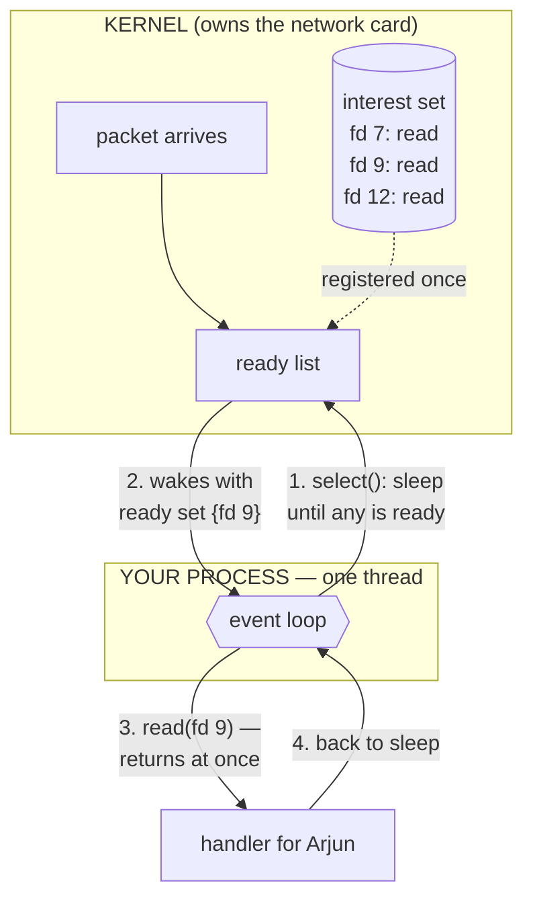
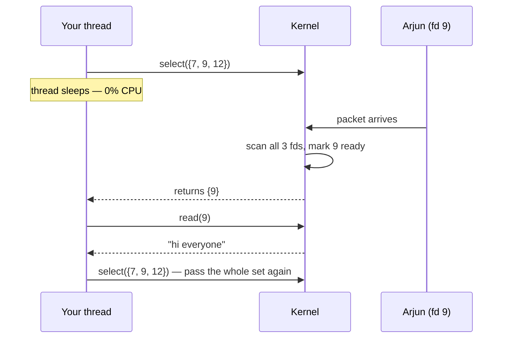
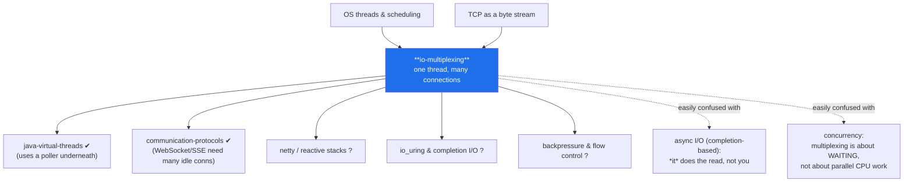

# I/O Multiplexing — from "one thread per user" to "one thread for everyone"

> **Tell a friend:** Meera works the front desk of a hotel with 10,000 rooms.
> Nearly every room is silent nearly all the time, yet any guest may speak at
> any moment, and someone must answer fast. Hire one person per room and the
> wage bill sinks the hotel. Hire one person to sprint down the row of phones
> asking "anything?" and she is exhausted, and still slow. The fix is to stop
> asking: put a light on every line, and let one person doze in a chair until a
> light comes on. Your server is Meera, the rooms are network connections, and
> this lab is how one thread comes to hold ten thousand of them for almost
> nothing.

The trainer for this lab is [`visualization.html`](visualization.html), which
races all three designs on the same traffic. The runnable servers and
experiments live in `src/`. How the numbers were made, and where this lab sits
among your others, is in [section 20](#20-about-this-lab) at the end.

---

# BEGINNER MODEL

## 1. Why is waiting the only thing your server really does?

> **In one breath:** Ten thousand people have your chat app open, and five of
> them are typing. Your server spends its whole life waiting on the other
> 9,995. So the one question that decides your cloud bill is what waiting
> costs.

Asha, Arjun and Priya have your chat app open. So do 9,997 other people.

At this instant, five people in that crowd are typing. Everyone else is
reading, scrolling, or has the phone face-down on a table.

You cannot hang up on the quiet ones. The moment Priya types "on my way", it
has to appear on Asha's screen straight away. A connection you closed can
deliver nothing.

So look at what your server is actually doing. It is not computing. It is not
serving. It is **waiting**, on 9,995 conversations that are saying nothing.

Which gives us the uncomfortable question. The whole lab is the answer to it.

> **What does it cost you to wait?**

Two futures follow from that answer, and they are very far apart.

| If waiting costs… | Then one machine holds… | And your chat app is… |
|---|---|---|
| a thread and a megabyte per person | a few thousand people | an infrastructure project |
| a few bytes in a kernel table | all ten thousand, comfortably | a weekend feature |

Your cloud bill would scale with the number of *idle* people. That is the
absurdity we are trying to remove. Everything in this lab is about making the
second row true.

## 2. What does a 10,000-room hotel have to do with it?

> **In one breath:** Forget servers for a moment. Picture a hotel where the
> only way to learn whether a guest is speaking is to pick up their phone line
> and listen.

Meera runs the front desk of a hotel with 10,000 rooms. Every room has a phone
line running down to her desk.

Guests call down rarely. Asha in room 7 wants a towel. Arjun in room 9 wants to
place a dinner order. Priya in room 12 has not called all week. But when one of
them does speak, somebody must answer quickly, or the bad review goes up that
same evening.

Now the cruel part of the setup. **There is no ringer.** No light, no buzzer,
no notification of any kind. The only way to find out whether a guest is
speaking is to pick up that line's receiver and listen.

Meera's job is to staff that desk. That is your server's job too, one word at a
time.

| In the hotel | On your server |
|---|---|
| a room with a phone line | one open network connection |
| Asha, Arjun and Priya in their rooms | three of your ten thousand users |
| picking up a receiver to listen | your code asking a connection "anything for me?" |
| the front desk | your program |
| Meera herself | one thread of execution |

Here is how far the lab goes, and what you can do at the end of each layer.

| Layer | Sections | After it you can… |
|---|---|---|
| **Beginner** | 1–11 | say why one-person-each and ask-everyone both fail, and what replaces them |
| **Intermediate** | 12 | walk the wait call through three generations, and say what each one fixed |
| **Engineering** | 13–15 | name eight failures from their symptoms, and run three of them yourself |
| **Production** | 16–20 | say what Netty adds, what to watch, and whether virtual threads retire it |

## 3. Why not simply hire one person per line?

> **In one breath:** Give every line its own employee, holding the receiver to
> their ear all day. It is simple, it is correct, and it is how almost every
> tutorial server is written.

The obvious answer: hire 10,000 employees.

Meera becomes employee #9. She holds room 9's receiver against her ear all day,
waiting for Arjun to say something. Employee #4,127 does the same on line
4,127. Nobody is ever missed, because no line is ever shared.

When Arjun finally speaks, Meera hears him instantly and handles it. Fast,
simple, obviously correct.

In code this is **thread-per-connection**. Every connection gets its own
thread. That thread sits inside a `read()` call which does not return until
bytes arrive. Holding the receiver to your ear *is* `read()`, and Meera's whole
day *is* one thread. The file is `src/BlockingEchoServer.java`, and here is its
heart:

```java
Socket client = serverSocket.accept();
new Thread(() -> handle(client)).start();   // one thread, one connection, forever
...
int n = in.read(buf);   // this thread now sleeps here until bytes arrive
```

This is how virtually every tutorial socket server is written, and it works.

> **🔮 Predict:** 10,000 connections, all silent, one thread each. Roughly how
> much **CPU** is this server using?
>
> <details><summary>Reveal</summary>
>
> **Almost none.** This is the part people get wrong. A thread waiting inside
> `read()` is not spinning. The operating system has taken it off the CPU
> entirely, and will not schedule it again until data arrives. Zero CPU.
>
> If you guessed "10,000 threads must be burning the machine down", you were
> picturing 10,000 people *checking*. They are not checking. Each one is
> asleep, and sleeping is free.
>
> So if CPU is free, what actually breaks? That is the whole point of the next
> section, and the answer is a different resource.
> </details>

## 4. If the CPU is idle, what actually runs out?

> **In one breath:** Employees are not free even when they do nothing. Each
> thread claims memory and a slot in the operating system's bookkeeping, and
> those run out long before the network does.

Run it and count:

```
$ java src/Experiments.java threads 2000

  thread-per-connection : 2000 connections -> 2000 handler threads
  io-multiplexing       : 2000 connections -> 1 event-loop thread
```

Ignore that second line for now. It is the answer we have not invented yet,
printed so you can see where this is heading. Only the first line is today's
design.

Two thousand connections, two thousand threads. The scaling is exactly 1:1.

> **🔮 Predict:** Meera's hotel now employs 10,000 people who each do nothing
> all day. Which resource gives out first — the CPU, the memory, or the
> network card?
>
> <details><summary>Reveal</summary>
>
> **Memory, and then the scheduler.** The network card is barely involved;
> 10,000 idle TCP connections carry almost no traffic. The CPU is idle too, as
> the previous prediction showed.
>
> If you said "the network card", you were sizing the *traffic*. The traffic is
> tiny. What is enormous is the *staff list*, and the staff list is held in
> memory and walked by the scheduler.
> </details>

Three separate bills arrive with a thread each, and every one of them is about
staff, not about guests.

| What it costs | The number | What that number means |
|---|---|---|
| Stack reserved per thread | about 1 MB | address space each thread claims on a 64-bit JVM |
| Stack actually touched | tens of KB | the part that turns into real, resident pages |
| Ten thousand threads | roughly 10 GB | address space reserved before a single message is sent |
| Scheduler records | one per thread | the OS must consider every one when picking what to run |
| Thread ceiling | an OS-imposed limit | you stop at some connection count, however idle they are |

Read the first three rows together. **You run out of memory long before you run
out of network capacity.**

The fourth row costs you differently. Switching between threads means saving
one set of CPU state, restoring another, and dirtying the CPU's caches on the
way. With five active users and 10,000 threads, the machine spends its time
managing employees instead of serving guests.

This was famous enough to earn a name in 1999: the **C10K problem**. How do you
serve ten thousand concurrent connections on one machine? Thread-per-connection
could not.

Now look harder at what is actually being wasted. Those 9,995 employees are not
doing work. They are doing *waiting*. Waiting is not a task; it is the absence
of a task. The hotel is paying 10,000 salaries so that 10,000 people can each
be individually informed of something.

**Why does waiting need a person at all?**

## 5. What if one person just runs down the row?

> **In one breath:** Keep one employee and make her sprint. She never holds a
> receiver; she picks each one up, hears nothing, drops it, and moves on
> forever.

Fire everyone. Keep Meera.

Give her a new rule: never hold a receiver to your ear. Instead, sprint down
the row of 10,000 phones. Pick up line 1 — "anything? no" — drop it. Pick up
line 2 — "anything? no" — drop it. On reaching line 10,000, run back to line 1
and start the lap again.

For this to work, Meera needs a phone that answers "nothing here" instantly
instead of making her wait. Otherwise the first silent line traps her for the
rest of the day.

In code that phone is a **non-blocking socket**: a connection configured so
that a read with no data returns immediately, saying "no data right now",
instead of parking your thread. In Java you switch a connection into that mode
with one call, and then a read of an empty connection returns `0` rather than
sleeping:

```java
channel.configureBlocking(false);   // read() now returns 0 instead of waiting
...
int n = ch.read(buf);               // 0 = nothing right now, keep running
```

That is `src/SpinEchoServer.java`. One thread, all 10,000 connections, no
thread explosion. Problem solved?

> **🔮 Predict:** 2,000 silent connections, three seconds of this. How much CPU
> does the single thread burn, and how many times does it hear "nothing"?
>
> <details><summary>Reveal</summary>
>
> A full CPU core, pinned at 100%, and roughly four million "nothing" answers.
> The exact numbers are in the next section.
>
> If you guessed "not much, it is only one thread", you were counting threads
> rather than questions. One thread can ask millions of questions per second,
> and every question costs.
> </details>

## 6. Why is asking ten thousand times worse than waiting?

> **In one breath:** Meera's sprint burns a whole CPU core while absolutely
> nothing happens, and each new guest makes every lap slower.

Here is what the sprint costs, for 2,000 connections over three seconds:

```
$ java src/Experiments.java spin 2000

  hot-loop polling : 2,998 ms CPU burned | 2,111 loop passes | 4,225,570 readiness questions asked
  io-multiplexing  :     0 ms CPU burned |     0 wakeups     |         0 readiness questions asked
```

"Readiness question" is the program's phrase for one "anything for me?". The
proper name for it arrives in §9. Again, only the first line is today's design.

| What was counted | Hot-loop polling | What the number means |
|---|---|---|
| CPU burned in 3,000 ms of wall clock | 2,998 ms | one core pinned at 100%, permanently |
| Laps down the row of phones | 2,111 | complete passes over all 2,000 connections |
| "Anything for me?" questions asked | 4,225,570 | every one of them answered "no" |

Say that last row out loud. Meera asked "anything for me?" 4.2 million times,
and heard "no" 4.2 million times.

Each of those questions is a **system call** — a request from your program into
the operating system's core. That core is the **kernel**: the privileged code
that owns the network card and every connection on the machine. System calls
are cheap one at a time and ruinous by the million. They are the expensive part
of this design.

And it degrades as you grow. Every lap costs one question *per connection*, so
doubling the connections doubles the cost of a lap. The busier your server
looks on paper, the slower each lap becomes, and the longer a guest waits
before Meera reaches their phone.

We have now failed twice, in opposite directions.

| Design | Threads | CPU while idle | Why it fails |
|---|---|---|---|
| One thread per connection | 10,000 | ~0 | memory + scheduler collapse |
| One thread, keep asking | 1 | 100% of a core | pointless syscalls, one per connection per lap |

Both failures share a cause, and it is not obvious.

> **🔮 Predict:** Meera is standing in a room full of phones, asking each one
> "anything?" and hearing "no". Somebody in that building already knows exactly
> who is speaking, and has known since the instant they started. Who?
>
> <details><summary>Reveal</summary>
>
> **The phone system itself.** In code, the kernel.
>
> The kernel receives every network packet. At the instant a packet lands it
> already knows which connection that packet belongs to — it had to, to file
> the bytes in the right place.
>
> If you guessed "the guests know", you are right but stuck. Asha cannot reach
> the desk except through the phone system, and the phone system is the thing
> we are refusing to ask properly.
>
> In both failed designs *we* are the one asking the question, and we are the
> worst possible party to ask it. We are standing next to the one entity that
> has the answer, asking everyone *else*, over and over.
> </details>

## 7. What exactly do we need instead?

> **In one breath:** One thread must be able to wait on many connections at
> once, and be told which of them woke it. No ordinary read can do that.

State it plainly, because the rest of the lab is the pursuit of this one
sentence:

> **One thread must be able to wait on many connections at once, and be told
> which ones need attention — without asking each one individually, and without
> using CPU while nothing is happening.**

Read the first clause again: *wait on many connections at once*. That is the
thing an ordinary `read()` cannot do. A blocking read waits on **exactly one**
connection. There is no way to say "wait until any of these 10,000 has
something."

So we do not need a faster loop. We need a **new kind of wait**, one that
covers a whole set.

## 8. What if the phone system switched on a light?

> **In one breath:** Hand your entire list of connections to the kernel and go
> to sleep. The kernel wakes you when at least one of them has something, and
> hands you the list of which ones.

Install a light board.

Every phone at Meera's desk gets a light. When Arjun starts speaking, *the
phone system* switches line 9's light on. Meera does not run and does not
listen. She sleeps in a chair. The phone system wakes her the instant any light
comes on, and then tells her exactly which lines are lit.

One system call does all of that:

> **Hand the kernel your entire list of connections and go to sleep. The kernel
> wakes you when at least one of them has something, and hands you the list of
> which ones.**

That call is the whole concept. An idle connection costs the kernel a small
bookkeeping entry, and costs your thread *nothing*. No thread, no question, no
CPU.

Ten thousand silent connections therefore produce exactly zero wakeups. That is
not a hope. It is the second line of the experiment you already read in §6:
`0 ms CPU burned | 0 wakeups`. Those are the same 2,000 connections that cost
the sprinting design a whole core.

## 9. What are the real words for what Meera just did?

> **In one breath:** You have already felt every one of these problems. Here
> are their professional names, each attached to the moment in the story where
> you met it.

The words arrive in the order you earned them.

### Why is it called "multiplexing" rather than "sharing"?

Meera watching a whole wall of lights, alone, is **I/O multiplexing**. Said
precisely: a kernel facility that lets a single thread block on the readiness
of a *set* of file descriptors, returning the subset that is ready.

The word comes from telecoms, where multiplexing means sending many signals
over one shared channel. Here the shared channel is one thread of execution,
and the many signals are the connections. The name exists to distinguish this
from having one channel per signal, which is exactly §3's design. One thread
holding 10,000 chat connections is the direct answer to §4's C10K problem.

### What number does the kernel know a guest by?

Meera does not think "Arjun". She thinks "line 9". The kernel is the same. It
hands your program a small integer as a handle to an open thing: a file, a
pipe, or a network connection. That integer is a **file descriptor**, almost
always shortened to **fd**. Technically it is a per-process index into the
kernel's table of open file descriptions.

Unix deliberately made network connections look like files, so that the same
calls (`read`, `write`, `close`) work on both. That is why "everything is a
file" is a Unix slogan. Asha's connection is fd 7, Arjun's is fd 9, Priya's is
fd 12. Those are the numbers you hand the kernel.

In Java you rarely see the integer, because a `SocketChannel` wraps one. You
still meet the count: the open-file limit, `ulimit -n`, counts file
descriptors, and it is the wall you hit at high connection counts.

### Who waits — your thread, or nobody?

In §3 Meera held the receiver and waited. In §5 the phone answered "nothing
here" and she moved on. That is the difference between **blocking** and
**non-blocking**, and it is a setting on each individual descriptor.

Blocking means the call does not return until it can make progress.
Non-blocking means the call returns immediately with a "would have blocked"
indication — `0` in Java NIO, `EAGAIN` in C. The pair of words exists to name
one choice: *who waits*, the thread or nobody.

You set it with `channel.configureBlocking(false)`, as `SpinEchoServer` does.
Java's `Selector` **requires** non-blocking channels; registering a blocking
one throws `IllegalBlockingModeException`. Note what that implies. Neither mode
was enough on its own, and the real fix combines non-blocking sockets with a
*blocking* wait on the whole set.

### What does a lit light actually promise?

The light on line 9 means one thing. If you pick up that receiver right now,
you will hear something instead of waiting. Engineers call that **readiness**.

The kernel reports it in four flavours. Readable means bytes are buffered, or
the stream has ended. Writable means the send buffer has room. Acceptable means
a connection is pending. Connectable means an outbound connect has finished.

The term exists to separate *"you may now act"* from *"your action has been
done for you"*. That single distinction defines two whole families of I/O API,
and the second family arrives in §16. Here, readiness is the light: the kernel
says fd 9 is readable, and then **you** call `read(9)` yourself, which returns
immediately.

Read the promise again carefully, because §13 is built on what it leaves out.
The light says *someone is speaking*. It does not say what they said, how much
of it arrived, or whether they finished their sentence.

### Which two sets do beginners fuse into one?

Meera's board holds two different pieces of information, and they are easy to
confuse.

The **interest set** is "what to wake me for". It is the registration held
inside the kernel: a descriptor, plus the event types you care about. It is
long-lived, and you are the one who sets it. Wiring a phone into the board with
`channel.register(selector, OP_READ)` puts fd 9 into that set and leaves it
there.

The **ready set** is "what actually happened". It is the subset the kernel
hands back from one wait call, and it is fresh every time. One wait can return
a ready set of `{fd 9}` while fds 7 and 12 stay registered, idle and untouched.

In Java a `SelectionKey` is one entry in the interest set, and
`selector.selectedKeys()` is the ready set.

### What is the shape of Meera's whole day?

Sleep, get woken, handle whatever is lit, go back to sleep. That routine is an
**event loop**. In code it is one thread running
`while (running) { wait for readiness; dispatch each ready event to its handler; }`,
which is the `eventLoop()` method in `SelectorEchoServer`.

The term names an inversion of control. You no longer write "read, then
process". You write handlers, and the loop calls them when the kernel says so.
This is the same shape as a UI framework's main loop, and the same shape as
Node.js and nginx. Once you have seen it here, you recognise it everywhere.

### Why is "asynchronous" the word that trips everyone?

This is a **different axis** from blocking and non-blocking, and mixing the two
up causes most of the confusion around this whole topic.

| The question being asked | The two answers | What it decides |
|---|---|---|
| Does the call park my thread? | blocking / non-blocking | who waits: the thread, or nobody |
| Do *I* perform the I/O, or does someone else? | synchronous / asynchronous | who copies the bytes, and when you are told |

I/O multiplexing is **synchronous, non-blocking I/O with a blocking wait**. The
kernel tells you a connection is ready. **You** still call `read()` yourself,
and the bytes are copied while your thread waits for that copy. Nobody did the
read for you.

It *looks* asynchronous because your code is callback-shaped. The data movement
is still yours. True asynchronous I/O is the other thing: you hand over a
buffer and are told "it is filled" later. That family is `io_uring`, Windows
IOCP, and Java's `AsynchronousSocketChannel`.

### The seven words, and where you met each

Which of them names a *thing*, and which names a *choice*? Split them that way
and they stop blurring together.

Four words for the parts of the machine:

| Word | In the hotel | Met it in |
|---|---|---|
| **I/O multiplexing** | Meera alone, watching a wall of lights | §8, as the fix for §4 and §6 |
| **File descriptor (fd)** | the line number, not the guest's name | §3, every time a receiver was picked up |
| **Interest set** | which phones are wired into the board | §8, when the board was installed |
| **Ready set** | which lights are lit right now | §8, the list handed to Meera on waking |

Three words for the choices you make:

| Word | The question it answers | Met it in |
|---|---|---|
| **Blocking vs non-blocking** | does an empty read park the thread? | §3 held the receiver; §5 dropped it |
| **Readiness** | may I act now without waiting? | §8, the meaning of one lit light |
| **Synchronous vs asynchronous** | do I copy the bytes, or does someone else? | this section, and again in §16 |

And one word ties them together: the **event loop**, which is Meera's entire
working day from §8 onwards.

## 10. Which two pictures should you carry in your head?

> **In one breath:** Keep the hotel switchboard for thinking and the kernel
> diagram for debugging. Then learn the three places the hotel quietly lies to
> you, because each lie is a real bug in §13.

### The simple picture — what does Meera see?

A hotel switchboard. One operator, a wall of lights, one light per room. The
operator sleeps. A light comes on. She wakes, sees exactly which lights are
lit, handles those lines, and sits back down.

That picture is enough to reason about cost, and it is the one to carry into a
design discussion.

### The engineering picture — what does the kernel hold?

One thread. A kernel object holding a set of registered descriptors, and the
events wanted for each. A blocking call that returns the ready subset. A loop
that dispatches each ready descriptor to a handler, then calls the wait again.

All per-connection state lives in objects on the heap, because there is no
per-connection stack to hold it.

Read the diagram in two halves. The top box is the kernel, which owns the
network card. The bottom box is your process, which owns exactly one thread.
The numbered arrows are one full turn of the loop.



### How does the hotel line up with the code?

The things on the desk:

| In the hotel | In engineering | In Java | First met in |
|---|---|---|---|
| Phone line to a room | Network connection | `SocketChannel` | §2 |
| The line's number | File descriptor | (wrapped inside the channel) | §9 |
| The light board | Kernel multiplexing object | `Selector` | §8 |
| The full set of wired lines | Interest set | all `selector.keys()` | §9 |
| Which lights are lit right now | Ready set | `selector.selectedKeys()` | §9 |

What Meera does with them:

| In the hotel | In engineering | In Java | First met in |
|---|---|---|---|
| Wiring a phone into the board | Registering interest | `channel.register(selector, OP_READ)` | §9 |
| Operator asleep in the chair | The blocking wait | `selector.select()` | §8 |
| The operator's routine | Event loop | the `while` loop | §9 |
| The notepad for each room's half-finished order | Per-connection state | `SelectionKey` attachment | §13.3 |

### Where does the story lie to you?

Three places. Each lie is a real failure mode, and each one has a number in
§13.

**Lie 1: a lit light does not mean a complete sentence.** The operator story
suggests you pick up and hear the whole request. In reality "readable" means
only "some bytes are here". Half a message is normal. A message split across 76
separate wakeups is normal, and §13.3 measures exactly that. The light also
comes on when the guest **hangs up**, because "readable" includes end-of-stream.
Forgetting that causes the bug in §13.2.

**Lie 2: the operator can never leave the chair.** A real operator can put a
call on hold and walk to the kitchen. The event-loop thread cannot. One slow
database query, one `Thread.sleep`, one synchronous HTTP call, and **every**
light goes unanswered until it returns. The whole board freezes.
§13.1 puts a number on it: 905 ms of collateral damage from one slow request.

**Lie 3: the lights can lie.** The kernel is permitted to report readiness
spuriously. You wake up, read, and get nothing. Correct event-loop code treats
a wakeup as a *hint*, never a promise, and must survive a read that returns
zero bytes.

## 11. Can you watch all three designs race?

> **In one breath:** The trainer runs one thread per connection, hot-loop
> polling, and multiplexing side by side on identical traffic, so you can watch
> the thread count, the CPU and the syscall count move together.

Open [`visualization.html`](visualization.html), or the published link in the
chat message. It runs the three designs on the same simulated traffic, with a
live thread count, a CPU meter, and a syscall counter for each.

Watch the middle panel first. That is Meera sprinting, and the CPU meter tells
you what the sprint costs while Asha, Arjun and Priya say nothing at all.

Use it to answer the three questions a static diagram cannot: what changed, why
it changed, and what happens if you change it. In particular, try the buttons
that inject the failures from §13, and watch which design survives each one.

> ### ✅ CHECKPOINT — end of the BEGINNER MODEL
>
> You can now explain *why* I/O multiplexing exists. Waiting on many
> connections is the server's main job. One-thread-each is too expensive, and
> asking-each-one is too wasteful, so we hand the whole set to the kernel and
> sleep. You can define readiness, interest set, ready set and event loop, and
> you know that synchronous versus asynchronous is a different axis from
> blocking versus non-blocking.
>
> **Say it back.** Without using the words *readiness*, *kernel* or *event
> loop*, explain to a friend why the hotel's wage bill collapses once a light
> board is installed.
> <details><summary>A good answer sounds like</summary>
> "Before, somebody had to be assigned to every room, either standing at one
> phone forever or running past all of them. Both cost you a person's whole day
> for rooms where nothing happens. The lights mean nobody has to check. One
> person sleeps, and the building itself pokes her the moment somebody actually
> speaks."
> </details>
>
> **Next (§12):** how the wait call actually works, why the first version of it
> was too slow, and what the second version changed.

---

# INTERMEDIATE MODEL

## 12. How does the wait call work, and why was the first one too slow?

> **In one breath:** The first version handed the whole guest list to the
> kernel on every single call. The second version left the list with the
> kernel, and asked only "who is lit?". That change is the difference between
> C10K being impossible and being routine.

We build it in the order history did. The obvious version first, then the
failure that forced the version you actually use.

Keep one concrete scene in view throughout. **A chat server with three
connections: Asha on fd 7, Arjun on fd 9, Priya on fd 12. Only Arjun types.**

### Mechanism v1 — what did `select()` promise in 1983?

The first system call to do this. In the hotel it is a light board that Meera
has to re-wire completely before every nap.

Its contract, step by step:

1. You build a set of descriptors: `{7, 9, 12}`.
2. You call `select()`, passing the whole set in. Your thread sleeps.
3. Arjun types. A packet lands. The kernel returns from `select()`.
4. It hands back the set, with everything not ready removed: `{9}`.
5. You call `read(9)` and get Arjun's message.
6. You rebuild the set and call `select()` again.

Follow the arrows downwards. Step 3 is the nap, and the last line is the part
that will hurt later.



This satisfies §7's requirement exactly. For three connections it is perfect.

> **🔮 Predict:** Now scale the scene up. **10,000 connections, one of which is
> active.** How much work does the kernel do inside a single `select()` call?
>
> <details><summary>Reveal</summary>
>
> **It examines all 10,000 — on every single call.** Two costs, both
> proportional to the total number of connections rather than the active ones:
>
> 1. **Copy in.** The whole 10,000-descriptor set is copied from your process
>    into the kernel on every call, and the result is copied back out.
> 2. **Scan.** The kernel walks all 10,000, checking each one for readiness.
>
> If you guessed "one, because only one is active", you were describing the
> design that comes next. It did not exist yet in 1983.
>
> We fired the sprinting employee in §6 for doing exactly this work — asking
> every line on every lap. `select()` did not delete that work. It **moved it
> into the kernel**, where it is much cheaper per item, because there is no
> system call per connection. It is still proportional to the total.
>
> `select()` also carries a hard cap. The descriptor set is a fixed-size
> bitmask called `FD_SETSIZE`, conventionally **1024** entries. `poll()`, from
> 1986, removed the cap by using an array instead of a bitmask. It kept the
> copy and the scan.
> </details>

### The refinement — what did `epoll` and `kqueue` change in 2000–2002?

The scar from that failure produced the design you actually use. It comes from
one observation:

> The set of connections barely changes between calls. Why re-send and re-scan
> it every single time?

So split the one call into two, and let the kernel keep the list. Meera's board
gets wired once, and stays wired.

1. **Register once.** In the hotel, plug Arjun's line into the board and leave
   it there. In words: tell the kernel to remember that you care about fd 9. As
   a call, `epoll_ctl(ADD, fd 9)`. It stays across calls, with no re-copying.
2. **The network stack maintains a ready list.** This is the key move. When
   Arjun's packet arrives, the code handling the network interrupt *already
   touches fd 9's structures*, so it appends fd 9 to a ready list right there.
   No scan is needed, because readiness is recorded at the moment it is caused.
3. **The wait returns that ready list.** `epoll_wait()` returns `{9}`, copying
   one entry rather than 10,000.

The cost changes from **O(total connections)** to **O(ready connections)**. Ten
thousand idle connections now cost nothing per call. They are entries in a
kernel table and nothing more.

| | `select` (1983) | `poll` (1986) | `epoll`/`kqueue` (2000–02) |
|---|---|---|---|
| Interest set lives | in your process | in your process | **in the kernel** |
| Cost per wait call | O(total) copy + scan | O(total) copy + scan | **O(ready)** |
| Max descriptors | 1024 (`FD_SETSIZE`) | unlimited | unlimited |
| Portable | everywhere | POSIX | Linux / BSD-macOS respectively |

Same idea, three generations. **`epoll` is Linux; `kqueue` is BSD and macOS.**
Java hides the difference behind one portable façade, `Selector`. You can ask
your own machine which one it picked:

```
$ java Probe.java
Selector impl on this OS : sun.nio.ch.KQueueSelectorImpl
```

That output is from a Mac. On Linux the same code prints
`sun.nio.ch.EPollSelectorImpl`.

### The refinement's own refinement — why can edge-triggering hang a connection?

One more knob, and one more failure that explains why the knob exists.

Picture the light again. **Level-triggered** means the light stays on while
there are unread bytes, so you get woken again on the next wait if you did not
consume everything. **Edge-triggered** means the light flashes once, on the
transition from not-ready to ready, and then goes dark regardless of how much
you read.

Edge-triggered means fewer wakeups. It also sets a trap. **If you do not drain
the socket completely, you will never be told again.** That connection then
hangs forever while everything else works, which is one of the nastiest bugs in
this area, because it presents as a network problem.

**Java's `Selector` is level-triggered.** That is the forgiving default, and it
is why `SelectorEchoServer` can read one bufferful and safely return. Netty's
native Linux transport offers edge-triggering for throughput, and its
documentation is emphatic: you must loop reading until the socket says `EAGAIN`.

> ### ✅ CHECKPOINT — end of the INTERMEDIATE MODEL
>
> You can now explain the mechanism message by message, and say *why* modern
> systems use `epoll` or `kqueue` rather than `select`. The interest set moved
> into the kernel, and readiness became proportional to the ready connections
> instead of the total. You know Java's `Selector` is the portable façade, and
> that it is level-triggered.
>
> **Say it back.** Without using the words *descriptor*, *syscall* or *O(n)*,
> explain to a friend what changed between 1983's design and 2002's.
> <details><summary>A good answer sounds like</summary>
> "In the old one you handed over the entire guest list every time you went to
> sleep, and someone checked every name on it. In the new one you hand the list
> over once and it stays there. After that you only ever ask 'who spoke?', and
> the answer is as short as the number of people who actually spoke."
> </details>
>
> **Next (§13):** what breaks. Three of the failures below run on your machine,
> and every one of them is a real production incident somewhere.

---

# ENGINEERING MODEL

## 13. What breaks, and how would you recognise each one at 3 a.m.?

> **In one breath:** Everything that goes wrong here comes from two facts. One
> thread means one slow handler freezes everyone, and a lit light promises
> bytes rather than meaning.

Eight failures follow. Three of them you can create on your machine right now.
The rest you will meet in somebody else's production system. A table at the end
puts all eight side by side.

### 13.1 Why did Arjun's ping take 905 ms when Asha placed a slow order?

Asha (client A) sends a request whose handler takes a full second — a database
lookup, say. One hundred milliseconds later Arjun (client B) sends a one-word
"ping". Create it with `java src/Experiments.java blockedloop`:

```
  io-multiplexing (1 shared loop) : B's ping took 905 ms
  thread-per-connection          : B's ping took   0 ms
```

The event loop is one thread. While Meera is standing in the kitchen sorting
out Asha's order, nobody is watching the board. Arjun's bytes physically
arrived at the network card within a millisecond, and then sat unread in a
kernel buffer until she came back.

Read Arjun's 905 ms carefully. It is not caused by Arjun, and it has nothing to
do with Arjun's request. Correctness survives — his echo is right when it
finally comes. Latency isolation does not. **A shared loop means shared fate**,
and one slow handler is a partial outage for every connection on that loop.

This is the number one event-loop bug in the world. The rule that follows is
absolute. On the loop thread: no JDBC call, no synchronous HTTP client, no
`Thread.sleep`, no unbounded loop, no `synchronized` block that might contend,
and no large JSON parse. Slow work goes to a separate worker pool, and the
result is posted back to the loop. Netty ships `EventExecutorGroup` for exactly
this. Netty and Vert.x both log a warning when a loop thread stalls, and
Vert.x's `BlockedThreadChecker` produces a "blocked event loop" line you will
meet in real logs.

### 13.2 Why does a guest who hung up keep her light on forever?

Priya closes the app. Her connection ends. What does her light do?

> **🔮 Predict:** Priya's line goes dead, and the handler treats "nothing to
> read" as "try again later". In half a second of otherwise total silence, how
> many times does the loop wake up?
>
> <details><summary>Reveal</summary>
>
> **351,609 times.** A correct server wakes zero times in the same window.
>
> If you guessed "once, then it settles down", you are assuming the light turns
> off. It does not. A closed connection is **permanently readable**, and
> level-triggering means "keep telling me while the condition holds".
> </details>

Create it with `java src/EchoTest.java broken`, which runs the same test suite
against `src/BrokenSelectorServer.java`:

```
  correct : closed_connection_is_deregistered_and_loop_sleeps  → 0 wakeups in 500 idle ms
  broken  : FAIL — 351,609 wakeups in 500 idle ms
```

When the peer closes, reads return `-1` forever. That value is
**end-of-stream**: the connection is finished, not empty. The broken handler
reads it as "no data, try later" and returns without cancelling the
registration. So the wait call returns instantly, forever. That is 351,609 laps
in half a second, one core at 100%, caused by a guest who *left*.

The correct code closes the loop on the condition instead of ignoring it:

```java
if (n == -1) { key.cancel(); ch.close(); return; }   // deregister, or spin forever
```

Every other connection keeps working perfectly, which is exactly what makes
this so hard to spot. What you lose is the CPU budget, and eventually latency
for everyone. On a dashboard the symptom is *100% CPU on one core with no
traffic*, which looks insane until you know this. A flame graph or `perf top`
shows the wait call returning immediately in a tight loop, and `strace -c`
shows millions of `epoll_wait` calls returning instantly.

### 13.3 How can one message arrive seventy-six times?

Asha sends a single 512 KB photo caption in one call. Her code sent one
message. How many times does Meera's light come on?

> **🔮 Predict:** One application message, 512 KB, one `write` on the client.
> How many separate readiness events does the server see?
>
> <details><summary>Reveal</summary>
>
> **76.** And 108 separate `read()` calls to drain them.
>
> If you guessed "one, because it was one message", you are trusting the
> analogy from §10. TCP is a byte stream, not a message queue. It promises your
> bytes arrive in order and complete, and promises nothing whatsoever about how
> they are grouped.
> </details>

Create it with `java src/Experiments.java readiness`:

```
  bytes sent: 524,288 | bytes received: 524,288
  readiness events: 76 | read() calls: 108 | smallest chunk: 4,096 bytes | largest: 16,384 bytes
```

| What was counted | Value | What it means |
|---|---|---|
| Bytes sent, bytes received | 524,288 each | nothing was lost or reordered |
| Readiness events | 76 | the light came on 76 times for one message |
| `read()` calls | 108 | some of those wakeups needed more than one read |
| Smallest chunk | 4,096 bytes | the kernel's receive buffer hands over what it has |
| Largest chunk | 16,384 bytes | and never the whole 512 KB at once |

The kernel's receive buffer is finite, so it hands you 4–16 KB at a time. That
range is the last two rows of the table, in the units people usually say them
in.

Ordering and completeness within the connection survive. Any illusion of
message boundaries does not.

The consequence is structural. Every protocol on an event loop must do
**framing**: recovering message boundaries from a byte stream. The three usual
ways are a length prefix (Netty's `LengthFieldBasedFrameDecoder`), a delimiter
(HTTP's blank line, or `\r\n` in Redis), or a self-describing format.

And between wakeups the half-arrived message has to live *somewhere*. With no
per-connection thread there is no per-connection stack, so it lives on the
heap, per connection. That is what the `ByteBuffer` attached to each
`SelectionKey` in `SelectorEchoServer` is for.

This is the real price of the whole approach. With a thread per connection,
"read until I have a whole message" is a local variable and a loop. With one
shared thread it becomes an explicit per-connection state machine, and that is
the reason non-blocking code is harder to write.

### 13.4 What happens when Meera is the one who cannot get a word in?

Not runnable here, because this lab's echoes are small. Treat it as flagged
theory rather than a number from a run.

Writes can be partial too, exactly like reads. A call to `write()` returns "I
accepted 3 KB of your 100 KB" when the kernel's send buffer fills, because the
peer is reading slowly. You must buffer the remaining 97 KB, and register interest in
**writability** so the kernel tells you when there is room. In Java that
interest flag is `OP_WRITE`.

Here is the trap, and it is the mirror image of §13.2. **A socket is writable
almost all the time.** Leave `OP_WRITE` registered permanently and the wait
call returns immediately, forever — the same busy loop, arriving from the other
direction. The rule is narrow: register writability only while you have
leftover bytes, and deregister the moment they drain.

The second trap is **backpressure**. If a client reads slowly and you keep
queueing outbound data on the heap, you have built an unbounded queue and you
will run out of memory. Netty's answer is a pair of watermarks,
`WriteBufferWaterMark` and `Channel.isWritable()`: past a high-water mark you
stop producing.

### 13.5 Why do ten sleeping operators all wake for one guest?

Run several event loops, one per core, all registered for new connections on
the same listening socket. In Java that interest flag is `OP_ACCEPT`.

One connection arrives. **All** the loops wake. One wins the `accept()`. The
rest find nothing to do and go back to sleep, having burned a wakeup each.
Engineers call that a **thundering herd**.

There are two standard fixes. Use a dedicated acceptor loop that hands new
connections to workers, which is Netty's "boss" and "worker" group split. Or
use `SO_REUSEPORT`, where each loop opens its own socket on the same port and
the kernel load-balances arrivals between them.

Note the correctness point riding along with it, because it is §10's third lie
in concrete form. Readiness is a hint. An `accept()` on a supposedly acceptable
socket may legitimately return `null`, because another thread took the
connection first. Code that assumes a non-null result crashes here.

### 13.6 Who decides which lit line Meera answers first?

Nobody. The loop handles ready connections in whatever order the ready set
gives them.

Now imagine one very chatty guest. Handled with "read until the socket says
`EAGAIN`", that one connection can hold the loop for a long time while every
other lit line waits. Netty caps the damage with `maxMessagesPerRead`.

This is **head-of-line blocking** at the event-loop level. It is the same
phenomenon you met in the [communication-protocols](../02-communication-protocols/README.md)
lab at the connection level, one layer up.

### 13.7 If nobody is waiting, who notices a guest who went silent?

Subtle, and easy to miss entirely.

With thread-per-connection, a per-connection timeout is trivial. The call
`socket.setSoTimeout(30_000)` works because that thread is already waiting on
that one connection, so it can simply give up.

With an event loop, **no thread is waiting on any particular connection**. So
there is nothing to time out. Priya's connection goes silent forever, never
appears in a ready set again, and holds its memory and its file descriptor
indefinitely. Nobody is watching her line, because nobody is watching any line.

Idle detection therefore has to become an explicit, separate mechanism: a timer
that sweeps connections by last-activity timestamp. Netty's `IdleStateHandler`
and its `HashedWheelTimer` exist for precisely this.

### 13.8 What if the light board itself is faulty?

Historically, on Linux, `Selector.select()` could return **0 with no keys
ready, repeatedly and instantly**. This is the epoll spin bug, JDK-6670302 and
JDK-6693490, caused by epoll reporting an event that Java's selector did not
map to any interest. The result was §13.2's busy loop with no bug in your code
at all.

Netty's workaround still ships today. It counts consecutive premature returns
and, past a threshold set by `io.netty.selectorAutoRebuildThreshold` with a
default of 512, it **builds a new `Selector` and migrates every registration to
it.**

The bug has been reported fixed in several JDK versions. The guard remains
because the failure was so severe. It is worth knowing not because you will hit
it, but because it explains why production event-loop code contains defences
that look paranoid.

### The eight failures side by side

Which of these would you actually be able to name from a dashboard alone? Read
the last two columns together: they are what survives and what does not.

| # | What goes wrong | Why it happens | What still works | What you lose |
|---|---|---|---|---|
| 13.1 | one slow handler stalls everyone | one thread, and it left the chair | correctness — the echo is right | latency isolation; shared loop, shared fate |
| 13.2 | 100% CPU with no traffic | closed peer is permanently readable, never deregistered | every other connection | the CPU budget, then everyone's latency |
| 13.3 | one message, 76 wakeups | TCP is a byte stream, not a message queue | ordering and completeness | message boundaries; you now write framing |
| 13.4 | one connection eats the heap | writes are partial, and writability is near-permanent | reads, and other connections | memory, unless you add backpressure |
| 13.5 | every loop wakes, one wins | all loops registered on one listening socket | the connection is still accepted | wasted wakeups, and `accept()` may return `null` |
| 13.6 | one chatty guest starves the rest | the ready set has no fairness rule | throughput for the chatty one | fair latency; head-of-line blocking returns |
| 13.7 | a silent connection is held forever | no thread waits on any one connection | everything visibly working | file descriptors and memory, silently |
| 13.8 | busy loop with no bug in your code | a JDK-level epoll mapping fault | your logic, which is innocent | the CPU, and your confidence |

---

## 14. What does the kernel actually promise, and what does it refuse to?

> **In one breath:** The kernel promises Meera will not be stuck when it says
> "ready". It promises nothing about meaning, fairness, or how much arrived.

Everything below is a promise made to Meera (the event-loop thread) about Asha,
Arjun and Priya (the registered connections).

### What can you rely on?

- If the kernel reports readable, a read will not block. It may still return 0.
- Bytes within a connection arrive in order and without gaps. That is TCP's
  guarantee, inherited whole.
- Level-triggered notification is *repeated* while the condition holds, so
  handling data incrementally is safe.
- Interest registration is durable. Registered once, it stays until cancelled.

### What is explicitly not promised?

- That "readable" means a complete application message arrived (§13.3).
- That readiness will not be reported spuriously. A wakeup is a hint.
- That a "ready" operation will succeed; `accept()` may return `null` (§13.5).
- That connections are served fairly (§13.6).
- That a write accepts all your bytes (§13.4).
- Any liveness property at all if a handler blocks. The loop is a single point
  of stalling (§13.1).

### What did you trade away on purpose?

Each row is one bargain, and you signed all four when you installed the light
board.

| You gain | You give up |
|---|---|
| ~1 thread instead of N | latency isolation between connections |
| ~zero cost per idle connection | the simple "read a message" programming model |
| cost proportional to ready, not total | per-connection timeouts as a free feature |
| no thread-count ceiling | stack-held state; you now write state machines |

That last row is the honest summary of the whole technique. **It converts a
memory-and-scheduler problem into a programming-model problem.** You get
density. You pay in complexity and in shared fate. Which is precisely why
§16's ending matters so much for a Java engineer today.

---

## 15. Where is the code, and what does each file prove?

> **In one breath:** Four servers, deliberately written in parallel so you can
> diff them, plus a test suite and the four experiments quoted above.

These are Meera's three careers, in order: receiver-holder, sprinter, and
light-board operator. The fourth file is the version of her that never notices
Priya hung up.

| File | The section it is | What it proves |
|---|---|---|
| `src/BlockingEchoServer.java` | §3 | thread per connection: correct, and 1:1 with connections |
| `src/SpinEchoServer.java` | §5 | one thread, hot-loop polling: correct, and a core on fire |
| `src/SelectorEchoServer.java` | §8 | the real thing: one thread plus a `Selector` |
| `src/BrokenSelectorServer.java` | §13.2 | the planted bug, used by exercise 6 |
| `src/EchoTest.java` | — | five scenario tests; the `broken` argument runs them against the bug |
| `src/Experiments.java` | — | the four measurements quoted in this document |

Run everything:

```bash
cd ~/Documents/Learning/03-io-multiplexing
java src/EchoTest.java              # 5 passed, 0 failed
java src/EchoTest.java broken       # 4 passed, 1 failed  ← finds the planted bug
java src/Experiments.java all 2000  # the four experiments
```

The entire concept is three lines of `SelectorEchoServer`, marked `THE-IDEA` in
the source. In words: wire the front door into the board, sleep until something
is lit, then walk the list of what is lit.

```java
serverChannel.register(selector, SelectionKey.OP_ACCEPT);  // 1. interest set
selector.select();                                         // 2. sleep until ready
Iterator<SelectionKey> it = selector.selectedKeys().iterator();  // 3. ready set
```

Two more lines carry far more weight than they look:

```java
it.remove();   // the selector ADDS to selectedKeys but never clears it.
               // Forget this and you re-handle every event forever.

client.register(selector, SelectionKey.OP_READ, ByteBuffer.allocate(4096));
               // the attachment IS the per-connection state (§13.3).
               // With no per-connection thread, there is no stack to hold it.
```

> ### ✅ CHECKPOINT — end of the ENGINEERING MODEL
>
> You can now name eight ways this breaks, tell them apart from their symptoms
> alone, and re-create three of them on your own machine. You can say what the
> kernel guarantees, what it refuses to guarantee, and which four bargains you
> signed when you chose density over isolation.
>
> **Say it back.** An operator shows you a graph: one core at 100%, request
> throughput completely normal, latency fine, no errors. Without using the
> words *epoll* or *deregister*, say what you think is happening and what you
> would look at next.
> <details><summary>A good answer sounds like</summary>
> "Something is waking the loop instantly and endlessly while nothing is
> actually there to handle. The usual cause is a connection whose far end went
> away, which the code keeps treating as 'nothing to read yet' instead of
> 'this one is finished'. I would look at whether the spike lines up with
> clients disconnecting, and I would sample where that thread is spending its
> time."
> </details>
>
> **Next (§16):** what a real framework adds, what an operator watches, and
> whether virtual threads have quietly retired all of it.

---

# PRODUCTION MODEL

## 16. What does a real system add on top of this toy?

> **In one breath:** Netty is this lab's hundred lines with every unsolved
> problem in §13 solved. Then Java gave you virtual threads, and the whole
> mechanism moved under the floor without going away.

The chain runs like this. **Toy** (`SelectorEchoServer`, about 100 lines) →
**real framework** (Netty, roughly 1,000× that) → **production architecture** →
**operations**.

Meera's hotel is now a chain of hotels, and Asha, Arjun and Priya are two
million people. Everything below is what you have to add before that sentence
is safe.

### Which of §13's failures does Netty close for you?

Each row is a section above that this lab deliberately left unsolved.

| Netty feature | The failure it closes |
|---|---|
| boss group / worker group | thundering herd on accept (§13.5) |
| `ChannelPipeline` of handlers | the state-machine complexity of §13.3 |
| `LengthFieldBasedFrameDecoder` and friends | framing (§13.3) |
| `WriteBufferWaterMark`, `isWritable()` | backpressure (§13.4) |
| `IdleStateHandler` + `HashedWheelTimer` | no free timeouts (§13.7) |
| `EventExecutorGroup` for blocking work | the cardinal sin (§13.1) |
| selector auto-rebuild | the JDK epoll spin bug (§13.8) |

And three more that lift limits rather than fixing bugs:

| Netty feature | The limit it lifts |
|---|---|
| `EventLoopGroup`, N loops ≈ N cores, each owning a fixed set of connections | the single-loop CPU ceiling |
| pooled, reference-counted `ByteBuf` | GC pressure from per-message buffers |
| native epoll/kqueue transports, edge-triggered option | the portability ceiling of `Selector` |

### Who actually runs on this exact mechanism?

| System | What it runs on | Worth knowing |
|---|---|---|
| nginx, HAProxy, Envoy | C/C++ epoll event loops | the proxies in front of your service are all this |
| Redis | famously a *single* event-loop thread | one slow `KEYS *` stalls the entire server: §13.1 at production scale |
| Node.js | libuv | the whole runtime is one event loop |
| Kafka's broker network layer | Java NIO `Selector` | the same class as this lab, in a system you already run |
| Netty | Java NIO `Selector` | and therefore Vert.x, Spring WebFlux, gRPC-Java, Elasticsearch and Cassandra |

### What comes after readiness?

Readiness-based multiplexing still requires *you* to call `read()`, as §9
insisted. The fourth generation hands that over too.

Windows IOCP arrived in the 1990s and Linux `io_uring` in 2019. With both, you
submit "read 100 bytes into this buffer" and are notified when it is **done**.
That means fewer system calls, because `io_uring` uses shared-memory ring
buffers, and no readiness-then-read round trip at all.

In Java the completion-based API is `AsynchronousSocketChannel`, from NIO.2. It
has seen far less adoption than `Selector` and Netty. Part of the reason is
that on Linux it was historically implemented over epoll plus a thread pool
anyway, giving you the complexity of callbacks without the syscall win.

### What do you actually watch in operations?

| What you watch | Where to get it | What a bad value means |
|---|---|---|
| Event loop lag | time between successive loop iterations | the single most important metric here; a rising p99 means §13.1 |
| 100% CPU on one core with no traffic | `strace -c -p <pid>`, or a flame graph for hot `epoll_wait` | a busy loop: §13.2 or §13.8 |
| Open fd count against `ulimit -n` | `lsof -p`, or `/proc/<pid>/fd` | your real connection ceiling is approaching |
| Connections per loop | the framework's own metrics | imbalance: some loops idle while one saturates |
| Outbound buffer size per connection | the framework's own metrics | rising means slow consumers, and §13.4 approaching |

The file-descriptor row deserves a number. The machine this lab was written on
allows 1,048,576 open files. The default on many Linux images is 1024, which is
a production incident waiting to happen.

Five tuning knobs are worth knowing by name:

| Knob | What it sets |
|---|---|
| number of event loops | usually about one per core |
| `SO_BACKLOG` | the pending-connection queue depth |
| `TCP_NODELAY` | disables Nagle's algorithm, trading bandwidth for latency |
| socket buffer sizes | how much the kernel will hold per connection |
| `SO_REUSEPORT` | multi-loop accept without a thundering herd (§13.5) |

### Is this still your problem, now that Java has virtual threads?

Here is the conclusion that matters most for you, and it connects directly to
the [java-virtual-threads](../18-java-virtual-threads/README.md) lab.

> **🔮 Predict:** A virtual thread blocking on a socket read is nearly free,
> because the JVM unmounts it from its carrier thread. So *how does the JVM know
> when to mount it back*?
>
> <details><summary>Reveal</summary>
>
> **It does exactly what this lab does.** The JDK has to wait on many
> connections at once without burning a thread each, which is precisely this
> lab's problem, so it runs internal **poller** threads built on epoll or
> kqueue.
>
> When a virtual thread blocks on a socket read, the JDK registers that file
> descriptor with a poller and parks the virtual thread. When the poller reports
> readiness, it unparks it.
>
> If you guessed "the OS wakes the virtual thread directly", the OS has never
> heard of your virtual thread. It only knows file descriptors and real threads.
>
> The probe below shows that machinery present in your own JDK.
> </details>

You do not have to take that on trust. Ask your own JVM whether the poller
classes are there:

```
$ java Probe.java
present : sun.nio.ch.Poller
present : sun.nio.ch.KQueuePoller     ← macOS; on Linux this is EPollPoller
```

**I/O multiplexing did not go away. It moved under the floor.** Which changes
the engineering advice in four specific ways.

**Write thread-per-connection code again.** A blocking `read()` on a virtual
thread gives you §3's simple programming model with §8's efficiency. No framing
state machines, no callbacks, and `try/finally` and stack traces work properly.

**§13.1 stops applying to your code.** Blocking a virtual thread blocks only
that request, because the carrier is released. The cardinal sin is a sin only
on a real event loop.

**But keep everything else.** Framing (§13.3), backpressure (§13.4), idle
timeouts (§13.7) and file-descriptor limits are all still yours. The JDK solved
the *thread cost* of waiting, not the *semantics* of stream I/O.

**And you still need this knowledge.** You need it to read Netty, Kafka, Redis
and nginx behaviour, to diagnose a pinned core, and to reason about any
existing reactive codebase. Note the honest exception too. **Pinning** is a
virtual thread stuck to its carrier, caused by a native frame or by a
`synchronized` block before JDK 24, and it puts the old thread ceiling straight
back.

### What does this lab deliberately leave out?

Framing, writability and backpressure, multiple loops, idle timeouts, TLS,
buffer pooling, graceful shutdown, connection limits, and the selector-rebuild
guard. Each one is named above, with the real-world component that provides it.

> ### ✅ CHECKPOINT — end of the PRODUCTION MODEL
>
> You can now say what Netty adds and which §13 failure each feature answers,
> name the five things an operator watches on an event-loop server, and explain
> where completion-based I/O sits relative to readiness. You can also say what
> virtual threads changed for you. More importantly, you can say what they did
> not change.
>
> **Say it back.** Your tech lead asks whether the team can stop caring about
> any of this now that you are on modern Java. Answer in two sentences: one for
> what you can stop doing, one for what you cannot.
> <details><summary>A good answer sounds like</summary>
> "We can go back to writing plain blocking code per connection, and one slow
> call no longer punishes unrelated users. We still own message boundaries,
> slow consumers, idle connections and the open-file limit, because the
> platform made waiting cheap without making a byte stream into a message
> queue."
> </details>

---

## 17. Where are the exercises?

> **In one breath:** Eight rungs, from "explain it back" to a production design
> prompt, with a planted bug and one method for you to implement.

See `EXERCISES.md`. Answers are in `SOLUTIONS.md`; attempt first. Rungs 7 and 8
are design discussions rather than single right answers.

Rung 1 asks you to retell §3 and §5 without jargon, which is Meera's two failed
careers in your own words. Rung 6 hands you the server that never notices Priya
hung up, and asks you to find the bug from its symptom alone.

## 18. What does this connect to, and what should you learn next?

> **In one breath:** This lab sits directly under virtual threads and under
> every persistent-connection protocol, and it is confused with two things it
> is not.

Read the diagram top to bottom. What feeds in is above, what it feeds is below,
and the dotted arrows are the two ideas people mistake it for. Every box below
`io-multiplexing` is a place where Meera's light board is already running,
whether or not the code you read there ever mentions it.



**Built on your earlier labs.**
[java-virtual-threads](../18-java-virtual-threads/README.md) is where the
mount and unmount cycle was taught, and this lab is the machinery underneath
it. [communication-protocols](../02-communication-protocols/README.md) is
where persistent connections were chosen, and persistent connections are
exactly what make idle-connection cost the dominant concern.
`database-landscape` and `cap-theorem` connect only distantly.

**Commonly confused with — one sentence separates each.**

- *Asynchronous I/O*: multiplexing tells you **you may read now**; async I/O
  **does the read** and tells you it finished.
- *Concurrency and parallelism*: multiplexing makes **waiting** cheap. It adds
  no CPU parallelism whatsoever, since one loop is one core.
- *Non-blocking I/O*: that is only the socket mode. Without a readiness
  notification it degenerates into §5's hot loop.

**Suggested next.**

```
/learn netty            — the production framework built on everything in §16
/learn io-uring         — the completion-based fourth generation
/learn backpressure     — §13.4 as a first-class topic, across protocols
/learn tcp-flow-control — why partial reads and writes happen at all
/learn reactor-pattern  — the design-pattern formalisation of the event loop
```

---

## 19. Glossary — every word, grouped by where it lives

Which word were you looking for? Seven small tables instead of one long one, so
you can find it by asking where in Meera's hotel the thing belongs.

The problem, and the two designs that failed at it:

| Term | One line |
|---|---|
| **C10K problem** | The 1999 challenge of serving 10,000 concurrent connections on one machine. |
| **Thread-per-connection** | One dedicated thread per connection, blocked in `read()` while idle. |
| **Non-blocking socket** | A connection whose `read()` returns "nothing right now" instead of waiting. |
| **Polling / hot loop** | Repeatedly asking every connection whether it has data — correct, and CPU-ruinous. |
| **System call (syscall)** | A request from your program into the kernel; cheap individually, ruinous in millions. |

What lives on the kernel's side of the line:

| Term | One line |
|---|---|
| **Kernel** | The privileged core of the OS that owns the network card and the connections. |
| **I/O multiplexing** | One thread blocking on the readiness of a whole *set* of connections. |
| **File descriptor (fd)** | The small integer handle the kernel gives you for an open connection or file. |
| **Interest set** | The registered set of descriptors + event types you want to be woken for. |
| **Ready set** | The subset the kernel returns from one wait call. |

The two axes, and the routine built on them:

| Term | One line |
|---|---|
| **Blocking vs non-blocking** | Whether a call parks your thread when it cannot proceed. |
| **Synchronous vs asynchronous** | Whether *you* perform the I/O, or someone does it and notifies you. |
| **Readiness** | "Act now and you will not block" — not "your data is complete". |
| **Event loop** | `wait for readiness → dispatch handlers → repeat`, on one thread. |

Three generations of the wait call:

| Term | One line |
|---|---|
| **`select`** | The 1983 multiplexing syscall: whole set in, O(total) scan, 1024-descriptor cap. |
| **`poll`** | 1986; same cost model as `select`, no fixed cap. |
| **`epoll`** | Linux (2002): kernel-resident interest set, O(ready) wait. |
| **`kqueue`** | BSD/macOS (2000) equivalent of epoll. |

What Java hands you, and how it notifies:

| Term | One line |
|---|---|
| **`Selector`** | Java's portable façade over epoll/kqueue; requires non-blocking channels. |
| **`SelectionKey`** | One registration; carries the interest bits, the ready bits, and an attachment. |
| **Attachment** | Arbitrary per-connection state hung on a key — the heap replacement for a thread stack. |
| **Level-triggered** | Notify repeatedly while the condition holds. Java's `Selector` default. |
| **Edge-triggered** | Notify only on the transition to ready; you must drain fully or hang. |

What goes wrong, and what it is called:

| Term | One line |
|---|---|
| **End-of-stream (`-1`)** | The peer closed. Makes the connection permanently readable — deregister it. |
| **Busy loop** | A loop woken instantly and endlessly, usually from a never-cleared ready condition. |
| **Framing** | Recovering message boundaries from a byte stream: length prefix or delimiter. |
| **Backpressure** | Slowing production when a slow consumer makes outbound buffers grow. |
| **Thundering herd** | Many waiters woken for one event; all but one find nothing to do. |
| **Head-of-line blocking** | One item at the front of a queue delaying everything behind it. |

What you meet in production:

| Term | One line |
|---|---|
| **`SO_REUSEPORT`** | Multiple sockets on one port, with the kernel load-balancing new connections. |
| **Event loop lag** | Time between loop iterations; the key health metric for an event-loop server. |
| **Completion-based I/O** | IOCP / `io_uring` / NIO.2: hand over a buffer, be told when the transfer is done. |
| **Poller (JDK)** | `sun.nio.ch.Poller` — the internal epoll/kqueue threads that park and unpark virtual threads. |
| **Pinning** | A virtual thread stuck to its carrier (native frame; `synchronized` before JDK 24), restoring the old ceiling. |

---

## 20. About this lab

What is in the folder, and how far should you trust the numbers? Everything in
this section is about the lab itself rather than the subject. It is here so
that Meera, Asha, Arjun and Priya never have to stop mid-story while the
document explains itself.

### What is in the folder?

| File | What it is |
|---|---|
| `README.md` | this document: 19 sections of subject, plus this appendix |
| `visualization.html` | the trainer that races all three designs on one traffic pattern |
| `src/BlockingEchoServer.java`, `src/SpinEchoServer.java`, `src/SelectorEchoServer.java` | the three designs from §3, §5 and §8 |
| `src/BrokenSelectorServer.java`, `src/EchoTest.java`, `src/Experiments.java` | the planted bug, the five tests, and the four experiments |
| `src/FramingServer.java`, `src/FramingTest.java` | the starting point for exercise rung 5 |
| `EXERCISES.md`, `SOLUTIONS.md` | eight rungs and their answers |

### What did you need before starting?

Nothing for the concept itself. You should be comfortable with threads in
general: what one is, and what it means for one to be blocked.

The four depth layers are Beginner (§1–11), Intermediate (§12), Engineering
(§13–15) and Production (§16–20). Each transition carries a checkpoint that
tells you what you can do at that point, and a prompt to say it back in your
own words.

### How were the numbers made?

**Every number quoted in this document was produced by the code in `src/` on
this machine, while the document was being written.** Nothing above is
illustrative.

Re-running will shift the magnitudes a little. You might see 899 ms rather than
905, or 71 readiness events rather than 76. The shape is what matters, and the
shape is stable.

Three things are described rather than captured, and it is worth knowing which:

| Figure | Status |
|---|---|
| §13.4, the write side and backpressure | flagged theory; this lab's echoes are too small to fill a send buffer |
| §13.5 to §13.8 | described from real systems, not reproduced by the code here |
| The numbers inside the trainer (`visualization.html`) | modelled for teaching, not captured from a run |

Two probe outputs in the text came from a Mac, which is why `Selector`
resolves to `sun.nio.ch.KQueueSelectorImpl` and the JDK poller to
`sun.nio.ch.KQueuePoller`. On Linux the same probes print
`sun.nio.ch.EPollSelectorImpl` and `EPollPoller`. The open-file limit quoted in
§16, 1,048,576, is this machine's `ulimit -n`, and it is far higher than the
1024 that many Linux images still ship with.

### Where does this sit among your other labs?

It sits underneath two you have already done.
[java-virtual-threads](../18-java-virtual-threads/README.md) taught you that
blocking a virtual thread is nearly free; this lab is the machinery that makes
that true, and §16 closes the loop on it.
[communication-protocols](../02-communication-protocols/README.md) taught you
to choose persistent connections; persistent connections are precisely what
make the cost of an idle connection the number that decides your architecture.

It also sits alongside
[networking-for-developers](../01-networking-for-developers/README.md), which
is the floor under both. That lab asks "it is broken, and where?". This one
asks "it is idle, and what does that cost?".
