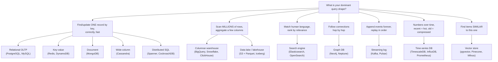
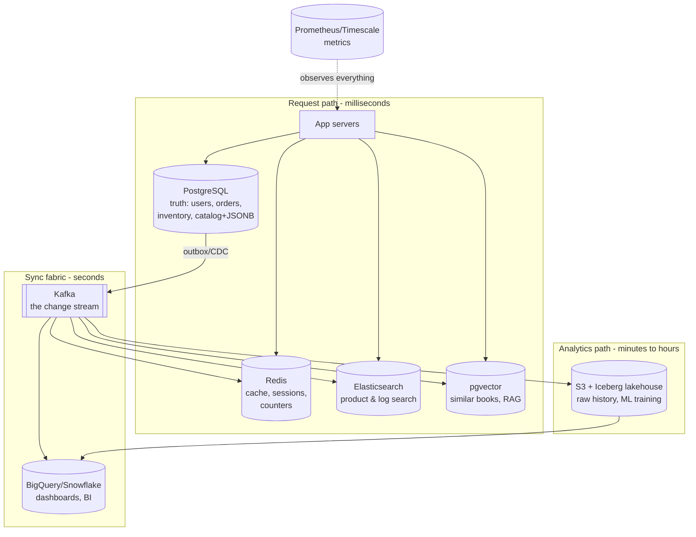
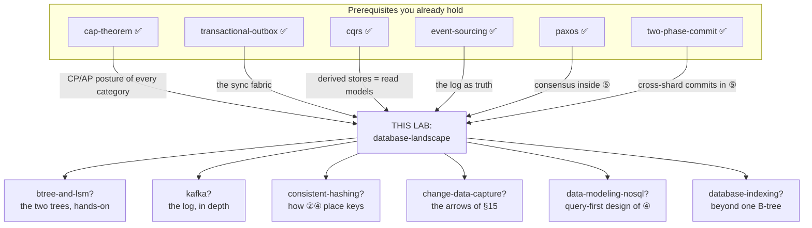

# The Database Landscape — how to choose a data store, and when to say no

> **Tell a friend:** Meera ran a bookshop with one big notebook and wrote every
> event into it in the order it happened. That worked until customers started
> asking four different kinds of question, and three of them meant reading the
> whole notebook. So she kept four books instead of one, each arranged the way
> one question wanted. Every database on earth is one of Meera's books: it
> arranges bytes so its favourite question is nearly free, and quietly makes
> the other questions expensive. This lab teaches you to name the question
> first, pick the book second, and know which book must never hold the truth.

The trainer is [`visualization.html`](visualization.html): eight scenarios to
diagnose before the answer shows. Three runnable proofs live in `experiments/`.
What is in the folder, how the numbers were made, and where this lab sits among
your others are all in [section 19](#19-about-this-lab) at the end.

---

# BEGINNER MODEL

## 1. Why are there fifty kinds of database?

> **In one breath:** The cloud console offers you a bewildering menu, and the
> pick you make is the hardest thing in the whole system to undo. The menu is
> not fifty random products. It is about a dozen ideas, and each one exists for
> a reason you can learn in an afternoon.

Open any cloud console and read the storage menu. Relational. Key-value.
Document. Wide-column. Graph. Time-series. Search. Warehouse. Lake. Streaming.
Vector. Eleven words, and each one hides several products.

Teams routinely pick wrong. That would be forgivable if it were cheap. It is
not, and the reason is specific.

**A database choice is the hardest decision in a system to reverse.** Code can
be refactored in an afternoon. Migrating a terabyte of live data between stores
with different data models is a multi-month project with downtime risk. So a
team that picks a store because it is trendy, or because it is the one they
already know, ends up in one of two places. They fight their database every
day. Or they rebuild on a new one under pressure.

Now the good news. The menu is not fifty unrelated things. It is **about a
dozen categories**, and each category exists for one clear reason. By the end
of this document you will look at a workload and name the category it wants.
Just as importantly, you will name the categories that would quietly ruin you.

We get there through one shop and one company. Meera runs the shop. Chaptr is
what the shop became when it went online, and Priya, Dev, Asha, Omar and Ben
are the people who keep it alive. Arjun is the customer they keep arguing
about. Everything in this lab happens to those seven.

## 2. What breaks in Meera's one big notebook?

> **In one breath:** Meera writes everything into one book, in date order. Four
> different questions arrive. Three of them force her to read the whole book,
> because the book is arranged for the fourth.

Meera runs a corner bookshop and keeps **one big ledger book**. Every event
goes in it, one line after another. Sold two novels to Arjun. Received a box
from the distributor. Priya asked for "that blue book about trains". Noted that
Arjun likes mysteries.

One notebook. Perfectly fine. Then the shop grows, and four different
*questions* start hitting the same notebook.

The first is her accountant's. *"How much money did we make in March?"* Meera
flips through **every page**, picking out just the amounts, adding as she goes.
One question, an hour of flipping.

The second is a customer at the counter. *"Do we have 'The Blue Train' in
stock?"* Now she flips **backwards**, looking for the last time that title was
bought or sold. Another whole flip-through.

The third is Priya's. *"Which books mention trains?"* The ledger is ordered by
**date**, not by topic. There is no way to answer it without reading everything
she has ever written.

The fourth is about Arjun. *"He liked these mysteries — what should I
recommend?"* Meera would have to trace from Arjun, to the books he bought, to
*other customers* who bought those books, to what *they* bought. Hopping like
that through a date-ordered notebook is torture.

Notice what is actually happening here. The notebook is not "too small". It is
**shaped wrong for three of the four questions**. Each question wants the
information physically arranged a different way.

> **🔮 Predict:** Meera buys a second, much bigger notebook and hires an
> assistant to help her flip. Which of the four questions gets better?
> <details><summary>Reveal</summary>
> Only the second one, and only a little, because two people can flip in
> parallel. If you guessed "all of them, twice as fast", you are thinking about
> *how much* work there is. The problem is *what shape* the work is. Question 1
> still reads every page to find the amounts. Question 3 still has no path from
> a word to a book. Question 4 still has no thread from a person to a person.
> More notebook does not create an arrangement that was never there.
> </details>

Here is what each question actually wants on the page:

| Meera's question | What it wants the paper to look like |
|---|---|
| How much did we make in March? | just the amounts, all together |
| Is 'The Blue Train' in stock? | one row per title, kept current |
| Which books mention trains? | a word-to-books index, like the back of a textbook |
| What should Arjun read next? | threads connecting people to books to people |

Real shopkeepers solved this centuries ago. They keep **several books**. A
daily ledger, append-only, which is the truth. A stock register, one line per
title, updated in place. A subject index card box. And a "regulars" notebook
with each customer's tastes.

Same information. Arranged four ways, because it is *asked* four ways.

Hold on to that sentence. It is the entire topic.

Here is how far this lab goes, and what you can do after each layer:

| Layer | Sections | After it you can… |
|---|---|---|
| **Beginner** | 1–9 | say why several categories of database have to exist |
| **Intermediate** | 10 | name every category, its physical trick, and when to walk away |
| **Engineering** | 11–14 | reason about the failures and guarantees, and run the proofs |
| **Production** | 15 | read a real company's data architecture box by box |

Zero database internals are assumed. You only need to have written an app that
reads and writes data somewhere.

## 3. Why is "one database, just make it bigger" the right first move?

> **In one breath:** Meera's shop went online as Chaptr, and everything went
> into one relational database. That was not a mistake. It is the correct
> opening move, and it survives longer than most people expect.

Back to software. Meera's shop became **Chaptr**, an online bookstore, and
Priya and Dev built it. Like almost every sensible startup, they put everything
in one relational database: PostgreSQL. Users, books, orders, page views,
search, everything. Tables, foreign keys, transactions.

To be clear, and this matters more than anything else in the section: **this is
the right starting move**, not a mistake. One store. One backup. One thing to
learn. Transactions keep money-related data correct for free.

Chaptr grows. Things get slow. Priya reaches for the plan every team tries
first, in this order:

- Slow query? **Add an index.**
- Still slow? **Buy a bigger server.**
- Still slow? **Add read replicas**, which are copies of the database that
  serve reads.

This works for a surprisingly long time. Years, sometimes. A single well-tuned
PostgreSQL box comfortably handles tens of thousands of queries per second.
Most apps never outgrow it, which is why "just use Postgres" is genuinely good
default advice rather than laziness.

But Chaptr keeps growing. And growth does not send *more of the same* queries.
It sends **new shapes of query**.

## 4. How does one database die four different ways?

> **In one breath:** Chaptr's single database had four bad years in one year.
> Each incident is one of Meera's four questions arriving in software. No
> bigger server fixes any of them, because the problem is the arrangement of
> the data and not the amount of hardware under it.

Four incidents, four people, one diagnosis. Watch which of Meera's questions
each one is.

**Incident 1 — the dashboard that ate the database.** This is Meera's question
1, the totals. Asha runs finance, and she wants a dashboard: revenue per day,
per category, per region, over two years. That query touches 40 million order
rows. PostgreSQL stores data **row by row**, so each order's id, user, book,
price, address and timestamp sit together on disk. To sum just the `price`
column, the database must read *entire rows*. It drags the addresses and
timestamps through memory only to throw them away. Asha's dashboard takes 4
minutes, and while it runs, checkout queries queue behind it. Analytics is
literally slowing down shopping. An index does not help. An index finds *few*
rows fast; this query wants *all* rows.

**Incident 2 — search that is not search.** This is question 3, the topics.
Omar owns the search box. Users type "blue train mystery" into it, and the
first implementation is `WHERE title LIKE '%blue%train%'`. That has two
problems, and only one of them is speed. It scans every row, because a `LIKE`
pattern with a leading `%` cannot use a normal index. And it is *wrong*. It
will not find "The Blue Locomotive". It will not rank the best match first. It
will not tolerate the typo "mistery". Relational databases match values. Users
want **relevance over language**. Different job entirely.

**Incident 3 — the counter that melted.** This one is a new shape, tiny hot
writes, and it is Dev's. He ships "👀 231 people viewed this book today". Every
page view is now an UPDATE to a counter row. Popular books take hundreds of
updates a second, all fighting to lock the *same row*, each waiting for the
previous transaction to finish. The database is doing everything correctly. It
is applying full transactional ceremony to a number nobody needs to be exact.
That is correctness Chaptr does not need, at a price it cannot pay.

**Incident 4 — the recommendation query from hell.** Question 4, the threads,
and it is about Arjun. "Readers who bought this also bought…" is, in SQL, a
join from orders to orders to orders. Three hops means joining the
40-million-row orders table to itself three times. Each hop multiplies the
work. Priya measures six-second response times. The data is a **web of
connections**, and tables answer web-shaped questions by rebuilding the web
from scratch on every single query.

Read the four incidents side by side. The last column is the one that matters:

| Incident | Whose | Meera's question | Why the row layout loses |
|---|---|---|---|
| 1. Dashboard | Asha | totals | reads whole rows to sum one column |
| 2. Search box | Omar | topics | no path from a word to the books holding it |
| 3. View counter | Dev | a new one, hot writes | full transaction ceremony on one contended row |
| 4. Recommendations | Priya, about Arjun | threads | rebuilds the web of links on every query |

One diagnosis covers all four: **the query shapes changed, and the storage
layout did not.** PostgreSQL was never wrong. It is *shaped* for question 2,
which is find or update one order by id, and it still does that beautifully. It
was handed questions 1, 3 and 4.

> **🔮 Predict:** the team's first instinct is "PostgreSQL can't handle our
> scale — let's migrate everything to something webscale." Is Chaptr's problem
> *scale*?
> <details><summary>Reveal</summary>
> No — and this misdiagnosis is the most expensive mistake in the field. The
> order workload, which has question 2's shape, is fine; Postgres handles it
> easily. The problem is that *other-shaped* workloads landed on a store shaped
> for question 2's find-one-record-fast shape. Migrating
> *everything* to, say, Cassandra would fix incident 3, leave 1 and 4 broken,
> and *break checkout*, which needs transactions Cassandra doesn't offer.
> The fix is not one better database. It is one database *per dominant query shape*.
> </details>

## 5. What does Chaptr actually need?

> **In one breath:** Two promises. Arrange the data the way each question asks
> for it, and still keep exactly one copy that is definitely true.

Say it in plain words first, then read it twice:

> **For each workload, data must be physically arranged the way that workload
> asks for it** — while keeping exactly **one** authoritative copy of the
> truth, so the many arrangements can disagree only briefly and can always be
> rebuilt.

Both halves are load-bearing, and they pull in opposite directions.

The first half says *you will run more than one kind of store*. Meera's four
books, in software.

The second half says *they cannot all be equally trusted*. One of them owns the
truth. The rest are copies, arranged for speed, and a copy that disagrees with
the truth is simply wrong.

The whole discipline of choosing databases is the pursuit of those two
guarantees at once.

## 6. What is the one idea underneath all of it?

> **In one breath:** A database is not a general tool. It is a bet on one
> question, paid for by making the other questions cost more.

Here it is, and everything after this section is a footnote to it:

> **Every database is an opinionated bet on one access pattern.** It arranges
> bytes on disk so that *its* favorite question is nearly free — and pays for
> that by making other questions expensive. Choosing a database is therefore
> not "which is best?" but **"whose bet matches the question I ask most?"**

There is a corollary, and it comes straight from the second half of section 5.
Use several stores. Appoint exactly one of them the source of truth. Treat all
the rest as disposable copies you could delete and rebuild tonight.

The industry name for running several stores this way is **polyglot
persistence**, and the next section defines it properly.

## 7. What do professionals call what you just watched?

> **In one breath:** You have now felt every problem these words name. Here are
> the words, each one attached to the moment in Chaptr's year where you met it.

Asha's dashboard and Priya's checkout are the two poles of this whole subject,
and the trade has a name for each.

The checkout is **OLTP**, online transaction processing. In plain terms it is
the shop-counter workload: many small, fast reads and writes of individual
records, right now, correctly. Precisely, it is a high volume of short
transactions, each touching few rows, needing low latency and strong
correctness. Chaptr's checkout is the example. Read one cart, insert one order,
decrement one stock count, 30 ms, and it must never double-charge. The term
exists to separate this workload from analytics, because the two want opposite
storage layouts. The transactions and locking you watched melt down in incident
3 are OLTP machinery, working exactly as designed.

Asha's dashboard is **OLAP**, online analytical processing. Plainly, it is the
back-office workload: big questions over history. Precisely, it is a low volume
of long queries, scanning millions of rows, aggregating a few columns, with
latency in seconds and slightly stale data being fine. Revenue per category per
month over two years is the example. Incident 1 *is* the OLTP and OLAP
collision, because one store cannot be laid out for both. Section 10 shows you
the row-versus-column layouts that make it physical.

The word for what distinguishes them is **access pattern**, also called query
shape. Plainly, it is the *kind* of question you ask, and how often. Precisely,
it is the distribution of operations across point lookup, range scan, full
scan, traversal and aggregation, plus the read/write ratio, the latency budget
and the consistency need. Meera's four questions are four access patterns. The
term matters because it is the input to every database decision you will ever
make. Compare "get order by id, 5000×/sec, under 10 ms, must be current" with
"sum revenue, 10×/day, under 30 s, yesterday's data fine". Those two sentences
choose two different products.

An **index** is the card box at the back of the textbook: a shortcut from a
value to where it lives. Precisely, it is an auxiliary structure, usually a
B-tree, mapping a key to a row location, making point lookups cost O(log n)
instead of a full scan. Every index also slows writes slightly, because each
write must update it too. It is the first tool everyone reaches for. Incidents
1 and 2 showed you its limits: indexes accelerate *selective* lookups, not
scan-everything queries and not match-the-language queries.

Now the distinction the whole architecture hangs on. A **source of truth** is
the master ledger. **Derived data** is every copy made from it. Precisely, the
source of truth is the one store whose loss is unrecoverable and whose value is
definitionally correct; every other store holds transformations of it that may
lag and can be rebuilt from it. Chaptr's Postgres orders table is truth. The
search index Omar builds and the analytics warehouse Asha queries are derived.
The distinction exists because the moment you run two stores they *will*
disagree, and this rule decides who wins. Your CQRS lab already taught you the
same shape: read models are exactly derived data, and its "consistency window"
is the lag between truth and its copies.

**Denormalization** is writing the same fact in several places so each reader
finds it already arranged for them. Precisely, it is deliberately duplicating
data to eliminate query-time joins and aggregation, trading write complexity
and storage for read speed. Storing the author's *name*, not just the id,
inside every order record is the small version. NoSQL stores do not do joins,
so denormalization is how they answer join-shaped questions at all.

And **polyglot persistence** is the name of the destination this document walks
toward: several kinds of store in one system, each doing what it is shaped for.
Precisely, it is an architecture with one source-of-truth store per data
domain, plus derived stores per access pattern, connected by a synchronization
mechanism that section 15 builds.

Five smaller words appear from here on, so meet them now:

| Word | What it means | Where you met it |
|---|---|---|
| schema-on-write | the store enforces structure when data goes *in* | Postgres, section 3 |
| schema-on-read | structure is applied when data comes *out* | documents and lakes, section 10 |
| throughput | operations per second | Dev's counter, incident 3 |
| latency | time for one operation | Asha's 4-minute dashboard, incident 1 |
| hot key / hot partition | one item taking a wildly outsized share of traffic | incident 3's counter row |

> **🔮 Predict:** Asha asks for her dashboard to be "real-time, like checkout".
> Which of the two words above is she actually asking Priya to break?
> <details><summary>Reveal</summary>
> Latency, on a workload built for throughput. If you guessed "throughput", you
> have them the right way round but the wrong way up: a warehouse already moves
> enormous volume per second; what it does not do is answer one question in ten
> milliseconds. OLAP buys scan speed by giving up freshness and point-read
> latency. Asking for both, in one store, is asking one layout to be two
> layouts. Section 11's failure F6 is a team that tried it.
> </details>

> **Checkpoint — BEGINNER to INTERMEDIATE.** You can now explain *why* multiple
> database categories exist, because query shapes differ and layout must match
> the shape, and you can use the vocabulary of the trade. Next come the actual
> physical tricks: the handful of data arrangements every database on earth is
> built from.

> **Say it back.** Without using the words *OLTP*, *OLAP* or *access pattern*,
> explain to a friend why Asha's dashboard made Arjun's checkout slow.
> <details><summary>A good answer sounds like</summary>
> "The shop keeps one book, written in the order things happened. Asha's
> question needs every page read from the start, and while someone is reading
> every page, nobody else can get to the counter. It isn't that the book is
> full. It's that her question and his question want the paper laid out two
> different ways, and there's only one book."
> </details>

## 8. Which two pictures should you carry?

> **In one breath:** Keep a simple picture and a precise one. The simple one is
> Meera's shelf of books. The precise one is that every database is four
> choices, and a category is just a bundle of those four that keeps recurring.

**The simple picture: Meera's shelf.** One shop, several specialized books. The
*daily ledger* is append-only and holds the truth. The *stock register* has one
row per item and is updated in place. The *subject index cards* map a word to
books. The *regulars notebook* holds webs of taste. The *monthly totals sheet*
is just numbers, pre-added. A new question shape means a new book. Every
evening, Meera copies from the ledger into the other books.

**The precise picture: four choices.** Every store you will ever meet is a
bundle of four decisions. The names in the middle column, B-tree and LSM and
inverted index and their friends, are section 10's subject. You only need the
*shape* of this table for now. Each name is taught properly before it is used
for anything.

| Choice | The options | Decides |
|---|---|---|
| **Storage layout** | rows together / columns together / append-only log / key→value slots | which query shape is nearly free |
| **Index structure** | B-tree / LSM-tree / hash / inverted index / graph adjacency / vector index | how lookups and writes cost |
| **Distribution model** | single node / replicas / partitioned (sharded) across nodes | scale ceiling and failure behavior |
| **Consistency contract** | ACID transactions ↔ eventual consistency (your CAP lab: CP ↔ AP) | what the app may assume |

Categories are just recurring bundles of those four. "Relational OLTP" is rows
plus B-tree plus usually a single writer plus ACID. "Wide-column" is
rows-by-partition plus LSM plus heavy partitioning plus eventual or tunable
consistency. Learn the four axes and no product page will confuse you again.

Now hold the two pictures against each other. Meera's books first:

| Meera's shop | Engineering |
|---|---|
| The daily ledger | source of truth (append-only log / OLTP store) |
| Stock register | OLTP table, updated in place |
| Subject index cards | search engine's inverted index |
| Regulars notebook | graph database |
| Monthly totals sheet | OLAP warehouse / materialized aggregate |

And then Meera's habits, which map onto the parts engineers find hardest:

| What Meera does | Engineering |
|---|---|
| Meera's evening copying | CDC / outbox relay / ETL pipeline (§15) |
| "Which book do I trust if they disagree?" — the ledger | derived stores rebuilt from truth |

**Where the story lies to you.** Every analogy in this workspace ends this way,
because an analogy you cannot see through starts making decisions for you. Four
lies, and the engineering truth that replaces each:

| The lie | The truth | Where it bites |
|---|---|---|
| Meera copies once a day and nobody minds | derived stores lag by *seconds*, and users do mind | read-your-own-writes, failure F3 |
| Meera never crashes mid-copy | systems crash between two writes, every day | the dual-write trap, failure F2 |
| Meera's books can't disagree with themselves | one partitioned store can show two values for one key | your CAP lab, category ④ |
| One person owns all the books | different teams own different stores | the truth contract is organizational too |

Read the first row twice. Read-your-own-writes problems, which your CQRS lab
already made you feel, are real engineering rather than bookkeeping. The second
row is why the sync mechanism needs the outbox and CDC machinery you learned,
instead of a nightly cron and hope. The fourth row is the one nobody puts on
the architecture diagram, and it is the one that decides whether the diagram
survives contact with the org chart.

## 9. What does the whole landscape look like on one page?

> **In one breath:** One question at the top, a dozen answers underneath. This
> is the territory the rest of the document walks through, organized by the
> question each category answers best.

Do not memorize the map below. By the end of section 10 you will be able to
redraw it from scratch, because you will know *why* each branch exists. Meera's
four questions are in there, and so is each of Chaptr's four incidents.



The second thing to look at is the interactive explorer,
[`visualization.html`](visualization.html) in this lab folder. It gives Priya
eight real-world scenarios to diagnose *before* seeing the answer. It also has
a workload questionnaire that walks this same decision tree visibly. And it has
two animations of the physical layouts you are about to meet: a
row-versus-column scan, and a B-tree-versus-LSM write path. It is best used
**after** reading section 10, as practice rather than as instruction.

---

# INTERMEDIATE MODEL

## 10. What are the seven tricks, and who bets on which?

> **In one breath:** Databases look like fifty products. Under the floorboards
> there are about seven ways to arrange bytes so that one kind of question
> becomes cheap. Learn the seven, and every product is just "which tricks,
> bundled how".

Priya's mistake, before this section, was shopping by product name. After it
she shops by trick. Learn the tricks first; the catalogue that follows is then
almost boring, which is the point.

### 10.1 What are the seven physical tricks?

**Trick 1, the hash table.** Take the key, scramble it into a number, and jump
straight to that slot. In code that is `hash("user:42") % number_of_slots`. No
walking, no comparing, no ordering. One jump to read, one jump to write, and
engineers write that cost as O(1), meaning it does not grow as the data grows.

The price of trick 1 is that there **is** no ordering. Ask for "all users
between 40 and 50", or for "all keys starting with `user:`", and the store has
nothing better than checking everything. Redis, Memcached, and DynamoDB's
partition routing all run on this trick.

**Trick 2, the B-tree.** Keep the rows **sorted by key**, in fixed-size pages
of typically 8 KB. Arrange those pages as a tree so wide and so shallow that a
billion rows sit three or four levels deep. A point lookup walks three or four pages
and stops. A range scan, such as "orders from March", finds the start and then
reads *neighbours in order*, which the hash table simply could not do. Writes
update pages **in place**.

The price of trick 2 shows up under write pressure. A write to a random key
touches a random page. At high write rates that becomes scattered disk I/O, and
page locks start contending, which is exactly what melted Dev's counter in
incident 3. PostgreSQL, MySQL, SQL Server and Oracle are B-tree stores, and so
is almost every secondary index anywhere.

**Trick 3, the LSM-tree**, short for Log-Structured Merge tree. Never update in
place. Always append. A write lands in an in-memory sorted buffer. When that
buffer fills, it is flushed to disk as one immutable sorted file. A background
process called *compaction* then merges those files, discarding values that
were overwritten. Every byte written to disk is written **sequentially**,
which is the fastest thing storage hardware does, so write throughput is
enormous.

The price of trick 3 lands on reads. One read may have to consult the memory
buffer plus several files on disk, so reads are slower and much less
predictable than a B-tree's. Compaction also burns background I/O forever.
**The B-tree and LSM fork is the single most important internals fact in this
document:** B-tree is read-optimized, LSM is write-optimized. Cassandra, HBase,
RocksDB, LevelDB and ScyllaDB run on it, as do the storage engines inside many
newer systems.

**Trick 4, the columnar layout.** A row store keeps
`[order1: id,user,price,date][order2: id,user,price,date]…` on disk. A column
store keeps `[all ids][all users][all prices][all dates]` instead. Now
`SUM(price)` reads *only the price bytes*. On a 40-column table that is roughly
one fortieth of the data, and it is the direct cure for Asha's incident 1.
There is a bonus. A column holds similar values, so it compresses brutally
well. A million dates from the same year, run-length-encoded, almost vanish.
Compression of 10–20× is ordinary, and it shrinks the scan again.

The price of trick 4 is the exact opposite bet from a B-tree. Fetching or
updating **one whole row** now touches every column file. Columnar stores are
therefore batch-loaded rather than transactionally updated. BigQuery,
Snowflake, Redshift, ClickHouse, DuckDB and the Parquet file format all take
this bet.

**Trick 5, the inverted index.** This is the index at the back of a textbook.
Split every document into terms, so "The Blue Train" becomes `blue` and
`train`, and for each term keep the list of documents containing it. The query
"blue train" is then an intersection of two lists, which takes milliseconds
over millions of documents. Then each hit is *scored* for relevance: rarer
words weigh more, and how often a term appears matters. Analyzers add stemming,
turning `running` into `run`, and fuzzy matching, turning "mistery" into
"mystery". This is the cure for Omar's incident 2.

The price of trick 5 is freshness. The index is expensive to update in place,
so search engines rebuild index segments in the background. Documents become
searchable *seconds* after being written rather than instantly, which the trade
calls near-real-time rather than real-time. It is also why search engines make
poor primary stores, a point section 11 turns into a war story. Elasticsearch,
OpenSearch, Solr and Lucene, the library inside all three, are the names here.

**Trick 6, adjacency.** Store each record with **direct references** to its
neighbours, a layout the trade calls *index-free adjacency*. Now "friends of
friends of Arjun" is pointer-following, and the cost is proportional to the
*neighbourhood you touch* rather than to the size of the table. In SQL every
hop is a join that searches an index over ALL edges. In a graph store, hop
three costs the same as hop one. This is the cure for Priya's incident 4.

The price of trick 6 is distribution. A pointer-chasing layout partitions
poorly across machines, because a graph has no clean lines to cut along, so
graph stores scale awkwardly. Queries that are not traversals, such as "all
users named Priya", still need ordinary indexes. Neo4j, Amazon Neptune and
Memgraph are the products.

**Trick 7, the append-only log.** Records are only ever **appended**. Each
reader keeps its own position, called an offset, and replays forward at its own
pace. Writes and reads are sequential, which is maximal disk throughput. Many
independent readers do not disturb the writer or each other. The past is never
destroyed, so any reader can start from zero and rebuild. You already know this
trick: it is your event-sourcing lab's event store, industrialized.

The price of trick 7 is that a log answers "what happened, in order" and
nothing else. There are no lookups and no queries. You *derive* queryable
stores from it. Kafka, Pulsar and Kinesis are the products, and the write-ahead
log hiding inside every database above is the same idea.

**Half-trick 8, the vector index.** An embedding is an array of floats that
represents meaning, and similar meanings land near each other in that space. A
vector index, chiefly HNSW, is a navigable graph of neighbours that finds
approximate nearest neighbours without comparing against every vector. It
trades exactness for speed: results are about 99% right, deliberately.
pgvector, Pinecone, Milvus and Weaviate run on it, and it gets a proper entry
in the catalogue below.

Now read all eight together. The two middle columns are the whole subject:

| Trick | How it arranges bytes | Nearly free | Expensive | Powers |
|---|---|---|---|---|
| 1. Hash table | key scrambled to a slot | one-key get and set | ranges, prefixes, ordering | Redis, Memcached, DynamoDB routing |
| 2. B-tree | sorted 8 KB pages, wide and shallow | point lookup, range scan | random-key write storms, row locks | PostgreSQL, MySQL, SQL Server, Oracle |
| 3. LSM-tree | append, flush, compact in background | huge sequential write rates | reads across many files, compaction I/O | Cassandra, HBase, RocksDB, LevelDB, ScyllaDB |
| 4. Columnar | each column stored contiguously | scans and aggregates over few columns | fetching or updating one whole row | BigQuery, Snowflake, Redshift, ClickHouse, DuckDB |
| 5. Inverted index | term → list of documents | word match, ranking, typo tolerance | in-place updates; instant visibility | Elasticsearch, OpenSearch, Solr, Lucene |
| 6. Adjacency | node → its edges, as pointers | multi-hop traversal | spreading the graph over machines | Neo4j, Neptune, Memgraph |
| 7. Append-only log | ordered immutable history | append, replay, many readers | any query that is not "read forward" | Kafka, Pulsar, Kinesis, every WAL |
| 8. Vector index | neighbourhood graph over embeddings | "most similar to this" | exactness, and any keyword match | pgvector, Pinecone, Milvus, Weaviate |

> **🔮 Predict:** Cassandra (LSM, trick 3) advertises stunning write throughput.
> A teammate proposes it for Chaptr's *order* system "because writes matter most
> when checkout traffic spikes". What did they miss?
> <details><summary>Reveal</summary>
> Two things. First, checkout isn't write-heavy in the relevant sense — thousands of
> writes/sec is nothing; Postgres does that easily. LSM's advantage matters at
> *hundreds of thousands* of writes/sec. Second, checkout's actual hard requirement
> is the one Cassandra sacrificed: multi-row ACID transactions (decrement stock +
> insert order + record payment, atomically). They'd trade a guarantee they need
> for throughput they don't. The lesson generalizes: **pick by the requirement that
> is hardest, not the benchmark that is flashiest.**
> </details>

### 10.2 Which store makes which bet?

Thirteen store families follow, in eight clusters. Each cluster opens with the
question its members are shaped to answer, because that is how you will
actually choose. Every family carries a circled number, ① through ⑭, which the
rest of the document uses as shorthand. Two comparison tables at the end of the
section put all thirteen side by side.

#### Who answers "find or change one record, right now, correctly"?

This is Meera's question 2, and it is the largest cluster because it is the
most common question in software. Five families answer it, and they differ in
what they are willing to give up.

**① Relational OLTP — PostgreSQL, MySQL, SQL Server, Oracle.** No incident
forced this one. It is the store Chaptr *rightly started with*, and it keeps
the checkout, orders and users workload forever. The bet is rows together on
disk, so fetching one order gets the whole order, plus B-trees for keys and
indexes, plus **ACID transactions** across many rows and tables, plus
schema-on-write, plus joins. Joins mean data lives in one place, which the
trade calls normalized, and still answers combined questions. The usual
deployment is one writer node with read replicas.

Priya reaches for ① when entities relate to each other and correctness matters:
orders, payments, inventory, bookings, and anything where "read two things,
decide, write two things" must be atomic. There is a second and less obvious
reason. Reach for it **when you don't know your query patterns yet**. SQL's
flexibility, any WHERE and any join and ad-hoc questions, is the best hedge
against an unknown future. That is why "default to Postgres until a specific
incident forces otherwise" is professional advice rather than laziness. Real
users: basically every company on earth for the transactional core, with Stripe
on MySQL, and Instagram and Robinhood on Postgres.

Priya walks away from ① in three situations. First, when a single machine's
write capacity is genuinely exceeded, at roughly tens of thousands of sustained
writes per second. Replicas scale *reads* only, and sharding relational data
yourself is a famous tar pit, so that pushes her to ⑤ or ⑨. Second, when the
workload is analytical scans, which is ⑥. Third, when the data is genuinely
schema-free or the access is pure key to blob, which is ② or ③. Its consistency
posture is CP-leaning single-writer ACID, and its replicas introduce the one
eventual-consistency leak most teams meet first, replica lag.

**② Key-value stores and caches — Redis, Memcached, DynamoDB.** Dev's melted
counter is the loud story here. There is a quieter one alongside it: every page
load hits the database for the same book details, thousands of times a minute.
The bet is trick 1, the hash table. The store knows *nothing* about your value,
which is an opaque blob behind a key. In exchange you get sub-millisecond get
and set, and, because keys hash independently, near-perfect horizontal scaling.
Two families share that one bet. In-memory caches such as Redis and Memcached
give microsecond reads, and data may be evicted or lost. Durable key-value
stores such as DynamoDB and Riak are disk-backed and replicated, and still
key-only.

Dev reaches for ② when access is *by exact key, at high volume*. Sessions, so
`session:abc123` maps to who is logged in. Caching query results in front of
store ①, in the read-through shape: check the cache, and on a miss read the
database and fill the cache. Counters and rate limiters, where Redis `INCR` is
atomic and lock-free and is incident 3's actual cure. Leaderboards, on Redis
sorted sets. Feature flags. DynamoDB specifically earns its place when you need
key-value at *any* scale with SLAs and zero operations work, which is why
Amazon's own cart runs on it.

Dev walks away from ② the moment a query wants anything other than the key.
"All sessions for user 42" is unanswerable, because the store cannot see inside
values. Multi-key transactions are another exit. And the third exit is the
dangerous one: **when you are tempted to make a cache the only copy of data you
cannot lose.** A restarted Redis is empty, and section 11 opens with that war
story. DynamoDB has its own corollary: you must know your access patterns *up
front*, because changing them later means re-modeling the table, which is
precisely why "unknown future queries" was a reason to *stay* relational. On
posture, a single-node Redis is trivially consistent, but only because it is
one machine; DynamoDB is AP by default with eventually-consistent reads, and
offers opt-in strongly-consistent reads at double cost.

**③ Document stores — MongoDB, Couchbase, Firestore.** Chaptr's product
catalogue is the story. Books, e-books, audiobooks and box sets each have
different fields. Does this one have a narrator? A file size? A number of
volumes? In Postgres that becomes 60 nullable columns, or a dozen sparse
side-tables, and every product page load joins six tables to assemble one
product. The bet is to store each record as a **self-contained JSON document**,
the whole product, nested, retrieved by key in one read, with no joins to
reassemble it. This is denormalization institutionalized. Unlike ②, the store
*can* see inside, so you may index and query any field. It is schema-on-read:
two documents in one collection may differ in shape, and the writer decides,
per document.

Omar reaches for ③ when records are naturally self-contained things that are
read whole. Product catalogues are the canonical use, because each seller's
item has different attributes. User profiles, CMS content, and IoT payloads
that vary by device are the others. The trigger is that each record's shape
varies enough that a fixed schema fights you. Real users: eBay's catalogue and
Forbes' CMS, both on MongoDB.

Omar walks away from ③ in three cases. First, when the entities are
*many-to-many relational*, such as orders referencing users referencing
addresses. Documents then force him into one of two bad choices. Either he
embeds copies, which must be updated everywhere, so "user changed address" now
touches every order document. Or he simulates joins in application code, badly.
Second, when cross-document ACID becomes routine. MongoDB does have
multi-document transactions now, but if you use them constantly, your data is
telling you it is relational. Third, when documents grow without bound. An
`orders: [...]` array inside the user document eventually hits the 16 MB
document cap, and it rewrites the whole document on every append. That is
failure F5 in section 11. One honesty note belongs here: Postgres's JSONB gives you
indexed documents inside a relational store, and for mixed workloads one store
① with JSONB columns often beats running ① and ③ together. Posture:
single-document atomicity always, primary-replica with eventual reads if you
read from secondaries, tunable per query.

**④ Wide-column stores — Cassandra, ScyllaDB, HBase, Bigtable.** Chaptr
launches a reading app that reports each reader's page position every 10
seconds. A million readers means about 100 000 writes per second, forever,
spread worldwide, and the *only* query is "positions for reader X, most recent
first". Postgres's B-trees choke on that random-write firehose. The bet is
trick 3, the LSM tree, for the firehose, plus aggressive partitioning. Rows are
grouped by a **partition key**, so reader X's data lives together on one set of
nodes, sorted by a clustering key such as timestamp. Partitions are spread
across dozens of nodes in a hash ring, and every node accepts writes, so there
is no single writer to bottleneck. Replication is masterless: writes go to N
replicas, with read and write quorum knobs per query.

There is a catch that shocks relational people. **You design tables from your
queries, not your entities.** One query shape per table, with data duplicated
across tables at write time. There is no join and no ad-hoc query. The schema
*is* the query plan.

Ben reaches for ④ when the workload is write-heavy, key-partitioned, with
queries known in advance, at serious scale, with multi-datacenter and
no-single-point-of-failure requirements. Messaging history is the flagship
case, and Discord stores trillions of messages on ScyllaDB. Activity feeds and
device telemetry follow. Netflix's viewing history runs on Cassandra, and Apple
runs hundreds of thousands of Cassandra nodes.

Ben walks away from ④ when queries are ad-hoc or still evolving, because every
new question means a new table and a backfill. He walks away when data volume
is under a few terabytes, or writes are under about 10 000 per second. Postgres
does that without the operational bill. Cassandra clusters need real care:
compaction tuning, repair schedules, the lot. He walks away when
transactions or strong consistency are the default requirement. And he walks
away when the partition key would produce hot or unbounded partitions, which is
section 11's celebrity problem. Posture: ④ is the textbook AP system straight
from your CAP lab, available under partition, with tunable quorums where R plus
W greater than N buys per-query strong reads, and last-write-wins conflict
resolution by default.

**⑤ Distributed SQL, also called NewSQL — Spanner, CockroachDB, YugabyteDB,
TiDB, Vitess.** Chaptr goes global. Orders must survive a *region* failure, and
write volume finally, genuinely exceeds one Postgres box. But checkout still
needs real transactions. Category ① cannot scale writes. Category ④ will not do
transactions. For decades the answer was "pick your poison".

The bet is to keep SQL, schema and ACID, and to shard data automatically across
nodes while running **consensus per shard**. That consensus is Raft or Paxos:
your paxos lab, productized, where every write is a quorum decision, so any
node can fail and the shard keeps a consistent leader. Cross-shard transactions
layer two-phase commit *on top of* per-shard consensus. Your two-phase-commit
lab's blocking problem is solved by making each participant itself a
fault-tolerant quorum, which is exactly the fix that lab hinted at. Spanner
adds globally synchronized clocks, from GPS and atomic clocks, to give
lock-free consistent reads across continents.

Meera reaches for ⑤ when she needs relational semantics at a scale or
availability level one machine cannot give. Global financial ledgers.
Multi-region inventory. Any system where "Postgres, but it survives a region
and scales writes" is the actual specification. Google's own AdWords
billing runs on Spanner, which exists because sharded MySQL had become
unbearable; DoorDash and Netflix keep metadata on CockroachDB.

Meera walks away from ⑤ when one region and one box's write volume suffice,
which is *most businesses*, because the costs are real. Every write crosses the
network for quorum, so the latency floor is milliseconds rather than
microseconds. Cross-shard joins and transactions cost more than local ones.
Operations, or bills, are heavier. This category is a destination you *earn*
through measured limits, never a starting point. Posture: CP by construction,
so under partition the minority side refuses writes, which is your CAP lab's
"the majority keeps working" made into a product.

#### Who answers "add up a column across millions of rows"?

This is Meera's question 1, Asha's dashboard, and two families answer it at two
very different price points.

**⑥ Columnar warehouses, the OLAP shelf — BigQuery, Snowflake, Redshift,
ClickHouse, DuckDB.** Incident 1 is the story: the 4-minute dashboard that
queued up checkouts. The bet is trick 4, columnar layout with compression, plus
massively parallel execution that splits a big scan across many workers, plus
one more thing the cloud generation added: **storage and compute separation**.
Data lives in object storage. Compute spins up per query. You pay per scan on
BigQuery, or per warehouse-second on Snowflake. Data is loaded in batches or
streams *from* other systems, and queried with full SQL, big and read-only.

Asha reaches for ⑥ for analytics, full stop: dashboards, BI, "revenue by
category by month over two years", machine-learning feature backfills, and
anything scanning millions or billions of rows for aggregates. The pattern is
always the same. The OLTP stores, ① through ④, hold the live truth. A pipeline,
which section 15 builds, copies changes into the warehouse. Analysts then
hammer the warehouse where they cannot hurt production. Two variants are worth
naming. ClickHouse is the pick when you need *sub-second* analytics inside a
product, which is how Cloudflare's dashboards work. DuckDB is the pick when the
data fits one machine: it is "SQLite for analytics", a library rather than a
server, and you will run it in this lab's experiments.

Asha walks away from ⑥ the moment the workload is operational: point lookups
such as "order 12345", single-row updates, or thousands of small queries per
second. Columnar layout makes each of those touch every column file. Warehouses
also often charge *per data scanned*, so an app hammering BigQuery with point
lookups is slow **and** ruinously expensive. A warehouse is never the source of
truth, and never sits behind an end-user request path, with the deliberate
ClickHouse-style exception noted above. Posture: consistency is not the
interesting axis here, because data is minutes to hours stale by design. The
honest contract is "answers about *up to* time T, fast", and consumers must
know T.

**⑪ Object storage, data lakes and lakehouses — S3, GCS or ADLS, plus Parquet,
plus Iceberg, Delta or Hudi.** Chaptr's machine-learning team wants
*everything, forever, raw*: clickstreams, images, logs, six years of order
snapshots. The warehouse ⑥ is structured and priced for curated tables, not for
petabytes of maybe-useful-someday. The bet here is three layers that took the
industry a decade to stack.

The bottom layer is **object storage**, meaning S3 or GCS: infinitely scalable
key-to-blob-file storage at around $0.02 per GB-month, with eleven nines of
durability and no compute attached. It is the cheapest durable bytes money
buys. The middle layer is the **data lake**: files in object storage in an open
columnar format, namely Parquet. Parquet is trick 4 as a *file format*, so any
engine such as Spark, Trino or DuckDB can query those files in place. But bare files
have no transactions. Two writers corrupt each other, and readers see
half-written data, which is how the industry got the phrase "the data swamp".
The top layer is the **lakehouse**, meaning Iceberg, Delta Lake or Hudi. It is
a *table format*: a metadata layer over those files that adds ACID commits,
schema evolution and time travel. It makes the lake behave like warehouse
tables while every engine keeps direct file access and storage stays at $0.02
per GB. Industry consensus is converging here, and warehouses like Snowflake
and BigQuery now read Iceberg natively.

Omar reaches for ⑪ when data is raw, varied and huge, and its future uses are
unknown. Training corpora go here. So does the cheap long-term layer beneath
the warehouse. So does sharing one copy of data across many engines instead of
keeping N copies. Also reach for plain object storage for what it plainly is:
the correct home for **files**, meaning images, PDFs and backups. Put the *URL* in your database,
never megabyte blobs in Postgres rows.

Omar walks away from ⑪ when he needs low-latency serving, because lake queries
take seconds to minutes and nothing user-facing reads a lake directly. He walks
away for small structured data that a warehouse or Postgres handles, because a
lakehouse's Spark-sized toolchain is a heavy tax. And he walks away from using
it as a system of record for *transactional* workloads. Posture: object stores
are now strongly consistent per object, which S3 has been since 2020, and table
formats add snapshot-isolation commits per table.

#### Who answers "match the words a human typed"?

This is Meera's question 3, Omar's search box, and two families split it
between matching *words* and matching *meaning*.

**⑦ Search engines — Elasticsearch, OpenSearch, Solr, Algolia, Typesense,
Meilisearch.** Incident 2 is the story: `LIKE '%blue%train%'` is not search.
The bet is trick 5, the inverted index, wrapped in a relevance-scoring pipeline
that tokenizes, normalizes, stems, scores and ranks. Add typo tolerance. Add
faceting, so the sidebar can say "Fiction (1 203) | Mystery (410)…". Add
highlighting. Add aggregations fast enough that Elasticsearch doubles as a
log-analytics engine, which is the ELK stack: logs in, Kibana dashboards out,
and likely where you have already met it.

Omar reaches for ⑦ when humans type words and expect the *best* matches ranked:
product search in the Amazon style, site search, log search that greps
terabytes in milliseconds, and autocomplete. Real users include Wikipedia, the
lineage behind GitHub code search, and Uber on Elasticsearch, with Stripe's
dashboard search in the Typesense and Algolia class.

Omar walks away from ⑦ when matching is *exact and structured*. "Orders over
₹500 this week" is SQL's job, and a search engine adds operations for nothing.
He also walks away, hard, from the temptation to treat it as a primary store.
It is the canonical **derived** store: near-real-time rather than immediate
visibility of writes, historically weak durability guarantees, and mappings
that periodically need a full reindex. One rule keeps you safe here. **You must
always be able to delete the search index and rebuild it from the source of
truth.** If you cannot, you have mis-assigned truth, and section 11 shows what
that costs. Posture: eventually consistent by design, with a refresh interval
of about 1 s, which is your CQRS lab's consistency window made into a product.

**⑫ Vector stores — pgvector, Pinecone, Milvus, Weaviate, Qdrant.** Chaptr adds
"books like this one", and semantic search, so that "cozy mystery on a train"
finds *The Blue Locomotive* even though no word matches. A model turns each
book description into an **embedding**, an array of about 1000 floats where
similar meaning lands nearby in space. The query is now "nearest neighbours of
this point", and neither B-trees nor inverted indexes nor hashes can answer it,
because exact nearest-neighbour search in 1000 dimensions means comparing
against *every* vector.

The bet is approximate nearest-neighbour indexing, chiefly HNSW, a multi-layer
"skip-list of neighbourhoods" graph. It finds about 99% of the true nearest
neighbours in milliseconds by accepting that missing about 1% is fine for
similarity, which is half-trick 8. Metadata filtering rides along, so you can
ask for "similar AND in stock".

Omar reaches for ⑫ for semantic and similarity retrieval. The flagship case is
RAG for LLM apps, where relevant documents are fetched to stuff into a prompt,
and it was 2023-25's defining workload. Recommendation retrieval, image and
audio similarity, and near-duplicate detection follow. The pragmatic guidance
mirrors ⑧'s below. **Start with pgvector**, an extension that keeps vectors next to your
relational data with joins and transactions. Move to a dedicated vector
database such as Pinecone or Milvus when vectors are your *primary* workload at
hundreds-of-millions scale. Most production RAG stacks, Notion AI among them,
started on pgvector.

Omar walks away from ⑫ for exact keyword and filter queries, where a *hybrid*
of ⑦ and ⑫ usually beats either alone, fusing BM25 keyword scores with vector
similarity. He walks away for tiny corpora under 100k vectors, where a
brute-force scan is fast, exact and index-free. And he walks away from treating
it as truth, because embeddings are *derived twice over*, from the documents
and through a particular model version, so re-embedding on a model upgrade
means a full rebuild. The delete-and-rebuild rule of ⑦ applies here doubly.
Posture: derived-store semantics, where freshness equals your re-embedding
pipeline's lag, and approximate by *contract*, making it the only category here
whose reads are deliberately not exact.

#### Who answers "follow the connections"?

**⑨ Graph databases — Neo4j, Amazon Neptune, Memgraph.** This is Meera's
question 4 and Priya's incident 4: the three-self-joins recommendation query
about Arjun. The bet is trick 6, index-free adjacency, plus a query language
shaped like the traversal itself. In Cypher, "readers who bought what Arjun
bought also bought this" is written
`(arjun)-[:BOUGHT]->(b)<-[:BOUGHT]-(other)-[:BOUGHT]->(rec)`. Compare that line
to the SQL it replaces. Hop cost is independent of dataset size.

Priya reaches for ⑨ when *the connections are the data* and the queries are
multi-hop or variable-depth. Fraud rings are the killer app: accounts sharing
devices sharing cards, which is how bank anti-fraud units work. Then
recommendations, knowledge graphs, dependency and impact analysis, network
topology, and permissions inheritance. Real users include LinkedIn's graph,
which is custom-built, NASA's lessons-learned knowledge graph on Neo4j, and
most large banks' fraud units.

Priya walks away from ⑨ when she has relationships but her queries are only
ever one or two fixed hops, because SQL joins handle that fine. "Our data has
relationships!" describes *every* dataset, so the honest test is narrower: *do
you ask variable-depth or three-plus-hop questions, often?* She walks away when
queries are aggregations over everyone, because graph databases are poor at
OLAP. And she walks away when she needs extreme write scale, because
partitioning a graph across machines is an unsolved-in-general problem, which
is ④'s bet running the other way. Posture: Neo4j is single-writer ACID, so
CP-ish with causal clusters, and graph stores generally choose consistency and
pay for it in scale-out.

#### Who answers "numbers over time"?

**⑧ Time-series databases — TimescaleDB, InfluxDB, Prometheus, QuestDB.**
Chaptr now runs 200 services, and Ben wants CPU, latency and request-rate
metrics every 15 seconds, plus "p99 latency, per service, last 30 days".
Metrics are a firehose with a peculiar shape. They are always appended and
never updated. They are always queried by time window. Recent data is hot, and
old data is only ever read as aggregates.

The bet is to exploit that shape ruthlessly. Partition by time, so dropping a
whole month means deleting one partition, instantly, instead of a million-row
DELETE. Compress brutally, using delta-of-delta encoding on timestamps because
"every 15 s" is nearly constant, and Gorilla-style float compression, together
worth 10–20×. **Downsample** old data automatically: keep raw for 7 days,
1-minute averages for 90, hourly forever. And make time-window aggregation the
fast path. Prometheus adds the *pull* model, scraping your services, and is the
de-facto standard for infrastructure metrics.

Ben reaches for ⑧ for metrics, IoT sensor data, financial ticks, and anything
whose primary key is really *(thing, timestamp)* and whose queries are windows
and rollups. TimescaleDB is the pragmatic pick when this is one workload among
many, because it is a Postgres extension, so metrics sit next to relational
data with full SQL.

Ben walks away from ⑧ when data is not time-keyed, or gets updated after the
fact, or the volume is modest. A plain Postgres table with a timestamp index
handles millions of rows fine; the specialized machinery pays off at billions.
And he never stores *business truth*, such as orders, in a store configured to
downsample and expire, because retention policies delete data *by design*.
Posture: typically single-writer or per-series-partitioned, and consistency is
rarely the pressure point here. Ingestion throughput and retention are.

#### Who answers "what happened, in order"?

**⑩ Streaming logs and message queues — Kafka, Pulsar, Kinesis, and RabbitMQ,
SQS.** By now Chaptr's one truth, Postgres, feeds *five* derived stores: search
⑦, warehouse ⑥, cache ②, metrics ⑧ and recommendations ⑨. Wiring five
point-to-point pipelines means ten integrations, each lossy in its own way. The
fix is the one your outbox lab already taught you: publish every change
**once**, to a place every consumer can read at its own pace.

The bet is trick 7, the append-only log, partitioned for scale, which is
Kafka's design. Producers append. Each consumer keeps its own offset. History
is retained for days, or forever with compaction, so a *new* consumer, such as
next year's warehouse, replays from zero and catches up. This is a **data
source**, not a database. It holds the flow of facts, and its query language is
"read forward from an offset".

One distinction here prevents endless confusion, and it is the difference
between a queue and a log. A **queue**, meaning RabbitMQ or SQS, hands each
message to *one* worker and then it is gone. It is for *jobs*: send this email,
resize this image. The message is a task to consume. A **log**, meaning Kafka,
is durable history that *many* readers replay independently. It is for *facts*:
order 123 was placed. The message is an event to remember. A job goes to a
queue. A fact carrying data between systems goes to a log. Teams using Kafka as
a mere job queue, and teams using RabbitMQ as an event backbone, both suffer.

Priya reaches for ⑩ when one truth must feed N systems, where CDC from the
primary database into Kafka, which is your outbox lab's relay industrialized,
is *the* standard pattern. Then event-driven microservices. Then stream
processing, such as fraud scoring on the purchase stream in flight with Kafka
Streams or Flink. Then buffering firehoses in front of slower stores. LinkedIn
built Kafka and runs about 7 trillion messages a day; Uber and every bank's
integration backbone followed.

Priya walks away from ⑩ when she needs to *query*. "What is the current state
of order 123?" is unanswerable by a log, which can only replay; state lives in
stores derived from it. She walks away for request-and-response RPC between two
services, because that is an API call, and putting Kafka in the middle adds
latency and an operations estate for nothing. And she walks away at tiny scale,
where two services and one database want the plain outbox pattern you already
know, with no Kafka cluster required. Posture: ordered *within a partition*,
at-least-once by default, so your outbox lab's idempotent-consumer rule applies
verbatim, with exactly-once available only inside Kafka's own transactional
boundaries.

#### Who answers "and can we do this with no server at all"?

**⑬ Embedded databases — SQLite, RocksDB, DuckDB.** This is not a Chaptr
incident but a change of *setting*. Chaptr ships a mobile app that needs a
local offline store, and its edge service needs a key-value store *inside the
process*, with no network hop. The bet is that the database is a **library in
your process** rather than a server: no network, no operations, one file or
directory of state. The same tricks, embedded. SQLite is a B-tree relational
store, so ① in a library. RocksDB is an LSM key-value store, which *is* the
storage engine under many big systems. DuckDB is columnar OLAP, so ⑥ in a
library.

Dev reaches for ⑬ for on-device storage, where SQLite is on every phone on
earth and is the most deployed database in existence. Also for local-first
apps, CLI tools and test fixtures. Also for single-user analytics on files,
where DuckDB querying Parquet on a laptop replaces a Spark cluster
embarrassingly often. And also as the storage engine inside a system you are
building yourself.

Dev walks away from ⑬ when many *processes or machines* must share mutable
state, because embedded means single-machine. SQLite specifically serializes
writers, allowing one writer at a time, which is fine for an app and fatal for
a busy web backend. He walks away when he needs managed durability or
replication, which is what servers buy you. One footnote cousin exists: "NewSQL
at the edge", where Turso and libSQL replicate SQLite, which is niche but real.
Posture: single-node ACID, and SQLite is fully ACID, trivially consistent
because there is nothing distributed to disagree.

#### What else is on the specialist shelf?

**⑭ The specialist shelf.** Five more families exist that you should recognize
without reaching for.

Ledger databases, meaning Amazon QLDB and immudb, are append-only tables with
cryptographic hash-chaining, so history is *provably* untampered. They serve
audit and compliance niches. QLDB itself is being retired, and that carries its
own lesson: niche categories carry vendor risk, and Postgres plus append-only
discipline plus hash chains often suffices.

Geospatial, meaning PostGIS, answers "points or shapes near X" using
R-tree-family spatial indexes. It is overwhelmingly used as the PostGIS
extension to Postgres, which is the "extension over new store" pattern you have
now seen three times: for time-series ⑧, for vectors ⑫, and here for geo.
Internalize that pattern. It is the single best operations-saver in this
document.

Multi-model stores, meaning ArangoDB, Cosmos DB and OrientDB, speak several
models in one product, mixing document, graph and key-value. They are tempting
on paper, because "one store for everything!" sounds like the end of this whole
problem. In practice each model is rarely best-in-class, and Cosmos DB's real
pitch is Azure-managed global distribution rather than multi-modelness.
Evaluate per workload as if each model were a separate product.

Hierarchical and mainframe stores, meaning IBM IMS, plus object databases, are
pre-relational history. IMS still clears a shocking share of card transactions.
Know they exist. The relational model largely replaced them for good reasons,
chief among them ad-hoc queries.

In-memory data grids, meaning Hazelcast and Ignite, are partitioned RAM caches
with compute attached, sitting in a niche between ② and ⑤.

Now the two comparison tables. The first is what each family buys you:

| # | Family | The bet, in one line | Reach for it when |
|---|---|---|---|
| ① | Relational OLTP | rows + B-tree + ACID + joins | entities relate and correctness matters; queries still unknown |
| ② | Key-value / cache | trick 1: opaque blob behind a key | access by exact key at high volume |
| ③ | Document | one self-contained JSON record, read whole | records are bounded things whose shape varies |
| ④ | Wide-column | trick 3 + partition key + masterless writes | write firehose, known queries, multi-datacenter |
| ⑤ | Distributed SQL | SQL and ACID, sharded, consensus per shard | relational semantics past one box or one region |
| ⑥ | Columnar warehouse | trick 4 + parallel scan + storage/compute split | dashboards, BI, aggregates over billions of rows |
| ⑦ | Search engine | trick 5 + scoring, stemming, facets | humans type words and want the best match ranked |
| ⑧ | Time-series | time partitions + heavy compression + downsampling | metrics, ticks, sensors keyed by (thing, timestamp) |
| ⑨ | Graph | trick 6: nodes point at their edges | three-plus-hop or variable-depth traversals, often |
| ⑩ | Log / queue | trick 7: append once, many readers replay | one truth must feed N systems |
| ⑪ | Lake / lakehouse | cheap object bytes + Parquet + a table format | raw, varied, huge data with unknown future uses |
| ⑫ | Vector | half-trick 8: approximate nearest neighbours | similarity and semantic retrieval, RAG |
| ⑬ | Embedded | the database as a library in your process | on-device, local-first, single-user analytics |

The second table is the one to read twice. Every regret in section 11 is
somebody who skipped it:

| # | Family | Walk away when | Consistency posture |
|---|---|---|---|
| ① | Relational OLTP | writes exceed one box; scans dominate; data is key-to-blob | single-writer ACID, CP-leaning; replica lag is the first leak |
| ② | Key-value / cache | you query anything but the key; multi-key transactions; it becomes the only copy | Redis is one machine; DynamoDB AP with opt-in strong reads |
| ③ | Document | many-to-many entities; routine cross-document ACID; unbounded arrays | atomic per document; eventual on secondary reads |
| ④ | Wide-column | ad-hoc queries; under a few TB; strong consistency by default; skewed keys | AP, tunable quorums, last-write-wins |
| ⑤ | Distributed SQL | one region and one box suffice; you cannot pay the quorum latency | CP by construction; the minority refuses writes |
| ⑥ | Columnar warehouse | point lookups, row updates, per-request queries | stale by design; contract is "up to time T" |
| ⑦ | Search engine | exact structured matching; anyone calls it truth | eventually consistent, refresh about 1 s |
| ⑧ | Time-series | not time-keyed; updated after the fact; modest volume; business truth | single-writer or per-series; throughput is the pressure |
| ⑨ | Graph | one or two fixed hops; aggregations over everyone; extreme write scale | single-writer ACID; pays in scale-out |
| ⑩ | Log / queue | you need to query state; plain RPC; two services and one database | ordered per partition, at-least-once |
| ⑪ | Lake / lakehouse | low-latency serving; small structured data; transactional truth | strongly consistent per object; snapshot commits per table |
| ⑫ | Vector | exact keyword filters; under 100k vectors; treating it as truth | derived; approximate by contract |
| ⑬ | Embedded | many processes share mutable state; you need managed replication | single-node ACID |

> **🔮 Predict:** Omar wants one search box that does two jobs. It must find
> books with the word *train* in the title. It must also find books that simply
> *feel* like the one you are looking at. Is that one bet or two?
> <details><summary>Reveal</summary>
> Two bets, always. ⑦ matches words and ⑫ matches meaning, and neither one does
> the other's job: a vector index will miss an exact title match that shares no
> meaning with the query, and an inverted index will never connect "cozy
> mystery on a train" to *The Blue Locomotive*. Production search fuses both
> score lists, which is why the glossary calls it hybrid search. If you
> answered "one store", you may still be right about the *server*: pgvector
> keeps vectors next to a full-text index inside one Postgres, which is one
> marriage instead of two. One server, two indexes, two bets.
> </details>

> **Checkpoint — INTERMEDIATE to ENGINEERING.** You can now name every major
> category, the physical trick under it, and its walk-away conditions. What is
> left is what separates senior engineers: how these stores *fail*, what they
> actually guarantee, and how a real company wires ten of them together without
> lying to itself about consistency.

> **Say it back.** Without naming a single product, explain to Meera why
> Chaptr will end up running six stores rather than one, and how she will know
> which one to believe on a Monday morning when two of them disagree.
> <details><summary>A good answer sounds like</summary>
> "Each of your books is arranged for one question, and arranging for one
> question makes the others slower. So we keep several. But only the daily
> ledger is the shop's memory. Every other book is copied out of it, and if a
> copy disagrees, the copy is wrong. We can burn any copy and write it again
> from the ledger. We can never burn the ledger."
> </details>

---

# ENGINEERING MODEL

## 11. How does each choice go wrong in production?

> **In one breath:** Happy-path knowledge picks databases. Failure knowledge
> keeps them running. Seven recurring disasters follow, and the first three are
> about the *gaps between* stores rather than any store's own quirks.

Ben carries the pager at Chaptr. Every scenario below is a real, recurring
industry incident pattern, and Ben has been woken by most of them. Read the
first three most carefully. They are polyglot persistence's own failure modes,
and they matter more than any single product's oddities.

**F1 — The cache that became the truth.** Priya's team caches data in Redis
"temporarily". Months pass. Some values now exist *only* in Redis: shopping
carts, draft posts. Then Redis restarts.

What Ben sees is that every cart in the company empties at 14:32. There is no
error and no corruption. An in-memory store's contract is "may forget
anything", through eviction, restart or failover, and the team silently
promoted a derived store to a source of truth without giving it a truth store's
durability. The response is that the data is simply gone and you apologize.
Redis behaved exactly as documented; the guarantee held. What was lost was
Chaptr's data, because section 5's truth-and-derived boundary was crossed
without anyone noticing.

In production the rule is mechanical. For every store, ask: **if this vanished
right now, could we rebuild it from something else?** If the answer is no, it
is a truth store, and it must have a truth store's durability, or that data
must move out. Redis *can* persist, with AOF, and Chaptr's cart belongs in
Postgres or DynamoDB.

**F2 — The stale derived store, and the dual-write trap.** The app writes
Postgres, then writes Elasticsearch. Two separate calls. One day the
Elasticsearch call fails after the database has already committed, because of a
deploy, a timeout, or a crash between the two. That is your outbox lab's
*dual-write problem*, verbatim.

What Ben sees is nothing, and that is the danger. A product exists, is
purchasable, and search cannot find it. Nobody notices for weeks, because
nothing *errors*. The cause is simple and unfixable by effort: two independent
writes cannot be atomic. The response has two halves. Run a periodic full
reconciliation that compares truth against the index and repairs the differences.
And fix the pipe, so changes are published via CDC or outbox into Kafka and
then into the indexer, which section 15 draws. A search index fed by a
replayable stream is not a best-effort second write. Postgres's truth survived
intact here; what was lost was the *completeness* of the derived view, silently.
In production, teams monitor **lag** and **drift**, meaning the count of
mismatches, between truth and each derived store, as first-class alerts.

**F3 — Read-your-own-writes, across two stores.** Arjun edits his profile,
which writes Postgres. The page reloads from the search-backed listing, which
is Elasticsearch, 1–2 s behind. His edit appears not to have taken. So he edits
again. Now Ben has either a confused customer or a duplicate record.

The cause is that every derived store is behind truth by its consistency
window, which is the number your CQRS lab taught you to name. The response is
to route *the author's own next read* to the truth store, or to apply the write
optimistically in the UI, which is standard CQRS medicine. Eventual convergence
survives; the system is not broken. What was lost is the illusion of one
database, and that illusion is precisely what polyglot systems must engineer
deliberately, per flow, in the places where it matters.

**F4 — The hot partition, which Cassandra and DynamoDB people call the
celebrity problem.** Chaptr partitions its reading-position table by
`book_id`. A celebrity posts about one book. That book's partition now takes
100× the traffic of any node's fair share.

What Ben sees is maddening: the cluster is 95% idle, and timeouts are spiking.
One node is melting while its peers watch. The cause is that partitioning
distributes *keys*, not *load*, and a skewed key defeats it. This is incident
3's hot-row problem, reborn at cluster scale. The response is to redesign the
key, perhaps to `book_id + hour`, or to a shard suffix such as `book_id#1..8`
that is fanned out at read time. Note what kind of fix that is. It is a
*data-model* change requiring a rewrite and a backfill, not a configuration
toggle, and that is exactly why category ④ insisted queries be known up front.
The cluster's other partitions were fine throughout; what was lost was the
latency target on the hot key.

F4 has a production sibling, the **unbounded partition**. Use `user_id` as the
key for an append-forever stream and one partition grows to gigabytes, at which
point repairs and compactions choke. The fix is again key design, usually
time-bucketing. Cassandra also punishes delete-heavy workloads, because deletes
write *tombstones*, which are markers that must be scanned until compaction
purges them. That is why queues-on-Cassandra is a notorious anti-pattern.

**F5 — The unbounded document.** A MongoDB user document embeds an
`orders: [...]` array. A loyal customer reaches thousands of orders.

What Ben sees has a cruel shape: the busiest customers get the slowest pages,
because every read and write now moves megabytes. At 16 MB, writes start
failing outright. The cause is that embedding bets a document stays small and
is read whole, and unbounded growth breaks the bet. The response is to model
the relationship as separate documents, with an orders collection referencing
the user, which is relational modeling inside a document store. The general law
is worth memorizing. **Document stores fit data that arrives and is read as a
bounded unit; anything that grows without limit is a stream or a table, not a
field.**

**F6 — The warehouse on the request path.** Someone says "BigQuery is fast,
let's serve the seller dashboard's live widget from it", and ships a
per-page-load query.

What Ben sees is a p95 in seconds, because warehouses optimize throughput
rather than latency, and some of them queue queries. He also sees a five-figure
monthly bill, because scan-priced engines charge per query even when each
result is one number. The cause is being on the wrong side of the OLTP and OLAP split, which
makes this the mirror image of incident 1. The response is to precompute
aggregates into a serving store, such as Postgres, Redis or ClickHouse, on a
schedule or a stream, so the request path reads a precomputed answer. The rule:
**end-user requests read stores shaped for point reads, and warehouses feed
those stores, never browsers.**

**F7 — Replica lag inside one database.** This is the classic. Postgres plus
read replicas; a replica falls minutes behind under load; reads routed to it
serve stale data, and a customer "loses" the order they just placed.

The cause is worth stating starkly, because it surprises people. Even category
① becomes eventually consistent the moment reads leave the writer. CAP-lab
thinking applies *within* one product. The response is to route read-after-write
traffic to the primary, monitor replication lag, and treat replicas as what
they are: the first derived store most teams ever run.

Read the seven together. The fourth column is the one that tells you whether to
panic:

| Failure | What Ben sees at 3 a.m. | Why it happens | What survived | The fix |
|---|---|---|---|---|
| F1 cache became truth | every cart empties at 14:32 | a store that may forget was made the only copy | Redis's own contract | give it truth-store durability, or move the data |
| F2 stale derived store | nothing; search silently misses products | two independent writes cannot be atomic | Postgres truth | one write plus CDC/outbox, plus reconciliation |
| F3 read-your-own-writes | "my edit didn't take"; duplicate records | the derived store's consistency window | eventual convergence | route the author's next read to truth |
| F4 hot partition | cluster 95% idle, timeouts spiking | partitioning spreads keys, not load | every other partition | redesign the key; rewrite and backfill |
| F5 unbounded document | best customers get slowest pages; writes fail at 16 MB | embedding bets the document stays small | the rest of the collection | separate documents, referenced |
| F6 warehouse on request path | p95 in seconds; five-figure bill | OLTP request served by an OLAP layout | the warehouse's own speed at scans | precompute into a serving store |
| F7 replica lag | order placed, then missing on reload | reads left the writer | the primary's correctness | read-after-write goes to the primary |

> **🔮 Predict:** F2's team says "fine, we'll write Elasticsearch *first*, then
> Postgres — search can never miss a product then." What breaks instead?
> <details><summary>Reveal</summary>
> Ghost products: ES write succeeds, Postgres write fails → search returns items
> that don't exist (can't be bought — arguably worse than invisible ones). The
> dual-write problem is orderless: *any* two independent writes can diverge in
> either direction. The only fixes are one write + derived replication (outbox/CDC)
> or reconciliation — never write ordering. You proved this in the outbox lab;
> here it is wearing a search costume.
> </details>

## 12. What is actually guaranteed, and what was traded away?

> **In one breath:** Three laws survive any technology churn, and then every
> category has a receipt: what it bought, what it explicitly did not buy, and
> what it spent to get there.

Pull the whole lesson into invariants. Three system-level laws first. These
outlive every product name in this document.

**Law 1 — one source of truth per fact.** Every fact has exactly one store
whose value is definitionally correct. Every other copy is derived, may lag,
and must be rebuildable *from the truth alone*. That is the delete-and-rebuild
test you met in ⑦ and ⑫. A fact with two truth stores will eventually have two
values and no arbiter, which is F1's cart and F2's drift.

**Law 2 — every derived store has a consistency window, and someone must know
its size.** The lag from truth to a derived store is a *contract term*, not an
implementation detail. Search may be 2 s behind. The warehouse may be 15 min
behind. The machine-learning embeddings may be a day behind. Failures F2, F3
and F7 are all one sentence: nobody knew the window, or nobody monitored it.

**Law 3 — cross-store operations are at-least-once, so consumers must be
idempotent.** The sync fabric, whether outbox, CDC or Kafka, redelivers on
retry. Your outbox lab's rule now governs the whole architecture rather than
one pipeline.

Now the per-category receipt. Read the third column twice:

| Category | Guarantees | Explicitly does NOT guarantee | Traded away for |
|---|---|---|---|
| ① Relational OLTP | multi-row ACID; ad-hoc SQL | write scale beyond one node; fast full-scans | flexibility & correctness over scale |
| ② KV / cache | O(1) by key; (cache) microsecond reads | queries inside values; (cache) durability | speed over queryability |
| ③ Document | atomic single document; flexible shape | cheap cross-document relations | read-whole speed over relational integrity |
| ④ Wide-column | massive write throughput; no SPOF; tunable quorums | joins; ad-hoc queries; default strong consistency | availability & scale over flexibility (AP) |
| ⑤ Distributed SQL | ACID + SQL across nodes/regions (CP) | microsecond writes; single-box simplicity | latency & ops over both prior compromises |
| ⑥ Warehouse | fast scans over billions of rows | freshness; cheap point reads | latency & freshness over scan cost |
| ⑦ Search | relevance ranking; typo tolerance | immediate visibility; being a safe truth store | exactness & freshness over language handling |
| ⑧ Time-series | ingest rate; window queries; cheap retention | updates; non-time queries; keeping everything raw forever | generality over the time-shaped fast path |
| ⑨ Graph | hop cost ∝ neighborhood | scan/aggregate speed; easy horizontal scale | scale-out over traversal speed |
| ⑩ Log/stream | ordered durable replayable history (per partition) | queryability; exactly-once across systems | queryability over being the universal feed |
| ⑪ Lake(house) | cheapest durable bytes; open format; (lakehouse) table ACID | latency; serving traffic | speed over cost & openness |
| ⑫ Vector | fast semantic similarity | exact results (deliberately ~99%) | exactness over similarity speed |
| ⑬ Embedded | zero-ops in-process ACID | multi-machine sharing | distribution over simplicity |

**A database's "does NOT guarantee" list is its real datasheet.** Every failure
in section 11 was somebody who did not read it.

> **🔮 Predict:** Meera asks whether Chaptr could buy its way out of Law 2 by
> spending more on hardware, so the derived stores never lag. Can it?
> <details><summary>Reveal</summary>
> No. Money shrinks the window; it cannot close it. A derived store is fed by a
> write that happens *after* the truth store's write, so there is always an
> interval in which the two disagree. Faster machines make that interval
> milliseconds instead of seconds, which is genuinely worth buying — but the
> interval is a property of having two stores, not of having slow ones. If you
> guessed "yes, with enough replicas", you have described making the window
> smaller *and* adding more places for it to open. The only real escape is to
> read truth for the flows that cannot tolerate the window, which is F3's fix.
> </details>

> **Checkpoint — ENGINEERING model complete.** You can name the categories,
> their physical bets, their failure modes and their guarantee receipts. Two
> things remain. Touch the mechanism with your own hands, in sections 13 and
> 14. Then see how a real company assembles and operates the whole picture, in
> section 15.

> **Say it back.** Without using the words *idempotent* or *consistency
> window*, explain to Dev why the search index is allowed to be wrong for two
> seconds but never allowed to be the only place a product exists.
> <details><summary>A good answer sounds like</summary>
> "Being two seconds behind is fine because we can always look at the real
> record and see what it should have been. That's the whole deal: the copy is
> allowed to be late because it can be corrected from the original. If the
> original doesn't exist, being late turns into being wrong forever, and there
> is nothing left to correct it from."
> </details>

## 13. Which claims can you run yourself?

> **In one breath:** Three small Java programs prove the load-bearing claims of
> section 10 on your own laptop, with no servers, using a row store and a
> column store side by side.

This lab's code is deliberately tiny, and Dev kept it that way on purpose. The
*tricks* are what matter, and the tricks are demonstrable in plain Java plus
H2, which is a row store, plus DuckDB, which is a column store. Both are JDBC
jars already sitting in `../lib/`, so there is no build tool and nothing to
install.

| Script | Proves | From §10 |
|---|---|---|
| `experiments/Exp1IndexVsScan.java` | an index makes *selective* lookups ~350× faster but does nothing for aggregate scans | trick 2's promise and its limit (incident 1) |
| `experiments/Exp2InvertedIndex.java` | `LIKE '%word%'` degrades linearly; an inverted index answers in microseconds from the same data | trick 5 (incident 2) |
| `experiments/Exp3RowVsColumn.java` | the identical SQL aggregate runs orders of magnitude faster on columnar DuckDB than row-store H2 — and the point read reverses the verdict | trick 4 (incident 1's cure) |

The load-bearing lines are commented with the invariant they demonstrate. Run
them yourself in section 14. Predicted-then-observed beats read-and-believed.

## 14. What happens when you predict first, then run?

> **In one breath:** Three experiments, each with a fork you should guess
> before the machine answers. The third one contains the entire document in two
> table rows.

Do what Dev did and commit to a guess before each run. Set up once, by moving
into the lab folder with `cd ~/Documents/Learning/04-database-landscape`. There
is nothing to install, because the H2 and DuckDB JDBC jars already live in
`../lib/`, and every
experiment is a single Java source file that the `java` launcher compiles and
runs in one step. The `--enable-native-access=ALL-UNNAMED` flag only silences a
JDK 25 warning from DuckDB's native library.

**Experiment 1 — the index's power and its boundary.** The table has 1M rows.

> **🔮 Predict:** (a) `WHERE id = 500000` without an index, against the same
> query with one — how much faster? (b) `SUM(price)` over all rows: does the
> index help at all?
> <details><summary>Reveal</summary>
> (a) roughly 350×, because a B-tree walks about three pages instead of
> scanning a million rows. (b) within noise of identical. The aggregate must
> visit every row regardless. If you guessed the index would help both, you are
> holding the most common wrong model in the field: indexes accelerate
> *selectivity*, never *volume*. That asymmetry **is** incident 1.
> </details>

Run it:

```
java --enable-native-access=ALL-UNNAMED -cp ../lib/duckdb_jdbc.jar:../lib/h2.jar experiments/Exp1IndexVsScan.java
```

**Experiment 2 — why search engines exist.** 200k short documents, one column
of text.

> **🔮 Predict:** `LIKE '%locomotive%'` against a dictionary-of-sets inverted
> index built from the same rows — guess the gap. Then the second question:
> which of the two finds "Blue Locomotive" when the user types "locomotiv"?
> <details><summary>Reveal</summary>
> The gap is enormous, because `LIKE` scans every row on every query, in tens
> or hundreds of milliseconds and growing linearly with the data, while the
> inverted index intersects two small sets in microseconds. On the typo, the
> answer surprises people: plain `LIKE` finds it by substring luck, and the
> exact-term inverted index does not. If you guessed the index wins both, you
> have found where *relevance machinery* attaches. Speed lives in the index;
> quality lives in the analyzer bolted onto it. A real engine such as Lucene is
> this dictionary, made persistent, compressed, scored and sharded.
> </details>

Run it:

```
java --enable-native-access=ALL-UNNAMED -cp ../lib/duckdb_jdbc.jar:../lib/h2.jar experiments/Exp2InvertedIndex.java
```

**Experiment 3 — row store against column store, same SQL, same data.** A
5M-row orders table, in H2 and in DuckDB.

> **🔮 Predict:** `SELECT category, SUM(price) ... GROUP BY` in each store. Then
> the reverse bet: fetch *one whole row* by id. Which store wins which?
> <details><summary>Reveal</summary>
> The aggregate is dramatically faster columnar, because DuckDB reads two
> columns' bytes, vectorized and compressed, rather than eight columns × 5M
> rows. The single-row fetch reverses it, because H2 reads one B-tree page
> while DuckDB reassembles a row from every column's segment. If you predicted
> one store would win both, that is the belief this whole document exists to
> break. **Neither store wins both — that is the entire document in one
> experiment.**
> </details>

Run it:

```
java --enable-native-access=ALL-UNNAMED -cp ../lib/duckdb_jdbc.jar:../lib/h2.jar experiments/Exp3RowVsColumn.java
```

Here are the figures those runs produced, with the last column saying what each
number actually means:

| Experiment | Query | Result | What the number means |
|---|---|---|---|
| 1 | `WHERE id = 500000`, no index vs index | ~350× faster with the index | trick 2 buys *selectivity* |
| 1 | `SUM(price)` over all rows, no index vs index | no meaningful change | trick 2 buys nothing on *volume* |
| 2 | `LIKE '%locomotive%'` vs inverted index | microseconds instead of tens of ms | trick 5's whole reason to exist |
| 3 | `SELECT category, SUM(price) ... GROUP BY` | 566× faster in DuckDB | trick 4 reads 2 columns, not 8 × 5M rows |
| 3 | fetch one whole row by id | 57.8× faster in H2 | trick 2 reads one page; columnar reassembles |

Full timings, run-to-run spread and the exact machine are recorded in
`experiments/RESULTS.md` and repeated in section 19. Compare yours against
them; the ratios are what should match, not the absolute times.

---

# PRODUCTION MODEL

## 15. What does Chaptr look like when the dust settles?

> **In one breath:** One truth store, several derived stores fed by one change
> stream, and a set of numbers Ben watches. Every box below was earned by an
> incident you have already read.

Here is the architecture Priya, Dev, Asha, Omar and Ben end up with. Nothing in
it is decoration:



Note what did **not** happen. Chaptr never "migrated off Postgres". Postgres
stayed truth for the transactional core, and specialized stores grew *around*
it, each fed from the change stream. That is the mature shape of most
successful systems, and it is the opposite of the instinct in section 4's
prediction.

**The sync fabric is the hard part.** Boxes are easy. The arrows are
engineering.

- **CDC**, meaning change data capture, tails the truth database's write-ahead
  log with a tool such as Debezium and publishes every row change to Kafka.
  That is your outbox lab's relay at infrastructure grade. Use the outbox
  pattern instead where you need *intent* events rather than row differences.
- **ETL and ELT** are the batch pipelines, using Airflow or dbt, that load the
  warehouse and the lake. The modern default is ELT: load raw first, then
  transform with SQL inside the warehouse.
- Everything downstream is at-least-once, so every consumer must be idempotent.
  That is Law 3, and it is not optional.

Ben watches a different number for each store. This table is his dashboard:

| Store | What Ben watches | Why that number |
|---|---|---|
| Postgres | replication lag, connection saturation, bloat and vacuum, slow-query log | lag is F7; the rest is the truth store's health |
| Redis | memory and eviction rate, hit ratio | evictions on a store someone treats as truth means F1 is brewing |
| Cassandra | compaction backlog, tombstone warnings, partition-size p99, repair schedule | every one of these is F4 arriving early |
| Elasticsearch | indexing lag against truth, heap pressure, segment merges | indexing lag is the consistency window, measured |
| Kafka | **consumer group lag** | the single most-watched number in event-driven shops: it *is* every consistency window |
| Warehouse | cost per query, pipeline freshness SLA | F6 shows up in the bill before it shows up in latency |
| Everything | drift reconciliation job results | the only detector for F2, which is otherwise silent |

**Managed or self-hosted, and what a store really costs.** Default to managed:
RDS or Aurora, MemoryDB, MSK, OpenSearch Service, Snowflake or BigQuery. The
operations list above is the reason. Self-host only with a team that *wants*
that job, and ClickHouse and Kafka are the common self-hosting exceptions,
usually for cost at scale.

Then count the total cost of every store you add. Infrastructure. A sync
pipeline. Monitoring. An on-call rotation that understands it. Upgrade toil,
forever. **A store you add is a marriage, not a download.**

That sentence is the deep reason behind the extension pattern from ⑭.
Timescale, PostGIS and pgvector each add a *capability* without adding a
*marriage*. It is also the reason behind the professional default: new stores
enter by measured incident, never by conference-talk enthusiasm.

**What this lab's toy view leaves out**, so the bridge to real systems stays
honest:

- Security and access control per store, which is wildly uneven across
  categories.
- Schema migration mechanics.
- Backup and restore drills, because a backup untested is a hope rather than a
  backup.
- Multi-region topologies, which differ per store.
- Data governance and lineage: who may see which column where. GDPR's "delete
  user 42 *everywhere*" is genuinely hard in polyglot systems, and it ties back
  to your event-sourcing lab's crypto-shredding.
- Capacity planning.
- The political dimension. Every arrow in that diagram crosses a team boundary,
  and Conway's law bites harder than CAP in practice.

> **🔮 Predict:** Chaptr's Kafka consumer group lag for the search indexer
> climbs steadily from 2 seconds to 40 minutes over an afternoon, with no
> errors anywhere. Which failure from section 11 is Ben now living in, and what
> will customers notice first?
> <details><summary>Reveal</summary>
> F3, read-your-own-writes, arriving before F2. Nothing is lost and nothing has
> drifted permanently, because the log still holds every change; the indexer is
> just behind. Customers notice that edits "don't take" and that new products
> are missing from search, and sellers will re-publish items, creating
> duplicates. If you said F2, you named the right family but the wrong
> mechanism: F2 is a write that never arrives, and this is a write that arrives
> late. That is why lag and drift are two separate alerts.
> </details>

> **Checkpoint — PRODUCTION model reached.** You can read a company's data
> architecture diagram and, for every box, say why it is there, what feeds it,
> what it must not be trusted for, and what its on-call engineer watches.

> **Say it back.** Meera is looking at that diagram for the first time and asks
> why there are seven boxes when she used to run a shop with four books.
> Answer her in her own vocabulary.
> <details><summary>A good answer sounds like</summary>
> "It's the same shelf, with three more books, because software asks three
> questions your shop never did: what does this text mean, what is similar to
> this, and how is every machine feeling right now. The ledger is still the
> ledger — that's the Postgres box. The arrow in the middle is your evening
> copying, except it runs every second and never forgets where it stopped."
> </details>

## 16. Can you climb the eight rungs?

> **In one breath:** Eight rungs of exercises, from "explain it with no jargon"
> through diagnosis drills to two full system designs. Do the diagnosis drills
> before you look at any answer.

Eight rungs wait in [`EXERCISES.md`](EXERCISES.md), and each rung stands on the
one below it. Rung 1 asks you to explain the whole idea to a new teammate with
zero jargon, using Meera's ledger if it helps. Rungs 3 to 5 are runnable, so
the machine checks you rather than an answer key. Rung 6 hands you five shipped
designs that each page somebody at 3 a.m., and asks you to name the failure.
Rung 8 is two full designs, including a food-delivery platform across 12
cities.

Worked answers live in [`SOLUTIONS.md`](SOLUTIONS.md). The diagnosis drills
mirror the visualization's scenario cards, so do those *before* peeking at
either answer.

## 17. Where does this lab sit, and what comes next?

> **In one breath:** Six labs fed into this one, and this one opens six more.
> Five commonly confused pairs are worth settling before you leave.

Everything you already knew showed up here wearing a new costume. Here is the
map, with the arrows labelled by what each earlier lab contributed:



Five pairs get confused constantly. Settle them now, and read the third column
for where each half appeared:

| The pair | How they differ | Where you met them |
|---|---|---|
| Document vs relational-with-JSONB | same query surface; they differ in whether relational integrity stays available when you need it, and JSONB keeps it | ③, and ①'s honesty note |
| Wide-column vs columnar warehouse | despite the names, opposites: ④ is OLTP-ish write scale on LSM and partitions, ⑥ is OLAP scan speed on trick 4 | ④ and ⑥ |
| Search vs vector | an inverted index matches *words*; a vector index matches *meaning*; production search increasingly fuses both | ⑦ and ⑫ |
| Queue vs log | a job disappears when it is done; a fact is history that many readers replay | ⑩'s distinction |
| Data lake vs warehouse | open files, cheap, schema-on-read, slow, against curated tables, priced, schema-on-write, fast — and the lakehouse is their merger | ⑪ and ⑥ |

Ready-to-type next steps start with `/learn btree-and-lsm`, the fork under
everything and Chaptr's own recommended next lab. Then `/learn kafka`,
`/learn consistent-hashing`, `/learn change-data-capture`, and
`/learn database-indexing`.

## 18. Glossary — what does each word mean?

> **In one breath:** Every term in this document, grouped by the part of the
> story where you earned it, with the section that introduced it.

### Which words describe the workload?

| Term | Plain meaning | Where you met it |
|---|---|---|
| OLTP | shop-counter workload: many small fast correct reads/writes of single records | §7, Priya's checkout |
| OLAP | back-office workload: few big scans aggregating history | §7, Asha's dashboard |
| access pattern / query shape | what kind of question you ask, how often, how fast, how fresh | §7, Meera's four questions |
| index | shortcut structure from a value to where its rows live; speeds selective lookups, taxes writes | §7, and experiment 1 |
| throughput / latency | operations per second / time for one operation | §7, incidents 3 and 1 |
| schema-on-write / schema-on-read | structure enforced going in (relational) vs applied coming out (document, lake) | §7, then ③ and ⑪ |

### Which words name the physical tricks?

| Term | Plain meaning | Where you met it |
|---|---|---|
| hash table (trick 1) | key → slot in one jump; O(1); no ordering | §10.1, powering ② |
| B-tree (trick 2) | sorted pages, wide shallow tree; point + range reads; in-place writes | §10.1, powering ① |
| page | fixed-size disk block (~8 KB) databases read/write as a unit | §10.1, trick 2 |
| LSM-tree (trick 3) | append-only sorted files merged in background; huge write throughput, costlier reads | §10.1, powering ④ |
| compaction | LSM background merging of files, discarding overwritten/deleted values | §10.1, and Ben's dashboard in §15 |
| columnar layout (trick 4) | each column stored contiguously; scans read only needed columns; compresses hugely | §10.1, powering ⑥ |

### Which words belong to search and meaning?

| Term | Plain meaning | Where you met it |
|---|---|---|
| inverted index (trick 5) | word → list of containing documents; the back-of-book index | §10.1, powering ⑦ |
| tokenize / stem / analyzer | split text into terms / reduce to root form / the pipeline doing both | §10.1, trick 5 |
| relevance scoring | ranking hits by match quality (rarity, frequency), not just matching | §10.1, trick 5 |
| embedding | array of floats encoding meaning; similar things land nearby | ⑫, and half-trick 8 |
| ANN / HNSW (trick 8) | approximate nearest-neighbor search / the graph index doing it | §10.1, powering ⑫ |
| hybrid search | fusing keyword (inverted) and semantic (vector) rankings | ⑫'s walk-away note |

### Which words describe connections and history?

| Term | Plain meaning | Where you met it |
|---|---|---|
| index-free adjacency (trick 6) | nodes physically point at neighbors; hop cost ∝ neighborhood | §10.1, powering ⑨ |
| append-only log (trick 7) | ordered immutable history; readers replay from their own offset | §10.1, powering ⑩ |
| offset | a reader's bookmark position in a log | §10.1, trick 7 |
| queue vs log | a job consumed once and gone vs a fact kept for many readers to replay | ⑩'s distinction |
| write-ahead log | the internal append-only log every serious database recovers from | §10.1, trick 7's footnote |

### Which words describe spreading data over machines?

| Term | Plain meaning | Where you met it |
|---|---|---|
| sharding | splitting data across machines by key | ①'s walk-away, then ⑤ |
| partition key / clustering key | which node group a row lives on / sort order within the partition | ④'s bet |
| masterless | every node accepts writes; no single leader (Cassandra) | ④'s bet |
| hot key / hot partition | one key or partition receiving outsized traffic and melting its owner | §7, then failure F4 |
| tombstone | delete-marker an LSM store must carry until compaction purges it | F4's sibling |
| read replica / replica lag | read-only copy of a database / how far behind truth it runs | §3, then failure F7 |

### Which words describe truth and its copies?

| Term | Plain meaning | Where you met it |
|---|---|---|
| source of truth | the one store whose value is definitionally correct and whose loss is unrecoverable | §7, and Law 1 |
| derived data | any copy/transformation of truth; may lag; must be rebuildable | §7, and Law 1 |
| denormalization | duplicating data on purpose so reads find it pre-arranged | §7, institutionalized in ③ |
| polyglot persistence | one system, several store kinds, each matched to a workload | §7, drawn in §15 |
| consistency window | how far a derived store lags truth; a contract term, not a detail | Law 2, and failures F2, F3, F7 |
| drift / reconciliation | truth and a derived store disagreeing / the job that finds and repairs it | F2, and Ben's dashboard |

### Which words keep the copies in step?

| Term | Plain meaning | Where you met it |
|---|---|---|
| CDC | change data capture: tailing a database's log to publish every change | §15's sync fabric |
| ETL / ELT | pipelines loading analytics stores; modern default transforms *after* loading | §15's sync fabric |
| idempotent consumer | processing a redelivered message twice changes nothing (your outbox rule) | Law 3 |
| ACID | atomic-consistent-isolated-durable transactions | ①'s bet |

### Which words belong to the analytics shelf?

| Term | Plain meaning | Where you met it |
|---|---|---|
| object storage | infinitely scalable, cheap key→file storage (S3); no compute attached | ⑪'s bottom layer |
| Parquet | open columnar *file* format — trick 4 as a file | ⑪'s middle layer |
| data lake / lakehouse | raw files in object storage / + a table format adding ACID and schema | ⑪ |
| table format (Iceberg, Delta) | metadata layer making lake files behave like transactional tables | ⑪'s top layer |
| time travel | querying a lakehouse table as of a past snapshot | ⑪'s top layer |
| storage/compute separation | data in object storage, query engines spun up independently | ⑥'s bet |

### Which words describe caches, files and endings?

| Term | Plain meaning | Where you met it |
|---|---|---|
| cache-aside / read-through | check cache → on miss read truth and fill cache | ②'s reach-for list |
| cache stampede | a popular key expires and thousands of requests hit truth at once | exercise rung 7.2 |
| downsampling / retention | replacing old raw data with aggregates / how long data is kept at all | ⑧'s bet |
| embedded database | database as an in-process library, not a server (SQLite) | ⑬ |
| RAG | retrieval-augmented generation: fetch similar documents to ground an LLM | ⑫'s reach-for list |

## 19. About this lab

Everything in this section is about the lab itself rather than about databases.
It sits at the end so that Meera, Priya, Dev, Asha, Omar, Ben and Arjun never
have to stop mid-story while the document explains itself.

### What kind of lab is this?

It is a survey and decision-skill lab. There is no protocol to implement here.
The skill being trained is *workload reasoning*: looking at a problem and
knowing which kind of store fits, which kinds will hurt, and why.

### What is in the folder?

| File | What it is |
|---|---|
| `README.md` | this document: the story, the catalogue, the anti-patterns |
| `experiments/` | runnable proofs that storage layout decides speed (H2 + DuckDB + plain Java) |
| `visualization.html` | interactive decision explorer with predict-then-reveal scenarios |
| `EXERCISES.md` / `SOLUTIONS.md` | the eight rungs and their worked answers |

The visualization was also published as an artifact. The workspace's lab notes
carry no artifact URL for it, so the copy to open is
[`visualization.html`](visualization.html) in this folder.

### What did you need before starting?

Zero database-internals knowledge is assumed. You only need to have written an
app that reads and writes data somewhere.

Four labs feed this one directly. [cap-theorem](../24-cap-theorem/) supplies
the CP-versus-AP posture that appears in every category above.
[cqrs](../51-cqrs/) supplies read models, which are exactly derived stores.
[transactional-outbox](../48-transactional-outbox/) supplies the mechanism that
keeps stores in sync. [event-sourcing](../50-event-sourcing/) supplies the
append-only log as a source of truth.

The four depth layers are Beginner in §1–9, Intermediate in §10, Engineering in
§11–14 and Production in §15. Each transition carries a checkpoint saying what
you can do at that point, and a Say-it-back prompt.

### How were the numbers made?

Every figure quoted in sections 13 and 14 came from the three programs in
`experiments/`, and the full run is recorded in `experiments/RESULTS.md`. That
file was produced on 2026-08-28 on an Intel Core i9 Mac, on JDK 25, with DuckDB
JDBC 1.5.5.1 and H2 2.4.240. Re-run them and compare; the ratios are what
should match, not the absolute times.

Here are the recorded timings behind every ratio in this document:

| Experiment | Measurement | Recorded figure | What it means |
|---|---|---|---|
| 1, 1M rows in H2 | one user's orders, no index | 69.1 ms | a full scan of a million rows |
| 1 | the same query with a B-tree index | 0.195 ms | about 354× faster; a three-page walk |
| 1 | `SUM(price)`, no index vs with index | 301.4 ms vs 240.9 ms | 1.25×, which is no help at all |
| 2, 200k titles | `LIKE '%blue%locomotive%'` | 42.0 ms per query | scans everything, every time |
| 2 | inverted index, exact terms | 0.000146 ms per query | 288,088× faster; index build cost 331 ms, paid once |
| 3, 5M rows × 8 columns | GROUP BY aggregate over 2 of 8 columns | 1,787.0 ms in H2 vs 3.2 ms in DuckDB | columnar wins by 566× |
| 3 | fetch one whole row by id | 12.9 µs in H2 vs 745.7 µs in DuckDB | the row store wins by 57.8× |

Two honesty notes about that table. Across eight runs the experiment-1 lookup
speedup landed between 293× and 366×. Its aggregate ratio wandered between
0.82× and 1.25×, falling on *both* sides of 1. That is precisely the point:
the index is irrelevant to a query that must visit every row. Across five runs
the columnar speedup landed between 505× and 625×, and the row-store advantage
between 45.9× and 68.4×. Both engines hold all 5M rows in RAM, so the only
thing separating those two rows of the table is the *layout*.

One trap is worth flagging for anyone re-running experiment 3. H2 has two
result caches, `QUERY_CACHE_SIZE` and `OPTIMIZE_REUSE_RESULTS`. Both are
switched off in this lab's connection URLs. Leave either on, and repeated runs
of the aggregate return a memoised answer in about 0.1 ms. The row store then
appears to *win* the scan, and you have measured a cache rather than a storage
layout.
