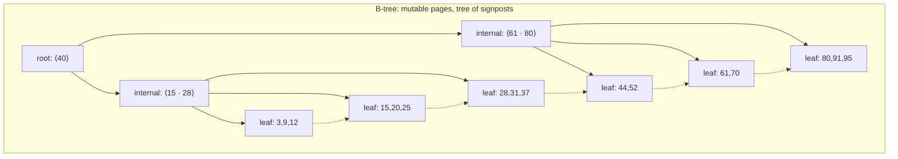
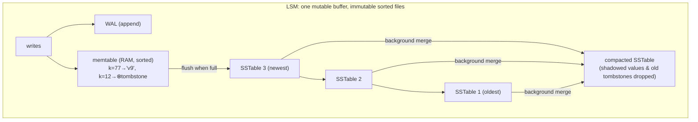
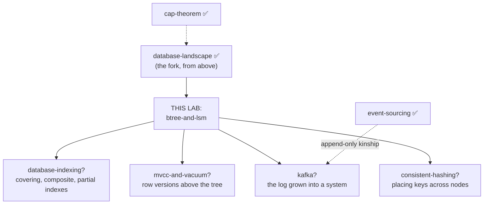

# B-trees and LSM-trees — the two machines under every database

> **Lab type:** full learning lab — the concept is an algorithm with state, so
> you get to run it, break it, and watch it move.
>
> **What's in this lab** (plain language here; the vocabulary is earned in §7):
> - `README.md` — this document: one dilemma, two inventions, and everything
>   that follows from each
> - `src/BTree.java` — the first engine, ~320 readable lines, with counters for
>   every unit of disk work it does
> - `src/Lsm.java` — the second engine, ~520 lines, writing **real files** to a
>   directory you can `ls` while it runs
> - `tests/` — scenario-named tests that double as documentation (12 pass as
>   shipped; 8 more stay red until you do the exercises)
> - `experiments/` — measure both engines' costs yourself, on your machine
> - `src/Exercises.java` + `src/BrokenLsm.java` — the red-first stubs and the
>   planted bug the exercises hunt
> - `visualization.html` — build both engines by hand and watch them work
>   (artifact link in the lab notes)
> - `EXERCISES.md` / `SOLUTIONS.md`
>
> **Builds on:** [database-landscape](../04-database-landscape/) — you already
> know *that* B-trees are read-optimized and LSM write-optimized (tricks 2–3),
> what compaction, tombstones, and pages are at one-line depth, and you
> measured the consequences in that lab's Machine B and experiments. This lab
> answers the question that one deliberately left open: **how do the two trees
> actually work, and where do their costs come from?**

---

## Layer map

> **BEGINNER MODEL** (§1–§9) → **INTERMEDIATE MODEL** (§10) →
> **ENGINEERING MODEL** (§11–§14) → **PRODUCTION MODEL** (§15)

---

## 1. WHY — one level down is where the answers live

Every store you cataloged in the last lab keeps its data in one of two
structures: PostgreSQL, MySQL, SQLite, Oracle, and nearly every secondary
index anywhere sit on **B-trees**; Cassandra, RocksDB, LevelDB, HBase,
ScyllaDB — and, as embedded engines, half the "new" databases of the last
decade — sit on **LSM-trees**. That means the mysterious production symptoms
of both worlds — "why did our p99 spike after we switched to UUID keys?",
"what is this compaction backlog alert?", "why do deletes make Cassandra
*slower*?", "why does Postgres need VACUUM?" — are not database trivia. They
are the mechanics of these two structures leaking upward. Understand the two
machines and those symptoms become predictable; tune a database and you are,
almost always, turning knobs on one of these two trees.

---

## 2. PROBLEM — Kabir and the invoices

Meera's bookshop (from the last lab) has grown enough to hire Kabir, who runs
the back office. His job, reduced to its essence, is two operations on paper
invoices, all day:

1. **File** each invoice as it arrives — dozens per hour, in *no particular
   order* (invoice #4831, then #212, then #9905...).
2. **Find** any invoice the moment someone asks — "pull up #3117" — and
   sometimes a *range*: "all invoices from #3000 to #3200."

Two innocent-looking requirements. Everything in this lab — both trees, every
knob, every production incident — falls out of the tension between them.

---

## 3. NAIVE SOLUTION — the pile, then the sorted notebook

**Try 1: the pile.** Kabir drops each invoice on top of a pile. Filing is
instant — the fastest possible write. But "find #3117" means digging through
the whole pile, every time. With 10,000 invoices, every question is a
10,000-paper excavation. (You know this structure: it's the append-only log
from the last lab — trick 7. Perfect for "what happened, in order"; hopeless
for "find one thing.")

**Try 2: keep everything sorted.** Kabir binds the invoices into one giant
sorted binder. Now "find #3117" is delightful: open the middle, too high or
too low, halve again — binary search, ~14 peeks for 10,000 invoices instead
of 10,000. Ranges are even better: find #3000, then read forward until #3200.
Sorted order is *the* superpower for finding things.

---

## 4. FAILURE — sorted order and arriving order are enemies

Now invoice **#4832 arrives**, and it belongs in the *middle* of the binder.
To insert one page in its sorted place, Kabir must shift every page after it
— thousands of pages moved to file one invoice. The binder made finds cheap
by making files ruinous.

Look at the shape of the dilemma, because it is the entire subject:

- Writes arrive in **random order** and want to be cheap.
- Reads want the data in **sorted order**.
- Keeping data sorted *at all times* means paying a re-sorting cost on
  **every single write**.

And one more constraint, from the machine itself (you met it in the last
lab): storage devices don't read and write single bytes — they move
**fixed-size chunks** (pages, ~4–16 KB), and they are dramatically faster at
*sequential* chunks than at scattered ones (your Machine B: seeks vs
sequential blocks). Any real solution must respect chunk-sized, preferably
sequential, I/O.

> **🔮 Predict:** you're Kabir. You refuse to shift thousands of pages per
> invoice, and you refuse to dig through an unsorted pile. What furniture do
> you buy? (There are two famous answers. Think of at least one before
> revealing.)
> <details><summary>Reveal</summary>
> Answer one: <b>a filing cabinet</b> — chop the sorted sequence into many
> small folders, each with slack space, so an insert only ever rearranges ONE
> folder. Answer two: <b>an inbox tray</b> — let invoices pile up unsorted but
> SMALL, sort the small pile at day's end into a neat stack, and merge stacks
> occasionally. The first is the B-tree. The second is the LSM-tree. Both are
> ways to keep things "sorted enough" without re-sorting the world per write —
> and the entire rest of this document is just these two ideas growing up.
> </details>

---

## 5. THE REAL REQUIREMENT

In plain words, a storage engine must give Kabir:

> **Reads that behave as if the data were fully sorted, writes that cost a
> small bounded amount of work each, and I/O that arrives in page-sized —
> ideally sequential — chunks.** (Plus, after a crash, nothing acknowledged is
> lost.)

No structure gets all of it for free. The B-tree and the LSM-tree are the two
canonical ways to *distribute the cost of sortedness*: the B-tree pays a
little on **every write, at write time, in place**; the LSM pays **later, in
bulk, in the background**. Hold that sentence — it generates everything else.

---

## 6. KEY IDEA

Two inventions, one dilemma:

> **B-tree:** cut the sorted data into thousands of small **pages, each with
> slack space**, and build a tree of signposts above them. An insert
> rearranges exactly one page — and when a page overflows, it **splits in
> two**, pushing one signpost up. Sortedness is repaired *locally, immediately*.

> **LSM-tree:** stop repairing the sorted files altogether — they are
> **immutable**. Collect incoming writes in a small sorted buffer in memory;
> when it fills, write it out as a brand-new sorted file *sequentially*; and
> occasionally **merge** files in the background. Sortedness is repaired
> *globally, later, in bulk*.

---

## 7. TERMINOLOGY — names for what Kabir just invented

The load-bearing vocabulary. (From the last lab you already carry: *page*,
*compaction*, *tombstone*, *write-ahead log*, *B-tree/LSM* as one-liners —
those get upgraded here, not re-introduced.)

**Node / page (upgraded).**
*Plain:* one folder in the cabinet. *Precise:* the fixed-size unit (say 8 KB)
a B-tree reads or writes at once; holds sorted keys plus either pointers to
child pages (an **internal node**) or the actual data (a **leaf**). *Why the
term:* it aligns the tree's shape with the device's native chunk — one node =
one disk fetch. *Example:* an 8 KB page holding ~200 keys of ~40 bytes each.

**Fanout (a.k.a. branching factor / order).**
*Plain:* how many folders a signpost page can point at. *Precise:* children
per internal node — hundreds in practice, because a node is a whole page full
of routing values (each one a **separator key**: "below this value, go left"). *Why it exists:* fanout is what makes B-trees **shallow**:
fanout 200 reaches 200³ = 8 million keys in 3 levels, ~1.6 billion in 4. A
find costs one page read *per level* — so "3–4 page reads for a billion keys"
is fanout doing its job. *Connects to:* exp1 of the last lab (the 5,344×
lookup was a 3-level walk).

**Split.**
*Plain:* a folder overflows, so you split its contents into two folders and
add one line to the signpost above. *Precise:* when an insert lands in a full
page, the page divides at its median; the median (or a separator) is
**promoted** into the parent — which may itself overflow and split, possibly
all the way up. When the *root* splits, the tree gains a level: **B-trees grow
from the top**, which is why they stay balanced with no rebalancing pass.
*Example:* in §10.

**Memtable.**
*Plain:* the inbox tray — plus a clever detail: Kabir keeps the tray itself
sorted as papers land (it's small; that's cheap). *Precise:* an in-memory
sorted structure (skiplist/red-black tree) absorbing all writes; reads check
it first; at a size threshold (say 64 MB) it becomes immutable and is written
out. *Why:* it converts random-order writes into a batch that can be emitted
*sequentially* — the whole LSM trick in one object.

**SSTable (sorted string table) / sorted run.**
*Plain:* one day's sorted stack, stapled — never edited again. *Precise:* an
immutable file of sorted key-value pairs, written once sequentially, read
many times; a "newer" table's value for a key **shadows** any older table's.
*Why immutability matters:* immutable files need no locks to read, can be
scanned sequentially, and make crash recovery trivial (a half-written new
file is just discarded).

**Flush.**
*Plain:* day's end — sort the tray, staple it, shelve it. *Precise:* writing
the frozen memtable to disk as a new SSTable, sequentially. This is the ONLY
way user data reaches disk in an LSM (aside from the log below).

**Compaction (upgraded).**
*Plain:* merging several stapled stacks into one, discarding superseded
invoices. *Precise:* a background k-way merge of SSTables into fewer, larger
ones, dropping shadowed values and (eventually) tombstones. It is *deferred
sorting* — the work the B-tree does per-write, done here in bulk. The
**policy** deciding what to merge when (size-tiered vs leveled, §10.6) is the
LSM's most consequential knob.

**Write-ahead log — WAL (upgraded).**
*Plain:* Kabir's carbon-copy book: scribble every invoice into it the moment
it arrives, *before* filing — if fire takes the tray, the book replays it.
*Precise:* an append-only file each write goes to (sequentially, cheaply)
before the engine acknowledges; on restart, unflushed writes are replayed
from it. Both engines carry one; the LSM's protects the memtable (RAM would
otherwise lose acknowledged writes on crash), the B-tree's protects
half-updated pages.

**Amplification (read / write / space).**
*Plain:* how much *extra* work or room the engine spends per unit of useful
work. *Precise:* **write amp** = bytes actually written to disk ÷ bytes of
user data (a B-tree rewrites an 8 KB page for a 100-byte row: amp ≈ 80; an
LSM rewrites data at every compaction: amp 5–30); **read amp** = places
checked per lookup (B-tree: height, ~3–4; LSM: memtable + up to N tables);
**space amp** = disk used ÷ live data (old versions not yet compacted; pages
deliberately left with slack). *Why the triad exists:* it's the scorecard the
two engines trade on — **you never reduce all three; you choose which one
bleeds.** This lab's experiments measure all three on your machine.

Minor terms, one line each: **B+ tree** — the ubiquitous B-tree variant where
*all* data lives in leaves and leaves are chained left-to-right (what
databases actually use; what we build); **separator key** — the signpost
value an internal node uses to route ("< 40 go left, ≥ 40 go right");
**bloom filter** and **sparse index** — two small LSM read accelerators,
earned properly in §10.5; **fill factor** — how full pages are kept on
purpose; **write stall** — an LSM refusing writes because compaction fell
behind (§11).

> **Checkpoint — BEGINNER → INTERMEDIATE.** You can explain the dilemma
> (sorted reads vs random writes vs chunked I/O) and both answers in
> furniture terms, and you know the cost scorecard's names. Next: the actual
> machinery, key by key — where splits cascade and why deletes are writes.

---

## 8. MENTAL MODELS

**Simple model — Kabir's two offices.**
*Office A (B-tree):* a filing cabinet of small folders, each deliberately
left one-third empty; a signpost card on each drawer; a master signpost on
the wall. Every invoice goes straight into its one true folder; a full folder
is split into two and the drawer card gains a line. Everything is always in
its place; nothing is ever done "later."
*Office B (LSM):* a sorted inbox tray on the desk, a carbon-copy book beside
it, and shelves of stapled sorted stacks, newest on top. Nothing on the
shelves is ever edited; finding means tray first, then stacks newest-first;
night shifts merge stacks. Everything is done "later," in bulk.

**Engineering model — two ways to spend the sorting budget:**

| | B-tree | LSM-tree |
|---|---|---|
| Disk layout | mutable pages, updated in place | immutable sorted files, append-only |
| Write path | walk to leaf, edit 1 page (maybe split) | append WAL + insert memtable; flush later |
| Read path | root → internal → leaf (height page reads) | memtable, then SSTables newest→oldest |
| Sortedness repaired | locally, at write time | globally, at compaction time |
| I/O personality | small random reads/writes | big sequential writes, scattered reads |
| Delete | remove from page (space reclaimed later) | write a tombstone (§10.4) |
| Crash safety | WAL for page updates | WAL for the memtable |
| Bleeds on the scorecard | write amp (page-per-row), space slack | read amp (many files), compaction I/O |

**The mapping:** folder = page · drawer/wall signposts = internal nodes/root ·
folder split = page split · inbox tray = memtable · carbon-copy book = WAL ·
stapled stack = SSTable · night merge = compaction · "one-third empty
folders" = fill factor · "invoice marked CANCELLED on a new sheet" = tombstone.

**Where the analogy breaks.** (1) Kabir splits a folder in seconds; a
database splits a page while *hundreds of threads* are reading it — real
engines need latches/lock-free schemes we deliberately omit (§15). (2) The
night-shift merge sounds free; on a machine, compaction competes with live
traffic for the same disk — it is the LSM's defining operational burden, not
a janitorial detail (§11). (3) Paper folders hold ~20 invoices; real pages
hold hundreds of keys, which is why real trees are 3–4 levels, not 6–10 —
intuition from small drawings *understates* fanout's power. (4) No filing
cabinet grows a new *top*; B-trees do — the root split is where the analogy
simply stops. Watch it happen in the visualization instead.

---

## 9. VISUALIZATION

The lab's interactive page (`visualization.html`, artifact link in the lab
notes) has two machines matching the two offices, plus the read-path race:

- **Machine 1 — the B-tree floor:** insert keys (your choice: sequential,
  random, or type your own) and watch the descent, the leaf insert, and the
  split cascade — including the root split that grows the tree a level. The
  counters tally page reads, page writes, and splits: the write-amp story,
  live.
- **Machine 2 — the LSM floor:** writes land in the memtable; flushes emit
  SSTables; deletes write tombstones; a "read key" control races the read
  path (memtable → bloom-filter skips → newest-first file checks); a
  compaction button merges the shelf, visibly dropping shadowed values and
  tombstones.

Both machines are deterministic and support step-back; each scripted
scenario asks for your prediction first. Use it after §10; the mermaid
sketches below are enough to read on.

The two shapes, side by side — the cabinet's tree of signposts vs the shelf
of immutable stacks:





---

## 10. ACTUAL MECHANISM

We build each machine the way a smart engineer would: the obvious version
first, then watch it break, then the refinement. Every "weird" detail of the
finished engines is the scar of one of these breaks. Tiny pages (max 4 keys)
throughout, so the examples fit on screen — real pages hold hundreds; the
*logic* is identical (that, and everything else we simplify, is listed
honestly in §15).

### 10.1 B-tree v1 — sorted pages and a signpost page

Chop Kabir's sorted binder into pages of ≤ 4 keys, and keep one **signpost
page** listing each page's first key:

```text
signpost: [3→P1, 15→P2, 28→P3, 44→P4, 61→P5, 80→P6]
P1:[3,9,12] P2:[15,20,25] P3:[28,31,37] P4:[44,52] P5:[61,70] P6:[80,91,95]
```

**Search 31:** read the signpost (1 page read) — 31 ≥ 28 and < 44, so P3;
read P3 (1 page read); binary-search inside; found. Two page reads, any key.
**Insert 33:** route to P3, slide it in: `[28,31,33,37]` — one page touched,
because pages carry *slack space*. The binder's shift-everything disaster is
gone.

But two seeds of trouble: P3 is now **full**, and with a million pages the
signpost page *itself* is a million entries — it no longer fits in one page.
The second problem answers itself with a beautiful move: **a signpost page is
just a sorted page of keys — so give the signposts their own signposts.**
Pages of signposts, recursively, until one page rules them all: the **root**.
Internal nodes and leaves, exactly the mermaid shape above. Search = one page
read per level, and fanout keeps levels tiny (fanout 200 → 4 levels covers
~1.6 B keys).

### 10.2 The split — how a B-tree absorbs overflow and stays balanced

Now the first seed. **Insert 35** into full `P3:[28,31,33,37]`:

1. P3 splits at its median into `P3a:[28,31]` and `P3b:[33,35,37]`.
2. The separator key **33** is *promoted* into the parent: it now routes
   "< 33 → P3a, ≥ 33 → P3b". One page became two; the parent grew by one key.
3. If the parent was itself full, *it* splits the same way, promoting a
   separator further up — a **split cascade**.
4. If the cascade reaches a full **root**, the root splits and a *new root*
   is created above it with a single separator. **The tree grows from the
   top** — this is why every leaf is always at exactly the same depth, i.e.
   why B-trees are perfectly balanced without any rebalancing procedure.
   (Watch this in Machine 1; it is genuinely satisfying.)

> **🔮 Predict:** Kabir inserts keys in strictly increasing order — 1, 2, 3,
> 4, ... 1000 (an auto-increment primary key). Which page does every insert
> hit, and are splits more or less frequent than with random keys?
> <details><summary>Reveal</summary>
> Every insert lands in the <b>rightmost leaf</b> — the only page that ever
> splits. Same number of splits overall (the data must still fit), but every
> touched page is the same hot page (cached, no random I/O), and real engines
> special-case rightmost splits to leave the left page ~100% full instead of
> half — so sequential inserts also pack pages tighter. Random keys (UUIDv4)
> hit a <em>different random leaf each time</em>: cold pages, scattered
> writes, half-full pages everywhere. You measured the seek half of this in
> the last lab's Machine B; <code>experiments/Exp2KeyOrder.java</code>
> measures the splits-and-fill half in this one.
> </details>

Two finishing touches turn this into the **B+ tree** every database actually
ships: keep *all* values in the leaves (internal nodes hold only separator
keys — so they pack enormous fanout), and **chain the leaves left-to-right**.
The chain makes range scans trivial: walk down to the first leaf of the range
(3–4 page reads), then follow sibling links sequentially — no tree
re-walking. "Orders #3000–#3200" is one descent plus a linked-list stroll.

**The B-tree's bill.** Every write rewrites its whole page (a 100-byte row in
an 8 KB page = write amp ~80). Every page keeps slack (engines aim for
~70% full — that's *fill factor*; the slack **is** the product: it's what
makes the next insert cheap) = space amp ~1.4. In exchange: reads are a fixed,
tiny `height` page reads — the read-optimized half of the fork you already
knew. Now the write-optimized half.

### 10.3 LSM v1 — memtable + flush... and the read bill arrives

Office B. Writes append one line to the **WAL** (sequential, cheap, crash
insurance) and land in the **memtable**, kept sorted in RAM. At the threshold
— ours flushes at 6 entries, RocksDB at ~64 MB — the memtable is written out,
already sorted, as an immutable **SSTable**, in one sequential pass. Writes
are gorgeous: append + RAM insert, deferred bulk flush. Machine B of the last
lab, now with named parts.

**Read `get(52)`** must respect one law — **newest wins**: check the memtable
first, then SSTables *newest → oldest*, stop at the first hit. And here is
v1's bill: after a week, 400 SSTables. A read checks the memtable, then
potentially *all 400 files*. Read amplification isn't a footnote — untreated,
it's fatal. Three refinements (10.4–10.6) are all treatments.

### 10.4 Deletes — why removing data means writing data

**Delete invoice 20.** In the B-tree: walk to the leaf, remove it (the page
just gets emptier — real engines reclaim/merge underfull pages lazily; so
does ours; §15). But in the LSM, key 20 might live in SSTable 3 — which is
**immutable**. You cannot remove what you cannot touch. The only thing an LSM
can ever do is *write something newer*: so it writes a **tombstone** — a
special "20 is deleted" record — to the memtable. Newest-wins does the rest:
any read finds the tombstone before the old value and reports "not found."
The old value physically dies later, when compaction merges the two files.
This is the last lab's one-line "deletes write tombstones", now with its why:
**tombstones are the price of immutability** — and their production sting
(§11) is that a delete-heavy workload makes files *bigger* and reads *slower*
until compaction catches up.

### 10.5 Two read accelerators — paying tiny RAM for huge I/O

*Problem 1: absent keys.* `get(99999)` — never written. No file contains it,
so no file check can stop early: the read probes **every** SSTable. Absent-key
reads are the worst reads — and common (caches asking "is X here?"). Fix: a
**bloom filter** — a small bitmap per SSTable, built at flush from the
table's keys, answering "possibly here" or **"definitely not here"** with a
tunable false-positive rate (~1% at ~10 bits/key). "Definitely not" skips the
file without touching disk: absent-key reads collapse from N file probes to
~zero (experiment 3 measures it). One-way certainty is the whole trick — it
can never wrongly skip, only occasionally probe in vain.

*Problem 2: finding a key inside one big file.* A 2 GB SSTable is sorted, but
binary-searching raw disk is many scattered reads. Fix: a **sparse index** —
at flush, remember every ~64th key's file offset in RAM; a lookup finds the
surrounding pair, seeks once, reads one block. Sorted files + tiny in-RAM
maps = one seek per file probed.

### 10.6 Compaction policy — the LSM's steering wheel

Refinement three attacks the file *count* itself. Merging is easy (all files
are sorted: k-way merge, drop shadowed values and expired tombstones — our
`src/Lsm.java` does exactly this). The consequential question is **which files,
when** — the policy:

- **Size-tiered (STCS)** — merge ~4 similar-sized tables into one bigger one,
  tier by tier (our toy; Cassandra's default). Write-cheap: each key is
  rewritten only ~log(N) times as it graduates through tiers. But reads may
  still probe a table per tier, and space spikes: shadowed copies survive
  across tiers, and a big merge needs room for input *and* output (the "needs
  2× disk" alert of §11).
- **Leveled (LCS)** — organize tables into levels L1, L2, L3... where each
  level is ~10× bigger and holds **non-overlapping key ranges**; new data
  trickles down level by level, merging into the ranges it overlaps
  (RocksDB's default). Reads touch ≤ 1 table *per level* (~3–4 total, almost
  B-tree-like!) and space amp stays ~1.1 — but each key is rewritten at
  *every* level: write amp ~10× the tier policy.

Read the pair against the scorecard: **STCS bleeds reads and space; LCS
bleeds writes. Choosing a compaction policy is choosing which amplification
bleeds** — the fork inside the fork. (Time-series stores add a third policy —
time-windowed — merging only same-time-window files, because time-keyed data
never shadows across windows; your last lab's ⑧ in new clothes.)

> **🔮 Predict:** an LSM ingests at full speed all day. Compaction is
> throttled to be "nice" to foreground traffic and quietly falls behind —
> file count climbs. What breaks first: correctness, reads, or writes?
> <details><summary>Reveal</summary>
> Reads first — every extra file is another probe on every get; p99 read
> latency climbs smoothly. Correctness never breaks (newest-wins holds
> regardless of file count). Writes break <em>last but hardest</em>: at a
> file-count threshold the engine <b>stalls writes on purpose</b> (RocksDB
> write stalls, Cassandra backpressure) because accepting more ingest would
> dig the hole deeper. "My writes suddenly hang" on an LSM almost always
> decodes to "compaction lost the race hours ago" — §11's F-L1.
> </details>

### 10.7 Crash safety — the WAL closes both loops

The B-tree edits pages in place — a crash mid-split could leave the tree
inconsistent; the WAL (plus recovery replay) makes page updates redoable.
The LSM holds acknowledged writes in RAM — a crash would eat them; the WAL
replays them into a fresh memtable at startup (our `crash_recovery_replays_wal`
test does exactly this: build, "crash", recover, verify). Once a memtable is
safely flushed as an SSTable, its WAL segment is deleted — the log stays
short. Immutable SSTables themselves need no recovery: a half-written one is
simply discarded.

> **Checkpoint — INTERMEDIATE → ENGINEERING.** You can walk both write paths
> and both read paths with real keys, explain splits, tombstones, bloom
> filters, sparse indexes, and the two compaction policies — each as the fix
> to a failure you watched. Next: how these mechanics fail in production, and
> what is actually guaranteed.

---

## 11. FAILURE SCENARIOS — the mechanics leaking into production

Four per engine. Each: how to create it → where to watch it → what happens
and why → what production does about it. Every one is a §10 mechanism wearing
a pager.

**F-B1 — the random-key insert storm (the UUID incident).**
*Create:* switch a table's primary key from auto-increment to random UUIDv4
under heavy insert load. *Watch:* `experiments/Exp2KeyOrder.java`, or Machine
1 with "random" order. *What/why:* every insert now lands in a different leaf
— cold pages dragged into cache, scattered page writes, splits sprayed across
the whole tree leaving every page ~half-full (the tree is *bigger* and its
cache hit rate worse for the same data). Sequential keys hit one hot
rightmost leaf. *Production:* the classic "we switched to UUIDs and p99
doubled"; fixes are time-ordered keys (UUIDv7/ULID) or accepting the bill.
*Guarantee intact:* correctness, balance. *Lost:* the write-cost assumption
your capacity plan was built on.

**F-B2 — bloat: the tree that grows while the data doesn't.**
*Create:* heavy updates/deletes on a B-tree table for weeks (bonus in
Postgres: MVCC keeps old row versions until VACUUM). *Watch:* run
`Exp2KeyOrder.java` and compare live keys vs pages held. *What/why:* deletes
empty pages but pages are rarely merged back; splits never un-split; slack
plus dead entries accumulate — space amp climbs and scans read mostly air.
*Production:* Postgres autovacuum (tuned, monitored — "dead tuples" and bloat
queries), `REINDEX`/`pg_repack` as the deep clean; InnoDB purge threads.
*The mirror image:* this is the B-tree's version of the LSM's shadowed data —
both engines carry garbage; they differ in *who* collects it and *when*.

**F-B3 — the crash mid-split (torn write).**
*Create:* kill the process between "leaf split" and "parent updated."
*Watch:* conceptually in Machine 1 (a split is visibly multi-page); in code,
`crash_recovery_replays_wal` shows the WAL discipline. *What/why:* a
multi-page change half-applied = a tree pointing at pages that aren't what
the parent believes — without protection, corruption. *Production:* WAL +
replay makes the split redoable; Postgres additionally writes full page
images after each checkpoint (torn-page defense). The rule the WAL enforces
everywhere: **acknowledge nothing the log can't replay.**

**F-L1 — compaction falls behind (the write stall).**
*Create:* sustained ingest above compaction throughput (throttle compaction,
as §10.6's prediction did). *Watch:* `Exp1Amplification.java` prints the
file count growing; Machine 2's shelf visibly deepens if you never compact.
*What/why:* reads slow first (a probe per extra file), then the engine stalls
writes at a threshold to protect itself. *Production:* RocksDB
`pending_compaction_bytes` / stall counters, Cassandra `sstables per read`
p99 — the on-call graphs for this failure; remedies are rate-limiting
ingest, more compaction parallelism, or faster disks. The deep lesson: **an
LSM's write speed is a loan from the future; compaction is the repayment
schedule.**

**F-L2 — the tombstone storm (the queue anti-pattern, decoded).**
*Create:* use an LSM table as a queue — insert, read, delete, thousands/sec,
then range-scan for the next work item. *Watch:* `tombstones_slow_range_reads`
(tests double as this experiment). *What/why:* every consumed item leaves a
tombstone; a range scan must read *through* the tombstones to find live
entries — soon each poll wades through millions of dead records; and
tombstones can't be dropped at the first compaction (an older copy of the key
might still exist in a not-yet-merged file — drop the tombstone early and the
old value *resurrects*; this is why Cassandra keeps them for `gc_grace_seconds`,
default 10 days). *Production:* Cassandra logs tombstone warnings and aborts
pathological reads; the real fix is the last lab's rule — queues are jobs,
not facts; use a queue.

**F-L3 — the 2 a.m. disk-full during compaction.**
*Create:* run size-tiered compaction with the disk at 60% full and a big tier
merge due. *Watch:* `Exp1Amplification.java` prints space amp before/after
compaction. *What/why:* a merge writes its output *before* deleting its
inputs (crash safety demands it), so peak usage ≈ inputs + output — a large
STCS merge can transiently need ~2× the data size. *Production:* capacity
rule of thumb — keep STCS disks ≤ 50–60% full; or run leveled compaction and
pay in write amp instead. The scorecard again: you chose where to bleed.

**F-L4 — reads for keys that don't exist.**
*Create:* point a cache-miss-heavy workload ("is X here?" mostly answering
no) at an LSM with bloom filters disabled or under-sized. *Watch:*
`Exp3Bloom.java` — the same 2,000 absent-key reads with blooms on and off.
*What/why:* absence can't stop early; without blooms every file is probed.
*Production:* bloom bits-per-key is a first-class tuning knob (RocksDB ~10
bits/key ≈ 1% false positives); monitoring watches "bloom useful" ratios.

---

## 12. CORRECTNESS — invariants, guarantees, and the bill

**B-tree invariants** (all enforced in `src/BTree.java`, named in comments):
1. **Sortedness** — keys sorted within every page; separators route
   correctly (everything in child *i* is < separator *i*).
2. **Uniform depth** — every leaf at the same depth, forever, because the
   tree only grows by root split. Balance is not maintained; it is
   *structural*.
3. **Bounded occupancy** — pages hold ≤ max keys (and, in real engines,
   ≥ ~half after merges); hence height ≤ log_fanout(N) and every operation
   is O(height) page I/Os.

**LSM invariants** (enforced in `src/Lsm.java`):
1. **Newest wins** — the read path's order (memtable, then tables
   newest→oldest, first hit wins) *defines* the current value; tombstones
   are just values that mean "gone."
2. **Immutability** — flushed files never change; all mutation is new files.
3. **WAL-before-ack** — no write is acknowledged before it is in the log;
   recovery = replay.
4. **Compaction is logically invisible** — merging preserves exactly the
   newest-wins answer for every key (it only makes the physical set smaller).
   A compaction that changes any read's answer is a bug, full stop.

**What is guaranteed, what is not, what it costs:**

| | Guarantees | Does NOT guarantee | The bill |
|---|---|---|---|
| B-tree | O(height) point & range reads, always; predictable latency; data always in sorted place | cheap random-key writes; full pages | write amp (page per row), space slack, random write I/O |
| LSM | cheap durable writes at any rate (until the loan is called); sequential disk usage; immutable files | flat read cost (grows with file count); prompt space reclaim; cheap deletes | read amp, compaction I/O forever, tombstone debt, space spikes |

And the honest summary of the whole fork: **neither tree is faster — they
move the same sorting work to different moments.** The B-tree sorts at write
time so reads are flat; the LSM sorts at compaction time so writes are flat.
Pick per workload — which you already knew from the landscape lab; now you
know the machinery that makes it true.

> **Checkpoint — ENGINEERING model complete.** Invariants, failure modes,
> and the cost model are yours. What remains: touch the machines (§13–14)
> and map the toys to InnoDB/RocksDB/Cassandra knobs (§15).

---

## 13. CODE — two engines you can read in one sitting

Both in `src/`, JDK only — no build tool, no test framework — written to be
read top-to-bottom. The
load-bearing lines carry comments naming their invariant.

**`src/BTree.java` (~320 lines)** — a B+ tree with max 4 keys/page:
`insert` descends to the leaf and inserts locally (§10.1's promise);
`splitLeaf` is the heart — median promoted, two half-pages, and the root
split growing the tree from the top (§10.2). `search` counts page reads so
experiments can *measure* height. `rangeScan` walks down once, then follows
`page.next` — the leaf chain, executable. Counters: `pageReads`,
`pageWrites`, `splits`.

**`src/Lsm.java` (~520 lines)** — an LSM engine using **real files** in a
directory you can `ls`: `put` appends to `wal.log` then the memtable
(WAL-before-ack, invariant 3); `flush` writes `sstable_N.txt` sorted, builds
its bloom filter + sparse index, truncates the WAL; `get` walks
memtable → tables newest-first with bloom skips (newest-wins, invariant 1);
`delete` writes `TOMBSTONE` (§10.4); `compact` k-way-merges all tables,
dropping shadowed values and tombstones (invariant 4); the constructor replays
the WAL after a "crash." Counters: `bytesWritten` (write amp),
`fileProbes`/`bloomSkips` (read amp), `diskBytes()` vs live data (space
amp).

**`tests/`** — scenario-named. Compile the whole lab once, then run each
suite as a plain `main` (details in §14):
splits growing the tree from the top, range scans following the chain,
newest-wins after flush, deletes needing tombstones, tombstones slowing range
reads, crash recovery via WAL replay, compaction reclaiming space *without
changing any answer* (invariant 4, as a test). All 12 pass as shipped.

**`src/Exercises.java` and `src/BrokenLsm.java`** — the exercise scaffolding:
two stubs whose 8 tests fail until you implement them (so rung 5 is
red-first), and a copy of the engine with **one expression changed** in
`compact()` for you to hunt (rung 6). Watch what that one expression does:
`java -cp out ExpDebugBroken` shows deleted keys resurrecting and
recent updates silently reverting — invariant 4, violated.

---

## 14. EXPERIMENTS — measure the scorecard yourself

Run from the lab root; JDK only, no build tool, seconds each. Compile the
whole lab once — engines, tests and experiments together — then run any class
by name:

```
javac -d out src/*.java tests/*.java experiments/*.java
java -cp out BTreeTest        # 6 passed, 0 failed
java -cp out LsmTest          # 6 passed, 0 failed
java -cp out ExercisesTest    # 0 passed, 8 failed  ← red until rung 5
```

(Re-run the `javac` line after any edit. `out/` is throwaway build output.)

**Experiment 1 — the amplification scorecard.**
*Predict:* 3,000 random puts into both engines. Which has higher **write**
amp? Higher **read** amp? What happens to LSM space amp when compaction runs?
Run: `java -cp out Exp1Amplification`
*Observe & why:* B-tree write amp is brutal (whole page per row) but read amp
is flat (= height). LSM write amp stays low-ish (WAL + flush + compaction
rewrites) but read amp is a *distribution* — recent keys cheap, old keys
probe several files — and compaction visibly collapses both file count and
space amp. The §12 table, printed from your own machine.

**Experiment 2 — key order: the UUID incident, measured.**
*Predict:* same 2,000 keys inserted sequentially vs shuffled into the B-tree.
Same final tree? Same page writes? Same *distinct pages touched*?
Run: `java -cp out Exp2KeyOrder`
*Observe & why:* same keys, same height — but random order touches nearly
every page of the tree while sequential order hammers one hot edge (cheap,
cacheable). F-B1 in numbers; the LSM columns show it genuinely doesn't care.

**Experiment 3 — what bloom filters are worth.**
*Predict:* 2,000 gets for keys that were never written, across 8 SSTables.
File probes with blooms off? With blooms on (~10 bits/key)?
Run: `java -cp out Exp3Bloom`
*Observe & why:* off ≈ every-file-probed per read; on ≈ almost all probes
skipped, at a few KB of RAM per table. The cheapest performance win in the
whole storage world, and why every real LSM has them on by default.

**Experiment 4 — the planted bug (rung 6 of the exercises).**
*Predict:* one expression in `src/BrokenLsm.java`'s `compact()` is wrong.
Compaction still merges, files still shrink, no error is raised. What could a
user possibly notice?
Run: `java -cp out ExpDebugBroken`
*Observe & why:* every deleted key comes back and every overwritten key
reverts to its **original** value — the merge picks the oldest version
instead of the newest. Silent, retroactive data corruption from a single
expression: the strongest argument in this lab for why invariant 4 is written
down and tested.

*(Numbers from this machine are recorded in `experiments/RESULTS.md`.)*

---

## 15. PRODUCTION — from these toys to the engines you run

**Where you meet each machine:**
B-tree: PostgreSQL (heap tables + B-tree indexes — note the distinction:
Postgres stores rows in a heap and indexes point into it; MySQL/InnoDB
*clusters* rows inside the primary-key B-tree itself, which is why long
random primary keys hurt InnoDB doubly), SQLite, SQL Server, Oracle, and
almost every secondary index — including the ones inside document stores.
LSM: RocksDB (the embedded engine inside CockroachDB, TiKV, Kafka Streams
state stores, MyRocks...), LevelDB, Cassandra/ScyllaDB, HBase, InfluxDB —
your landscape-lab categories ④⑧ largely stand on this machine.

**The knobs, mapped to what you now know:** page size & fill factor
(B-tree: slack vs density — §10.2); memtable size (LSM: flush frequency vs
RAM and recovery time); compaction policy STCS/LCS/TWCS and its
throughput/rate limits (§10.6 — *the* LSM decision); bloom bits per key
(§10.5); WAL fsync policy (per-commit vs batched — durability vs latency,
both engines).

**What the on-call engineer watches:** Postgres — cache hit ratio, dead
tuples/bloat, autovacuum progress, checkpoint write bursts. RocksDB —
`pending_compaction_bytes`, write-stall counters, sstables-per-read, bloom
useful ratio. Cassandra — sstables-per-read p99, tombstones-scanned warnings,
compaction backlog, disk headroom (F-L3's 50–60% rule). Every one of these
graphs is a §11 failure with a dashboard.

**What our toys deliberately omit** (so the bridge is honest): concurrency —
real engines let hundreds of threads read *during* splits and compactions
(latch crabbing, lock-free skiplists, MVCC snapshots); block caches and
prefix compression; checksums and torn-page defenses; group commit batching
WAL fsyncs; underfull-page merging on the B-tree side; partitioned/parallel
compaction, per-level rate limiting, and merge iterators streaming rather
than materializing on the LSM side; and transactions entirely — those live a
layer above, using these structures as their substrate.

> **Checkpoint — PRODUCTION model reached.** You can read a RocksDB tuning
> guide or a Postgres bloat postmortem and recognize every noun, and you know
> which graph betrays which failing mechanism.

---

## 16. EXERCISES

The eight-rung ladder is in [`EXERCISES.md`](EXERCISES.md) — explain,
identify (in the visualization), predict (against the experiments), modify
the engines, implement a missing piece against a failing test, find a planted
bug, survive a crash, and two design prompts. Answers in
[`SOLUTIONS.md`](SOLUTIONS.md).

---

## 17. KNOWLEDGE MAP & NEXT STEPS



**Commonly confused, one sentence each:**
*B-tree vs B+ tree* — in the B+ variant (what databases ship) internal nodes
hold only separators and all data sits in chained leaves; "B-tree" in
conversation almost always means B+ tree.
*LSM vs append-only log* — the log stores *history in arrival order*; the LSM
uses append-only *files* as a technique to store *current state* in sorted
order.
*Compaction vs VACUUM* — the same garbage-collection job on opposite trees:
compaction merges immutable files dropping shadowed data; VACUUM reclaims
dead row versions inside mutable pages.
*Memtable flush vs checkpoint* — a flush writes new data to its permanent
sorted home (LSM); a checkpoint writes already-applied dirty pages back so
the WAL can be trimmed (B-tree world).
*Bloom filter vs index* — an index says where a key IS; a bloom filter can
only swear where it ISN'T.

**Ready to type:** `/learn database-indexing` (what you can build ON a
B-tree — recommended next), `/learn mvcc-and-vacuum`, `/learn kafka`,
`/learn consistent-hashing`.

---

## 18. GLOSSARY (in order of appearance)

| Term | Plain meaning |
|---|---|
| node / page (upgraded) | the fixed-size unit a B-tree reads/writes at once; internal = signposts, leaf = data |
| internal node / leaf | signpost page routing by key range / bottom page holding the actual values |
| root | the single top page every search starts from |
| fanout (order) | children per internal node — hundreds; why trees are 3–4 levels deep |
| split | a full page divides in two and promotes a separator to its parent |
| promote | move a separator key up into the parent during a split |
| split cascade | splits propagating upward when parents are also full |
| root split | the root itself splits and a new root appears — the only way the tree gets taller |
| memtable | the in-RAM sorted buffer absorbing all LSM writes |
| SSTable / sorted run | an immutable sorted file, written once sequentially |
| shadow | a newer file's value for a key hiding any older file's value |
| flush | writing the frozen memtable to disk as a new SSTable |
| compaction (upgraded) | background k-way merge of SSTables, dropping shadowed values and old tombstones |
| write-ahead log (upgraded) | append-only file capturing every write before acknowledgment; replayed on restart |
| write / read / space amplification | extra bytes written ÷ user bytes; places checked per lookup; disk used ÷ live data |
| B+ tree | the shipped variant: data only in leaves, leaves chained for range scans |
| separator key | the value an internal node routes by |
| fill factor | how full pages are kept on purpose — slack is what makes inserts cheap |
| tombstone (upgraded) | a "deleted" record written because immutable files can't be edited |
| newest wins | the LSM read order (memtable → newest → oldest) that defines the current value |
| bloom filter | tiny per-file bitmap answering "definitely not here" / "maybe here" |
| false-positive rate | how often a bloom filter says "maybe" for an absent key (~1% at 10 bits/key) |
| sparse index | every ~Nth key + file offset kept in RAM, giving one-seek lookups inside an SSTable |
| size-tiered / leveled compaction | merge similar-sized files (write-cheap) vs maintain 10×-growing non-overlapping levels (read-cheap) |
| write stall | an LSM deliberately pausing writes because compaction fell behind |
| bloat | B-tree dead space from deletes/updates that VACUUM/REINDEX reclaims |
| torn write | a crash landing mid-way through a multi-page change; defeated by WAL replay |
| gc_grace | how long tombstones must survive before compaction may drop them (resurrection defense) |
| clustered index | rows stored inside the primary-key B-tree itself (InnoDB), vs Postgres's heap + pointing index |
| checkpoint | writing applied dirty pages to disk so the WAL can be trimmed |


