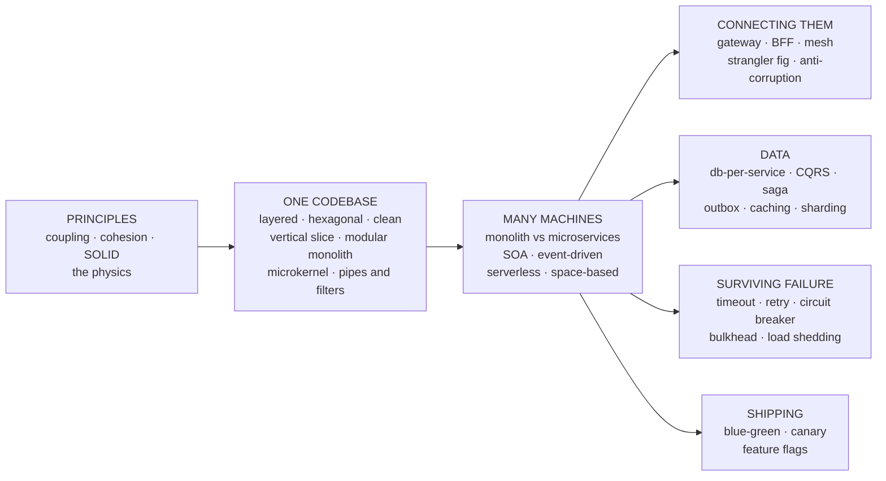
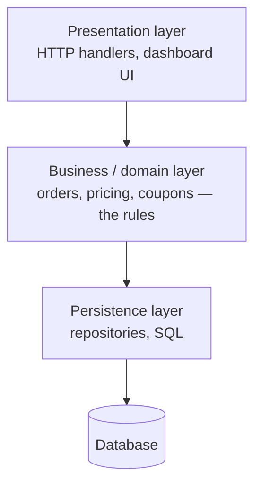
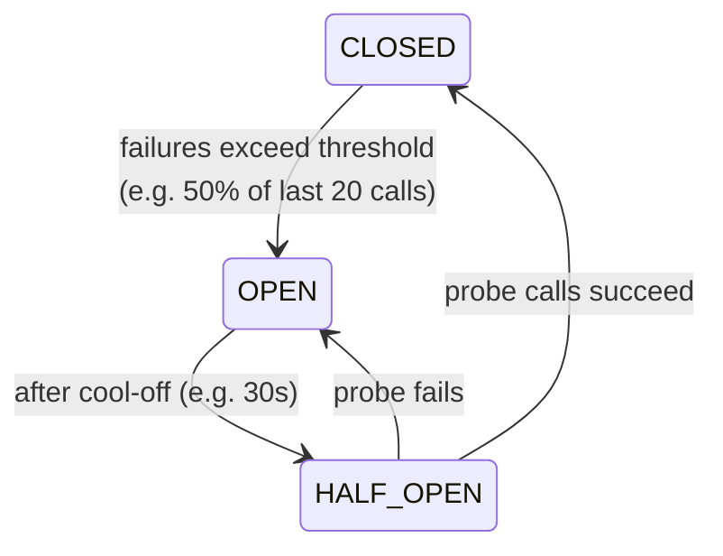
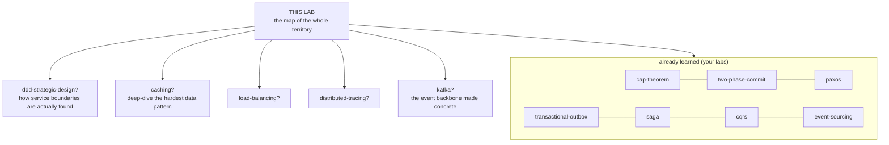

# Software Architecture — Patterns, Principles, and How to Choose

> **Depth layers in this doc:**
> **BEGINNER MODEL** (stages 1–9) → **INTERMEDIATE MODEL** (stage 10) →
> **ENGINEERING MODEL** (stages 11–12) → **PRODUCTION MODEL** (stage 15)
>
> Companion files: [`CATALOG.md`](CATALOG.md) — the exhaustive per-pattern
> reference (every pattern, when to use it, when NOT to, real systems using
> it). [`EXERCISES.md`](EXERCISES.md) — the practice ladder.
> Interactive **Pattern Atlas** — `visualization.html` in this folder (also
> published as an artifact; link in the session notes).

This lab builds on things you already learned:
[transactional-outbox](../48-transactional-outbox/), [saga](../47-saga/),
[cqrs](../51-cqrs/), [event-sourcing](../50-event-sourcing/),
[two-phase-commit](../45-two-phase-commit/), [paxos](../39-paxos/),
[cap-theorem](../24-cap-theorem/). Those labs each taught **one** pattern in
depth. This lab answers the question that sits above all of them: **what is
the full landscape of patterns, and how do you pick?**

---

## 1. WHY — why does "architecture" exist at all?

Every software system that survives gets bigger, gets more users, and gets
more people working on it. When that happens, the thing that kills projects
is almost never a hard algorithm — it is that **changing one part breaks
another part**, and nobody can predict which. Teams slow to a crawl, releases
become terrifying, and eventually someone says "we have to rewrite it."
Architecture is the discipline of arranging code and machines so that change
stays cheap and failures stay small — *before* the system gets big enough to
punish you. If nobody does this job, the system does not stay simple; it
becomes complicated in an *uncontrolled* way instead of a controlled one.

---

## 2. THE PROBLEM — Meera's tiffin service

Meera starts **TiffinBox**, a lunch-delivery service. Week one, the whole
"system" is one Python file: a customer messages her, she writes the order
into a spreadsheet, she texts the kitchen. It works perfectly.

Six months later: 2,000 orders a day, a real web app, online payments, a
kitchen dashboard, delivery-rider assignment, discount coupons. Meera hired
two developers, Dev and Priya. All the code lives in one project, and every
feature was added wherever it was quickest to add — payment code calls into
menu code, the coupon logic reads the riders' GPS table directly, and the
function that saves an order also sends the SMS, updates loyalty points, and
resizes the dish photo.

Nothing is *wrong* yet. Every individual feature works. But notice the shape
of the thing: **everything touches everything**, and no one decided that —
it just happened, one shortcut at a time.

---

## 3. THE NAIVE SOLUTION — "just keep adding code carefully"

The team's plan is the plan every team starts with: be careful, test before
deploying, and add each new feature wherever it fits most easily. No
structure is *decided*; structure is whatever the last six months of
shortcuts produced.

> **🔮 Predict:** Priya changes how dish photos are stored — a change that
> has nothing to do with money. What is the *worst* thing that can plausibly
> happen when she deploys?
> 

Reveal

> Payments go down. The order-saving function also resizes photos, so her
> change made saving an order throw an error — and saving an order is the
> step that happens *after* charging the card. Customers get charged, orders
> don't get recorded. The failure appeared in the code furthest from where
> she was working, which is exactly why she didn't test it. When everything
> touches everything, "unrelated" is an illusion.
> 

---

## 4. THE FAILURE — why "being careful" cannot work

The photo incident happens, for real, at 1 p.m. on the busiest day of the
month. The postmortem finding is uncomfortable: **no individual was
careless.** The system itself made the blast radius of every change equal to
the whole system. Three specific things went wrong, and each one is a
*structural* fact, not a people fact:

1. **A change in one place broke a distant place** — because a hidden
   connection existed (order-saving → photo-resizing) that nobody
   remembered.
2. **Nobody could say in advance what a change might affect** — because the
   connections are not written down anywhere; they exist only as function
   calls scattered through 80,000 lines.
3. **The team cannot work in parallel** — Dev and Priya keep editing the
   same files, and every merge is a fight.

Being careful does not scale, because *care is a per-person resource and the
number of hidden connections grows roughly with the square of the code.*
The deeper problem is now visible: it is not any single bug. It is the
**shape of the dependencies**.

---

## 5. THE REAL REQUIREMENT

What TiffinBox actually needs — what every growing system needs — is:

> **The effect of a change must be predictable and local.** A change to
> photos should be able to break photos, and nothing else. And it must be
> possible to *know that* without reading the whole codebase.

Everything in this lab — every pattern, every principle — is some team's
battle-tested answer to a version of this requirement, at some scale (one
file, one codebase, one company, one planet). Keep this sentence; it is the
measuring stick for every pattern you're about to meet.

---

## 6. THE KEY IDEA

> **Draw boundaries on purpose, and control what crosses them.**

That's the whole field. You divide the system into parts, you decide which
part is allowed to know about which other part, and you make the connections
between parts explicit and few. A **pattern** is nothing more mysterious
than a *named, pre-packaged way of drawing those boundaries* that many teams
have already paid to debug — plus a known bill: every boundary you draw
costs something (indirection, latency, duplication, operational work). The
second half of the skill is knowing when a pattern's bill is higher than the
problem it solves.

---

## 7. TERMINOLOGY — the words professionals use for all this

Now that you've *felt* the problem, here are the names. These seven are
load-bearing for the whole lab.

**Software architecture** — plain: the on-purpose shape of a system.
Precise: the set of structures (parts, and the relations between parts) plus
the *decisions that are expensive to reverse*. The term exists to separate
"decisions we can casually refactor Tuesday" from "decisions that will still
be constraining us in three years" (language, datastore, sync-vs-async,
service boundaries). Example: "one codebase or many services?" is
architecture; "for-loop or stream?" is not. Connects to: everything below.

**Module / component** — plain: a part with a name and a job. Precise: a
unit of code with an explicit **interface** (what outsiders may call) and
hidden internals. The term exists because "part" is only useful if the part
has a *boundary* — TiffinBox has parts (payments, menus) but no boundaries,
so its parts aren't modules. Example: a `payments` module whose only public
surface is `charge(order)` and `refund(paymentId)`.

**Coupling** — plain: how much parts know about each other. Precise: the
degree to which a change in one module forces a change (or a failure) in
another. The term exists because "everything touches everything" needed a
measurable name — you *lower* coupling. Example: the coupon code reading the
riders' GPS *table directly* is high coupling; the photo-resize hiding
inside order-saving is coupling nobody even knew about. Comes in flavors
you'll meet later: compile-time, runtime ("if B is down, A fails" —
**temporal coupling**), and data-shape coupling.

**Cohesion** — plain: how much the things inside one part belong together.
Precise: the degree to which a module's contents change for the same
reasons. The term exists as coupling's twin: you *raise* cohesion. A module
holding "everything about invoicing" is cohesive; a `utils` folder holding
date-parsing, retry logic, and a coupon rule is not — three unrelated
reasons to change, filed in one place. The eternal slogan: **low coupling,
high cohesion** — few connections *between* parts, strong belonging
*within* parts.

**Quality attributes (the "-ilities")** — plain: the adjectives you want the
system to have. Precise: measurable non-functional properties —
*scalability* (add load without redesign), *availability* (fraction of time
it answers), *maintainability/evolvability* (cost of the next change),
*performance* (latency/throughput), *reliability*, *deployability*,
*testability*, *security*, *simplicity* (yes, it counts — it's the one you
trade away most often). The term exists because features tell you what a
system *does*; -ilities describe how it *holds up* — and **patterns are
chosen by -ilities, not by features**. Example: "orders must survive a
datacenter outage" is an availability requirement; no feature list will
surface it.

**Pattern** — plain: a named solution-shape other teams already debugged.
Precise: a reusable arrangement of parts + responsibilities + tradeoffs,
addressing a recurring problem in a context. The term (borrowed from
building architect Christopher Alexander, via the 1994 "Gang of Four" book)
exists so engineers can transfer *judgment*, not just code — saying
"circuit breaker" transmits a whole failure-analysis in two words. Patterns
come in sizes: **architecture styles** shape the whole system (layered,
microservices, event-driven); **architecture patterns** solve one recurring
sub-problem inside a style (saga, outbox, API gateway, circuit breaker);
**design patterns** (GoF: factory, observer, strategy...) live inside a
single module, below this lab's altitude.

**Tradeoff** — plain: what the pattern costs you. Precise: the -ilities a
pattern *worsens* as the price of the ones it improves. The term is
load-bearing because of what practitioners call the **First Law of
Software Architecture** (Richards & Ford): *everything in architecture is a
tradeoff* — and its corollary: if you think you've found a pattern with no
downside, you haven't found the downside yet. Example: microservices buy
independent deployment and pay with network failures, eventual consistency,
and an ops bill.

Smaller terms will be introduced as they're earned; every one lands in the
[GLOSSARY](#18-glossary).

---

## 8. MENTAL MODELS — carry two pictures

**The simple model: a city.** A garage workshop (one file) grows into a
building (structured codebase), then a city (many services). Zoning laws
decide what may be built where (boundaries); roads and phone lines connect
districts (interfaces, networks); the fire code limits how far a fire can
spread (blast radius); and the city planner's real job is not designing any
one building — it is deciding *what goes where and what connects to what*,
knowing the city will keep growing in ways nobody can predict.

**The engineering model: three overlaid graphs plus a ledger.** A system is
(1) a **dependency graph** — who is allowed to know about whom, at build
time; (2) a **runtime topology** — what actually calls what, over which
transport, sync or async; (3) a **failure graph** — if this node dies or
slows, which nodes feel it; and (4) a **tradeoff ledger** — for every
boundary you drew, what it bought and what it costs. Architecture work =
editing these graphs on purpose. Every pattern in this lab is a named shape
in one or more of these graphs.

| City model | Engineering model |
|---|---|
| Zoning map | Dependency graph (allowed knowledge) |
| Roads, phone lines | Runtime topology (calls, queues, transports) |
| Fire spreading between buildings | Failure graph (blast radius) |
| Cost-benefit file at city hall | Tradeoff ledger |
| A district (residential, industrial) | A module / service with one job |
| Building codes | Principles (SOLID, etc.) |
| "We've seen this city-shape work" | A pattern / style |

**Where the analogy breaks.** Three places, and they matter. (1) Concrete is
hard; software is soft — you *can* re-zone a live software city
(refactoring, strangler migrations), and much of modern practice exploits
exactly this, so "get it right up front" is the wrong lesson to take.
(2) City roads degrade gracefully; **networks fail weirdly** — a software
"road" can silently drop one message in a thousand, deliver it twice, or
deliver it after a 30-second stall, and (as your [cap-theorem](../24-cap-theorem/)
lab showed) can cut a district in half while both halves keep working.
(3) A city has physics keeping buildings apart; software has *nothing*
keeping modules apart except discipline or tooling — left alone, every
boundary erodes. The engineering model, not the city, is the truth: the
graphs are real and checkable; the city is just how you'll remember them.

---

## 9. VISUALIZATION — the map of the territory

Open **`visualization.html`** (the Pattern Atlas) alongside the rest of this
doc. It holds the full pattern landscape as a filterable map — filter by the
problem you have, click any pattern for its when/when-not card — and a
**decision-guide quiz**: real scenarios where you commit to a pattern choice
before seeing the verdict. Use it after stage 10, once the families below
mean something.

Here is the same territory as a static map — this is the diagram to
memorize. Everything in stage 10 walks it left to right:

---

> **✅ CHECKPOINT — you now hold the BEGINNER MODEL.** You can explain *why*
> architecture exists (change must stay local), what a pattern is (a named
> boundary-shape with a known bill), and what actually gets traded
> (-ilities). Next layer: the actual patterns, family by family — each one
> arriving only when Meera's system breaks in the way that pattern fixes.

---

## 10. THE ACTUAL MECHANISM — the pattern families, earned one failure at a time

This is the longest stage. Each subsection: the failure that forces the
family, the v1 answer, where v1 cracks, the refinements. Full per-pattern
detail (including the ones only name-dropped here) lives in
[`CATALOG.md`](CATALOG.md).

### 10.1 First, the physics: principles

Patterns are shapes; principles are the forces that make some shapes strong.
Six you must have before any pattern makes sense.

**Low coupling, high cohesion** (stage 7) is the master principle; nearly
everything below is a special case of it.

**Information hiding** (David Parnas, 1972 — older than almost everything
else here). Decompose a system around *what is likely to change*, and hide
each such decision inside one module, behind an interface that would survive
the change. TiffinBox translation: "which SMS vendor we use" is likely to
change → one module owns it, and its interface says `notify(customer, msg)`,
not `sendViaTwilio(apiKey, ...)`. When the vendor changes, one module
changes. This 1972 idea is the direct ancestor of hexagonal architecture and
of microservice boundary-drawing — you'll see it twice more.

**SOLID** — five module-level rules, here compressed to what earns its keep
at architecture altitude:
- **S**ingle Responsibility: a module should have **one reason to change**
  (one business stakeholder whose mind changing rewrites it). The
  order-saver that also sends SMS and resizes photos has three.
- **O**pen/Closed: add behavior by *adding* code (a new plugin, handler,
  strategy), not editing working code. This is the seed of microkernel and
  event-driven styles.
- **L**iskov Substitution: anything claiming to be a `PaymentProvider` must
  be usable wherever one is expected, no surprises. At architecture scale:
  every implementation behind an interface must honor the interface's
  *contract*, including its failure behavior.
- **I**nterface Segregation: many small client-shaped interfaces beat one
  fat one — don't force the kitchen dashboard to depend on refund methods
  it never calls.
- **D**ependency Inversion: the load-bearing one for this lab, so slowly:
  high-level policy ("an order is confirmed when paid") must not depend on
  low-level detail (Postgres, Stripe, Twilio). Instead **both** depend on an
  interface that the *policy* side owns. The arrow of knowledge points from
  detail to policy — the detail is the plugin. Hold onto this; hexagonal
  architecture (10.2) is this principle drawn as a picture.

**DRY, KISS, YAGNI** — the judgment trio. *Don't Repeat Yourself* — but the
real rule is: don't duplicate a piece of **knowledge** (a tax rule, a
validation) so it can drift; duplicating incidental *code* is often fine,
and DRY-zealotry that fuses two coincidentally-similar things into one
shared abstraction creates coupling worse than the duplication ("wrong
abstraction > duplication" is a classic failure). *Keep It Simple* — the
simplest design that meets today's actual -ilities. *You Aren't Gonna Need
It* — don't build for imagined future requirements; you pay for flexibility
now, and probably guessed the wrong flexibility. Together they say:
**complexity must be paid for by a real, current requirement** — the single
most-violated rule in architecture.

**Separation of concerns** — one part per *kind* of work (what to do vs how
to store vs how to display). The layered style (next) is this principle as a
floor plan.

**Conway's law** (1967): a system's shape copies the communication structure
of the organization that builds it — four teams building a compiler will
build a four-pass compiler. It sounds like a joke; it is the most reliable
law in this lab. Consequence used daily in industry (the "inverse Conway
maneuver"): if you want a given architecture, *shape the teams first*,
because the org chart wins any fight with the diagram. This is why "how many
teams?" appears in every pattern-selection question later.

### 10.2 Structuring one codebase

Meera's team is 3 people, one deployable app. Everything in this subsection
keeps it that way — these styles cost almost nothing to adopt and are where
every system should start.

**v1 — Layered architecture.** The first structural instinct, and a good
one: horizontal floors, each allowed to call only downward.

Separation of concerns, applied: HTTP details on one floor, business rules
on another, SQL on a third. A photo-storage change now lives on one floor.
For a huge share of real applications — internal tools, CRUD-heavy apps,
early-stage products — **this is enough, and choosing more is a mistake.**

> **🔮 Predict:** Two years of layered TiffinBox. Where does the business
> logic actually end up living?
> 

Reveal

> Everywhere except the business layer. Validation drifts into HTTP
> handlers ("it was quicker"), pricing rules drift into SQL queries ("the
> report needed it"), and the business layer degrades into pass-through
> methods. Two structural causes: (1) layering by *technical kind* means
> one feature is smeared across all floors, so cohesion is low by
> construction — "the coupon logic" has no single home; (2) everything
> transitively depends on the database at the bottom, so the *shape of the
> tables* starts driving the design of the domain, when it should be the
> reverse. Layered doesn't fail loudly; it erodes.
> 

**Refinement 1 — Hexagonal architecture (a.k.a. ports and adapters).**
Alistair Cockburn's fix, and it is exactly Dependency Inversion drawn as a
picture: put the **domain** (business rules) at the center; the domain
defines **ports** — interfaces it owns, in its own vocabulary
(`OrderRepository`, `PaymentGateway`, `Notifier`); everything technological
— HTTP, Postgres, Stripe, Twilio, the test suite — is an **adapter**
plugged into a port from outside. All arrows point *inward*. The database is
no longer the foundation; it's a plugin, exactly as swappable as the SMS
vendor. Two consequences you can cash immediately: the domain is testable
with no database and no HTTP (plug in in-memory adapters), and vendor swaps
touch one adapter. The bill: more interfaces and mapping code than layered
— which is why it's wrong for a 10-endpoint CRUD app.

**Same family, other names:** **Onion architecture** and **Clean
architecture** (Robert Martin) are the same core move — domain center,
dependencies point inward — with more prescribed rings. Treat the trio as
one idea: **the domain owes nothing to any technology.** Learn hexagonal;
recognize the other two names in blog posts.

**Refinement 2 — Vertical slice architecture.** Attacks layering's other
weakness (features smeared across floors) from the opposite direction:
organize by **feature**, not by technical kind — a `place-order/` slice
owns its handler, its logic, its data access, top to bottom. Cohesion by
construction: one feature, one folder, one place to change. Bill: shared
domain rules now need a deliberate home or they get duplicated across
slices. Hexagonal-vs-slices is a real fork in modern backend teams; slices
win for request/response apps with many independent features, hexagonal
wins for deep domains with heavy shared rules. Hybrid (slices whose inside
is hexagonal) is common and fine.

**Refinement 3 — the modular monolith.** The team is now 12 and stepping on
each other. The 2010s reflex was "split into microservices." The current
industry consensus — learned expensively — is: first make it a **modular
monolith**: one deployable, internally divided into modules with *enforced*
boundaries — each module (`orders`, `payments`, `kitchen`, `riders`) has a
public interface, private internals a build-time rule stops others from
importing, and ideally its own tables that only it touches. You get most of
microservices' *organizational* benefits (team ownership, local reasoning)
with none of the network. It is also the only honest preparation for
microservices: **module boundaries are where you rehearse service
boundaries while mistakes are still one refactor away** — get a boundary
wrong in a monolith, fix it in an afternoon; get it wrong across two
services and two databases, fix it in a quarter. Shopify runs one of the
world's largest commerce platforms this way, on purpose, at a scale far
beyond most companies that run microservices.

**Two specialist shapes** worth recognizing (details in CATALOG):
**microkernel / plugin** — a small core plus plugins, for products whose
*point* is extension (IDEs, browsers, payment gateways with per-country
rules; Open/Closed as a whole architecture); **pipes and filters** —
independent stages connected by data flow, for transformation-shaped
problems (compilers, data/ETL pipelines, Unix pipes).

### 10.3 Distributing: when one deployable stops being enough

TiffinBox is now 40 engineers, 500k orders/day. Three pressures no
single-codebase style can relieve: (1) **deployment coupling** — 8 teams
share one release train, one team's bug rolls back everyone; (2)
**scale shape** — order-placement needs 30 instances at lunch, menu-editing
needs 2, but a monolith scales as one lump; (3) **fault isolation** — a
memory leak in photo-processing takes down payments, because one process
shares one fate. Note carefully what is *not* on the list: "monoliths can't
scale" (Stack Overflow and Shopify falsify that daily) and "microservices
are more modern." The pressures are deployment independence, differential
scaling, and blast-radius control — if you don't actually have them,
this whole subsection is YAGNI.

**Microservices** — split the system into independently deployable
services, each owned by one team, each owning its own data, talking over a
network. The style is best understood as **the modular monolith's module
boundaries, promoted to process boundaries** — which buys the three
-ilities above and pays a famous bill: every in-process call became a
network call that can fail, slow down, or half-happen; every cross-module
transaction became a distributed-data problem. You have already met the
payment plan for that bill — it is your previous labs: no more shared ACID
transaction across modules → [saga](../47-saga/); "save locally AND announce
it" is now a dual write → [transactional-outbox](../48-transactional-outbox/);
cross-service queries → [cqrs](../51-cqrs/) read models; and the temptation to
get atomicity back via [two-phase-commit](../45-two-phase-commit/) — which you
already know blocks on coordinator death, which is why the industry chose
sagas. **Microservices are not an upgrade; they are a tradeoff you buy when
team-scale forces it** — the industry's own numbers (Amazon's Prime Video
team publicly re-merged a microservice pipeline into a monolith in 2023 and
cut costs 90%; Segment wrote the same story in 2018) say the failure mode
of adopting them early is common and expensive.

A note on the ancestor: **SOA** (service-oriented architecture, 2000s) had
the same core idea — services — but with heavyweight shared middleware (the
Enterprise Service Bus) into which integration logic sank until the bus
itself became the new monolith. Microservices' slogan "smart endpoints,
dumb pipes" is a direct scar from that: keep logic in services, keep the
transport stupid. (Amazon's famous 2002 API mandate — all teams expose
functionality only through service interfaces — is SOA's success story and
microservices' origin myth.)

> **🔮 Predict:** TiffinBox splits into 12 services. Placing one order now
> synchronously calls: orders → payments → kitchen → riders → notifications.
> Each service is up 99.9% of the time. Is order-placement more or less
> available than the old monolith — and roughly what is its availability?
> 

Reveal

> Less. A synchronous chain is an AND of availabilities: 0.999⁵ ≈ 99.5% —
> about 43 hours of failed orders a year, versus ~9 for one 99.9% monolith.
> Distribution *subtracted* availability, because the chain is temporally
> coupled: every link must be up at the same moment. This one calculation
> motivates the next family (async messaging) and stage 10.6 (resilience).
> 

**Event-driven architecture (EDA)** — the standard answer to that
calculation. Instead of orders *calling* four services and waiting, orders
appends `OrderPlaced` to a **broker** (a durable message middleman — Kafka,
RabbitMQ, SNS/SQS) and answers the customer. Kitchen, riders, notifications
each consume the event at their own pace. What changed structurally:
producers no longer know consumers exist (**coupling drops to the event
schema alone**); a dead consumer no longer fails the producer — the event
waits (**temporal decoupling** — the availability math above stops
multiplying); and adding a 13th subscriber (fraud scoring) touches zero
existing services (Open/Closed, at system scale). The bill, which you can
already itemize from your labs: eventual consistency windows ([cqrs](../51-cqrs/)),
at-least-once delivery forcing idempotent consumers
([transactional-outbox](../48-transactional-outbox/)), and a new system-level
disease — **nobody can see the workflow**. When "place an order" is 9
services reacting to each other's events, no code file says what happens in
what order; the flow exists only emergently. That disease has a name and a
fork you already know from [saga](../47-saga/): **choreography** (pure
reactions — maximal decoupling, invisible flow) vs **orchestration** (an
explicit coordinator — visible flow, one more component to own). Same fork,
same tradeoff, system-wide. Within events themselves there's a spectrum
(Fowler's distinction, detailed in CATALOG): **event notification** ("order
1042 placed — call me if you care") → **event-carried state transfer** (the
event carries the full order, consumers keep local copies — more autonomy,
more staleness) → [event-sourcing](../50-event-sourcing/) (the events *are*
the truth — a per-service storage decision, not a system-wide one).

**Two more distribution styles**, for recognition (details in CATALOG):
**serverless / FaaS** — functions on demand, infrastructure fully rented;
superb for spiky/glue/event-handling workloads, wrong where cold starts,
execution limits, or per-invocation cost at sustained volume bite;
**space-based** — in-memory data grids absorbing extreme write bursts
(ticketing on-sales, trading), the database moved out of the hot path.

### 10.4 Connecting the pieces

Distribution created a new problem class: the seams themselves.
Four patterns cover most of it (rest in CATALOG):

- **API gateway** — one front door for all clients: routing, auth, rate
  limiting, TLS in one place instead of 12. Risk: business logic sinking
  into it (the ESB disease returning — keep the pipe dumb).
  **BFF** (backend-for-frontend) — one thin gateway *per client type*
  (mobile, web), each shaping responses for its screen, owned by that
  client's team.
- **Service mesh / sidecar** — networking concerns (retries, mTLS, metrics)
  extracted into a proxy deployed *beside* every service, so 12 services
  don't reimplement them 12 times inconsistently. Worth its ops cost only
  well past 10–15 services.
- **Anti-corruption layer (ACL)** — a translator at the border between your
  clean model and a messy/legacy/third-party one, so their concepts
  (`CUST_MST_TBL`, 40-field SOAP orders) never leak into your domain.
  Information hiding, applied at the border.
- **Strangler fig** — *the* migration pattern: put a routing facade in
  front of the legacy system, move capabilities out one at a time, shrink
  the old system until it can be turned off. This is how real monolith →
  services migrations are done — incrementally and reversibly. Big-bang
  rewrites are the alternative, and their industry track record is dismal
  enough that "strangler over rewrite" qualifies as a best practice.

Undercutting all four, one fundamental dial: **sync vs async**. Synchronous
request/response is simple to reason about and temporally couples the
caller to the callee's health and latency; asynchronous messaging decouples
time and pays in complexity, duplicates, and consistency windows. Most real
architectures deliberately mix: sync for queries the user is waiting on,
async for everything that can happen "soon."

### 10.5 Data patterns

Shortest section, because your labs already are the depth here — this is
just the map. **Database-per-service** is the rule that makes services
real: each service's data is private; others go through its API or events.
The moment two services write one schema (**shared database** — the #1
distributed anti-pattern), every schema change needs cross-team
coordination and you have a distributed monolith with extra steps. Flowing
from that one rule: cross-service writes → [saga](../47-saga/); write + announce
→ [outbox](../48-transactional-outbox/); cross-service reads →
[cqrs](../51-cqrs/)-style read models fed by events, or **CDC** (change data
capture — tailing a database's own change log, e.g. Debezium, to get events
out of systems that were never designed to emit them). Below that sit the
storage-scaling patterns every backend engineer needs on recall —
**caching** (cache-aside, write-through, write-behind — and the two classic
diseases: staleness and stampede), **replication** (read replicas —
[cap-theorem](../24-cap-theorem/) tradeoffs apply the moment a replica lags),
**sharding** (split data across nodes by key — the escape hatch when one
writer node is not enough, at the price of losing cross-shard joins and
transactions), **materialized views**. Each has a full CATALOG entry.

### 10.6 Surviving failure: resilience patterns

The distributed TiffinBox is one week old when it has its first *cascading*
failure, and this family is best taught by walking it: the riders service
develops a slow database query (2s instead of 20ms). Orders calls riders
synchronously with no timeout. Orders' request threads start waiting 2s
each; its thread pool (200 threads) fills in seconds; now *orders* is
unresponsive — to everything, including requests that never touch riders.
The web tier calling orders fills up next. **Total outage, from one slow
query in one service.** Note the physics: in distributed systems, **slow is
more dangerous than down** — a dead service fails fast and callers move on;
a slow one holds every caller's resources hostage. The patterns, in the
order the postmortem adds them:

1. **Timeout** — never wait unboundedly; budget how long the caller can
   tolerate (say 500ms) and fail at the deadline. Converts "slow" into
   "down," which is survivable.
2. **Retry, with exponential backoff and jitter** — try again, but each
   retry waits longer (1s, 2s, 4s...) and adds randomness. The naive
   version — immediate retries — is a weapon: 200 failing callers retrying
   instantly triple the load on the already-struggling service, and
   synchronized retries arrive as coordinated waves (**retry storm** /
   thundering herd). Backoff gives the victim air; jitter breaks the
   synchronization. Also: only retry *transient* errors (a 400 will fail
   all 5 times), and only retry *idempotent* operations — retrying
   "charge card" without an idempotency key double-bills a customer (your
   outbox lab's at-least-once lesson, appearing on the client side).
3. **Circuit breaker** — retries still send every request into a service
   known to be drowning. The breaker wraps calls with a state machine:

   CLOSED = normal; OPEN = fail *instantly* without calling (callers get an
   error in microseconds instead of a timeout in 500ms — resources freed,
   victim gets zero load and room to recover); HALF_OPEN = let a few probes
   through to test recovery. Named after the electrical part, and the
   analogy is exact: sacrifice the circuit to save the house.
4. **Bulkhead** — partition resources so one dependency can't drain them
   all: a separate small thread/connection pool per downstream dependency.
   The riders pool (30 threads) can now fill completely while the other 170
   threads serve everything else. Named after ship hull compartments; this
   is blast-radius control *inside* one service.
5. **Load shedding & backpressure** — when genuinely overloaded, reject
   cheap and early (shed) rather than degrade for everyone; let pressure
   propagate to slow the *source* (backpressure — queues with bounded
   length, consumers pulling at their own pace) instead of buffering
   unboundedly until you fall over.
6. **Graceful degradation / fallback** — decide *in advance* what the
   user experience is when a dependency is gone: recommendations service
   down → show bestsellers, not an error page; riders-ETA down → "being
   assigned" instead of a spinner. Availability of the *product*, not of
   every service.

Netflix made this family famous (Hystrix, now resilience4j in the JVM
world), plus its cultural weapon: **chaos engineering** — deliberately
killing instances in production (Chaos Monkey) so these patterns are
continuously proven, not hoped.

### 10.7 Shipping: deployment patterns

The last family closes the loop, because architecture that can't be
deployed safely doesn't stay any shape for long. **Blue-green** — two
identical environments; deploy to the idle one, flip traffic atomically,
flip back to roll back; instant rollback, at 2× infrastructure cost, and
watch the shared database schema (it serves both colors during the flip —
schema changes must be backward-compatible, usually via expand/contract:
add-new, migrate, remove-old across releases). **Canary** — route 1% → 5%
→ 25% of real traffic to the new version, watching error/latency metrics,
promoting or rolling back on evidence; blast-radius control for deploys
themselves. **Feature flags** — decouple *deploy* from *release*: code
ships dark, a runtime switch turns it on per-user/percentage, and the
fastest rollback in the industry is flipping a flag off; the bill is flag
debt (dead flags multiply into `if` spaghetti — flags need expiry dates).
**Rolling deploys** — replace instances gradually; the default in
Kubernetes; both versions serve simultaneously, so N and N+1 must
interoperate.

---

> **✅ CHECKPOINT — you now hold the INTERMEDIATE MODEL.** You can name the
> seven families, and for each pattern say which failure forced it into
> existence and what bill it charges. What you can't yet do is *judge*:
> spot these patterns failing in the wild, and choose among them under real
> constraints. That is the next layer.

---

## 11. FAILURE SCENARIOS — how architectures actually go wrong

Protocols fail by crashing; architectures fail by *decisions* — slowly,
expensively, and usually while every individual service is green. The six
below cause most real-world architectural pain. Format per scenario: how
it's created → how you detect it → why it happens → the repair → what it
teaches.

**F1 — The distributed monolith.** Created by: splitting a monolith into
services along the wrong lines (usually entity nouns, or too early), so
every business change still touches 4 services. Detect: deploys must be
coordinated ("release train" for "independent" services); PRs routinely
span repos; lockstep version requirements. Why: the coupling was never
removed — it was *promoted* from function calls (cheap, refactorable,
compiler-checked) to network calls + API contracts (slow, unrefactorable,
runtime-checked). You now pay microservices' full bill (network failures,
sagas, ops burden) while receiving none of its product (independent
deployment). Strictly worse than the monolith you started with. Repair:
re-merge (Prime Video, Segment — no shame in it) or re-draw boundaries
along business capabilities and team ownership. Teaches: **the unit of
decomposition is the business capability, not the entity** — "orders,
payments, kitchen," never "users-service, database-service." Guarantee
lost: evolvability. Kept: none — that's what makes it the #1 anti-pattern.

**F2 — Premature microservices.** Created by: a 6-person team adopting
12 services because that's what the conference talks did (the *golden
hammer* / resume-driven-design anti-patterns). Detect: infra work dwarfs
feature work; every feature is a distributed transaction; the whole
codebase would fit in one IDE window. Why: the style's benefits scale with
*team count* and its costs are near-fixed — below ~2–3 teams the bill
exceeds the benefit by construction. Boundaries also get drawn before the
domain is understood, guaranteeing F1. Repair: modular monolith; keep the
module seams honest so a *future* extraction is an option held, not a
price paid. Teaches: **Conway's law sets the service count, not ambition**.

**F3 — The shared database.** Created by: two services "temporarily"
writing the same tables during a migration; temporary becomes permanent.
Detect: a schema change requires a cross-team meeting; you can't tell who
writes a column. Why: the schema becomes a hidden global contract —
maximal coupling with zero interface, invisible in every architecture
diagram. Repair: pick one owner per table set; everyone else migrates to
the owner's API/events; CDC as a bridge during transition. Teaches: a
boundary you can bypass **is** bypassed; boundaries need enforcement, not
agreement.

**F4 — Event spaghetti.** Created by: years of choreography — hundreds of
event types, every service reacting to reactions. Detect: nobody can
answer "what all happens when an order is placed?" without archaeology; a
consumer change breaks a producer nobody knew existed; debugging = reading
five services' logs side by side. Why: choreography's decoupling hides the
*workflow* — the flow exists only emergently, and system-level reasoning
was traded away service by service, each trade locally reasonable. Repair:
orchestrators for the core multi-step workflows (the saga fork, chosen
consciously); an event **schema registry** with versioning; distributed
tracing (stage 15) as the flashlight. Teaches: decoupling is not free
observability — the more decoupled the pieces, the more deliberate the
*visibility* work must be.

**F5 — The retry storm / metastable failure.** Created by: layered
retries without budgets — client retries ×3, gateway ×3, service ×3 = one
user click becoming 27 downstream calls exactly when the system is
sickest. Detect: load spikes *during* partial outages; recovery doesn't
happen even after the root cause is fixed (the system is kept down by its
own retry load — a *metastable* state). Why: each layer's retry is locally
reasonable; the multiplication is emergent. Repair: retry budgets, one
designated retry layer, circuit breakers as the pressure-relief valve,
jitter everywhere. Teaches: resilience patterns compose *against* you
unless designed as a system.

**F6 — Cache inconsistency as a product bug.** Created by: cache-aside
with ad-hoc invalidation ("we'll delete the key when we update"). Detect:
support tickets — "I changed my address and the old one still shows";
stale reads that heal on refresh. Why: cache + database is a two-writes
problem — the dual-write from your [outbox](../48-transactional-outbox/) lab
wearing a different coat; deletes get missed, race (read-repopulates-stale
just after invalidation), or fan out to keys nobody tracked. Repair: TTLs
as the safety net (bounded staleness), event-driven invalidation off the
outbox/CDC stream, or accept-and-display staleness honestly. Teaches: a
cache is a *replica*, and every replica buys [cap-theorem](../24-cap-theorem/)
consistency problems at small scale.

---

## 12. CORRECTNESS — what "getting it right" even means here

Individual patterns have proofs (your paxos lab proved safety properties).
Architecture has no proofs — it has **laws, tradeoff discipline, and fit**.
This stage is the actual skill; everything before it was vocabulary.

**The two laws** (Richards & Ford, *Fundamentals of Software Architecture*):
**First Law: everything in architecture is a tradeoff** — if a choice looks
tradeoff-free, the downside hasn't been found yet. **Second Law: *why* is
more important than *how*** — an architecture whose reasons are recorded
can be safely evolved when the reasons change; one whose reasons are lost
becomes cargo cult ("we've always had a gateway there").

**There is no "best architecture."** Only fit between: the -ilities that
actually matter for *this* system (ranked, because they conflict — you
cannot maximize consistency and availability, per your CAP lab; nor
simplicity and fault-isolation), the team (size, count, skill — Conway),
and the constraints (money, deadline, regulation, existing systems). The
selection method, compressed:

1. Extract the top 3–5 -ilities from the actual business situation (not
   from preference). "We're a 5-person startup finding product-market fit"
   → evolvability, simplicity, speed-to-ship. "We process payments" →
   consistency, auditability. Most systems genuinely need only 2–3.
2. Take the **simplest** style that serves them (there is a default:
   modular monolith, layered or hexagonal inside, boring relational
   database, sync calls — deviate only on evidence).
3. Add patterns one at a time, each **paid for by a named, current
   requirement** (YAGNI at architecture scale). "We might need to scale
   someday" buys you clean module seams — an option — not 12 services.
4. Record each decision and its *why* (ADRs, stage 15) so future teams
   can re-decide when the why changes.

What this discipline guarantees — and doesn't: you get *fitness for the
requirements you named* and *revisability*. You explicitly do NOT get
future-proofing (requirements will change; the goal is cheap-to-change,
not never-changes), and you traded away resume glamour and the comfort of
following the loudest conference talk. **Safety-vs-liveness has an
architecture-level echo you already know:** in every distributed choice
you made above, you were choosing between refusing to proceed (consistent,
maybe unavailable) and proceeding on possibly-stale grounds (available,
maybe wrong) — CAP again, wearing a suit.

---

## 13. CODE — where the runnable versions live

A survey has no single toy implementation — its runnable arm is the labs
you already built: [saga](../47-saga/), [transactional-outbox](../48-transactional-outbox/),
[cqrs](../51-cqrs/), [event-sourcing](../50-event-sourcing/),
[two-phase-commit](../45-two-phase-commit/), [paxos](../39-paxos/) each contain a
working implementation of one pattern from stage 10.5's family, with tests
and failure experiments. The load-bearing code *shapes* from this lab —
a hexagonal port/adapter in miniature and a circuit breaker state machine
— are in [`CATALOG.md`](CATALOG.md) entries for those patterns, at
walking-through length.

## 14. EXPERIMENTS — breaking things on purpose

The interactive Pattern Atlas (`visualization.html`) is this lab's
experiment bench: the **decision-guide quiz** puts you in six realistic
scenarios (startup CRUD app, payment flow, cascading failure, monolith
migration...) where you commit to a pattern choice and then see the
verdict and the bill. The thought-experiment versions — with worked
answers — are rungs 3, 4, 7 and 8 of [`EXERCISES.md`](EXERCISES.md).

---

> **✅ CHECKPOINT — you now hold the ENGINEERING MODEL.** You can recognize
> the six classic architecture failures in a system you've just met, and
> you have a defensible method for choosing patterns under constraints.
> The last layer: how this discipline is actually operated inside real
> companies, day to day.

---

## 15. PRODUCTION — how real organizations do architecture

**Deciding and recording: ADRs.** An Architecture Decision Record is a
one-page file, in the repo, per significant decision: context → options
considered → decision → consequences (including the accepted downsides).
The ADR log is the Second Law made operational — the *why* survives the
people. Industry-standard practice; start one this week, it costs nothing.

**Communicating: the C4 model.** Four zoom levels of diagram — Context
(system among its neighbors), Container (deployable units: services, DBs,
brokers), Component (modules inside one container), Code (rarely drawn).
Its value is agreeing on the *altitude* of a conversation; most
architecture arguments are two people talking at different zoom levels.

**Keeping the shape: fitness functions & evolutionary architecture.**
Boundaries erode (mental-model break #3), so encode them as tests that
fail the build: "no module imports another's internals" (ArchUnit on the
JVM), "no service calls this deprecated API," "p99 latency of this
endpoint < 300ms." An architecture with fitness functions can evolve
safely — the tests hold the shape while everything inside changes. This +
strangler fig + ADRs is the modern posture: architecture as a continuously
re-decided thing, not a blueprint drawn once.

**Operating it: observability.** A distributed architecture is only as
good as your ability to see it: the **three pillars** — metrics
(aggregate health: rates, errors, latency percentiles), logs (per-event
detail), **distributed tracing** (one request's journey across services —
trace IDs propagated through every call and event; the only cure for F4's
"what happens when an order is placed?"). On-call reality check for every
pattern you adopt: a breaker that opens needs an alert and a dashboard; a
saga that half-completes needs a place where a human can see and resume
it; a consumer lagging its topic needs a lag monitor ([cqrs](../51-cqrs/)
taught you why). **A pattern you can't observe is a pattern you don't
have.**

**What this doc's tidy story omitted** (the honest list): security
architecture (zero-trust, secrets, authn/z topologies) — a lab of its own;
multi-region and data-residency; cost as an -ility (cloud bills kill
architectures too — Prime Video again); org politics (the real
counterweight to every clean method here); and the fact that real systems
are *never* one style — every production architecture at scale is a hybrid
(a modular monolith core + a few extracted services + an event backbone +
serverless glue is a very common honest answer).

**Real-world anchors to remember, one line each:** Amazon 2002 — API
mandate, services only, birth of the modern era. Netflix 2010s — microservices
+ resilience patterns + chaos engineering, the reference implementation.
Shopify — world-scale *modular monolith*, the proof you don't have to
distribute. Stack Overflow — top-100 website on a handful of servers, the
proof scale-up is real. Segment 2018 / Amazon Prime Video 2023 — public,
successful *retreats* from microservices; the proof that re-merging is a
move, not a failure.

---

## 16. EXERCISES

The eight-rung ladder is in [`EXERCISES.md`](EXERCISES.md) — explain,
identify, predict, modify, plus (this being architecture) heavyweight
rungs 7–8: failure-handling and full design prompts with worked solutions
in [`SOLUTIONS.md`](SOLUTIONS.md). Rung 8 is the one that matters: do it
on paper before reading the solution.

## 17. KNOWLEDGE MAP & NEXT STEPS

**Commonly confused, one sentence each:** *microservices vs SOA* — same
"services" idea; SOA centralized logic in a smart bus, microservices keep
the pipe dumb. *Hexagonal vs clean vs onion* — one idea (domain center,
arrows inward), three brandings. *Event-driven vs event sourcing* — EDA is
how services *talk*; event sourcing is how one service *stores*; you can
have either without the other. *Saga orchestration vs an ESB* — the
orchestrator owns one workflow's logic; the ESB owned everybody's.
*Modular monolith vs layered monolith* — modules cut by business
capability with enforced seams vs floors cut by technical kind.

**Next steps, ready to type:** `/learn ddd-strategic-design` (the missing
skill this lab kept pointing at: *finding* boundaries), `/learn kafka`
(the event backbone concrete), `/learn caching`, `/learn distributed-tracing`,
`/learn load-balancing`.

## 18. GLOSSARY

In order of appearance. One line each.

- **Software architecture** — the on-purpose shape of a system: its parts, their relations, and the hard-to-reverse decisions.
- **Module / component** — a named part with a public interface and hidden internals.
- **Interface** — the declared surface through which outsiders may use a module.
- **Coupling** — how much a change (or failure) in one part forces change (or failure) in another; lower it.
- **Temporal coupling** — a runtime flavor of coupling: A works only while B is up and fast, at the same moment.
- **Cohesion** — how much a module's contents change for the same reason; raise it.
- **Quality attributes / -ilities** — measurable non-functional properties (scalability, availability, maintainability…) that patterns are chosen by.
- **Pattern** — a named, reusable boundary-shape with known tradeoffs; sizes: style → architecture pattern → design pattern.
- **Architecture style** — a pattern that shapes the whole system (layered, microservices, event-driven).
- **Tradeoff** — the -ilities a choice worsens as the price of those it improves.
- **Blast radius** — how much of the system one change or failure can reach.
- **Information hiding** — decompose around likely changes; hide each inside one module (Parnas).
- **SOLID** — five module-design rules: single responsibility, open/closed, Liskov substitution, interface segregation, dependency inversion.
- **Dependency inversion** — policy owns the interface; technological detail implements it; arrows point from detail to policy.
- **DRY / KISS / YAGNI** — don't duplicate knowledge / keep it simple / don't build for imagined futures.
- **Separation of concerns** — one part per kind of work.
- **Conway's law** — system shape copies org communication shape; the inverse maneuver: shape teams to get the architecture.
- **Layered architecture** — horizontal technical floors, calls point downward.
- **Hexagonal architecture / ports and adapters** — domain at center defining ports (interfaces it owns); all technology plugs in as adapters; arrows inward.
- **Port / adapter** — a domain-owned interface / a technology-specific implementation of one.
- **Onion / clean architecture** — same-family variants of hexagonal with prescribed rings.
- **Vertical slice architecture** — organize by feature (full stack per slice) instead of by technical layer.
- **Modular monolith** — one deployable, internally split into enforced business-capability modules with private data.
- **Microkernel / plugin architecture** — minimal core plus plugins; extension is the product.
- **Pipes and filters** — independent transformation stages connected by data flow.
- **Microservices** — independently deployable, team-owned services with private data, communicating over a network.
- **SOA / ESB** — 2000s service style with a smart central bus; the bus became the new monolith — hence "smart endpoints, dumb pipes."
- **Event-driven architecture (EDA)** — services communicate by publishing events to a broker; consumers react asynchronously.
- **Broker** — durable message middleman (Kafka, RabbitMQ) between producers and consumers.
- **Choreography vs orchestration** — flow emerges from reactions vs an explicit coordinator owns the flow.
- **Event notification / event-carried state transfer** — event as pointer ("go ask") vs event carrying the full data (consumers keep copies).
- **Serverless / FaaS** — functions run on demand on rented infrastructure; scale-to-zero, cold starts.
- **Space-based architecture** — in-memory data grids absorb extreme bursts; database out of the hot path.
- **API gateway / BFF** — one front door for cross-cutting concerns / one thin per-client-type front door.
- **Service mesh / sidecar** — per-service proxy handling networking concerns uniformly.
- **Anti-corruption layer** — a translator preventing a foreign model from leaking into yours.
- **Strangler fig** — migrate by routing through a facade and moving capabilities out incrementally.
- **Database-per-service** — each service's data is private; access via API or events only.
- **Shared database (anti-pattern)** — multiple services writing one schema; hidden maximal coupling.
- **CDC (change data capture)** — tailing a database's change log to emit events (e.g. Debezium).
- **Cache-aside / write-through / write-behind** — read-miss-fill / write both synchronously / write cache now, store later.
- **Cache stampede** — many callers rebuilding an expired hot key at once.
- **Sharding** — partitioning data across nodes by key; loses cross-shard joins/transactions.
- **Timeout** — a deadline on every remote call; converts slow into down.
- **Retry with backoff and jitter** — spaced, randomized re-attempts of transient, idempotent failures.
- **Retry storm / thundering herd** — multiplied, synchronized retries attacking a struggling service.
- **Metastable failure** — a system kept down by its own recovery load after the root cause is gone.
- **Circuit breaker** — CLOSED/OPEN/HALF_OPEN wrapper that fails fast when a dependency is drowning.
- **Bulkhead** — partitioned resource pools so one dependency can't drain everything.
- **Load shedding / backpressure** — reject early when overloaded / propagate slowdown to the source via bounded queues.
- **Graceful degradation / fallback** — a pre-decided reduced experience when a dependency is gone.
- **Chaos engineering** — deliberately injecting failure in production to prove resilience continuously.
- **Blue-green / canary / rolling deployment** — flip between two environments / shift traffic gradually on metrics / replace instances one by one.
- **Feature flag** — runtime switch decoupling deploy from release; needs expiry or becomes flag debt.
- **Expand/contract** — backward-compatible schema migration: add new, migrate, remove old, across releases.
- **Distributed monolith** — services with monolith coupling; all of the bill, none of the benefit.
- **Golden hammer / resume-driven design** — choosing patterns from familiarity or fashion instead of fit.
- **Schema registry** — versioned, validated home for event schemas.
- **ADR (architecture decision record)** — one page per decision: context, options, decision, consequences.
- **C4 model** — four diagram zoom levels: context, container, component, code.
- **Fitness function** — an automated test that fails the build when an architectural rule is broken.
- **Evolutionary architecture** — architecture as continuously re-decided, held in shape by fitness functions.
- **Three pillars of observability** — metrics, logs, distributed traces.
- **Distributed tracing** — following one request's ID across every service and event it touches.
