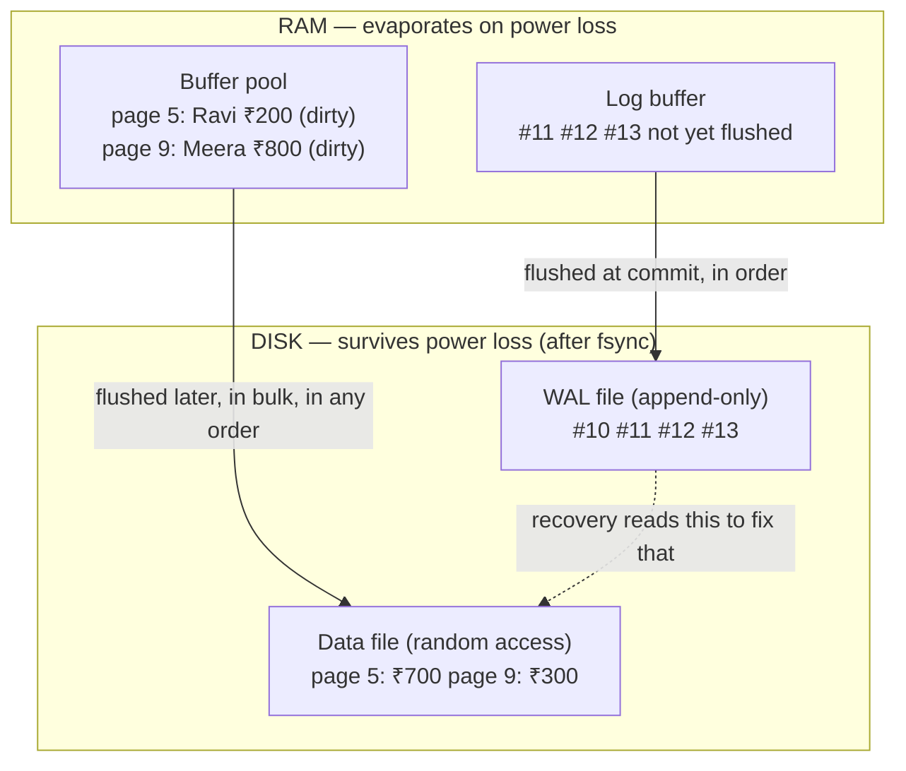
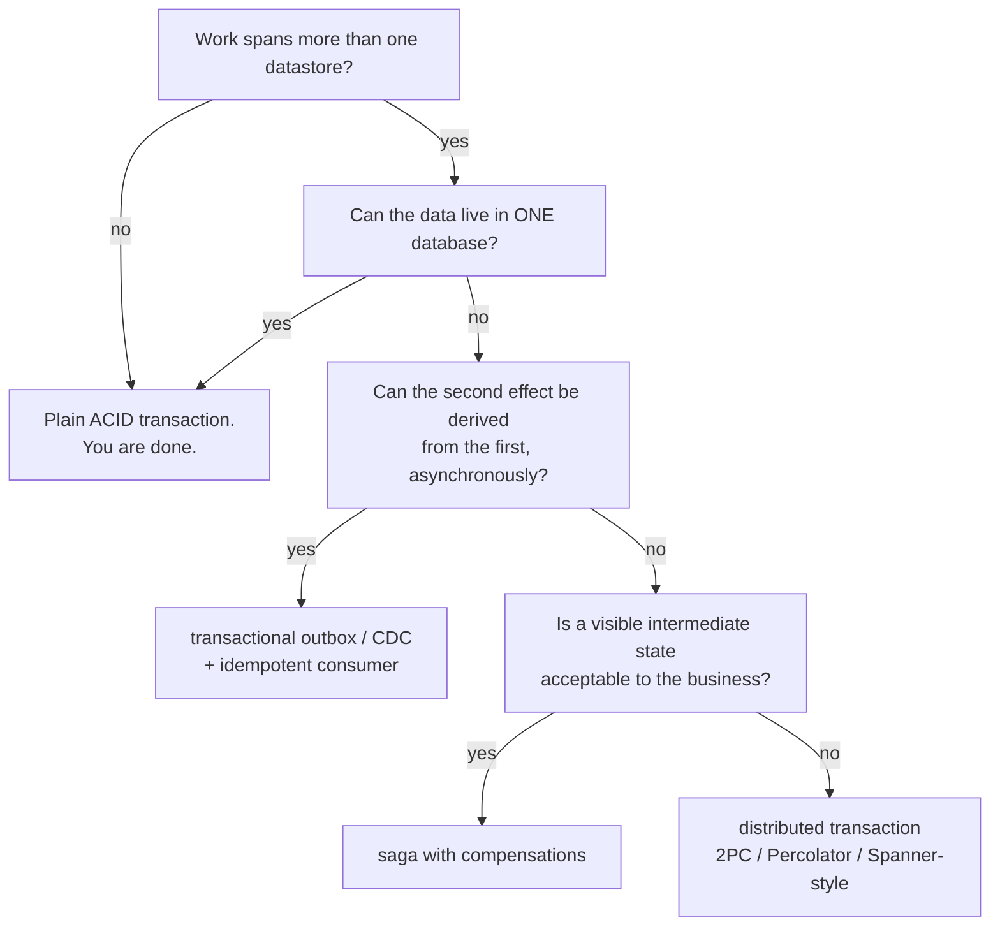
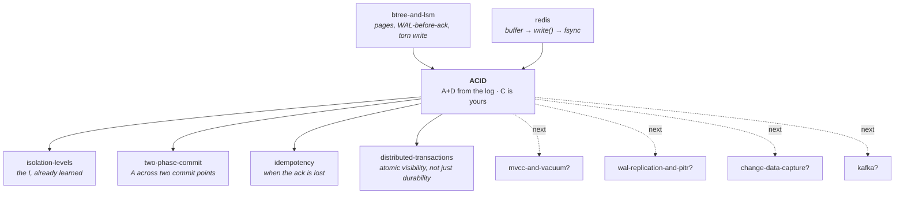

# ACID — the four promises, and the one machine that keeps two of them

> **Lab type:** contract / principle + the storage mechanism behind it ·
> **No runnable code** (doc + interactive visualization + exercises).
>
> **This lab is deliberately lopsided, and here is why.** ACID has four
> letters. You already own one of them outright: the
> [isolation-levels](../08-isolation-levels/) lab spent an entire session proving
> that **I** is a separate dial with its own anomalies, its own mechanisms
> (2PL, MVCC, snapshot, SSI) and its own bills. Re-teaching it here would
> waste your time. So this lab does three things instead:
>
> 1. **A** and **D** — in full depth, because no lab has taught them yet.
>    They turn out to be *the same machine*: a log written before the change.
> 2. **C** — the letter that is not like the others, and the argument for why.
> 3. The **audit**: what the four letters together actually promise you in
>    production, and the four places engineers reliably think they promise
>    more than they do.

---

## Where you are

> **Depth layers in this doc:**
> **BEGINNER MODEL** (§1–§9) → **INTERMEDIATE MODEL** (§10) →
> **ENGINEERING MODEL** (§11–§12) → **PRODUCTION MODEL** (§13)
>
> A checkpoint at each transition tells you what you can do if you stop there.

> **Honesty note up front.** This lab measures nothing itself — it has no
> runnable code by design. Every number in it is either (a) a **measured
> result from one of your earlier labs**, named as such, or (b) a **documented
> vendor behaviour** with the source named. Where I state something I have
> not verified and cannot cite, I say so in the same sentence. The one place
> you can *watch* behaviour here is the visualization, whose simulation is the
> lab's only executable artifact.

---

## 1. WHY — the money that was there yesterday

Somewhere tonight a server loses power in the middle of doing something. Not
during an error, not during a bug — during perfectly ordinary work, halfway
through changing two numbers.

When it comes back up, one of three things is true. Either both numbers
changed, or neither did, or **one did**. The third outcome is the one that
ends careers. A payment was taken from one account and never added to the
other. A seat was released and never re-sold. An order was marked shipped and
its stock never decremented. Nobody gets an error message, no exception is
thrown, nothing is logged as a failure — the system simply comes back up and
carries on being wrong, quietly, forever, until a human notices the totals
don't add up months later.

The other half of the same problem is the opposite: a customer was **told**
their transfer succeeded, the machine died a second later, and when it came
back the transfer wasn't there. No error there either. Just a customer
holding a receipt for something the system has no memory of.

ACID is the name for the promise that neither of those happens. This lab is
about how that promise is actually kept — and, just as importantly, exactly
where it stops being kept.

## 2. THE PROBLEM — Asha, the ledger, and the fire alarm

Forget computers for a while. We are in a small branch office, before
computers, and everything here will map onto a real database piece by piece.

**Asha** is the cashier. The branch keeps one enormous bound book — **the
ledger** — with one page per customer. Ravi's balance is written on **page 5**.
Meera's balance is on **page 9**.

Right now:

| Page | Customer | Balance |
|---|---|---|
| 5 | Ravi | ₹700 |
| 9 | Meera | ₹300 |
| | **Total** | **₹1000** |

That total matters. Money is only ever *moved* between customers in this
branch, never created or destroyed, so **the total must always be ₹1000**.
Hold on to that number — it is the single fact we will check after every
disaster in this lab.

Ravi comes to the counter and asks to send **₹500 to Meera**. For Asha that is
two pen strokes in the ledger:

1. On page 5, cross out ₹700, write **₹200**.
2. On page 9, cross out ₹300, write **₹800**.

And there is one more thing she does, which is not a pen stroke at all: at some
point she looks up and tells Ravi **"done"** — and hands him a receipt. That
moment is a promise. From then on, Ravi will walk out of the building believing
this happened.

Now the constraint that makes this whole subject exist. **At any instant, the
fire alarm can go off**, and it is a real evacuation: everyone leaves
immediately, mid-stroke, mid-sentence, mid-thought. The next morning the branch
reopens and a *different* cashier, **Vikram**, is at the counter.

Vikram was not there. He has no idea what Asha was doing. He cannot ask her.
Everything that existed only in Asha's head, or as a note on her desk, is gone.
**Vikram knows only what is written in books that survived the night.**

That is the entire problem of this lab, and it has two halves:

- **What if the alarm goes off between stroke 1 and stroke 2?** The ledger says
  Ravi has ₹200 and Meera has ₹300. Total: **₹500**. The ₹500 left Ravi and
  never arrived; it has ceased to exist, and no one is aware of it.
- **What if the alarm goes off just after Asha said "done" to Ravi, but before
  she wrote anything down?** Ravi has a receipt. The books have nothing.

> **🔮 Predict:** Suppose we tell Asha "always do stroke 1 and stroke 2 as fast
> as you can, right next to each other, and only then say *done*." Does that
> fix either half of the problem?
>
> <details><summary>Reveal</summary>
>
> **Neither half, and this is the most important idea in the lab.** Speed
> changes the *probability* of being interrupted between the two strokes; it
> does not change the *possibility*. There is no pair of actions so fast that
> nothing can happen between them, because the alarm is not polite — it can
> fire in the gap no matter how narrow you make the gap. "Rare" is not
> "impossible", and at ten thousand transfers a second, "rare" happens several
> times a day.
>
> Every correct answer in this lab has the same shape: **not "make the gap
> small" but "make the gap survivable"** — arrange things so that whoever
> arrives after the interruption can figure out what to do.
> </details>

## 3. THE NAIVE SOLUTION — just be careful with the ledger

The obvious plan is the one nearly everyone writes first. Work directly in the
ledger, in place, and be careful:

- Change page 5.
- Change page 9.
- Tell Ravi "done".

Let's give it every advantage. Asha is careful, she is fast, she does the two
strokes back to back, and she only says "done" after both are on paper. This
is the design equivalent of an application that just issues two `UPDATE`
statements and then returns success.

It has one genuinely good property: after both strokes, the ledger is right,
and it is right *permanently*, because the ledger is the thing that survives
the night. If nothing interrupts her, this design is perfect.

## 4. THE FAILURE — two ways it breaks, and the second one is worse

**Failure A — the gap.** The alarm fires between stroke 1 and stroke 2.

```
Ledger after the fire:   page 5: Ravi ₹200      page 9: Meera ₹300
                         Total: ₹500            ← ₹500 gone
```

Vikram opens the branch. He sees ₹200 and ₹300. He has **no way to know**
anything is wrong: ₹200 is a perfectly plausible balance for Ravi, ₹300 is a
perfectly plausible balance for Meera. The ₹500 that left Ravi and never reached
Meera has simply ceased to exist. There is nothing in the ledger that
says "this page was changed as part of something bigger that never finished."
The evidence of the half-finished job was in Asha's head, and Asha's head is
not in the building.

This is the failure of **all-or-nothing**. The two strokes were meant to be one
indivisible act, and the ledger has no idea they were related.

**Failure B — the smudge.** This one is easy to miss and it is worse. Suppose
the alarm fires *while Asha's pen is on page 5*. She has crossed out the old
number and written "2" of "200". The page now reads `₹2`. Or in the version
that actually happens to computers: the page is left **half old and half new**,
and there is no way to tell by looking at it.

Failure A leaves the ledger *plausible but wrong*. Failure B leaves a page
*damaged*, and the original value is gone too, so even a very clever Vikram
cannot reconstruct it from the ledger alone. Whatever we invent has to handle
both, and note the shape of the second one: **the old value was destroyed by
the very act of writing the new one.**

> **🔮 Predict:** Asha's fix attempt: "I'll write the new balances on a
> scrap of paper on my desk first, and copy them into the ledger only once both
> are ready." Does that fix Failure A?
>
> <details><summary>Reveal</summary>
>
> **No — it moves the gap, it doesn't close it.** Now there are still two
> strokes into the ledger (page 5, then page 9), and the alarm can still fire
> between them. Worse, if the alarm fires while the scrap is still on the desk,
> the scrap burns and *nothing* happened — which is at least safe for
> Failure A, but if Asha had already said "done" to Ravi, we've now created the
> second half of §2's problem instead.
>
> The scrap of paper is a real idea and we will keep it — it is exactly what a
> database's memory is — but on its own it just relocates the danger.
> </details>

## 5. THE REAL REQUIREMENT — what we actually need Vikram to be able to do

Strip away the mechanisms and state the goal in plain words. We need this to be
true **at every single instant**, so that no matter when the alarm fires:

> When Vikram opens the branch, he must be able to bring the books to a state
> that contains **every transfer Ravi was told was done**, and **no part of any
> transfer that was not**.

Read it twice, because there are two separate promises hiding in that one
sentence, and they will get separate names in a moment:

- **No part of an unfinished job may survive.** Not one of its two strokes. It
  is all of it or none of it.
- **Every finished job must survive.** If a receipt was handed over, the books
  must eventually agree, and no fire may take it back.

And there is a third thing we need, which is easy to overlook: **Vikram must be
able to do this himself, from paper alone, without asking anybody.** A design
that requires Asha's memory is not a design.

Everything from here on is the pursuit of that sentence.

## 6. THE KEY IDEA — write down what you're about to do, before you do it

Here is the whole invention, in one line:

> **Before touching the ledger, write your intention in a separate book that
> is safe — and say "done" to the customer only once your intention is safely
> written.**

Asha gets a second, much smaller book: **the day-book**. It is never neat. It
is append-only — she only ever adds a line at the bottom, never crosses
anything out. Each line says what she is about to do, in enough detail to
either **finish it** or **take it back**.

For Ravi's transfer, the day-book gets these lines:

```
#10   transfer T1 begins
#11   T1: page 5 (Ravi)   was ₹700   →  will be ₹200
#12   T1: page 9 (Meera)  was ₹300   →  will be ₹800
#13   T1 COMMITTED                                     ← the "done" moment
```

Look at line #11 and #12 for a second: each records **both the old value and
the new value**. That is not redundancy, it's the two directions of travel:

- The **new** value lets Vikram **finish** a job that was promised but not
  fully written into the ledger.
- The **old** value lets Vikram **take back** a job that was written into the
  ledger but never promised.

And line #13 is the hinge of the entire subject. **Asha may not say "done" to
Ravi until line #13 is safely written.** Once it is written, the transfer is
real forever, even if not one stroke has touched the ledger yet — because the
day-book alone contains everything Vikram needs to make the ledger right.

Notice what just happened to the ledger's job. It is no longer the thing that
records the truth first. It is a **slow, tidy copy** of a truth that already
lives in the day-book. The ledger can lag by minutes and it doesn't matter.

## 7. TERMINOLOGY — the professional names, now that you've earned them

Now we can name things. Each load-bearing term gets: plain meaning, technical
meaning, why the word exists, a concrete example from our branch, and how it
connects to something you already know.

### 7.1 The four promises: A, C, I, D

**Transaction** — *plain:* one job that should count as a single act, even
though it's made of several steps. *Technical:* a unit of work with a defined
start and a defined end (`BEGIN` … `COMMIT`/`ROLLBACK`) to which the database
attaches guarantees. *Why the word:* Latin *trans-agere*, "to drive through" —
the point is that it is driven through to a single conclusion. *Our branch:*
Ravi's transfer, T1, made of two pen strokes. *Connects to:* you already used
this word constantly in [isolation-levels](../08-isolation-levels/); here we
finally look at what happens to it when the machine dies.

**Commit** — *plain:* the moment the job officially counts. *Technical:* the
point at which the database's promise attaches to the transaction; after it,
the effects are guaranteed to survive. *Why the word:* you *commit* to it —
before this point you may still change your mind, after it you may not. *Our
branch:* day-book line #13, and only then telling Ravi "done".

**Abort / rollback** — *plain:* changed my mind, undo everything this job did.
*Technical:* terminating a transaction such that none of its effects remain.
*Why two words:* *abort* is the decision, *rollback* is the work of carrying it
out. *Our branch:* Ravi says "actually, cancel that" after stroke 1 — Asha must
put page 5 back to ₹700 using the "was ₹700" she wrote in line #11.

Now the four letters. **ACID is not a mechanism, it's a contract** — four
promises a database makes about transactions.

| | Promise, in plain words | Status in this lab |
|---|---|---|
| **A** — Atomicity | All of the job happens, or none of it. | **Taught here, in depth.** |
| **C** — Consistency | The data still obeys its rules afterwards. | The odd one out — §12.2. |
| **I** — Isolation | Concurrent jobs don't corrupt each other. | **You already own this** — [isolation-levels](../08-isolation-levels/). |
| **D** — Durability | Once committed, it survives crashes. | **Taught here, in depth.** |

One-line refresher on **I**, since you proved all of this yourself: isolation is
a separate dial with its own settings, and its default setting permits real
data loss — your own measured result was **8 threads × 40 increments ending on
~60 of 320, about 80% of the work gone with every transaction committing
successfully**. Its mechanisms (2PL, MVCC, snapshot isolation, SSI) and its
anomalies (dirty read, lost update, write skew) are that lab's material and
this lab will not repeat them. What this lab adds is the observation that
**A and D come from a completely different machine than I does** — which is
precisely why isolation could be a dial in the first place.

### 7.2 Where data lives, and the three moments of "written"

**Page** — *plain:* the fixed-size chunk a database reads and writes at a time.
*Technical:* the unit of storage I/O, typically 8 KB (PostgreSQL) or 16 KB
(InnoDB); rows live inside pages and a database never reads or writes less than
one. *Why the word exists:* it names the fact that storage has a *granularity*
— you cannot change one byte on disk, you replace a whole page. *Our branch:*
one numbered page of the ledger, holding Ravi's balance. *Connects to:*
[btree-and-lsm](../05-btree-and-lsm/), where you counted cold pages and measured
119× write amplification — that was this same page, and this lab explains what
else has to happen every time one of them is written.

**Buffer pool** — *plain:* the database's working memory, holding copies of
pages it's currently using. *Technical:* an in-memory cache of disk pages,
finite in size, where all reads and writes actually happen. *Why the word:* it
*buffers* between fast CPU and slow disk. *Our branch:* Asha's desk, where she
keeps the couple of ledger pages she's working on right now. It burns.

**Dirty page** — *plain:* a page in memory that's been changed but whose change
hasn't reached the disk yet. *Technical:* a buffer-pool page whose in-memory
contents differ from the on-disk version. *Why the word:* "dirty" = needs
cleaning, i.e. needs writing out. *Our branch:* Asha has mentally decided Ravi's
balance is ₹200 but page 5 in the bound ledger still says ₹700. *Connects to:*
this is the same "dirty" as in *dirty read*, but a completely different
concern — dirty read is about **who can see it**, a dirty page is about **where
it is stored**. Same adjective, two unrelated axes.

**Write-ahead log (WAL)** — *plain:* the day-book. A separate append-only file
where every intended change is recorded **before** the change is made.
*Technical:* a sequential on-disk log of log records; the rule is that a log
record describing a change must reach durable storage before the modified page
does. *Why the words:* the log is *written ahead* of the data. *Our branch:*
lines #10–#13. *Connects to:* you already met WAL twice — as the LSM's write
path in [btree-and-lsm](../05-btree-and-lsm/) (the term "WAL-before-ack" is
already in your knowledge map) and as Redis's AOF in [redis](../13-redis/). This
lab is where you finally take it apart.

**Log record** — one line in the day-book. Typical kinds: *begin*, *update*
(with before-image and after-image), *commit*, *abort*, and one more we will
invent in §10.5.

**LSN (log sequence number)** — *plain:* the line number in the day-book.
*Technical:* a monotonically increasing identifier for a position in the log,
usually a byte offset, so it doubles as "how far into the log is this".
*Why it exists:* it gives every change in the entire database **one global
order** and a name you can point at from elsewhere — which is the trick that
makes recovery idempotent (§10.4). *Our branch:* the `#11`, `#12` in the
listing above. *Connects to:* PostgreSQL exposes it directly — an LSN like
`0/16B3A50` in `pg_stat_replication` is exactly this number, and "replication
lag" is a subtraction between two of them.

**Now the three moments** — and this one you have already measured, so it gets
a refresher, not a lesson. In the [redis](../13-redis/) lab you established that
"written" is three distinct events, not one:

| Moment | Where the bytes are | Survives the process dying? | Survives power loss? |
|---|---|---|---|
| in the application's own buffer | our own memory | ❌ | ❌ |
| after `write()` | the **OS page cache** — kernel memory | ✅ | ❌ |
| after `fsync()` | the physical device | ✅ | ✅ |

Your measured result from that lab: **`kill -9` with `appendfsync no` lost
nothing**, because the page cache belongs to the kernel and the kernel didn't
die; **power loss cost one fsync window — 530 ms of traffic**; and
`appendfsync always` bought zero loss at **3.4× lower throughput**. Everything
in §13 about `synchronous_commit` and `innodb_flush_log_at_trx_commit` is that
same three-way distinction wearing a different vendor's clothes.

**fsync** — *plain:* "actually put it on the physical device, and don't come
back until you have". *Technical:* a system call that forces previously written
data for a file out of kernel caches to stable storage. *Our branch:* Asha
doesn't just write the day-book line on a slip in her out-tray; she posts the
slip into a **fireproof safe bolted to the floor**. The out-tray burns. The safe
doesn't.

**Durable** — *plain:* it will still be there tomorrow. *Technical:* present on
storage that survives the failure you are designing against — and that last
clause is doing enormous work, which §12.3 is entirely about.

### 7.3 The two directions of repair

**Redo** — *plain:* finish a job that was promised but not fully written into
the ledger. *Technical:* re-apply a committed change to a page using the log
record's **after-image**. *Why the word:* the work is being *done again*.
*Our branch:* line #13 exists, but page 9 still says ₹300, so Vikram writes
₹800 into page 9.

**Undo** — *plain:* take back a job that reached the ledger but was never
promised. *Technical:* revert a change using the log record's **before-image**.
*Our branch:* page 9 says ₹700 because of a transfer that never committed, so
Vikram writes ₹800 back.

**Recovery** — *plain:* what Vikram does before opening the counter.
*Technical:* the startup procedure that reads the log and brings the data files
to the state defined by §5's sentence. *Our branch:* Vikram's morning, reading
the day-book cover to cover before he serves anyone.

**Checkpoint** — *plain:* a note saying "everything before this line is already
safely in the ledger, don't bother reading further back". *Technical:* a record
marking a point from which recovery can start, plus the flushing work that
makes it true. *Our branch:* Asha, at 4 p.m., copies every pending change into
the bound ledger and writes in the day-book: *"#500 — checkpoint: ledger is
current as of here."* *Connects to:* the word is already in your knowledge map
from [btree-and-lsm](../05-btree-and-lsm/) and from Redis's RDB snapshots — same
idea, third context.

## 8. MENTAL MODELS — two pictures, and where the first one lies

### 8.1 The simple model — the day-book and the ledger

Carry this picture around:

> A cashier writes every intention in a **rough day-book** the instant she
> decides it, and posts it into a **fireproof safe**. Only then does she tell
> the customer "done". The neat **bound ledger** gets updated whenever she has
> a spare moment. If the building is evacuated, the next cashier reads the
> day-book and makes the ledger agree with it: **finishing** anything marked
> committed and **taking back** anything that isn't.

### 8.2 The engineering model — three places and one rule



Two things to notice in that diagram, because they are the whole design:

- The arrow into the **data file** is lazy, unordered and can happen at any
  time — including for changes that have not committed.
- The arrow into the **WAL** is eager and strictly ordered, and there is one
  law governing the relationship between them:

> **The WAL rule.** A log record describing a change to a page must be durable
> **before** that page's new contents are written to the data file. And a
> transaction's commit record must be durable **before** the client is told
> "committed".

Everything else in this lab is a consequence of that two-sentence rule.

### 8.3 The mapping

| Branch office | Database | Fails how? |
|---|---|---|
| Asha | the running database process | dies with the machine |
| Asha's desk | the **buffer pool** (RAM) | lost on any crash |
| The out-tray of written slips | the **OS page cache** | survives process crash, lost on power loss |
| The fireproof safe | the physical **disk** after `fsync` | survives both |
| The rough **day-book** (in the safe) | the **WAL file** | append-only, sequential |
| The bound **ledger** (in the safe) | the **data file** | random-access, updated lazily |
| Line number in the day-book | the **LSN** | |
| Telling Ravi "done" | the **commit ack** to the client | |
| The **fire alarm** | power loss / `kill -9` / kernel panic | can strike at any instant |
| **Vikram's morning** | **crash recovery** at startup | must work from paper alone |
| The 4 p.m. tidy-up | the **checkpoint** | |

### 8.4 Where the analogy breaks

An analogy left unqualified becomes a wrong belief. Four places this one lies:

1. **Paper is never half-written in a way you can't see.** If Asha's pen stops
   mid-digit you can *tell*. A disk writing an 8 KB page can be interrupted
   after 2 KB and leave a page that is half-old, half-new **and looks
   completely normal** — no checksum in the page contents, nothing obviously
   wrong. This is a **torn page**, and §10.6 exists entirely because of it. The
   engineering model must therefore assume that a page write is *not* atomic,
   which the paper model would never suggest.

2. **Vikram can read the whole day-book in a minute; a real WAL can be
   gigabytes.** Recovery time is a production number people get paged about.
   That gap is exactly why checkpoints exist (§10.4) and why the checkpoint
   interval is a tuning knob with a real tradeoff.

3. **Paper never lies about being in the safe.** A disk absolutely does: many
   consumer SSDs and some virtualised or misconfigured storage stacks
   acknowledge `fsync` while the data is still in a volatile on-device write
   cache. This is documented behaviour that PostgreSQL warns about in its own
   reliability chapter. The paper model has no equivalent of "the safe lied",
   and so it cannot teach you to be suspicious — but you should be. (I have not
   tested any specific device; I am reporting the vendor documentation.)

4. **Asha is one person, so her work is naturally serial.** A real database has
   many transactions in flight at once, interleaved, sharing pages. That is the
   *isolation* problem, which this analogy quietly hides — and it hides it so
   well that it is worth saying out loud: **nothing in this lab's mechanism
   prevents two concurrent transactions from corrupting each other's logic.**
   The log gives you A and D. It does not give you I. That separation is the
   lab's punchline and §12.1 states it precisely.

## 9. VISUALIZATION — watch the alarm go off

Open **`visualization.html`** in this directory, or the published version:
<https://claude.ai/code/artifact/584af82b-f8f6-4e22-8580-5d955149d4cf>

**What you are looking at.** Three stacked bands matching the diagram in §8.2:
your transactions at the top, **RAM** in the middle (buffer pool + log buffer,
amber = will evaporate), **DISK** at the bottom (WAL file + data file, teal =
survives). Every box shows real values — the actual balances, the actual log
lines with their LSNs.

**What to do first.** Press **"Run the whole story"**. It plays the transfer,
crashes the machine at the worst possible moment, and recovers — narrating each
step in a full sentence. Watch the **Total** readout: it must return to ₹1000.

**Then experiment.** The controls that matter:

- **CRASH** — kill it at any instant you like, then **RECOVER** and watch the
  three passes run.
- **Process crash vs power loss** — the difference between losing Asha's desk
  and losing the out-tray too. This is the redis lab's three moments, live.
- **Policy switches** — turn the WAL off entirely, switch between *steal* and
  *no-steal*, *force* and *no-force*, turn off full-page writes. Each switch
  breaks something specific; the verdict panel names which promise died.
- **Six predict-then-run scenarios** — commit before the ack, crash during the
  undo pass, torn page, and so on. Guess before you press.

Everything in §10 and §11 below has a scenario on that page. Read a section,
then go run its scenario.

---

> ### ✅ CHECKPOINT — end of the BEGINNER MODEL
>
> If you stop here you can already explain, correctly and to anyone: what a
> transaction is, what the four letters promise, why "be fast and careful"
> cannot work, and the one idea that fixes it — *write your intention to a safe
> place before you act, and only promise once that's safe*. You could sit in a
> design review and say "where's the write-ahead log in this?" and mean it.
>
> **What the next layer adds:** the actual mechanism, built the way it was
> historically built — a first version that a smart engineer would design, then
> the specific failure that breaks it, then the refinement that fixes it, five
> times over. By the end of §10 you will be able to derive ARIES, the recovery
> algorithm essentially every relational database uses, rather than memorise it.

---

## 10. THE ACTUAL MECHANISM — built five times, because the first four break

We are going to build the recovery machine the way it was actually arrived at.
Each version is what a competent engineer would design given what they knew;
each one then meets a specific failure, and the fix for that failure is a
feature you will recognise from a real database's documentation.

Throughout, the branch's state stays concrete:

```
Ravi   = page 5   Meera = page 9   Total must always be ₹1000
T1 = "move ₹500 Ravi → Meera"   T2 = "move ₹100 Meera → Ravi"
```

### 10.1 Mechanism v1 — log the new values, commit, write pages later

The simplest design that respects §6:

1. `BEGIN` — append a *begin* record.
2. Each change: append an *update* record holding the **after-image** (the new
   value), then change the page **in memory only**.
3. `COMMIT` — append a *commit* record, **fsync the log**, then tell the client
   "committed".
4. Whenever convenient — later, in the background — write the changed pages out
   to the data file.

And two rules to go with it:

- **Never write a page belonging to an uncommitted transaction to disk.**
  (We'll name this policy in a moment.)
- **Don't force the pages out at commit time.** The log record is enough.

**Why this works for the obvious crash.** Crash right after step 3, with page 5
and page 9 both still only in memory:

```
Log on disk:   #101 T1 BEGIN
               #102 T1 p5 → ₹200
               #103 T1 p9 → ₹800
               #104 T1 COMMIT
Data file:     page 5: ₹700     page 9: ₹300        ← nothing applied yet
```

Vikram scans the log, sees T1 has a commit record, and **redoes** #102 and #103
against the data file. Result: ₹200 and ₹800, total ₹1000, and Ravi's receipt
is honoured. The commit ack was given at step 3 and it was legitimate, because
by then the log — the only thing that mattered — was in the safe.

Note what v1 needs: **redo only**. It never needs before-images, because an
uncommitted change never reaches disk.

> **🔮 Predict:** The buffer pool is finite — say it holds 4 pages, and it's
> full. A new transaction needs a page that isn't in memory, so one page must
> be evicted to make room. Every page currently in the buffer pool has been
> modified by a transaction that hasn't committed yet. What does v1 do?
>
> <details><summary>Reveal</summary>
>
> **v1 is stuck.** Its rule forbids writing an uncommitted page to disk, so it
> cannot evict any of them, so it cannot free a frame, so it cannot proceed
> until one of those transactions commits. Two consequences, both fatal in
> practice:
>
> - **A transaction can never modify more data than fits in the buffer pool.**
>   `UPDATE orders SET status='archived'` over ten million rows would need ten
>   million rows' worth of pages pinned in RAM simultaneously.
> - **Long transactions strangle everyone else**, because their pages are
>   unevictable for their entire lifetime.
>
> The obvious fix is to allow the eviction. And the instant you allow it, the
> disk can contain changes from a transaction that never commits — which v1
> has no way to take back, because it only ever recorded new values.
> </details>

### 10.2 Mechanism v2 — allow eviction, so record the old values too

We now permit the buffer manager to **steal**: to write out a dirty page even
though the transaction that dirtied it hasn't committed. This is not an
optional nicety; without it a database cannot process more data than it has
RAM.

The price is exact: **every update record must also carry the before-image.**

```
#106  T2  page 9   before = ₹800   after = ₹700   prevLSN = #105
        ^^^^^^^^^^^^^^^^^^^^^^^^  the new half — this is what buys undo
```

Now two named policies, and the 2×2 that every storage engineer knows:

**Steal / no-steal** — may a dirty page from an *uncommitted* transaction be
written to disk? *Steal* = yes. *Why the word:* the buffer manager "steals" the
frame back from the transaction that was using it.

**Force / no-force** — must **all** of a transaction's dirty pages be written
to disk *before* commit returns? *Force* = yes.

| | **force** | **no-force** |
|---|---|---|
| **no-steal** | need neither undo nor redo | need **redo** only |
| **steal** | need **undo** only | need **undo and redo** |

- **no-steal** fails for the reason you just predicted: transaction size capped
  by RAM.
- **force** fails on cost: committing would mean writing every touched page —
  scattered *random* I/O across the data file — before the client hears
  "committed". A hot page touched by a thousand transactions gets written a
  thousand times. Compare with no-force, where commit is **one sequential
  append plus one fsync to a single file**, and the hot page is written once,
  eventually, carrying all thousand changes at once.

So essentially every serious database picks **steal + no-force**, which is
exactly the corner requiring **both** undo and redo. That is not a coincidence
or a complication — it is what you buy with the two cheapest properties in the
table.

### 10.3 The same machinery does ordinary rollback

Before moving on, notice something that saves an entire subsystem. When Ravi
says "cancel that" and T1 aborts *while the database is running* — no crash
involved — what does the database do? It walks T1's log records backward and
applies their before-images. **Exactly the undo pass, on a healthy system.**

This is why each record carries a **prevLSN**: a pointer to the previous log
record *of the same transaction*, so one transaction's records form a backward
chain through a log full of everybody else's records.

```
T2's chain:   #106 ──prevLSN──▶ #105 (BEGIN)
T1's chain:   #104 ──▶ #103 ──▶ #102 ──▶ #101 (BEGIN)
```

Rollback = follow the chain, revert each step. One implementation serves both
"the user changed their mind" and "the building burned down".

### 10.4 Mechanism v3 — don't read the whole log, and don't apply anything twice

Two problems remain with v2, and they are the ones that show up in production
dashboards.

**Problem: recovery scans from the beginning of time.** The log is append-only
and never rewritten, so Vikram's morning gets longer every day. A database that
takes four hours to start is not available, and availability is the thing you
were buying.

**Fix: the checkpoint.** Periodically the database writes a checkpoint record
naming (a) which transactions are currently running and (b) which pages are
currently dirty and from which LSN. Recovery starts there instead of at the
beginning. *In the branch:* Asha's 4 p.m. note.

The tradeoff is a straight dial and you will meet it as a config parameter:
**frequent checkpoints = fast recovery, more constant background I/O; rare
checkpoints = less I/O, longer outage after a crash.**

**Problem: redo may be applied to a page that already has it.** In the crash
below, page 9 was stolen to disk *after* T1's change was applied to it. If
recovery blindly re-applies #103, that is fine for a "set balance to ₹800"
record — but for any record expressed as a *change* rather than a *value*
("add ₹500") it would double the money. And recovery itself can crash and
re-run, so "applied exactly once" is not something we can arrange by being
careful.

**Fix: put the LSN on the page.** Every data page carries a **pageLSN** — the
LSN of the most recent log record whose change is already reflected in this
page. Redo then has a rule:

> Apply log record *L* to page *P* **only if** `L.LSN > P.pageLSN`.

That single comparison makes redo **idempotent**: running it once, twice or
fifty times produces the same page. Recovery can now crash and restart as often
as it likes. *Connects to:* this is the same shape as the idempotency key in
the [idempotency](../49-idempotency/) lab and the same shape as "expected version"
in [event-sourcing](../50-event-sourcing/) — **a stored marker that lets a
repeated operation recognise itself.** Third context, same trick.

### 10.5 The three passes, worked by hand

Here is the full recovery, with real numbers. This is the trace to remember.

**The log on disk when the machine died:**

```
#100  CHECKPOINT        active transactions: (none)   dirty pages: (none)
#101  T1 BEGIN
#102  T1  page 5  before ₹700  after ₹200   prevLSN #101
#103  T1  page 9  before ₹300  after ₹800   prevLSN #102
#104  T1 COMMIT                             prevLSN #103   ← Ravi was told "done"
#105  T2 BEGIN
#106  T2  page 9  before ₹800  after ₹700   prevLSN #105
      *** CRASH ***
```

**The data file on disk when the machine died** — and this is the messy,
realistic part. The buffer manager happened to evict page 9 (steal!) after T2
had touched it, and never got around to page 5:

```
page 5:  ₹700   pageLSN #100      ← T1's change never reached disk
page 9:  ₹700   pageLSN #106      ← BOTH T1's and T2's changes reached disk
Total on disk: ₹1400              ← wrong in a way that flatters nobody
```

**What correctness demands:** T1 committed, so its effects must be present.
T2 did not, so its effects must be gone. Target: page 5 = ₹200, page 9 = ₹800,
total ₹1000.

---

**PASS 1 — ANALYSIS.** *What was going on when the lights went out?* Scan
**forward** from the last checkpoint (#100), building two tables.

| Read | Transaction table | Dirty page table |
|---|---|---|
| #101 T1 BEGIN | T1: running | |
| #102 T1 p5 | | p5 first dirtied at #102 |
| #103 T1 p9 | | p9 first dirtied at #103 |
| #104 T1 COMMIT | T1: **committed → winner**, remove | |
| #105 T2 BEGIN | T2: running | |
| #106 T2 p9 | | (p9 already listed) |
| *end of log* | T2 still running → **loser** | |

Analysis writes nothing and changes nothing. It produces two answers:
**losers = {T2}**, and **redo must begin at LSN #102** (the earliest point any
page might have fallen behind).

**PASS 2 — REDO.** *Put the world back exactly as it was at the instant of the
crash.* Scan **forward** from #102, and for every update record compare
against the page's pageLSN:

| Record | Page's pageLSN | Decision | Result |
|---|---|---|---|
| #102 p5 → ₹200 | #100 < #102 | **apply** | p5 = ₹200, pageLSN #102 |
| #103 p9 → ₹800 | #106 ≥ #103 | **skip** — already there | p9 unchanged |
| #106 p9 → ₹700 | #106 ≥ #106 | **skip** — already there | p9 unchanged |

State after redo: **page 5 = ₹200, page 9 = ₹700, total ₹900.**

Stop and look at that total. **It is wrong, and it is supposed to be.** Redo
did not try to produce a correct database; it reproduced the crash instant
faithfully — including T2's half-finished damage. This is called **repeating
history**, and it is the design decision that makes ARIES simpler than its
predecessors:

> **Why redo a loser's change just to undo it three lines later?** Because if
> redo skipped losers, the undo pass would face two possible starting states
> per page ("the loser's change is here" / "it isn't") and would need to check.
> By repeating history first, undo always starts from a state identical to the
> pre-crash state — which is exactly the state that **ordinary runtime
> rollback** (§10.3) starts from too. One undo implementation, one set of
> assumptions, no special cases. The extra work is paid once; the removed
> complexity is paid forever.

**PASS 3 — UNDO.** *Take back everything the losers did.* Walk T2's prevLSN
chain **backward** from its last record.

Two new pieces of vocabulary arrive here, both invented for one reason: **undo
must survive being interrupted**, because recovery can itself be interrupted.

- A **CLR (compensation log record)** is a log record saying *"the undo of
  record X has been performed"*. It is written to the log **before** the revert
  touches the page, exactly like any other change — the WAL rule has no
  exceptions. Its defining rule: **a CLR is never itself undone.**
- **undoNext** is a pointer inside a CLR naming the next record of that
  transaction still needing undo. It is what lets a restarted rollback resume
  in the middle instead of beginning again.

With those, the pass runs:

| Step | Action | Log written | Result |
|---|---|---|---|
| at #106 | revert p9 to its before-image ₹800 | **#107 CLR**: undoes #106, p9 = ₹800, **undoNext = #105** | p9 = ₹800, pageLSN #107 |
| follow undoNext → #105 | that's T2's BEGIN — nothing to revert | #108 T2 **END** (abort complete) | |

**Final state: page 5 = ₹200, page 9 = ₹800, total ₹1000.** T1 present, T2
absent. §5's sentence is satisfied.

> **🔮 Predict:** The machine crashes *again*, right in the middle of Pass 3 —
> after page 9 was reverted to ₹800 but before recovery finished. We restart
> and run the whole thing again from the checkpoint. Does it come out right?
>
> <details><summary>Reveal</summary>
>
> **Yes — but only because of that CLR, and the reason is not the one most
> people guess.**
>
> The common guess is "without a CLR we'd undo twice and double-undo the
> money". For *this* record that's not true: the undo writes the literal value
> ₹800 (a physical before-image), so doing it twice is harmless. Being precise
> about this matters, so here is what CLRs actually buy:
>
> 1. **Undo isn't always idempotent.** Real databases log much of their undo
>    *logically* or *physiologically* — "remove key K from this index page",
>    "give back 100" — because a physical before-image of an 8 KB page per row
>    change is ruinously large. Re-running "give back 100" twice gives back
>    ₹200. The CLR records that this particular undo **has already happened**.
> 2. **Rollback must terminate.** Without a record of progress, a crash during
>    undo restarts the rollback from scratch. A transaction that modified ten
>    million rows, crashing 90% of the way through its rollback, would start
>    over — and could, in a crash-loop, never finish. With CLRs, each restart
>    resumes from `undoNext` and the remaining work only shrinks.
> 3. **A CLR is never undone.** It is redo-only, by rule. That closes the door
>    on the pathological case of undoing an undo.
>
> So: on restart, analysis reads #107, sees T2's undo has progressed to
> `undoNext = #105`, redo re-applies the CLR if page 9 hasn't got it, and undo
> resumes at #105 — which is just the BEGIN. Done, correctly, from any number
> of nested crashes.
> </details>

### 10.6 Mechanism v4 — the page that is half old and half new

Redo assumes something we have not justified: that a page on disk is a
*coherent* page, just possibly an old one. Take that away and redo breaks.

A page write is one `write()` of 8 KB or 16 KB. The storage device underneath
works in sectors — historically 512 bytes, commonly 4 KB. **A power loss during
the write can leave some sectors updated and others not.** The result is a
**torn page**: internally inconsistent, and nothing about it looks wrong from
the outside.

Why redo can't fix it: most redo records are *physiological* — "on page 9, set
the balance field of the row at slot 3 to ₹800". That instruction is only
meaningful if the page's slot directory, row offsets and headers are coherent.
If half the page is from before a row was moved and half from after, redo
writes ₹800 into a location that is now garbage, and the pageLSN itself may be
from either half, so recovery can't even tell which records to apply.

Two production answers, and you should recognise both:

- **Full-page writes (PostgreSQL, `full_page_writes = on`, default).** The
  first time a page is modified after each checkpoint, the **entire page image**
  goes into the WAL, not just the change. If that page is later found torn,
  recovery replaces it wholesale from the log copy and then replays subsequent
  changes onto a known-good page. Cost: WAL volume spikes right after every
  checkpoint. This is a documented and frequently-discussed PostgreSQL
  behaviour, and it is why checkpoint tuning shows up in WAL-size complaints.
- **Doublewrite buffer (MySQL/InnoDB, `innodb_doublewrite = ON`, default).**
  Every page is written **twice**: first sequentially into a scratch area, then
  to its real home. If the home copy is torn, InnoDB restores it from the
  scratch copy. Cost: roughly double the page-write I/O (sequential, so cheaper
  than it sounds).

Same problem, two different bills. Neither is free, and turning either off is a
"my data is expendable" switch, not a performance tip.

### 10.7 Mechanism v5 — the fsync in the commit path, and the queue behind it

One thing has been glossed over. §10.1 said "append a commit record, **fsync the
log**, then tell the client committed". That fsync is the single most expensive
thing in the commit path, and it is unavoidable — it is the exact moment the
promise becomes real. Everything else in a commit can be lazy; this cannot.

So the commit path costs at minimum **one durable write to one sequential
file**, which is the best possible shape for a disk (no seeking, one file). The
whole no-force design exists to make that sentence true.

But a naive implementation does one fsync **per transaction**, and now
throughput is capped by the device's sync rate no matter how many CPUs you own.
The fix is a batching trick that appears in every mature engine:

**Group commit.** When several transactions want to commit at nearly the same
time, their commit records are already adjacent in the same log file. One
`fsync` makes *all* of them durable. So the engine waits a moment, collects the
commit records that arrive in that window, syncs once, and acks everyone.

The trade is explicit: **each transaction pays a little extra latency; the
system gains a large multiple of throughput.** PostgreSQL exposes the waiting
window as `commit_delay`/`commit_siblings`; MySQL has binary-log group commit
with `binlog_group_commit_sync_delay`. *(I have not benchmarked these; the
mechanism and the parameter names are from the vendors' documentation.)*

*Connects to:* this is the identical shape as the batching you have seen
elsewhere — one expensive synchronous step amortised over many callers, paid
for in latency. Your [work-pressure-and-deadlines](../61-work-pressure-and-deadlines/)
lab's queueing arithmetic applies to it directly.

### 10.8 The finished machine

```mermaid
sequenceDiagram
  participant C as Client
  participant DB as Database (RAM)
  participant W as WAL (disk)
  participant D as Data file (disk)
  C->>DB: BEGIN; UPDATE Ravi; UPDATE Meera
  DB->>DB: change pages in buffer pool (dirty)
  DB->>W: append #102, #103 (before+after images)
  C->>DB: COMMIT
  DB->>W: append #104 COMMIT
  W->>W: fsync  ← the promise becomes real here
  DB-->>C: "committed"
  Note over DB,D: later, lazily, in any order
  DB->>D: write page 5, page 9
  Note over W,D: after a crash
  W->>D: analysis → redo → undo
```

Every feature in that picture is a scar:

| Feature | The failure that forced it |
|---|---|
| The log at all | crash between two changes (§4) |
| Before-images (undo) | evicting an uncommitted dirty page (§10.1) |
| After-images (redo) | committing without writing the pages (§10.1) |
| pageLSN comparison | recovery applying a change twice (§10.4) |
| Checkpoints | recovery scanning the whole log (§10.4) |
| Repeating history in redo | undo needing two different starting states (§10.5) |
| CLRs + undoNext | crash during rollback (§10.5) |
| Full-page writes / doublewrite | torn page (§10.6) |
| Group commit | one fsync per transaction (§10.7) |

That machine, with those exact parts, is **ARIES** (Mohan et al., IBM, 1992) —
the algorithm PostgreSQL, MySQL/InnoDB, SQL Server, DB2 and Oracle all
implement variants of. You did not memorise it; you derived it.

---

> ### ✅ CHECKPOINT — end of the INTERMEDIATE MODEL
>
> You can now read the ARIES paper, or PostgreSQL's `src/backend/access/transam`
> README, and recognise every noun in it. You can explain to a colleague why
> `full_page_writes` exists, why `innodb_doublewrite` exists, and why a
> database that "just writes carefully" cannot be correct.
>
> **What the next layer adds:** the failure modes one at a time — including the
> ones this machine does **not** handle — and then a precise audit of what the
> four letters do and don't promise. This is the layer that changes how you
> review a design.

---

## 11. FAILURE SCENARIOS — eleven ways it goes wrong, and what survives each

Each of these has a scenario on the visualization page. Read one, go run it,
come back.

**F1 — Crash before the commit record is durable.**
*Create it:* start the transfer, let both update records be written, hit CRASH
before pressing COMMIT (or with `fsync-on-commit` still pending).
*What happens:* analysis finds T1 with no commit record → loser → undo reverts
whatever reached disk. Balances back to ₹700/₹300.
*Why:* the promise was never made. §5's sentence only obliges us to preserve
transfers the client was **told** about.
*Intact:* atomicity — no half-transfer survives; the total is ₹1000.
*Lost:* nothing that was promised. The client's request is simply gone.
*In production:* this is the overwhelmingly common crash case and it is
completely uneventful — which is the point. From the client's side it is
indistinguishable from a connection error, and that ambiguity is F9.

**F2 — Crash after the commit record is durable, before the pages are written.**
*Create it:* commit, then CRASH before the background writer flushes.
*What happens:* redo re-applies #102/#103 from the log. Ravi ₹200, Meera ₹800.
*Why:* no-force means committed changes routinely exist only in the log at
crash time — this is not an edge case, it is the normal state of affairs.
*Intact:* durability, and atomicity.
*Lost:* nothing. Recovery time, though, is proportional to how far behind the
data file was — which is what checkpoints bound.
*In production:* every crash of a busy database is this. "Recovery took 90
seconds" is this quantity, and it is tuned with the checkpoint interval.

**F3 — Crash with an uncommitted change already on disk.**
*Create it:* start T2, force a buffer eviction (the visualization has a
"buffer full → steal a page" control), then CRASH.
*What happens:* redo repeats history (page 9 = ₹700, total ₹900 — wrong on
purpose), then undo reverts T2 using its before-image and writes a CLR.
₹1000 restored.
*Why:* steal is mandatory for a database that handles more data than RAM
(§10.2), so uncommitted data on disk is a designed-for state.
*Intact:* atomicity.
*Lost:* nothing, but recovery now has a third pass and it is the slow one —
undo does random I/O over whatever the losers touched.
*In production:* this is why killing a database in the middle of a giant
`DELETE` produces a long, un-skippable rollback on restart, and why the advice
is always "let it finish". InnoDB reports it as
`InnoDB: Rolling back trx ... N% complete`.

**F4 — Crash during recovery itself.**
*Create it:* run recovery, hit CRASH mid-undo, then recover again.
*What happens:* the same final state. Redo is idempotent because of the
pageLSN comparison; undo resumes from the last CLR's `undoNext` instead of
restarting.
*Why:* recovery is not a privileged mode — it can be interrupted like anything
else, so it had to be designed to be restartable (§10.4, §10.5).
*Intact:* everything.
*Lost:* time only.
*In production:* crash loops are real (bad memory, a failing disk, an OOM
killer with a taste for the database). A recovery that were not restartable
would turn a transient fault into permanent corruption.

**F5 — Torn page.**
*Create it:* switch off full-page writes in the visualization, then CRASH
during a page write.
*What happens with protection on:* recovery restores the whole page from the
log's full image and replays forward — correct.
*What happens with it off:* the page is half old and half new; redo's
physiological instructions land on incoherent structure. The visualization
marks the page **corrupt** and the total is unrecoverable from the log alone.
*Why:* a multi-sector write is not atomic (§10.6).
*Intact:* nothing you can rely on for that page.
*Lost:* the page. In a real system this surfaces later as
`invalid page header in block ...` — a checksum error at read time, long after
the crash.
*In production:* this is exactly why `full_page_writes=off` and
`innodb_doublewrite=OFF` are documented as unsafe except on storage that
guarantees atomic page writes.

**F6 — The device that lies about fsync.**
*Create it:* set the visualization's safe to "lies about the seal".
*What happens:* commit records are acked as durable while still sitting in a
volatile on-device cache. Power loss then destroys transactions the client was
told had committed. Recovery cannot detect it — the log simply ends earlier
than the client's receipts imply.
*Why:* durability is a claim by every layer beneath you, and a claim is only as
good as the weakest layer (§12.3).
*Intact:* atomicity — you still get whole transactions, just fewer of them.
*Lost:* **durability, silently.** This is the worst failure in the lab because
nothing anywhere reports an error.
*In production:* PostgreSQL's own reliability documentation discusses drives
that acknowledge writes before they are stable and the resulting risk; the same
class of problem appears with misconfigured virtualised storage. The equivalent
self-inflicted version is `fsync = off`, which is a benchmark-only setting.

**F7 — Process crash vs power loss.**
*Create it:* the CRASH control has two modes.
*What happens:* `kill -9` of the database process loses the buffer pool but
**not** the OS page cache, so log bytes that reached `write()` are still there
and recovery finds them. A power cut loses the page cache too, so anything not
`fsync`ed is gone.
*Why:* the page cache belongs to the kernel, not to the process.
*Measured, in your own earlier lab:* [redis](../13-redis/) — `kill -9` with
`appendfsync no` lost **nothing**; power loss cost **530 ms of traffic**;
`always` gave zero loss at **3.4× lower throughput**. Same three moments, same
arithmetic, different product.
*Why it matters here:* it explains why a setting like
`innodb_flush_log_at_trx_commit = 2` is not simply "unsafe" — it is *safe
against process crash and unsafe against power loss*, which is a real and
sometimes acceptable distinction.

**F8 — The log disk fills up.**
*Create it:* not simulated in the visualization (noted here for completeness —
this one I am describing from vendor documentation, not from a run).
*What happens:* the WAL cannot be appended, so **no transaction can commit** —
because committing *is* appending. The database stops accepting writes.
PostgreSQL will `PANIC` and shut down when it cannot write WAL.
*Why:* the log is on the critical path of every commit by construction.
*Intact:* correctness. Nothing is corrupted.
*Lost:* availability, completely.
*In production:* the classic cause is a replication slot or an archiver that
stopped consuming WAL, so the log cannot be recycled and grows without bound.
"Disk full on the WAL volume" is an outage, not a warning.

**F9 — The client never learns the outcome.**
*Create it:* CRASH in the window between the commit fsync and the ack reaching
the client.
*What happens:* the transaction **is** committed and durable; the client sees a
timeout or a dropped connection and does not know it.
*Why:* the ack travels over a network, and the network is not part of the
transaction.
*Intact:* atomicity and durability, perfectly.
*Lost:* the client's certainty — and if it retries, you get the transfer twice.
*In production:* this is precisely the problem your [idempotency](../49-idempotency/)
lab solves, and it is worth stating the boundary bluntly: **ACID gives you a
correct database and tells you nothing about whether the caller knows it.** The
fix lives above the database — an idempotency key stored inside the same
transaction, so the retry recognises itself.

**F10 — Failover to a replica that was behind.**
*Create it:* not in this lab's visualization (single-node); described from the
labs that measured it.
*What happens:* the primary acks a commit after its own local fsync. It dies.
An asynchronous replica is promoted. Transactions committed in the replication
lag window are gone — **and they were acked**.
*Why:* the fsync made the write durable **on that machine**. The machine was
the failure domain, and the machine is what failed.
*Measured, in your own earlier lab:* [redis](../13-redis/) — **500 acked writes,
500 lost** across a failover; `WAIT` measures the window and cannot close it.
*Intact:* single-node atomicity, which is now irrelevant.
*Lost:* durability, as the user understands the word.
*In production:* this is what `synchronous_commit = remote_apply`,
`min-replicas-to-write`, and Kafka's `acks=all` + `min.insync.replicas` are
for — they move the durability boundary from *one disk* to *a quorum of
machines*, and charge you a network round trip per commit. §12.3.

**F11 — The application commits nonsense.**
*Create it:* the visualization's "commit a balance of −₹50" button.
*What happens:* it commits. Atomically. Durably. Forever.
*Why:* nothing in the WAL machinery has an opinion about what a valid balance
is. Unless you declared `CHECK (balance >= 0)`, the database was never asked.
*Intact:* A, I, D — all four mechanisms performed flawlessly.
*Lost:* C, in the only sense that matters to your business.
*In production:* the single most common misunderstanding of ACID, and §12.2 is
about it.

## 12. CORRECTNESS — auditing the four promises

### 12.1 What A and D actually guarantee

**Atomicity, precisely stated:** for every transaction, either all of its
changes are present in the database or none are, with respect to **crashes and
aborts**. That's it. The two words at the end are the whole scope.

Three things atomicity is regularly assumed to mean, and does not:

- **It does not mean "invisible while running".** Whether another transaction
  can see your half-finished work is **isolation**, not atomicity — at read
  uncommitted it can, at read committed it cannot, and you measured all of it
  in [isolation-levels](../08-isolation-levels/). A database can be perfectly
  atomic and still show a concurrent reader a state that never legally existed.
- **It does not extend past this database.** Two databases, or a database and a
  message broker, are two commit points. Making them one act is
  [two-phase-commit](../45-two-phase-commit/), and doing it *without* fracturing
  readers is [distributed-transactions](../46-distributed-transactions/) — whose
  measured result was **16 fractured audits in 40 runs with perfect 2PC and
  zero crashes**, because atomic durability is not atomic visibility.
- **"Atomic" is now three different words in your vocabulary.** In the
  [java-memory-model](../17-java-memory-model/) it meant "no other thread observes
  a half-written value". In [redis](../13-redis/) it meant "the command runs to
  completion on the one thread, and there is no rollback". Here it means "all
  or nothing across a crash". They are genuinely different guarantees and
  conflating them is a reliable source of bugs.

**Durability, precisely stated:** once the client has been told "committed",
the effects survive **the failures the storage layer was configured to
survive**. Not "all failures". §12.3.

### 12.2 C is not like the others — and this is the most useful thing here

A, I and D name **mechanisms the database implements**: a log and recovery
passes for A and D, a concurrency-control scheme for I. If you disable them,
something inside the database changes.

**C names an outcome you are responsible for.** Written out fully, the C in
ACID says: *a transaction takes the database from one valid state to another
valid state.* Ask the obvious question — **valid by whose definition?** — and
the answer is: yours. The database has never heard of your business rules.

There is exactly one bridge between your definition of valid and the database's
ability to enforce it, and it is **declared constraints**:

```sql
-- The part of "valid" the database can actually keep for you
ALTER TABLE accounts ADD CONSTRAINT positive_balance CHECK (balance >= 0);
ALTER TABLE bookings ADD CONSTRAINT one_per_slot UNIQUE (room_id, day);
ALTER TABLE orders   ADD CONSTRAINT real_customer
  FOREIGN KEY (customer_id) REFERENCES customers(id);
```

*(Read-only illustration — this lab creates no files and runs nothing.)*

Everything you declare there, the database will defend against every writer
forever: your application, the other team's application, the migration script,
and the support engineer typing `UPDATE` into a psql session at 2 a.m.
Everything you *don't* declare — "the total across all accounts is ₹1000",
"a shipped order must have a payment" — lives in an `if` statement in one
service, and the database will happily, atomically and durably commit its
violation.

You reached this same conclusion from the other direction in
[isolation-levels](../08-isolation-levels/), and it is worth quoting your own
knowledge map back at you: *"a constraint beats an isolation level whenever the
rule can be stated about the data rather than the decision — an isolation level
protects the code paths that remember to ask; a constraint protects the table."*
That is the practical form of C. **The letter C is a to-do list: move as much of
your definition of "valid" as you can into declarations the engine enforces,
because that is the only portion of C that ACID is actually buying you.**

Two more traps worth naming:

- **The C in ACID is not the C in CAP.** ACID's C is "the data satisfies its
  rules". CAP's C is *linearizability* — a recency and ordering guarantee about
  reads on a distributed system, which you have a whole lab on
  ([linearizability](../26-linearizability/), and the distinction from
  serializability in [linearizability-vs-serializability](../27-linearizability-vs-serializability/)).
  Same letter, unrelated concepts, and the collision causes real confusion in
  design discussions. When someone says "we need consistency", make them say
  which one.
- **Constraint checking has a timing.** Most constraints are checked per
  statement; some can be `DEFERRABLE INITIALLY DEFERRED` and are checked at
  commit instead, which is what lets a transaction pass through an
  intermediate state that violates a foreign key. Worth knowing the switch
  exists; the details are engine-specific.

### 12.3 Durability is always durability *against something*

There is no such thing as durable. There is a ladder, and every rung survives
strictly more than the one below it:

| Rung | Survives | Doesn't survive | Costs |
|---|---|---|---|
| in the process's log buffer | nothing | a `kill -9` | free |
| after `write()` — OS page cache | process crash | power loss | free |
| after `fsync()` | power loss on this machine | this disk dying | one sync per commit (or per group) |
| on redundant local storage (RAID, cloud block store) | one disk dying | this machine / this AZ | hardware / service cost |
| acked by a **quorum of replicas** | machine and AZ loss | region loss, correlated bugs | a network round trip per commit |
| acked by a remote region | region loss | | tens of milliseconds per commit |

Two consequences that decide real architectures:

1. **"We use an ACID database, so we can't lose data" is a category error.**
   ACID's D is a rung on that ladder, chosen by configuration. F10 is what it
   looks like when the rung you're standing on is lower than the failure you
   met.
2. **Every rung above `fsync` is bought with a network round trip**, which is
   the exact latency-vs-consistency currency you priced in
   [pacelc](../25-pacelc/): even with no partition anywhere, stronger durability
   costs latency on every single write. Durability is a PACELC "else" branch.

### 12.4 The invariants the machine actually maintains

Stated as rules, each one earned by a failure above:

- **WAL rule:** for any change, its log record is durable before the modified
  page is written to the data file. *(Without it: F3 has no before-image to
  undo with.)*
- **Commit rule:** a transaction's commit record is durable before the client
  is told "committed". *(Without it: F6 — silent durability loss.)*
- **Redo idempotence:** apply record *L* to page *P* only if
  `L.LSN > P.pageLSN`. *(Without it: F4 corrupts on a second recovery.)*
- **Repeating history:** redo re-applies losers' changes too, so undo always
  starts from the pre-crash state. *(Without it: two undo code paths.)*
- **CLRs are never undone**, and each carries `undoNext`. *(Without it: F4's
  rollback may never terminate.)*
- **Page-write atomicity is not assumed** — it is manufactured, by full-page
  writes or a doublewrite buffer. *(Without it: F5.)*

### 12.5 What was traded away

Nothing here is free, and the bills are specific:

- **Every change is written twice** — once to the log, once to the data file.
  Write amplification, on top of the amplification you already measured for the
  storage structure itself in [btree-and-lsm](../05-btree-and-lsm/) (119× for a
  B-tree, 2.5× for an LSM).
- **Every commit costs a durable sequential write.** Group commit amortises it;
  nothing removes it.
- **Crash recovery time is not zero**, and it scales with how far the data file
  lagged. That is an availability cost paid at the worst moment.
- **Rollback is expensive and unskippable.** A huge aborted transaction must be
  undone before the database is fully usable.
- **The log must be retained and recycled**, which introduces a whole class of
  operational failure (F8) that a database without a log would not have.

---

> ### ✅ CHECKPOINT — end of the ENGINEERING MODEL
>
> You can now audit a design. Given "we use Postgres, so we're fine", you can
> ask the four questions that matter: *which rung of the durability ladder are
> you on; which of your business rules are actually declared as constraints;
> what does your caller do when the ack is lost; and does anything in this
> system need atomicity across two datastores?*
>
> **What the next layer adds:** the mapping from this machine to the actual
> parameters in PostgreSQL, InnoDB, SQLite and Oracle, what an on-call engineer
> sees when each part misbehaves, and an explicit list of what this lab left
> out.

---

## 13. PRODUCTION — from this lab's machine to the one you actually operate

### 13.1 The same parts, four vendors' names for them

Every column below is the mechanism you derived in §10. Only the vocabulary
changes. *(Sourced from vendor documentation; I have not run any of these.)*

| Our part | PostgreSQL | MySQL / InnoDB | SQLite | Oracle |
|---|---|---|---|---|
| The log | WAL (`pg_wal/`) | redo log (`ib_logfile*`) + **separate** undo tablespace | rollback journal, or WAL file in WAL mode | redo log + undo tablespace |
| Before-images live | in the same WAL records | in **undo logs**, which also serve MVCC reads | in the rollback journal | in the undo tablespace, also serving flashback/MVCC |
| Line number | LSN (`0/16B3A50`) | LSN | — | SCN |
| Marker on the page | pageLSN | `FIL_PAGE_LSN` | — | |
| Torn-page defence | `full_page_writes` | doublewrite buffer | journal/WAL framing + checksums | |
| Commit durability dial | `synchronous_commit` | `innodb_flush_log_at_trx_commit` | `PRAGMA synchronous` | `COMMIT WRITE [WAIT\|NOWAIT]` |
| Batching | `commit_delay` | binlog group commit | — | |
| Checkpoint | `checkpoint_timeout`, `max_wal_size` | adaptive flushing, `innodb_max_dirty_pages_pct` | WAL checkpointing | |

Two of those cells deserve a second look.

**InnoDB keeps undo separate from redo, and that is not a detail.** Its undo
logs are also what serve MVCC reads — an old row version is reconstructed by
walking undo records backwards. So in InnoDB the same structure that provides
**atomicity** also provides **isolation**, which is why a long-running read
transaction bloats undo (`History list length` climbing) exactly the way an
open snapshot bloats PostgreSQL and requires `VACUUM`. You met that cost as
"snapshot isolation pays in keeping old versions" in
[isolation-levels](../08-isolation-levels/); this is the same bill, itemised
differently.

**SQLite's original design is the *other* corner of §10.2's table.** A rollback
journal is **undo-only with force**: before changing a page it copies the
original into the journal, then modifies the database file directly, and at
commit it syncs the database file and deletes the journal. Crash → copy the
originals back. It is a complete, correct, simple design — and it pays exactly
the price the table predicts: every commit forces the changed pages out, and
readers block writers. SQLite's WAL mode later moved it to the redo corner, and
the release notes' listed benefits (better concurrency, fewer fsyncs) are
precisely what the table says you get for it.

### 13.2 The durability dial, in the three forms you'll actually meet

All three are the same ladder from §12.3, and all three have a middle setting
that people misread as "unsafe" when it really means "safe against process
crash, unsafe against power loss" (F7):

**PostgreSQL — `synchronous_commit`:**
`on` (WAL fsynced locally before ack) · `local` (same, ignoring replicas) ·
`remote_write` / `on`-with-`synchronous_standby_names` / `remote_apply`
(a standby has it — moves you up the ladder, costs a round trip) ·
`off` (ack before the local fsync; you can lose a bounded window of *committed*
transactions but the database stays **consistent** — Postgres's docs are
careful to say `synchronous_commit=off` risks data loss, while `fsync=off`
risks corruption; those are very different bets).

**MySQL/InnoDB — `innodb_flush_log_at_trx_commit`:**
`1` = write + fsync at every commit (default, fully durable) ·
`2` = write at every commit, fsync ~once a second (survives `mysqld` crashing,
not the OS dying) · `0` = write and fsync ~once a second (loses up to a second
in any crash). And **`sync_binlog=1`** is the second half — the binary log has
its own durability setting, and replication/PITR depends on it.

**SQLite — `PRAGMA synchronous`:** `FULL`/`EXTRA` · `NORMAL` (in WAL mode: no
sync on every commit; a power loss can lose recent commits but not corrupt) ·
`OFF`.

### 13.3 The 2PC hiding inside a single MySQL server

Worth knowing because it closes a loop with an earlier lab. MySQL has **two**
logs that must agree: InnoDB's redo log (which decides what the storage engine
recovered) and the server's **binary log** (which decides what replicas and
point-in-time recovery see). If a crash left them disagreeing, a replica would
diverge from its primary.

So MySQL runs an internal **two-phase commit** between them on every commit:
prepare in InnoDB → write the binlog → commit in InnoDB; on recovery, a
transaction found *prepared* in InnoDB is committed if it is present in the
binlog and rolled back otherwise. Coordinator, participants, prepare/vote,
commit point, in-doubt-on-recovery — every noun from your
[two-phase-commit](../45-two-phase-commit/) lab, running inside one process, on a
single machine, thousands of times a second. It is the cleanest example there
is of why that lab's material is not only about distributed systems.

### 13.4 What an on-call engineer actually sees

| Symptom | What it really is | Where to look |
|---|---|---|
| "Database took 4 minutes to start after the crash" | redo pass (F2), proportional to checkpoint lag | checkpoint interval, `max_wal_size` |
| "It came up but is unusable, CPU pinned on one process" | undo pass (F3) rolling back a huge aborted transaction | InnoDB `Rolling back trx ... N%`; wait it out |
| "Commit latency doubled and nothing changed in the app" | fsync got slower — noisy neighbour, degraded cloud volume, a failing disk | device latency, `pg_stat_wal`, group-commit settings |
| "WAL volume exploded overnight" | full-page writes after checkpoints (§10.6), or a stuck replication slot / archiver (F8) | checkpoint frequency, `pg_replication_slots` |
| "The disk filled and the database PANICked" | F8 — the log could not be recycled | slots, archive command, retention |
| "We failed over and customers say orders vanished" | F10 — durability at the wrong failure domain | replication mode, sync standbys |
| "`invalid page header in block N`" | a torn or corrupted page surfacing at read time (F5) | checksums, storage health, restore from backup |
| "Rows exist that our code could never have written" | F11 / §12.2 — an undeclared invariant | add the constraint |

### 13.5 What this lab deliberately left out

The machine in §10 is complete enough to be correct and small enough to hold in
your head. Real engines add, and this lab does not cover:

- **Log-file management** — segmentation, recycling, archiving, and
  point-in-time recovery by replaying archived WAL onto a base backup. (This is
  the feature that makes the log valuable for something other than crashes.)
- **Physical vs logical logging** — how much of a change to record, and the
  *physiological* middle ground real engines use. We waved at this in §10.6.
- **Index and structural changes** — a B-tree page split is many page changes
  that must be atomic among themselves; real systems use nested top actions,
  which are CLR-like markers making a structural change un-undoable. Your
  [btree-and-lsm](../05-btree-and-lsm/) lab's split cascade is exactly this case.
- **Concurrency in recovery** — parallel redo workers, and the fact that redo
  must respect per-page order while being parallel across pages.
- **Isolation and MVCC**, entirely — [isolation-levels](../08-isolation-levels/).
- **Replication**, entirely — the log is also the replication stream (the WAL
  is what a Postgres standby consumes and what logical decoding turns into a
  CDC feed), which is a lab of its own.
- **Backups and verification** — a durable database with an unrestorable backup
  is a slower way to lose data.

### 13.6 When one database's ACID isn't the shape of your problem

The last bridge. Everything above is **one database, one machine**. Real
systems put a payment in Postgres and an event on Kafka and a row in a
different team's service. The moment the work spans two commit points, none of
this applies, and you already have the whole decision ladder from other labs:



Your own knowledge map already ranks these: **one DB > co-locate keys on one
shard > [outbox](../48-transactional-outbox/) > [saga](../47-saga/) >
[distributed transaction](../46-distributed-transactions/)**, in that order, and
the further right you go the more machinery you own forever.

## 14. EXERCISES

In **`EXERCISES.md`**, eight rungs from "explain it in your own words" to
"design the durability posture for a payments system across three regions".
Answers in **`SOLUTIONS.md`** — attempt first; several of them are designed so
that being wrong is the lesson.

Rung 5 (trace by hand) and rung 6 (spot the planted flaw) are the two that
most reliably expose a gap in the model. Do those even if you skip others.

## 15. KNOWLEDGE MAP & NEXT STEPS



**Commonly confused, separated in one sentence each:**

- **ACID's C vs CAP's C** — ACID's C is "the data obeys its declared rules";
  CAP's C is linearizability, a recency guarantee about distributed reads.
  Unrelated. ([cap-theorem](../24-cap-theorem/), [linearizability](../26-linearizability/))
- **Atomicity vs isolation** — atomicity is about crashes and aborts; isolation
  is about what a *concurrent* transaction may observe.
- **Atomic durability vs atomic visibility** — the log makes the write
  all-or-nothing on disk; that does not stop a reader catching it half-applied
  across shards. ([distributed-transactions](../46-distributed-transactions/),
  measured: 16 fractured audits in 40 runs.)
- **Durable vs replicated** — `fsync` protects against power loss on one
  machine; only replication protects against losing the machine.
- **WAL (the log) vs WAL mode (SQLite)** — the second is SQLite's name for
  switching from an undo-journal design to a redo-log design.
- **Undo log vs rollback segment vs before-image** — three names for the same
  idea in three vendors.

**Real technologies built directly on this:** PostgreSQL WAL (and therefore
streaming replication, logical decoding and Debezium/CDC), InnoDB redo+undo,
SQLite journal/WAL modes, Oracle redo+undo/SCN, SQL Server's transaction log,
Kafka's log segments and `acks`/`min.insync.replicas`, and every LSM engine's
commit log (RocksDB, Cassandra) — which is the same WAL, protecting the
memtable.

**Suggested next, in the order I'd actually do them:**

- `/learn wal-replication-and-pitr` — the log's *second* career: streaming to
  replicas and replaying onto a base backup. This lab deliberately stopped at
  crash recovery, and this is the natural continuation.
- `/learn mvcc-and-vacuum` — your knowledge map has been suggesting this since
  the isolation-levels lab; now that you know pageLSN and undo, the version
  chains have a place to live.
- `/learn change-data-capture` — how the WAL becomes an event stream, and what
  breaks when it does.
- `/learn kafka` — suggested by four labs now, including this one's `acks`
  discussion.

## 16. GLOSSARY

In order of first appearance.

- **Transaction** — one job that should count as a single act.
- **Commit** — the moment a transaction officially counts and its effects are
  guaranteed.
- **Abort / rollback** — ending a transaction so that none of its effects
  remain; *abort* is the decision, *rollback* the work.
- **Atomicity (A)** — all of a transaction's changes are present, or none, with
  respect to crashes and aborts.
- **Consistency (C)** — the data still satisfies its rules afterwards; only the
  rules you *declared* are enforced by the database.
- **Isolation (I)** — concurrent transactions do not corrupt each other's
  logic; a separate dial with its own levels.
- **Durability (D)** — once committed, the effects survive the failures the
  storage layer was configured to survive.
- **Page** — the fixed-size chunk (8 KB / 16 KB) a database reads and writes at
  a time.
- **Buffer pool** — the database's in-memory cache of disk pages, where all
  changes actually happen.
- **Dirty page** — an in-memory page whose change hasn't reached disk yet.
- **Write-ahead log (WAL)** — an append-only file recording every intended
  change *before* it is made.
- **Log record** — one entry in the log: begin, update, commit, abort, or CLR.
- **Before-image / after-image** — the old and new values in an update record;
  they buy undo and redo respectively.
- **LSN (log sequence number)** — the position of a record in the log; a global
  order for every change in the database.
- **prevLSN** — pointer from a log record to the previous record of the same
  transaction, forming a backward chain used by rollback.
- **OS page cache** — kernel memory holding written-but-not-synced bytes;
  survives a process crash, not a power loss.
- **fsync** — the call that forces written data onto the physical device.
- **Redo** — re-applying a committed change using its after-image.
- **Undo** — reverting a change using its before-image.
- **Recovery** — the startup procedure that reads the log and repairs the data
  files.
- **Checkpoint** — a log record marking a point recovery can start from, plus
  the flushing that makes it true.
- **Steal / no-steal** — whether an uncommitted dirty page may be written to
  disk. Steal requires undo.
- **Force / no-force** — whether all of a transaction's pages must reach disk
  before commit returns. No-force requires redo.
- **pageLSN** — the LSN of the most recent change already reflected in a page;
  the comparison that makes redo idempotent.
- **Analysis / redo / undo passes** — the three phases of ARIES recovery.
- **Repeating history** — redoing *all* changes, losers included, so undo
  starts from the pre-crash state.
- **Loser / winner** — a transaction that had not committed / had committed at
  the moment of the crash.
- **CLR (compensation log record)** — a record of undo work already performed;
  never itself undone, and carrying `undoNext`.
- **undoNext** — the pointer in a CLR to the next record still needing undo,
  making rollback restartable.
- **Torn page** — a page left partly old and partly new by an interrupted
  multi-sector write.
- **Full-page writes** — logging a whole page image after each checkpoint to
  survive torn pages (PostgreSQL).
- **Doublewrite buffer** — writing every page twice, scratch then home, to
  survive torn pages (InnoDB).
- **Group commit** — batching several transactions' commit records into one
  fsync; latency for throughput.
- **ARIES** — the recovery algorithm (analysis/redo/undo, pageLSN, CLRs) that
  §10 derives and real engines implement.
- **Failure domain** — the scope of what a given durability guarantee actually
  protects against: a process, a machine, a disk, an availability zone, a
  region.
