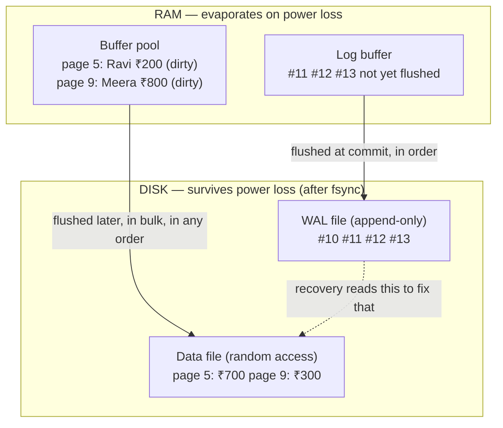
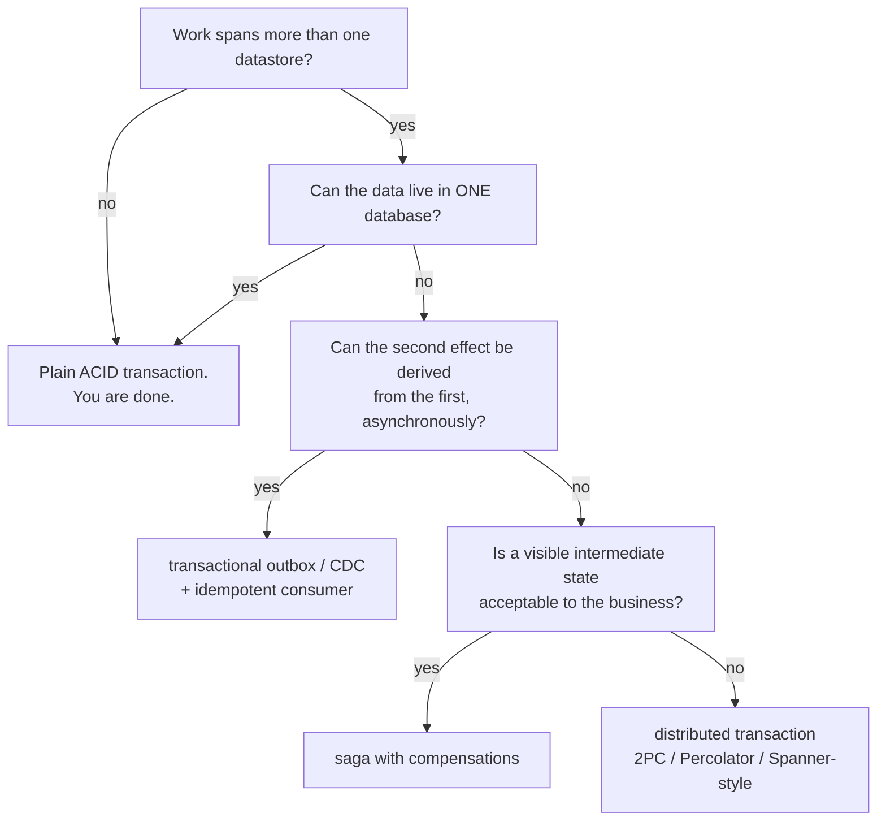
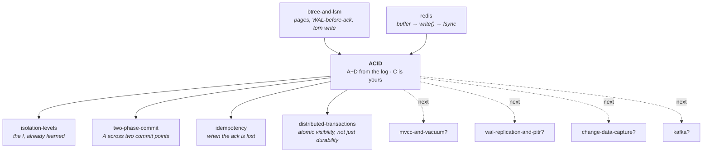

# ACID — the four promises, and the one machine that keeps two of them

> **Tell a friend:** Asha the cashier moves ₹500 from Ravi's page to Meera's
> page in one big paper ledger, and the fire alarm can go off between her two
> pen strokes. ACID is the name for four promises a database makes. They exist
> so that Vikram, the cashier who opens up the next morning, can still put the
> books right from paper alone. Here is the surprise the whole lab is built on:
> the four letters do not come from one place. **A** and **D** are a single
> machine, a rough day-book written before the ledger. **I** is a completely
> different machine. **C** is not a machine at all; it is your job. ACID is a
> contract, not a mechanism, and this lab is the audit of who signs which line.

Watch the alarm go off in [`visualization.html`](visualization.html), or at
<https://claude.ai/code/artifact/584af82b-f8f6-4e22-8580-5d955149d4cf>.
Where every number came from, and why this lab is shaped the way it is, is in
[section 17](#17-about-this-lab).

---

## 1. Why does this problem exist at all?

> **In one breath:** A machine can stop halfway through changing two numbers.
> When it comes back, one number changed and the other did not. Nobody gets an
> error, and the money is simply gone.

Somewhere tonight a server loses power in the middle of doing something. Not
during an error. Not during a bug. During perfectly ordinary work, halfway
through changing two numbers.

When it comes back up, one of three things is true. Either both numbers
changed, or neither did, or **one did**. The third outcome is the one that ends
careers.

Here is what that looks like in a real business.

- A payment was taken from one account and never added to the other.
- A seat was released and never re-sold.
- An order was marked shipped and its stock was never decremented.

Now notice what is missing from that list. Nobody gets an error message. No
exception is thrown. Nothing is logged as a failure. The system comes back up
and carries on being wrong, quietly, forever, until a human notices months
later that the totals don't add up.

The other half of the same problem is the exact opposite. A customer was
**told** their transfer succeeded. The machine died a second later. When it
came back, the transfer wasn't there. No error there either. Just a customer
holding a receipt for something the system has no memory of.

ACID is the name for the promise that neither of those happens. This lab is
about how that promise is actually kept. It is just as much about exactly where
it stops being kept.

## 2. What happens to Ravi's ₹500 when the fire alarm goes off?

> **In one breath:** A cashier moves money by making two marks in a book. If
> the building is evacuated between the two marks, the money vanishes — and
> nothing in the book says anything is wrong.

Forget computers for a while. We are in a small branch office, before
computers. Everything here will map onto a real database, piece by piece.

**Asha** is the cashier. The branch keeps one enormous bound book, **the
ledger**, with one page per customer. **Ravi's** balance is written on **page
5**. **Meera's** balance is on **page 9**.

Read the last row of this table first. It is the single fact we will check
after every disaster in this lab.

| Page | Customer | Balance |
|---|---|---|
| 5 | Ravi | ₹700 |
| 9 | Meera | ₹300 |
| | **Total** | **₹1000** |

Money is only ever *moved* between customers in this branch. It is never
created and never destroyed. So **the total must always be ₹1000**.

Ravi comes to the counter and asks to send **₹500 to Meera**. For Asha that is
two pen strokes in the ledger:

1. On page 5, cross out ₹700, write **₹200**.
2. On page 9, cross out ₹300, write **₹800**.

There is one more thing she does, and it is not a pen stroke at all. At some
point she looks up, tells Ravi **"done"**, and hands him a receipt. That moment
is a promise. From then on Ravi walks out of the building believing this
happened.

Now the constraint that makes this whole subject exist. **At any instant, the
fire alarm can go off.** It is a real evacuation. Everyone leaves immediately —
mid-stroke, mid-sentence, mid-thought.

The next morning the branch reopens and a *different* cashier, **Vikram**, is
at the counter. Vikram was not there. He has no idea what Asha was doing. He
cannot ask her. Everything that existed only in Asha's head, or as a note on
her desk, is gone. **Vikram knows only what is written in books that survived
the night.**

That is the entire problem of this lab, and it comes in two halves.

**Half one — the alarm goes off between stroke 1 and stroke 2.** The ledger now
says Ravi has ₹200 and Meera has ₹300. Total: **₹500**. The ₹500 left Ravi and
never arrived. It has ceased to exist, and nobody is aware of it.

**Half two — the alarm goes off just after Asha said "done" to Ravi, but before
she wrote anything down.** Ravi has a receipt. The books have nothing.

> **🔮 Predict:** Suppose we tell Asha "always do stroke 1 and stroke 2 as fast
> as you can, right next to each other, and only then say *done*." Does that
> fix either half of the problem?
> <details><summary>Reveal</summary>
> **Neither half, and this is the most important idea in the lab.** Speed
> changes the *probability* of being interrupted between the two strokes. It
> does not change the *possibility*. There is no pair of actions so fast that
> nothing can happen between them. The alarm is not polite; it fires in the gap
> however narrow you make the gap.
>
> If you guessed "it fixes half two, because she promises only at the very
> end", look again. She still has to say "done" at some particular moment, and
> the alarm can fire in the instant right after she says it.
>
> "Rare" is not "impossible". At ten thousand transfers a second, "rare"
> happens several times a day.
>
> Every correct answer in this lab has the same shape. **Not "make the gap
> small" but "make the gap survivable".** Arrange things so that whoever
> arrives after the interruption can work out what to do.
> </details>

**How deep this goes.** Stop at any checkpoint and you still have something
whole.

| Layer | Sections | After it you can… |
|---|---|---|
| Beginner | 1–9 | tell the fire-alarm story, and say why "be fast and careful" cannot work |
| Intermediate | 10 | derive the recovery machine yourself, and run its three passes by hand |
| Engineering | 11–12 | reason about every failure, and audit what each of the four letters really promises |
| Production | 13 | map the machine onto PostgreSQL, InnoDB, SQLite and Oracle, and read their dials |

## 3. Why can't Asha just be careful?

> **In one breath:** Work straight into the ledger, quickly and carefully, and
> tell Ravi at the end. It is the design everybody writes first, and it is
> perfect whenever nothing interrupts it.

The obvious plan is the one nearly everyone writes first. Work directly in the
ledger, in place, and be careful:

- Change page 5.
- Change page 9.
- Tell Ravi "done".

Let's give it every advantage. Asha is careful. She is fast. She does the two
strokes back to back. She says "done" only after both are on paper.

This is the design equivalent of an application that issues two `UPDATE`
statements and then returns success.

It has one genuinely good property. After both strokes the ledger is right, and
it is right *permanently*, because the ledger is the thing that survives the
night. If nothing interrupts her, this design cannot be beaten.

## 4. What are the two ways "be careful" breaks?

> **In one breath:** The alarm can catch Asha between the two strokes, which
> loses money silently. It can also catch her mid-stroke, which destroys the
> old number as well as the new one. The second is worse.

**Failure A — the gap.** The alarm fires between stroke 1 and stroke 2.

```
Ledger after the fire:   page 5: Ravi ₹200      page 9: Meera ₹300
                         Total: ₹500            ← ₹500 gone
```

Vikram opens the branch. He sees ₹200 and ₹300. He has **no way to know**
anything is wrong. ₹200 is a perfectly plausible balance for Ravi, and ₹300 is
a perfectly plausible balance for Meera.

The ₹500 that left Ravi and never reached Meera has simply ceased to exist.
Nothing in the ledger says "this page was changed as part of something bigger
that never finished". The evidence of the half-finished job was in Asha's head,
and Asha's head is not in the building.

This is the failure of **all-or-nothing**. The two strokes were meant to be one
indivisible act, and the ledger has no idea they were related.

**Failure B — the smudge.** This one is easy to miss, and it is worse. The
alarm fires *while Asha's pen is on page 5*. She has crossed out the old number
and written "2" of "200". The page now reads `₹2`.

The version that actually happens to computers is nastier. The page is left
**half old and half new**, and there is no way to tell by looking at it.

Failure A leaves the ledger *plausible but wrong*. Failure B leaves a page
*damaged*, and the original value is gone too. Even a very clever Vikram cannot
reconstruct it from the ledger alone.

Whatever we invent has to handle both. And note the shape of the second one,
because an entire later section exists only because of it: **the old value was
destroyed by the very act of writing the new one.**

> **🔮 Predict:** Asha's own fix attempt. "I'll write the new balances on a
> scrap of paper on my desk first, and copy them into the ledger only once both
> are ready." Does that fix Failure A?
> <details><summary>Reveal</summary>
> **No. It moves the gap; it does not close it.** There are still two strokes
> into the ledger, page 5 and then page 9, and the alarm can still fire between
> them.
>
> If you guessed "yes, because now everything is prepared before anything is
> committed to the book", you are counting the preparation as the dangerous
> part. It isn't. The dangerous part is the pair of writes into the book that
> survives the night.
>
> Worse: if the alarm fires while the scrap is still on the desk, the scrap
> burns and *nothing* happened. That is at least safe for Failure A. But if
> Asha had already said "done" to Ravi, we have just built the second half of
> section 2's problem instead.
>
> The scrap of paper is a real idea and we will keep it. It is exactly what a
> database's memory is. On its own, it just relocates the danger.
> </details>

## 5. What exactly must Vikram be able to do?

> **In one breath:** Strip away every mechanism and one sentence is left. The
> books must end up holding every transfer Ravi was promised, and no part of
> any transfer he wasn't.

Here is the goal in plain words. It must be true **at every single instant**,
so that it holds no matter when the alarm fires.

> When Vikram opens the branch, he must be able to bring the books to a state
> that contains **every transfer Ravi was told was done**, and **no part of any
> transfer that was not**.

Read it twice, because two separate promises are hiding in that one sentence.
They will get separate names in a moment.

- **No part of an unfinished job may survive.** Not one of its two strokes. It
  is all of it, or none of it.
- **Every finished job must survive.** If a receipt was handed over, the books
  must eventually agree, and no fire may take it back.

There is a third thing we need, and it is easy to overlook. **Vikram must be
able to do this himself, from paper alone, without asking anybody.** A design
that requires Asha's memory is not a design. Asha is not in the building.

Everything from here on is the pursuit of that sentence.

## 6. What is the one idea that makes the gap survivable?

> **In one breath:** Before you touch the ledger, write down what you are about
> to do, in a book that survives fires. Then the gap stops being dangerous,
> because the next person can read your intention and finish it.

Here is the whole invention, in one line:

> **Before touching the ledger, write your intention in a separate book that is
> safe — and say "done" to the customer only once your intention is safely
> written.**

Asha gets a second, much smaller book: **the day-book**. It is never neat. It
is append-only: she only ever adds a line at the bottom, and never crosses
anything out. Each line says what she is about to do, in enough detail either
to **finish it** or to **take it back**.

For Ravi's transfer, the day-book gets these four lines.

```
#10   transfer T1 begins
#11   T1: page 5 (Ravi)   was ₹700   →  will be ₹200
#12   T1: page 9 (Meera)  was ₹300   →  will be ₹800
#13   T1 COMMITTED                                     ← the "done" moment
```

Look at lines #11 and #12 for a second. Each one records **both the old value
and the new value**. That is not redundancy. It is the two directions of
travel.

- The **new** value lets Vikram **finish** a job that was promised but not
  fully written into the ledger.
- The **old** value lets Vikram **take back** a job that was written into the
  ledger but never promised.

Line #13 is the hinge of the entire subject. **Asha may not say "done" to Ravi
until line #13 is safely written.** Once it is written, the transfer is real
forever, even if not one stroke has touched the ledger yet. The day-book alone
contains everything Vikram needs to make the ledger right.

Notice what just happened to the ledger's job. It is no longer the thing that
records the truth first. It is a **slow, tidy copy** of a truth that already
lives in the day-book. The ledger can lag by minutes and it does not matter.

> **🔮 Predict:** Asha now has two books. Which one has to be in the fireproof
> safe before she is allowed to say "done" to Ravi — the day-book, the ledger,
> or both?
> <details><summary>Reveal</summary>
> **Only the day-book.** That is the whole trade, and it is what buys the
> speed.
>
> If you guessed "both", you have described a design that works and that every
> real database rejects. Putting the ledger in the safe at every "done" means
> scattering writes across a huge book before every customer can leave. Section
> 10.2 gives that design its real name and prices it exactly.
>
> If you guessed "the ledger", ask what Vikram would do with a ledger that is
> right but has no record of *why*. He could not tell a finished transfer from
> a half-finished one.
>
> The day-book is small, it is written strictly in order, and it is appended to
> at one end. Those three properties are why it is cheap to make safe, and
> section 10.7 is about the price even so.
> </details>

## 7. What do engineers call the things in Asha's branch?

> **In one breath:** You have already felt every idea in this section. Now each
> one gets its professional name, and the four famous letters turn out to come
> from three different places.

### 7.1 What do the four letters promise, and where does each one come from?

Start with the three words that describe the job itself.

A **transaction** is one job that should count as a single act, even though it
is made of several steps. Ravi's transfer is a transaction; the lab calls it
T1, and it is made of two pen strokes. Precisely, it is a unit of work with a
defined start and a defined end, `BEGIN` … `COMMIT`/`ROLLBACK`, to which the
database attaches guarantees.

The word is Latin, *trans-agere*, "to drive through". The point is that the job
is driven through to a single conclusion. You used this word constantly in
[isolation-levels](../08-isolation-levels/). Here we finally look at what
happens to it when the machine dies.

A **commit** is the moment the job officially counts. In the branch it is
day-book line #13, and only then telling Ravi "done". Precisely, it is the
point at which the database's promise attaches to the transaction; after it,
the effects are guaranteed to survive. The word is the ordinary English one.
Before this point you may still change your mind. After it, you may not.

An **abort** is changing your mind, and a **rollback** is the work of undoing
what the job already did. In the branch: Ravi says "actually, cancel that"
after stroke 1, so Asha must put page 5 back to ₹700, using the "was ₹700" she
wrote in line #11. Precisely, it is terminating a transaction so that none of
its effects remain. Two words, because *abort* is the decision and *rollback*
is the labour of carrying it out.

Now the four letters. **ACID is not a mechanism. It is a contract** — four
promises a database makes about transactions. Take them one at a time, because
each one is a different moment in Asha's day.

**A, atomicity, is about the gap.** It is Failure A from section 4, forbidden.
Both pen strokes land or neither does, and Vikram must never find one without
the other. The day-book is what makes that possible, and Vikram's morning is
what carries it out.

**D, durability, is about Ravi's receipt.** It is half two of section 2,
forbidden. Once Asha has said "done", the fire may not take it back. What buys
it is not the ledger at all. It is line #13 being safe *before* she speaks.

**I, isolation, is about the second counter.** Imagine Asha is not alone. A
second cashier is serving Meera at the same moment, touching page 9 while
Asha's pen is still hovering over it. Nothing in the day-book has an opinion
about that. Isolation is a different machine entirely, and you already took it
apart in [isolation-levels](../08-isolation-levels/).

**C, consistency, is about the number nobody is checking.** Look back at the
₹1000 total in section 2. Who enforces it? Not Asha; she writes what she is
told. Not the day-book; it records intentions, it does not judge them. Not
Vikram; he restores whatever the books say. If Ravi asks to send ₹5000 he does
not have, and nobody has written that rule down anywhere, the branch will
process it atomically, durably and in perfect isolation. And be wrong.

There is the surprise. Read the fourth column of this table downwards, and
notice that it names **three different things, not one**.

| Letter | The promise, in plain words | The moment in Asha's branch | What actually keeps it | Where you learn it |
|---|---|---|---|---|
| **A** — Atomicity | All of the job happens, or none of it. | Both pen strokes, or neither (§4, Failure A). | The day-book, plus Vikram's morning. | Here, in depth (§10). |
| **C** — Consistency | The data still obeys its rules afterwards. | The ₹1000 total, which nobody is watching. | **You**, through rules you declare. | Here, §12.2 — the odd one out. |
| **I** — Isolation | Concurrent jobs don't corrupt each other. | A second cashier on page 9 at the same instant. | A separate machine: locks or versions. | [isolation-levels](../08-isolation-levels/) — you already own this. |
| **D** — Durability | Once committed, it survives crashes. | Ravi's receipt honoured after the fire. | The safe, plus the rule about when to say "done". | Here, in depth (§10, §12.3). |

**A and D come from one machine. I comes from another. C comes from nobody
inside the database at all.** That is why this lab is shaped the way it is. It
is also why isolation could be a *dial* in the first place: you can turn the
concurrency machine down without touching the crash machine.

One-line refresher on **I**, since you proved all of this yourself. Isolation
is a separate dial with its own settings, and its default setting permits real
data loss. Here is the figure you got, and what it meant.

| Your result from the isolation lab | What it means |
|---|---|
| 8 threads × 40 increments | 320 increments were issued, every one inside a transaction that committed successfully |
| ended on ~60 of 320 | about 80% of the work vanished, with nothing anywhere reporting an error |

That lab has its own mechanisms: two-phase locking, MVCC, snapshot isolation
and SSI. It has its own anomalies too: dirty read, lost update, write skew. All
of that is its material, and this lab will not repeat it.

> **🔮 Predict:** You turn a database's isolation level all the way down to
> `READ UNCOMMITTED`. Which of the four letters have you weakened?
> <details><summary>Reveal</summary>
> **Only I.** Atomicity and durability are untouched. The log is still written
> before the pages, the commit record is still made safe before the "done", and
> recovery still puts the books right after a crash.
>
> If you guessed "A as well, because now other people can see my half-finished
> work", you have hit the most common confusion in this subject, and it is
> worth being precise about. Atomicity is about **what survives a crash or an
> abort**. Isolation is about **what a concurrent reader may observe**. A
> database can be perfectly atomic and still show a neighbour a state that
> never legally existed. Section 12.1 states this exactly.
>
> If you guessed "C", you are closer than it looks. A weaker isolation level
> can certainly let your application write nonsense. But the letter C was never
> promising to stop that, and section 12.2 is the whole argument.
> </details>

### 7.2 Where does the data live, and when is something really "written"?

Three places hold Asha's work, and only one of them survives the night.

A **page** is the fixed-size chunk a database reads and writes at a time. In
the branch it is one numbered page of the ledger, holding Ravi's balance.
Precisely, it is the unit of storage input and output, typically 8 KB in
PostgreSQL and 16 KB in InnoDB. Rows live inside pages, and a database never
reads or writes less than one whole page.

The word exists to name the fact that storage has a *granularity*. You cannot
change one byte on disk; you replace a whole page. You already counted these.
In [btree-and-lsm](../05-btree-and-lsm/) you counted cold pages and found 119×
write amplification for a B-tree. That was this same page, and this lab
explains what else has to happen every time one of them is written.

The **buffer pool** is the database's working memory, holding copies of the
pages it is currently using. In the branch it is Asha's desk, where she keeps
the couple of ledger pages she is working on right now. Precisely, it is an
in-memory cache of disk pages, finite in size, where all reads and writes
actually happen. It *buffers* between a fast processor and a slow disk. And in
the branch, it burns.

A **dirty page** is a page in memory that has been changed, but whose change
has not reached the disk yet. Asha has mentally decided Ravi's balance is ₹200,
while page 5 in the bound ledger still says ₹700. "Dirty" means *needs
cleaning*, which here means *needs writing out*. Be careful with this word. It
is the same adjective as in *dirty read* from the isolation lab, and a
completely different concern. A dirty read is about **who can see it**. A dirty
page is about **where it is stored**. Same adjective, two unrelated axes.

The **write-ahead log**, or **WAL**, is the day-book: a separate append-only
file where every intended change is recorded **before** the change is made.
Precisely, it is a sequential on-disk log of log records, and the rule is that
a log record describing a change must reach durable storage before the modified
page does. The name says what it is. The log is *written ahead* of the data. In
the branch it is lines #10 to #13.

You have met it twice before. It was the LSM's write path in
[btree-and-lsm](../05-btree-and-lsm/), where the term "WAL-before-ack" is
already in your knowledge map. It was Redis's AOF in [redis](../13-redis/).
This lab is where you finally take it apart.

A **log record** is one line in the day-book. The usual kinds are *begin*,
*update* (carrying both the before-image and the after-image), *commit* and
*abort*. There is one more, and it does not exist yet. Section 10.5 has to
invent it, because recovery itself can be interrupted.

An **LSN**, or **log sequence number**, is the line number in the day-book. In
our listing it is the `#11` and the `#12`. Precisely, it is a monotonically
increasing identifier for a position in the log, usually a byte offset, so it
doubles as "how far into the log is this".

It exists because it gives every change in the entire database **one global
order**, and a name you can point at from elsewhere. That is the trick that
makes recovery repeatable, and section 10.4 is where it earns its keep.
PostgreSQL exposes it directly: an LSN like `0/16B3A50` in
`pg_stat_replication` is exactly this number, and "replication lag" is a
subtraction between two of them.

**Now the three moments.** You already own this one from [redis](../13-redis/),
where you established that "written" is three distinct events, not one. Read
the last column: only the bottom row survives a power cut.

| Moment | Where the bytes are | Survives the process dying? | Survives power loss? |
|---|---|---|---|
| in the application's own buffer | our own memory | ❌ | ❌ |
| after `write()` | the **OS page cache** — kernel memory | ✅ | ❌ |
| after `fsync()` | the physical device | ✅ | ✅ |

Here are the three numbers you got from that lab. They are the same three
moments, wearing a Redis costume.

| Setting and event | Result | What it proves |
|---|---|---|
| `kill -9` with `appendfsync no` | nothing lost | the page cache belongs to the kernel, and the kernel did not die |
| power loss with `appendfsync no` | 530 ms of traffic gone | one fsync window is exactly what a power cut costs you |
| `appendfsync always` | zero loss, 3.4× lower throughput | safety against power loss is bought with throughput |

Everything in section 13 about `synchronous_commit` and
`innodb_flush_log_at_trx_commit` is that same three-way distinction wearing a
different vendor's clothes.

**fsync** is the call that means "actually put it on the physical device, and
don't come back until you have". Precisely, it is a system call that forces
previously written data for a file out of kernel caches to stable storage. In
the branch, Asha does not just write the day-book line on a slip in her
out-tray. She posts the slip into a **fireproof safe bolted to the floor**. The
out-tray burns. The safe does not.

**Durable** means it will still be there tomorrow. Precisely, it means present
on storage that survives *the failure you are designing against* — and that
last clause is doing enormous work. Section 12.3 is entirely about it.

### 7.3 What are the two directions of repair?

Vikram can walk in either of two directions, and the day-book was designed so
that he can.

**Redo** means finishing a job that was promised but never fully written into
the ledger. Line #13 exists, but page 9 still says ₹300, so Vikram writes ₹800
into page 9. Precisely, it is re-applying a committed change to a page using
the log record's **after-image**. The word says it: the work is being *done
again*.

**Undo** means taking back a job that reached the ledger but was never
promised. Page 9 says ₹700 because of a transfer that never committed, so
Vikram writes ₹800 back. Precisely, it is reverting a change using the log
record's **before-image**.

**Recovery** is what Vikram does before he opens the counter. He reads the
day-book cover to cover, before he serves anyone. Precisely, it is the startup
procedure that reads the log and brings the data files to the state defined by
section 5's sentence.

A **checkpoint** is a note saying "everything before this line is already
safely in the ledger, don't bother reading further back". In the branch it
happens at 4 p.m. Asha copies every pending change into the bound ledger. Then
she writes one more line in the day-book: *"#500 — checkpoint: ledger is
current as of here."*

Precisely, a checkpoint is a record marking a point from which recovery can
start, plus the flushing work that makes it true. The word is already in your
knowledge map twice, from [btree-and-lsm](../05-btree-and-lsm/) and from
Redis's RDB snapshots. Same idea, third context.

## 8. What picture should you carry in your head?

> **In one breath:** Two books and a safe. Or, in engineering terms, two places
> in memory, two files on disk, and one law about the order they get written
> in.

### 8.1 What is the picture a friend would understand?

Carry this around:

> A cashier writes every intention in a **rough day-book** the instant she
> decides it, and posts it into a **fireproof safe**. Only then does she tell
> the customer "done". The neat **bound ledger** gets updated whenever she has
> a spare moment. If the building is evacuated, the next cashier reads the
> day-book and makes the ledger agree with it: **finishing** anything marked
> committed, and **taking back** anything that isn't.

### 8.2 What does the same picture look like to an engineer?

Four boxes in two bands. The top band evaporates when the power goes; the
bottom band does not. Watch the two solid arrows between them. They behave
completely differently, and that difference is the entire design.



Two things to notice in that diagram, because together they are the whole
design.

- The arrow into the **data file** is lazy and unordered. It can happen at any
  time, including for changes that have not committed.
- The arrow into the **WAL** is eager and strictly ordered.

One law governs the relationship between them.

> **The WAL rule.** A log record describing a change to a page must be durable
> **before** that page's new contents are written to the data file. And a
> transaction's commit record must be durable **before** the client is told
> "committed".

Everything else in this lab is a consequence of that two-sentence rule.

### 8.3 How does the branch line up with a database?

Two tables, because the mapping has two halves. First, where things are kept,
and what a fire does to each.

| In Asha's branch | In a database | What the fire does to it |
|---|---|---|
| Asha herself | the running database process | dies with the machine |
| Asha's desk | the **buffer pool** (RAM) | lost on any crash |
| The out-tray of written slips | the **OS page cache** | survives a process crash, lost on power loss |
| The fireproof safe | the physical **disk** after `fsync` | survives both |
| The rough **day-book**, in the safe | the **WAL file** | append-only, sequential |
| The bound **ledger**, in the safe | the **data file** | random-access, updated lazily |

Second, the events — the things that *happen*, rather than the things that sit
there. The last column says where in this lab each one turns up.

| In Asha's branch | In a database | Met in |
|---|---|---|
| Line number in the day-book | the **LSN** | §7.2 |
| Telling Ravi "done" | the **commit ack** to the client | §2 and §6 |
| The **fire alarm** | power loss, `kill -9`, kernel panic | §2 |
| **Vikram's morning** | **crash recovery** at startup | §5 and §10.5 |
| The 4 p.m. tidy-up | the **checkpoint** | §7.3 and §10.4 |

### 8.4 Where does the story lie to you?

An analogy left unqualified becomes a wrong belief. This one lies in four
places, and each lie hides a real piece of engineering.

**Paper is never half-written in a way you can't see.** If Asha's pen stops
mid-digit, you can *tell*. A disk writing an 8 KB page can be interrupted after
2 KB and leave a page that is half old and half new, **and looks completely
normal**. There is no checksum in the page contents, and nothing obviously
wrong. This is a **torn page**. Section 10.6 exists entirely because of it, and
the engineering model must therefore assume that a page write is *not* atomic.
The paper model would never suggest that.

**Vikram can read the whole day-book in a minute; a real WAL can be gigabytes.**
Recovery time is a production number that people get paged about. That gap is
exactly why checkpoints exist (§10.4), and why the checkpoint interval is a
tuning knob with a real trade-off.

**Paper never lies about being in the safe.** A disk absolutely does. Many
consumer SSDs, and some virtualised or misconfigured storage stacks,
acknowledge `fsync` while the data is still in a volatile on-device write
cache. PostgreSQL warns about this in its own reliability chapter. The paper
model has no equivalent of "the safe lied", so it cannot teach you to be
suspicious. You should be anyway.

**Asha is one person, so her work is naturally serial.** A real database has
many transactions in flight at once, interleaved, sharing pages. That is the
*isolation* problem, and this analogy quietly hides it. It hides it so well
that the point is worth saying out loud. **Nothing in this lab's mechanism
prevents two concurrent transactions from corrupting each other's logic.** The
log gives you A and D. It does not give you I. That separation is the lab's
punchline, and section 12.1 states it precisely.

## 9. Can you watch the alarm go off?

> **In one breath:** Yes. There is a page where you press CRASH whenever you
> like, then press RECOVER, and watch three passes put ₹1000 back.

Open **`visualization.html`** in this directory, or the published version:
<https://claude.ai/code/artifact/584af82b-f8f6-4e22-8580-5d955149d4cf>

**What you are looking at.** Three stacked bands, matching the diagram in §8.2.
Your transactions at the top. **RAM** in the middle — buffer pool and log
buffer, in amber, because it will evaporate. **DISK** at the bottom — WAL file
and data file, in teal, because it survives. Every box shows real values: the
actual balances, the actual log lines with their LSNs.

**What to do first.** Press **"Run the whole story"**. It plays the transfer,
crashes the machine at the worst possible moment, and recovers, narrating each
step in a full sentence. Watch the **Total** readout. It must return to ₹1000.

**Then experiment.** Four groups of controls matter.

- **CRASH** kills it at any instant you like. Then press **RECOVER** and watch
  the three passes run.
- **Process crash vs power loss** is the difference between losing Asha's desk
  and losing the out-tray too. This is the redis lab's three moments, live.
- **Policy switches** turn the WAL off entirely, switch between *steal* and
  *no-steal* and between *force* and *no-force*, and turn off full-page writes.
  Each switch breaks something specific, and the verdict panel names which
  promise died.
- **Six predict-then-run scenarios** cover committing before the ack, a crash
  during the undo pass, a torn page, and more. Guess before you press.

Everything in sections 10 and 11 below has a scenario on that page. Read a
section, then go and run its scenario.

---

## ✅ Checkpoint: can you say the beginner model back?

If you stop here you can already explain, correctly and to anyone: what a
transaction is, what the four letters promise, why "be fast and careful" cannot
work, and the one idea that fixes it. You could sit in a design review, ask
"where's the write-ahead log in this?", and mean it.

> **Say it back.** Without using the words *log*, *WAL*, *commit* or
> *durable*, explain to a friend why Asha is allowed to tell Ravi "done" before
> either balance in the big ledger has changed.
> <details><summary>A good answer sounds like</summary>
> "She has already written down what she is about to do, in a small book she
> keeps in a fireproof safe. That note says both the old amounts and the new
> amounts. If the building burns down tonight, tomorrow's cashier can read the
> note and finish the job himself. So the big book being out of date doesn't
> matter. It can be caught up from the note at any time."
> </details>

Next up: the actual mechanism, built the way it was historically arrived at. A
first version a smart engineer would design, then the specific failure that
breaks it, then the refinement that fixes it — five times over. By the end of
section 10 you will be able to *derive* ARIES, the recovery algorithm
essentially every relational database uses, rather than memorise it.

---

## 10. What is the machinery underneath? Built five times, because the first four break

> **In one breath:** Start with the simplest day-book that could work. Four
> times, a specific disaster breaks it, and the repair is a feature you will
> recognise from a real database's manual. The fifth version is what PostgreSQL
> and InnoDB actually do.

We are going to build the recovery machine the way it was actually arrived at.
Each version is what a competent engineer would design given what they knew.
Each one then meets a specific failure, and the fix for that failure is a
feature with a name in the documentation.

Throughout, the branch's state stays concrete. Meera now sends money back, so
there are two transfers in flight.

```
Ravi   = page 5   Meera = page 9   Total must always be ₹1000
T1 = "move ₹500 Ravi → Meera"   T2 = "move ₹100 Meera → Ravi"
```

### 10.1 Version 1: what if we log the new values and write the pages later?

The simplest design that respects section 6 is four steps.

1. `BEGIN` — append a *begin* record.
2. Each change: append an *update* record holding the **after-image**, the new
   value, then change the page **in memory only**.
3. `COMMIT` — append a *commit* record, **fsync the log**, then tell the client
   "committed".
4. Whenever convenient, later, in the background: write the changed pages out
   to the data file.

Two rules come with it.

- **Never write a page belonging to an uncommitted transaction to disk.** We
  will name this policy in a moment.
- **Don't force the pages out at commit time.** The log record is enough.

**Why this works for the obvious crash.** Crash right after step 3, with page 5
and page 9 both still only in memory:

```
Log on disk:   #101 T1 BEGIN
               #102 T1 p5 → ₹200
               #103 T1 p9 → ₹800
               #104 T1 COMMIT
Data file:     page 5: ₹700     page 9: ₹300        ← nothing applied yet
```

Vikram scans the log, sees T1 has a commit record, and **redoes** #102 and #103
against the data file. Result: ₹200 and ₹800, total ₹1000, and Ravi's receipt
is honoured. The commit ack was given at step 3 and it was legitimate. By then
the log was in the safe, and the log was the only thing that mattered.

Note what version 1 needs: **redo only**. It never needs before-images, because
an uncommitted change never reaches disk.

> **🔮 Predict:** The buffer pool is finite. Say it holds 4 pages, and it is
> full. A new transaction needs a page that isn't in memory, so one page must be
> evicted to make room. Every page currently in the buffer pool has been
> modified by a transaction that hasn't committed yet. What does version 1 do?
> <details><summary>Reveal</summary>
> **Version 1 is stuck.** Its rule forbids writing an uncommitted page to disk,
> so it cannot evict any of them, so it cannot free a frame, so it cannot
> proceed until one of those transactions commits.
>
> If you guessed "it just waits a moment and then continues", that is the
> optimistic reading, and it hides two consequences that are both fatal in
> practice.
>
> - **A transaction can never modify more data than fits in the buffer pool.**
>   `UPDATE orders SET status='archived'` over ten million rows would need ten
>   million rows' worth of pages pinned in RAM at the same time.
> - **Long transactions strangle everyone else**, because their pages are
>   unevictable for their entire lifetime.
>
> The obvious fix is to allow the eviction. And the instant you allow it, the
> disk can contain changes from a transaction that never commits — which
> version 1 has no way to take back, because it only ever recorded new values.
> </details>

### 10.2 Version 2: what happens when memory runs out?

We now permit the buffer manager to **steal**: to write out a dirty page even
though the transaction that dirtied it hasn't committed. This is not an
optional nicety. Without it, a database cannot process more data than it has
RAM.

The price is exact. **Every update record must also carry the before-image.**

```
#106  T2  page 9   before = ₹800   after = ₹700   prevLSN = #105
        ^^^^^^^^^^^^^^^^^^^^^^^^  the new half — this is what buys undo
```

Two named policies now exist, and between them they make the 2×2 that every
storage engineer knows.

**Steal or no-steal** answers: may a dirty page from an *uncommitted*
transaction be written to disk? *Steal* means yes. The word is literal. The
buffer manager "steals" the frame back from the transaction that was using it.

**Force or no-force** answers: must **all** of a transaction's dirty pages be
written to disk *before* commit returns? *Force* means yes.

Find the bottom-right cell. That is the corner every serious database lives in.

| | **force** | **no-force** |
|---|---|---|
| **no-steal** | need neither undo nor redo | need **redo** only |
| **steal** | need **undo** only | need **undo and redo** |

Why the other three corners lose:

- **no-steal** fails for the reason you just predicted. Transaction size is
  capped by RAM.
- **force** fails on cost. Committing would mean writing every touched page
  before the client hears "committed". That is scattered *random* input and
  output across the data file. A hot page touched by a thousand transactions
  gets written a thousand times.
- **no-force**, by contrast, makes commit **one sequential append plus one
  fsync to a single file**. The hot page is written once, eventually, carrying
  all thousand changes at once.

So essentially every serious database picks **steal plus no-force**, which is
exactly the corner requiring **both** undo and redo. That is not a coincidence
or a complication. It is what you buy with the two cheapest properties in the
table.

### 10.3 Why does the same machinery do an ordinary rollback?

Before moving on, notice something that saves an entire subsystem.

Ravi says "cancel that" and T1 aborts *while the database is running*. No crash
is involved. What does the database do? It walks T1's log records backward and
applies their before-images. **That is exactly the undo pass, on a healthy
system.**

This is why each record carries a **prevLSN**: a pointer to the previous log
record *of the same transaction*. One transaction's records form a backward
chain through a log full of everybody else's records.

```
T2's chain:   #106 ──prevLSN──▶ #105 (BEGIN)
T1's chain:   #104 ──▶ #103 ──▶ #102 ──▶ #101 (BEGIN)
```

Rollback is: follow the chain, revert each step. One implementation serves both
"the user changed their mind" and "the building burned down".

### 10.4 Version 3: how do we stop reading the whole day-book, and stop doing anything twice?

Two problems remain with version 2. Both of them show up on production
dashboards.

**Recovery scans from the beginning of time.** The log is append-only and never
rewritten, so Vikram's morning gets longer every day. A database that takes
four hours to start is not available, and availability is the thing you were
buying.

The fix is the **checkpoint**. Periodically the database writes a checkpoint
record naming two things: which transactions are currently running, and which
pages are currently dirty and from which LSN. Recovery starts there instead of
at the beginning. In the branch, it is Asha's 4 p.m. note.

The trade-off is a straight dial, and you will meet it as a config parameter.
**Frequent checkpoints mean fast recovery and more constant background input
and output. Rare checkpoints mean less input and output, and a longer outage
after a crash.**

**Redo may be applied to a page that already has it.** In the crash below, page
9 was stolen to disk *after* T1's change was applied to it. If recovery blindly
re-applies #103, that is fine for a "set balance to ₹800" record. But for any
record expressed as a *change* rather than a *value*, such as "add ₹500", it
would double the money. And recovery itself can crash and re-run, so "applied exactly
once" is not something we can arrange by being careful.

The fix is to **put the LSN on the page**. Every data page carries a
**pageLSN**: the LSN of the most recent log record whose change is already
reflected in this page. Redo then has a rule.

> Apply log record *L* to page *P* **only if** `L.LSN > P.pageLSN`.

That single comparison makes redo **idempotent**. Running it once, twice or
fifty times produces the same page, so recovery can crash and restart as often
as it likes.

You have seen this shape twice already. It is the same idea as the idempotency
key in the [idempotency](../49-idempotency/) lab. It is the same idea again as
"expected version" in [event-sourcing](../50-event-sourcing/). All three are
**a stored marker that lets a repeated operation recognise itself.** Third
context, same trick.

### 10.5 What do the three passes look like, worked by hand?

Here is the full recovery, with real numbers. This is the trace to remember.

**The log on disk when the machine died:**

```
#100  CHECKPOINT        active transactions: (none)   dirty pages: (none)
#101  T1 BEGIN
#102  T1  page 5  before ₹700  after ₹200   prevLSN #101
#103  T1  page 9  before ₹300  after ₹800   prevLSN #102
#104  T1 COMMIT                             prevLSN #103   ← Ravi was told "done"
#105  T2 BEGIN
#106  T2  page 9  before ₹800  after ₹700   prevLSN #105
      *** CRASH ***
```

Now the data file at the same instant. This is the messy, realistic part. The
buffer manager happened to evict page 9 — steal! — after T2 had touched it, and
never got around to page 5.

```
page 5:  ₹700   pageLSN #100      ← T1's change never reached disk
page 9:  ₹700   pageLSN #106      ← BOTH T1's and T2's changes reached disk
Total on disk: ₹1400              ← wrong in a way that flatters nobody
```

**What correctness demands:** T1 committed, so its effects must be present. T2
did not, so its effects must be gone. Target: page 5 = ₹200, page 9 = ₹800,
total ₹1000.

---

**PASS 1 — ANALYSIS.** *What was going on when the lights went out?* Scan
**forward** from the last checkpoint, #100, building two tables. Read the
middle column: it is who was still running.

| Read | Transaction table | Dirty page table |
|---|---|---|
| #101 T1 BEGIN | T1: running | |
| #102 T1 p5 | | p5 first dirtied at #102 |
| #103 T1 p9 | | p9 first dirtied at #103 |
| #104 T1 COMMIT | T1: **committed → winner**, remove | |
| #105 T2 BEGIN | T2: running | |
| #106 T2 p9 | | (p9 already listed) |
| *end of log* | T2 still running → **loser** | |

Analysis writes nothing and changes nothing. It produces two answers:
**losers = {T2}**, and **redo must begin at LSN #102**, the earliest point at
which any page might have fallen behind.

**PASS 2 — REDO.** *Put the world back exactly as it was at the instant of the
crash.* Scan **forward** from #102. For every update record, compare against
the page's pageLSN.

| Record | Page's pageLSN | Decision | Result |
|---|---|---|---|
| #102 p5 → ₹200 | #100 < #102 | **apply** | p5 = ₹200, pageLSN #102 |
| #103 p9 → ₹800 | #106 ≥ #103 | **skip** — already there | p9 unchanged |
| #106 p9 → ₹700 | #106 ≥ #106 | **skip** — already there | p9 unchanged |

State after redo: **page 5 = ₹200, page 9 = ₹700, total ₹900.**

Stop and look at that total. **It is wrong, and it is supposed to be.** Redo
did not try to produce a correct database. It re-created the crash instant
faithfully, including T2's half-finished damage. This is called **repeating
history**, and it is the design decision that makes ARIES simpler than its
predecessors.

> **Why redo a loser's change just to undo it three lines later?** Because if
> redo skipped losers, the undo pass would face two possible starting states
> per page. Either the loser's change is there, or it isn't, and undo would have
> to check every time. By repeating history first, undo always starts from a
> state identical to the pre-crash state. That is exactly the state **ordinary runtime
> rollback** (§10.3) starts from too. One undo implementation, one set of
> assumptions, no special cases. The extra work is paid once; the removed
> complexity is paid forever.

**PASS 3 — UNDO.** *Take back everything the losers did.* Walk T2's prevLSN
chain **backward** from its last record.

Two new pieces of vocabulary arrive here, and both were invented for one
reason: **undo must survive being interrupted**, because recovery can itself be
interrupted.

- A **CLR**, or **compensation log record**, is a log record saying *"the undo
  of record X has been performed"*. It is written to the log **before** the
  revert touches the page, exactly like any other change. The WAL rule has no
  exceptions. Its defining rule: **a CLR is never itself undone.**
- **undoNext** is a pointer inside a CLR, naming the next record of that
  transaction still needing undo. It is what lets a restarted rollback resume
  in the middle instead of beginning again.

With those, the pass runs in two steps.

| Step | Action | Log written | Result |
|---|---|---|---|
| at #106 | revert p9 to its before-image ₹800 | **#107 CLR**: undoes #106, p9 = ₹800, **undoNext = #105** | p9 = ₹800, pageLSN #107 |
| follow undoNext → #105 | that's T2's BEGIN — nothing to revert | #108 T2 **END** (abort complete) | |

**Final state: page 5 = ₹200, page 9 = ₹800, total ₹1000.** T1 present, T2
absent. Section 5's sentence is satisfied.

> **🔮 Predict:** The machine crashes *again*, right in the middle of Pass 3 —
> after page 9 was reverted to ₹800, but before recovery finished. We restart
> and run the whole thing again from the checkpoint. Does it come out right?
> <details><summary>Reveal</summary>
> **Yes, but only because of that CLR, and the reason is not the one most
> people guess.**
>
> The common guess is "without a CLR we'd undo twice and double-undo the
> money". For *this* record that is not true. The undo writes the literal value
> ₹800, a physical before-image, so doing it twice is harmless. Being precise
> about this matters, so here is what CLRs actually buy.
>
> 1. **Undo isn't always idempotent.** Real databases log much of their undo
>    *logically* or *physiologically*. It reads like "remove key K from this
>    index page", or "give back 100". They do that because a physical
>    before-image of an 8 KB page per row change is ruinously large. Re-running
>    "give back 100" twice gives back ₹200. The CLR records that this
>    particular undo **has already happened**.
> 2. **Rollback must terminate.** Without a record of progress, a crash during
>    undo restarts the rollback from scratch. A transaction that modified ten
>    million rows, crashing 90% of the way through its rollback, would start
>    over — and could, in a crash loop, never finish. With CLRs, each restart
>    resumes from `undoNext`, and the remaining work only shrinks.
> 3. **A CLR is never undone.** It is redo-only, by rule. That closes the door
>    on the pathological case of undoing an undo.
>
> So, on restart: analysis reads #107 and sees T2's undo has progressed to
> `undoNext = #105`. Redo re-applies the CLR if page 9 hasn't got it. Undo then
> resumes at #105, which is just the BEGIN. Done, correctly, from any number of
> nested crashes.
> </details>

### 10.6 Version 4: what if a page is half old and half new?

Redo assumes something we have not justified: that a page on disk is a
*coherent* page, just possibly an old one. Take that away and redo breaks.

A page write is one `write()` of 8 KB or 16 KB. The storage device underneath
works in sectors — historically 512 bytes, commonly 4 KB. **A power loss during
the write can leave some sectors updated and others not.** The result is a
**torn page**: internally inconsistent, and nothing about it looks wrong from
the outside. This is Failure B, the smudge, in its computer form.

Why can't redo fix it? Because most redo records are *physiological* — "on page
9, set the balance field of the row at slot 3 to ₹800". That instruction is
only meaningful if the page's slot directory, row offsets and headers are
coherent. If half the page is from before a row was moved and half from after,
redo writes ₹800 into a location that is now garbage. Worse, the pageLSN itself
may come from either half, so recovery cannot even tell which records to apply.

> **🔮 Predict:** The log already holds a *before* value and an *after* value
> for every change. So why can't recovery just put back the before-image and
> replay?
> <details><summary>Reveal</summary>
> **Because the before-image is not a whole page either.** It is a field inside
> a page, and writing a field back requires the page's structure to be
> readable. A torn page has no trustworthy structure.
>
> If you guessed "it can, that's the point of before-images", you have found
> exactly the assumption every version so far has quietly made: that the page
> around the field is intact. The two production answers below both work by
> stopping making that assumption — one of them stores a whole page image in
> the log, the other stores a whole second copy on disk.
> </details>

Two production answers, and you should recognise both.

**Full-page writes** are PostgreSQL's answer, controlled by
`full_page_writes = on`, which is the default. The first time a page is
modified after each checkpoint, the **entire page image** goes into the WAL,
not just the change. If that page is later found torn, recovery replaces it
wholesale from the log copy, then replays subsequent changes onto a known-good
page. The cost is that WAL volume spikes right after every checkpoint, which is
why checkpoint tuning shows up in complaints about WAL size.

**The doublewrite buffer** is MySQL and InnoDB's answer, controlled by
`innodb_doublewrite = ON`, again the default. Every page is written **twice**:
first sequentially into a scratch area, then to its real home. If the home copy
is torn, InnoDB restores it from the scratch copy. The cost is roughly double
the page-write traffic — sequential, so cheaper than it sounds.

Same problem, two different bills. Neither is free, and turning either off is a
"my data is expendable" switch, not a performance tip.

### 10.7 Version 5: what does the fsync in the commit path really cost?

One thing has been glossed over. Section 10.1 said "append a commit record,
**fsync the log**, then tell the client committed". That fsync is the single
most expensive thing in the commit path, and it is unavoidable. It is the exact
moment the promise becomes real. Everything else in a commit can be lazy; this
cannot.

So the commit path costs at minimum **one durable write to one sequential
file**. That is the best possible shape for a disk: no seeking, one file. The
whole no-force design exists to make that sentence true.

But a naive implementation does one fsync **per transaction**, and now
throughput is capped by the device's sync rate no matter how many processors
you own. The fix is a batching trick that appears in every mature engine.

**Group commit** works like this. When several transactions want to commit at
nearly the same time, their commit records are already adjacent in the same log
file. One `fsync` makes *all* of them durable. So the engine waits a moment,
collects the commit records that arrive in that window, syncs once, and
acknowledges everyone.

The trade is explicit. **Each transaction pays a little extra latency; the
system gains a large multiple of throughput.** PostgreSQL exposes the waiting
window as `commit_delay` and `commit_siblings`. MySQL has binary-log group
commit, tuned with `binlog_group_commit_sync_delay`.

This is the identical shape as batching you have seen elsewhere: one expensive
synchronous step amortised over many callers, paid for in latency. Your
[work-pressure-and-deadlines](../61-work-pressure-and-deadlines/) lab's queueing
arithmetic applies to it directly.

### 10.8 What does the finished machine look like?

Read the diagram top to bottom. The one line that matters is the `fsync`,
because everything above it is reversible and everything below it is not.

```mermaid
sequenceDiagram
  participant C as Client
  participant DB as Database (RAM)
  participant W as WAL (disk)
  participant D as Data file (disk)
  C->>DB: BEGIN; UPDATE Ravi; UPDATE Meera
  DB->>DB: change pages in buffer pool (dirty)
  DB->>W: append #102, #103 (before+after images)
  C->>DB: COMMIT
  DB->>W: append #104 COMMIT
  W->>W: fsync  ← the promise becomes real here
  DB-->>C: "committed"
  Note over DB,D: later, lazily, in any order
  DB->>D: write page 5, page 9
  Note over W,D: after a crash
  W->>D: analysis → redo → undo
```

Every feature in that picture is a scar. Read the right column as a list of
disasters that already happened to somebody.

| Feature | The failure that forced it |
|---|---|
| The log at all | crash between two changes (§4) |
| Before-images (undo) | evicting an uncommitted dirty page (§10.1) |
| After-images (redo) | committing without writing the pages (§10.1) |
| pageLSN comparison | recovery applying a change twice (§10.4) |
| Checkpoints | recovery scanning the whole log (§10.4) |
| Repeating history in redo | undo needing two different starting states (§10.5) |
| CLRs plus undoNext | crash during rollback (§10.5) |
| Full-page writes / doublewrite | torn page (§10.6) |
| Group commit | one fsync per transaction (§10.7) |

That machine, with those exact parts, is **ARIES** — Mohan and colleagues, IBM,
1992. It is the algorithm that PostgreSQL, MySQL/InnoDB, SQL Server, DB2 and
Oracle all implement variants of. You did not memorise it. You derived it.

---

## ✅ Checkpoint: can you say the intermediate model back?

You can now read the ARIES paper, or PostgreSQL's
`src/backend/access/transam` README, and recognise every noun in it. You can
explain to a colleague why `full_page_writes` exists, why `innodb_doublewrite`
exists, and why a database that "just writes carefully" cannot be correct.

> **Say it back.** Without using the words *redo*, *undo*, *idempotent* or
> *pageLSN*, explain to a friend why Vikram deliberately re-does the damage
> from a transfer that never finished, only to take it back a moment later.
> <details><summary>A good answer sounds like</summary>
> "He wants the books to look exactly the way they looked at the instant of the
> fire, before he starts cleaning anything up. If he cleaned up as he went, he
> would have to keep asking 'did this half-finished change reach the book or
> not?' for every single page. By first putting the world back to how it was,
> every clean-up step starts from the same known place — the same place a
> cancelled transfer starts from on an ordinary day. One rule instead of two."
> </details>

Next up: the failure modes one at a time, including the ones this machine does
**not** handle. Then a precise audit of what the four letters do and don't
promise. This is the layer that changes how you review a design.

---

## 11. What are the eleven ways it goes wrong, and what survives each?

> **In one breath:** Eleven disasters. The machine handles most of them
> completely and uneventfully. Three of them it does not handle at all, and
> those three are the ones worth memorising.

Each of these has a scenario on the visualization page. Read one, go and run
it, come back. The eleven keep their numbers, F1 to F11, because the exercises
refer to them.

**F1 — Crash before the commit record is durable.** Start the transfer, let
both update records be written, then hit CRASH before pressing COMMIT. Leaving
`fsync-on-commit` still pending amounts to the same thing. Analysis
finds T1 with no commit record, marks it a loser, and undo reverts whatever
reached disk. Balances go back to ₹700 and ₹300. This is correct because the
promise was never made: section 5's sentence only obliges us to preserve
transfers the client was **told** about. In production this is the
overwhelmingly common crash case, and it is completely uneventful — which is
the point. From the client's side it is indistinguishable from a connection
error, and that ambiguity is F9.

**F2 — Crash after the commit record is durable, before the pages are
written.** Commit, then CRASH before the background writer flushes. Redo
re-applies #102 and #103 from the log, and Ravi has ₹200 while Meera has ₹800.
No-force means committed changes routinely exist only in the log at crash time.
This is not an edge case; it is the normal state of affairs. Every crash of a
busy database is this. "Recovery took 90 seconds" is exactly this quantity, and
it is tuned with the checkpoint interval.

**F3 — Crash with an uncommitted change already on disk.** Start T2, force a
buffer eviction using the page's "buffer full → steal a page" control, then
CRASH. Redo repeats history, taking page 9 to ₹700 and the total to ₹900, wrong
on purpose. Then undo reverts T2 using its before-image and writes a CLR, and
₹1000 is restored. Steal is mandatory for a database that handles more data
than RAM (§10.2), so uncommitted data on disk is a designed-for state. Recovery
now has a third pass, and it is the slow one — undo does random reads and
writes over whatever the losers touched. This is why killing a database in the
middle of a giant `DELETE` produces a long, un-skippable rollback on restart,
and why the advice is always "let it finish". InnoDB reports it as
`InnoDB: Rolling back trx ... N% complete`.

**F4 — Crash during recovery itself.** Run recovery, hit CRASH mid-undo, then
recover again. You land in the same final state. Redo is idempotent because of
the pageLSN comparison, and undo resumes from the last CLR's `undoNext` instead
of restarting. Recovery is not a privileged mode. It can be interrupted like
anything else, so it had to be designed to be restartable (§10.4, §10.5). Crash
loops are real: bad memory, a failing disk, an OOM killer with a taste for the
database. A recovery that were not restartable would turn a transient fault
into permanent corruption.

**F5 — Torn page.** Switch off full-page writes in the visualization, then
CRASH during a page write. With the protection on, recovery restores the whole
page from the log's full image and replays forward, and the result is correct.
With it off, the page is half old and half new, and redo's physiological
instructions land on incoherent structure. The visualization marks the page
**corrupt**, and the total is unrecoverable from the log alone. A multi-sector
write is not atomic (§10.6). In a real system this surfaces later as
`invalid page header in block ...`, a checksum error at read time, long after
the crash. This is exactly why `full_page_writes=off` and
`innodb_doublewrite=OFF` are documented as unsafe, except on storage that
guarantees atomic page writes.

**F6 — The device that lies about fsync.** Set the visualization's safe to
"lies about the seal". Commit records are acknowledged as durable while still
sitting in a volatile on-device cache. Power loss then destroys transactions
the client was told had committed. Recovery cannot detect it; the log simply
ends earlier than the client's receipts imply. Durability is a claim by every
layer beneath you, and a claim is only as good as the weakest layer (§12.3).
This is the worst failure in the lab, because nothing anywhere reports an
error. PostgreSQL's own reliability documentation discusses drives that
acknowledge writes before they are stable, and the same class of problem
appears with misconfigured virtualised storage. The self-inflicted version is
`fsync = off`, which is a benchmark-only setting.

**F7 — Process crash versus power loss.** The CRASH control has two modes. A
`kill -9` of the database process loses the buffer pool but **not** the OS page
cache, so log bytes that reached `write()` are still there and recovery finds
them. A power cut loses the page cache too, so anything not `fsync`ed is gone.
The page cache belongs to the kernel, not to the process. You have your own
figures for this from [redis](../13-redis/): `kill -9` with `appendfsync no`
lost nothing, power loss cost 530 ms of traffic, and `always` gave zero loss at
3.4× lower throughput. Same three moments, same arithmetic, different product.
This is why a setting like `innodb_flush_log_at_trx_commit = 2` is not simply
"unsafe". It is *safe against process crash and unsafe against power loss*,
which is a real and sometimes acceptable distinction.

**F8 — The log disk fills up.** This one is not simulated in the visualization;
it is here from vendor documentation, not from a run. The WAL cannot be
appended, so **no transaction can commit**, because committing *is* appending.
The database stops accepting writes, and PostgreSQL will `PANIC` and shut down
when it cannot write WAL. The log is on the critical path of every commit by
construction. Nothing is corrupted, but availability is gone completely. The
classic cause is a replication slot or an archiver that stopped consuming WAL,
so the log cannot be recycled and grows without bound. "Disk full on the WAL
volume" is an outage, not a warning.

**F9 — The client never learns the outcome.** CRASH in the window between the
commit fsync and the acknowledgement reaching the client. The transaction
**is** committed and durable, but the client sees a timeout or a dropped
connection and does not know it. The acknowledgement travels over a network,
and the network is not part of the transaction. Atomicity and durability are
both perfect. What is lost is the client's certainty — and if it retries, you
get the transfer twice. This is precisely the problem your
[idempotency](../49-idempotency/) lab solves. The boundary is worth stating
bluntly. **ACID gives you a correct database. It tells you nothing about
whether the caller knows it.** The fix lives above the database: an idempotency
key stored inside the same transaction, so the retry recognises itself.

**F10 — Failover to a replica that was behind.** This one is not in this lab's
visualization either, since the lab is single-node; it is described from the
labs that ran it. The primary acknowledges a commit after its own local fsync,
then dies. An asynchronous replica is promoted. Transactions committed inside
the replication lag window are gone — **and they were acknowledged**. The fsync
made the write durable **on that machine**, the machine was the failure domain,
and the machine is what failed. Your own figures from [redis](../13-redis/):
**500 acked writes, 500 lost** across a failover, with `WAIT` able to measure
the window but not to close it. Single-node atomicity is intact and now
irrelevant; durability, as the user understands the word, is gone. This is what
`synchronous_commit = remote_apply`, `min-replicas-to-write`, and Kafka's
`acks=all` with `min.insync.replicas` are for. They move the durability
boundary from *one disk* to *a quorum of machines*, and charge you a network
round trip per commit. Section 12.3.

**F11 — The application commits nonsense.** Press the visualization's "commit a
balance of −₹50" button. It commits. Atomically. Durably. Forever. Nothing in
the WAL machinery has an opinion about what a valid balance is. Unless you
declared `CHECK (balance >= 0)`, the database was never asked. A, I and D all
performed flawlessly. C is what died, in the only sense that matters to your
business. This is the single most common misunderstanding of ACID, and section
12.2 is about it.

**The eleven, side by side.** Read the last column first: a *silent* loss is
the one that hurts, because nothing anywhere tells you it happened.

| Failure | Still intact | What is lost | Loud or silent? |
|---|---|---|---|
| F1 — crash before commit is durable | atomicity; total ₹1000 | nothing that was promised | loud: the client sees an error |
| F2 — crash after commit, before pages | durability and atomicity | nothing; recovery time only | loud: a slow startup |
| F3 — uncommitted change already on disk | atomicity | nothing; a slow third pass | loud: rollback progress messages |
| F4 — crash during recovery | everything | time only | loud: it restarts |
| F5 — torn page | nothing you can rely on for that page | the page | silent until a later read |
| F6 — the device lies about fsync | atomicity: whole transactions, just fewer | **durability, silently** | silent, always |
| F7 — process crash vs power loss | depends which one; see the three moments | the un-`fsync`ed window on power loss | silent |
| F8 — log disk full | correctness; nothing corrupted | availability, completely | loud: `PANIC` and shutdown |
| F9 — client never learns the outcome | atomicity and durability, perfectly | the client's certainty | loud to the client, invisible to the database |
| F10 — failover to a behind replica | single-node atomicity, now irrelevant | durability as users mean it | silent until customers complain |
| F11 — application commits nonsense | A, I and D — all performed | C, in the only sense your business cares about | silent forever |

## 12. What do the four promises actually promise?

> **In one breath:** Atomicity is only about crashes and aborts. Durability is
> only about the failures you configured for. Isolation is a different machine.
> And consistency was never the database's job in the first place.

### 12.1 What do A and D really guarantee, and what do people think they do?

**Atomicity, precisely stated:** for every transaction, either all of its
changes are present in the database or none are, with respect to **crashes and
aborts**. That's it. The two words at the end are the whole scope.

Three things atomicity is regularly assumed to mean, and does not.

**It does not mean "invisible while running".** Whether another transaction can
see your half-finished work is **isolation**, not atomicity. At read
uncommitted it can; at read committed it cannot; and you measured all of it in
[isolation-levels](../08-isolation-levels/). A database can be perfectly atomic
and still show a concurrent reader a state that never legally existed.

**It does not extend past this database.** Two databases, or a database and a
message broker, are two commit points. Making them one act is
[two-phase-commit](../45-two-phase-commit/). Doing it *without* fracturing
readers is [distributed-transactions](../46-distributed-transactions/), whose
result was **16 fractured audits in 40 runs, with perfect 2PC and zero
crashes**, because atomic durability is not atomic visibility.

**"Atomic" is now three different words in your vocabulary.** In the
[java-memory-model](../17-java-memory-model/) it meant "no other thread observes
a half-written value". In [redis](../13-redis/) it meant "the command runs to
completion on the one thread, and there is no rollback". Here it means "all or
nothing across a crash". They are genuinely different guarantees, and
conflating them is a reliable source of bugs.

**Durability, precisely stated:** once the client has been told "committed",
the effects survive **the failures the storage layer was configured to
survive**. Not "all failures". Section 12.3.

### 12.2 Why is C not like the others?

A, I and D name **mechanisms the database implements**: a log and recovery
passes for A and D, a concurrency-control scheme for I. Disable any of them and
something inside the database changes.

**C names an outcome you are responsible for.** Written out fully, the C in
ACID says: *a transaction takes the database from one valid state to another
valid state.* Now ask the obvious question. **Valid by whose definition?** The
answer is: yours. The database has never heard of your business rules.

> **🔮 Predict:** Your service layer checks every balance before it writes, and
> refuses anything negative. Does the database now guarantee that no balance is
> ever negative?
> <details><summary>Reveal</summary>
> **No, and the gap is not about bugs in your check.** Your check protects one
> code path. The database has many writers.
>
> If you guessed "yes, because every write goes through our service", list the
> writers again. The other team's service. Last month's migration script. The
> support engineer typing `UPDATE` into a psql session at 2 a.m. A bulk import.
> A restored backup. None of those pass through your `if` statement.
>
> The one bridge between your definition of valid and the database's ability to
> enforce it is a **declared constraint**. That is the whole of what C buys
> you, and it is why C is a to-do list rather than a feature.
> </details>

Go back to the branch for a second. There is exactly one thing Asha's manager
can do that survives Asha leaving. She can paint the rule on the wall behind
the counter. Then every cashier has to obey it, including Vikram, and including
the temp on Saturday. In a database that painted rule is a **declared
constraint**. Three of them, in plain words first, then as statements:

- No account balance may ever go below zero.
- No two bookings may hold the same room on the same day.
- No order may name a customer who does not exist.

And the same three, as SQL:

```sql
-- The part of "valid" the database can actually keep for you
ALTER TABLE accounts ADD CONSTRAINT positive_balance CHECK (balance >= 0);
ALTER TABLE bookings ADD CONSTRAINT one_per_slot UNIQUE (room_id, day);
ALTER TABLE orders   ADD CONSTRAINT real_customer
  FOREIGN KEY (customer_id) REFERENCES customers(id);
```

*(Read-only illustration — this lab creates no files and runs nothing.)*

Everything you declare there, the database will defend against every writer,
forever: your application, the other team's application, the migration script,
and the support engineer at 2 a.m.

Everything you *don't* declare lives in an `if` statement in one service.
"The total across all accounts is ₹1000." "A shipped order must have a
payment." The database will happily, atomically and durably commit their
violation.

You reached this same conclusion from the other direction in
[isolation-levels](../08-isolation-levels/). It is worth quoting your own
knowledge map back at you.

> *"a constraint beats an isolation level whenever the rule can be stated about
> the data rather than the decision — an isolation level protects the code
> paths that remember to ask; a constraint protects the table."*

That is the practical form of C. **The letter C is a to-do list.** Move as much
of your definition of "valid" as you can into declarations the engine enforces.
That portion is the only part of C that ACID is actually buying you.

Two more traps worth naming.

**The C in ACID is not the C in CAP.** ACID's C is "the data satisfies its
rules". CAP's C is *linearizability*, a recency and ordering guarantee about
reads on a distributed system, which you have a whole lab on
([linearizability](../26-linearizability/), plus the distinction from
serializability in [linearizability-vs-serializability](../27-linearizability-vs-serializability/)).
Same letter, unrelated concepts, and the collision causes real confusion in
design discussions. When someone says "we need consistency", make them say
which one.

**Constraint checking has a timing.** Most constraints are checked per
statement. Some can be `DEFERRABLE INITIALLY DEFERRED` and are checked at commit
instead, which is what lets a transaction pass through an intermediate state
that violates a foreign key. Worth knowing the switch exists; the details are
engine-specific.

### 12.3 Durable against what, exactly?

There is no such thing as durable. There is a ladder, and every rung survives
strictly more than the one below it. Read the third column: it is what still
kills you at that height.

| Rung | Survives | Doesn't survive | Costs |
|---|---|---|---|
| in the process's log buffer | nothing | a `kill -9` | free |
| after `write()` — OS page cache | process crash | power loss | free |
| after `fsync()` | power loss on this same machine | this disk dying | one sync per commit, or per group |
| on redundant local storage (RAID, cloud block store) | one disk dying | this machine, this availability zone | hardware or service cost |
| acked by a **quorum of replicas** | machine and zone loss | region loss, correlated bugs | a network round trip per commit |
| acked by a remote region | region loss | | tens of milliseconds per commit |

Two consequences decide real architectures.

**"We use an ACID database, so we can't lose data" is a category error.** ACID's
D is a rung on that ladder, chosen by configuration. F10 is what it looks like
when the rung you're standing on is lower than the failure you met.

**Every rung above `fsync` is bought with a network round trip.** That is the
exact latency-versus-consistency currency you priced in [pacelc](../25-pacelc/).
Even with no partition anywhere, stronger durability costs latency on every
single write. Durability is a PACELC "else" branch.

### 12.4 Which rules does the machine actually keep?

Six rules, and each one was earned by a specific failure above. The bracket at
the end of each says what happens without it.

- **WAL rule:** for any change, its log record is durable before the modified
  page is written to the data file. *(Without it: F3 has no before-image to
  undo with.)*
- **Commit rule:** a transaction's commit record is durable before the client
  is told "committed". *(Without it: F6 — silent durability loss.)*
- **Redo idempotence:** apply record *L* to page *P* only if
  `L.LSN > P.pageLSN`. *(Without it: F4 corrupts on a second recovery.)*
- **Repeating history:** redo re-applies losers' changes too, so undo always
  starts from the pre-crash state. *(Without it: two undo code paths.)*
- **CLRs are never undone**, and each carries `undoNext`. *(Without it: F4's
  rollback may never terminate.)*
- **Page-write atomicity is not assumed.** It is manufactured, by full-page
  writes or a doublewrite buffer. *(Without it: F5.)*

### 12.5 What did all of this cost?

Nothing here is free, and the bills are specific.

**Every change is written twice**, once to the log and once to the data file.
That is write amplification on top of the amplification you already found for
the storage structure itself in [btree-and-lsm](../05-btree-and-lsm/): 119× for
a B-tree, 2.5× for an LSM.

**Every commit costs a durable sequential write.** Group commit amortises it.
Nothing removes it.

**Crash recovery time is not zero**, and it scales with how far the data file
lagged. That is an availability cost, paid at the worst possible moment.

**Rollback is expensive and unskippable.** A huge aborted transaction must be
undone before the database is fully usable.

**The log must be retained and recycled.** That introduces a whole class of
operational failure, F8, that a database without a log would not have.

---

## ✅ Checkpoint: can you say the engineering model back?

You can now audit a design. Given "we use Postgres, so we're fine", you can ask
the four questions that matter. Which rung of the durability ladder are you on?
Which of your business rules are actually declared as constraints? What does
your caller do when the acknowledgement is lost? And does anything in this
system need atomicity across two datastores?

> **Say it back.** A colleague says "our database is ACID, so Ravi can never
> end up with a negative balance". Without using the words *constraint*,
> *isolation* or *durability*, explain to them what is wrong with that
> sentence.
> <details><summary>A good answer sounds like</summary>
> "The database promises that whatever we ask it to write happens completely,
> or not at all, and then sticks around. It does not promise that what we asked
> for made any sense. If our code sends it a balance of minus fifty, it will
> store minus fifty perfectly and forever. The only way the database itself
> starts refusing is if we tell it the rule up front, in the table definition —
> and then it applies to everybody, not just our code."
> </details>

Next up: the mapping from this machine to the actual parameters in PostgreSQL,
InnoDB, SQLite and Oracle, what an on-call engineer sees when each part
misbehaves, and an explicit list of what this lab left out.

---

## 13. What happens in production?

> **In one breath:** Every part of Asha's branch has a vendor's name and a
> config parameter. Learn the mapping once and four different databases stop
> being four different subjects.

Asha's day-book, her fireproof safe, her 4 p.m. tidy-up and Vikram's morning
all exist in PostgreSQL, InnoDB, SQLite and Oracle. They just have four
different sets of labels, and the labels are what you type into a config file.
This section is that translation, plus what Ravi's transfer looks like on a
pager at 3 a.m.

### 13.1 What do four vendors call the same parts?

Every row below is a part of the machine you derived in section 10. Only the
vocabulary changes.

| Our part | PostgreSQL | MySQL / InnoDB | SQLite | Oracle |
|---|---|---|---|---|
| The log | WAL (`pg_wal/`) | redo log (`ib_logfile*`) + **separate** undo tablespace | rollback journal, or WAL file in WAL mode | redo log + undo tablespace |
| Before-images live | in the same WAL records | in **undo logs**, which also serve MVCC reads | in the rollback journal | in the undo tablespace, also serving flashback/MVCC |
| Line number | LSN (`0/16B3A50`) | LSN | — | SCN |
| Marker on the page | pageLSN | `FIL_PAGE_LSN` | — | |
| Torn-page defence | `full_page_writes` | doublewrite buffer | journal/WAL framing + checksums | |
| Commit durability dial | `synchronous_commit` | `innodb_flush_log_at_trx_commit` | `PRAGMA synchronous` | `COMMIT WRITE [WAIT\|NOWAIT]` |
| Batching | `commit_delay` | binlog group commit | — | |
| Checkpoint | `checkpoint_timeout`, `max_wal_size` | adaptive flushing, `innodb_max_dirty_pages_pct` | WAL checkpointing | |

Two of those cells deserve a second look.

**InnoDB keeps undo separate from redo, and that is not a detail.** Its undo
logs are also what serve MVCC reads: an old row version is reconstructed by
walking undo records backwards. So in InnoDB, the same structure that provides
**atomicity** also provides **isolation**. That is why a long-running read
transaction bloats undo, with `History list length` climbing. It is exactly the
way an open snapshot bloats PostgreSQL and requires `VACUUM`. You met that cost as
"snapshot isolation pays in keeping old versions" in
[isolation-levels](../08-isolation-levels/). Same bill, itemised differently.

**SQLite's original design sits in the *other* corner of section 10.2's table.**
A rollback journal is **undo-only with force**. Before changing a page it copies
the original into the journal, then modifies the database file directly. At
commit it syncs the database file and deletes the journal. After a crash, it
copies the originals back. It is a complete, correct, simple design, and it
pays exactly the price the table predicts: every commit forces the changed
pages out, and readers block writers. SQLite's WAL mode later moved it to the
redo corner. The release notes list better concurrency and fewer fsyncs as the
benefits, which is precisely what the table says you get for it.

### 13.2 What does the durability dial look like in the three forms you'll meet?

All three are the same ladder from section 12.3. All three have a middle
setting that people misread as "unsafe", when it really means "safe against
process crash, unsafe against power loss" (F7).

**PostgreSQL uses `synchronous_commit`.** Its settings: `on` means the WAL is
fsynced locally before the acknowledgement. `local` means the same, ignoring
replicas. `remote_write`, `on` with `synchronous_standby_names`, and
`remote_apply` all require a standby to have it, which moves you up the ladder
and costs a round trip. `off` acknowledges before the local fsync, so you can
lose a bounded window of *committed* transactions while the database stays
**consistent**. Postgres's own documentation is careful about this distinction:
`synchronous_commit=off` risks data loss, while `fsync=off` risks corruption.
Those are very different bets.

**MySQL and InnoDB use `innodb_flush_log_at_trx_commit`.** Setting `1` writes
and fsyncs at every commit; it is the default and it is fully durable. Setting
`2` writes at every commit and fsyncs roughly once a second, so it survives
`mysqld` crashing but not the operating system dying. Setting `0` writes and
fsyncs about once a second, losing up to a second in any crash. And
**`sync_binlog=1`** is the second half of the story: the binary log has its own
durability setting, and replication and point-in-time recovery depend on it.

**SQLite uses `PRAGMA synchronous`.** `FULL` and `EXTRA` are the safe settings.
`NORMAL`, in WAL mode, does not sync on every commit, so a power loss can lose
recent commits without corrupting the file. `OFF` is what it sounds like.

### 13.3 Why is there a two-phase commit inside a single MySQL server?

This one is worth knowing because it closes a loop with an earlier lab.

MySQL has **two** logs that must agree. InnoDB's redo log decides what the
storage engine recovered. The server's **binary log** decides what replicas and
point-in-time recovery see. If a crash left them disagreeing, a replica would
diverge from its primary.

So MySQL runs an internal **two-phase commit** between them on every commit:
prepare in InnoDB, write the binlog, commit in InnoDB. On recovery, a
transaction found *prepared* in InnoDB is committed if it is present in the
binlog, and rolled back otherwise.

Coordinator, participants, prepare and vote, the commit point, in-doubt on
recovery — every noun from your
[two-phase-commit](../45-two-phase-commit/) lab, running inside one process, on a
single machine, thousands of times a second. It is the cleanest example there
is of why that lab's material is not only about distributed systems.

### 13.4 What does an on-call engineer actually see?

Every row below is Vikram's morning (crash recovery) or Asha's safe (the
commit fsync), seen from the outside by somebody who has just been woken up.
Read the middle column: it is the translation from a complaint into a mechanism
you now understand.

| Symptom | What it really is | Where to look |
|---|---|---|
| "Database took 4 minutes to start after the crash" | redo pass (F2), proportional to checkpoint lag | checkpoint interval, `max_wal_size` |
| "It came up but is unusable, CPU pinned on one process" | undo pass (F3) rolling back a huge aborted transaction | InnoDB `Rolling back trx ... N%`; wait it out |
| "Commit latency doubled and nothing changed in the app" | fsync got slower — noisy neighbour, degraded cloud volume, a failing disk | device latency, `pg_stat_wal`, group-commit settings |
| "WAL volume exploded overnight" | full-page writes after checkpoints (§10.6), or a stuck replication slot or archiver (F8) | checkpoint frequency, `pg_replication_slots` |
| "The disk filled and the database PANICked" | F8 — the log could not be recycled | slots, archive command, retention |
| "We failed over and customers say orders vanished" | F10 — durability at the wrong failure domain | replication mode, sync standbys |
| "`invalid page header in block N`" | a torn or corrupted page surfacing at read time (F5) | checksums, storage health, restore from backup |
| "Rows exist that our code could never have written" | F11 and §12.2 — an undeclared invariant | add the constraint |

### 13.5 What did this lab deliberately leave out?

The machine in section 10 is complete enough to be correct, and small enough to
hold in your head. Real engines add more, and this lab does not cover it.

- **Log-file management** — segmentation, recycling, archiving, and
  point-in-time recovery by replaying archived WAL onto a base backup. This is
  the feature that makes the log valuable for something other than crashes.
- **Physical versus logical logging** — how much of a change to record, and the
  *physiological* middle ground real engines use. We waved at this in §10.6.
- **Index and structural changes** — a B-tree page split is many page changes
  that must be atomic among themselves. Real systems use nested top actions,
  which are CLR-like markers making a structural change un-undoable. Your
  [btree-and-lsm](../05-btree-and-lsm/) lab's split cascade is exactly this case.
- **Concurrency in recovery** — parallel redo workers, and the fact that redo
  must respect per-page order while being parallel across pages.
- **Isolation and MVCC**, entirely — [isolation-levels](../08-isolation-levels/).
- **Replication**, entirely — the log is also the replication stream. The WAL is
  what a Postgres standby consumes, and what logical decoding turns into a CDC
  feed. That is a lab of its own.
- **Backups and verification** — a durable database with an unrestorable backup
  is a slower way to lose data.

### 13.6 What if one database's ACID isn't the shape of your problem?

The last bridge. Everything above is **one database, one machine**. Real
systems put a payment in Postgres, an event on Kafka, and a row in a different
team's service. The moment the work spans two commit points, none of this
applies.

You already have the whole decision ladder from other labs. Follow it top to
bottom, and stop at the first "yes".



Your own knowledge map already ranks these: **one DB, then co-locating keys on
one shard, then [outbox](../48-transactional-outbox/), then [saga](../47-saga/),
then [distributed transaction](../46-distributed-transactions/)**, in that order.
The further right you go, the more machinery you own forever.

---

## ✅ Checkpoint: can you say the production model back?

You can now read a database's durability settings and say what each one costs
and what it fails to protect against. You can look at a complaint on a
dashboard and name which pass of Vikram's morning is responsible, and whether
Ravi's receipt is still good.

> **Say it back.** A colleague proposes setting
> `innodb_flush_log_at_trx_commit = 2` to speed up commits. Without using the
> words *fsync*, *page cache* or *durability*, tell them what they are actually
> buying and what they are actually risking.
> <details><summary>A good answer sounds like</summary>
> "You're telling the database it can hand the commit note to the operating
> system and then answer the customer straight away, instead of waiting for the
> disk to confirm it. If the database program itself dies, the operating system
> still has the note, and nothing is lost. If the power goes out, the note dies
> with everything else in memory, and about a second's worth of transactions we
> already told customers were fine simply never happened. That may be an
> acceptable trade for us. It is not the same as 'safe'."
> </details>

---

## 14. Where are the exercises?

> **In one breath:** Eight rungs, in `EXERCISES.md`, from "explain it in your
> own words" to "design the durability posture for a payments system across
> three regions".

Answers are in **`SOLUTIONS.md`**. Attempt first. Several of them are designed
so that being wrong is the lesson.

Rung 5, tracing recovery by hand, and rung 6, spotting the planted flaw, are
the two that most reliably expose a gap in the model. Do those even if you skip
the others.

## 15. What else does this connect to, and where should you go next?

> **In one breath:** Two earlier labs fed into this one, four labs run out of
> it, and the log you just built has a whole second career you have not seen
> yet.



**Commonly confused, separated in one sentence each.**

- **ACID's C versus CAP's C** — ACID's C is "the data obeys its declared
  rules"; CAP's C is linearizability, a recency guarantee about distributed
  reads. Unrelated. ([cap-theorem](../24-cap-theorem/),
  [linearizability](../26-linearizability/))
- **Atomicity versus isolation** — atomicity is about crashes and aborts;
  isolation is about what a *concurrent* transaction may observe.
- **Atomic durability versus atomic visibility** — the log makes the write
  all-or-nothing on disk; that does not stop a reader catching it half-applied
  across shards. ([distributed-transactions](../46-distributed-transactions/),
  where the figure was 16 fractured audits in 40 runs.)
- **Durable versus replicated** — `fsync` protects against power loss on one
  machine; only replication protects against losing the machine.
- **WAL, the log, versus WAL mode in SQLite** — the second is SQLite's name for
  switching from an undo-journal design to a redo-log design.
- **Undo log versus rollback segment versus before-image** — three names for
  the same idea in three vendors.

**Real technologies built directly on this.**

- PostgreSQL WAL, and therefore streaming replication, logical decoding and
  Debezium/CDC.
- InnoDB redo and undo.
- SQLite journal and WAL modes.
- Oracle redo, undo and SCN.
- SQL Server's transaction log.
- Kafka's log segments, with `acks` and `min.insync.replicas`.
- Every LSM engine's commit log, in RocksDB and Cassandra. That is the same
  WAL, protecting the memtable.

**Suggested next, in the order I'd actually do them.**

- `/learn wal-replication-and-pitr` — the log's *second* career: streaming to
  replicas, and replaying onto a base backup. This lab deliberately stopped at
  crash recovery, and this is the natural continuation.
- `/learn mvcc-and-vacuum` — your knowledge map has been suggesting this since
  the isolation-levels lab. Now that you know pageLSN and undo, the version
  chains have a place to live.
- `/learn change-data-capture` — how the WAL becomes an event stream, and what
  breaks when it does.
- `/learn kafka` — suggested by four labs now, including this one's `acks`
  discussion.

## 16. Glossary — what does each word mean, in one line?

Grouped by theme, and in order of first appearance within each group.

### The contract itself

- **Transaction** — one job that should count as a single act.
- **Commit** — the moment a transaction officially counts and its effects are
  guaranteed.
- **Abort / rollback** — ending a transaction so that none of its effects
  remain; *abort* is the decision, *rollback* the work.
- **Atomicity (A)** — all of a transaction's changes are present, or none, with
  respect to crashes and aborts.
- **Consistency (C)** — the data still satisfies its rules afterwards; only the
  rules you *declared* are enforced by the database.
- **Isolation (I)** — concurrent transactions do not corrupt each other's
  logic; a separate dial with its own levels.
- **Durability (D)** — once committed, the effects survive the failures the
  storage layer was configured to survive.

### Where the bytes actually sit

- **Page** — the fixed-size chunk (8 KB / 16 KB) a database reads and writes at
  a time.
- **Buffer pool** — the database's in-memory cache of disk pages, where all
  changes actually happen.
- **Dirty page** — an in-memory page whose change hasn't reached disk yet.
- **OS page cache** — kernel memory holding written-but-not-synced bytes;
  survives a process crash, not a power loss.
- **fsync** — the call that forces written data onto the physical device.
- **Failure domain** — the scope of what a given durability guarantee actually
  protects against: a process, a machine, a disk, an availability zone, a
  region.

### The log's own vocabulary

- **Write-ahead log (WAL)** — an append-only file recording every intended
  change *before* it is made.
- **Log record** — one entry in the log: begin, update, commit, abort, or CLR.
- **Before-image / after-image** — the old and new values in an update record;
  they buy undo and redo respectively.
- **LSN (log sequence number)** — the position of a record in the log; a global
  order for every change in the database.
- **prevLSN** — pointer from a log record to the previous record of the same
  transaction, forming a backward chain used by rollback.
- **pageLSN** — the LSN of the most recent change already reflected in a page;
  the comparison that makes redo idempotent.
- **Checkpoint** — a log record marking a point recovery can start from, plus
  the flushing that makes it true.

### Putting the books right afterwards

- **Redo** — re-applying a committed change using its after-image.
- **Undo** — reverting a change using its before-image.
- **Recovery** — the startup procedure that reads the log and repairs the data
  files.
- **Analysis / redo / undo passes** — the three phases of ARIES recovery.
- **Repeating history** — redoing *all* changes, losers included, so undo
  starts from the pre-crash state.
- **Loser / winner** — a transaction that had not committed / had committed at
  the moment of the crash.
- **CLR (compensation log record)** — a record of undo work already performed;
  never itself undone, and carrying `undoNext`.
- **undoNext** — the pointer in a CLR to the next record still needing undo,
  making rollback restartable.
- **ARIES** — the recovery algorithm (analysis, redo, undo, pageLSN, CLRs) that
  section 10 derives and real engines implement.

### Policies, and the hazards they answer

- **Steal / no-steal** — whether an uncommitted dirty page may be written to
  disk. Steal requires undo.
- **Force / no-force** — whether all of a transaction's pages must reach disk
  before commit returns. No-force requires redo.
- **Torn page** — a page left partly old and partly new by an interrupted
  multi-sector write.
- **Full-page writes** — logging a whole page image after each checkpoint to
  survive torn pages (PostgreSQL).
- **Doublewrite buffer** — writing every page twice, scratch then home, to
  survive torn pages (InnoDB).
- **Group commit** — batching several transactions' commit records into one
  fsync; latency for throughput.

## 17. About this lab

### Why is this lab shaped so lopsidedly?

**Lab type:** contract / principle, plus the storage mechanism behind it.
**No runnable code** — the lab is a document, an interactive visualization and
a set of exercises.

ACID has four letters, and you already own one of them outright. The
[isolation-levels](../08-isolation-levels/) lab spent an entire session proving
that **I** is a separate dial. It has its own anomalies, its own bills, and its
own mechanisms: 2PL, MVCC, snapshot, SSI. Re-teaching it here would waste your
time. So this lab does three things instead.

1. **A** and **D** in full depth, because no lab has taught them yet. They turn
   out to be *the same machine*: a log written before the change.
2. **C**, the letter that is not like the others, and the argument for why.
3. The **audit** — what the four letters together actually promise you in
   production, and the four places engineers reliably think they promise more
   than they do.

### How the depth layers are laid out

**BEGINNER MODEL** (§1–§9) → **INTERMEDIATE MODEL** (§10) → **ENGINEERING
MODEL** (§11–§12) → **PRODUCTION MODEL** (§13). A checkpoint at each transition
tells you what you can do if you stop there, and each one carries a *Say it
back* prompt.

### Where do the numbers come from?

This lab measures nothing itself; it has no runnable code by design. Every
number in it is either a measured result from one of your earlier labs, named
as such, or a documented vendor behaviour with the source named. Where
something is stated that has not been verified and cannot be cited, the text
says so in the same sentence. The one place you can *watch* behaviour is the
visualization, whose simulation is the lab's only executable artifact.

| Number, and where it appears | How it was produced | What that means for you |
|---|---|---|
| 8 threads × 40 increments ending on ~60 of 320, about 80% lost (§7.1) | measured in [isolation-levels](../08-isolation-levels/) against a real database | quote it freely; it is your own result |
| 530 ms of traffic lost on power loss; `kill -9` lost nothing; 3.4× lower throughput with `appendfsync always` (§7.2, F7) | measured in [redis](../13-redis/), one representative run | quote the shapes and orders of magnitude, not the last digit |
| 119× write amplification for a B-tree, 2.5× for an LSM (§7.2, §12.5) | measured in [btree-and-lsm](../05-btree-and-lsm/) | your own counted result |
| 500 acked writes, 500 lost across a failover (F10) | measured in [redis](../13-redis/) | the failure domain, demonstrated |
| 16 fractured audits in 40 runs with perfect 2PC and zero crashes (§12.1, §15) | measured in [distributed-transactions](../46-distributed-transactions/) | atomic durability is not atomic visibility |
| Page sizes, torn-page defences, every config parameter in §13 | vendor documentation; **not** run in this lab | check them against your own version before relying on a row |
| Group commit's parameter names (§10.7) | vendor documentation; the mechanism has not been benchmarked here | the shape is reliable, the numbers are not stated |
| Recovery times, PANIC behaviour, `History list length` (§11, §13) | vendor documentation and operational reports, not runs | treat as descriptions of behaviour, not measurements |

A note on the two failures that are not in the visualization. F8, the log disk
filling up, and F10, failover to a behind replica, are described from vendor
documentation and from earlier labs. Everything else in section 11 has a
scenario you can run on the page.

### What the visualization is

[`visualization.html`](visualization.html) is also published at
<https://claude.ai/code/artifact/584af82b-f8f6-4e22-8580-5d955149d4cf>. It
holds a simulation of the machine in section 10, with the six predict-then-run
scenarios and the policy switches described in section 9. It is the only piece
of this lab that executes anything.
