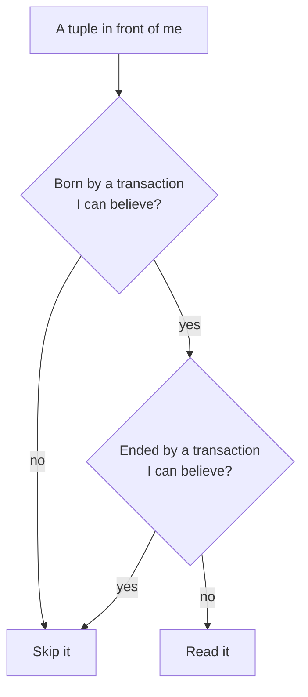
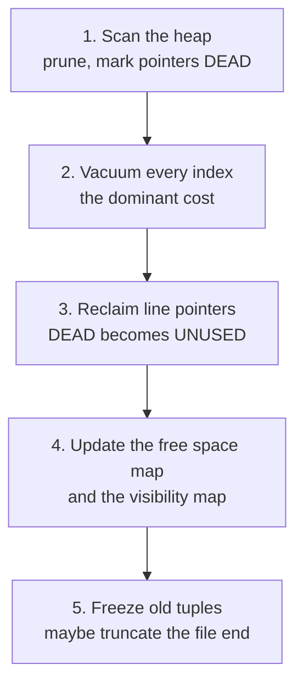

# MVCC and VACUUM — why deleting a row deletes nothing, and why your 2 GB table is 40 GB

> **Tell a friend:** Asha the clerk needs one second to record a land sale, and
> Ravi the auditor needs forty minutes to read the whole register without the
> pages changing under him. There is one book, so one of them has to wait. The
> way out is that Asha stops rubbing things out. She writes a fresh entry and
> pencils *superseded* in the margin of the old one, so Ravi still sees the
> register exactly as it stood when he began. Nothing is overwritten and
> nothing is erased, which means the bill arrives later: somebody must walk the
> book and strike out the entries no living reader could still want. That
> somebody is VACUUM, and every surprise in this lab comes from what it is not
> allowed to touch.

Step the heap, the stamps and the horizon at [`visualization.html`](visualization.html) or <https://claude.ai/code/artifact/c0f183fb-0b6c-446d-ba34-68491ddae988>.
What this lab is made of, and where it sits next to your other labs, is in [section 28](#28-about-this-lab).

---

## 1. Why is a 2 GB table sitting in 41 GB of disk?

> **In one breath:** A payments team is paged because the disk is nearly full.
> They delete three million old rows and the disk gets *bigger*. They run the
> cleanup command by hand and nothing at all comes back. Every one of those
> surprises is the intended behaviour of a design you are about to meet.

A payments team gets paged at 03:10. The alert is disk usage on the primary
database. At 100% PostgreSQL stops accepting writes, and the payment API stops
taking money.

The on-call engineer looks at the biggest table. It is called
`payment_attempts`. The row count has not changed materially in a week. There
has been no data import. Nobody added a column.

Read the middle column: it is what each figure on the alert page actually
means.

| Figure | What it means | Why it is alarming |
|---|---|---|
| 94% | disk used on the primary when the alert fired | 6% of headroom left |
| 2% an hour | how fast that number was still climbing | three hours to the wall |
| 100% | where PostgreSQL stops accepting writes | the payment API stops taking money |
| 8.1 million | rows in `payment_attempts` | unchanged for a week |
| 2.4 GB | those rows multiplied by the average row width | this is the real data |
| 41 GB | what the table occupies on disk | seventeen times more disk than data |

The engineer does the reasonable thing.

```sql
DELETE FROM payment_attempts WHERE created_at < now() - interval '90 days';
-- DELETE 3102847
```

Three million rows deleted. Disk usage does not fall by a single byte. It goes
**up**.

Then someone runs `VACUUM payment_attempts` by hand. It completes, with no
error. Disk usage still does not fall. The statistics view
`pg_stat_user_tables` reports **19 million dead rows**. That is more dead rows
than the table has live ones. And the vacuum that just ran successfully removed
almost none of them.

| Surprise | What the engineer expected | What actually happened |
|---|---|---|
| 1 | the table is about the size of its data | 41 GB of file for 2.4 GB of rows |
| 2 | deleting 3,102,847 rows frees disk | disk usage rose |
| 3 | a manual vacuum reclaims the space | zero bytes returned |
| 4 | a successful vacuum means no dead rows | 19 million dead rows remained |

Every one of those four is a direct, predictable consequence of one design
decision, and that decision was made to solve a completely different problem:
**letting a report run for forty seconds without stopping anybody from taking
payments.**

By the end of this lab you will look at that incident and name the cause in one
sentence. You will find the culprit in one query. And you will know which of
four possible fixes actually returns the 38 GB.

## 2. What happens when Asha and Ravi need the same book?

> **In one breath:** One clerk needs the ledger for a second. One auditor needs
> it for forty minutes. There is one ledger, it sits on one table, and that is
> the entire problem this lab solves.

Forget databases for ten minutes. We are in a district land registry office in
1970. There is one book: the **register**. Each page holds numbered entries,
and each entry records who owns a plot.

Two people need the register right now.

**Asha** is a clerk. A sale has completed, so plot 12 must change hands from
*Meera* to *Vikram*. Writing that down takes her about a second.

**Ravi** is an auditor. He is preparing a statement of every plot in the
district. He must read all 400 pages, and it takes him **forty minutes**.

There is one book and it is on one table. That is the whole of the difficulty.

Two things must be true at once, and they fight each other.

The first is that **Ravi's statement must be internally consistent**. Suppose
he reads plot 12 as *Meera* on page 3, and reads plot 12's mortgage as
belonging to *Vikram* on page 290. He has now produced a document describing a
state of the world that never existed. His report has to describe the register
**as of one moment**.

The second is that **Asha must not have to wait forty minutes** to record a
completed sale. The customer has already gone home.

Hold that scene in your head. Every design in this lab is an attempt to give
both of them what they want.

> **Naming, once, so the rest reads cleanly.** In this lab a **reader** is any
> transaction that needs a consistent view over time — a report, a `pg_dump`, a
> nightly export, an analytics query, a long `SELECT`. A **writer** is any
> transaction that changes rows. The tension is never reader-vs-reader.

**How deep does this go?** Stop at any checkpoint and you still have something
whole.

| Layer | Sections | After it you can… |
|---|---|---|
| Beginner | 1–10 | say what MVCC is, why it exists, and why rollback is free |
| Intermediate | 11–17 | price a dead row, state the horizon rule, and say why the file never shrinks |
| Engineering | 18–21 | predict every failure shape, including the counter running out |
| Production | 22–26 | place any MVCC engine on the same map and run the 03:10 incident |

## 3. Why can't we just let one person hold the book?

> **In one breath:** Whoever is using the book holds it, and everybody else
> queues. It works. It also means a query that changes nothing can stop your
> business from taking money for thirty-seven minutes.

The first design any reasonable person proposes is possession. Asha wants to
write, so she takes the book. Ravi wants to read, so he takes the book. Nobody
else touches it until they put it down.

You have seen this before under a formal name. From
[isolation-levels](../08-isolation-levels/) this is **two-phase locking (2PL)**,
and its bill was stated there in three words: *2PL pays in waiting*. You even
know the refinement. Readers can share the book, because many people may read
at once. A writer needs it exclusively. So a writer waits for every reader, and
a reader waits for every writer.

Let us actually run the morning, because the failure is worse than "some
waiting". Read the last column: it is who is standing in the corridor.

| Time | What happens | Who is waiting |
|---|---|---|
| 09:00 | Ravi opens the register and starts his forty-minute pass | nobody |
| 09:03 | Asha arrives with the plot 12 sale and needs exclusive access | Asha |
| 09:06 | a second clerk arrives with another sale | Asha, clerk 2 |
| 09:11 | a third clerk arrives | Asha, clerk 2, clerk 3 |
| 09:40 | Ravi finishes; Asha finally records the sale | nobody, 37 minutes late |

Now say what that table means in production terms.

> **A read-only query stopped the business from taking money for 37 minutes.**

Nothing was wrong. Nobody crashed. No network partitioned. A query that changes
nothing, that has no side effects, that could in principle be run on a
photocopy, halted every writer in the system. It did so because the only way it
could guarantee itself a consistent view was to freeze the world.

That is not a tuning problem. It is structural. And it gets worse in the
direction you would not guess. Reverse the order and the writers starve the
reader instead. If clerks arrive every 20 seconds and each holds the book for a
second, Ravi may never get a clean forty-minute window at all. His report never
runs.

> **🔮 Predict #1.** Before reading on, commit to an answer:
>
> *Ravi is read-only. He changes nothing. Is there any way to give him a
> consistent forty-minute view of the register that does not require him to stop
> Asha — while still using only the one physical book on the table?*
>
> Think about what specifically breaks if Asha writes underneath him. It is not
> that she writes. It is something narrower than that.

<details><summary><b>Answer</b> (open after you have committed)</summary>

Yes — and the narrow thing that breaks is worth naming precisely.

Ravi is not harmed by Asha *adding information*. He is harmed by Asha
**destroying** information: specifically, by her erasing the value he still needs
to see. If Asha writes *Vikram* on top of *Meera*, the value *Meera* is gone from
the universe and Ravi can no longer produce a 09:00-consistent report.

So the requirement is not "stop Asha writing". It is:

> **stop Asha from destroying the past.**

Those sound similar. They are enormously different in cost. Blocking writes costs
you availability. Preserving the past costs you *space*, and space is a bill you
can pay later, in the background, when nobody is watching.

If you guessed that Ravi must simply be given a photocopy, you were close to
right and expensive. A photocopy of a 400-page register is a full copy of the
database, taken per reader. The trick below gets the same effect for the cost of
the few entries that actually changed.

That trade is the entire subject of this lab: **latency now, for space and
cleanup later**. Everything else is consequences.
</details>

## 4. What exactly does Ravi need, stated in one sentence?

> **In one breath:** One sentence defines the whole job. Every mechanism in the
> rest of the lab is an attempt to deliver it, and every failure is that
> sentence being kept when you wish it would bend.

State the requirement plainly, because the rest of the lab is the pursuit of
this one sentence:

> **Every reader must be able to see a complete, unchanging picture of the data
> as it stood at one chosen moment, no matter how long that reader takes, and
> without preventing any writer from proceeding.**

Three parts of it are load-bearing. Read the last column: it is where that
clause comes back to matter.

| The clause | What it demands | Where it bites |
|---|---|---|
| "as it stood at one moment" | internal consistency; not the newest data, *one consistent* data | §7, when Ravi correctly reads a value that is fourteen minutes stale |
| "no matter how long" | the guarantee may not weaken as the reader runs longer | §12 and §13, where this is what forbids cleanup |
| "without preventing any writer" | Asha never queues behind Ravi | §3, the whole reason we are here |

## 5. What if Asha never rubbed anything out?

> **In one breath:** When something changes, do not change it. Write a new copy
> and pencil a note in the margin of the old one saying when it stopped being
> true. Now the past is still readable and nobody has to wait.

Here is the invention, in two sentences.

> **When a row changes, do not modify it. Write a brand-new copy of the row
> containing the new values, and mark the old copy with the moment it stopped
> being current.**

Back at the registry, Asha stops erasing. Instead she does three things.

Entry 47 currently reads *Plot 12 — owner Meera*. Asha writes a **new entry**,
number 92, on a fresh line: *Plot 12 — owner Vikram*. Then she goes back to
entry 47 and writes in its margin: *superseded at 09:03*.

She has not destroyed anything. Entry 47 is still legible, still there, with a
note saying when it stopped being true.

Now Ravi, who started at 09:00, has a rule he can apply on his own. He does not
have to talk to anybody to apply it.

> *Ignore any entry created after 09:00. Ignore any entry that was already
> superseded before 09:00. What is left is the register as of 09:00.*

Walk it with him. He reads entry 47 and sees "superseded at 09:03". That is
after his 09:00, so the superseding had not happened yet as far as he is
concerned, and he **uses entry 47**. He reaches entry 92, sees it was created at
09:03, after his 09:00, and **skips it**.

Asha did not wait. Ravi got a consistent 09:00 view. The only thing it cost was
ink and paper.

This is **Multi-Version Concurrency Control**, and now the name decomposes
exactly. *Multi-version* means more than one physical copy of each logical row
exists at once. *Concurrency control* is the mechanism by which concurrent
transactions are kept from interfering.

You knew the acronym MVCC coming in. What you now have is the *reason*. MVCC is
the answer to "how do I stop destroying the past", and it exists because
readers-blocking-writers was intolerable.

## 6. What are the four words the rest of this lab is written in?

> **In one breath:** You have felt four distinctions already. Now they get their
> names: the physical copy, the family of copies, the birth stamp and the death
> stamp. Everything after this is built from those four.

Now that you have felt the distinctions, they can have names. These four are
load-bearing. Everything else gets defined at first use and collected in the
glossary in [section 27](#27-glossary--what-does-each-word-mean).

### What is the difference between a row and a tuple?

In PostgreSQL's own source code and documentation, a **tuple** means **one
physical version of one row**. This is the single most important vocabulary
correction in the lab, so say it out loud. A *row* is the logical thing your
application talks about, such as "plot 12's owner". A *tuple* is one physical
copy of it sitting in a page on disk. **One row can be many tuples.**

In the registry, plot 12 is the row. Entries 47 and 92 are two tuples.

*(Warning, because this genuinely confuses people: in the SQL standard and in
most textbooks, "tuple" just means "row". PostgreSQL uses it in the narrower
physical sense above, and so does this lab, because that distinction is the
thing being taught.)*

The set of tuples that are all copies of the same logical row, ordered oldest to
newest, is called a **version chain**. Plot 12's chain is `entry 47 → entry 92`.

### What do the two margin notes become?

Asha wrote two things by hand: *who wrote this entry*, and *when it stopped
being current*. Those are the two stamps every physical version carries, and
they are the whole of MVCC's memory.

Read the middle column first: it is the plain-English name for each stamp, and
the symbol only arrives in the last column.

| The thing in the registry | In words | The symbol PostgreSQL uses |
|---|---|---|
| "written by clerk 701" on entry 92 | the tuple's birth certificate: which transaction created it | `xmin` |
| "superseded at 09:03 by clerk 701" on entry 47 | the tuple's death certificate: which transaction ended it, by deleting it or replacing it | `xmax` |
| a margin with nothing written in it | nobody has ended this version, so it is the current one | `xmax = 0` |

Entry 47's death stamp and entry 92's birth stamp are **the same transaction**,
because the single act that created 92 also ended 47.

Two consequences are worth noticing right now, because they will do a lot of
work later.

**An update is really an insert plus a stamp.** Physically, telling PostgreSQL
`UPDATE plots SET owner='Vikram' WHERE id=12` writes a whole new tuple and puts
a death stamp on the old one. In SQL words, an `UPDATE` is an `INSERT` plus a
`DELETE`. There is no "modify in place" anywhere in this design. Updating a
single boolean column on a 4 KB row writes a new 4 KB tuple.

**A delete deletes nothing.** A `DELETE` writes a death stamp on the existing
tuple and returns. The bytes are all still there. That is the sentence in the
lab title, and it is literally true.

> **Illustrative only — do not run this anywhere that matters, and note that
> the birth and death stamps are hidden system columns you can select but never
> write:**
>
> ```sql
> SELECT ctid, xmin, xmax, id, owner FROM plots WHERE id = 12;
> ```
>
> On PostgreSQL this returns one row per *visible* tuple, so normally one row.
> The value of this snippet is that it is the seam where the physical model
> becomes observable. The first column, `ctid`, is the tuple's physical address
> written as `(page, line-pointer)`, and it changes every time the row is
> updated, because the row moved.

## 7. What do the stamps look like on real numbers?

> **In one breath:** Swap the clerks' names for numbers and run the same
> morning. Ravi reads a value that is fourteen minutes out of date, and that is
> exactly the correct answer.

Time to drop the registry for concrete machine values. We keep the people.

Transactions get an ever-increasing integer identifier. Think of it as the
number stamped on a clerk's badge when they start a shift. In PostgreSQL it is
called a **transaction ID**, universally abbreviated **XID**. Badge 700 started
before badge 701. That is all it means, for now. Section 19 will demolish "that
is all it means", but not yet.

Our table `plots` starts with two rows, both written long ago by transaction
**500**, which committed. Read the two stamp columns as birth and death.

| tuple | xmin (born by) | xmax (ended by) | id | owner |
|---|---|---|---|---|
| A | 500 | 0 (nobody) | 12 | Meera |
| B | 500 | 0 (nobody) | 13 | Kavya |

**Ravi begins his report.** He gets badge **700**. He takes a *snapshot*, which
for the moment we will treat as just "the moment 700 began". He starts reading.

**Asha updates plot 12.** She gets badge **701** and runs `UPDATE plots SET
owner='Vikram' WHERE id=12`. Two physical things happen. A new tuple **C** is
written, born by 701 and ended by nobody, holding *Vikram*. Tuple **A** gets a
death stamp naming 701.

| tuple | xmin (born by) | xmax (ended by) | id | owner |
|---|---|---|---|---|
| A | 500 | **701** | 12 | Meera |
| B | 500 | 0 (nobody) | 13 | Kavya |
| **C** | **701** | 0 (nobody) | 12 | **Vikram** |

If you ever dump those two events in the engineer's own shorthand, this is what
you see. Read the middle column first; the shorthand is only the last column.

| The event | In words | In raw notation |
|---|---|---|
| tuple C appears | born by 701, ended by nobody, plot 12 now owned by Vikram | `xmin=701, xmax=0, id=12, owner=Vikram` |
| tuple A is stamped | ended by 701 | `xmax=701` |
| tuple A, both stamps together | born by 500, ended by 701 | `(xmin=500, xmax=701)` |

**Asha commits.** Transaction 701 is now committed and durable.

**Ravi, still in transaction 700, reads plot 12.** He walks the tuples for id 12
and finds A and C. Which does he take?

He applies a rule of exactly two clauses:

> A tuple is visible to me if two things hold. **(a)** Its birth stamp names a
> transaction I should be able to see. **(b)** Its death stamp is either absent,
> or it names a transaction I should *not* be able to see.

Work it through. Read the last column: it is the verdict.

| tuple | clause (a): the birth stamp | clause (b): the death stamp | verdict |
|---|---|---|---|
| C | 701 started *after* Ravi's 700 began, so he must not see it | not reached | **invisible** |
| A | 500 committed long before Ravi began, so it passes | 701 is a transaction Ravi cannot see, so it passes | **visible** |

Ravi reads `owner = Meera`. Asha committed her change fourteen minutes ago and
it is not there, **which is exactly right**, because Ravi is producing a 09:00
report. Meanwhile any transaction starting *now* gets badge 702, sees C, and
reads *Vikram*.

Look at what just happened at the physical level. Two different transactions
read two different bytes from two different places on disk, for the same logical
row, at the same instant, with no locks and no coordination between them. That
is the whole payoff. Visibility is a pure function of the tuple's stamps and
your own snapshot. It requires no communication.

## 8. Why isn't "started before me" the same as "finished before me"?

> **In one breath:** Comparing badge numbers looks like it decides who you can
> see. It does not, because clerks do not finish their shifts in the order they
> started them. Two extra structures supply the missing facts.

Version 1 of the rule quietly assumed something false. It assumed that "a
transaction I should be able to see" can be decided by comparing badge numbers.

Here is the scenario that breaks it. Read the last column: it is what is true at
09:06, when Ravi takes his snapshot.

| Badge | Who | What they did | State at 09:06 |
|---|---|---|---|
| 710 | Asha | began a long update touching many rows | **still running** |
| 711 | Vikram | began a quick update and committed at 09:05 | committed |
| 712 | Ravi | began a report at 09:06 | running, this is us |

Now Ravi looks at a tuple whose birth stamp reads `xmin = 710`. Under the naive
number rule, 710 is less than 712, so "it started before me, I see it". That is
**wrong**, because 710
has not committed. Ravi would be reading uncommitted data. From
[isolation-levels](../08-isolation-levels/) you know the name for that result: a
**dirty read**, forbidden at every level above read-uncommitted.

Now the reverse case. Ravi looks at a tuple whose birth stamp reads
`xmin = 711`. Again 711 is less than 712, so the number rule says visible. Here
that happens to be correct, because
711 committed before Ravi started. But now imagine a third transaction 715 that
commits, and then Ravi, still in 712, looks at its tuple. 715 is greater than
712, so invisible, which is also correct. The number comparison got two of three
right by luck.

The actual requirement is this:

> I should see a transaction's work if and only if that transaction had
> **already committed** at the instant my snapshot was taken.

Two facts are needed, and neither of them is on the tuple. The first is whether
that transaction committed, aborted, or is still running; the tuple header only
carries a number. The second is whether it was *already* committed when I
started; a number cannot answer this, because transactions do not commit in the
order they start. Badge 710 started before 711 and will commit after it.

### Which two structures supply the missing facts?

The registry office has an answer to the first question already. There is a
board by the door where each clerk's shift is marked *on duty*, *signed off*, or
*walked out*. PostgreSQL has the same board, and it is tiny.

**The commit log** is a separate array on disk with **two bits per transaction
ID**, recording in progress, committed, aborted or sub-committed. To ask "did
710 commit?", you index into that array. It is small and almost always in
memory. Its file is called `pg_xact`, and it is called `clog` in older versions
and in most blog posts.

The second question needs Ravi's slip of paper. When a transaction needs a view,
it captures a **snapshot** — not a copy of data, but a *description of which
transactions to believe*. In PostgreSQL it is three fields. Read the middle
column first.

| Field | In words | What it decides |
|---|---|---|
| snapshot `xmin` | the lowest badge still on duty when I took my slip | anything below this is finished, so ask the commit log |
| snapshot `xmax` | the next badge that had not yet been handed out | anything at or above this began after me: **always invisible** |
| `xip[]` | the badges that were on duty at that instant, between the two bounds | **always invisible**, whatever they do later |

*(Careful: the snapshot's `xmin`/`xmax` fields and a tuple's `xmin`/`xmax`
stamps are different things that unfortunately share names. Snapshot bounds
describe transactions; tuple stamps describe one physical version. When it
matters below, this lab writes "snapshot xmin" or "tuple xmin" in full.)*

So Ravi's snapshot at 09:06 is roughly `xmin=710, xmax=713, xip=[710]`. Read it
as a sentence: *"Everything below 710 has finished — ask the commit log whether
it committed. 710 was still running, so never believe it. 713 and above did not
exist yet, so never believe them."*

> **🔮 Predict #2.** Asha's transaction 710 has been running for two hours and
> has updated 50,000 rows. She now types `ROLLBACK`. Those 50,000 new tuples are
> sitting in the table's pages on disk, physically written, some of them already
> flushed to disk by the background writer.
>
> **How much work does the rollback do to undo them?** Give an order of
> magnitude: seconds? minutes? proportional to 50,000?

<details><summary><b>Answer</b></summary>

**Essentially none. It is O(1) and it is instant.** The rollback writes a single
entry in the commit log, saying "transaction 710: aborted". That is two bits.
Then it returns.

That is it. Nothing walks back over the 50,000 tuples. Nothing is erased. All
50,000 new tuples are still physically present in the pages, and all 50,000 old
tuples still carry a death stamp naming 710, written `xmax = 710`.

They are simply now **invisible to everyone forever**, by the same rule that
governs everything. Any reader that checks a birth stamp of 710 will consult the
commit log, learn that 710 aborted, and skip the tuple. Any reader checking an
old tuple's death stamp of 710 will learn 710 aborted, conclude that the
deletion never happened, and treat the tuple as alive. The abort is retroactive
and free.

If you predicted "proportional to 50,000", you were applying the model from
[acid](../07-acid/), and you were right about every in-place engine on earth.
There, undo was real work: before-images, a full undo pass, CLRs, `undoNext`,
and a recovery process that could pin a CPU for an hour rolling back one huge
aborted transaction. That was ARIES on an **in-place** storage engine, where the
new value physically overwrote the old one, so getting the old value back meant
copying it back.

PostgreSQL's heap never overwrites, so **there is nothing to copy back**. The
undo work is zero.

And now the sentence that is really the thesis of the entire lab:

> **The work did not disappear. It moved.** In an in-place engine you pay for old
> versions at rollback time and at read time. In a no-overwrite engine you pay
> for them **later, in the background, in a completely different process, on a
> schedule you do not control.**
>
> That process is VACUUM. It is not a maintenance chore bolted onto PostgreSQL.
> It is the other half of the design, and you have just watched the bill being
> run up.

(One honest footnote: rollback is not *quite* free of consequence. The aborted
transaction's changes were still written to the WAL, still dirtied pages, and
still left 50,000 dead tuples. It is free of *undo work*, not free of cost.)
</details>

## 9. What is the visibility rule, exactly?

> **In one breath:** Two questions about every tuple you touch. Was it born by
> somebody I believe? Was it ended by somebody I believe? Yes and no means you
> read it.

You now have every piece. Here is the actual rule, which PostgreSQL evaluates
for **every tuple it touches, on every scan**. This is the intermediate model's
centrepiece. Read it slowly once and it will serve you for years.

The shape first, so the tables afterwards land on something.



We are looking at a tuple whose two stamps we will call `t.xmin` and `t.xmax`,
held by a reader whose snapshot we will call `S`. In words: the tuple's birth
stamp, the tuple's death stamp, and my slip of paper.
The pair `(t.xmin, t.xmax)` is just those two stamps side by side.

**Step 1 — is the tuple's creator visible to me?** Read the middle column: it is
the question in plain words.

| The check | In words | Result |
|---|---|---|
| it is *my own* transaction | I wrote this myself | visible, after a command-level check described below |
| `t.xmin >= S.xmax` | it was born after my slip was issued | **not visible.** Stop here |
| `t.xmin ∈ S.xip[]` | its creator was still on duty when my slip was issued | **not visible.** Stop here |
| otherwise, ask the commit log | its creator had finished; did it sign off or walk out? | aborted ⇒ **stop, invisible.** committed ⇒ go to step 2 |

**Step 2 — has the tuple been ended by someone I can see?**

| The check | In words | Result |
|---|---|---|
| `t.xmax = 0` | nobody ever ended it | **VISIBLE.** This is the current version |
| the death stamp is only a *lock* | somebody is holding the row, not deleting it | **VISIBLE.** See the note below |
| `t.xmax >= S.xmax`, or `t.xmax ∈ S.xip[]` | somebody deleted it, but that deletion is in my future | **VISIBLE.** This is exactly Ravi reading *Meera* |
| otherwise, ask the commit log | did the deleter sign off or walk out? | aborted ⇒ **VISIBLE**, the delete never happened. committed ⇒ **not visible** |

Two refinements matter in practice.

**A death stamp is not always a death.** `SELECT ... FOR UPDATE` and
foreign-key checks place a *row lock*, and PostgreSQL records row locks in the
same `xmax` field, telling them apart with flag bits in the tuple header called
the `infomask`. So a tuple can have a non-zero death stamp and be perfectly
alive and current. If you ever inspect raw tuples and see a populated `xmax` on
a row you know was never deleted, this is why.

**Your own changes need a finer clock.** Two extra fields, `cmin`/`cmax`, record
the *command number* inside your transaction. Without them, `UPDATE t SET x =
x+1` would see the rows it is itself producing and loop forever. You will never
tune this. Know it exists so the header layout makes sense.

The one-sentence version is worth memorising:

> **A tuple is visible to me if it was created by a transaction that had
> committed before my snapshot, and has not been deleted by a transaction that
> had committed before my snapshot.**

Notice what is *not* in that rule. There is no mention of other readers, no
lock, no coordination, no waiting. Visibility is decided entirely locally. That
locality is why MVCC scales, and it is why "readers don't block writers, writers
don't block readers" is true rather than aspirational.

## 10. Where does the registry picture lie to you?

> **In one breath:** The book with margin notes is a good model and you should
> keep it. It lies to you in four places, and each lie is a section of this lab
> waiting to happen.

### What is the simple model worth keeping?

The registry book. Nothing is erased. New entries go on fresh lines. Superseded
entries get a margin note saying when they stopped being true. Every reader
carries a slip of paper and applies the same two-clause rule. Periodically a
clerk goes through with a ruler and strikes out entries that no reader in the
building could possibly still need, freeing those lines for reuse.

That model gets you a long way and it is the one to keep in your head.

### What is actually on disk?

A PostgreSQL table is a **heap**: a sequence of 8 KB **pages**. You met pages in
[btree-and-lsm](../05-btree-and-lsm/), and it is the same object. Here is the
inside of one page.

```
┌─────────────────────────────────────────────────────────────┐
│ page header (24 B)                                          │
├─────────────────────────────────────────────────────────────┤
│ line pointer array  →  [1][2][3][4][5] ...                  │  grows down ↓
│   each 4 bytes: offset, length, and a 2-bit STATE           │
│   state ∈ { UNUSED · NORMAL · DEAD · REDIRECT }             │
├─────────────────────────────────────────────────────────────┤
│                                                             │
│                  free space                                 │
│                                                             │
├─────────────────────────────────────────────────────────────┤
│ tuple 5 │ tuple 4 │ tuple 3 │ tuple 2 │ tuple 1             │  grows up ↑
│                                                             │
│  each tuple = 23-byte header (xmin, xmax, cid, ctid,        │
│               infomask flags) + null bitmap + your data     │
└─────────────────────────────────────────────────────────────┘
```

Three details from that diagram each become a section of their own later.

**The line pointer array is a level of indirection.** An index does not point at
a tuple's byte offset. It points at `(page number, line pointer number)`, and
that pair is the `ctid`. The line pointer then says where in the page the
tuple actually starts. Indirection is what makes section 16's HOT updates
possible.

**Line pointers have their own lifecycle.** A pointer sits in one of four
states. Read the middle column: it is the state in plain words.

| State | In words | Why it exists |
|---|---|---|
| `NORMAL` | it points at a real tuple | the ordinary case |
| `DEAD` | the tuple is gone, but index entries may still point here | vacuum, phase 1 |
| `UNUSED` | fully reclaimed and reusable | vacuum, phase 3 |
| `REDIRECT` | it forwards to another line pointer in the same page | HOT, section 16 |

Two of those four states exist purely because of vacuum.

**The header is 23 bytes, padded to 24.** Picture a table of narrow rows: an
8-byte integer key and a 4-byte value. The per-version bookkeeping is then
*twice the size of your data*. MVCC is not free even when nothing goes wrong.

### How do the two models map onto each other?

First the physical things: the paper you could pick up.

| The registry | PostgreSQL | Met in |
|---|---|---|
| the book | the heap, the table's data file | section 10 |
| a page of the book | an 8 KB page | section 10 |
| an entry | a tuple, one physical row version | section 6 |
| the entry number in the margin index | a line pointer, addressed by `ctid` | section 10 |

Then the bookkeeping: the things that decide who sees what.

| The registry | PostgreSQL | Met in |
|---|---|---|
| "written by clerk 701" | `xmin` | section 6 |
| "superseded at 09:03 by clerk 701" | `xmax` | section 6 |
| the reader's timestamped slip | a snapshot `(xmin, xmax, xip[])` | section 8 |
| the board recording which clerks finished their shift properly | `pg_xact`, the commit log | section 8 |
| the clerk with the ruler | VACUUM | section 12 |

### Where does the analogy break?

Four places, and each one matters.

**Ravi's slip says a time; a snapshot does not.** A snapshot is not "09:00". It
is a *set of transaction identities to believe*. This is not pedantry. It is why
a transaction that starts later can still see *less* than one that started
earlier, and why wall-clock time never appears anywhere in the visibility rule.
If you carry "snapshot = timestamp" in your head you will mispredict every
overlapping-writer case in section 8.

**The clerk with the ruler cannot make the book thinner.** Striking out an entry
frees the *line* for a future entry. It does not remove a page from the book,
and it does not make the book lighter. Section 14 is entirely about this.

**The register has no index; a real table has several, and they are separate
books.** Every tuple you create needs an entry in every index. Cleaning up a
tuple means first finding and removing its pointers in every one of those books.
This is why vacuum's cost is dominated by index maintenance, not by the heap.

**The clerk's numbers run out.** The registry could use 09:03 forever. A
PostgreSQL badge number is a **32-bit** counter, it wraps, and the consequence is
the single most feared operational failure in the whole system. That is section
19, and it is the part of this lab that has woken people up at night.

---

> ### ✅ CHECKPOINT — end of the BEGINNER MODEL
>
> **You can now:** explain what MVCC is and *why* it exists (not "for
> performance" — to stop readers blocking writers); explain why an `UPDATE` is
> physically an insert plus a stamp; state the visibility rule and apply it to
> a two-transaction trace; explain why rollback is free in PostgreSQL and
> expensive in an ARIES-style in-place engine; and read `xmin`, `xmax`, `ctid`
> in a tuple header.
>
> **What the next layer adds:** the bill. Every one of those unremoved tuples is
> still occupying disk and still being read by every sequential scan. We now
> follow the garbage — who is allowed to collect it, why the obvious collection
> rule is wrong, and why the space does not come back.

> **Say it back.** Without using the words *version*, *snapshot* or *tuple*,
> explain to a friend why Asha could record the sale immediately and Ravi's
> report still came out right.
> <details><summary>A good answer sounds like</summary>
> "Asha was not allowed to rub anything out. She wrote the new owner on a fresh
> line and pencilled a note on the old line saying when it stopped counting.
> Ravi started at nine, so he ignores anything written after nine and ignores
> notes dated after nine. He reads the old line and gets the nine o'clock
> answer. Neither of them had to wait for the other, and the only thing it cost
> was more paper."
> </details>

---

## 11. What does one dead tuple actually cost?

> **In one breath:** A tuple nobody can ever see again still sits on disk, still
> gets read by every full scan, and still takes up room in memory. The third one
> is the one that ruins your afternoon.

A **dead tuple** is a tuple that is invisible to every possible reader, now and
forever. Nobody will ever look at it again. It is garbage. In the registry, it
is an entry so old that no auditor in the building could still have a slip that
reaches it. Not Ravi, and not anyone who walks in later.

Let us price it on a realistic table called `sessions`. Read the last column: it
is where each number comes from.

| Quantity | Value | How it is arrived at |
|---|---|---|
| rows | 1,000,000 | the live session count |
| bytes per row | 200 | your actual data |
| bytes per tuple | 224 | 200 of data plus the 24-byte header |
| tuples per 8 KB page | about 35 | 8 KB divided by 224 bytes |
| pages when clean | about 28,600 | 1,000,000 divided by 35 |
| size when clean | about 230 MB | 28,600 pages of 8 KB |

Now the application does what applications do. It updates a "last seen" column
on every request, so each session is touched **10 times** an hour.

After one hour with no cleanup, read the last column: it is what changed.

| Quantity | Value | What it means |
|---|---|---|
| tuples written | 11,000,000 | 1,000,000 original plus 10,000,000 updates |
| live tuples | 1,000,000 | the row count has not changed at all |
| dead tuples | 10,000,000 | every superseded version, still on disk |
| table size | about 2.5 GB | for 230 MB of real data |

Three costs land, and they are different from each other.

**The first cost is disk.** It is the obvious one and the least interesting.
Disk is cheap.

**The second cost is that every sequential scan reads all of it.** `SELECT
count(*) FROM sessions` must visit all 11 million tuples and evaluate the
visibility rule on each one, in order to return 1,000,000. That is not 230 MB
of I/O. It is **2.5 GB**. Your query got 11× slower. The query plan did not
change, the statistics did not change, and nothing in your code changed. *This*
is what people mean when they say bloat hurts.

**The third cost is cache pollution.** PostgreSQL's shared buffers and the
operating system's page cache hold *pages*, not rows. If 90% of every page is
garbage, then 90% of your RAM is holding garbage. A working set that comfortably
fit in 8 GB of cache now needs 88 GB and does not fit. So you start hitting disk
on queries that used to be served from memory. Latency does not degrade
gracefully here. It falls off a cliff when the working set crosses the cache
size.

You met the general shape of the first two costs in
[btree-and-lsm](../05-btree-and-lsm/) under the names **space amplification**
and **read amplification**. This is the same scorecard applied to a different
engine. MVCC's answer to "when do you pay for sortedness" is "not sortedness —
*deadness*, and you pay in a background process".

So somebody has to collect the garbage. That somebody is VACUUM, and it is the
clerk with the ruler from Ravi and Asha's registry. Now the interesting part:
the obvious way to write it is wrong.

## 12. Who is allowed to throw an old version away?

> **In one breath:** The obvious cleanup rule deletes the very entry Ravi is
> about to read. The fix is a single number: the oldest slip of paper anybody in
> the building is still holding.

Here is **version 1 of the cleanup rule**, which everybody proposes first:

> *Scan the table. For each tuple, if its death stamp is set and that
> transaction committed, the tuple has been deleted — remove it.*

It is wrong, and section 7 already contains the counterexample.

Recall the trace. Tuple **A** was born by 500 and ended by 701, which in raw
notation is `(xmin=500, xmax=701)`. Asha's 701 has
committed, and Ravi is still sitting in transaction 700 producing his
forty-minute report. Under rule v1, A qualifies for removal: death stamp set,
that transaction committed, delete it.

Ravi reaches plot 12 and finds only tuple C, which reads `owner = Vikram` and
was born by 701 — a transaction he cannot see. His snapshot says C is invisible, and A no longer exists.
**Plot 12 has vanished from the register.** Ravi's report is missing a plot. Not
stale. *Wrong*, and silently so.

We have violated the exact guarantee we set out to provide in section 4: *"no
matter how long that reader takes"*. Version 1 of vacuum silently converts a
slow reader into a corrupt report.

### What is the horizon?

So the rule must consult not only the tuple, but **every snapshot alive in the
system**:

> **A dead tuple may be removed only when its deletion is visible to every
> snapshot currently held anywhere in the database — that is, only when its
> death stamp names a transaction that committed before the *oldest* snapshot
> still in existence.**

Since snapshots are described by their `xmin` bound, this reduces to a single
number. In the registry it is the earliest time written on any slip of paper
still in the building.

> **the horizon** = the minimum snapshot `xmin` over all snapshots currently
> held.
>
> Every transaction with a badge below the horizon is finished and its outcome
> is settled for everyone. A dead tuple whose death stamp is below the horizon
> can never be wanted again. **A dead tuple whose death stamp is at or above the
> horizon must be kept, no matter how obviously dead it looks.**

PostgreSQL exposes this number. It is often written `OldestXmin` in logs, and it
appears as `backend_xmin` in the `pg_stat_activity` view.

Read the horizon definition once more and notice its shape. It is a **global
minimum**. Not an average. Not a percentile. **One** participant, anywhere,
holding an old snapshot pins the horizon for the **entire database** — including
tables that participant has never heard of.

That single structural fact generates most of section 20's failure scenarios,
the 03:10 page in section 1, and about 80% of all PostgreSQL bloat incidents
ever filed.

> **🔮 Predict #3.** A developer opens `psql`, runs `BEGIN;` and a single
> `SELECT count(*) FROM users;`, gets the answer, and then goes to lunch without
> typing `COMMIT`. The session is now `idle in transaction`, holding an open
> read-only transaction. It holds **no locks on any table** — it is read-only and
> it finished its query.
>
> Meanwhile the application updates the `sessions` table 10 million times over
> the next three hours, and autovacuum runs against it dozens of times,
> successfully, with no errors in the log.
>
> **How many of those 10 million dead tuples can vacuum remove?**

<details><summary><b>Answer</b></summary>

**Zero.**

Every one of those 10 million dead tuples has a death stamp at or above the
horizon, because the horizon is pinned at the developer's snapshot from three
hours ago. Vacuum runs, walks all 11 million tuples, evaluates every one,
removes **none**, reports success, and goes back to sleep. Then it does it
again. And again.

Three hours later the table is 2.5 GB of which 230 MB is real. The developer
comes back from lunch, types `COMMIT` (or their client times out), and the
horizon jumps forward by three hours' worth of badge numbers. The next vacuum
removes all 10 million dead tuples in one pass — and **the table is still 2.5 GB
on disk**. Section 14 explains that last part.

This is worth internalising as a shape, because it recurs in every MVCC system
ever built:

> **One idle session, holding nothing, blocking nobody, caused unbounded space
> growth across the entire database.**

There are no locks involved. There is no error. `pg_locks` is clean. The only
symptom is disk. This is why every experienced PostgreSQL operator sets
`idle_in_transaction_session_timeout`. It is also why "who is holding the oldest
xmin" is the first query you run on a bloat page. It is not "is autovacuum
running", which was the on-call engineer's wrong first move in section 1.

If you predicted "a few", the mistake was almost certainly assuming the horizon
is per-table, or that a read-only transaction is harmless. Neither is true. The
horizon is global, and *read-only is exactly the dangerous kind*. A writing
transaction that long would at least be visibly holding locks.
</details>

## 13. What are vacuum's five jobs, and which one hurts?

> **In one breath:** "VACUUM removes dead tuples" is about a fifth of the truth.
> It has five jobs, four of them cause a production symptom you would otherwise
> misdiagnose, and the expensive one is the indexes.

Here is the whole job. A vacuum of one table proceeds roughly like this.



**Phase 1 — scan the heap and build a list of dead tuples.** Read the table's
pages, skipping the ones the visibility map marks all-visible (section 17). On
each page, apply the horizon rule to every tuple. For each removable one, do an
in-page *prune*: move its data out, and set its line pointer to `DEAD`. Collect
its `ctid` into an in-memory list.

Why only `DEAD` and not `UNUSED`? Because indexes still point at that line
pointer. Freeing the slot now would let a future tuple occupy it, and an old
index entry would then point at an unrelated row. So the line pointer must be
kept as a tombstone until every index has been cleaned.

**Phase 2 — vacuum the indexes.** For **each index on the table**, scan it and
delete every entry whose `ctid` is in that list. This is usually the *dominant
cost of the whole operation*: a full index scan per index. A table with 8
indexes pays 8 full index scans.

**Phase 3 — reclaim the line pointers.** Go back over the heap pages and set
those `DEAD` line pointers to `UNUSED`. Now the slots and the space are
genuinely reusable.

**Phase 4 — update the free space map and the visibility map.** Record how much
free space each page now has, which is how future inserts find a home. Then set
the all-visible bit on pages where every tuple is now visible to everyone.

**Phase 5 — freeze old tuples**, and possibly truncate empty pages off the end
of the file. Sections 19 and 14 respectively.

### Which four consequences can you now predict instead of discover?

**(a) Vacuum is mostly an index operation.** If a vacuum is taking hours, the
first question is not "how big is the table" but "how many indexes does it have,
and how big are they". Dropping an unused index makes every future vacuum
faster, permanently.

**(b) The dead-tuple list has a memory budget, and running out used to be
brutal.** The list lives in `maintenance_work_mem`. If it fills up, vacuum must
stop scanning, do the *entire* index phase, come back, and resume. So a big
table could pay for five or ten complete passes over every index.

On PostgreSQL 17 and later this changed significantly. The dead-TID list was
rewritten to a compressed radix-tree structure called `TidStore`, which removed
the old 1 GB cap and made multiple index passes far rarer. *[Version-specific:
check your major version. The old advice "raise maintenance_work_mem before a
big vacuum" is strong pre-17 advice and much less critical after.]*

**(c) Vacuum is deliberately, configurably slow.** It runs a **cost-based
delay** loop. It accumulates notional cost points as it works, and when it
exceeds a limit it sleeps. Read the middle column: it is what each knob counts,
in plain words.

| Setting | In words | Effect |
|---|---|---|
| `vacuum_cost_page_hit` | points charged for a page already in cache | cheapest |
| `..._miss` | points charged for a page read from disk | dearer |
| `..._page_dirty` | points charged for a page vacuum modifies | dearest |
| `vacuum_cost_limit` | points allowed before a nap, default 200 | the speed limit |
| `vacuum_cost_delay` | how long that nap lasts | the throttle |

This is throttling by design: vacuum yields to your workload. It is also the
single most common reason autovacuum "cannot keep up". It is not stuck. It is
**obeying a speed limit set for a machine much smaller than yours**. The
defaults have historically been extremely conservative;
`autovacuum_vacuum_cost_delay` dropped from 20 ms to **2 ms** in PostgreSQL 12,
and on modern SSD hardware raising `vacuum_cost_limit` well above the default
200 is routine.

**(d) A plain `SELECT` can clean up.** Phase 1's in-page pruning also happens
*opportunistically* whenever a page is read and looks like it would benefit.
That is HOT pruning, and section 16 covers it. So a read query can dirty pages
and generate WAL.

If you have ever wondered why a read-only workload produces write I/O, that is
one of two reasons. The other is **hint bits**. The first reader to touch a
tuple after its creating transaction committed writes a flag into the tuple
header, caching "this birth stamp is committed", so the next reader need not
consult the commit log. That flag write dirties the page. Both are the system
doing your future self a favour, and both make "read-only query, why is it
writing?" a non-mystery.

## 14. Why doesn't the disk space come back?

> **In one breath:** Vacuum frees lines inside the book. It does not tear pages
> out of the book. So the healthy result of a vacuum is that the file *stops
> growing*, not that it shrinks.

This is surprise 3 and surprise 4 from the 03:10 incident, and it is the single
most common misconception about vacuum.

> **🔮 Predict #4.** The developer from section 12 finally committed. The
> horizon has jumped forward. Autovacuum now runs on `sessions` and successfully
> removes all **10 million** dead tuples. The table has 1 million live rows,
> about 230 MB of real data, and the file on disk is 2.5 GB.
>
> The vacuum reports success. **What does `du` say the file size is now?**

<details><summary><b>Answer</b></summary>

**2.5 GB.** Unchanged. Not one byte returned to the operating system.

If you predicted 230 MB, you have just made the same mistake the on-call
engineer made at 03:10, and the next paragraph is the most useful one in the
lab.
</details>

> **Ordinary VACUUM does not return space to the operating system. It makes
> space reusable *inside* the existing file.**

Freeing tuple slots inside a page leaves the page where it is. The file has the
same number of pages. `du` reports the same size. What has changed is that the
free space map now says "page 4,201 has 6 KB free", so the *next* insert or
update will land there instead of extending the file.

So the effect of vacuum is **not shrinkage — it is that growth stops.** The
table reaches a steady-state size somewhere above its live size, and stays
there. That steady state is the honest, healthy outcome. It is why a
permanently-somewhat-larger-than-its-data table is not a bug.

There is exactly one case where plain vacuum *does* shorten the file:
**truncation**. If the pages at the very **end** of the file are entirely empty,
vacuum can lop them off and hand the space back. Note the two conditions. The
empty pages must be **contiguous** and at the **end**.

Delete 3 million rows scattered through a 41 GB table, and you free space in the
middle of thousands of pages and truncate approximately nothing. Truncation also
needs a brief `ACCESS EXCLUSIVE` lock, which vacuum will give up on rather than
block your workload. It can be disabled per-table with
`vacuum_truncate = off`.

Which finally explains the incident in section 1 exactly. Read the last column:
it is what the on-call engineer should have expected.

| What they did | Why it did nothing | What was actually true |
|---|---|---|
| `DELETE` of 3,102,847 rows | `DELETE` writes death stamps and frees nothing | disk *grew*: three million stamps went to the WAL and dirtied every page they touched |
| manual `VACUUM` | the horizon was pinned by something — find it! | almost nothing was removable |
| expected the file to shrink | even removing everything does not shrink the file | only the four methods below return bytes |

### What are the four ways to actually get the 38 GB back?

| Method | How it works | Lock | Cost |
|---|---|---|---|
| **Wait and reuse** | let vacuum keep the space free-listed; future rows fill it | none | free, but the file stays big forever |
| **`VACUUM FULL`** | rewrites the entire table into a brand-new compact file, then swaps and drops the old one | **`ACCESS EXCLUSIVE` for the whole operation** — all reads and writes on that table block | needs up to **2× the table size** in free disk while it runs. On a 41 GB table with 4 GB free, this fails |
| **`pg_repack` / `pg_squeeze`** (extensions) | build the compact copy concurrently, capture changes with a trigger, swap under a brief lock at the end | brief exclusive lock at the swap only | also needs ~2× space; needs installing an extension; the standard production answer |
| **partitioning** | make the old data a separate partition and `DROP` it | brief | the *correct* answer for time-series retention. `DROP TABLE` on a partition returns the file to the OS instantly, with no vacuum, no rewrite, and no 2× space requirement |

The last row deserves emphasis, because there is a design-level lesson hiding in
a tuning table. **The winning move on the 03:10 incident is not to run a better
vacuum. It is to have partitioned `payment_attempts` by month, so that deleting
90-day-old data is a `DROP` and not a `DELETE`.** Mass `DELETE` on a large table
is the operation MVCC handles worst. It is the one to design away rather than
optimise.

## 15. How does one field decide who wins a write conflict?

> **In one breath:** Two clerks want the same entry. The death stamp is already
> claimed by one of them, and that claim *is* the conflict detector. No separate
> lock table is needed.

You learned in [isolation-levels](../08-isolation-levels/) that snapshot
isolation resolves concurrent writers by **first-committer-wins**. Here is the
physical implementation, which is a two-line addition to what you already have.

When Asha (transaction 701) tries to update tuple A, she checks A's death stamp.
If it is set to a still-running transaction, she cannot proceed, because someone
else got there first. So she **waits on that transaction's lock**. When it
finishes, one of two things happens.

If it aborted, Asha proceeds. If it committed, the answer depends on her
isolation level. At `READ COMMITTED` she re-reads the *newest* version and
re-evaluates her `WHERE` clause against it. That re-check is called
"EvalPlanQual", and it is precisely why `READ COMMITTED` permits lost update
while still not permitting dirty write. At `REPEATABLE READ` or `SERIALIZABLE`
she instead gets `ERROR: could not serialize access due to concurrent update`,
which is SQLSTATE **40001**, the retry-loop error you already know.

So the entire write-conflict rule is one sentence: *the `xmax` field is the
conflict detector.* No separate lock table entry is needed for row-level write
conflicts, because the row version itself carries the claim.

## 16. What does every extra index cost, and how does HOT dodge it?

> **In one breath:** Every new version of a row needs a new entry in every
> index, because the new version lives at a new address. Unless it does not move
> far, in which case PostgreSQL can skip the indexes entirely.

Return to a cost mentioned in passing. Every new tuple needs an entry in
**every** index on the table. The reason is that the new version sits at a
**new `ctid`**, which is a new physical address, and every index maps a key to
a `ctid`.

So a table with 6 indexes, updated once, writes **1 new heap tuple plus 6 new
index entries**, even if you only changed one non-indexed column. Later,
cleaning that tuple up costs 6 index scans. Index bloat is frequently worse than
heap bloat, and unlike the heap it directly slows down the lookups you actually
care about.

That is so expensive that PostgreSQL has a special case for it. The special case
is worth understanding, because you can *cause* it or *prevent* it with schema
decisions.

### What is a heap-only tuple?

If **both** of these hold —

1. the `UPDATE` changes **no indexed column**, and
2. the new tuple **fits on the same page** as the old one —

then PostgreSQL performs a **HOT update**, where HOT stands for Heap-Only Tuple.

```
BEFORE                          AFTER a HOT update
page 42                         page 42
 lp[1] NORMAL ──▶ tuple A        lp[1] REDIRECT ──▶ lp[3]
                                 lp[3] NORMAL ────▶ tuple C   (new version)
index entry: 'Meera' → (42,1)   index entry: 'Meera' → (42,1)   ← unchanged!
```

The index entry still points at line pointer 1. Line pointer 1 becomes a
`REDIRECT` that forwards to the new tuple within the same page. **No index was
touched.** The chain of versions lives entirely inside one page, which is why it
is called a heap-only tuple: a tuple no index points to.

The payoff compounds. HOT chains can also be pruned *without* an index scan,
opportunistically, by any query that reads the page. So a HOT-heavy workload
largely cleans up after itself, and autovacuum has far less to do.

> **🔮 Predict #5.** A migration lands on `sessions`. It adds one index on
> `last_seen_at`, the column every request updates. The index itself is small
> and the dashboard query that needed it gets faster.
>
> **What happens to the table's bloat and to vacuum's cost per run?** Same,
> a little worse, or much worse?

<details><summary><b>Answer</b></summary>

**Much worse, and not because of the index's own upkeep.**

The index is on the column that every update changes. Condition 1 for a HOT
update is now violated on *every single update of that table*. Every update that used to touch no index at all now writes an
entry in every index on the table. Every one of those entries must later be
found and removed by vacuum's phase 2.

If you answered "a little worse, one more index to maintain", you used the
right model for an index on a *static* column and the wrong one here. The cost
of this index is not local to itself. It is charged to every update of the
table, and then charged again to every vacuum.

This is the highest-leverage and least-known fact in PostgreSQL schema design,
and it arrives in a migration diff that looks completely innocent.
</details>

### What are the two ways to lose HOT?

Both of them are choices you make.

The first is **indexing a column you update frequently**. Adding an index on
`sessions.last_seen_at` sounds harmless and even helpful. It converts every
single session update from a HOT update into a full index-entry-per-index write.
That is Predict #5 above.

The second is **filling pages to 100%**. Condition 2 needs free space on the
page. A freshly-loaded table is packed full, so the first update of every row
must go to a different page and cannot be HOT.

The lever is **`fillfactor`**. Running `ALTER TABLE sessions SET
(fillfactor = 85)` tells PostgreSQL to leave 15% of each page empty at insert
time, reserved for future in-page versions. You are spending 15% more disk to
buy HOT updates. On an update-heavy table this trade is usually strongly
positive. On an append-only table it is pure waste, which is why the default is
100.

*(PostgreSQL 16 carries a related but distinct idea for indexes themselves,
"bottom-up index deletion", introduced in PG 14. A B-tree page about to split
first tries to delete entries it can prove are dead, which specifically targets
the index bloat caused by non-HOT updates of unchanged index columns. Worth
knowing the name; not worth tuning, as it has no knobs.)*

## 17. Why does your "index-only scan" still read the table?

> **In one breath:** An index entry does not know whether its row is visible to
> you. There is a two-bit-per-page cheat sheet that sometimes lets the index
> answer alone, and vacuum is the only thing that writes it.

Vacuum keeps a tiny side file per table called the **visibility map**, holding
**two bits per page**. Read the middle column: it is what the bit promises.

| Bit | In words | What it lets the system skip |
|---|---|---|
| all-visible | every tuple on this page is visible to every possible transaction | vacuum need not look at the page at all |
| all-frozen | stronger still; nothing here can ever age out (section 19) | even an aggressive vacuum can skip it |

It exists to let vacuum skip pages. If a page has not changed since it was
marked all-visible, vacuum need not look at it. That alone turns vacuuming a
1 TB mostly-static table from a 1 TB read into a small one.

But the map acquired a **second job**, and this is where it reaches into your
query plans.

Consider `SELECT count(*) FROM orders WHERE customer_id = 88`, with an index on
`customer_id`. In principle the index alone answers this, since it contains
`customer_id` values. So why touch the table at all? Because of everything in
section 9: **the index entry does not carry visibility information.** An index
entry might point at a tuple that was deleted, or one created by a transaction
you cannot see. Only the tuple header knows.

So the escape hatch is this. For each index entry, check the visibility map. If
the target *page* is marked all-visible, then every tuple on it is visible to
everyone, so this one certainly is, and **the heap fetch can be skipped**. If it
is not marked, the heap must be visited to check.

Now the operational consequence, which surprises people badly.

> **An `Index Only Scan` in `EXPLAIN` is not a promise. It is a hope.** Run
> `EXPLAIN (ANALYZE, BUFFERS)` and read the **`Heap Fetches:`** line. On a
> freshly-vacuumed table it says 0 and the query is fast. On a
> recently-written table it can equal the row count, and the "index-only" scan is
> doing exactly as much work as a plain index scan plus overhead.

Which yields a sentence connecting two things you would never have connected:

> **Whether vacuum ran recently is an input to your query performance, not just
> to your disk usage.**

Ravi's reporting query can be 20× slower on Monday than on Sunday, because a
bulk load on Sunday night cleared the all-visible bits on every page it touched
and autovacuum has not caught up. Nothing in the plan changed. Nothing in the
statistics changed. This is also why manually running `VACUUM` after a large
bulk load measurably speeds up subsequent reads, even though there are no dead
tuples to remove: you are setting visibility-map bits, not collecting garbage.

---

> ### ✅ CHECKPOINT — end of the INTERMEDIATE MODEL
>
> **You can now:** explain what a dead tuple costs (three distinct costs);
> state the horizon rule and use it to explain why a vacuum that runs
> successfully can remove nothing; list vacuum's five phases and name the
> symptom each one causes; explain why `VACUUM` does not shrink files and name
> the four ways to actually reclaim space; and diagnose a slow "index-only" scan
> from `Heap Fetches`.
>
> **What the next layer adds:** the counter runs out. Everything so far assumed
> badge numbers are just increasing integers. They are 32 bits, they wrap, and
> the fix for that is a second, entirely separate reason vacuum must visit every
> page of every table — including tables that are never written to at all.

> **Say it back.** A colleague says "our table is bloated, so autovacuum must be
> broken". Without using the words *horizon*, *snapshot* or *xmin*, explain why
> they might be wrong, and what you would look at first.
> <details><summary>A good answer sounds like</summary>
> "Autovacuum is probably running fine and being told it is not allowed to
> throw anything away. It may only remove an old row version once nobody in the
> whole database could still be reading it. If one session opened a transaction
> and went to lunch, everything from lunchtime onwards has to be kept, for every
> table, even ones that session never touched. So I would look at the list of
> open sessions and find the oldest one, before I look at vacuum at all. And
> even once it does clean up, the file will not get smaller — it just stops
> growing."
> </details>

---

## 18. Who decides when to vacuum, and why did it skip your table?

> **In one breath:** A background daemon decides, using one arithmetic rule.
> That rule waits until a fifth of your table is garbage, which is fine on a
> small table and ruinous on a huge one.

Nobody runs `VACUUM` by hand in production. A background daemon does it. Knowing
its decision rule is what lets you predict *why it did not run on the table you
cared about*.

An **autovacuum launcher** wakes every `autovacuum_naptime`, which defaults to
**1 minute**. It picks databases and starts up to `autovacuum_max_workers`
worker processes, which defaults to **3**. A worker examines each table's
statistics and vacuums it if a threshold is crossed.

Here is the trigger:

```
dead_tuples  >  autovacuum_vacuum_threshold  +  autovacuum_vacuum_scale_factor × reltuples
                          (default 50)                    (default 0.2)
```

Read that as a sentence: *"vacuum when 20% of the table is dead."* Read the last
column: it is what that rule costs at each table size.

| Table size | Dead tuples before autovacuum starts | What that means |
|---|---|---|
| 100,000 rows | about 20,000 | fine; a small vacuum, often |
| 100,000,000 rows | about **20,000,000** | the table is 20% bloated before anything starts |

On the big table the vacuum, when it finally comes, is enormous. It takes hours,
during which another few million tuples die.

> **The single most common autovacuum tuning change, and the one to reach for
> first:** lower the scale factor on your big, hot tables, per table.
>
> ```sql
> ALTER TABLE payment_attempts SET (
>   autovacuum_vacuum_scale_factor = 0.01,   -- 1%, not 20%
>   autovacuum_vacuum_threshold    = 1000
> );
> ```
>
> Small, frequent vacuums instead of rare, huge ones. The total work is similar;
> the *peak* is a fraction, and the bloat ceiling drops from 20% to 1%. Some
> shops go further and set `scale_factor = 0` with a fixed threshold, making the
> trigger purely absolute.

### Why did an insert-only table never get vacuumed at all?

There is a second trigger, for inserts only, added in PostgreSQL 13. It uses
`autovacuum_vacuum_insert_threshold`, which defaults to **1000**, and
`autovacuum_vacuum_insert_scale_factor`, which defaults to **0.2**.

It exists because an insert-only table generates *no dead tuples at all*. It
therefore never crossed the first trigger, and so it never got its visibility
map set or its tuples frozen. Append-only tables historically sat untouched
until they hit an anti-wraparound emergency, and every index-only scan on them
fetched the heap. If you run an older major version, this is a real gap you must
cover with a scheduled manual `VACUUM`.

### When does autovacuum refuse to get out of the way?

Autovacuum is a polite guest, with one exception that will bite you. A normal
autovacuum worker holds only a `SHARE UPDATE EXCLUSIVE` lock, which does not
block reads or writes. It also **cancels itself** the moment somebody requests a
conflicting lock, such as an `ALTER TABLE` or an index build. That is why
routine autovacuum is invisible.

The exception is an **anti-wraparound** autovacuum, which is section 19's
subject. It does **not** yield. It cannot, because the alternative is the
database shutting down.

So the shape of a classic outage is this. A migration takes `ACCESS EXCLUSIVE`.
It queues behind a six-hour anti-wraparound vacuum. Every query on that table
then queues behind the migration. The table is up, the vacuum is working
correctly, and the application is completely down.

**If a `DDL` statement is hanging, check `pg_stat_activity` for an autovacuum
worker on that table, and look at whether its query text says
`(to prevent wraparound)`.** Killing it is usually the wrong move. It will
simply restart, and the wraparound clock is still ticking.

## 19. What happens when the transaction counter runs out?

> **In one breath:** Badge numbers are 32 bits, so they run out and start again.
> A row whose badge falls too far behind stops looking old and starts looking
> like the future, and a row in the future is invisible to everybody.

Everything so far treated badge numbers as plain increasing integers. They are
**32-bit**, which gives about **4.29 billion** values, and a busy system can
burn through that in weeks. So they wrap around to the beginning.

Now look at the visibility rule again and notice that it is built entirely on
comparisons of the form *"is this badge older than that one?"*. With a wrapping
counter, "older" cannot mean "numerically smaller". PostgreSQL therefore
compares badge numbers **modulo 2³²**. From where you stand, the **2 billion
badges behind you are the past**, and the roughly 2 billion ahead of you are the
future.

That is a circle, not a line. And it has a lethal property.

> If a tuple's birth stamp is allowed to fall more than **2 billion**
> transactions behind the current badge number, it silently crosses over and
> starts appearing to be **in the future**.
>
> A tuple in the future is invisible to everyone.
>
> **The row disappears. No error. No log entry. It is simply not in your table
> any more, and it is not in your backups either if they are logical dumps.**

Meera's plot, recorded correctly in 2019 and never touched since, would simply
cease to exist. This is the worst failure mode in PostgreSQL, and the whole
freezing machinery exists to make it impossible.

> **🔮 Predict #6.** A lookup table was loaded once, in 2019, and has never been
> written to since. It has no dead tuples, no updates, and no deletes. The
> database around it is busy and burns 300 million transactions a month.
>
> **Does that table need vacuuming?** And if it never gets one, what does
> `SELECT * FROM lookup` eventually return?

<details><summary><b>Answer</b></summary>

**Yes, it needs vacuuming, and eventually the query returns nothing at all.**

If you answered "no — there is no garbage to collect", you were using the only
model this lab has given you so far, and it is exactly half the truth. Vacuum
has a second job that has nothing to do with garbage.

The rows in that table carry birth stamps from 2019. The current badge number
keeps climbing. Once a stamp is more than 2 billion transactions behind, the
modular comparison flips its sign, and the row starts looking as though it was
written by a transaction that has not happened yet. Every reader skips it.

Nothing errors. Nothing is logged. The table is simply empty, and a logical dump
of it is empty too.

That is why vacuum must eventually visit **every page of every table**,
including tables that are never written to, contain no dead tuples, and belong
to a schema nobody has looked at in years.
</details>

### What is freezing?

**Freezing** marks a tuple as *"created so long ago that it is visible to
everybody, unconditionally, forever"*. Once frozen, its birth stamp is never
compared again, so it can never cross to the far side of the circle.

*(Mechanically: PostgreSQL 9.4 and later set a flag bit in the tuple's
`infomask` rather than overwriting the birth stamp with a magic value, so the
original badge number stays readable for forensics. Older versions really did
overwrite it.)*

Freezing is a **second, independent reason vacuum must visit pages**. It is the
reason vacuum must eventually visit every page of every table, including tables
that have never been updated and contain no dead tuples at all. A read-only
lookup table loaded once in 2019 still needs to be frozen.

### Which four ages govern it?

Read the middle column: it is the age in plain words, before the setting name.

| Setting | In words | What happens at that age |
|---|---|---|
| `vacuum_freeze_min_age` | 50 million transactions old | any vacuum freezes tuples older than this while it is there anyway |
| `vacuum_freeze_table_age` | 150 million | the next vacuum escalates to an **aggressive** scan: it may no longer skip all-visible pages, only all-*frozen* ones, so it reads much more of the table |
| `autovacuum_freeze_max_age` | 200 million | an **anti-wraparound autovacuum is forced**, even on tables with `autovacuum = off`, even in a database nobody is connected to. This is the one that does not yield to locks |
| `vacuum_failsafe_age` | 1.6 billion (PG 14+) | **emergency**: vacuum abandons the cost-delay throttle and skips index cleanup entirely, doing the bare minimum to freeze tuples fast |

And the endgame, if all four are outrun. Read the last column: it is what your
application sees.

| Margin remaining | What the server does | What you see |
|---|---|---|
| about 40 million transactions | every commit emits `WARNING: database "x" must be vacuumed within 39,999,999 transactions` | the alarm, in your logs, almost always ignored for weeks |
| about a million | the server **refuses to assign new transaction IDs** | `ERROR: database is not accepting commands to avoid wraparound data loss` — your application is down |

Reads may still work at that point. Anything that consumes a badge number does
not. You must let vacuum finish. On older major versions this meant stopping the
server and running in single-user mode, a genuinely frightening operation on a
production system at 3 a.m.

**Watch it with one query**, and put it on a dashboard before you need it:

```sql
-- illustrative: how much of the 2-billion budget each table has consumed
SELECT c.relname,
       age(c.relfrozenxid) AS xid_age
FROM   pg_class c
WHERE  c.relkind IN ('r','m')
ORDER  BY xid_age DESC
LIMIT  10;
```

If the top value is climbing steadily past 200 million and never falling back,
autovacuum is losing, and you need to find out why *now* rather than at 1.9
billion.

### Which second counter did you not know existed?

There is a **multixact ID**, also 32-bit, also wrapping, with its own
`autovacuum_multixact_freeze_max_age`, which defaults to **400 million**.

A multixact is allocated when **more than one transaction holds a lock on the
same row at once**. That happens routinely from `SELECT ... FOR SHARE` and,
much more often than people realise, from **foreign-key checks**, which lock the
parent row.

Picture a `tenants` or `accounts` table where every child row points at the same
parent. A schema with a heavily-referenced parent like that can burn multixacts
far faster than badge numbers, and hit a wraparound emergency on a counter
nobody was monitoring. If you have ever seen `pg_multixact` grow to tens of
gigabytes, this is why.

### How much of this changes between versions?

Everything above describes 32-bit transaction IDs. There is long-running work on
**64-bit transaction IDs**, which would delete this entire class of failure. It
has been proposed and reworked in the PostgreSQL community for many years. As
far as this lab can state, it has **not** landed in a released major version as
of PostgreSQL 18.

*Treat that as a claim to verify against your version's release notes rather
than a fact to rely on.* It is exactly the sort of thing that changes. The
freezing machinery, the ages, and the monitoring query above are stable across
every version you are likely to run.

## 20. Ten ways this goes wrong — which one are you looking at?

> **In one breath:** Every failure below is the same event in a different
> costume. Either the horizon stopped moving, or cleanup lost the race. The
> skill is telling the costumes apart in under a minute.

The universal first move, before any of them:

```sql
-- illustrative: who is holding the horizon back, ranked
SELECT pid, state, backend_xmin, age(backend_xmin) AS xmin_age,
       now() - xact_start AS txn_duration, query
FROM   pg_stat_activity
WHERE  backend_xmin IS NOT NULL
ORDER  BY age(backend_xmin) DESC;
```

Now the ten shapes, told as short stories. Ravi's forty-minute report is the
honest version of several of them; the dishonest versions are the ones that
cause outages.

**1 — the session that went to lunch.** A session runs `BEGIN`, does something
small, and stops. This is Predict #3, and it is the most common cause by a wide
margin. Correctness is never at risk; only space is. In an ORM it is usually a
transaction opened around an HTTP request that then makes an external API call
and waits.

**2 — a genuinely long query.** A four-hour analytics job, or a `pg_dump`, which
holds one snapshot for its whole run by design. This is Ravi, doing his job.
Distinguishing it from shape 1 matters, because the fix is the opposite: you
cannot just kill it, the work is real. Run it on a replica, accept a defined
bloat budget for its duration, or make it incremental.

**3 — Ravi's report, running on a different machine.** A long query on a
physical replica with `hot_standby_feedback = on` is the nastiest of the family.
The cause is on a machine the on-call engineer is not looking at. The replica
tells the primary "do not remove anything my queries still need", so the
primary's horizon is pinned by a report running elsewhere.

*The tradeoff here is explicit and you must choose a side.* With feedback
**on**, the primary bloats. With it **off**, the replica's long queries get
cancelled with `ERROR: canceling statement due to conflict with recovery`. There
is no setting where both are happy. This is a genuine PACELC-shaped "somebody
pays" choice, not a misconfiguration.

**4 — an abandoned replication slot.** A logical replication or CDC consumer,
such as Debezium, a decommissioned read-replica, or a failed upgrade, has a slot
that nobody reads. The slot pins the WAL **and**, for logical slots, the
horizon. That is why it often presents as two alarms at once, because it fills
your disk with WAL as well. Drop the slot — and note the sharp edge from
[change-data-capture](../52-change-data-capture/): dropping a slot that a real
consumer still needs loses its position permanently.

**5 — an orphaned prepared transaction.** Somebody ran `PREPARE TRANSACTION`,
which is two-phase commit, covered in
[two-phase-commit](../45-two-phase-commit/), and the coordinator died before
resolving it. It survives restarts, holds locks and the horizon **forever**, and
appears in no ordinary session view. It can go undiagnosed for days, because
almost nobody runs the query that finds it. If `max_prepared_transactions = 0`,
which is the default, you can rule this out instantly.

**6 — autovacuum falling behind on a hot table.** No horizon problem at all.
Cleanup is simply slower than damage. The signature is `n_dead_tup` **not
dropping to near zero after each run**. Fix it in this order.

1. Lower that table's `autovacuum_vacuum_scale_factor`.
2. Raise `vacuum_cost_limit`.
3. Drop unused indexes.
4. Consider `fillfactor`, plus removing an index on a hot-updated column, to
   restore HOT.
5. Raise `autovacuum_max_workers` **last**. Workers share the cost budget, so
   more workers each go slower unless you raise the limit too.

**7 — autovacuum starved by locks.** On a table receiving frequent DDL or
`LOCK TABLE`, autovacuum politely cancels itself every time and never completes
a pass. Find the DDL. This one silently escalates into shape 8.

**8 — the anti-wraparound vacuum that will not yield.** The inverse of shape 7,
described in section 18. A migration hangs behind a vacuum that cannot be
polite. **Do not kill it.** The wraparound clock does not stop, and it will
restart.

**9 — mass `DELETE` with no space returned.** Section 14, and the 03:10
incident. Accept the reuse and do nothing, or reach for `pg_repack`. The proper
answer is to partition, so the operation becomes a `DROP`.

**10 — wraparound emergency.** Section 19. Find and clear whatever is pinning
the horizon, since shapes 1 to 5 are the usual causes, then let the failsafe
vacuum run. Do **not** raise `autovacuum_freeze_max_age` to make the warning go
away. That is turning off the smoke alarm.

Now the whole family in one table. Read the third column: it is the thing you
actually look at.

| # | The shape | What you watch | What to do |
|---|---|---|---|
| 1 | `idle in transaction` | `state = 'idle in transaction'` with a large `xmin_age` | set `idle_in_transaction_session_timeout` to 5–15 minutes; fix connection hygiene |
| 2 | a real long query | `state = 'active'` with a long `xact_start` | move it to a replica, budget the bloat, or make it incremental |
| 3 | long query on a replica | `pg_stat_replication.backend_xmin` on the primary, and `pg_replication_slots.xmin` | choose a side of the `hot_standby_feedback` trade |
| 4 | abandoned replication slot | `pg_replication_slots WHERE active = false`, plus its `xmin`/`catalog_xmin` | drop the slot, carefully |
| 5 | orphaned prepared transaction | `SELECT * FROM pg_prepared_xacts;` | `COMMIT PREPARED` or `ROLLBACK PREPARED` once you know the right outcome |
| 6 | autovacuum outrun | `n_dead_tup` climbing while `last_autovacuum` keeps updating | the ordered fix list above |
| 7 | autovacuum starved by locks | `last_autovacuum` far in the past despite high `n_dead_tup`; cancellation lines in the log | find and reschedule the DDL |
| 8 | anti-wraparound blocking a migration | a hanging `ALTER TABLE`; a worker whose query ends `(to prevent wraparound)` | wait it out |
| 9 | mass delete, no space back | table size flat or growing after a large delete | reuse, `pg_repack`, or partition |
| 10 | wraparound emergency | `must be vacuumed within N transactions` in the log; `age(relfrozenxid)` past 1 billion | clear the horizon holder, let the failsafe run |

**And a cross-cutting eleventh, which never looks like a vacuum problem at
all.** Someone adds an index on a frequently-updated column in a routine
migration. Every update on that table stops being HOT. Write throughput drops,
index bloat starts, and vacuum's per-run cost roughly doubles. There is no
error, no alert, and a migration diff that looks completely innocent. If a
table's vacuum cost jumps after a deploy, look at what got indexed.

## 21. What did you actually buy, and what did you not?

> **In one breath:** You bought correctness that never bends, and you paid for
> it in space, speed and availability. Every failure in this lab is one of those
> three, and none of them is ever a wrong answer.

Here is what MVCC guarantees, as described in this lab.

**Snapshot stability.** Within one snapshot, a given row's visible version never
changes, however long you take. Ravi's repeated reads return the same answer at
09:00 and at 09:39.

**Readers never block writers; writers never block readers.** Structurally, not
by tuning. Visibility is a local function of data plus snapshot, so there is no
shared resource to contend on for *reading*.

**Dirty reads are impossible.** Not "forbidden at this level" — *impossible*,
because the visibility rule consults the commit log. This is why PostgreSQL's
`READ UNCOMMITTED` silently behaves as `READ COMMITTED`, a fact you already
recorded in [isolation-levels](../08-isolation-levels/) and can now explain
mechanically.

**Rollback is O(1)**, and it leaves no correctness debt.

**Cleanup is never visible.** Vacuum only ever removes tuples that no snapshot
could reach, so its actions are logically invisible. That is exactly the
invariant you met as *compaction-is-logically-invisible* in
[btree-and-lsm](../05-btree-and-lsm/). Same invariant, different engine.

And here is what it explicitly does not guarantee.

**Not serializability.** Snapshot isolation permits **write skew**, because two
transactions writing *different* rows never touch each other's death stamp. You
proved this in [isolation-levels](../08-isolation-levels/). PostgreSQL's
`SERIALIZABLE` adds SSI *on top of* everything in this lab: it keeps the same
version machinery and adds read-tracking and pivot detection. **MVCC gives you
snapshot isolation; SSI is a separate layer.**

**Not bounded space.** There is no upper bound on table size as a function of
live data. The bound is a function of *the oldest snapshot*, which is controlled
by client behaviour you may not own.

**Not bounded cleanup latency.** Vacuum is best-effort and throttled.

**Not freshness.** A long reader sees old data, by design. Ravi reading *Meera*
at 09:39 is the feature working.

The guarantees rest on three assumptions. Read the last column: it is which
failure shape breaks it.

| Assumption | In words | Violated by |
|---|---|---|
| every snapshot is eventually released | somebody eventually puts their slip down | shapes 1 to 5 |
| tuples are frozen before they age 2 billion | old entries get stamped "always visible" in time | shape 10 |
| cleanup throughput exceeds garbage production | the clerk with the ruler keeps up, on average | shape 6 |

Notice the shape of that list. **All three assumptions are about liveness, none
about safety.** MVCC's correctness is never at risk from any failure in this
lab. What is at risk is space, speed, and availability.

That is the trade you made back in section 3 when you chose not to make Asha
wait. It is why an MVCC database fails by getting slower and fatter, rather than
by getting wrong.

---

> ### ✅ CHECKPOINT — end of the ENGINEERING MODEL
>
> **You can now:** explain freezing and wraparound and why a read-only table
> still needs vacuuming; predict which autovacuum trigger fires and when; work
> the ten failure shapes back to a cause from a symptom; and state precisely what
> MVCC guarantees and what it does not.
>
> **What the last layer adds:** PostgreSQL is one of at least four different
> answers to the same problem. InnoDB, Oracle and SQL Server all implement MVCC
> and **none of them has a VACUUM**. Seeing where they put the old versions
> instead is what turns this from PostgreSQL trivia into a transferable model —
> and it reveals that all four have the same long-running-transaction failure,
> under four different names.

> **Say it back.** Without using the words *freeze*, *wraparound* or *modulo*,
> explain to a friend why a table that nobody has written to since 2019 can
> silently go empty.
> <details><summary>A good answer sounds like</summary>
> "Every row remembers the badge number of the clerk who wrote it, and badge
> numbers are handed out from a book that runs out and starts again. The
> database works out 'is this old or new?' by measuring the gap. Once the gap
> gets past about two billion, an ancient row starts measuring as though it were
> written tomorrow, and rows written tomorrow are not shown to anybody. So the
> housekeeper has to walk even the untouched tables and stamp the old rows
> 'always show this', before the gap gets that big."
> </details>

---

## 22. Where do the other four engines put the garbage?

> **In one breath:** Every engine here lets Ravi read while Asha writes. They
> differ on exactly one decision: where the old copy physically lives. Whether
> they need a VACUUM at all falls out of that single choice.

Every engine on this page implements MVCC. Every one of them lets readers see
old versions without blocking writers. They differ on **one decision**: *where
does the old version physically live?* Everything else, including whether they
need a VACUUM at all, falls out of that one choice.

### PostgreSQL — old versions live in the table

What you have just learned. New versions are appended to the heap alongside the
current ones, so the table *is* the version store.

Rollback is **free**. Reading an old version is **free**, because it is right
there, in the same page, often in the same cache line's neighbourhood. Reading
the *current* version pays for every dead tuple in the way. Cleanup is a
separate, throttled, failure-prone background process, and it is called
**VACUUM**. The bill lands as **space in your tables and indexes**.

### MySQL and InnoDB — old versions live in the undo log

InnoDB updates the row **in place** in the clustered index, and writes the
*before-image* into an **undo log record** in an undo tablespace.

Each clustered index record carries two extra fields. Read the middle column
first.

| The field | In words | What it points at |
|---|---|---|
| `DB_TRX_ID` | which transaction last modified this row | the writer's identity |
| `DB_ROLL_PTR` | where the previous version of this row is kept | one undo record |

Old versions are therefore a linked list running *backwards out of* the table
into the undo log. InnoDB's name for a snapshot is a **read view**. A reader
holding an old read view that finds a too-new `DB_TRX_ID` follows
`DB_ROLL_PTR`. It then **reconstructs** the older version by applying undo
records, one hop at a time.

So Ravi, in InnoDB, gets his consistent view by walking backwards. That changes
every entry on the scorecard. Rollback is **expensive**, because it is real undo
work, exactly the ARIES shape from [acid](../07-acid/). Reading the current
version is **fast**, because the table contains only current rows. Reading an
*old* version is **slow, and slower the older it is**. Every hop is a random
read plus a reconstruction. So a long transaction gets progressively more
expensive as the chain it must walk grows.

Cleanup is done by **purge threads**, controlled by `innodb_purge_threads`,
which defaults to 4. They discard undo records no read view needs, and
physically remove delete-marked index entries.

The bill lands as **undo tablespace growth and purge lag**, measured by
**`History list length`** in `SHOW ENGINE INNODB STATUS`. That is a noun you
already recorded in the [acid](../07-acid/) lab. You can now read it as *"the
number of undo records the oldest open read view is preventing purge from
discarding."* Watching that number climb is watching a PostgreSQL bloat incident
in another language.

Two structural notes are worth carrying. InnoDB's secondary indexes have **no
per-row transaction ID**. Instead each index page carries a `PAGE_MAX_TRX_ID`,
and if that is old enough relative to the read view, the index can answer
without touching the clustered index. *That is InnoDB's visibility map, at page
granularity, doing the same job as section 17.*

And InnoDB transaction IDs are **48-bit** counters, so there is no wraparound,
no freezing, and no anti-wraparound vacuum. That entire family of PostgreSQL
failure modes simply does not exist there. (MySQL 8.0 also finally made undo
tablespaces truncatable, which earlier versions could not do — the direct
analogue of "VACUUM does not shrink the file".)

### Oracle — undo segments, and a different answer to slow readers

Structurally Oracle is close to InnoDB: in-place update, before-images in **undo
tablespaces**, and consistent reads reconstructed by applying undo to a block as
of your SCN.

The interesting difference is what happens when a reader is *too slow*. Oracle
keeps undo for `UNDO_RETENTION` and then **overwrites it**. A long-running query
that later needs a before-image which has been recycled does not get a wrong
answer, and does not get a slow answer. It gets this:

> `ORA-01555: snapshot too old: rollback segment too small`

**Read that as a design statement, not an error message.** Oracle has chosen to
**bound the space and sacrifice the reader**. PostgreSQL has chosen to
**guarantee the reader and let the space grow without bound**. Those are the
only two options, and there is no third. This is the central tradeoff of the
entire lab, stated as cleanly as it ever gets. In Oracle, Ravi's forty-minute
report can be killed. In PostgreSQL it cannot, and Asha's table grows instead.

PostgreSQL once offered an opt-in switch to Oracle's side of that trade, called
`old_snapshot_threshold`. It raised a `snapshot too old` error rather than
retaining versions forever, and it was **removed in PostgreSQL 17** after
long-standing correctness problems. *[Version-specific; verify against your
release notes.]* Which means that on modern PostgreSQL, **you cannot opt out of
unbounded retention.** Your only lever is client discipline.

### SQL Server — versions in a side store, in a different database

Snapshot behaviour is **off by default**. You enable it per database with
`READ_COMMITTED_SNAPSHOT ON`, a switch you already flagged in
[isolation-levels](../08-isolation-levels/) as one that changes application
behaviour with no code change. Or you enable it per transaction with
`SET TRANSACTION ISOLATION LEVEL SNAPSHOT`.

Row versions get a 14-byte pointer appended, and the old versions are copied
into the **version store in `tempdb`**.

The failure mode is therefore *"`tempdb` filled up"*, and its cause is, again,
one long-running transaction preventing version-store cleanup. Same disease,
third pathology report. (SQL Server 2019's Accelerated Database Recovery moved
this to a Persistent Version Store inside the user database, partly to fix
exactly this.)

### CockroachDB and Pebble — versions in the key encoding

You have this one already from [cockroachdb](../67-cockroachdb/). Every key is
stored as `key/timestamp → value`, so versions are literally adjacent entries in
the sorted keyspace. Old versions are removed by MVCC garbage collection once
they are older than **`gc.ttlseconds`**, which defaults to 14400, or 4 hours.

Which puts CockroachDB firmly in **Oracle's camp**. Retention is *bounded by
time*, and a read older than the GC threshold **fails** rather than being
served. And the thing that stops GC for a backup or a changefeed is called a
**protected timestamp**. That is a noun you already have. You can now recognise
it as *an explicit, named, revocable handle on the horizon*, which is arguably
what PostgreSQL is missing.

> **🔮 Predict #7.** InnoDB has no VACUUM, no freezing and no anti-wraparound
> emergency. A colleague concludes that moving to MySQL would make the 03:10
> incident impossible.
>
> **Are they right?** And if a developer opens a transaction and goes to lunch
> on an InnoDB primary, what grows?

<details><summary><b>Answer</b></summary>

**They are half right, and the half they are wrong about is the half that
caused the incident.**

The wraparound family really is gone: 48-bit transaction IDs do not wrap in any
practical timescale, so no freezing, no anti-wraparound vacuum, and no migration
hanging behind one.

But the lunch problem is untouched. The developer's read view pins purge exactly
as it pins the horizon. Undo records pile up in the undo tablespace instead of
dead tuples piling up in the table, and `History list length` climbs instead of
`n_dead_tup`. Meanwhile every read of a row that changed since lunchtime gets
slower, because the chain of undo hops to walk keeps growing — a cost PostgreSQL
does *not* have.

If you answered "yes, no VACUUM means no bloat", you swapped one bill for
another and did not read the invoice. The version store moved. The horizon did
not.
</details>

### The whole comparison in one table

| | **PostgreSQL** | **InnoDB / Oracle** | **SQL Server (RCSI)** | **CockroachDB** |
|---|---|---|---|---|
| old versions live | in the table | in undo logs | in `tempdb` | in the keyspace |
| current row read | pays for dead tuples in the way | fast — table is clean | fast | pays for versions in the way |
| old version read | free | costly, grows with age | pointer chase | free |
| rollback | free, O(1) | real undo work | real undo work | free |
| cleanup process | **VACUUM** / autovacuum | **purge threads** | version-store cleanup | **MVCC GC** |
| retention bound | **none** — the oldest snapshot | time / space based | until cleanup | **time** (`gc.ttlseconds`) |
| slow reader gets | a correct answer, always | `ORA-01555` (Oracle) | error 3958 | `batch timestamp … must be after GC threshold` |
| the bill lands as | table + index bloat | undo growth, purge lag, history list length | `tempdb` growth | range size / GC queue |
| counter wraparound | **yes** — 32-bit XIDs, freezing | no (48-bit / SCN) | no | no |

## 23. What is the one truth underneath all four?

> **In one breath:** How much history a system must keep is decided by its
> oldest reader, and that reader is a client the database does not control. Find
> the horizon; find who holds it.

Strip away the storage layouts and every row of that table says the same thing:

> **In any MVCC system, the amount of history that must be retained is determined
> by the oldest snapshot still alive — and that snapshot is held by a client the
> database does not control.**

Ravi is not an attacker. He is not even careless. He is an auditor doing a job
that takes forty minutes, and the whole database's disk usage is a function of
how long he takes.

Which yields a rule you can apply to any versioned system you meet for the rest
of your career, including ones that do not exist yet:

> **Find the horizon. Find who holds it. That is your bloat, your undo growth,
> your `tempdb`, your GC queue, your S3 lifecycle backlog, your Kafka log
> retention, your git pack size.** The mechanism differs; the shape never does.

And the corollary, which is the one to say out loud in a design review:

> **A long-running transaction is not a slow query. It is a resource leak with a
> global scope, and it is the only kind of leak that a completely idle,
> read-only, unprivileged client can cause.**

## 24. What do you look at first at 03:10?

> **In one breath:** Four queries, in order. The first one is the one the
> engineer in section 1 skipped, and skipping it is what turned a ten-minute
> incident into a three-hour one.

**The four queries.** These are the whole runbook; everything else is
interpretation.

```sql
-- 1. Is anything holding the horizon?  (run this FIRST, always)
SELECT pid, state, age(backend_xmin) AS xmin_age,
       now() - xact_start AS duration, left(query, 60)
FROM   pg_stat_activity WHERE backend_xmin IS NOT NULL
ORDER  BY age(backend_xmin) DESC LIMIT 5;

-- 2. The three non-session horizon holders that query misses
SELECT slot_name, active, xmin, catalog_xmin FROM pg_replication_slots;
SELECT * FROM pg_prepared_xacts;
SELECT application_name, backend_xmin FROM pg_stat_replication;

-- 3. Which tables are actually bloated, and is vacuum reaching them?
SELECT relname, n_live_tup, n_dead_tup,
       round(100.0 * n_dead_tup / NULLIF(n_live_tup + n_dead_tup, 0), 1) AS pct_dead,
       last_autovacuum, autovacuum_count
FROM   pg_stat_user_tables ORDER BY n_dead_tup DESC LIMIT 10;

-- 4. How close is anything to wraparound?
SELECT relname, age(relfrozenxid) FROM pg_class
WHERE  relkind IN ('r','m') ORDER BY 2 DESC LIMIT 10;
```

**The one live view worth knowing** is `pg_stat_progress_vacuum`. It shows a
running vacuum's phase and how far through the heap it is, which is the
difference between "it is stuck" and "it is on pass 3 of 7 through the indexes".

### Which extensions do you install before you need them?

| Extension | In words | What it is for |
|---|---|---|
| `pgstattuple` | walks the table and counts what is really live | measuring real bloat precisely, at the cost of reading the table |
| `pg_visibility` | shows the all-visible and all-frozen bits | answering "why is my index-only scan fetching heap" |
| `pageinspect` | `heap_page_items()` shows raw stamps and line-pointer states | making everything in section 10 directly observable |

### What goes on the dashboard, and what do you never do?

Four metrics catch every failure in section 20: `n_dead_tup` per big table,
`max(age(relfrozenxid))` across the cluster, the oldest `backend_xmin` age, and
the count of inactive replication slots.

The settings, ranked by how often they are the right change:

1. `idle_in_transaction_session_timeout` — set it. Catches the most common cause.
2. Per-table `autovacuum_vacuum_scale_factor` on your large hot tables — 0.01–0.05.
3. `vacuum_cost_limit` — the default 200 assumes hardware from another era.
4. `fillfactor` (70–90) on update-heavy tables, plus deleting the index on the
   hot-updated column — both to restore HOT.
5. `autovacuum_max_workers` — raise *with* the cost limit, not instead of it.
6. `log_autovacuum_min_duration` — set to something like `1s` so vacuum activity
   is in your logs *before* the incident, not after.

And four things never to do. Do not turn autovacuum off because "it is causing
load" — the load does not go away, it accumulates and arrives later as an
anti-wraparound vacuum that does not yield. Do not raise
`autovacuum_freeze_max_age` to silence the wraparound warning. Do not run
`VACUUM FULL` on a large table during business hours. And do not reach for
`VACUUM` at all before you have run query 1.

## 25. Which models in your head are wrong?

> **In one breath:** Ten beliefs that sound right, each with the exact moment in
> this lab where it fell over. If you only remember one, remember that a
> successful vacuum removing nothing is normal.

### Which beliefs about space are wrong?

**"`DELETE` frees space."** It writes a death stamp and returns. It *consumes*
space, in WAL records and dirtied pages, and creates work for later. The
counterexample is section 1's three-million-row delete, after which disk usage
went **up**. The correct model: `DELETE` marks, `VACUUM` reclaims *within the
file*, and only `TRUNCATE`, `DROP`, `VACUUM FULL` or `pg_repack` return bytes to
the operating system.

**"`VACUUM` shrinks tables."** It makes space reusable inside the existing file.
Its normal, healthy outcome is that *growth stops*, not that size falls. The
counterexample is the manual vacuum in section 1 that completed successfully and
freed zero bytes.

**"Bloat means autovacuum isn't running."** Usually autovacuum is running
perfectly and is *forbidden* from removing anything, because the horizon is
pinned. The counterexample is Predict #3 in section 12: dozens of successful
vacuums, zero tuples removed, no errors. The first query is `pg_stat_activity`,
not `last_autovacuum`.

**"Adding a column with a default rewrites the table, so it is like an
`UPDATE`."** Since PostgreSQL 11 a non-volatile default is stored in the catalog
and **no rows are rewritten**. This is one of the few schema operations that
does *not* generate a table's worth of dead tuples. Worth knowing precisely,
because the older folk wisdom is now wrong.

### Which beliefs about concurrency and query plans are wrong?

**"A read-only transaction is harmless."** A read-only transaction is precisely
the dangerous kind. It holds a snapshot while holding no locks, so every
lock-based diagnostic shows a clean system. The counterexample is the developer
at lunch in section 12.

**"MVCC means transactions never block each other."** Readers never block
writers and writers never block readers. **Writers absolutely still block
writers.** Two transactions updating the same row serialise on that row's death
stamp, which is section 15. MVCC removes one of the three contention pairs, not
all three.

**"MVCC gives me serializability."** It gives snapshot isolation. Write skew
survives it, and you measured that in
[isolation-levels](../08-isolation-levels/). PostgreSQL's `SERIALIZABLE` is SSI
layered *on top of* the machinery in this lab. Oracle's `SERIALIZABLE` is
snapshot isolation and permits write skew.

**"An `Index Only Scan` doesn't touch the table."** It touches the table for
every row whose page is not marked all-visible. Read `Heap Fetches` in `EXPLAIN
(ANALYZE)`. Its performance is a function of *how recently vacuum ran*, which is
section 17.

**"Wraparound is a legacy problem that modern versions fixed."** The failsafe in
PG 14 and better freezing make it much harder to reach. But badge numbers are
still 32-bit, and the shutdown behaviour is still there. It is *rarer*, not
*gone*.

**"An extra index just costs a bit of write amplification."** On a
frequently-updated table, an index on the updated column also destroys HOT for
every update on that table, multiplying heap bloat and vacuum cost. That is
section 16 and failure 11. Its cost is not local to itself.

## 26. Where does this lab sit, and what comes next?

> **In one breath:** Three earlier labs each ended by pointing here, and this
> lab is the machinery under all three. Five things it is commonly confused
> with, and five places to go next.

**This lab sits directly downstream of three others.**

[isolation-levels](../08-isolation-levels/) taught you *which anomalies each
level forbids*. This lab is the machinery underneath the snapshot-based half of
that table, and it explains mechanically why PostgreSQL's `READ UNCOMMITTED`
cannot produce a dirty read.

[acid](../07-acid/) taught you the WAL and ARIES undo. This lab is the striking
contrast: a no-overwrite heap needs no undo pass, and pays for that in a
background collector instead. That lab's note that InnoDB's undo tablespace
"also serves MVCC reads" is now fully cashed in, in section 22.

[btree-and-lsm](../05-btree-and-lsm/) taught you pages, line pointers, and
write, read and space amplification. It also taught
*compaction-is-logically-invisible*, which is the same invariant vacuum obeys.

### What is this commonly confused with?

**MVCC versus optimistic locking**
([optimistic-vs-pessimistic-locking](../10-optimistic-vs-pessimistic-locking/)).
MVCC is how the engine stores and shows versions. Optimistic locking is an
application-level conflict *policy*. You can run either policy on an MVCC
engine.

**VACUUM versus LSM compaction** ([btree-and-lsm](../05-btree-and-lsm/)). Both
discard shadowed data in the background. Compaction *rewrites and merges files*,
and reclaims to the filesystem. Vacuum *frees slots in place*, and does not.

**VACUUM versus garbage collection**
([jvm-garbage-collectors](../22-jvm-garbage-collectors/)). These are strikingly
close, and the difference is the interesting part. A GC decides death by
**reachability from roots**: it never finds the dead, it defines them as
everything it did not reach. Vacuum decides death by **visibility relative to
the oldest snapshot**, which is a horizon, not a graph walk.

Both suffer the same pathology from the same cause. A long-lived reference keeps
garbage alive, and that reference is a GC root in one system and an old snapshot
in the other. In both, the cost is paid in a background process competing with
your application. If it helps:
**the oldest snapshot is vacuum's GC root.**

**Snapshot (MVCC) versus snapshot (backup).** Unrelated meanings of the word. A
filesystem or volume snapshot is a point-in-time copy of bytes.

### What should you learn next?

| Next lesson | Why it follows from here |
|---|---|
| `/learn database-indexing` | the one layer this lab kept treating as a black box, and where "which index should exist" meets "what an index costs every update" |
| `/learn wal-replication-and-pitr` | the other half of the WAL story that [acid](../07-acid/) left open; replication slots appeared here as failure 4 and deserve their own treatment |
| `/learn postgres-query-planning` | why `Heap Fetches`, `n_distinct` and stale statistics change plans, the natural sequel to section 17 |
| `/learn toast-and-large-values` | how PostgreSQL stores values too big for a page, and why an `UPDATE` that does not touch a large column is cheaper than section 11's arithmetic suggests |
| `/learn zheap-and-undo-in-postgres` | the abandoned attempt to give PostgreSQL an InnoDB-style undo heap, the best possible way to understand what the current design actually buys |

> **Say it back.** A colleague is choosing between PostgreSQL and MySQL for a
> system where analysts run four-hour queries against the primary. Without using
> the words *MVCC*, *vacuum* or *undo*, tell them what the real choice is.
> <details><summary>A good answer sounds like</summary>
> "Both databases let the analyst see a frozen picture while everyone else keeps
> writing. They keep the old copies in different places. One keeps them inside
> the tables, so the tables get fat while the analyst is running, and the fat
> never goes away on its own — but the analyst always finishes. The other keeps
> them in a side area and rebuilds the old picture step by step. The tables stay
> tidy, but the analyst's query gets slower the longer it runs, and on Oracle it
> can be killed outright. So the question is: would you rather buy
> disk, or would you rather explain to the analyst why their report died at hour
> three?"
> </details>

## 27. Glossary — what does each word mean?

> **In one breath:** Every term this lab earned, grouped by where it lives in
> the machine. Each group is small enough to read in one go.

### What are the words for the physical layout?

- **Tuple** — one physical version of one row (PostgreSQL's usage). One row may
  be many tuples. Earned in section 6.
- **Version chain** — all tuples that are copies of the same logical row.
- **Heap** — the table's main data file: a sequence of 8 KB pages. Drawn in
  section 10.
- **Line pointer (ItemId)** — a 4-byte slot at the top of a page holding a
  tuple's offset and one of four states: `NORMAL`, `DEAD`, `UNUSED`, `REDIRECT`.
- **ctid** — a tuple's physical address, `(page, line pointer)`. What every index
  entry points at. Changes on every non-HOT update.
- **infomask** — the tuple header's flag bits (xmin committed, xmax is a lock,
  frozen, HOT-updated, …).

### What are the words for the stamps and the snapshot?

- **xmin (tuple)** — the XID of the transaction that created this tuple; the
  birth stamp of section 6.
- **xmax (tuple)** — the XID of the transaction that deleted or superseded it; 0
  if none. May instead record a row *lock*, distinguished by flag bits.
- **XID / transaction ID** — a 32-bit, wrapping counter identifying a
  transaction; the badge number of section 7.
- **Commit log (`pg_xact`, formerly `clog`)** — two bits per XID recording
  in-progress / committed / aborted. The board by the door in section 8.
- **Snapshot** — `(xmin, xmax, xip[])`: the set of transactions a reader is
  allowed to believe. Not a timestamp.
- **Snapshot xmin / xmax** — the snapshot's bounds; distinct from tuple stamps of
  the same name.
- **xip[]** — the list of XIDs in progress when the snapshot was taken.
- **Visibility rule** — created-by-a-committed-transaction-before-my-snapshot and
  not-deleted-by-one. Stated in section 9.
- **cmin / cmax** — command numbers within a transaction, so a statement does not
  see its own output.
- **Hint bits** — cached commit status written into a tuple header by the first
  reader after commit; why read queries can dirty pages (section 13).

### What are the words for cleanup and its knobs?

- **Dead tuple** — a tuple invisible to every possible snapshot; garbage.
- **Bloat** — the gap between a table's live data size and its file size.
- **Horizon (OldestXmin, `backend_xmin`)** — the minimum snapshot xmin across the
  whole system. Nothing at or above it may be removed. Section 12.
- **VACUUM** — the process that removes dead tuples, cleans indexes, updates the
  free space and visibility maps, and freezes old tuples.
- **Pruning** — in-page removal of dead tuples, done by vacuum and
  opportunistically by ordinary reads.
- **Free space map (FSM)** — a per-table fork recording free space per page, so
  inserts can find reusable room.
- **Visibility map (VM)** — a per-table fork with two bits per page: all-visible
  and all-frozen. Lets vacuum skip pages and lets index-only scans skip heap
  fetches. Section 17.
- **Cost-based delay** — vacuum's deliberate self-throttling
  (`vacuum_cost_limit`, `vacuum_cost_delay`).
- **maintenance_work_mem** — the memory budget for vacuum's dead-tuple list;
  overflowing it caused repeated index passes (much improved in PG 17).
- **`VACUUM FULL`** — a full table rewrite into a new compact file. Takes
  `ACCESS EXCLUSIVE`; needs ~2× the space.
- **pg_repack / pg_squeeze** — extensions that achieve the same compaction with
  only a brief lock.
- **Truncation** — vacuum returning *trailing* empty pages to the OS; the only
  case where ordinary vacuum shrinks a file. Section 14.
- **Autovacuum** — the daemon: a launcher plus up to `autovacuum_max_workers`
  workers, triggered by `threshold + scale_factor × reltuples`. Section 18.

### What are the words for indexes and HOT?

- **HOT (Heap-Only Tuple)** — an update that touches no indexed column and fits
  on the same page, so no index entry is created; the old line pointer becomes a
  `REDIRECT`. Section 16.
- **fillfactor** — the percentage of a page filled at insert time; free space left
  behind enables HOT.
- **Bottom-up index deletion** — a B-tree's attempt (PG 14+) to delete provably
  dead entries instead of splitting a page.
- **Index-only scan** — an index scan that skips the heap fetch when the target
  page is marked all-visible. `Heap Fetches` in `EXPLAIN` tells you how often it
  failed to.

### What are the words for freezing and the counter?

- **Freezing** — marking a tuple as unconditionally visible to everyone, so its
  XID is never compared again. Section 19.
- **Anti-wraparound vacuum** — a forced vacuum at `autovacuum_freeze_max_age`
  that does **not** yield to conflicting lock requests.
- **Transaction ID wraparound** — the failure where an unfrozen tuple's xmin ages
  past 2 billion and appears to be in the future, making the row vanish.
- **relfrozenxid / datfrozenxid** — the oldest unfrozen XID in a table /
  database; `age()` of it is your wraparound budget consumed.
- **Failsafe (`vacuum_failsafe_age`)** — PG 14+ emergency mode: skip index
  cleanup and throttling to freeze fast.
- **Multixact** — a second wrapping 32-bit counter, allocated when multiple
  transactions lock the same row (notably via foreign-key checks).

### What are the words for whoever is holding the horizon?

- **`idle in transaction`** — a session inside an open transaction running
  nothing; the most common horizon holder. Failure 1 in section 20.
- **Replication slot** — a server-side position marker for a consumer; an
  inactive one pins both WAL and (for logical slots) the horizon. Failure 4.
- **Prepared transaction** — a `PREPARE TRANSACTION` awaiting resolution;
  survives restart and pins the horizon indefinitely. Visible only in
  `pg_prepared_xacts`. Failure 5.
- **hot_standby_feedback** — a replica telling the primary not to remove versions
  its queries need; trades primary bloat against replica query cancellations.
  Failure 3.
- **`max_standby_streaming_delay`** — the other side of that same dial: how long
  a replica delays applying changes before it cancels a conflicting query.

### What are the words the other engines use?

- **Undo log / rollback segment** — where InnoDB and Oracle put old versions
  instead of the table. Section 22.
- **DB_TRX_ID / DB_ROLL_PTR** — InnoDB's per-row transaction stamp and pointer
  into the undo chain.
- **Read view** — InnoDB's name for a snapshot.
- **Purge thread** — InnoDB's vacuum.
- **History list length** — InnoDB's bloat metric: undo records not yet purged.
- **ORA-01555 "snapshot too old"** — Oracle's choice to fail the slow reader
  rather than retain versions forever.
- **`old_snapshot_threshold`** — PostgreSQL's removed (PG 17) opt-in to that same
  behaviour.
- **Version store** — SQL Server's `tempdb` area holding row versions under
  RCSI/snapshot isolation.
- **Protected timestamp** — CockroachDB's explicit, named handle preventing MVCC
  GC below a point, for backups and changefeeds.
- **`gc.ttlseconds`** — CockroachDB's time-bounded retention (default 4 hours).

## 28. About this lab

> **In one breath:** What is this lab made of, what does it deliberately not
> teach, and how far can you trust its version-specific claims?

**Lab type:** storage-engine mechanism · **No runnable code** (doc + interactive
visualization + exercises).

### Where does this sit among your other labs?

It builds directly on three labs that each ended by pointing here:
[isolation-levels](../08-isolation-levels/) (`Next: [mvcc-and-vacuum?]`),
[acid](../07-acid/) (same), and [btree-and-lsm](../05-btree-and-lsm/) (same).

You already own the words *MVCC, version, snapshot, snapshot isolation,
first-committer-wins, bloat, vacuum*. You own them as **names**. This lab is
where they become **machinery**, and where the operational failures they cause
become things you can predict at 2 a.m. instead of discover.

Asha, Ravi, Meera and Vikram are the same cast you met in
[acid](../07-acid/); if the ledger there felt familiar, that is deliberate.

### What does this lab deliberately not re-teach?

Isolation levels and their anomalies — you have them. The write-ahead log, crash
recovery and ARIES — you have them. B-tree page mechanics — you have them. SSI,
rw-antidependencies and write skew — you have them, and they appear here only as
one-line refreshers.

This lab spends all its depth on one narrow, deep question: **where do the old
versions physically live, who is allowed to throw them away, and when.**

Also not covered: TOAST, index internals beyond "every version needs an entry",
logical decoding, `pg_repack`'s implementation, and query planning beyond
`Heap Fetches`.

### How is the lab structured?

| Layer | Sections | What you can do after it |
|---|---|---|
| Beginner model | 1–10 | tell the story and state the visibility rule |
| Intermediate model | 11–17 | price the bill and state the horizon rule |
| Engineering model | 18–21 | predict every failure shape |
| Production model | 22–26 | place any engine on the same map |

Checkpoints at each transition tell you what you can already do if you stop
there. Prediction points marked 🔮 are placed where the answer is genuinely not
obvious; the lab shipped with four, and this delivery adds three more, for seven
in all. Commit to an answer before reading on — that is most of the value. A
**Say it back** box closes each depth layer.

The exercises are in [`EXERCISES.md`](EXERCISES.md), with worked answers in
[`SOLUTIONS.md`](SOLUTIONS.md): 8 rungs, 26 exercises, including
counterfactuals. Section numbers in this README are stable, and those two files
cite them.

### Where do the numbers come from?

| What | Where it comes from | What that means for you |
|---|---|---|
| the 03:10 incident in section 1 | a representative composite of a common PostgreSQL bloat page, not a single measured run | treat the shape as real and the exact digits as illustrative |
| the `sessions` arithmetic in section 11 | derived from stated row widths and the 8 KB page size, shown step by step in the table | recompute it with your own row width; the method is the point |
| defaults such as 200, 0.2, 50 million, 200 million | PostgreSQL documentation for roughly the 14–18 era | check `SHOW <setting>` on your own server before quoting one |
| the four-engine comparison in section 22 | vendor documentation for InnoDB, Oracle, SQL Server and CockroachDB; **not** measured in this lab | verify any row against your own version before relying on it |
| the visualization | its engine is verified headlessly by `./validate-visualization.sh`: 85 engine assertions plus 117 render and control assertions, 202 checks in all | the picture on screen was cross-checked, not asserted |

The interactive page is [`visualization.html`](visualization.html), titled
*Nothing Is Ever Erased*, also published at
<https://claude.ai/code/artifact/c0f183fb-0b6c-446d-ba34-68491ddae988>. It draws
the heap as pages of line pointers coloured by classification, transactions as
bars on a badge-number axis, and **the horizon as a red line whose position
decides every colour on the page**. It has 8 predict-then-run scenarios, vacuum
stepped phase by phase, and four dials: long-reader-holds-snapshot,
index-on-updated-column, fillfactor, and freezing. Its deliberate
simplifications are stated on the page: 6 slots per page, 6-bit badge numbers so
the wrap is watchable, vacuum phases as discrete steps, and fillfactor 100
forbidding HOT outright.

### How much of this changes with your version?

Everything marked `[Version-specific]` should be checked against your own major
version's release notes. PostgreSQL's vacuum internals change meaningfully
between releases, and this lab describes roughly the **14–18** era, with older
behaviour noted where it is still commonly encountered.

*Lab built 2026-08-30. Re-delivered in the STYLE.md voice 2026-09-09.*
