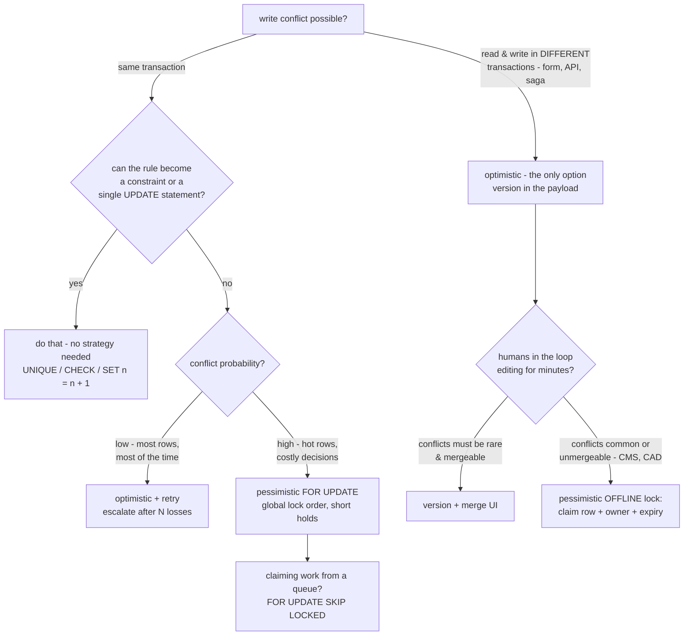
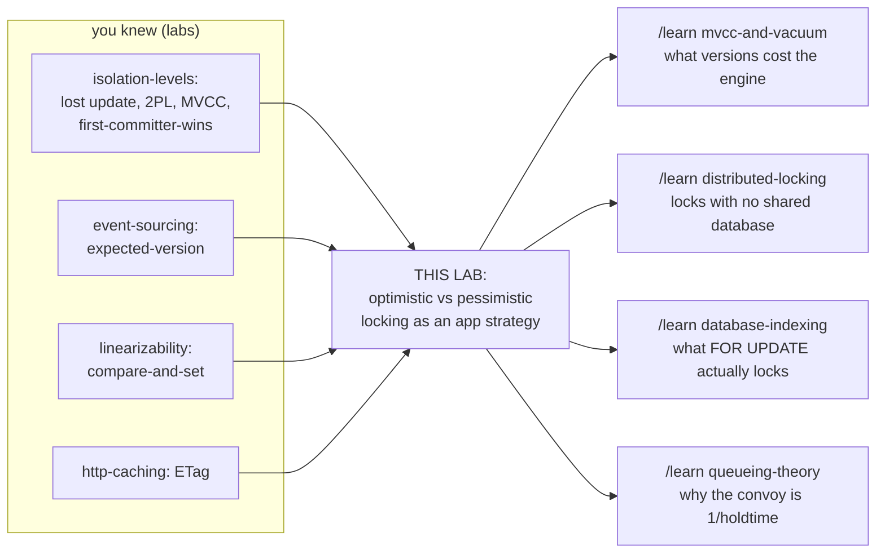

# Optimistic vs Pessimistic Locking

*A learning lab. Everything measured here was measured by running the code in
`src/` on H2 2.4.240, JDK 25, on this machine — commands included. Numbers
vary a little between runs; the shapes don't.*

**You already have the prerequisites.** From the [isolation-levels lab](../08-isolation-levels/):
lost update, `SELECT … FOR UPDATE`, two-phase locking, MVCC,
first-committer-wins, the retry loop, and the fact that "optimistic locking"
is first-committer-wins implemented in the application. From
[event-sourcing](../50-event-sourcing/): the expected-version append. From
[linearizability](../26-linearizability/): `compareAndSet` and the
87%-lost-increment experiment. This lab is where all of those become one
decision you make in real application code — and it starts with a problem
**none of them can solve**.

> Layer map: **BEGINNER** (§1–9) → **INTERMEDIATE** (§10) →
> **ENGINEERING** (§11–14) → **PRODUCTION** (§15). Checkpoints at each border.

---

## 1. WHY — the conflict that outlives every transaction

Two people open the same record on their screens. Both edit. Both click
Save. Both see "Saved successfully." One of their changes no longer exists,
and nothing anywhere — no error, no log line, no failed request — records
that it ever did.

The isolation-levels lab dealt with conflicts *inside* the database: two
transactions overlapping for milliseconds. This conflict is different in one
brutal way: **the gap between reading the record and writing it back is
minutes long and contains a human**. No transaction spans it. No isolation
level can see it. Whatever protects against it has to be built by *you*, in
application code — and there are exactly two ways to build it. That choice —
detect conflicts at write time, or prevent them at read time — is what
"optimistic vs pessimistic locking" means, and choosing wrong shows up as
lost customer data, deadlocked order processing, or a job queue running at a
quarter speed.

## 2. PROBLEM — Meera, Sam, and product #42

Meera and Sam run the admin tool of a small web shop. Product #42 is a steel
water bottle: description *"Steel water bottle, 500ml"*, price 1500.

- **10:00:00** — Meera opens the edit page. Her browser now holds a copy of
  the row.
- **10:00:05** — Sam opens the edit page. His browser holds the same copy.
- **10:02:00** — Meera fixes the description to *"Steel bottle, 500ml,
  BPA-free"* and clicks Save. The row is updated. ✓
- **10:03:30** — Sam changes the price to 1200 and clicks Save. His form
  posts **every field** — including the description *as it looked at
  10:00:05*. The row is updated. ✓

Final row: price 1200, description *"Steel water bottle, 500ml"*. Meera's
work is gone. She'll discover it next week, if ever. Run the kill rate
yourself:

```bash
cd 10-optimistic-vs-pessimistic-locking
java -cp ../lib/h2.jar src/Experiments.java overwrite
```

```text
naive last-save-wins:  Meera's edit destroyed in 100/100 rounds (0 errors shown to anyone)
```

This is the isolation lab's **lost update** — but stretched. There, the read
and the write sat inside one transaction, seconds apart. Here they sit in
*different HTTP requests*, minutes apart, with lunch in between.

## 3. NAIVE SOLUTION — "the database already solves this"

A reasonable engineer who just finished the isolation-levels lab reaches for
the tools that fixed lost update there:

1. **Wrap each save in a transaction.** Already true — every save above was
   a perfectly ACID transaction. Didn't help.
2. **Raise the isolation level.** Set everything to SERIALIZABLE.
3. **Use `SELECT … FOR UPDATE`** when loading the edit page, so nobody else
   can grab the row while Meera has it open.

> **🔮 Predict:** Sam's save runs at SERIALIZABLE. Does the database reject
> it?
> <details><summary>Reveal</summary>
> No — on any database. Serializability promises that concurrent
> transactions behave as if run one at a time. But Meera's *save*
> transaction committed at 10:02 and Sam's *save* transaction started at
> 10:03:30. They are not concurrent at all. Sam's transaction is a lone
> UPDATE that read nothing; run serially after Meera's, it does exactly what
> it did. The database is keeping its promise perfectly. The conflict isn't
> between two transactions — it's between two *conversations*, each spanning
> a read-transaction, a human, and a write-transaction. The database never
> sees a conversation.
> </details>

## 4. FAILURE — and the second naive idea is worse

Option 3 — hold `FOR UPDATE` from page-open to save — at least *targets* the
gap. It fails on three independent grounds:

- **A transaction is welded to one connection.** Holding a transaction for
  minutes means holding a pooled connection for minutes. A pool of 20
  connections supports 20 open edit pages. The 21st admin takes the site
  down. (HTTP makes it worse: Sam's save request may land on a different app
  server, which cannot commit a transaction living on the first one.)
- **The lock outlives the intention.** Meera opens the page, the phone
  rings, she goes to lunch. The row is now locked until her transaction
  times out — and every colleague who touches product #42 queues behind
  her. Measured (a 2-second pause standing in for lunch, five colleagues
  retrying meanwhile, each willing to wait 500ms):

  ```text
  === lunch — who pays for one client's 2s pause?
  PESSIMISTIC: other clients landed  0 saves, hit 15 lock timeouts during the pause
  OPTIMISTIC : other clients landed 170 saves, hit 0 lock timeouts during the pause
  ```

  One person's pause became fifteen *other* people's errors. That
  multiplication — **someone else's delay becoming your failure** — is the
  signature cost of holding locks.
- **Browsers don't send "I closed the tab."** If Meera never comes back,
  who unlocks the row, and when?

## 5. THE REAL REQUIREMENT

What we actually need, in plain words:

> Between "I read the record" and "I wrote it back" — a gap of arbitrary
> length that may cross transactions, connections, servers, and lunch —
> **no other write may slip in unnoticed**. And the protection must not
> consume any database resource during the gap.

Note what is *not* required: preventing the other write. Meera and Sam may
both edit freely. What must never happen is the *silent* overwrite — a
conflict nobody was told about.

## 6. KEY IDEA — make the write conditional on what you read

Carry, as plain data, proof of *which state of the row you read*. When you
write, tell the database: **"apply this only if the row is still the one I
saw."** If it isn't, the write does nothing, you're told, and you get to
re-decide with fresh eyes. Proof-of-what-I-saw is one number — a counter on
the row that every write increments.

Nothing is held during the gap. The number sits in a hidden form field, a
JSON payload, a session — it's data, so it survives anything: connection
close, server switch, a week of vacation.

And the same requirement has a second, opposite answer for a different
situation: when conflicts are near-certain and retrying is expensive,
**stop them from starting** — take the row lock *before* reading, do the
work, commit. That only works when the whole read-decide-write fits inside
one transaction; in exchange, nothing is ever wasted on a doomed attempt.

Detect at write time, or prevent at read time. Everything else in this lab
is the working-out of that pair.

## 7. TERMINOLOGY — the professional names

**Optimistic locking** — the conditional-write strategy. *Plain meaning*:
proceed assuming no one interfered; check at the end. *Technical meaning*:
every write carries the version it was based on and succeeds only if that
version is still current (first-committer-wins, enforced by the
application's protocol — the same rule the isolation lab met inside
snapshot-isolation engines, now hand-built one level up). *Why the term
exists*: to name the bet — you bet conflicts are rare and pay only when you
lose. *Example*: Sam's `UPDATE … WHERE id=42 AND version=0` matches 0 rows
because Meera made the version 1. *The name is a lie in one detail*: *no
lock exists*. Nothing is ever held. Some texts say "optimistic concurrency
control" precisely to avoid the lie; JPA calls it `@Version`.

**Pessimistic locking** — the lock-first strategy. *Plain meaning*: assume
interference; claim exclusivity before touching anything. *Technical
meaning*: acquire the database's row lock (`SELECT … FOR UPDATE` — the same
row lock every UPDATE takes anyway, taken early, at read time) and hold it
until commit. *Why the term exists*: to name the opposite bet — conflicts
are likely, so pay a known cost (waiting) instead of an unknown one
(redoing). *Example*: while Meera holds #42, Sam's `FOR UPDATE` queues.

**Version column** — the counter that makes reads provable. Any
monotonically advancing value works (integer, timestamp — integers avoid
clock trouble, a lesson three labs old). It answers one question: *has this
row changed since a given moment?* — with no history, only "same or not".

**Stale** — describing a copy of data whose source has since changed.
Meera's save made Sam's browser copy stale. Staleness is invisible to its
holder; that invisibility is the whole problem.

**Conflict** (in this lab) — a write attempt based on a stale read. The two
strategies differ only in *when* it surfaces: optimistic at write time (update
count 0), pessimistic at read time (you wait until it can't happen).

**Lock queue / lock timeout / `NOWAIT` / `SKIP LOCKED`** — what a blocked
locker may do: wait in the row's queue (default; give up after the timeout —
error 50200 on H2), refuse to wait (`NOWAIT`: instant error), or pretend
locked rows don't exist (`SKIP LOCKED`: the query returns only unclaimed
rows — §14's job-queue trick).

**Offline lock** — Fowler's name (PoEAA) for either strategy stretched
across requests, which is exactly our Meera/Sam setting: *Optimistic
Offline Lock* is the version column; *Pessimistic Offline Lock* is an
application-managed "checked out by Meera" claim (a row in a `locks` table
with an owner and an expiry — NOT a database lock, precisely because
database locks can't span requests).

Minor terms get one line where they first appear; everything lands in the
glossary (§18).

## 8. MENTAL MODELS

**The simple model — two ways teams share files.**
*Optimistic is git.* Everyone clones and edits freely. When you push, git
checks whether the remote moved since your clone; if it did, your push is
**rejected — fetch first**. You pull, look at what changed, redo your
intent, push again. Nobody ever waited; latecomers redo work.
*Pessimistic is the shared Excel file on the network drive.* First opener
gets it; everyone after sees **"locked by another user — open read-only?"**
and waits. Nobody ever redoes work; everybody queues — and when the holder
goes to lunch with the file open, the team goes to lunch too.

**The engineering model.** A row `(data, version)` plus, per client, a
conversation `(readData, readVersion, decide(), write)`. Optimistic: writes
are compare-and-swap on the version — `AtomicInteger.compareAndSet` from
the linearizability lab, spelled in SQL, with the row lock making
check-and-write one atomic statement. Pessimistic: an exclusive lock with a
FIFO-ish queue, acquired at read, released at commit; hold time =
read-to-commit, and every waiter's latency includes every holder's hold.

| simple model | engineering model |
|---|---|
| your clone of the repo | the row copy + version your SELECT returned |
| remote moved since clone | version no longer matches |
| push rejected, fetch first | the save's UPDATE finds the version changed → rejected |
| pull + redo + push again | re-read, re-decide, retry |
| Excel's "locked by user" dialog | `FOR UPDATE` queue (or NOWAIT error) |
| closing the Excel file | commit/rollback releasing the lock |

**Where the analogies break.** Git *merges*: non-overlapping edits combine
automatically, and both histories survive. A version check is all-or-nothing
on the whole row — Meera edited description, Sam edited price, no overlap,
*still a conflict*; if you want field-level merging you write it yourself in
the retry (as `optimistic_retry_rereads_so_both_edits_survive` does), and
the database keeps no history to merge from. And Excel's lock is owned by a
*person* who can hold it overnight; a `FOR UPDATE` lock is owned by a
*transaction* and cannot outlive it — which is precisely why it cannot
protect a conversation (§4), and why the offline-pessimistic pattern needs
an expiry-bearing claim row instead.

## 9. VISUALIZATION — watch both bets play out

Open **[visualization.html](visualization.html)** (published copy:
<https://claude.ai/code/artifact/fafcd865-f069-4619-9861-db4df13d8944>). It plays Meera, Sam, and colleagues against
product rows under all three strategies. The row's version badge, every
held lock, every queued waiter, every conflict-and-retry are on screen;
counters track saves landed, edits silently lost, time spent waiting, and
work redone. Seven predict-then-run scenarios mirror this document — from
the silent overwrite through the lunch break to the job-board pile-up and
the forgotten-check bug. Use step ◀ ▶ to replay any moment; every client
card shows the exact copy (and version) that client is editing from, with a
STALE flag the moment the real row moves on — a flag the client itself,
crucially, cannot see.

## 10. ACTUAL MECHANISM — build it, break it, harden it

> **CHECKPOINT — beginner → intermediate.** You can now explain *why* the
> two strategies exist and which bet each one makes. Next: the exact SQL,
> and the three places hand-rolled implementations really go wrong.

### 10.1 Optimistic v1 — the conditional UPDATE

Schema change: one column, `version BIGINT NOT NULL`, starting at 0. Reads
return it. Saves become:

```sql
UPDATE product
SET    description = ?, price = ?, version = version + 1
WHERE  id = ? AND version = ?     -- the version the form was rendered from
```

Walk Meera/Sam with real values. Both read `(…, version=0)`. Meera's UPDATE
matches (version is 0), writes, sets version 1. Sam's UPDATE hunts for a row
with `id=42 AND version=0` — no such row exists anymore.

> **🔮 Predict:** what does the database do with Sam's UPDATE — error,
> block, or something else?
> <details><summary>Reveal</summary>
> Something else, and it's the trap of the whole technique: the UPDATE
> **succeeds, affecting 0 rows**. To SQL, an UPDATE whose WHERE matches
> nothing is as unremarkable as a SELECT returning no rows. The *only*
> witness to the conflict is the update count your JDBC call returns. H2,
> Postgres, MySQL — all identical here.
> </details>

So the load-bearing line is not the SQL — it's the Java after it
([Store.java:96-97](src/Store.java#L96-L97)):

```java
int count = u.executeUpdate();
if (count == 0) throw new StaleVersionException(p.id(), p.version());
```

Delete the `if` and nothing fails, ever — conflicting saves become silent
no-ops. That's planted bug #1; `java -cp ../lib/h2.jar src/Tests.java
broken` shows Sam's save vanishing without an exception *or* an effect.

**Why can't two writers both match version 0?** The check and the write are
one statement, and the engine takes the row lock for that statement (the
MVCC write lock from the isolation lab). If both UPDATEs arrive together,
one holds the row first; the second waits the few microseconds until
commit, then re-evaluates its WHERE against the new row — version is 1 now,
count 0. The atomicity you'd have to build carefully in Java is free in one
SQL statement. (Same shape as the isolation lab's single-statement
`UPDATE SET n = n + 1` — and as `compareAndSet`.)

### 10.2 Optimistic v2 — the retry loop, and the second trap

An exception is not a strategy. What should Sam's code *do* with
`StaleVersionException`? Two legitimate answers:

- **Ask the human** — reload, show "Meera changed this while you were
  editing", let Sam re-decide. Right for forms.
- **Retry in code** — for machine decisions: *re-read the row, re-run the
  decision on the fresh values, attempt again* ([Store.java:110-131](src/Store.java#L110-L131)).

The event-sourcing lab's rule — *a conflict means re-decide against fresh
truth, never re-send* — is load-bearing here, and planted bug #3
(`stale-reapply`) shows why: a retry loop that re-reads **only the version**
(so the WHERE passes) but keeps the value computed from the original read.
It retries diligently and still destroys data:

```text
bug_caught: stale-reapply loses increments despite retrying (40/320)
```

280 of 320 increments gone — *with* a version column and *with* a retry
loop. The version check verifies where the write lands, not what it
contains; only re-deciding refreshes the contents.

(Planted bug #2, `no-version-bump`, forgets `version = version + 1`: the
consumed version stays current, so the *next* stale writer also matches.
First-committer-wins quietly becomes every-committer-wins.)

### 10.3 Pessimistic — the queue, and its three dialects

```sql
SELECT id, description, price, version FROM product WHERE id = 42 FOR UPDATE
```

Same row lock an UPDATE takes — taken at read time, held to commit. Between
those two moments you are provably alone on the row: read, decide, write,
no version check, no retry, no wasted work. Everyone else queues.
Measured queue mechanics (`src/Tests.java`):

- `for_update_blocks_until_commit` — a second locker proceeds ~the instant
  the first commits (waited ≈ the 400ms hold), not before.
- `nowait_fails_immediately_instead_of_queueing` — `FOR UPDATE NOWAIT`
  errors in <1ms instead of queueing: "tell me now, I'll do something else."
- `skip_locked_returns_only_unclaimed_rows` — with row 0 locked by someone
  else, `FOR UPDATE SKIP LOCKED` returns rows 1 and 2 as if 0 didn't exist.

Wait / refuse / skip: those three dialects are the entire pessimistic API
surface, and §14's queue experiment shows `SKIP LOCKED` alone is worth 4×.

## 11. FAILURE SCENARIOS — each one created, watched, explained

> **CHECKPOINT — intermediate → engineering.** You can write both
> strategies correctly. Now: how each one fails, what each failure costs,
> and which guarantee survives it. Every scenario below is runnable.

**a. The silent no-op** (optimistic, bug #1). *Create*: ignore the update
count. *Watch*: `Tests.java broken`. *What/why*: conflicting saves match 0
rows; SQL raises nothing. *Response*: none — that's the failure. *Kept*:
first writer's data (conflicts lose instead of overwriting — strictly
better than naive, by luck). *Lost*: the entire point — nobody learns their
save didn't happen. *Production*: users report "my edits randomly don't
stick"; no error rate moves. Audit every hand-written conditional UPDATE
for a count check; ORMs (`@Version`) do it for you.

**b. Version consumed but not advanced** (bug #2). *Watch*: `Tests.java
broken`. *Why*: the WHERE guards against versions *changing*; if writes
don't change it, the guard guards nothing. Second stale save lands, first
writer's edit dies. *Production*: hand-rolled SQL where someone "optimized
away" the increment; catches fire only under concurrent editing, i.e. in
production and not in tests.

**c. Retry-without-re-decide** (bug #3, §10.2). *Lost*: 280/320 updates
despite detection *and* retry. *Production rule*: the retry re-runs **the
whole use case** — the same rule the isolation lab derived for
serialization failures (re-run the method, not the statement).

**d. The lunch break** (pessimistic). *Create*: any pause between lock and
commit — a slow downstream call, a GC pause, a human. *Watch*:
`Experiments.java lunch`. *What*: 0 neighbour saves, 15 neighbour timeouts
during one client's 2s pause; under optimistic the same pause costs the
neighbours nothing (170 saves) and the sleeper pays alone with one
conflict. *Why*: a held lock converts one client's delay into everyone's
delay — availability coupling. *Kept*: correctness. *Lost*: independence of
latencies. *Production*: p99 spikes on hot rows whenever anything pauses;
the on-call sees lock-timeout storms with no CPU or I/O anomaly. Rule:
**never hold a row lock across a network call or user interaction.**

**e. Deadlock** (pessimistic only). *Create*: two transactions lock the
same two rows in opposite orders. *Watch*: `Experiments.java deadlock` —
59 victims (SQLState 40001) in 60 opposite-order transfers; the optimistic
translation of the same workload: 0 deadlocks, 14 cheap retries. *Why*:
deadlock needs wait-while-holding; optimistic clients never wait while
holding anything. *Response*: the engine detects the cycle and shoots one
victim, which must retry (so pessimistic code needs a retry loop after
all — for 40001 instead of stale versions). *Kept*: progress (one side
wins). *Lost*: the victim's work; ordering-discipline debt. The
isolation-levels fix still applies: lock in a global order (lower id first
→ 0 deadlocks, measured there).

**f. Starvation** (optimistic only). *Create*: one writer whose
read-decide-write takes 30ms sharing a row with six who take ~0ms.
*Watch*: `Experiments.java starvation`:

```text
pure optimistic         : 0/5 saves in 8019ms, 263 lost races  <- STARVED (no error, no progress)
escalate after 3 losses : 5/5 saves in  603ms,  15 lost races, 5 escalations
```

*Why*: first-committer-wins has no queue and no memory — every retry faces
the same race it just lost, and the slowest decider loses ~always. 263
diligent retries, zero progress, zero errors: a pure **liveness** failure
(safety intact — nothing was ever lost). *Fix*: **escalation** — after N
losses, swallow your optimism and take `FOR UPDATE`; the lock's queue is
exactly the fairness optimism lacks. This hybrid is the production-grade
default for mixed workloads.

**g. The convoy** (pessimistic misuse). *Create*: N workers each claiming
"the first PENDING job" with plain `FOR UPDATE`. *Watch*:
`Experiments.java queue` — all four workers pick the *same* first row, three
queue behind one, processing serializes: 1397ms for 120 jobs × 10ms against
a 1200ms serial floor. `SKIP LOCKED`: 312ms — the perfect 4-way split.
*Why*: they don't contend on data, they contend on *position*. Skipping
locked rows makes claims disjoint by construction. *Lost with SKIP LOCKED*:
strict FIFO order — jobs are claimed slightly out of order; queues almost
never care.

**h. Write skew, revisited and finally fixed in the app.** The
isolation-levels lab proved H2 permits write skew *at every level including
SERIALIZABLE* (the two doctors both go off call, each updating only their
own row — no write-write conflict for first-committer-wins to see, because
the thing they shared was a rule, not a row). Now you own the fix:
**materialize the rule as a row and force every rule-dependent transaction
to bump its version**:

```sql
UPDATE roster SET version = version + 1 WHERE id = 1 AND version = ?
```

Both doctors' transactions now collide on the roster row *on purpose*; the
second gets count 0 and aborts. Measured
(`shared_version_bump_stops_write_skew`): 1 doctor left on call, 1
rejection — against `write_skew_survives_for_update_on_own_rows` proving
`FOR UPDATE` on your *own* row does nothing (0 doctors left). JPA ships
this as `LockModeType.OPTIMISTIC_FORCE_INCREMENT` on the aggregate root.
The deep point: **a version column turns invisible read-dependencies into
visible write-conflicts** — a hand-built, targeted rw-antidependency check.

## 12. CORRECTNESS — what is actually guaranteed

| | optimistic | pessimistic |
|---|---|---|
| lost update between your read and write | **impossible** (if count is checked) | **impossible** (while lock held) |
| works across requests/connections/servers | **yes** — version is data | no — lock dies with the transaction |
| write succeeds first try | not guaranteed (conflict → retry) | guaranteed once lock acquired |
| deadlock | impossible (never wait-while-holding) | possible (needs ordering discipline) |
| starvation / livelock | possible (no queue) | queue gives rough fairness |
| wasted work | yes: redone decisions | no; waiting instead |
| one client's pause hurts others | no | yes — that's what holding means |
| stale *reads* | allowed (it's not a read guarantee) | allowed for plain SELECTs too |
| protects against writers outside the protocol | **no** — a raw UPDATE bypasses it | no — unless they too touch the locked row |

Traded away, respectively: *liveness under contention and redone work*
(optimistic) vs *latency independence and deadlock-freedom* (pessimistic).
Neither guarantees anybody *reads* fresh data — both are write-write
protocols; read skew from the isolation lab is untouched by either.

The last row deserves its own sentence, because it echoes the isolation
lab's constraint lesson: **an isolation level protects code that asks; a
version column protects code that follows the protocol; only a database
constraint protects the table.** The migration script and the support
engineer's console feel no version checks. Where the rule can be a
constraint (`UNIQUE`, `CHECK balance >= 0`), the constraint still wins.

## 13. CODE — the toy, and its exact Spring/JPA spelling

The toy ([Store.java](src/Store.java)) is ~150 lines; the load-bearing ones
were walked in §10 (conditional UPDATE + count check; re-read-re-decide
retry; `readForUpdate`). What your day job generates for you:

| this lab | Spring / JPA |
|---|---|
| `version BIGINT` + conditional UPDATE + count check | a `@Version private long version;` field — Hibernate emits the same UPDATE and checks the same count |
| `StaleVersionException` | `OptimisticLockException`, wrapped by Spring as `ObjectOptimisticLockingFailureException` |
| the retry loop | `@Retryable(retryFor = OptimisticLockingFailureException.class)` around the **service method** (re-runs the whole decision — §11c) |
| `readForUpdate` | `em.find(P.class, id, LockModeType.PESSIMISTIC_WRITE)` or `@Lock(PESSIMISTIC_WRITE)` on a Spring Data repository method |
| `SET LOCK_TIMEOUT` / `NOWAIT` / `SKIP LOCKED` | hint `jakarta.persistence.lock.timeout`: ms, or `0` = NOWAIT, `-2` = SKIP LOCKED (Hibernate-specific values, dialect-dependent) |
| roster version bump (§11h) | `LockModeType.OPTIMISTIC_FORCE_INCREMENT` on the aggregate root |

Two Spring-specific traps, both versions of bugs you just ran:

- **The controller that "re-loads and copies".** A POST handler that does
  `Product p = repo.findById(id); p.setPrice(form.getPrice()); repo.save(p)`
  has **disabled** `@Version` — the entity was freshly loaded, so its
  version is current and the check always passes. The form's (stale)
  version never took part: bug (a) wearing MVC clothes. The version must
  round-trip through the form (hidden field / DTO) and be applied to the
  entity before save.
- **Catch-and-ignore.** `try { repo.save(p) } catch
  (OptimisticLockingFailureException e) { /* log */ }` — a hand-built
  silent no-op.

The same protocol, spelled by other systems you know: HTTP's
`ETag` + `If-Match` (from the http-caching lab — a stale ETag gets `412
Precondition Failed`: optimistic locking for REST resources), Redis
`WATCH`/`MULTI` (measured degrading at 4.8 aborts per success in the redis
lab — same starvation as §11f), event-sourcing's expected-version append,
`compareAndSet` in `java.util.concurrent`. One idea, five costumes.

## 14. EXPERIMENTS — run the argument yourself

```bash
java -cp ../lib/h2.jar src/Tests.java            # 14 scenario checks
java -cp ../lib/h2.jar src/Tests.java broken     # 3 planted bugs, each caught
java -cp ../lib/h2.jar src/Experiments.java      # all 7 measurements (~25s)
java -cp ../lib/h2.jar src/Experiments.java lunch   # or any one by name
```

Predict before each; numbers from this machine:

- **overwrite** — how often does last-save-wins actually lose data under
  interleaved edits? *100/100, zero errors; with versions: 0/100 lost,
  100/100 conflicts detected and merged.*
- **crossover** — 8 clients × 25 read-modify-writes (2ms of real CPU
  "decision" each), spread over 1→32 rows:

  ```text
  rows |                         OPTIMISTIC |    PESSIMISTIC
     1 |    511ms  862 retries 2124ms burned |      434ms
     4 |    152ms  311 retries 1022ms burned |      132ms
    32 |     82ms   52 retries  504ms burned |       78ms
  ```

  Two honest surprises. First: wall-clock near-ties even on one hot row —
  because this box had idle cores to absorb the 1.7 seconds of redone work.
  The waste is real (the *burned* column: 5× the useful 400ms) but invisible
  in latency **until the cores aren't spare — which in production is
  exactly when contention is highest**. Second: pessimistic is *not* slow
  here — on an embedded database a lock costs nanoseconds. What makes
  pessimistic expensive in real deployments is holding locks **across
  network round trips** (client ↔ DB per statement), which this lab's
  in-process H2 cannot show; §15 returns to it.
- **waste** — same hot row, decision cost swept 0→15ms: optimistic redoes
  ~4500ms of work at 15ms (280 retries) while pessimistic sits exactly on
  its serial floor. *The retry bill scales with the price of deciding.*
- **lunch** (§11d) — 0 saves + 15 timeouts vs 170 saves + 0.
- **queue** (§11g) — 1397ms convoy / 312ms SKIP LOCKED / 317ms optimistic
  claim (which also worked — 121 lost claim races, each costing only a
  re-SELECT; `SKIP LOCKED` wins by not even racing).
- **deadlock** (§11e) — 59 victims vs 0.
- **starvation** (§11f) — 0/5 in 8s vs 5/5 in 603ms with escalation.

## 15. PRODUCTION — choosing, operating, and what the toy hides

> **CHECKPOINT — engineering → production.** You can implement, break, and
> fix both strategies. Left: which to choose when, and how this looks at 3am.

**The decision, as a flowchart:**



Note the two arrows that most engineers forget exist: *"just write better
SQL"* (the isolation lab's `UPDATE SET n = n + 1` — 320/320, 0 retries, 26ms
— still beats both strategies whenever the decision fits in SQL), and the
*offline pessimistic claim* (Google Docs' "someone is editing" banner,
Jira's soft locks) for long human edits where a version conflict after an
hour of work is cruelty.

**Toy → real.** This lab's H2 is in-process, which flatters pessimistic
locking twice: lock acquisition is a function call (real: a network round
trip *per statement*, with the lock held across all of them — a 3-statement
locked section at 1ms RTT holds the row ≥3ms, a 100× longer window than
here), and there are always spare cores to hide optimistic waste (real:
peak traffic eats the spare cores precisely when hot rows are hottest). The
directions of §14 survive; the exact crossover point is *yours to measure
on your stack* — the harness pattern in [Experiments.java](src/Experiments.java)
ports to any JDBC URL.

**Operations.** What you watch: optimistic → *conflict rate* (conflicts ÷
saves; rising means a hot row or a slow decider — find it before it becomes
starvation) and *retry-count distribution* (a growing tail IS starvation
beginning). Pessimistic → *lock waits* (`innodb_row_lock_waits`,
`pg_locks` + `log_lock_waits`), *lock timeouts*, *deadlock rate*. The 3am
signatures: optimistic failure = one entity's error rate climbs with
traffic, CPU busy on work that never lands; pessimistic failure = latency
cliff with *idle* CPU (everyone's queued), or a deadlock storm from one new
code path locking in the wrong order.

**What this lab intentionally omits.** Connection-pool dynamics (the real
multiplier of §4). Replication: a version check is only meaningful on the
primary — reading a *replica*'s version and writing through the primary
manufactures false conflicts (or worse, with `no-version-bump`-like
schemes, false successes); the quorums lab's staleness lessons apply.
Caches: a cached row + version behaves like a permanently stale form —
conflict storms that look like user error. Gap/next-key locks: on MySQL RR,
`FOR UPDATE` can lock *ranges* you didn't ask for (isolation lab, §MySQL) —
pessimistic scope is engine-specific. Fairness of real lock queues,
priority inheritance, `FOR NO KEY UPDATE`/`FOR SHARE` weaker modes,
advisory locks (Postgres `pg_advisory_xact_lock` — pessimistic locking on a
made-up name instead of a row).

**The same idea beyond SQL** (asserted from vendor docs, not run here):
DynamoDB `ConditionExpression` + `ConditionalCheckFailedException`;
MongoDB `findOneAndUpdate` filtering on the old value; Elasticsearch
`if_seq_no`/`if_primary_term`; Kubernetes `metadata.resourceVersion` — every
`kubectl apply` race returns HTTP `409 Conflict` and client-go ships
`RetryOnConflict`, §10.2's loop verbatim. Once you've seen the shape —
*carry proof of what you read; make the write conditional on it; re-decide
on conflict* — you'll find it in every system that lets two writers near
one datum without a lock.

## 16. EXERCISES

[EXERCISES.md](EXERCISES.md) — eight rungs, from "explain it in your own
words" to designing locking for a payments platform. Rung 5 is
`src/YourStrategy.java` (starts 2/6, self-checking); rung 6 debugs the three
planted bugs. Answers in [SOLUTIONS.md](SOLUTIONS.md) — attempt first.

## 17. KNOWLEDGE MAP & NEXT STEPS



**Commonly confused, separated in one sentence each:**
*Isolation levels* order operations inside transactions; this lab's
strategies order *conversations* that span transactions — you usually need
both. *MVCC* is an engine mechanism for reads-don't-block-writes; a version
column is an application protocol — an MVCC database happily hosts your
pessimistic locks, and snapshot isolation is itself "optimistic" only in
the first-committer-wins sense. *A lock* prevents the conflict; *a version*
detects it — "optimistic locking" contains no lock.

## 18. GLOSSARY (in order of appearance)

| term | one line |
|---|---|
| lost update | a write based on a stale read silently erasing an intervening write |
| conversation | one logical edit spanning read-transaction, think time, write-transaction |
| optimistic locking | conditional writes carrying the version they were based on; conflict detected at write time |
| pessimistic locking | taking the row's exclusive lock before reading; conflict prevented until commit |
| version column | a per-row counter incremented by every write; proof of which state a read saw |
| stale | describing a copy whose source has since changed — invisible to the holder |
| conflict | a write attempt based on a stale read |
| update count | rows matched by an UPDATE; the *only* witness of an optimistic conflict |
| first-committer-wins | of two writers from the same starting state, the first commit succeeds and the second is refused |
| retry loop | re-read, re-decide, re-attempt — the code that turns detection into a strategy |
| re-decide vs re-send | re-run the decision on fresh data vs re-write the stale conclusion (bug) |
| `FOR UPDATE` | SELECT that takes the row's write lock at read time |
| lock queue | blocked lockers waiting for the holder's commit, roughly in order |
| lock timeout | how long a waiter queues before giving up (H2 error 50200) |
| `NOWAIT` | fail instantly instead of queueing |
| `SKIP LOCKED` | treat locked rows as nonexistent — disjoint claims for job queues |
| offline lock | Fowler: either strategy stretched across requests; pessimistic variant = claim row with owner+expiry |
| escalation | after N optimistic losses, switch to `FOR UPDATE`; the queue supplies fairness |
| starvation | liveness failure where a slow optimistic writer loses every race, forever |
| convoy | workers serializing behind one locked row they all chose |
| deadlock (40001) | wait-while-holding cycle; engine shoots a victim, who must retry |
| write skew | two transactions breaking a shared rule via disjoint rows (no write-write conflict) |
| force-increment | bumping a shared row's version to make a read-dependency collide on purpose (JPA `OPTIMISTIC_FORCE_INCREMENT`) |
| `@Version` | JPA field enabling generated conditional UPDATEs + count checks |
| `ETag` / `If-Match` / 412 | the same protocol over HTTP |
| conditional write | the umbrella: any write that succeeds only if the target still matches an expectation |
