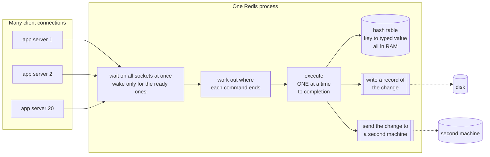
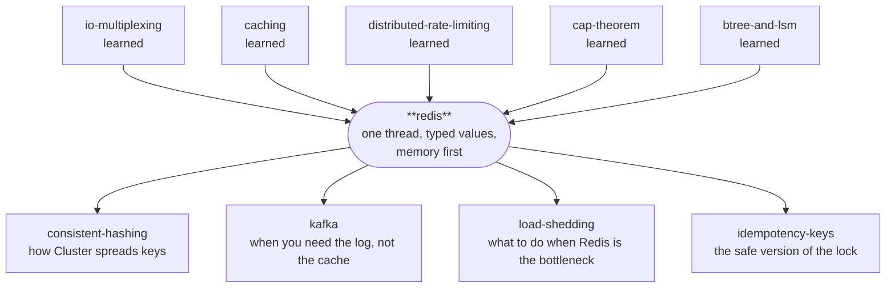

# Redis — the database that does one thing at a time

> **Tell a friend:** Twenty children need to change the same jars of sweets all
> day long. When Arjun and Bina reach for the samosa jar at the same moment,
> one sale quietly disappears and nobody is told. So the school puts Meera
> behind a counter, and nobody is allowed to touch a jar again. You shout what
> you want done, Meera does the whole thing alone, and only then does she
> listen to the next child. That one rule is Redis, and the same sentence gives
> you its best promise and its worst outage.

Watch the one thread work at [`visualization.html`](visualization.html) or <https://claude.ai/code/artifact/492e3d97-6221-482d-847c-8ee9302ece13>.
How this lab was built, where its numbers came from, and where it sits next to your other labs is in [section 19](#19-about-this-lab).

---

## 1. Why can't twenty machines just share one number?

> **In one breath:** Some facts change every second and are needed by every
> machine at once. Keep such a fact in one machine's memory and the other
> nineteen cannot see it. Put it in your main database and every touch pays for
> permanence you never asked for.

Asha runs an online tuck-shop business. Her application does not run on one
machine. It runs on twenty, behind a load balancer, and any request can land on
any of them. Priya's click lands on server 3. Omar's click lands on server 17.
Neither of them chose.

Most of the time that is fine, because most facts live in the database. A
customer's address does not change while you are reading it.

But some facts are **shared, change constantly, and are needed in
microseconds**. Read the middle column of this table: it is what makes each of
these facts different from an address.

| The fact Asha needs | Why it cannot sit on one server | What goes wrong if it does |
|---|---|---|
| how many requests this API key made in the last minute | all twenty servers must count into the same total | the limit is enforced twenty times over |
| what is in this shopper's basket | the shopper's next click lands elsewhere | the basket looks empty on the checkout page |
| which worker currently owns this job | whoever claims it must be visible to the rest | two workers do the same job |
| who is in the top ten this week | every score changes the same ordered list | ten different leaderboards, one per server |

So put those facts in one place. Which place?

Put such a fact in one server's memory and the other nineteen cannot see it.
That is not a subtle failure. Server 3 counts, server 17 does not, and the
number is wrong by a factor of twenty.

Put it in the main database instead and something slower goes wrong. Every read
and every write now travels through machinery built to make facts *permanent
and correct forever*. Indexes. Transactions. Row locks. Disk flushes. None of
that is what Asha needs here, and all of it is exactly what makes the trip
slow. Worse, under contention those row locks make her twenty servers queue up
behind each other. The database was protecting her from a problem she did not
have, and charging her for it on every operation.

If nobody solves this, you get the concrete failures you have already met. A
rate limiter that lets through twenty times its limit. A shopping basket that
loses an item when two tabs are open. A job picked up twice by two workers.

Redis is the thing that fills that hole. What follows is how. More usefully, it
is also what that costs.

---

## 2. What does the tuck shop need that a cupboard cannot give?

> **In one breath:** Three jars, twenty children, and constant change. The jars
> must be somewhere everybody can reach, and reaching them must take a second
> rather than a minute.

Forget servers for a while. A school has a tuck shop. Along one wall stand
labelled jars:

- a jar holding **one number** — how many samosas have been sold today
- a jar holding **tokens in the order they were dropped in** — the queue for the
  sandwich toaster
- a jar holding **names with scores** — this week's chess ladder

Twenty children need to change what is in those jars, constantly, all day.
Arjun sells a samosa and the count must go up. Bina joins the toaster queue.
Chetan wins a chess game and their score must go up by one.

Two demands come out of that, and they pull in opposite directions.

The jars must be **in the room where everyone can reach them**. A jar in the
staff room, behind a locked door, is a jar nobody can use during break.

And getting to them **must take a second, not a minute**. If Arjun has to fill
in a form to touch the samosa jar, he will stop counting samosas.

Hold on to those three jars. Every mechanism in this lab is something that
happens to one of them.

---

## 3. What does a reasonable person try first?

> **In one breath:** Open shelves. Anybody walks up, takes a jar down, changes
> it, puts it back. It is fast, simple, and everybody can do it at once.

No counter. No shopkeeper. No rules.

Arjun walks up, takes the samosa jar down, changes what is inside, and puts it
back. So does everybody else, whenever they like.

This is fast. It is simple. Everyone can do it at once, so nobody waits.

It is also exactly what your code does every single time it reads a value from
a shared store, changes it in your own process, and writes it back. Read,
modify, write. Three separate moments, and the store has no idea they were
meant to belong together.

> **🔮 Predict:** Arjun and Bina both sell a samosa in the same second. Before
> you read section 4, say out loud what the jar will hold afterwards, and how
> anybody would find out.
>
> <details><summary>Reveal</summary>
>
> The jar will hold **6** when two sales happened, and the honest answer to
> "how would anybody find out" is that nobody does. Section 4 walks the four
> moments that produce that, and then shows why the obvious fix is worse than
> it looks.
>
> If you said "the jar says 7, the shop is fine", you are assuming the two
> children took turns. Nothing in an open shelf makes them take turns.
> </details>

---

## 4. Why does the open shelf lose a sale?

> **In one breath:** Two children read the same number, both add one to what
> they read, and both write back the same answer. One of the two sales is gone,
> and no error is ever raised.

Arjun and Bina each sell a samosa at the same moment. The jar says **5**.

Read the last column: it is what the jar actually holds after each step.

| time | Arjun | Bina | the jar says |
|---|---|---|---|
| 1 | takes the jar down, reads **5** | | 5 |
| 2 | | takes the jar down, reads **5** | 5 |
| 3 | writes **6**, puts it back | | 6 |
| 4 | | writes **6**, puts it back | 6 |

> **🔮 Predict:** two samosas were sold. What does the jar say, and who finds out
> that anything went wrong?
>
> <details><summary>Reveal</summary>
>
> The jar says **6**. One sale has vanished.
>
> And the answer to the second half is the genuinely alarming part: **nobody finds
> out**. There is no error, no exception, no conflict, no log line. Both children
> did exactly what they were told to do and both believe they succeeded. The only
> evidence is that the number is quietly wrong, and it will stay quietly wrong
> forever.
>
> This is called a **lost update**, and you met it in the
> [distributed-rate-limiting](../60-distributed-rate-limiting/) lab as the reason
> twenty uncoordinated gateways turn "100 per minute" into 2,000 per minute.
> </details>

So the school reaches for the obvious fix. Put a padlock on the shelf. A child
takes the key, does their business, and returns the key. Now nothing is lost,
because only one child can be at the shelf at a time.

Look at what the padlock cost, though. Three separate bills arrive.

- **Three trips instead of one.** Get the key, read-and-write, return the key.
  If the shelf is across a field, you just tripled the walking.
- **One child at a time, for the whole shelf.** Bina wants the chess jar and
  Arjun has the samosa jar. Irrelevant. There is one padlock, so Bina waits for
  a jar she does not care about.
- **A child who takes the key and goes home stops the shop forever.** Somebody
  must now decide how long is too long to hold a key, and be wrong about it.
  You saw this exact shape in [two-phase-commit](../45-two-phase-commit/): after
  voting yes, a participant holds its locks and cannot decide alone if the
  coordinator dies.

So the padlock trades one silent bug for three loud problems. That is not
nothing. A loud problem is better than a silent one. But we can do better than
either.

---

## 5. What exactly must we guarantee?

> **In one breath:** No change may ever vanish, nobody may have to hold a key or
> walk three times, and the whole thing must be about as quick as shouting
> across a room.

Before any solution, state the target plainly. This is the promise the rest of
the lesson is chasing.

> Any of the twenty children must be able to change a shared jar such that
> **(a)** no change can ever be silently lost, **(b)** the child does not have to
> hold a key or make three trips, and **(c)** the whole thing takes about as long
> as shouting across a room.

Everything in the rest of this lesson is the pursuit of those three, for Arjun,
for Bina, for Chetan and for Asha's twenty servers. And every strange detail of
Redis's design is a scar from something that went wrong on the way.

Here is the road, so you know where you are on it. Each layer ends with a
checkpoint that tells you what stopping there leaves you with.

| Layer | Sections | After it you can… |
|---|---|---|
| Beginner model | 1–9 | say why Redis exists and why the single thread is the mechanism |
| Intermediate model | 10 | follow a command from socket bytes to hash table and back |
| Engineering model | 11–14 | name which promise each failure bends, and the mitigation |
| Production model | 15 | run one, watch the right numbers, and know when not to |
---

## 6. What if nobody is allowed to touch the jars?

> **In one breath:** Put one shopkeeper behind a counter. Children shout what
> they want done. She does the whole thing alone and finishes before she listens
> again, so there is no gap for anybody to slip into.

Meera stands behind a counter. The jars are behind her. The children never
touch a jar again.

Instead Arjun shouts an **instruction**: *"add one to the samosa jar."* Meera
does the whole thing alone. She takes the jar down, reads 5, writes 6, puts it
back, and calls out "6". Only *then* does she turn to the next child.

Bina is next in line, and she shouts the same instruction. Meera reads 6 and
writes 7. Two sales, two increments, no loss. Nothing clever happened. Bina
simply could not read the jar while Meera was holding it, because Bina is not
allowed to hold jars at all.

Two separate inventions are hiding in those paragraphs, and it is worth pulling
them apart, because people usually only notice the first.

The first is that **the instruction says what you want done, not "give me the
jar"**. That is only possible because Meera knows what *kind* of thing is in
each jar. You can say "add one" about the samosa jar and "add a token to the
end" about the queue jar, and she knows which of those makes sense where.

The second is that **there is exactly one Meera, finishing each instruction
before starting the next**.

The second one is what makes Arjun and Bina's lost sale *impossible*. Not a
padlock. An absence of simultaneity. There is no gap between the read and the
write for anyone to slip into, because during that gap Meera is not listening
to anyone.

This is Redis. Everything else in this document is a consequence of that
sentence, including all the bad parts. Hold that thought, because in section 11
you will watch the same sentence cause the most common Redis outage there is.

---

## 7. What are these things called, now that you have felt them?

> **In one breath:** Six words, and you have already met the thing each one
> names. A store with one way in, jars in the room rather than the basement, one
> shopkeeper, an instruction nobody can interrupt, jars whose kind is known, and
> the cost of shouting.

You have earned all of these. Each one names something that already happened to
Arjun, Bina, Chetan or Meera. So each gets the story first, the plain sentence
second, and the real name last.

### What is a key–value store?

The wall of jars is a very large box of labelled things. You put a thing in
under a name. You get it back by that name. That is the entire arrangement.

In plain words: the only way in is the label. Engineers call the label the
**key** and the thing the **value**, and a store built this way a **key–value
store**. Its only index is the primary key. There is no query planner, no
`WHERE`, no join. `GET user:42` is the entire query language.

The word exists to mark the contrast with a *relational* store, which lets you
ask questions the designer never anticipated. That flexibility is not free, and
a relational store pays for it on every single operation. A key–value store
gives it up on purpose. The [database-landscape](../04-database-landscape/) lab
called this "an opinionated bet on one access pattern". Redis's bet is *"you
already know the key."*

You can see the bet in two lines. `SET cart:7 "3 items"` puts the basket in.
`GET cart:7` takes it out. There is no way to ask "which carts have 3 items"
without looking at every key, one at a time.

### Why does "in-memory" change everything else?

The jars are on the shelf in the room. They are not in the basement warehouse.
Arjun can reach one while he is still talking to a customer.

In plain words: the whole working set of data lives in the machine's fast
memory. Engineers call that **in-memory**, and they mean it strictly. The disk
is used only to *recover* after a restart. It is never used to serve a read.

That is the sharpest difference from every disk-based database, and it is worth
saying the contrast precisely. Postgres keeps a cache in memory and the truth on
disk. Redis keeps the truth in memory and a *recovery record* on disk. Those are
opposite arrangements of the same two parts.

Two consequences follow immediately. Redis is fast because nothing waits for a
disk. And your dataset must fit in memory, which is why "how much RAM" is the
first question anybody asks about a Redis deployment.

The [caching](../11-caching/) lab taught that a cache is a bounded copy whose
truth lives elsewhere. So here is a correction worth carrying: **Redis is not,
by definition, a cache.** It is frequently *used* as one. It can equally be the
source of truth for data you would be very sad to lose. Which of the two it is
for you is a decision you make, not a property of the software. You make that
decision by choosing the persistence and eviction settings you will meet in
section 11.

### What does "single-threaded" actually claim?

One Meera. One instruction at a time. Each one finished before the next begins.

In plain words: all commands run on one worker, each running to completion
before the next is taken off the queue. Engineers call this **single-threaded
command execution**, and every word of that phrase is load-bearing.

The careful part is *command execution*, and the precision matters. "Redis is
single-threaded" is the most over-simplified sentence in the field. Modern Redis
uses other threads for several jobs. Flushing to disk. Freeing very large
values. Since version 6, optionally, reading and writing sockets. What has never
been parallel, and is the thing actually being claimed, is the part that
**touches your data**.

You built the machinery for this already. In
[io-multiplexing](../03-io-multiplexing/) you learned how one thread can serve
thousands of connections by handing the whole set to the kernel and sleeping
until something is ready. Redis is that lesson applied to a database. The same
`epoll` or `kqueue` loop you built, with a hash table behind it.

### Which "atomic" does Redis mean?

Meera's increment either fully happened or it did not. Nobody ever saw the
samosa jar mid-count.

In plain words: while one instruction is being carried out, no other instruction
can look at the half-finished state. Engineers call that **atomic**, and here
the word means something narrower than you may expect. A single Redis command is
indivisible *with respect to other commands*. No other command can observe or
interleave with its intermediate state.

This one genuinely trips people up, because you already know two *different*
things called atomicity. Read the last column: it says what does the work in
each case.

| | what it promises | how it is achieved |
|---|---|---|
| **Redis atomicity** | no other **command** interleaves | there is one thread |
| **ACID atomicity** (databases) | all-or-nothing across a **transaction**, with rollback | undo logs |
| **JMM atomicity** ([java-memory-model](../17-java-memory-model/)) | no other **thread** sees a torn read | CPU instructions, `volatile`, `AtomicLong` |

Redis gives you the first row. It does **not** give you the second. A Redis
"transaction" cannot roll back, which section 12 covers in detail. Confusing
those two rows is the single most common Redis mistake in production code.

Concretely: `INCR visits` reads 5, computes 6, writes 6. Between that read and
that write, no other client's command runs. That is the whole guarantee. It is
also enough to make Arjun and Bina's lost sale impossible.

### Why is "the shopkeeper knows the jar" the whole trick?

Meera knows the samosa jar holds a number and the toaster jar holds a queue. So
"add one" and "add a token to the end" are both instructions she can carry out.

In plain words: the server knows what kind of thing each value is. Engineers
call that kind the value's **data type**, and each type has commands that only
make sense for it.

This is the whole difference between Redis and a plain cache like memcached.
Memcached stores opaque bytes. It has no idea a value is a number. So "add one
to the counter" *must* be get-modify-set inside your client, with exactly the
gap that lost Arjun's sale. Because Redis knows the value is a number, `INCR`
can exist as one command, and the gap disappears.

Say that again, because it is the load-bearing sentence of the whole lab. **The
data types are not a convenience feature. They are the mechanism by which the
atomicity guarantee is delivered to you.**

Five types carry almost all real usage. Each one is a jar of a different shape.

| Type | The jar it is | What it holds | One command only it makes sense for |
|---|---|---|---|
| string | the samosa jar | one value: text, bytes, or a number | `INCR visits` |
| list | the toaster queue | items in the order they were put in | `LPUSH jobs "email"` |
| hash | a jar with labelled compartments | named fields under one key | `HGET user:1 name` |
| set | a jar of unique tokens | members, no duplicates, no order | `SADD seen:today arjun` |
| sorted set | the chess ladder | members, each with a score, kept in score order | `ZINCRBY leaderboard 1 chetan` |

Real Redis adds four more jars. They are not exotic, and two of them appear
later in this lab.

| Type | What it is for | Where it shows up here |
|---|---|---|
| stream | an append-only log with consumer groups and acknowledgements | the fix for Pub/Sub's lost messages, section 11 |
| bitmap | one bit per position in a string, for dense flags | production omissions, section 15 |
| HyperLogLog | an approximate count of distinct things, in tiny fixed memory | production omissions, section 15 |
| geo | coordinates with radius search, built on sorted sets | production omissions, section 15 |

The type is enforced, not advisory. Try `GET` on a list and the server refuses
with `WRONGTYPE`, which the test `wrong_type_operation_is_refused` pins down.

### Why does shouting cost more than the work?

Arjun's instruction takes Meera almost no time at all. Walking to the counter
and waiting for her answer takes far longer than the work itself.

In plain words: the journey there and back dominates. Engineers call one
request travelling out plus one reply travelling back a **round trip**. Sending
many requests without waiting for each reply, then collecting the replies in
order, is **pipelining**.

The word matters because Redis commands are so fast that the network dominates,
and that reverses the usual intuition about what to optimise. You know the
general shape from
[communication-protocols](../02-communication-protocols/) as round-trip-time
dominance. In Redis it is unusually stark. Experiment 3 puts a number on it:
10,000 `INCR`s took **277 ms** one at a time and **12 ms** pipelined. Identical
commands. Identical server work. The client just stopped waiting.

### The six words on one page

The last column sends you back to the place in this lab where the thing
actually happened to somebody.

| The word | In the tuck shop | What it means precisely | Why the word exists | Where you met it |
|---|---|---|---|---|
| **key–value store** | a wall of labelled jars | the only index is the primary key | to mark what it gave up: questions nobody planned for | §2, the three jars |
| **in-memory** | jars in the room, not the basement | the working dataset lives in RAM; disk only recovers | to mark the opposite arrangement to Postgres | §6, Meera reaching behind her |
| **single-threaded command execution** | one Meera, one instruction at a time | commands run on one thread, each to completion | because "Redis is single-threaded" is over-simplified | §6, the second invention |
| **atomic (Redis sense)** | nobody sees the jar mid-count | one command is indivisible against other commands | because ACID and Java mean different things by it | §4, the sale that vanished |
| **data type** | Meera knows each jar's kind | the server knows a value is a number, list, hash, set or sorted set | because it is *how* atomicity gets delivered | §6, the first invention |
| **round trip / pipelining** | walking to the counter and back | one request out plus one reply back; many sent without waiting | because the network, not the command, is the cost | §7, experiment 3 |

---

## 8. What is really running behind the counter?

> **In one breath:** One process, waiting on every connection at once, running
> one command at a time against a hash table that lives entirely in memory. The
> shop is a good picture of it, and it lies to you in five specific places.

### What is the picture you carry around?

One shopkeeper. One counter. A wall of labelled jars, each of a known kind.
Children shout instructions. Meera does them one at a time, out loud, and
answers.

That model is small enough to hold in your head during an incident, which is the
whole point of having it.

### What is actually running?

Now the same thing in machine terms. Read the diagram left to right: many
connections arrive on the left, and exactly one box in the middle is allowed to
touch the data.



Three facts describe the whole of it.

The state is one hash table, `key → typed value`, plus a second table,
`key → deadline`, for the keys that have one.

The loop is: wake on ready sockets, read bytes, work out where each command
ends, execute each to completion, write replies, and then tidy up. Tidying up
means dropping keys past their deadline, making room if memory is full, and
recording changes to disk and to the second machine. Every one of those tidy-up
steps gets its own section below.

And the invariant that everything rests on: exactly one thread is ever inside
the hash table.

### How does the shop map onto the code?

The right-hand column is the file and method you can open right now.

| tuck shop | Redis | where it is in the code |
|---|---|---|
| Meera the shopkeeper | the command-execution thread | `MiniRedis.loop()` |
| shouting an instruction | one command sent over the network | `Resp.parse()` |
| Meera knows each jar's kind | typed values | `Store.Value.type` |
| finishing one instruction before the next | atomicity | `MiniRedis.execute()` |
| the wall of jars | the keyspace in RAM | `Store.dict` |

The shop has four more features that this table does not yet mention. Notes on
jars saying "throw this out at 4pm". A shelf that runs out of room. Meera's
notebook. And a second shop copying that notebook. Each of those names a real
Redis mechanism. Each gets earned in sections 10 and 11, and the table is
completed at the end of section 11.

### Where does the story lie to you?

Never let an analogy quietly mislead you. Here is exactly where this one stops
being true.

> **🔮 Predict:** you set a key, memory fills up, and Redis throws your key
> away. What does your client see on the next read?
>
> <details><summary>Reveal</summary>
>
> A miss. Nothing else. No error, no warning, no log line on your side, and no
> way to tell it apart from a key you never set at all.
>
> If you said "an error", you are still picturing Meera, who would tell you.
> Redis does not. That gap between the picture and the machine is the first of
> the five below, and it is the one that costs people data.
> </details>

1. **Meera would tell you if a jar had been thrown away.** Redis throws keys
   away silently when memory runs out (section 10). Your next read is simply a
   miss, indistinguishable from a key you never set. Nothing is logged to your
   client.
2. **Meera does everything, including writing the notebook.** Real Redis does
   *not*. Flushing to disk, taking snapshots via `fork()`, freeing very large
   values, and, since Redis 6, reading and writing sockets can all happen on
   other threads. "Single-threaded" is a claim about command execution only. Get
   this wrong and you will mispredict performance.
3. **The shop is one room.** Redis Cluster is many shops, and each jar lives in
   exactly one of them. That is why a command touching two jars may be refused
   outright (section 15).
4. **Shouting is instant.** The network is not. On a real deployment the round
   trip is usually larger than the command, which is why section 14's experiment
   3 matters more in practice than anything about the command itself.
5. **The jars are still there in the morning.** Redis's memory is not. Without
   persistence turned on, a restart is an empty shop. Even *with* it, the
   recovery is not complete (section 11, F4).
---

## 9. Can you watch Meera work?

> **In one breath:** Yes, and five minutes there makes the rest of this document
> much easier. The page runs the same pipeline you just saw drawn, tick by tick,
> forwards and backwards.

Before the mechanism in detail, spend five minutes here.

**→ [The One Thread](https://claude.ai/code/artifact/492e3d97-6221-482d-847c-8ee9302ece13)** *(also saved locally as `visualization.html`)*

The page is the pipeline in the diagram above, laid out the same way left to
right: four clients, the waiting line, the one thread, the keyspace. Send
commands and step through tick by tick, forwards *and backwards*.

### Which control on the page is worth the whole visit?

The **thread-count switch**.

Run the "two clients add 1 to the same counter" scenario on one thread. Then
flip to four threads and run it again. The commands are identical.

On one thread the answer is 7. On four, an increment silently disappears, and
the log tells you exactly which read went stale. That is Arjun and Bina's lost
sale from section 4, live, with the mechanism visible instead of guessed at.

### What do the five scenarios show?

Five predict-then-watch scenarios cover the surprises. Atomicity. One slow
command freezing everybody. A key's deadline passing without its memory coming
back. A full shelf picking a victim by sampling. And a machine dying so that its
stand-in takes over, losing writes that had already been acknowledged to the
client.

Each of those five becomes a numbered failure in section 11. Watching them first
means you will read that section recognising things rather than learning them.

---

> ### ✅ CHECKPOINT — end of the BEGINNER MODEL
>
> You can now explain *why* Redis exists, what problem the single thread solves,
> and why "the server knows the type" is the mechanism rather than a convenience.
> If you stop here you can hold a sensible conversation about Redis and you will not
> make the lost-update mistake.
>
> **What the next layer adds:** how a command actually gets from a socket to the
> hash table, and why each awkward-looking detail of that path is the scar of
> something that broke.

> **Say it back.** Without using the words *atomic*, *thread* or *lock*, explain
> to a friend why Arjun and Bina cannot lose a sale once Meera is behind the
> counter.
> <details><summary>A good answer sounds like</summary>
> "Nobody is allowed to pick up a jar any more. You just shout what you want
> done. Meera takes the jar down, changes it and puts it back before she listens
> to anyone else, so there is never a moment where two people are both holding
> the same jar with the old number in their head. The children stopped being
> able to make the mistake, rather than being told not to make it."
> </details>

---

## 10. How does a command get from the wire into the jar?

> **In one breath:** We will build Meera's counter the way a smart person would
> build it, and let each version break. Every odd-looking detail of real Redis is
> the repair from one of those four breaks.

### What does the first version look like?

```
forever:
    wait for a client to say something
    read the bytes
    work out which command it is
    do it
    write the reply
```

That really is the shape of `MiniRedis.loop()`. Five lines. Now let us break it
four times.

### Break 1: is "the socket is readable" the same as "a command arrived"?

Arjun sends `SET name Redis`. Your `read()` returns 11 bytes. Is that a command?

It looks like one. It is 11 bytes and the command is 11 bytes long. But you did
not know that before you counted, and the counting is the problem.

> **🔮 Predict:** TCP is a stream of bytes, not a stream of messages. What happens
> if the client's `SET name Redis` arrives in two packets and the server executes
> whatever it has when the first one lands?
>
> <details><summary>Reveal</summary>
>
> You execute `SET name Re`, which either stores the wrong value or is a parse
> error — and then the remaining bytes `dis` arrive and get interpreted as the start
> of a *new* command. One split packet corrupts the connection permanently.
>
> This is the **framing** problem from [io-multiplexing](../03-io-multiplexing/), where
> you measured one 512 KB message arriving as 76 separate readiness events.
> </details>

The repair is why the Redis wire format looks the way it does. Every message
declares its own length before its content. A reader therefore always knows
exactly how many more bytes it needs, and never has to guess.

Engineers call that wire format **RESP**. This is what a client actually sends,
with the two length declarations pointed out.

```
*3\r\n$3\r\nSET\r\n$4\r\nname\r\n$5\r\nRedis\r\n
 |     |                                          
 |     $4 = "the next argument is 4 bytes long"
 *3 = "this command has 3 parts"
```

Replies come back in five shapes, each identified by its first byte. Read the
middle column: it is what the shape means.

| first byte | means | example |
|---|---|---|
| `+` | a short status | `+OK\r\n` |
| `-` | an error | `-WRONGTYPE Operation against...\r\n` |
| `:` | an integer | `:6\r\n` |
| `$` | a length-prefixed string (`$-1` = nothing there) | `$5\r\nRedis\r\n` |
| `*` | an array of the above | `*2\r\n$3\r\nfoo\r\n$3\r\nbar\r\n` |

The parser in `src/Resp.java` returns `null` when the bytes on hand are not yet a
complete command, and it never partially consumes them. The test
`resp_frames_a_command_split_across_two_tcp_writes` sends a deliberately
truncated command, checks nothing happened, then sends the rest and checks it
did.

And notice the payoff you get for free. If framing is length-prefixed, a client
can put *ten thousand* commands into one write, and the server will find all of
them. That is pipelining, and it is the 23× speedup in experiment 3. Nobody
added it as a feature. It fell out of fixing the framing bug.

### Break 2: one slow client starves everyone, so should we add threads?

Priya's connection stalls halfway through a command. Meera waits for her. Every
other child waits too. The obvious next move is a thread per connection, so that
one slow child cannot hold up the others.

> **🔮 Predict:** you switch to a thread per connection. The command code does not
> change at all. What have you just lost?
>
> <details><summary>Reveal</summary>
>
> Atomicity. `INCR` is read-modify-write; with several threads inside the hash table
> the read of one can land between the read and the write of another, and you are
> back to Arjun and Bina.
>
> Experiment 1 measures precisely this. Eight clients, 2,000 increments each, on
> exactly the same command code:
>
> ```
> expected                                : 16,000
> single-threaded server                  : 16,000   -> 0 lost
> same commands on many threads           : 11,124   -> 4,876 lost (30.5%)
> ```
>
> Nearly a third of the work vanished, silently. You could get it back with a lock
> per key, which is what most databases do. But then you have paid for locks on
> every operation, and you own every deadlock you create.
> </details>

The repair is to refuse the choice. Keep one thread for execution, and solve the
slow-client problem a different way: never wait on a socket at all. Hand the
whole connection set to the kernel, sleep, and get woken with only the ready
ones.

That is exactly the `Selector` loop you built in the io-multiplexing lab. It is
also why Redis can hold tens of thousands of connections on one thread.

This is the trade at the heart of Redis, stated honestly. One thread means
perfect isolation between commands and zero lock overhead. The price is that
*everything shares one fate*. Which brings us straight to the next break.

### Break 3: what happens when the shelf runs out of room?

Memory is finite. When the keyspace outgrows it, something has to go.

The obvious answer is least-recently-used: throw out whatever has gone longest
without being touched. To do that exactly, you keep every key in a linked list
and move it to the front on every access.

> **🔮 Predict:** exact LRU costs two pointers per key — on 10 million keys, roughly
> 160 MB of pure bookkeeping. Redis refuses to spend that and **samples** instead:
> pick 5 keys at random, evict the oldest of those, repeat. How much hit ratio does
> that shortcut cost?
>
> <details><summary>Reveal</summary>
>
> Almost none. Experiment 5, 200,000 requests over 20,000 keys with 80% of traffic
> on the hot 20%:
>
> ```
> policy                      hit ratio   evictions
> allkeys-exactlru                75.7%       48,639
> allkeys-lru (samples=5)         73.7%       52,545     <- what Redis actually does
> allkeys-lru (samples=10)        74.9%       50,204
> allkeys-random                  66.6%       66,864
> ```
>
> Sampling five costs **1.9 percentage points** against perfect LRU. Having a policy
> at all is worth **7.1** against random. So Redis buys 79% of the available benefit
> for zero per-key memory, and `maxmemory-samples 10` buys back another chunk if you
> want to pay a little CPU for it.
>
> This is a good thing to internalise generally: an approximation that costs nothing
> per item often beats an exact algorithm that costs something per item.
> </details>

Asha has to choose which victim rule her instance uses. The setting is
`maxmemory-policy`. The right-hand column says which kind of instance each
choice belongs to.

| policy | evicts | use when |
|---|---|---|
| `noeviction` | nothing — writes fail with an error | Redis is your source of truth and silent data loss is unacceptable |
| `allkeys-lru` | least recently used, sampled | pure cache — the standard choice |
| `allkeys-lfu` | least *frequently* used, sampled | cache with a stable hot set that scans would otherwise pollute |
| `volatile-lru` / `-lfu` / `-ttl` / `-random` | only among keys that have a deadline | mixed instance: some keys are cache, some are truth |

The `volatile-*` family is how Asha runs one instance holding both disposable
and precious data. It has a nasty edge, though. If *nothing* has a deadline
there is no candidate to evict, and writes fail exactly as if she had chosen
`noeviction`.

### Break 4: what about a note saying "throw this out at 4pm"?

Sessions expire. Caches go stale. Locks must not be held forever. So keys need
deadlines.

In plain words, a deadline is the moment after which a key stops counting.
Engineers call it a **TTL**, short for time to live.

The obvious implementation is a timer per key. On 10 million keys that is 10
million timers, and the cost is per key again.

> **🔮 Predict:** Redis will not pay that. So: you set 50,000 keys with a 1-second
> TTL. Two seconds later, nobody has read any of them. How much memory has come back?
>
> <details><summary>Reveal</summary>
>
> With only lazy expiry, **none at all**. Experiment 4:
>
> ```
> 50,000 keys, TTL 1s   DBSIZE=50000  used_memory=15,077,780 bytes
> 3 seconds later:
>   DBSIZE (residency)      : 50000      <- unchanged
>   logically alive         : 0
> ```
>
> Every one of those keys is dead and every one is still occupying memory.
> </details>

Redis finds dead keys two ways, and you need both in your head.

The first is **lazy expiry**. When anything touches a key, the server checks the
deadline first. If it has passed, the key is deleted right then, and the caller
is told the key does not exist. This is `Store.lookup()`. It costs nothing. It
also only ever finds keys somebody asks for.

The second is **active expiry**. Ten times a second, sample 20 keys *that have a
deadline*, delete the dead ones, and if more than a quarter of the sample was
dead, go round again immediately. This is `Store.activeExpireCycle()`, faithful
to the real algorithm. It is probabilistic rather than exhaustive, and
deliberately bounded so that it can never monopolise the one thread. Experiment
4 needed **157 sweep invocations** to clear 50,000 dead keys. At the real
ten-per-second rate, that is about fifteen seconds.

Two consequences are worth writing on a sticky note.

`DBSIZE` counts keys that are **resident**, not keys that are **alive**. That is
faithful to real Redis, and it is why "my TTLs expired but `DBSIZE` didn't move"
is a support question rather than a bug. The test
`expired_key_is_invisible_but_can_still_be_resident` pins the behaviour.

And an instance can sit pressed against its `maxmemory` limit holding nothing
but corpses, evicting *live* keys to make room, because the dead ones have not
been sampled yet.
---

> ### ✅ CHECKPOINT — end of the INTERMEDIATE MODEL
>
> You can now follow a command from socket bytes to hash table and back, and explain
> why RESP is length-prefixed, why execution is single-threaded, why eviction samples,
> and why expiry is lazy. Each of those is a scar from a break you just watched.
>
> **What the next layer adds:** what happens when things go wrong. The process
> dies, the machine dies, the network splits, a client stalls holding a lock.
> And exactly which promises survive each one.

> **Say it back.** Without using the words *sampling*, *probabilistic* or
> *amortised*, explain to a friend why Redis does not keep a perfect list of
> which key was used least recently, and why that is a good decision.
> <details><summary>A good answer sounds like</summary>
> "Keeping a perfect order means writing something down about every single jar,
> every single time anyone touches one. With ten million jars that bookkeeping
> costs more memory than some of the jars. So instead Meera grabs five jars at
> random and throws out the dustiest of those five. She is wrong sometimes, but
> she is only about two percent worse at picking than perfect, and she pays
> nothing per jar to be that good."
> </details>

---

## 11. What breaks, and which promise does each break bend?

> **In one breath:** Nine failures, all real, all runnable. In most of them
> nothing is *wrong*; something is merely *late*, *missing* or *gone*. Telling
> those apart is the whole skill.

Meera's counter is now built. This section is what happens to Asha's shop on a
bad day. Each failure is numbered so the exercises can point at it.

Two words will do a lot of work here, so earn them now. When nothing incorrect
ever happens, engineers say **safety** held. When the system stops making
progress in time, they say **liveness** was lost. A shop with a very long queue
is safe and not live. A shop that hands out the wrong change is live and not
safe.

### F1 — why did twenty innocent reads jump to 190 ms?

Priya walks up to the counter and asks Meera to read out the name on every jar
in the shop. There are two hundred thousand jars.

Meera starts reading. Behind Priya, twenty children are waiting to ask for one
tiny thing each. None of them wants Priya's jars. None of them wants any jar
Priya is touching. They wait anyway, because there is one Meera.

To make it happen on your machine, run `java src/Experiments.java 2`, or open
the "list every key" scenario in the visualization. Twenty clients do tiny
`GET`s on unrelated keys while one other client runs `KEYS user:session:1*`
across 200,000 keys.

```
the KEYS command itself took            : 245 ms
GET p99 sampled before it               : p99 =   1,011 us
GET p99 sampled during it               : p99 = 191,661 us, max = 191,715 us
```

There is one thread and it runs each command to completion. The twenty clients
were not competing for a key. They were competing for the thread. That is a
**190×** p99 collapse caused entirely by somebody else's connection.

Every guarantee about correctness holds here. No data is wrong. What is lost is
liveness: the system stops making timely progress. Safety intact, liveness gone,
which is exactly the distinction from [paxos](../39-paxos/).

This is the single most common Redis outage there is. `KEYS *` is the famous
one, and it has plenty of company. `SMEMBERS` on a million-member set does it.
So do `HGETALL` on a huge hash, `LRANGE key 0 -1`, a `DEL` of a multi-gigabyte
value, and a slow Lua script. Asha finds the culprit afterwards in `SLOWLOG GET`
and in `INFO commandstats`.

Three fixes, in the order she should reach for them. Use `SCAN` instead of
`KEYS`, because it does bounded work per call. Use `UNLINK` instead of `DEL`,
because it frees on a background thread. And never let one key grow unbounded. A
single key holding a huge collection is called a **big key**, and it is
dangerous precisely because every O(n) command on it is an outage for everybody
else.

### F2 — what happens when the shelf is full and Asha still writes?

The shelf holds what it holds. Once it is full, Meera must throw something out
before she can put anything new up.

Asha can produce this in a minute: set `maxmemory` low, set
`maxmemory-policy allkeys-lru`, and keep writing. The test
`maxmemory_with_lru_policy_evicts_down_to_the_limit` does it, and so does the
eviction scenario in the visualization.

The reason is the capacity invariant. Memory used must stay under the limit, so
on each write that would exceed `maxmemory`, victims are sampled and dropped
until it fits.

Now the part that decides whether this is routine or an emergency. If Redis is a
cache, nothing of value is lost. A miss just costs a trip to the source. **If
Redis is Asha's source of truth, this is silent permanent data loss**, and
nothing in her client will tell her. That is why `noeviction` exists. It is also
why the choice of policy is really a declaration of what the instance *is*.

In production she watches `evicted_keys` in `INFO`. A non-zero rate on an
instance she thinks of as a database is an emergency, not a graph.

One trap goes with it. `used_memory` counts what Redis asked for.
`used_memory_rss` counts what the operating system actually gave it. The ratio
between them is fragmentation, and it means a Redis sitting at 80% of
`maxmemory` can still be at 100% of the machine.

### F3 — the deadlines passed, so where did the memory go?

Fifty thousand jars had notes saying "throw this out at 4pm". It is now past
4pm. The shelf is exactly as full as it was.

Run `java src/Experiments.java 4` and watch it happen.

The reason is section 10's fourth break. Expiry is lazy plus sampled. It is
never exhaustive and never prompt. Nobody asked for those keys, so nobody
triggered the lazy check, and the sweep only samples.

Correctness is fine throughout. A dead key is never visible to anybody. What is
lost is Asha's ability to reason about memory from deadlines alone, which is a
smaller loss than F2 and a much more confusing one.

The graph to look at is the `expired_keys` rate against her own write rate. If
she creates keys with deadlines faster than the sweep reclaims them, memory
climbs until eviction starts throwing out *live* keys. That is F3 turning into
F2. Real Redis lets her tune the sweep's aggressiveness with `hz` and
`dynamic-hz`.

### F4 — the process dies. How much did you just lose?

> **🔮 Predict:** Redis is running with `appendfsync no`, so it has not forced
> anything to disk in ages. You run `kill -9` on it. How much acknowledged data do
> you lose?
>
> <details><summary>Reveal</summary>
>
> **Nothing.** Experiment 6 Part A does this for real, with a real separate process
> and a real `kill -9`:
>
> ```
> acknowledged writes : 5,000
> survived kill -9    : 5,000   -> 0 lost
> ```
>
> Redis had already called `write()`, so the bytes were in the **operating system's
> page cache**. Killing a process does not empty the kernel's memory. `appendfsync`
> protects you from the *machine* dying, not from the *process* dying — and those are
> very different events with very different frequencies.
>
> If this surprised you, it is because "flushed to disk" quietly conflates three
> separate moments: appended to Redis's own buffer, `write()`n to the OS, and
> `fsync()`ed to the physical device. Only the third survives a power cut.
> </details>

If you guessed "everything since the last fsync", you had the right rule and the
wrong villain. That answer is correct for the *next* failure, not this one.

#### F4b — and what if the machine loses power?

Now the page cache is gone too, because the page cache lives in the machine's
memory. Experiment 6 Part B measures all three settings. Read the second-to-last
column: it is the loss expressed as a *duration* of traffic.

```
appendfsync   acknowledged    durable       lost  lost as traffic   writes/sec
always              40,144     40,144          0             0 ms        8,920
everysec           137,121    120,949     16,172           530 ms       30,471
no                 153,137          0    153,137         4,500 ms       34,030
```

Read the loss as a duration, not a quantity. `everysec` lost everything written
since its last fsync. The crash landed 500 ms into the 1,000 ms window, so 530
ms of traffic went.

That is Redis's real durability promise, stated honestly: *your write is
acknowledged now and becomes durable up to a second from now.*

And look at the throughput column, because that is why `everysec` is the
default. Buying the zero in the `always` row cost **3.4× lower throughput**.

#### Which of the two recovery files does what?

Meera keeps a notebook of every instruction. She also, now and then, photographs
the whole shelf. Those are two different ways of being able to rebuild the shop,
and Redis has both.

| | **RDB** (snapshot) | **AOF** (append-only file) |
|---|---|---|
| what it is | a compact binary point-in-time dump of the whole dataset | every write command, appended in order |
| written by | a `fork()`ed child process | the main process, buffered, fsynced per policy |
| recovery | fast — load one file | slower — replay every command |
| loses | everything since the last snapshot (minutes) | up to your fsync window (a second) |
| file size | small | grows forever unless rewritten |

You have seen this pair before, twice. It is the write-ahead log plus checkpoint
from [btree-and-lsm](../05-btree-and-lsm/). It is the event log plus snapshot
from [event-sourcing](../50-event-sourcing/). Same idea, third context.

Production usually runs **both**: the append-only file for a tight loss window,
the snapshot for fast restarts and backups. Redis 7 unified them into a
"multi-part AOF", which is a base snapshot plus incremental files.

One production hazard belongs specifically to snapshots. `BGSAVE` calls
`fork()`. The child shares the parent's memory copy-on-write, so every page the
parent *writes* while the snapshot runs gets duplicated. On a write-heavy
instance the process can approach **twice** its dataset size in resident memory
for the duration. Sizing a box at exactly your dataset size is how you get
killed by the out-of-memory killer during a backup.

### F5 — the machine dies and Ben takes over. What arrives with him?

Ben keeps a second shop across the road. He copies Meera's notebook as fast as
he can. He is always slightly behind, and nobody has ever promised how far.

> **🔮 Predict:** the master acknowledged 500 writes to their clients, then died. A
> replica is promoted. How many of the 500 are on the new master?
>
> <details><summary>Reveal</summary>
>
> However many happened to have arrived — which you do not control. Experiment 7:
>
> ```
> replication lag     0 ms  ->  acked 500, on the promoted replica 500, LOST 0
> replication lag 1,500 ms  ->  acked 500, on the promoted replica   0, LOST 500
> ```
>
> Both rows are the same code with the same guarantees. The only variable is how far
> behind the replica happened to be.
> </details>

Redis replication is **asynchronous**. The master replies to the client and
streams to replicas as two independent acts, in that order. So *"Redis said
OK"* and *"this write will survive a failover"* are different statements, and
the gap between them is the replication lag.

Availability survives this. There is a working master within seconds.
**Durability of acknowledged writes does not.** This is the AP corner of
[cap-theorem](../24-cap-theorem/), and it is the product, not a
misconfiguration.

`WAIT` does not fix it, and it is worth being precise about why. `WAIT
numreplicas timeout` tells you how many replicas already have your write. It
cannot un-acknowledge one that they do not have. By the time `WAIT` returns a
disappointing number, your client already has its `OK`, and Redis has no
rollback. `WAIT` narrows the window you are exposed to. It does not close it.

Asha monitors `master_repl_offset` on the master against each replica's offset.
She configures `min-replicas-to-write` and `min-replicas-max-lag` so that a
master with no healthy replicas refuses writes rather than accepting ones it
cannot protect. That is her choosing CP for that instance. And if a write must
not be lost, it must not live *only* in Redis.

### F6 — what if Meera and Ben are both open at once?

Split the road. Now some children can reach Meera and some can reach Ben, and
neither shopkeeper can see the other.

The failover machinery decides Meera is gone and tells Ben he is in charge. That
machinery is **Sentinel**, the component that watches a master and promotes a
replica when it stops answering, covered in section 15. Meera has not stopped
answering. She simply cannot be seen by the majority.

So Meera keeps serving the children who can still reach her, while Ben serves
everybody else, and the two shops record different things. Engineers call this
**split brain**.

Both halves keep serving, so availability survives. Their data diverges, so
consistency does not. When the road reopens, Meera is reconfigured as a copy of
Ben and **discards her own divergent writes**. Those writes are gone, and no
client that received an `OK` was ever told.

The mitigation is the same `min-replicas-to-write` setting. A master that cannot
see enough replicas stops accepting writes, and the minority side goes
read-only. For Cluster there is `cluster-require-full-coverage` as well. This is
the CAP dial, Redis lets Asha turn it, and the default position is AP.

### F7 — how do two workers both end up holding one lock?

Dev and Omar both process invoices. Only one of them should touch invoice 42.
Almost every Redis deployment eventually grows this pattern.

```java
// take the lock: set it only if absent, with a deadline, in ONE command
SET lock:invoice:42 <random-token> NX PX 30000
   ... do the work ...
// release it only if we still own it (this must be a Lua script -- see below)
```

The `NX PX` combination in one command matters. `SETNX` followed by a separate
`EXPIRE` can crash in between and leave a lock with no deadline, held forever.
The test `set_nx_px_grants_the_lock_to_exactly_one_client` confirms that exactly
one of 20 concurrent clients wins.

> **🔮 Predict:** client A takes the lock with a 200 ms deadline, then stalls for
> 500 ms in a garbage-collection pause. How many clients believe they hold the lock?
>
> <details><summary>Reveal</summary>
>
> **Two.** Experiment 8:
>
> ```
> A: acquired the lock, deadline 200 ms
> B: acquired the lock (A's had expired) -> writing
> A: woke up, still believes it holds the lock -> writing
> writers that entered the critical section: 2  [B, A]
> ```
>
> Redis did nothing wrong. It granted one lock, expired it on schedule, and granted
> it again. The lock was lost by A **without A being told** — because nothing can
> tell A; A was not running.
>
> And you cannot escape by removing the deadline, because a lock with no deadline
> deadlocks permanently the first time a holder dies. Every lock with a timeout has
> this hole.
> </details>

In the story: Dev takes the key, is knocked out for half a minute, and wakes up
still holding it. Omar has long since been given a new key. Nobody lied to
either of them.

The fix does not live in Redis. It lives at the resource. Each acquisition takes
a strictly increasing number. Engineers call it a **fencing token**. The
protected resource then refuses any write carrying a token lower than the
highest it has already honoured.

```
B: accepted with token 2
A: REJECTED by the resource -- token 1 is stale
with fencing tokens, writers accepted: 1  [B]
```

The lock still failed identically. Both clients still believed they held it.
What changed is that the *resource* can now tell which belief is stale.

So mutual exclusion is **not** guaranteed. What a Redis lock actually gives you
is a strong probability that two workers will not do the same job at the same
time. That is worth a great deal, and it is not the same thing.

Use a Redis lock to stop duplicate work, which is an efficiency goal. Do not use
one as the only thing standing between you and a correctness violation.
**Redlock**, the multi-instance algorithm, does not change this conclusion.
Martin Kleppmann's critique and antirez's reply are both worth reading in full,
and the durable takeaway is the fencing token.

One more detail people get wrong. A correct *release* must check the token and
delete in one atomic step, which needs a Lua script. A plain `GET` followed by
`DEL` can delete somebody else's lock in between.

### F8 — why does adding machines not help Chetan's chess ladder?

Chetan's ladder is the most popular jar in the shop. Four requests in every ten
are about it.

> **🔮 Predict:** Asha's Redis is at 100% of one core because of that one jar.
> She adds four more machines to the cluster. What happens to the load on the
> jar's machine?
>
> <details><summary>Reveal</summary>
>
> Nothing at all. A cluster spreads *keys* across machines, and this is one key.
> It lives on exactly one machine before the change and on exactly one machine
> after it.
>
> If you said "it drops to a fifth", you are picturing the traffic being split.
> Sharding splits the *keyspace*, never a single key.
> </details>

A key taking a large share of all traffic is called a **hot key**. A Redis
Cluster spreads keys across shards, and a single key lives on exactly one shard.
So a key that is 40% of your traffic puts 40% of your traffic on one thread on
one machine, and adding shards does nothing at all.

Correctness is fine. What is gone is Asha's ability to scale that particular
workload horizontally.

This is the [distributed-rate-limiting](../60-distributed-rate-limiting/) lab's
hot-key problem in its native habitat, and the same remedies apply. Split the
key into `counter:{id}:0..9` and sum the parts. Put a short-deadline local cache
in front of it. Or route by a different dimension entirely. Find them with
`redis-cli --hotkeys` and `--bigkeys`.

### F9 — why did the announcement reach nobody?

Bina shouts an announcement across the tuck shop. Everyone currently in the room
hears it. Everyone else never learns it happened, and there is no record.

The test `pubsub_reaches_only_clients_connected_right_now` does exactly that.
Publish with nobody subscribed, and the message is delivered to zero clients and
is gone forever.

Redis **Pub/Sub** is fire-and-forget. There is no queue, no backlog, no retry
and no replay. A subscriber that was disconnected, or merely reconnecting,
misses everything sent in that window.

What you get is at-most-once delivery, with no durability whatsoever.

If losing a message is acceptable, Pub/Sub is perfect and very cheap. Cache
invalidation broadcasts and live dashboards are the classic fits. If it is not
acceptable, use **Redis Streams** with `XADD` and `XREADGROUP`, which keep a
persistent log with consumer groups and explicit acknowledgement. That is the
"queue versus log" distinction from
[database-landscape](../04-database-landscape/), living inside one product.

### The nine on one page

Read the third column first: it says whether anything became *wrong*, or merely
*late* or *missing*.

| # | What breaks | Safety or liveness? | How to make it happen | What Asha watches |
|---|---|---|---|---|
| F1 | one slow command freezes every client | safety intact, liveness gone | `java src/Experiments.java 2` | `SLOWLOG GET`, `INFO commandstats` |
| F2 | memory fills and a needed key is evicted | safety gone if Redis is truth | low `maxmemory` plus writes | `evicted_keys`, `mem_fragmentation_ratio` |
| F3 | deadlines pass and memory stays used | safety intact, reasoning lost | `java src/Experiments.java 4` | `expired_keys` rate vs write rate |
| F4 | the process or machine dies | up to one second of writes gone | `java src/Experiments.java 6` | `aof_last_write_status` |
| F5 | the master dies and a replica is promoted | acknowledged writes gone | `java src/Experiments.java 7` | `master_repl_offset` lag |
| F6 | a partition leaves two masters | consistency gone, availability kept | partition the network | `min-replicas-to-write` in effect |
| F7 | two clients hold one lock | mutual exclusion gone | `java src/Experiments.java 8` | duplicate-work alerts, fencing rejects |
| F8 | one key takes all the traffic | scaling gone, correctness fine | `redis-cli --hotkeys` | per-shard CPU, `--hotkeys` |
| F9 | Pub/Sub drops a message | delivery gone | publish with no subscriber | subscriber reconnect counts |

### What are the last four rows of the map?

Section 8 left four rows of the tuck-shop map unfilled, because the words had not
been earned yet. They have been now.

| tuck shop | Redis | where it is in the code |
|---|---|---|
| a note on a jar saying "throw this out at 4pm" | a **TTL**, found lazily and by sampling | `Store.expires`, `Store.activeExpireCycle()` |
| the shelf running out of room | **`maxmemory`** plus an **eviction policy**, sampled | `Store.evictIfNeeded()` |
| Meera's notebook of every instruction | the **AOF**, made durable per `appendfsync` | `MiniRedis.appendAof()` |
| Ben's shop copying the notebook, always slightly behind | an **asynchronous replica**, and that "slightly behind" is your failover data-loss window | `MiniRedis.propagate()` |
---

## 12. What is promised, what is not, and what did one Meera cost?

> **In one breath:** Six things Redis will always do, six things it will never
> do, and one table showing that both lists come from the same design decision.

### Which six promises does the design actually keep?

These hold for Arjun, for Asha's twenty servers, and for every client at once.

1. **One command at a time.** No command observes another's intermediate state.
   This is the source of everything good here.
2. **Commands are ordered.** Every client, every replica and the append-only log
   see the same sequence. There is one thread, so there is one order.
3. **An expired key is never visible**, even if it is still resident.
4. **`used_memory` ≤ `maxmemory`**, unless the policy is `noeviction`, in which
   case writes are refused instead.
5. **Only real effects propagate.** A `SET NX` that lost the race changes
   nothing, so it is never written to the append-only log and never sent to a
   replica.
6. **Propagation is deterministic.** Non-deterministic commands are *rewritten*
   before they leave the server, because a replica replaying them would diverge.
   `EXPIRE`, which is relative, becomes `PEXPIREAT`, which is absolute. `SPOP`,
   which is random, becomes the concrete `SREM` of the member actually removed.
   Both are pinned by tests.

That sixth one is worth a second look. Ben is not replaying what Dev asked for.
He is replaying what actually happened. Those are different, and the difference
is what keeps his shop identical to Meera's.

### Which six things will Redis never do for you?

In order of how often each one bites people.

> **🔮 Predict:** you send `MULTI`, then three increments, then `EXEC`. The
> second increment fails at run time because that key holds text. What happens to
> the first and third?
>
> <details><summary>Reveal</summary>
>
> They both happened, and they stay happened. There is no rollback in Redis, so
> the batch is not undone by a failure inside it.
>
> If you said "the whole thing is rolled back", you are reading `MULTI` as a
> database transaction. It is not one. It is a batch that nothing else can
> interleave with, which is a much smaller promise.
> </details>

- **Durability of an acknowledged write.** Acknowledgement precedes both `fsync`
  and replication. Up to one second locally (F4), and unboundedly on failover
  (F5).
- **That a "transaction" can be rolled back.** `MULTI`/`EXEC` runs a batch with
  nothing interleaved. It does **not** undo. If command 3 of 5 fails at run
  time, commands 1, 2, 4 and 5 still happened. Pinned by
  `multi_exec_does_not_roll_back_after_a_failed_command`:

  ```
  MULTI; INCR good; INCR text(<- fails); INCR good; EXEC
  -> [1, error, 2]   and `good` is 2.
  ```

  Redis's own documentation is explicit that this is a deliberate choice. Errors
  inside `EXEC` are programming bugs, and supporting rollback would cost every
  transaction speed to protect against them.
- **Mutual exclusion from a lock** (F7).
- **Message delivery from Pub/Sub** (F9).
- **That a key you wrote is still there.** Eviction and expiry both remove keys
  silently.
- **Isolation across multiple keys, when the data is spread over several
  machines.** A multi-key command whose keys live on different shards is refused
  outright (section 15).

### What did the single thread buy, and what did it charge?

Every row here is the same decision seen from two sides. Read them across.

| bought | cost |
|---|---|
| every command atomic, with no locks anywhere | one slow command blocks everything (F1) |
| no lock contention, no deadlocks, no lost updates | one CPU core per instance for command work |
| one total order of operations, for free | vertical scaling of a single key is impossible (F8) |
| a dramatically simpler codebase, hence very few concurrency bugs | you must reason about command complexity yourself |

### Which commands are safe to send, and which are outages?

The rule that falls out of that table is worth carrying into your own code:
*know the big-O of every command you send.*

The right-hand column is the sentence to say to yourself before sending one of
these on a busy instance.

| Cost | Commands | What it means on one thread |
|---|---|---|
| O(1) | `GET`, `SET`, `INCR`, `LPUSH`, `HGET`, `SADD` | free; send as many as you like |
| O(log n) | `ZADD` | free in practice, even on a large sorted set |
| O(offset + count) | `LRANGE` | fine with a small window, an outage with `0 -1` |
| O(n) | `KEYS`, `SMEMBERS`, `HGETALL`, `SORT`, `DEL` of a large collection | not "slow for that caller" — slow for everyone |

That last row is the whole point. On a threaded database, an O(n) query is a
problem for the person who ran it. On Redis it is F1.

### What do you do when one command cannot express the change?

Sometimes the change Asha wants depends on a value in a way no single command
captures. Read a balance, decide something in application code, then write.

`WATCH` is Redis's answer. It does not lock anything. It *remembers a version*,
and `EXEC` refuses if the version moved.

```
WATCH balance          <- remember the version
GET balance            -> 100
MULTI
SET balance 90         <- queued, not run
EXEC                   -> nil, if anybody touched `balance` in between
```

This is the expected-version check from
[event-sourcing](../50-event-sourcing/), applied per key. And like all optimism
it degrades with contention. Experiment 9 puts twelve clients on one key:

```
WATCH/MULTI/EXEC : result=2400  694 ms, 11,606 aborted attempts (4.8 per success)
INCR             : result=2400   23 ms,      0 aborted attempts
```

Both are correct. One is **30× faster** and cannot fail.

So: **if a single command already expresses what you want, use it.** Reach for
`WATCH` only when none does. Reach for a Lua script when even that costs too
many round trips.
---

## 13. Where is all of this in the code?

> **In one breath:** Eight files, no build tool, no dependencies. One command
> starts a real TCP server you can talk to, and seven short methods contain every
> idea in this lab.

`java src/MiniRedis.java 6380` starts a real TCP server on port 6380. Nothing
else is needed.

The second column says which section of this lab each file belongs to.

| file | what it is |
|---|---|
| `src/Resp.java` | the wire protocol — the framing fix from §10 break 1 |
| `src/Store.java` | the keyspace, expiry, eviction, versions for `WATCH` |
| `src/Commands.java` | the command table — read it asking "why is this a *server* command?" |
| `src/MiniRedis.java` | the event loop, persistence, replication |
| `src/Cli.java` | a small `redis-cli`, and the client the tests drive |
| `src/Tests.java` | 25 scenario-named tests |
| `src/Experiments.java` | the nine experiments in §14 |
| `src/BrokenRedis.java` | three planted bugs, for the debug exercise |

### Which seven methods carry the whole lab?

Read them in this order. Each one is short, and each one is a piece of Meera's
counter made concrete.

1. **`MiniRedis.loop()`** — accept, read, execute, reply, housekeep. Note what is
   *absent*: no `synchronized`, no locks, no atomics around the store. There
   cannot be a race because there is only ever one thread inside it.
2. **`Commands.incrBy()`** — read, modify, write, with no possibility of
   interleaving. This is the entire atomicity guarantee, and it is four lines
   with no concurrency machinery in them at all.
3. **`Store.lookup()`** — lazy expiry. A key past its deadline must never be
   *visible*, but may still be *resident*.
4. **`Store.evictIfNeeded()` / `pickVictim()`** — sampling rather than an exact
   LRU order, plus the cost of that shortcut.
5. **`MiniRedis.execute()`, the propagation block** — effects propagate, requests
   do not. Plus the `EXPIRE → PEXPIREAT` rewrite that keeps Ben's shop
   deterministic.
6. **`Commands.run()`, the `SET` case** — the sharpest example of "propagate the
   effect, not the request". Both the `NX` condition and the relative `PX`
   deadline are stripped before the command leaves the server, because
   re-deciding a condition later against a different clock can reach the opposite
   answer. `BrokenRedis` bug 3 turns this off, and shows the live server and the
   recovered server disagreeing about who holds a lock.
7. **`MiniRedis.appendAof()` / `flushAof()`** — the three distinct moments
   (buffer, `write()`, `fsync()`) whose conflation causes the F4 surprise.

### How do you run it?

```bash
cd ~/Documents/Learning/13-redis

java src/Tests.java                 # 25 scenario tests, ~20s
java src/Experiments.java           # all nine experiments, ~5 min
java src/Experiments.java 1 7       # just experiments 1 and 7
java src/BrokenRedis.java           # three planted bugs, each one real

# or talk to it by hand
java src/MiniRedis.java 6380 &
java src/Cli.java 6380
  127.0.0.1:6380> SET name Redis
  127.0.0.1:6380> INCR visits
  127.0.0.1:6380> OBJECT ENCODING visits
  127.0.0.1:6380> INFO
```

`nc 127.0.0.1 6380` works too. The server accepts plain typed lines as well as
RESP arrays, exactly as real Redis does. There is one thing this has *not* been
checked against, and it is recorded in [section 19](#19-about-this-lab).

---

## 14. Which experiment answers which question?

> **In one breath:** Nine runnable questions. Predict first, run second,
> reconcile third. The reconciling is where the learning is.

Each is framed the way you should approach any experiment. Read the middle
column and commit to an answer before you type anything.

| # | question to answer before running | command |
|---|---|---|
| 1 | 8 clients × 2,000 `INCR`, no locks. Final value? | `java src/Experiments.java 1` |
| 2 | 20 clients doing `GET`s; one runs `KEYS *`. What happens to the 20? | `... 2` |
| 3 | 10,000 increments four ways. Which is fastest, and which is *wrong*? | `... 3` |
| 4 | 50,000 keys expire and nobody reads them. How much memory returns? | `... 4` |
| 5 | Redis samples 5 keys instead of tracking exact LRU. What does that cost? | `... 5` |
| 6 | `kill -9` with `appendfsync no`. How much is lost? | `... 6` |
| 7 | 500 writes acknowledged, then the master dies. How many survive? | `... 7` |
| 8 | A locks for 200 ms, then stalls 500 ms. How many hold the lock? | `... 8` |
| 9 | `WATCH` loop vs `INCR`, 12 contending clients. Same answer — same cost? | `... 9` |

### Why will your numbers differ from these, and which ones should not?

Your numbers will not match these exactly, and that is not a problem. But read
the variance carefully, because it is itself informative.

Across repeated runs the lost updates in experiment 1 ranged from 26.6% to
30.5%, and experiment 2's p99 under load from 191 ms to 287 ms.

Now notice *which* numbers move and which do not. The single thread loses
**exactly zero** every time. Experiment 7 loses **exactly all 500** every time.
Those two are consequences of the design rather than of the machine.

So the wobbly numbers are the ones telling you how bad something is. The fixed
ones are telling you whether it happens at all.

When a figure here differs from yours by a factor rather than a fraction, that
is worth investigating. When it differs by 20%, that is your laptop.

---

> ### ✅ CHECKPOINT — end of the ENGINEERING MODEL
>
> You can now reason about Redis failures the way an on-call engineer has to: which
> promise each one bends, whether safety or liveness is lost, and what the mitigation
> actually is.
>
> **What the last layer adds:** the bridge from this toy to a real deployment — what
> MiniRedis leaves out, how production Redis fills each gap, and what you actually
> watch and tune.

> **Say it back.** Without using the words *durability*, *asynchronous* or
> *replication*, explain to a friend why "Redis said OK" is not the same as
> "this will still be here tomorrow".
> <details><summary>A good answer sounds like</summary>
> "Meera calls out 'done' the moment she has changed the jar. Writing it in her
> notebook, and Ben across the road copying that notebook, both happen
> afterwards. If the shop burns down in between, you were told yes and the
> change is gone. You can make her write things down more often, but she will
> serve fewer children, and you can never get the gap to zero."
> </details>
---

## 15. What changes between this toy and a real deployment?

> **In one breath:** Less than you would expect. The architecture is the same;
> real Redis adds formats, clustering, failover and scripting on top of the
> identical one-thread core.

### How much of what you learned survives?

All of it. MiniRedis and real Redis share the same architecture. One execution
thread. An event loop over non-blocking sockets. A hash table of typed values,
plus a second table of deadlines. Lazy plus sampled expiry, and sampled
eviction. An append-only log, and asynchronous replication.

If you understand this lab, you understand the shape of the real thing.

### What did MiniRedis leave out, and how does Redis fill each gap?

The second column is the real mechanism. Several of them are worth a lab of
their own.

| omitted here | what real Redis does |
|---|---|
| binary RDB format | a compact binary snapshot written by a `fork()`ed child; ours writes commands |
| AOF rewrite | the log would grow forever; Redis periodically rewrites it to a minimal form (Redis 7: a base RDB + incremental files) |
| Lua scripting / Functions | `EVAL` and `FUNCTION` run a whole script atomically on the one thread. Ours fakes one case as a native `RATELIMIT` command |
| Redis Cluster | 16,384 hash slots, `CRC16(key) mod 16384`, `MOVED`/`ASK` redirects, hash tags `{...}` to force keys together |
| Sentinel | monitors a non-clustered master, elects a new one, tells clients |
| Streams, bitmaps, HyperLogLog, geo, vector sets | more types, same execution model |
| blocking commands (`BLPOP`, `BRPOPLPUSH`) | the client is parked without blocking the thread |
| memory encodings | `listpack` / `intset` / `skiplist` / `embstr` — a small hash is a flat array, not a hash table. Ours reports the encoding it *would* pick (test: `object_encoding_changes_when_a_collection_grows`) |
| ACLs, TLS, `protected-mode` | authentication and per-user command permissions |
| client-side caching, RESP3 | the server invalidates a client's local cache by push message |
| active defragmentation, I/O threads | `activedefrag`, `io-threads` |
| keyspace notifications | events when keys change or expire |

### Which deployment shape should Asha choose?

Consider them in this order, and stop at the first one that works.

1. **One instance, one replica, Sentinel.** Correct for the overwhelming
   majority of workloads. One Redis on decent hardware handles well over 100,000
   operations per second on one core.
2. **Redis Cluster.** Only when the dataset genuinely does not fit in one
   machine's RAM, or one core is genuinely the bottleneck. It costs her: no
   multi-key commands across slots, no `MULTI` across slots, a cluster-aware
   client, and resharding as an operation. **Do not start here.**
3. **Managed.** AWS ElastiCache, MemoryDB (which is Redis-compatible *with*
   durable multi-AZ writes, a genuinely different durability posture), Redis
   Cloud, GCP Memorystore.

> **🔮 Predict:** Asha's dataset is 4 GB and her instance is at 30% of one core.
> Somebody proposes moving to Redis Cluster "so it scales". What does she get?
>
> <details><summary>Reveal</summary>
>
> Nothing she needs, and four things she did not have before: no multi-key
> commands across slots, no `MULTI` across slots, a cluster-aware client, and
> resharding as an operation she now owns.
>
> If you said "headroom", note that she already has it. Cluster buys capacity
> she is not short of, at a cost in capability she currently enjoys.
> </details>

### What does an on-call engineer actually watch?

These are the commands Asha types at 3 a.m., in the order she types them.

```
INFO memory       used_memory, used_memory_rss, mem_fragmentation_ratio, maxmemory
INFO stats        evicted_keys, expired_keys, keyspace_hits/misses, rejected_connections
INFO replication  master_repl_offset vs each replica's offset  (the F5 exposure window)
INFO persistence  rdb_last_bgsave_status, aof_last_write_status, aof_rewrite_in_progress
INFO clients      connected_clients, blocked_clients
SLOWLOG GET       the F1 culprit, after the fact
LATENCY DOCTOR    Redis's own analysis of its latency spikes
redis-cli --latency / --bigkeys / --hotkeys / --memkeys
```

Three alerts earn their place on the pager. `evicted_keys > 0` on an instance
she treats as a database. Replication offset lag above her tolerated data-loss
window. And `used_memory_rss` approaching machine memory, remembering that
`fork()` can nearly double it during a snapshot.

### What changes if you are wiring this into Spring Boot?

Six things, and the last two catch people who did everything else right.

- **Spring Data Redis** with the **Lettuce** driver is the default and the right
  choice. It is Netty-based, and one connection multiplexes safely across
  threads. Jedis needs a connection pool because its connections are not
  thread-safe.
- `RedisTemplate` and `StringRedisTemplate` handle direct commands.
  `@Cacheable` and `@CacheEvict` via `RedisCacheManager` generate the
  cache-aside pattern for you. **Always set a TTL on cache entries.** An
  unbounded `@Cacheable` region is F2 waiting to happen.
- **Spring Session** puts HTTP sessions in Redis, which is what makes Asha's
  twenty app servers interchangeable. Note the durability consequence: a Redis
  failover can log everybody out. Decide whether that is acceptable before it
  happens, not after.
- Serialization matters more than people expect. The default
  `JdkSerializationRedisSerializer` produces large, Java-only,
  refactoring-fragile blobs. Use `GenericJackson2JsonRedisSerializer` or a
  String serializer.
- A Redis call is a network call, so set command timeouts. Then decide per call
  site whether a Redis failure should fail the request or fall through to the
  source. That is the fail-open versus fail-closed choice from
  [distributed-rate-limiting](../60-distributed-rate-limiting/), made once per
  call site.
- `@Transactional` on a Spring `RedisTemplate` does **not** give you database
  transaction semantics. It maps to `MULTI`/`EXEC`, which, as section 12
  established, has no rollback.

### When should you not use Redis at all?

Five honest answers, any one of which is enough.

- The data does not fit in RAM, or would be far cheaper on disk.
- You need queries you cannot express as "I know the key".
- You cannot tolerate losing a second of acknowledged writes and cannot tolerate
  losing more on failover. MemoryDB is the exception built for exactly this.
- You need real multi-key transactions with rollback.
- You are reaching for it as a message queue and you need delivery guarantees.
  Use Streams deliberately, or use Kafka.

### What should you know before you deploy in 2026?

Redis's licence changed twice, and the fork it produced is now a default.

Redis left BSD in March 2024 for RSALv2 and SSPLv1, which are source-available
rather than open source. AWS and Google forked the last BSD version as
**Valkey**, now under the Linux Foundation. Redis 8.0, in May 2025, then added
AGPLv3, so Redis now ships under a tri-licence of AGPLv3, SSPLv1 or RSALv2, with
the line at Redis 8.8 as of May 2026. Valkey is BSD-3, wire-compatible, on its
own cadence at 9.1 in May 2026, and is the default on AWS ElastiCache and
MemoryDB.

Practically: everything in this lab applies identically to both. The choice is a
licensing and ecosystem decision, not a technical one. Do check which one your
managed provider is actually giving you.

> **Say it back.** Without using the words *cluster*, *shard* or *replica*,
> explain to a friend why Asha's answer to "should we scale Redis out?" is
> almost always no.
> <details><summary>A good answer sounds like</summary>
> "One shop with one shopkeeper already serves a hundred thousand children a
> second. Splitting it into five shops only helps if the jars no longer fit on
> one wall, or if the one shopkeeper is genuinely flat out. It costs you the
> ability to ask for two jars in one breath, and somebody now has to decide
> which jars live in which shop. So you only do it when you have run out of
> wall."
> </details>

---

## 16. Which exercise should you do if you only do one?

> **In one breath:** Rung 6.5. It is the one where a green test suite turns out
> to be a statement about the tests rather than about the code.

**[EXERCISES.md](EXERCISES.md)** has eight rungs, from "explain it back" to
"design the session store for three datacentres". Answers are in
**[SOLUTIONS.md](SOLUTIONS.md)**. Try first.

If you only do one, do **6.5**. `java src/BrokenRedis.java` runs three planted
bugs in Meera's counter, each a mistake somebody has shipped. Two are caught by the test suite. One
passes all 25 tests, and it is the one that would do the most damage.

Finding out which, and working out what *shape* of test the suite is missing, is
worth more than the other seven rungs combined.

---

## 17. What should you learn next?

> **In one breath:** Five labs led here. Four lead onward, and the first of them
> fills in the one black box this lab had to leave closed.

Everything above `redis` in this diagram is a prerequisite you already own.
Everything below it is a door this lab opens, and the first one explains how
Asha's cluster would decide which shop Chetan's ladder lives in.



### What is Redis commonly confused with?

Six confusions, one separating sentence each.

- **Memcached** stores opaque bytes, so compound operations must happen in your
  client, with the gap that loses updates. Redis knows the type, so they happen
  on the server.
- **A cache** is defined by *deleting it costs only speed*. Redis is often used
  as one, but configure it as a source of truth and that stops being true.
- **Redis Cluster versus Sentinel**: Cluster shards data across machines,
  Sentinel keeps one unsharded master highly available. Different problems.
- **Redis Streams versus Pub/Sub**: Streams keep a persistent log with consumer
  groups and acknowledgements. Pub/Sub keeps nothing and forgets instantly.
- **`MULTI`/`EXEC` versus an ACID transaction**: the first batches commands so
  nothing interleaves, the second can roll back. Redis has no rollback.
- **Redis versus Valkey**: the same software, forked over licensing in 2024,
  still wire-compatible.

### Where do you go from here?

```
/learn consistent-hashing      # how Cluster's 16,384 slots actually place a key -- the
                               # one prerequisite this lab had to leave as a black box
/learn kafka                   # the durable log, where Pub/Sub's guarantees run out
/learn idempotency-keys        # the correct answer to "did that job already run?" --
                               # the one the F7 lock only approximates
/learn load-shedding           # the sibling of rate limiting, for when Redis is the
                               # thing that is overloaded
```
---

## 18. Glossary — which word means what?

> **In one breath:** Every term this lab earned, grouped by the part of the shop
> it belongs to. The last column of each table says where you first met the
> thing, so a word you have forgotten sends you back to the story rather than to
> a definition.

### The problem, and the shape of the store

| term | in one line | where it happened |
|---|---|---|
| **lost update** | two clients read the same value and both write back a change; one silently disappears | §4, Arjun and Bina's samosa |
| **key–value store** | a store whose only index is the primary key — no queries, no joins | §7, the wall of labelled jars |
| **in-memory** | the working dataset lives in RAM; disk is only for recovery | §7, jars in the room not the basement |
| **single-threaded command execution** | all commands run on one thread, each to completion — not a claim about the whole process | §6, one Meera |
| **atomic (Redis sense)** | no other command interleaves; achieved by having one thread, not by locking | §7, the three atomicities |
| **data type** | the server knows a value is a number/list/hash/set/sorted set, which is what allows server-side compound operations | §7, Meera knows each jar |

### Getting a command in and the answer out

| term | in one line | where it happened |
|---|---|---|
| **round trip (RTT)** | one request out plus one reply back; usually costs more than the command | §7, walking to the counter |
| **pipelining** | sending many commands without waiting for each reply | §10 break 1, the free payoff |
| **RESP** | Redis's wire protocol; every message declares its own length so commands can be framed out of a byte stream | §10 break 1 |
| **framing** | recovering message boundaries from a TCP byte stream | §10 break 1, the split packet |
| **event loop** | one thread waiting on many sockets at once via `epoll`/`kqueue`, woken only for ready ones | §10 break 2, refusing the choice |

### Notes on jars: deadlines and residency

| term | in one line | where it happened |
|---|---|---|
| **TTL** | a per-key deadline after which the key stops being visible | §10 break 4 |
| **lazy expiry** | a dead key is deleted when something touches it | §10 break 4, `Store.lookup()` |
| **active expiry** | a background sweep samples ~20 keys with deadlines, ~10×/sec, repeating while >25% of a sample is dead | §10 break 4, 157 sweeps |
| **resident vs alive** | a key past its deadline is invisible but may still occupy memory; `DBSIZE` counts resident | §11 F3, the memory that stayed |

### When the shelf runs out of room

| term | in one line | where it happened |
|---|---|---|
| **`maxmemory`** | the memory ceiling at which eviction (or refusal) begins | §10 break 3 |
| **eviction policy** | which key to discard when full: `noeviction`, `allkeys-lru`, `allkeys-lfu`, `volatile-*` | §10 break 3, Asha's choice |
| **sampled LRU** | approximate LRU by sampling N keys and evicting the oldest — 1.9 points below exact in experiment 5 | §10 break 3 |
| **hot key** | one key taking a large share of traffic; sharding cannot help it | §11 F8, Chetan's ladder |
| **big key** | one key holding a huge collection, so O(n) commands on it block everyone | §11 F1, Priya's request |

### Surviving a restart

| term | in one line | where it happened |
|---|---|---|
| **AOF** | append-only file: every write command, replayed to recover | §11 F4, Meera's notebook |
| **`appendfsync`** | how often the AOF is forced to physical disk: `always`, `everysec`, `no` | §11 F4b, the three rows |
| **page cache** | the OS's copy of written-but-not-fsynced data; survives `kill -9`, not a power cut | §11 F4, the zero-loss surprise |
| **RDB** | a compact binary point-in-time snapshot, written by a forked child | §11 F4, photographing the shelf |
| **copy-on-write** | why `fork()` for a snapshot can nearly double memory on a write-heavy instance | §11 F4, the backup hazard |

### Surviving a dead machine

| term | in one line | where it happened |
|---|---|---|
| **replica** | a second instance receiving a live stream of the master's changes | §11 F5, Ben's shop |
| **asynchronous replication** | the master acknowledges the client before the replica has the write | §11 F5 |
| **replication lag** | the gap between acknowledged and replicated — exactly your failover data-loss window | §11 F5, 0 ms versus 1,500 ms |
| **failover** | promoting a replica to master; loses whatever had not replicated | §11 F5 |
| **`WAIT`** | reports how many replicas have your write; narrows the window, cannot close it | §11 F5 |
| **split brain** | a partition leaves two masters accepting divergent writes; the loser's writes are discarded on heal | §11 F6, the split road |

### Doing more than one thing at a time

| term | in one line | where it happened |
|---|---|---|
| **`MULTI`/`EXEC`** | run a batch of queued commands with nothing interleaved — **no rollback** | §12, the failed increment |
| **`WATCH`** | optimistic concurrency: remember a key's version, abort `EXEC` if it moved | §12, experiment 9 |
| **fencing token** | a strictly increasing number per lock acquisition, checked by the *resource*, which is what makes a lock safe | §11 F7, Dev and Omar |
| **Redlock** | the multi-instance Redis lock algorithm; still needs fencing for correctness | §11 F7 |

### Running one for real

| term | in one line | where it happened |
|---|---|---|
| **hash slot** | one of Cluster's 16,384 buckets; `CRC16(key) mod 16384` decides which shard holds a key | §15, what Cluster adds |
| **hash tag** | `{...}` in a key name, forcing related keys onto the same slot | §15, what Cluster adds |
| **Sentinel** | monitors a non-clustered master and orchestrates failover | §11 F6, who promoted Ben |
| **encoding** | the physical layout Redis picks for a value (`listpack`, `intset`, `skiplist`, `embstr`), visible via `OBJECT ENCODING` | §15, memory encodings |

### Messages, and the name on the tin

| term | in one line | where it happened |
|---|---|---|
| **Pub/Sub** | fire-and-forget broadcast; no queue, no replay, no delivery guarantee | §11 F9, Bina's announcement |
| **Streams** | a persistent append-only log with consumer groups and acknowledgements | §11 F9, the fix |
| **Valkey** | the BSD-licensed fork of Redis created in 2024, wire-compatible | §15, the 2026 licence note |

---

## 19. About this lab

> **In one breath:** What this lab is made of, where its numbers came from, what
> it has not checked, and where it sits next to your other labs.

### What is this lab, mechanically?

A lab that teaches Redis by building one. Everything above is demonstrated by a
working TCP server in `src/` that runs commands one at a time.

Lab type: runnable Java, plus an interactive visualization, plus exercises. The
cast is Meera, Arjun, Bina, Chetan, Asha, Priya, Ben, Dev and Omar, the same
names you meet across this workspace. If Asha felt familiar from
[isolation-levels](../08-isolation-levels/), that is deliberate.

### How is it structured?

The four depth layers are BEGINNER MODEL (§1–9), INTERMEDIATE MODEL (§10),
ENGINEERING MODEL (§11–14) and PRODUCTION MODEL (§15). There is a checkpoint at
each transition telling you what stopping there leaves you with, and a **Say it
back** box closing each one.

| Layer | Sections | What you can do after it |
|---|---|---|
| Beginner model | 1–9 | say why Redis exists and why one thread is the mechanism |
| Intermediate model | 10 | trace a command from socket bytes to hash table |
| Engineering model | 11–14 | name the promise each failure bends, and the fix |
| Production model | 15 | run one, watch the right numbers, and know when not to |

Prediction points marked 🔮 sit at the genuine forks. Commit to an answer before
reading on, because that is most of the value. Section numbers in this README
are stable, and [`EXERCISES.md`](EXERCISES.md) and [`SOLUTIONS.md`](SOLUTIONS.md)
cite them.

### Where did the numbers come from?

Every measured figure quoted in this document came from the experiment runs in
§14, on this machine, one representative run each.

| What | Where it comes from | What that means for you |
|---|---|---|
| experiments 1–9 | `java src/Experiments.java`, run on one laptop | shapes are real, exact digits are one run |
| the 25 test names | `java src/Tests.java`, all passing | each named behaviour is pinned by a test |
| the eviction and durability tables | experiments 5 and 6 | ratios hold; absolute throughput is machine-specific |
| Redis and Valkey version numbers | public release notes up to May 2026 | check before it matters to a contract |

### What has not been checked?

I have not pointed a real `redis-cli` at this server, because Redis is not
installed on this machine. The protocol implementation follows RESP2 faithfully
and *should* work. If you want to check, run `brew install redis` and then
`redis-cli -p 6380 ping`.

My training data ends in May 2026, and the licensing area has moved fast, so
verify the current state before it matters to a contract.

### Where does this sit among your other labs?

Five labs lead here, and each of them left a piece of machinery this lab
assumes. [io-multiplexing](../03-io-multiplexing/) gave you the event loop.
[caching](../11-caching/) gave you the definition of a cache.
[distributed-rate-limiting](../60-distributed-rate-limiting/) gave you the lost
update at scale. [cap-theorem](../24-cap-theorem/) gave you the AP corner.
[btree-and-lsm](../05-btree-and-lsm/) gave you the log-plus-checkpoint pair.

This lab does not re-teach any of those. It spends its depth on one narrow
question: **what does it cost to run a database where exactly one thing happens
at a time?** Section 17 says where to go next.
