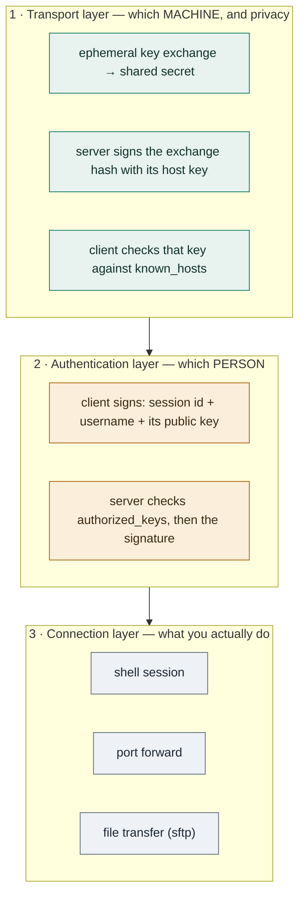
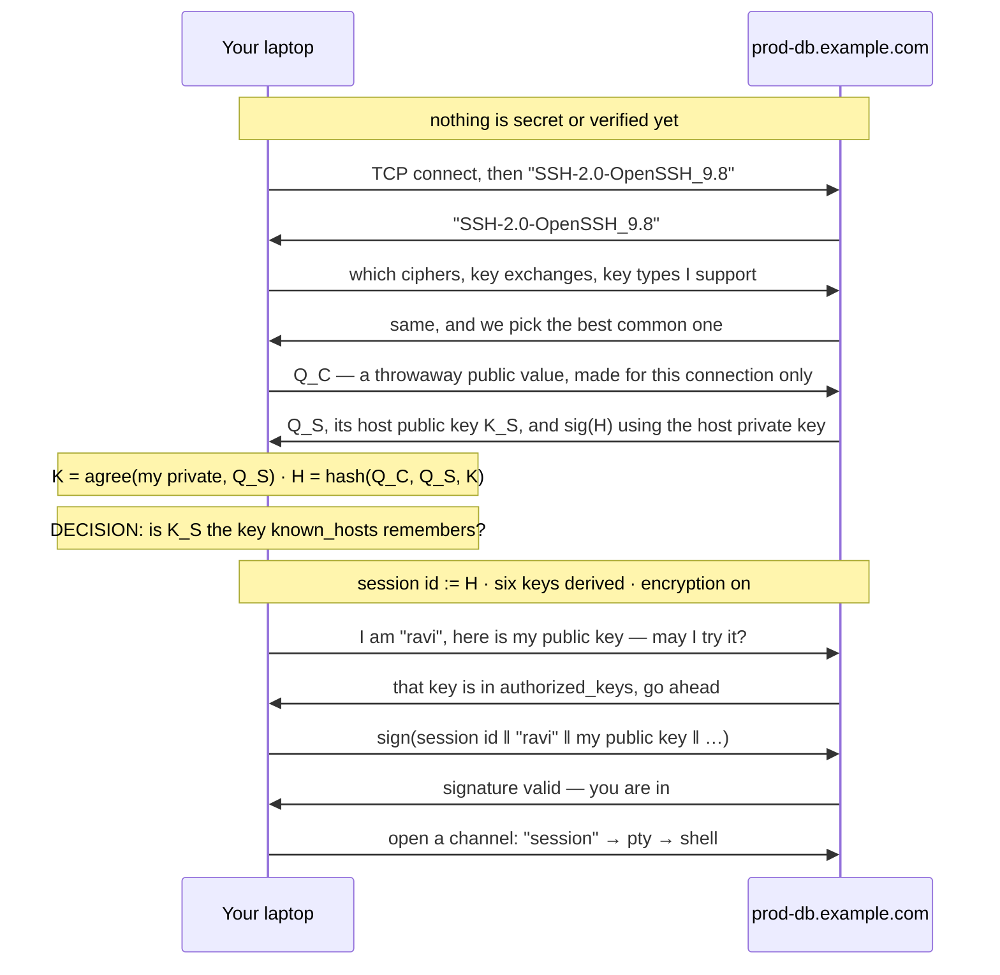
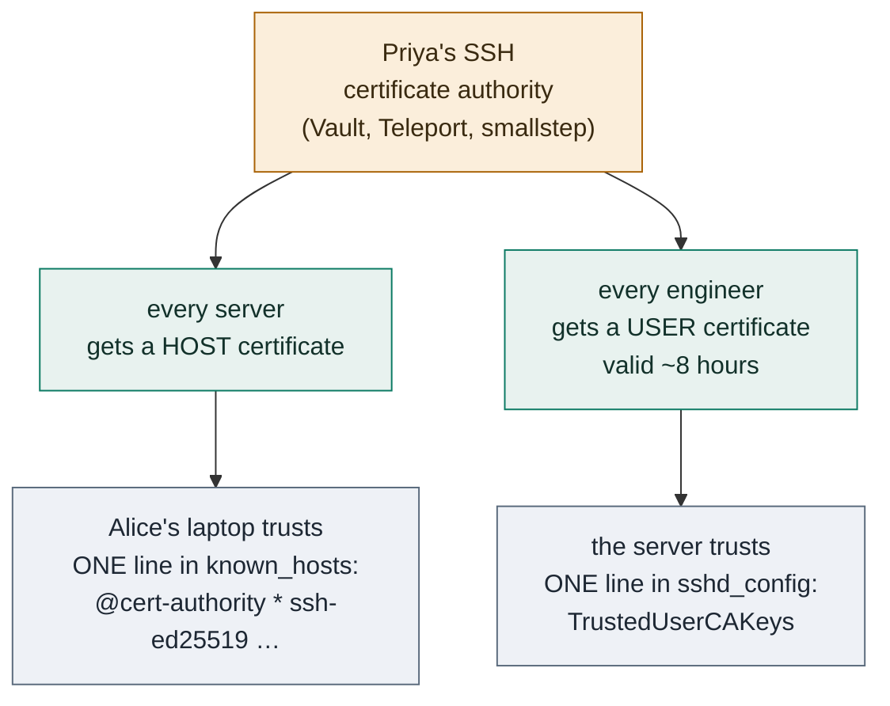
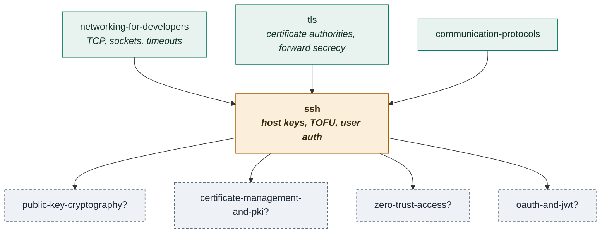

# SSH — how two strangers on a hostile network end up trusting each other

> **Tell a friend:** Alice in Delhi must send one order to Arjun's warehouse in
> Chennai, and every courier on the road is a stranger. Omar is one of them, and
> he is happy to open the envelope, or to answer in Arjun's name and never
> deliver it. Locking the box is easy, and on its own it fixes nothing, because
> Omar can run the lock trick twice, once with each end, and sit in the middle
> reading everything. So SSH gives Arjun a permanent name badge that he signs
> with, and Alice gets exactly one way to judge that badge: she wrote it down the
> first time, and she holds him to it forever. Same cryptography as TLS, opposite
> answer on identity — your own memory of last time, instead of a notary's word.

Watch that decision happen in [`visualization.html`](visualization.html),
published as [The Host Key Decision](https://claude.ai/code/artifact/f8828744-6598-405c-a6c8-cb33b5fb55ce).
What this lab is made of, and where it sits among your other labs, is in
[section 19](#19-about-this-lab) at the end.

---

# BEGINNER MODEL

## 1. Why does anyone need to solve this at all?

> **In one breath:** You type commands on a computer that is far away. The words
> travel through machines other people own. Any one of those people can read
> what you type, change it, or answer you instead of the computer you meant.

You have a computer in a data centre and you are sitting in a café. You need to
type commands on it. The words you type, and the results that come back, travel
through the café's wifi. Then through the café's internet provider. Then through
several networks you have never heard of, and finally the data centre's network.

Every one of those is a machine owned by somebody else.

Before this problem was solved, the standard tool was `telnet`. It sent
everything as ordinary readable text. Your password was ordinary readable text.
Anyone running a network anywhere on that path could read it, save it, and use
it later. In 1995 a researcher at a Finnish university found exactly that
happening on his own network. He wrote SSH in response.

Here is why the stakes are higher than they look. SSH is the tool by which
humans and deployment pipelines get administrative control of servers. If it
fails, the attacker does not get to read one message. The attacker gets to
*become you* on the machine.

Hold on to that. The failure is not a leak. The failure is a handover.

## 2. What can go wrong between Alice and Arjun?

> **In one breath:** Alice sends an order to a warehouse she has never visited,
> through four couriers she has never met. Three different things can go wrong,
> and each one needs a completely different fix.

Alice is in Delhi. She needs to send instructions to a warehouse in Chennai that
only she is allowed to give: *ship the gold*. The manager there is Arjun. She
has never visited the warehouse and has never met him.

She writes a letter and hands it to a courier. The courier passes it to another
courier, who passes it to a van driver, who passes it to a local runner. Four
strangers hold the letter. One of them is Omar.

Three separate things can go wrong. It is worth keeping them apart, because the
rest of this lab is about how differently each one is solved.

1. **Somebody reads it.** Omar opens the envelope and learns the instruction.
2. **Somebody changes it.** Omar rewrites "ship the gold to warehouse 4" as
   "ship the gold to my house".
3. **Somebody impersonates the warehouse.** Omar never delivers the letter at
   all. He writes back on warehouse letterhead saying *received, send more*.
   Alice is now in a conversation with a stranger and does not know it.

Read that list again and notice the shape. The first two are about the *letter*.
The third is about the *person*. That is the split the whole lab turns on.

Four people carry this story from here to the end. Here they are, with what each
one stands for once the story becomes software.

| In the story | Who they are | In SSH |
|---|---|---|
| **Alice** | in Delhi, sends the order, has never met the warehouse | your laptop, the client |
| **Arjun** | runs the warehouse in Chennai, receives the order | the server, `prod-db.example.com` |
| **Omar** | a courier on the road, will open or answer letters | the machine in the middle, the interceptor |
| **Eve** | sits by the road and keeps a copy of everything | a passive recorder, who never speaks |

Five more people join later. Asha takes the on-call pager in section 11. Meera
rebuilds servers, Ben runs a shared build box, and Dev owns a build pipeline. In
section 15, Priya has three thousand machines to look after.

Here is how far this lab goes, and what you can do at each stopping point. Stop
at any checkpoint and you still have something whole.

| Layer | Sections | After it you can… |
|---|---|---|
| **Beginner** | 1–9 | say why encryption alone is worthless here, and what a host key is |
| **Intermediate** | 10 | walk the handshake message by message, and name what each step stops |
| **Engineering** | 11–14 | diagnose eight failures, and say which guarantee each one bends |
| **Production** | 15 | reason about certificates, agents, bastions and what to monitor |

## 3. Does a locked box fix it?

> **In one breath:** Alice puts the letter in a box with a padlock. That stops
> Omar reading it and stops him changing it. It does not tell her who is holding
> the other key.

The obvious fix. Alice puts the letter in a box with a padlock. Couriers carry
the box. Nobody can read or change what is inside.

This kills problems 1 and 2 completely. In software it is also a solved matter.
Encryption is mature, fast and free.

But it raises an immediate question. A padlock needs a key, and Arjun needs that
key in order to open the box. Alice has never met him, so she cannot hand him
one. Sending the key inside the box is obviously absurd.

There is a real mathematical answer to this, and you already met it in the
[tls](../14-tls/) lab. Engineers call it **key exchange**. Alice and Arjun can
shout numbers at each other in public, in front of everybody, and each end up
holding the same secret number that nobody listening can work out.

Eve, sitting by the road with her notebook, hears both numbers and still cannot
compute the secret. That is not a trick of obscurity. It is arithmetic.

> **🔮 Predict:** Alice and Arjun do a public key exchange, agree a secret, and
> encrypt everything from then on. Which of the three problems above are now
> solved?
>
> <details><summary>Reveal</summary>
>
> Problems 1 and 2 are solved — *with respect to whoever she exchanged keys
> with*. Problem 3 is completely untouched, and the encryption actively makes it
> harder to notice, because everything now looks secure. If you said "all three",
> you are assuming the person on the other end of the exchange is Arjun. Nothing
> in the exchange said so. Section 4 shows what that costs.
> </details>

Experiment 2 in `SshLab.java` runs this exchange for real. Alice's public half
goes out, Arjun's public half comes back, and the two secrets match. Eve tries
the same move with her own keypair and lands somewhere else entirely.

```
  client -> server   Q_C = abcba80117346e15a4ef1c14...  (public, 32 bytes)
  server -> client   Q_S = 38616f604b3fceb81982d4f4...  (public, 32 bytes)

  client computes K = 0187c3d014652de8bbb86c00888c233a...
  server computes K = 0187c3d014652de8bbb86c00888c233a...
  same secret?      true

  Eve saw Q_C and Q_S. She has no private half, so the best she can do
  is bring her own keypair and compute a secret with it:
    Eve computes    K = 9f086da1ac7f4f966389579c086abbbc...
    matches theirs?   false   <- she is locked out
```

Three labels in that output will follow you through the rest of the lab. Alice's
throwaway public half is written `Q_C`. Arjun's is `Q_S`. The secret both sides
end up holding, which never travels, is `K`. Section 10 gives them a proper
table; for now, read them as "her half", "his half", and "the secret".

## 4. What does Omar do about the locked box?

> **In one breath:** He does the clever key exchange twice. Once with Alice
> while pretending to be Arjun, once with Arjun while pretending to be Alice.
> Both ends see a perfectly healthy encrypted conversation.

Here is what a courier does about that clever key exchange.

He does it twice.

Omar runs one key exchange with Alice, pretending to be the warehouse. He runs
another with Arjun, pretending to be Alice. Now he holds two secrets. One he
shares with Alice, one he shares with Arjun. Every message Alice sends, he
unlocks, reads, re-locks, and forwards.

Both ends see a perfectly healthy encrypted conversation. There is no error, no
warning, and no delay. Experiment 3 does exactly this. In the code the
interceptor is called Mallory, which is the traditional name for a courier who
edits letters rather than merely reading them.

```
  client encrypts and sends: 36a622e35c38fd1441ffcc598bbc0cb4d074dc8e...
  Mallory decrypts it as:    "cat /home/ravi/.aws/credentials"   <-- plaintext
  Mallory re-encrypts to the server, which reads: "cat /home/ravi/.aws/credentials"
```

Stare at the middle line. That is your cloud credentials file, in plain text, on
a stranger's screen, during a session your terminal reports as encrypted.

The deeper problem is now visible. Encryption answers "can anyone else read
this?". It never answers "who am I talking to?". Those are two separate
questions, and only the second one is hard.

## 5. What do we actually need?

> **In one breath:** Three things, and they are independent. Alice must know
> which machine answered. Arjun must know which person is asking. And a key
> stolen next year must not open this year's recordings.

Stated plainly, we need three things. Engineers would call this list the real
requirement. Watch how each one lands on a different character.

| Need | In the story | Engineers say |
|---|---|---|
| Alice knows which machine she reached, before she sends anything useful | "it is Arjun's warehouse, not Omar's shed" | **host authentication** |
| Arjun knows which person is asking, and the proof works nowhere else | "this really is Alice, and her note is useless in another warehouse" | **user authentication** |
| A key stolen next year cannot open a recording made this year | "Eve's notebook stays gibberish forever" | **forward secrecy** |

The first one is what this whole lab circles around. The other two turn out to
have clean answers once the first is settled.

Notice which of Alice's three worries from section 2 has now been renamed. The
courier who answers in Arjun's name is worry 3, and it is the one that took a
new mechanism rather than a bigger padlock.

## 6. What is the key idea?

> **In one breath:** Give every machine a permanent name badge that it uses only
> to sign, never to lock anything. Then let the client decide whether that badge
> is the right one by remembering what it saw last time.

Two sentences carry SSH.

> Give every server a long-lived key pair that stays with the machine for its
> whole life. Use it not to encrypt anything, but only to **sign** a summary of
> the key exchange that just happened. That signature proves the machine holding
> the key is the same machine you exchanged secrets with.

In the story: Arjun has a signet ring that never leaves the warehouse. He does
not lock the box with it. He presses it into wax on a note that says "the
numbers we just shouted at each other were mine". Omar, standing in the middle,
shouted different numbers to each side. His wax will not match either.

And then the part that makes SSH different from everything else:

> Have the client decide whether that long-lived key is the right one **by
> remembering what it saw last time**.

No certificate authority. No third party. Alice's only source of truth is her
own past.

That is the sentence to hold against the TLS lab. Nikhil asked Asha the notary
whether the seal was genuine, and Asha had vouched for the bank in advance.
Alice asks nobody. She opens her own address book and compares.

## 7. What do engineers call the things Alice just met?

> **In one breath:** Six words carry this entire lab. Every one of them names
> something that already happened to Alice, Arjun or Omar. Learn these properly
> and the rest is detail.

Six terms, each earned where the story earned it. The two tables at the end of
the section map every word back to the moment it happened.

### What is the machine's permanent name badge?

Arjun's signet ring is a **host key**: a key pair generated once when a machine
is built. The private half lives in `/etc/ssh/ssh_host_ed25519_key` and never
leaves the machine. The public half sits beside it in the matching `.pub` file,
and is handed to anyone who connects. The private half is used only to sign.

The word *host* is doing real work. Both halves of SSH's identity story use keys
that look identical, and they answer opposite questions. The host key answers
"which machine is this?". Your own user key answers "which person is this?".
Confusing those two is the single most common source of SSH confusion.

In TLS this role is played by the server's certificate. But a certificate comes
with a *vouching signature from someone else*. A host key comes with nothing at
all. It is naked. Everything in the rest of this lab is a consequence of that
one difference.

### How do you compare a key by eye?

You cannot. A public key is 68 characters of base64, and nobody compares that
correctly by eye at 2am. So SSH prints a short nickname instead, and calls it a
**fingerprint**: the SHA-256 hash of the public key blob, base64-encoded, 43
characters long. Here is one, and it is the badge of the server used all through
this lab.

`SHA256:xhd1+pkCJTaolmvmKbOu7AEklrDjGapafL4tD5XUav0`

The crucial property is that a fingerprint is not a *separate* identity. It is
computed from nothing but the key itself. Comparing fingerprints is therefore
exactly as strong as comparing keys, which is why every human procedure in SSH
is written in terms of fingerprints. Experiment 1 proves it by building a key in
Java, writing it out, and asking the real `ssh-keygen` binary what it thinks:

```
  ours          SHA256:vtqVBIOAz5W7fEY6IG5XgFLoRyXoTpZbtqGy348sVgo
  ssh-keygen    SHA256:vtqVBIOAz5W7fEY6IG5XgFLoRyXoTpZbtqGy348sVgo
  MATCH: true
```

### Where does Alice keep what she remembers?

In one small address book on her own desk. Engineers call it `known_hosts`, and
it lives at `~/.ssh/known_hosts` on your laptop. One line per host: the host name
and port, the key type, and the full public key. Here is one real line, written
by scenario 1 of `ssh-real.sh`:

```
[127.0.0.1]:2222 ssh-ed25519 AAAAC3NzaC1lZDI1NTE5AAAAIApxgo5ltUSdqOJIG8HCQcERm93FRWOPKsI2CpDkwhWA
```

The term exists because that file is the *entire* trust policy of SSH. There is
nothing else. No list of authorities, no online check, no second opinion. When
people say "SSH is decentralised", this file is what they mean.

It plays the role that TLS's trust store played for Nikhil, with one enormous
difference. A trust store is filled in advance, by someone else, with
authorities. This address book is filled by you, as you go, with individual
machines you have actually spoken to.

### What happens the very first time?

Nothing protects it. That is the honest answer, and the term for it is **trust on
first use**, usually shortened to TOFU. In plain words it says: *I have no idea
who you are, so I will assume you are who you claim, write it down, and hold you
to it forever.*

Technically it is the policy of accepting an unknown host key without checking
anything, recording it, and refusing any future key that differs. The name is
deliberately honest about where the protection starts. It starts at the
*second* use. The first use is unprotected, and no amount of cryptography
changes that.

This is precisely the problem certificate authorities exist to solve, and
precisely the complexity SSH refuses to take on by default. Experiment 4 runs
the same three connections twice. Once where the first connection was honest,
once where Omar was already on the wire. The second run is the one worth staring
at, because SSH behaves identically in both.

### Who is on Arjun's guest list?

A file on his side of the wire, called `authorized_keys`. It lives at
`~/.ssh/authorized_keys` in the *target user's* home directory on the *server*.
One public key per line. Being in this file is what "having access" means.

The name marks the direction, and the direction is what people get wrong. Your
address book is on your laptop and lists servers. The guest list is on the
server and lists people. They are mirror images and they are constantly
confused.

Get it wrong and you see `Permission denied (publickey)`. So does a completely
different mistake, made entirely on your own laptop, when your *private* key
file has permissions other users could read. Scenarios 5 and 6 of `ssh-real.sh`
produce both messages, and section 11 shows how to tell them apart in under a
minute.

### What makes Alice's proof useless anywhere else?

A serial number for this one conversation. Engineers call it the **session
identifier**, and it is the exchange hash `H` from the first key exchange: a
SHA-256 over both sides' public values and the shared secret. It is unique per
connection, because the throwaway keys are fresh every time.

The term exists because of what the number is used for. When Alice proves who
she is, she signs the session identifier *along with* her username. That binds
her proof to this one connection. A hostile warehouse cannot take her signature
and walk into a different warehouse with it. Experiment 5 removes the binding
and runs the replay:

```
--- design v1: sign only 'I am ravi, let me in' ---
  prod accepts the replayed signature? true   <-- she is in
--- design v2: sign the session id too (this is what SSH does) ---
  prod accepts the replayed signature? false  <-- refused
  a genuine login to prod still works?  true
```

### Which words carry over, and which are still coming?

Four words come straight from the TLS lab and need no re-teaching here: *key
exchange*, *ephemeral*, *forward secrecy*, *handshake*. Use them unchanged.

Seven more arrive later, each at the moment the story needs it: *channel*,
*agent*, *agent forwarding*, *port forwarding*, *bastion*, *SSH certificate* and
*principal*. Do not go looking for them now. Section 18 has all of them in one
place once you have met them.

### Where did each of the six words happen?

Two small maps back to the story. The machine's identity first.

| Engineers say | In Alice's story | Concrete in this lab | Where it happened |
|---|---|---|---|
| Host key | Arjun's signet ring, never leaves the warehouse | `/etc/ssh/ssh_host_ed25519_key` on the server | this section |
| Fingerprint | a short nickname you can read down a phone line | `SHA256:xhd1+pkCJTaolmvmKbOu7AEklrDjGapafL4tD5XUav0` | experiment 1 |
| `known_hosts` | Alice's own address book of warehouses she has met | `[127.0.0.1]:2222 ssh-ed25519 AAAAC3…` | `ssh-real.sh` scenario 1 |
| Trust on first use | the very first letter, sent on faith | the `yes/no` prompt | experiment 4 |

Then the person's identity.

| Engineers say | In Alice's story | Concrete in this lab | Where it happened |
|---|---|---|---|
| `authorized_keys` | the guest list on the warehouse door | one public key per line, on the server | `ssh-real.sh` scenarios 5 and 6 |
| Session identifier | a serial number stamped on this one conversation | the exchange hash `H` | experiment 5 |
| Public-key authentication | Alice signs a note only she could sign | `Auth.blob`, section 13 | section 10 |

## 8. What two pictures should you keep in your head?

> **In one breath:** The simple picture is recognising a voice on the phone. The
> engineering picture is three layers stacked in one connection, each refusing to
> start until the one below it worked. The story lies to you in four places.

### What does recognising a voice on the phone get you?

You ring a colleague's desk phone. Someone picks up. You have never met them in
person, but you have spoken to them a dozen times, and you **recognise the
voice**. No third party told you it was them. Your own ear did, out of your own
memory.

Then, because the request is sensitive, they ask you a question only you could
answer. And they ask a *different* question every time, so a recording of last
week's call is worthless to anyone who kept one.

Those two moves are the whole protocol. Recognising the voice is the host key
check. The different question every time is the session identifier inside your
signature.

### What does the engineering picture look like?

SSH is three layers stacked inside one TCP connection. Read the diagram bottom
to top, because that is the order they run in.



Each layer refuses to start until the one below it succeeded. That ordering is a
security property, not an implementation detail. **Your username and your key
are never offered until the machine has been identified.** Alice does not say a
word about herself until she is sure it is Arjun on the line.

### How do the two pictures line up?

Two small maps. The machine's side first: everything about recognising Arjun.

| On the phone | In SSH | Where it lives |
|---|---|---|
| their voice | the host key | `/etc/ssh/ssh_host_ed25519_key` on the server |
| your memory of the voice | `known_hosts` | `~/.ssh/known_hosts` on your laptop |
| the very first call, before you knew the voice | trust on first use | the `yes/no` prompt |
| "that doesn't sound like you" | `REMOTE HOST IDENTIFICATION HAS CHANGED` | the client aborts |

Then the person's side: everything about proving you are Alice.

| On the phone | In SSH | Where it lives |
|---|---|---|
| the question only you can answer | public-key authentication | your private key signs |
| a different question every call | the session identifier in the signature | RFC 4252 §7 |
| the guest list of who may give orders | `authorized_keys` | the server, per user |

> **🔮 Predict:** *Omar records one whole SSH session of Alice's, byte for byte,
> and replays every packet at Arjun's server tomorrow. Does he get a shell?*
>
> <details><summary>Reveal</summary>
>
> No, and the reason is in the second table. Every connection starts with a
> fresh key exchange, so tomorrow's session identifier is a different number.
> Alice's recorded signature covers yesterday's number and verifies against
> nothing today. If you said "yes, it is the same bytes", you are picturing a
> password, which *is* replayable. That is one of the reasons SSH prefers keys.
> </details>

### Where does the phone story lie to you?

Four places, and each one matters.

*A voice can be imitated; a key cannot be guessed.* Key comparison is exact and
binary. Forty-three characters either match or they do not. There is no "sounds
about right", and no bad line, and no cold. This makes SSH **stronger** than the
analogy suggests.

*You cannot phone the front desk to check a voice, but you can check a
fingerprint out of band.* Alice can read the fingerprint off the server build
ticket, or the cloud console, or a colleague's screen. This is the one move that
closes the hole in trust on first use, and the phone story hides it completely.

*Recognising a voice is passive; the address book is a file you can edit.* You
can delete the entry, which throws the protection away. That is exactly what
people do when the alarm fires, and scenario 4 of `ssh-real.sh` walks through it.

*The phone call has one conversation; an SSH connection carries many.* The single
connection multiplexes independent **channels**: your shell, a file copy, and
three port forwards at once, all under one handshake.

---

> ### ✅ Checkpoint — end of the beginner model
>
> You can now say what SSH is for, why encryption alone does not achieve it,
> what a host key is, and why one file on your laptop is the whole trust
> decision. That is enough to reason about the warning messages you will see.
>
> Next, in section 10: how the handshake actually runs, message by message, with
> real values — and the two places where the first design a smart person would
> write turns out to be broken.

> **Say it back.** Without using the words *host key*, *fingerprint* or
> *known_hosts*, explain to a friend why Alice's encrypted conversation can be
> perfectly secure and completely worthless at the same time.
> <details><summary>A good answer sounds like</summary>
> "The lock works. It just locks the box to whoever is holding the other key,
> and nothing in the locking told her who that is. Omar answered instead of the
> warehouse, so she locked the box to Omar and he opened it happily."
> </details>

---

## 9. Can you watch the decision happen?

> **In one breath:** Three switches, eight endings. Set who is on the wire, what
> Alice remembers, and what she does at the prompt. One combination is fully
> encrypted, warning-free, and completely compromised.

**[▶ The Host Key Decision](https://claude.ai/code/artifact/f8828744-6598-405c-a6c8-cb33b5fb55ce)**

Do this before reading section 10. Three controls, and every combination has a
different ending:

- **who is on the wire** — Arjun's real server, or Omar intercepting
- **what Alice remembers** — nothing, Arjun's real key, or Omar's key
- **what Alice does at the prompt** — type `yes`, or check the fingerprint first

Press the three story buttons in order. The third one, *"the one nobody
notices"*, is the point of the whole page: a fully encrypted, warning-free,
completely compromised session. Then fill in all eight rows of the table at the
bottom.

While you play, watch the *step* at which each run dies. You will notice that
every successful defence happens before authentication starts. Alice never
sends her name to Omar. That is section 8's layering, drawn.

---

# INTERMEDIATE MODEL

## 10. What does the handshake actually do, message by message?

> **In one breath:** Both sides say hello, agree algorithms, throw one public
> value each across the wire, and derive a shared secret. Then the server signs a
> summary with its permanent badge, the client checks that badge against its
> address book, and only then does anyone mention a username.

Here is the whole handshake. Read it once for shape. The three subsections after
it explain why three of these steps are not what you would have designed.



Five short labels do all the work in that diagram. Read this table before you
read the diagram a second time, because the third column is the only one that
matters for understanding.

| Symbol | In words | In the story | Travels? |
|---|---|---|---|
| `Q_C` | the client's throwaway public half, new every connection | Alice's number, shouted in public | yes, in the clear |
| `Q_S` | the server's throwaway public half, new every connection | Arjun's number, shouted back | yes, in the clear |
| `K` | the shared secret both sides compute and neither sends | the number only they can work out | never |
| `K_S` | the server's permanent public host key | Arjun's signet ring, shown to everyone | yes, every connection |
| `H` | the exchange hash: a hash over both halves and the secret | the serial number of this conversation | never sent; both sides compute it |

Those five, from one real run. They differ every run, because the throwaway keys
are new each time.

```
Q_C  = abcba80117346e15a4ef1c14…       32 bytes, public, discarded at logout
Q_S  = 38616f604b3fceb81982d4f4…       32 bytes, public, discarded at logout
K    = 0187c3d014652de8bbb86c00…       identical on both sides, never sent
K_S  = SHA256:xhd1+pkCJTaolmvmKbOu7AEklrDjGapafL4tD5XUav0   (the host key)
H    = the session id for this connection
```

One more surprise. Six keys come out of that one secret, not one.

```
key 'C'  9b4165ffd0cd85aa378c7dca…   (encryption key, client to server)
key 'D'  51b24ebb3904b67b52004e9d…   (encryption key, server to client)
key 'E'  95288e9101b9bc5480889e46…   (integrity key, client to server)
key 'F'  4eda4ac3e8b9e41c928f1602…   (integrity key, server to client)
```

Each direction gets its own encryption key and its own integrity key. So a key
captured for one purpose is useless for the others. Alice's outbound orders and
Arjun's inbound replies are locked with different locks.

### Refinement 1 — why does the host key only sign, and never encrypt?

The version you would write first is simpler and looks obviously correct. The
server has a long-lived key pair. The client generates a random session key,
encrypts it with the server's public key, and sends it. One round trip, and only
the server can decrypt it. This was genuinely how SSH-1 worked.

> **🔮 Predict:** Eve records this encrypted traffic today and cannot read it. A
> year later the server is decommissioned badly and its private host key leaks.
> What can she read now?
>
> <details><summary>Reveal</summary>
>
> Everything. Every session she ever recorded, going back years. The session key
> was encrypted *to* the host key, so the host key unlocks it — and the host key
> is the one key on the machine that never changes. If you said "only sessions
> from after the leak", you are thinking of a key that rotates. This one does
> not. Experiment 6 does this for real and prints the recovered command.
> </details>

```
=== one year later: the server is compromised and its private host
    key is stolen. Eve opens her archive. ===
design A: unwraps the session key 13ed4c52a0bf7d537aa3084f...
          and reads: "psql -h prod -c 'select * from payments limit 1'"
design B: the host key never touched the session key. The two
          ephemeral private halves were discarded at the end of the
          connection and exist nowhere. Eve holds 76 bytes of noise.
```

So SSH does it the other way. The session key is agreed by a fresh, throwaway
key exchange. The host key is used *only to sign the transcript*. It proves
identity and unlocks nothing. That is why Arjun's signet ring can sit in the
warehouse for a decade without becoming a liability for last year's letters. You
met this property as **forward secrecy** in the TLS lab. The mechanism here is
identical.

### Refinement 2 — why does your signature cover the session identifier?

Again the simple version first. Alice signs "I am ravi, here is my public key".
The server checks the signature against its guest list. Clean.

> **🔮 Predict:** Alice logs into a shared build box that Ben administers. What
> can that box's root user do with the signature she just sent it?
>
> <details><summary>Reveal</summary>
>
> Take it, connect to the production database server, and present her signature
> as their own. It is a valid signature by Alice's key over the words "I am
> ravi" — and those words are true no matter which server reads them. If you
> said "nothing, the key never moved", you are right that the key never moved,
> and it did not need to. The *proof* moved.
> </details>

So the signed blob starts with the session identifier. That value came out of
*this* connection's key exchange, and an attacker cannot reproduce it on a
different connection. Experiment 5, quoted back in section 7, runs both designs.
The replay succeeds against v1 and fails against v2, while an honest login still
works.

This is why it is safe to `ssh` from your laptop into a machine you do not fully
trust. The machine learns nothing it can reuse.

### Refinement 3 — why is there a prompt at all?

The third simple version is the one that feels airtight. The server signs the
transcript, the client checks the signature, done. It is cryptographically
valid.

Experiment 3 shows what that buys you:

```
  So Mallory signs with a host key of her OWN. That signature is
  mathematically valid:
    verify(Mallory host key, H_as_client_saw_it) = true   <- valid!
```

The problem is not the signature. **It is that no signature can tell you which
key was supposed to sign.** Something outside the connection has to answer that
question. TLS's answer was a certificate authority you trusted in advance.
SSH's default answer is your own address book — and on the very first
connection, that file is empty, so it asks you.

Trust on first use therefore protects connection two onwards. Connection one is
protected only if a human compares the fingerprint against something that did
not come down the wire. Section 15 shows how production environments remove the
prompt entirely.

---

> ### ✅ Checkpoint — end of the intermediate model
>
> You can now walk the handshake message by message, say what each message is
> for, and explain why three of its details exist by naming the attack each one
> stops.
>
> Next, in sections 11 to 14: what happens when things go wrong. Every failure
> created, watched, and tied to the guarantee it bends.

> **Say it back.** In two sentences, say why Alice's laptop must decide about
> Arjun's badge *before* it says the word "ravi", and what would be lost if it
> decided afterwards.
> <details><summary>A good answer sounds like</summary>
> "If she checked afterwards, she would have already told Omar her username and
> handed him a signed note. The check comes first so that a wrong answer costs
> her nothing except the connection."
> </details>

---

# ENGINEERING MODEL

## 11. What are the eight ways it fails, and how do you tell them apart?

> **In one breath:** Three failures are about Arjun's badge, two produce the
> identical error message from opposite ends of the wire, and three are about
> Alice's own key leaking. Two of the eight are silent, and those are the
> dangerous ones.

You can stage every one of these. `./ssh-real.sh` runs them against a real
`sshd`, and the visualization lets you watch the first three. Asha is on call
this week, so each story is told as what lands on her screen.

### F1 — what if the badge is not the one Alice remembers?

Scenario 3 of `ssh-real.sh` restarts the server with a different host key. Asha
connects and gets the loudest banner in all of SSH:
`REMOTE HOST IDENTIFICATION HAS CHANGED`.

What happened underneath is one comparison failing. The key the server offered
is not the key in `known_hosts`. Three quite different things produce that.
Somebody is intercepting. Or the server was rebuilt. Or Asha is hitting a
different machine behind the same load-balanced name.

The client aborts immediately, before sending her username or offering her key.
Her credentials are untouched; nothing usable reached the other end. What she
loses is availability. She cannot log in until a human decides what happened.

In real life this is overwhelmingly a rebuild, which is exactly why the alarm
gets ignored. Meera rebuilt that box on Tuesday. The correct move is still to
fetch the expected fingerprint from somewhere that is not the wire, and compare
it before touching `known_hosts`. Three places usually have it: the cloud
console's instance screen, the build pipeline log, and a colleague who already
knows.

### F2 — does the alarm mean Asha is under attack?

Set the visualization's wire to *the real server* and the memory to *the
attacker's key*. Identical banner, opposite cause.

This is the one to think about slowly. The alarm says the key changed. It does
not and cannot say that anyone is attacking. Asha, reasoning "the warning
appeared, so I am being attacked", has the logic backwards. Her colleague,
reasoning "it is always a rebuild", will eventually be wrong once. Both are
guessing where the protocol handed them a question.

### F3 — what if the very first connection was the intercepted one?

In the visualization, set *someone intercepting* plus *nothing remembered* plus
*type yes blindly*. Alice is now fully compromised and her screen is perfectly
clean.

There is no response to give, because SSH performed correctly. It had nothing to
check against. What was lost is everything, silently.

And it gets worse in a way that catches people. Alice's laptop has now pinned
Omar's key. When Omar goes away, the *honest* server looks wrong, and she gets
the F1 banner about the machine that was never the problem. This is precisely
why SSH certificates exist, and section 15 is about them.

> **🔮 Predict:** The next two failures produce the *identical* client message:
> `Permission denied (publickey)`. One is caused entirely on your laptop, the
> other entirely on the server. Before reading on — what single piece of evidence
> would let you tell them apart in under a minute?
>
> <details><summary>Reveal</summary>
>
> A key fingerprint, seen in two places. Run `ssh-keygen -lf ~/.ssh/id_ed25519.pub`
> to get yours, then look for it in the server's log. If it appears there, your
> key travelled and the server rejected it → `authorized_keys`. If it does not,
> your client never sent it → a local problem, usually permissions. With no
> server access, `ssh -v` and the line `Offering public key` answers the same
> question from your side. If you said "read the error text", the error text is
> byte-identical in both cases; that is the whole trap.
> </details>

### F4 — why does `Permission denied` sometimes mean Alice's own laptop?

Scenario 5 of `ssh-real.sh` runs `chmod 644` on the private key file. Here is
what Asha sees:

```
Permissions 0644 for '…/id_ravi' are too open.
This private key will be ignored.
ravi@127.0.0.1: Permission denied (publickey,keyboard-interactive).
```

The client is refusing to use a key that other users on your own machine could
read. It never offered it. So the server never saw a key at all and answered the
only way it could.

The trap is in the last line. It blames authentication, and people go and edit
`authorized_keys` on the server. The cause is three lines higher, on the laptop.
The server was never involved.

There is a twin of this bug on the server side, called `StrictModes`. `sshd`
refuses to read `authorized_keys` when the home directory or the `.ssh` folder
is group-writable, and it logs that it did. Same class of mistake, other end of
the wire.

### F5 — and why does the same message sometimes mean Arjun's guest list?

Scenario 6 empties `authorized_keys`. The client message is *identical* to F4,
word for word. The difference lives in the server log:

```
Failed publickey for ravi from 127.0.0.1 port 59417 ssh2: ED25519 SHA256:vAX2lrlLwqgjAWsFb/TmngpKvc8eh8hpBUannuOmD/U
```

Compare that fingerprint with `ssh-keygen -lf ~/.ssh/id_ed25519.pub`. If it
appears in the server log at all, the key reached the server and the server said
no. The problem is `authorized_keys`. If nothing appears, the key never left the
laptop, and the problem is local. Without access to the server log, run `ssh -v`
and look for `Offering public key`.

That one diagnostic separates the two most common SSH failures on earth, and it
takes about forty seconds.

### F6 — what does a stolen private key cost?

Copy `id_ravi` to another machine and use it. It works instantly. A private key
with no passphrase is a bearer token: whoever holds it is Alice.

There is no response, because there is nothing to detect. The login is genuine
by every measure SSH has. Nothing survives.

This is why passphrases exist, and why they are made bearable by `ssh-agent`. An
agent is a process that holds your unlocked key in memory and signs on request,
so you type the passphrase once per day rather than once per connection. It is
also why hardware-backed keys (`ed25519-sk`, Secure Enclave) are strictly
better, since the key physically cannot be copied. And it is the strongest
argument for short-lived certificates over long-lived keys.

### F7 — what does Alice hand over with `ssh -A`?

She runs `ssh -A` into Ben's shared build box, because it is convenient. That
flag exposes a unix socket on Ben's box that signs anything on request, for as
long as her session lasts.

> **🔮 Predict:** *Alice's private key never leaves her laptop during that
> session. So what exactly does the box's root user get?*
>
> <details><summary>Reveal</summary>
>
> Everything the key grants, for the duration. The agent's whole protocol is
> "sign this blob", and it has no way to ask what the blob is *for*. Root on
> that box can ask it to sign a login to production, and it will. If you said
> "nothing, the key stayed home", you are protecting the wrong asset. The key is
> intact. The *authority* was lent out.
> </details>

The fix is `ProxyJump`, written `ssh -J bastion target`. A **bastion**, or jump
host, is the one machine reachable from outside, through which all access to a
private network is funnelled. `ProxyJump` tunnels a *new, separate* connection
through it. The bastion carries Alice's encrypted traffic without ever being
able to use her key.

### F8 — what leaks even though everything is encrypted?

Experiment 7 answers this, and the answer surprises people. Ciphertext lengths
vary with command length. Interactive shells send one packet per keystroke.

```
    "ls"                                   -> ciphertext  30 bytes
    "sudo systemctl restart payments-api"  -> ciphertext  63 bytes
```

Eve, who never speaks and only keeps copies, learns the shape of everything
Alice types. Command lengths, password lengths, and typing rhythm all survive
encryption. Song, Wagner and Tian published keystroke-timing attacks on exactly
this at USENIX in 2001.

The content itself is safe. It is the *metadata* that leaks. In production this
is a real reason to prefer key authentication over typing passwords into an
interactive session, where each keystroke becomes its own packet.

### The eight side by side

First, how to produce each one and who owns the fix. Read the fourth column top
to bottom: two rows say "nothing", and those are the failures that end careers.

| # | Failure | See it yourself | What you see | Who owns the fix |
|---|---|---|---|---|
| F1 | Host key changed | `ssh-real.sh` scenario 3 | `REMOTE HOST IDENTIFICATION HAS CHANGED` | a human, after checking out of band |
| F2 | Alarm on an innocent server | visualization: real wire, wrong memory | the identical banner | whoever rebuilt the box |
| F3 | Intercepted on connection one | visualization: interceptor, empty memory, `yes` | nothing; a clean session | the design, not the operator |
| F4 | Key file too open | `ssh-real.sh` scenario 5 | `Permissions 0644 … too open` | you, on your own laptop |
| F5 | Key not in `authorized_keys` | `ssh-real.sh` scenario 6 | the same denial, plus a server log line | whoever manages the server's list |
| F6 | Stolen private key | copy `id_ravi` elsewhere | nothing; a genuine login | passphrases, hardware keys, short lifetimes |
| F7 | Agent forwarding hijack | `ssh -A` into a box with hostile root | nothing, until it is used | you: switch to `ProxyJump` |
| F8 | Traffic analysis | experiment 7 | 30 bytes vs 63 bytes | nobody; it is inherent |

Then what each failure costs. The middle two columns are the ones to argue about
in an incident review.

| # | What stayed intact | What was lost | What it looks like at 3am |
|---|---|---|---|
| F1 | your credentials; nothing usable was sent | availability, until a human decides | a red banner and a blocked deploy |
| F2 | everything; the protocol was right | trust in the alarm itself | the same banner, and a shrug |
| F3 | nothing | everything, silently, plus a poisoned address book | a clean session, then F1 next week |
| F4 | both machines; the key was never offered | ten minutes, usually spent on the wrong machine | an engineer editing the server's list |
| F5 | the private key | access, until the list is fixed | `Failed publickey` in `journalctl` |
| F6 | nothing | everything the key grants, permanently | a genuine login from a strange country |
| F7 | the private key itself, which never moves | every authority the key carries, for the session | nothing at all |
| F8 | the content of every command | command lengths, password lengths, typing rhythm | a paper from 2001 |

## 12. What does SSH actually promise Alice, and what does it not?

> **In one breath:** If her address book holds the right key, everything after
> the handshake is private, unforgeable and useless to replay. SSH promises
> nothing at all about whether that key was right in the first place.

Every guarantee below sits on one precondition: `known_hosts` holds the right
key for this server. Read that sentence twice. It is the hinge of the whole
lab.

### What is guaranteed, once the address book is right?

| Guarantee | In Alice's words | What it means for your code |
|---|---|---|
| **Privacy and integrity** | "nobody reads or edits my orders" | everything after the handshake is encrypted, and modified packets are detected rather than silently mangled |
| **Peer identity** | "the warehouse holds the ring I remember" | the peer holds the private half of the host key you already trusted |
| **Forward secrecy** | "Eve's old notebook stays gibberish" | today's stolen host key does not decrypt yesterday's recorded session |
| **Non-replayable proof** | "my signed note works in one warehouse only" | your authentication signature is worthless on any other connection |
| **Nothing sent too early** | "she gives her name last, not first" | username, key and signature are all withheld until the machine is identified |

### What is explicitly not guaranteed?

The first row is the important one. Everything else in SSH is arithmetic. This
one is trust, and trust is a human decision that happened once, possibly years
ago, in about one second.

| Not promised | Why it bites | Where you saw it |
|---|---|---|
| That the key in `known_hosts` is the right one | the entire chain rests on it, and by default it rests on somebody typing `yes` | section 7, and F3 |
| Anything about the first connection | unless a human compared the fingerprint against something off the wire | F3 |
| Metadata privacy | sizes and timings leak, whatever the cipher | F8 |
| Safety against a compromised server | if the machine is owned, SSH delivered you correctly to a hostile host | refinement 2 keeps your key; your session is gone |
| That an alarm means an attack | F1 and F2 produce the same screen from opposite causes | F1, F2 |

> **🔮 Predict:** *Alice logs into a production box that has already been
> compromised. Which of the five guarantees above still held?*
>
> <details><summary>Reveal</summary>
>
> All five. That is the uncomfortable part. SSH promised to deliver her to the
> machine whose key she remembered, privately and unforgeably, and it did
> exactly that. The machine itself being hostile was never on the list. If you
> said "none of them", you are asking SSH to judge the far end's behaviour. It
> only judges the far end's identity.
> </details>

### What was traded away to get this?

Two things, and both are about size rather than cryptography.

**Scale.** With TLS you trust about 150 authorities and can then check millions
of servers. With SSH you must acquire trust in *every individual machine*, one
at a time. For Alice's three servers this is genuinely simpler than TLS. For
three thousand ephemeral containers it collapses, which is what section 15 is
about.

**Revocation.** Removing a line from `authorized_keys` on 400 machines is 400
operations. Nothing tells you when one of them was missed.

## 13. Where is the code, and which line is load-bearing?

> **In one breath:** Six small Java files, no dependencies, no build tool. Four
> lines in them carry every security property in this lab; the rest is
> bookkeeping.

Run it like this. Nothing you already have is touched; the shell script builds
its own world from scratch.

```bash
cd ~/Documents/Learning/15-ssh
java SshLab.java          # the crypto core, 7 experiments
./ssh-real.sh             # generates throwaway keys, runs a real sshd on 127.0.0.1:2222
java BrokenAuth.java      # the planted bug, for exercise 6
```

On its first run the shell script makes its own keys, in `./lab`, with the same
`ssh-keygen` you would use by hand. One real server, one impostor, one user key:

```bash
ssh-keygen -q -t ed25519 -f lab/hostkey           -N '' -C 'the-real-server'
ssh-keygen -q -t ed25519 -f lab/hostkey_impostor  -N '' -C 'the-impostor'
ssh-keygen -q -t ed25519 -f lab/id_ravi           -N '' -C 'ravi@laptop'
```

Those three keys are the whole cast of scenarios 1 to 6. Arjun's warehouse is
the first, Omar's shed is the second, and Alice's own key is the third. The
impostor key is what scenario 3 restarts the server with, and it is why F1
fires.

Then the crypto itself. Six files, and none of them is long.

```
Wire.java        SSH's on-the-wire encoding, key blobs, fingerprints, signing
Kex.java         key exchange, the exchange hash, key derivation
Crypto.java      AES-GCM seal/open — the record layer, in two methods
KnownHosts.java  the entire trust policy, in about ten lines
Auth.java        the blob a client signs to prove who it is
SshLab.java      the seven experiments
```

The load-bearing lines, in order of importance.

**`Auth.blob` is the one field that stops replay.** This single line is
refinement 2, in code:

```java
byte[] head = sessionId == null ? new byte[0] : Wire.string(sessionId);
```

Passing `null` builds the broken v1 design. Everything else in the method is
bookkeeping. This line is the security property.

**`Kex.exchangeHash` is why Omar cannot hide.** Both public halves go into the
hash:

```java
return Wire.sha256(Wire.cat(Wire.string(qc), Wire.string(qs), Wire.string(k)));
```

Omar must present his own public half to Alice. So the number Alice computes
differs from the number Arjun computes, and Arjun's signature cannot verify
against Alice's version.

**`KnownHosts.check` is the whole trust decision.** Three branches: unknown (ask
a human, check nothing), match (proceed silently), mismatch (refuse). There is
no fourth branch, and there is no third party anywhere in the file. Ten lines
hold everything TLS spends a certificate chain on.

**`Kex.ephemeral` is forward secrecy in one word.** A fresh key pair per
connection, discarded at the end. If these were long-lived, experiment 6's
design B would fail exactly like design A.

## 14. What do the experiments show?

> **In one breath:** Seven experiments in Java build the crypto from primitives.
> Eight scenarios drive the real OpenSSH client and server. Every one is framed
> as a question, so commit to an answer before you run it.

### What does the crypto core show?

`java SshLab.java` runs seven experiments with JDK primitives only. The first
four are about identity.

| # | Question to answer first | What you should see |
|---|---|---|
| 1 | Is a "key" a special object, or just bytes? | Java builds a key; the real `ssh-keygen` computes the same fingerprint |
| 2 | Can two strangers agree a secret in public? | Identical `K` on both sides; Eve locked out |
| 3 | Does encryption tell you who you are talking to? | Mallory prints your plaintext |
| 4 | Does TOFU protect you? | Yes — from connection two. Story B is the one to read twice |

The last three are about design choices, and each one removes a feature to show
what it was for.

| # | Question to answer first | What you should see |
|---|---|---|
| 5 | Why does SSH sign the session id? | Remove it and watch the replay succeed |
| 6 | Does a stolen host key expose old sessions? | Design A yes, design B no |
| 7 | What leaks despite encryption? | Command lengths, keystroke counts |

### What does the real `sshd` show?

`./ssh-real.sh` drives the real OpenSSH client and server. It builds a throwaway
world in `./lab`, runs `sshd` on `127.0.0.1:2222`, and kills it on exit. **It
never reads or writes your real `~/.ssh`.** Every command passes explicit
`-F /dev/null`, `UserKnownHostsFile`, and `IdentitiesOnly`, and the agent socket
is pinned inside `./lab`.

Scenarios 1 to 4 are the trust decision, the same one the visualization draws.

| # | Question to answer first | What you should see |
|---|---|---|
| 1 | What does accepting a host key actually write? | One line in `known_hosts`, matching the server's key |
| 2 | How do you know the check happened? | Silence. No output at all |
| 3 | What does the client send once the key is wrong? | Nothing — it aborts before authentication |
| 4 | Does `ssh-keygen -R` fix the problem? | It gets you in — to the impostor |

Scenarios 5 to 8 are about the person rather than the machine.

| # | Question to answer first | What you should see |
|---|---|---|
| 5 | Whose fault is `Permission denied` here? | Yours; the key was never used |
| 6 | And here? | The server's list; read the `sshd` log |
| 7 | How many things can one connection carry? | A shell and a port forward at once |
| 8 | What does the agent actually hold? | A socket that signs on demand |

### What does the planted bug show?

`java BrokenAuth.java` is a hand-written SSH-style login with one deliberate
mistake in it. It passes its happy-path test and lets a total stranger in.
Exercise 6 asks you to find the line. Scenario 2's answer above is the hint:
silence is what success looks like, so a check that never runs looks exactly
like a check that passed.

---

> ### ✅ Checkpoint — end of the engineering model
>
> You can now diagnose SSH failures by mechanism rather than by guessing:
> separate the two `Permission denied` causes, explain what the host key alarm
> does and does not prove, and say which guarantee each failure bends.
>
> Next, in section 15: what changes when Alice has three thousand servers
> instead of three.

> **Say it back.** Asha pages you with `REMOTE HOST IDENTIFICATION HAS CHANGED`.
> In three sentences, and without using the word *attack*, tell her what the
> message proves, what it does not, and what to go and look at.
> <details><summary>A good answer sounds like</summary>
> "It proves the key that machine offered is not the key your laptop wrote down
> before. It does not say why they differ, and a rebuild looks exactly like an
> interception. Go and get the fingerprint from the cloud console or the build
> log, compare it to what the server offered, and only then decide whether to
> edit the file."
> </details>

---

# PRODUCTION MODEL

## 15. What changes when Alice has three thousand servers?

> **In one breath:** The cryptography does not change at all. What changes is
> where trust comes from. Priya cannot remember three thousand machines, so she
> stops remembering and starts vouching, with an authority she runs herself.

### What is the chain from this lab to a real fleet?

Three steps, and only the last one is interesting.

| Where | What holds the trust | What it is |
|---|---|---|
| **Toy**, this lab | `KnownHosts.java` | one map in memory, one host |
| **Real**, your laptop | `~/.ssh/known_hosts`, `~/.ssh/config`, `ssh-agent` | the same design, in real files, run by OpenSSH |
| **Production**, Priya's fleet | a certificate authority she operates | the same cryptography, a different source of truth |

Read the third column down. The cryptography is identical in all three rows.
Only the answer to "who says this key is right?" moves.

### What replaces trust on first use?

Trust on first use does not survive autoscaling. Priya's servers are created and
destroyed hourly and named by IP address. So every connection is a first
connection. Every engineer is trained to type `yes` reflexively. The protection
is gone in practice while looking present on paper.

The fix is to bring back the idea you already know from the TLS lab: **delegate
trust in advance**. The difference is that the authority is one Priya runs
herself, not one of the 150 that shipped with the laptop.



Now go back to section 11 and read what this does to four of the eight failures.

**F3 disappears.** Alice's laptop trusts the authority, so a brand-new server is
checked on the *first* connection. No prompt, ever. A prompt now means something
is genuinely wrong, which is what an alarm is supposed to mean.

**F1's false alarms disappear.** Meera rebuilds a box, it gets a new host key
and a new certificate from the same authority, and it connects silently. Asha's
pager stays quiet, and the banner goes back to being rare and meaningful.

**F6 shrinks from permanent to hours.** A user certificate expires. A stolen
laptop key is useless tomorrow morning. Issue certificates after single sign-on
and you have tied SSH access to your identity provider. Deactivate the account
and access ends everywhere at once.

**Revocation becomes possible at all.** Priya revokes at the authority, not by
editing `authorized_keys` on 400 machines and hoping she missed none.

A user certificate also carries **principals**, which are the usernames it may
log in as. It carries a validity window. And it carries extensions saying
whether port forwarding or agent forwarding are permitted at all. That is
policy `authorized_keys` cannot express well.

### Which settings actually change your day?

Almost everything painful about SSH is fixed by `~/.ssh/config`, and most
engineers never write one. Here is a config worth stealing:

```
Host prod-*
  User deploy
  IdentityFile ~/.ssh/id_ed25519_prod
  IdentitiesOnly yes          # stop offering every key you own to every server
  ProxyJump bastion.example.com
  ControlMaster auto          # reuse one connection for many sessions
  ControlPath ~/.ssh/cm-%r@%h:%p
  ControlPersist 10m
```

`ControlMaster` matters more than it looks. It removes the handshake from every
subsequent connection to the same host, and you already know from the networking
lab that the handshake is the expensive part.

Hardening comes next, in rough order of value. `PasswordAuthentication no`
removes brute-forcing entirely and is worth more than everything below it. Then
`PermitRootLogin no`, then `AllowGroups ssh-users`, then `MaxAuthTries 3`.
Finally, for automation accounts that must never get a shell, forced commands in
`authorized_keys`:

```
command="/usr/local/bin/backup-only",no-port-forwarding,no-agent-forwarding ssh-ed25519 …
```

### What does Asha actually read at 3am?

`journalctl -u ssh`, or `/var/log/auth.log` on older boxes. Three lines carry
almost all of the signal.

| Log line | What it tells Asha | When it matters |
|---|---|---|
| `Accepted publickey for … SHA256:…` | who got in, and with which key | attributing a change to a person |
| `Failed publickey for …` | the fingerprint that was rejected | the F5 diagnostic, straight from the server |
| `Connection closed by … [preauth]` | somebody gave up before authenticating | usually a scanner; the volume is startling and mostly harmless |

> **🔮 Predict:** Dev's CI pipeline needs to `git push` over SSH to a host it has
> never contacted. He suggests adding `ssh-keyscan github.com >> ~/.ssh/known_hosts`
> to the build script. It works, and the build goes green. What did it actually
> establish?
>
> <details><summary>Reveal</summary>
>
> Nothing. It asked the network "what key should I trust?" and wrote down the
> answer. That is the F3 weakness, automated. It runs fresh on every single
> build, so it never even gets the second-connection protection. Whoever controls
> the pipeline's network path controls the answer. If you said "it pins the key",
> it pins whatever answered this minute. The fix is to commit the known-good
> fingerprint into the pipeline config, where a change to it is a reviewable
> diff.
> </details>

That trap is worth naming out loud, because it is everywhere. `ssh-keyscan` is
not a check. It asks the network what to trust, which is the thing trust on
first use was already weak about, now automated and repeated. Pin the published
fingerprint in your pipeline config instead.

### What does this lab deliberately leave out?

Five things about the wire itself, which the Java files simplify away.

| Omitted here | What real SSH does |
|---|---|
| Packet framing | The Binary Packet Protocol: length, padding, payload, MAC — with padding chosen to blur message sizes |
| Algorithm negotiation | `KEXINIT` lists on both sides; the chosen names are hashed into `H`, which is what stops an attacker downgrading you to weak crypto |
| Rekeying | New key exchange every ~1 GB or 1 hour (`RekeyLimit`), bounding how much data one key protects |
| Hashed `known_hosts` | `HashKnownHosts yes` stores host names hashed, so stealing the file does not hand over your inventory of servers |
| Privilege separation | `sshd` splits into a sandboxed unprivileged process handling pre-auth network data, so a parser bug does not mean instant root |

And three about what surrounds it.

| Omitted here | What real SSH does |
|---|---|
| Host key rotation | `UpdateHostKeys yes` lets a server publish new host keys over the already-trusted connection, so rotation stops causing F1 |
| Other auth methods | keyboard-interactive, PAM, GSSAPI/Kerberos, FIDO2 (`ed25519-sk`) |
| Subsystems | `sftp`, `scp`, and `rsync -e ssh` all ride the connection layer as channels |

### Which real implementations should you know?

Four, and they sit at different heights.

| Implementation | What it is | Why you would reach for it |
|---|---|---|
| **OpenSSH** | effectively the standard, on both ends | read its `-v`, `-vv`, `-vvv` output; it narrates the whole handshake |
| **libssh / Apache MINA SSHD** | embeddable libraries | MINA SSHD is the Java one, for adding SSH or SFTP to a Spring Boot service |
| **Teleport / HashiCorp Vault SSH / smallstep** | the certificate authority layer above | this is how Priya's diagram gets built without writing it yourself |
| **Tailscale SSH** | a network identity layer | it replaces the trust decision entirely, rather than automating it |

---

> ### ✅ Checkpoint — end of the production model
>
> You can now explain why trust on first use is right for three servers and
> wrong for three thousand, describe what an SSH certificate authority changes,
> and name the operational controls that matter. You are ready to read RFC
> 4251–4254 and `man sshd_config` without translation.

> **Say it back.** Explain to a new engineer, in plain words, why Priya's fleet
> stopped showing fingerprint prompts, and why that made the prompts *more*
> trustworthy rather than less.
> <details><summary>A good answer sounds like</summary>
> "Every machine now carries a signed note from an authority the laptops already
> trust, so a new server is recognised the first time. The prompt used to appear
> constantly, so everyone typed yes without reading. Now it almost never
> appears, which means when it does, something is really wrong."
> </details>

---

## 16. Where are the exercises?

Ready to try this on Alice's behalf? [EXERCISES.md](EXERCISES.md) has eight
rungs, from "explain it in your own words" to "design SSH access for 3,000 hosts
and 200 engineers". Answers are in [SOLUTIONS.md](SOLUTIONS.md); try first.

## 17. Where does this sit, and what comes next?

> **In one breath:** Three labs lead here, and four could follow. The one
> sentence to carry away is that SSH and TLS run the same cryptography and give
> opposite answers about who vouches for identity.

The knowledge map:



Six pairs of words get confused constantly. Here is the one sentence that
separates each pair, and the section where you watched the difference happen.

| Pair | The difference | Where you saw it |
|---|---|---|
| SSH vs TLS | Same cryptography, opposite trust models: TLS asks an authority you trusted in advance, SSH asks your own memory of last time | sections 6 and 7 |
| Host key vs user key | The host key says *which machine*; your user key says *which person*. Different files, different directions, same algorithm | section 7 |
| `known_hosts` vs `authorized_keys` | `known_hosts` is on your laptop and lists machines you trust; `authorized_keys` is on the server and lists people it lets in | F4 and F5 |
| `ssh-agent` vs a password manager | The agent never reveals the key; it signs on request. That is why forwarding it is dangerous and copying it is not the risk you would expect | F6 and F7 |
| Port forwarding vs a VPN | A forward exposes one TCP port through one authenticated connection; a VPN puts you on the network | section 8, the channels lie |
| `ssh-keyscan` vs a real check | `ssh-keyscan` asks the network what to trust. It is convenience, not security | section 15 |

Next, in the order I would take them.

- `/learn public-key-cryptography` — you have now used signatures, key exchange
  and hashing three labs running without opening any of them. This is the box
  under all three.
- `/learn certificate-management-and-pki` — already flagged by the TLS lab, and
  section 15 makes it twice as relevant: issuance, rotation, revocation, and the
  expiry outage.
- `/learn zero-trust-access` — where section 15 leads: identity-aware proxies,
  short-lived credentials, and why the bastion host is disappearing.
- `/learn oauth-and-jwt` — SSH certificates bind machine access to a human
  identity; OAuth is how that human identity is established in the first place.

## 18. Glossary — which words did the story earn?

In order of first appearance. The third column points back at the moment each
one happened to Alice, Arjun, Omar or Eve.

| Term | One line | In the story |
|---|---|---|
| **key exchange** | A public conversation that leaves both sides holding the same secret number. | Alice and Arjun shouting numbers, section 3 |
| **host key** | The server's permanent identity key pair; signs, never encrypts. | Arjun's signet ring, section 7 |
| **fingerprint** | SHA-256 of a public key, base64 — a short form safe to compare by eye. | the 43 characters you can read down a phone line |
| **`known_hosts`** | Your laptop's record of which host key belongs to which server name. | Alice's own address book |
| **trust on first use (TOFU)** | Accept an unknown key, write it down, refuse any change later. Protects from connection two onward. | the very first letter, sent on faith |
| **`authorized_keys`** | The list on the server of public keys allowed to log in as a given user. | the guest list on the warehouse door |
| **public-key authentication** | Proving identity by signing a challenge, so no secret ever crosses the wire. | the question only Alice can answer |
| **session identifier** | The first exchange hash; unique per connection, and signed during login so proofs cannot be replayed. | a different question every call, refinement 2 |
| **exchange hash (`H`)** | A hash over both public values and the shared secret; what the host key signs. | the serial number of one conversation, section 10 |
| **ephemeral key** | A key pair made for one connection and discarded — the source of forward secrecy. | the numbers thrown away at logout |
| **forward secrecy** | A stolen long-term key cannot decrypt previously recorded sessions. | Eve's archive staying noise, experiment 6 |
| **AEAD** | Encryption that also detects tampering, in one operation. | the padlock that also shows if the box was opened |
| **transport / authentication / connection layer** | The three layers of SSH: which machine, which person, what you actually do. | the stack in section 8 |
| **channel** | One independent stream inside a connection — a shell, a forward, a file transfer. | where the phone analogy breaks, section 8 |
| **multiplexing** | Running many channels over one authenticated connection. | `ssh-real.sh` scenario 7 |
| **port forwarding** | Carrying a TCP port through the SSH connection (`-L` local, `-R` remote, `-D` SOCKS). | scenario 7, a shell and a forward at once |
| **`ssh-agent`** | A process holding your unlocked private keys that signs on request but never reveals them. | F6, the thing that makes passphrases bearable |
| **agent forwarding (`-A`)** | Exposing your agent's socket on a remote host — convenient, and equivalent to lending your key to that host's root. | F7, on Ben's build box |
| **`ProxyJump` (`-J`)** | Tunnelling a separate connection through a bastion, without exposing your agent. | the fix for F7 |
| **bastion / jump host** | The single reachable machine through which access to a private network is funnelled. | F7 |
| **`StrictModes`** | The server's refusal to read `authorized_keys` when the home directory permissions are too loose. | F4's twin, on the server side |
| **SSH certificate** | A host or user key signed by a CA you run, carrying validity, principals and permitted extensions. | Priya's authority, section 15 |
| **principal** | The identity a user certificate is allowed to log in as. | section 15 |
| **`ControlMaster`** | Reusing one authenticated connection for later sessions, skipping the handshake. | the config worth stealing, section 15 |
| **rekeying** | Periodically redoing the key exchange to limit how much data one key protects. | the omissions table, section 15 |
| **Binary Packet Protocol** | SSH's framing: length, padding, payload, MAC. | the omissions table, section 15 |

## 19. About this lab

What is this lab made of, where do its numbers come from, and what could it not
stage? Everything about the lab itself lives here, so that Alice's story above
can run without interruption.

**What it is made of.** This README, plus five runnable pieces.

| | |
|---|---|
| **Interactive** | [The Host Key Decision](https://claude.ai/code/artifact/f8828744-6598-405c-a6c8-cb33b5fb55ce) — put an interceptor on the wire, and watch how your laptop decides whether the machine answering is the one you meant |
| **Crypto core** | `java SshLab.java` — 7 experiments, JDK primitives only |
| **The real thing** | `./ssh-real.sh` — 8 scenarios against a real `sshd` |
| **Debug puzzle** | `java BrokenAuth.java` |
| **Practice** | [EXERCISES.md](EXERCISES.md) · [SOLUTIONS.md](SOLUTIONS.md) |

**How to read it.** Top to bottom. It tells one continuous story: a problem
appears, the obvious fix is tried, it breaks, and the breakage forces the next
idea. By the end, every strange detail of SSH should feel like the scar of a
failure you watched happen.

The four depth layers are marked as headings, and each transition has a
checkpoint telling you what you can now do.

| Layer heading | Sections it covers |
|---|---|
| `BEGINNER MODEL` | 1–9 |
| `INTERMEDIATE MODEL` | 10 |
| `ENGINEERING MODEL` | 11–14 |
| `PRODUCTION MODEL` | 15 |

Older labs and the exercises call these sections *stages*. The numbers are the
same either way, so "stage 15" and "section 15" mean the same thing.

**Where the numbers came from.** Everything runnable here has been run. Where a
number appears, it came out of a real execution on this machine. The
fingerprints, the key material, the byte counts and the log lines are all real
output, not illustrations. Values that depend on the throwaway keys change on
every run, so treat any specific hex string as one representative run rather
than a constant.

| Figure | What it means | Where it came from |
|---|---|---|
| 32 bytes, twice | the size of each side's throwaway public half | experiment 2 |
| 43 characters | the length of a SHA-256 fingerprint you compare by eye | section 7 |
| 68 characters | the length of the base64 key nobody can compare by eye | section 7 |
| 30 vs 63 bytes | ciphertext length for `"ls"` against a long command, showing what leaks | experiment 7 |
| 76 bytes of noise | what Eve holds after stealing a host key, under the real design | experiment 6 |
| port 59417 | the client port in one captured `Failed publickey` log line | `ssh-real.sh` scenario 6 |

**What could not be staged, and where each failure actually runs.** Four of the
eight are executed by the lab's own code. Two are staged in the visualization,
because an interceptor between two real machines is not something a script can
conjure. Two are described only, because both need a second machine with a
different owner.

| Failures | How they run here | Why not further |
|---|---|---|
| F1, F4, F5 | scenarios 3, 5 and 6 of `ssh-real.sh`, against a real `sshd` | nothing missing; these are the real thing |
| F8 | experiment 7 of `SshLab.java` | the leak is in the ciphertext lengths, which the Java core produces |
| F2, F3 | the visualization, with the wire and the memory set by hand | staging a live interceptor needs two machines and a hostile network |
| F6, F7 | described in section 11, not executed | both need a second machine whose root you do not control |

The visualization steps through the same messages section 10 draws, and it is
faithful in ordering and in *when* each guarantee arrives. It contains no
algorithm negotiation, no packet framing and no rekeying, which is exactly what
section 15's two omissions tables list.

**Where this sits relative to what you already know.** You finished the
[tls](../14-tls/) lab, so you know three things this one leans on. Agreeing a
secret with a stranger is easy, and knowing *who* the stranger is, is the hard
part. TLS solves the hard part by pre-trusting certificate authorities who vouch
for servers you have never met. And forward secrecy means a stolen key cannot
decrypt yesterday's recording. SSH faces the identical problem and answers it in
a completely different way. That difference is the most interesting thing in
this lab, and it is why the two labs are read back to back.

