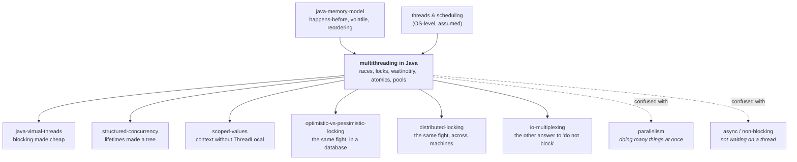

# Multithreading in Java — how one program does several things at once, and every way that goes wrong

> **Tell a friend:** Ana and Ben each add one box to the stockroom and write the
> new total on the same whiteboard. Both can read 10 before either walks back to
> write, so both write 11, and one box vanishes from the record. Threads are Ana
> and Ben, the whiteboard is a field in memory, and `count++` is the walk. Fixing
> it needs two promises, not one: nobody else is half-way through my job while I
> do it, and when I finish somebody can see it. Locks, `volatile`, `wait`,
> atomics and pools are all one of those promises or the bill for it, and none of
> them throws an exception when you get it wrong.

Drive it yourself in **The Interleaving Machine**, where you pick which thread runs next: <https://claude.ai/code/artifact/10d168d6-8a4f-49fe-9b39-471e067a6bc7>.
What this lab is made of, and where each of its numbers came from, is section 17.

---

# BEGINNER MODEL — stages 1 to 9

## 1. Why would a program ever do two things at once?

> **In one breath:** A program that does one thing at a time must finish the slow
> thing before it starts the next one. Threads let it start the next one anyway.
> That is the whole upside, and the rest of this lab is the bill.

A program normally does one thing at a time. It reads a line, does it, reads the
next. That is fine until one of those things is *slow*. Waiting for a database, a
payment provider or a file all count. While your program waits, it does nothing
else. Every other customer queues behind the slow one.

A modern machine has many CPU cores sitting idle during that wait.
**Multithreading is the ability to have several places in your program running at
once.** A slow customer no longer blocks a fast one, and eight cores do eight
things instead of one.

What does it cost to go without? Three prices, and each is concrete. Read the
right-hand column as "what the user actually experiences".

| If you only ever run one thing at a time | What it costs |
|---|---|
| a web server handling one request at a time | 100 users sharing one 200-millisecond database call wait 20 seconds for the last one |
| a report that could use eight cores using one | it takes eight times as long |
| code that must watch a socket and a timer at once | it cannot be written at all without contorting it |

That is the good news, and it is the entire upside. Everything from here on is
the bill.

Before you turn the page, one belief worth killing. People say concurrency bugs
are rare, so they are not a priority. They are not rare. They are **rare per run
and certain per fleet**. A race that shows up in one execution in ten thousand
happens roughly forty times a second in a service handling four hundred thousand
requests a second. And it never throws. The number is just wrong, and it stays
wrong.

## 2. Why does the stockroom tally say 11 when Ana and Ben each added a box?

> **In one breath:** Two people can both read the same number before either of
> them writes a new one. The second write then does not build on the first. One
> box disappears from the record and nobody is at fault.

A warehouse has a whiteboard in the stockroom with one number on it: **how many
boxes of paper we have**. Two workers, Ana and Ben, both need to record that they
have added a box.

Here is what a worker actually does. She walks to the stockroom and **reads** the
number off the board. She writes it on her own notepad and walks back to her
desk. She **adds one** on the notepad. She walks back to the stockroom and
**writes** her new number on the board.

Three separate actions, with walking in between: **read, change, write.**

Today the board says **10**. Ana adds a box. Ben adds a box. The board should say
**12**.

- Ana walks in, reads **10**, notes it down, walks out.
- Ben walks in and reads **10**, because Ana has not written anything yet. He notes it down and walks out.
- Ana comes back and writes **11**.
- Ben comes back and writes **11**.

The board says **11**. Two boxes were added. One of them has vanished from the
record, and nothing anywhere went wrong in a way anyone can see. Ana did her job
perfectly. Ben did his job perfectly. Nobody made a mistake. There is no
complaint to file, no alarm to ring, and no way to tell later that it happened.

> **🔮 Predict:** Ana and Ben each add exactly one box, starting from 10. Over
> every possible ordering of their walks, what values can the board end up
> showing?
>
> <details><summary>Reveal</summary>
>
> **11 or 12, never 13.** You get 12 when one finishes completely before the
> other starts. You get 11 when both read before either writes. It can never be
> 13, because neither worker ever writes anything other than *the number they
> read, plus one*. Nobody invents a value out of nothing.
>
> If you guessed that a write could be lost entirely, look again. Both writes
> land on the board. The second one simply carries a number that went stale while
> its owner was walking.
>
> This is not a guess. Scenario 1 of the visualization is exactly this, and the
> checker walks **every** interleaving of the two threads rather than sampling
> one. From a start of 0, the complete set of reachable answers is `{1, 2}`. The
> bad outcome is not exotic. It is half the state space.
> </details>

Where does this lab take you from here? Stop at any checkpoint and you still have
something whole.

| Layer | Sections | After it you can… |
|---|---|---|
| Beginner | 1–9 | tell Ana and Ben's story, and say why one line of Java is three actions |
| Intermediate | 10 | build the fix yourself, and say what each version does and does not promise |
| Engineering | 11–12 | name every failure, classify it, and argue about what locking costs |
| Production | 13–17 | size a pool, read a thread dump, and say what a real service adds |

## 3. Surely `count++` is one action — isn't it?

> **In one breath:** The naive solution says Ana and Ben made a simple job
> complicated, because in Java the whole thing is one line. That line is about to
> lose a box.

The obvious objection is that Ana and Ben made it complicated. In Java the whole
thing is *one line*:

```java
count++;              // surely this is one action?
```

It looks atomic. It is one statement, one semicolon, one keystroke's worth of
thought. Surely the machine does it in one go.

## 4. What if one line is really three — and `volatile` cannot save it?

> **In one breath:** `count++` is Ana's three trips, written in machine
> instructions. Behind it hides a second, completely separate problem: your write
> may never be looked at again by anybody.

It is not one action. `count++` compiles to roughly:

```java
int r = count;        // read  memory      -> CPU register
r     = r + 1;        // add   inside the CPU only
count = r;            // write CPU register -> memory
```

Those are Ana's three trips. The register `r` is her notepad. Memory is the
whiteboard.

**Open scenario 1 in the visualization and cause the bug yourself.** Run Thread A
one step, and it reads 0 — that is Ana reading the board. Run Thread B one step,
and it also reads 0 — that is Ben reading the same board. Then let each finish.
The engine counts the machine steps for you, so compare the two runs.

| What you drive | Machine steps | Final `count` | What that means |
|---|---:|---:|---|
| A reads, B reads, then both finish | 8 | 1 | two boxes added, one record |
| a sequential run: A to the end, then B | 8 | 2 | the answer everybody expected |

Same code, same two threads, same eight steps. Only the order changed.

Now comes the part that makes this a *deep* problem rather than an annoying one.
A reasonable person, having understood the above, says this: *the problem is that
Ana and Ben cannot see each other's writes, so let me make the board more
visible.* Java has a keyword for exactly that idea. Marking a field so that every
read goes all the way to memory, and every write is published to memory, is
called making it **volatile**. The keyword is `volatile`.

**It does not fix this.** Making the board more visible says nothing about what
happens *between* your read and your write. Ana still reads 10. While she is
walking back to her desk with her notepad, Ben reads a genuinely fresh, perfectly
visible 10.

So there are **two different problems wearing the same clothes**, and no single
keyword covers both. The table names them; the rest of the lab keeps them apart.

| The problem, in words | What Ben does | Where you watch it |
|---|---|---|
| nobody can see my write | he never even looks at the board again | scenario 2 |
| somebody slipped in between my read and my write | he looked, and what he saw was true at the time | scenario 1 |

Scenario 2 is worth running now, because it is the one that surprises experienced
engineers. A worker loops on `while (!stop)`, waiting to be told to go home.
Another thread sets `stop = true`. Memory genuinely holds `true`, and the
visualization shows it in the shared-memory panel. The worker read `stop` once,
copied it onto his notepad, and **has no reason to ever look again**.

Watch the worker's *private copy* row across a whole run. It is the proof.

| Scenario 2 run | What memory holds | What the worker keeps reading | Does he stop? |
|---|---|---|---|
| `volatile` off | `true` | `false`, from his own private copy | no, the loop never terminates |
| `volatile` on | `true` | `true` | yes, it terminates |

That hang uses 100% of a CPU, throws nothing, logs nothing, and looks like a
healthy thread. In production it is "the service will not shut down".

## 5. What exactly do we have to guarantee?

> **In one breath:** Two promises. Nobody else is half-way through my job while I
> am doing it. And when I finish, somebody else can actually see that I did.

Stated in plain words, and this is the whole rest of the lesson:

1. **When a piece of work must happen as a unit, no other thread may be part-way
   through the same piece of work at the same time.**
2. **When one thread finishes writing, there must be some guarantee that another
   thread will actually see it.**

Requirement 1 is about **which orderings are possible**. Requirement 2 is about
**which values are legal to see**. They are separate, and a correct program needs
both.

Ana and Ben's lost box is requirement 1 failing. The worker who never goes home
is requirement 2 failing. Keep those two pictures apart and the rest of this lab
is bookkeeping.

> **Say it back.** Without using the words *thread*, *atomic* or *visible*, tell
> a friend why two people each adding one box can leave the tally showing that
> one box arrived.
> <details><summary>A good answer sounds like</summary>
> "Each of them copies the number down before changing it. If they both copy it
> down before either walks back, the second one writes a total that was already
> out of date. Both totals are correct for the number each person copied. The
> board only keeps the last one written."
> </details>

## 6. What does one key on the stockroom door actually buy?

> **In one breath:** A lock is not a speed limit. It does not make Ana walk
> faster. It makes the world in which Ben walks in during her trips stop
> existing.

The invention is embarrassingly simple: **put a single key on the stockroom
door.** You may not enter without holding the key, and there is only one key.

The key does not make Ana walk faster. It does not turn her three trips into one
trip. What it does is make the *interleaving where Ben walks in during Ana's
trips* **cease to exist**. A lock is a deletion of possibilities, not a speed
limit.

And here is the part people miss. Java attaches the second guarantee to the same
key. Handing the key back publishes everything you wrote. Taking the key up
throws away everything you were remembering privately on your notepad.

**One mechanism, both requirements.** That is why `synchronized` is the default
answer, and why everything else in this lab is either a refinement of it or an
escape from it.

> **🔮 Predict:** Ana takes the key, reads 10, and then her manager stops her for
> a long chat before she writes 11. What is Ben doing meanwhile, and what does the
> board show?
>
> <details><summary>Reveal</summary>
>
> **Ben is standing at the door doing nothing, and the board still says 10.**
> That is both the point and the price. The tally is safe and Ben is stalled.
>
> If you guessed "Ben goes and does something else", you are describing a thread
> pool with other jobs queued, not a lock. A thread that wants a held key is
> stopped dead until it gets it. Section 11's fifth failure is this chat running
> for thirty seconds while fifty people queue at the door.
> </details>

## 7. What do engineers call the things Ana and Ben just did?

> **In one breath:** You have already felt every idea in this section. Now each
> one gets its real name, so the rest of the lab can say it in one word instead
> of a paragraph.

This is the lab's terminology, and each name below marks a distinction you have
already met in the stockroom. Minor terms are defined at first use later on; these
are the load-bearing ones.

### Who is running, and what do they share?

Ana is not the program. Ana is a *position in* the program, and it is the position
that is currently running. She is somewhere in the middle of the instruction
sheet, holding her own notepad. Engineers call that a **thread**.

Technically it is an independent flow of execution with **its own
program counter and its own stack**, meaning its local variables and its
method-call chain. It shares **one heap** with every other thread in the process,
and that heap holds all objects and all fields.

The word exists to separate the *thing that runs* from the *program*. A program
is text. A thread is a position in that text, and there can be many.

In scenario 1, Thread A and Thread B run identical code but each has its own `r`.
`r` lives on the stack, so it is private: Ana's notepad. `count` is a field, so it
is shared: the whiteboard.

You have already met a variant of this. In `java-virtual-threads` a **virtual
thread** is one of these whose stack lives on the heap, multiplexed onto a small
number of **carrier threads**. Everything in this lab applies to virtual threads
unchanged. Same memory model, same locks, same bugs.

The whiteboard has a name too. Data that more than one thread can both read and
change is **shared mutable state**. Technically: any location reachable from two
threads where at least one access is a write. That phrase names the **only** thing
that causes these bugs. Shared-and-immutable is safe. Mutable-but-not-shared is
safe. Only the intersection hurts, and naming the intersection tells you where to
attack.

`count` is shared and mutable. `r` is mutable but not shared. A `String` is shared
but not mutable. Neither of the last two can produce a race.

| Word | In the stockroom | In Java | Where you met it |
|---|---|---|---|
| Thread | Ana, walking | own program counter, own stack, shared heap | section 2 |
| Stack | her notepad | locals and the call chain, private to one thread | `r`, section 4 |
| Heap | the whiteboard | every object and every field, shared by all | `count`, section 4 |
| Shared mutable state | a board two people write on | a location two threads reach, one of them writing | section 2 |
| Virtual thread | Ana, but cheap to hire | a thread whose stack lives on the heap | `java-virtual-threads` |

### What exactly is going wrong?

When the answer depends on who happened to get there first, engineers call it a
**race condition**. Technically: correctness depends on the relative timing of
operations in different threads, when nothing in the program constrains that
timing.

The word exists to make one point. The bug is not in any one line. Every line in
scenario 1 is correct. The defect lives in the *set of orderings the program
permits*.

Ana and Ben's particular race has two more precise names. Its shape is
**check-then-act**, or more usefully **read-modify-write**: read a value, decide
something from it, write a value derived from it. Its result is a **lost update**,
which is a completed write silently overwritten by a write derived from stale
data.

That name will follow you around. `isolation-levels` and
`optimistic-vs-pessimistic-locking` both call this exact thing a lost update. It
is the same bug at three scales: between two CPU registers, between two database
transactions, and between two HTTP requests.

The property Ana needed and did not have is **atomicity**: all of it happens, or
none of it, with no visible middle. Precisely, an operation is atomic **with
respect to a set of threads** if those threads can never observe it half-done.

The word exists because "one line of code" and "one indivisible action" are
different things, and only the second one is worth anything. `count = 5` is atomic
for an `int`. `count++` is not. Assignment to a `long` or a `double` is not
guaranteed atomic on 32-bit JVMs unless the field is `volatile` **[JVM rule, not
this lab's model — JLS §17.7]**.

The property the never-stopping worker needed is a different one. **Visibility**
is whether your write ever shows up for somebody else. Precisely: whether a read
in thread B is permitted to return a value written by thread A. The word exists to
separate "when did it happen?" from "who is allowed to see it?". Scenario 2 has no
timing problem at all, because the write definitely happened first, and it is
still broken.

Visibility's guarantee has a formal name you have met. `java-memory-model` calls
it **happens-before**. If action X happens-before action Y, then whatever X wrote
is visible to Y. Two edges matter here. Releasing a lock happens-before any later
acquisition of that same lock. A write to a `volatile` field happens-before any
later read of that same field. Without such an edge, there is no promise at all.

| Word | What it means, in one line | Where you met it |
|---|---|---|
| Race condition | the answer depends on who got there first | section 2 |
| Read-modify-write | read, decide, write, with a gap in the middle | section 4 |
| Lost update | a good write overwritten by a stale-based one | section 2, the board saying 11 |
| Atomicity | nobody can observe it half-done | `count++`, section 4 |
| Visibility | your write is allowed to be seen by others | the worker, section 4 |
| happens-before | the ordering rule that makes a write visible | `java-memory-model` |

### What are the tools called?

The bit of code only one worker may be inside at a time is the **critical
section**. In scenario 3 it is the three lines between `synchronized (lock) {` and
`}`. Precisely, it is a region of code protected so that at most one thread
executes it concurrently for a given lock.

The guarantee that only one worker is inside is **mutual exclusion**, and the
property of enforcing it has its own word for a reason. The critical section is
*where*. Mutual exclusion is *the guarantee*. You choose the first. The runtime
provides the second.

The key on the door is a **lock**. In Java it is not something extra you create.
Every Java object already has one, called its **intrinsic lock** or its
**monitor**. `synchronized (obj)` acquires it and releases it on exit, including
when an exception is thrown.

A monitor has three parts. There is an **owner**, an **entry set** of threads
blocked trying to get in, and a **wait set** of threads that have deliberately
gone to sleep inside it. The entry set is the queue at the door. The wait set is
the waiting room down the corridor. All three parts are shown in the visualization's
Locks panel. In scenario 5, `buffer` is the monitor, and two consumers sit in its
wait set while the producer holds it.

Why "monitor"? It is Hoare's 1974 name for "a lock plus a place to wait". Mutual
exclusion alone cannot express "wait until there is something to consume". You
need both, so Java bolted both onto every object. Compare `distributed-locking`,
whose lock service is this same idea rebuilt out of messages, and which loses
mutual exclusion in the process. Here the JVM releases a dead thread's monitors
for you. There, nobody can tell death from slowness.

When everyone is politely waiting for someone else, forever, that is **deadlock**.
Technically it is a cycle in the "thread X holds a lock thread Y wants" graph.
With plain `synchronized` there is no timeout and no detection. The threads simply
stop. The word exists to distinguish *stopped because of a cycle* from *stopped
because it is slow*. Those look identical from outside and have completely
different cures. Scenario 4 is two transfers in opposite directions, each holding
one account and asking for the other, and it ends with both threads `BLOCKED`.

Hiring a new worker for every box is expensive, so real systems keep a fixed crew
and a queue of jobs. That is a **thread pool**, driven by an `ExecutorService`
holding N worker threads that repeatedly take tasks from a shared queue. It exists
because creating a thread costs a system call and roughly a megabyte of reserved
stack **[JVM rule, not this lab's model]**, so one thread per request stops
scaling. The pool tab shows the shape with twelve tasks of five ticks each.

| Workers in the pool | Everything finishes at tick | What the number says |
|---:|---:|---|
| 2 | 30 | six tasks each, back to back |
| 4 | 15 | three tasks each |
| 6 | 10 | two tasks each |

The last name is the escape hatch. **Compare-and-set**, usually written CAS, means
"write this, but only if nobody has touched it since I looked". It is a single CPU
instruction. It compares a memory location to an expected value, writes a new one
only if they match, leaves no gap in between, and returns whether it succeeded.

It exists because the gap between read and write is the entire bug, and hardware
can eliminate the gap without any thread having to wait. Scenario 6 is Ana and Ben
again: both read 0, Ana's compare-and-set succeeds, and Ben's is refused. That
refusal is not an error. Ben simply retries from 1 and wins.

You have met this primitive twice already. `optimistic-vs-pessimistic-locking`'s
conditional `UPDATE … WHERE version = ?` **is** compare-and-set. And
`linearizability` named `compareAndSet` as the canonical atomic operation. Same
primitive, three labs.

| Word | The stockroom version | The Java version | Where you met it |
|---|---|---|---|
| Critical section | the stockroom itself | code no two threads may share | scenario 3 |
| Mutual exclusion | one key, one person inside | at most one thread inside, per lock | section 6 |
| Monitor / intrinsic lock | key, door queue, waiting room | owner, entry set and wait set on every object | scenario 5 |
| Deadlock | two keys, two people, no way out | a cycle in the holds-and-wants graph | scenario 4 |
| Thread pool | a fixed crew and a job queue | `ExecutorService` over a shared queue | the pool tab |
| Compare-and-set | "write only if it still says 10" | one indivisible CPU instruction | scenario 6 |

## 8. Which mental models should you carry — and where do they lie to you?

> **In one breath:** Keep two pictures. The friendly one is Ana walking to a
> whiteboard. The precise one is several program counters sharing one heap. The
> friendly one lies in exactly three places.

**The simple model is the stockroom.** Workers walk between their desks and a
whiteboard. Reading takes a trip. Thinking happens at the desk. Writing takes
another trip. There is one key on the door, and a bell to call people out of the
waiting room.

**The engineering model is the same machine, stated precisely.** Several **program
counters** advance independently through code. Each has a **private stack** of
locals, parameters and its call chain. Each may keep field values in **CPU
registers**. All of them share **one heap**.

Between any two machine instructions of any thread, any other thread may execute
any number of its own. A **monitor** is a record `{owner, entry set, wait set}`.
The Java Memory Model defines a partial order called **happens-before**. A read
may return a write's value only where that order allows it, or where an unlucky
data race lets it.

Here is the mapping, in two halves. First the pieces of the machine.

| Stockroom | Java | Where you see it in the visualization |
|---|---|---|
| a worker | a thread | the coloured thread cards |
| her notepad | CPU registers, the private copy | "Private registers" and "Private copy" rows |
| the whiteboard | a field on the heap | the Shared memory panel |
| walking to the board and back | the read and write machine steps | each `LOAD` and `STORE` line |
| the single door key | an object's intrinsic lock | the Locks panel, "Held by" |

Then the things that happen to those pieces.

| Stockroom | Java | Where you see it in the visualization |
|---|---|---|
| waiting outside the locked door | thread state `BLOCKED`, the entry set | "Queued to enter" |
| going to the waiting room until the bell | `wait()`, the wait set | "Asleep in `wait()`" |
| ringing the bell | `notifyAll()` | scenario 5 |
| two workers each holding a key the other needs | deadlock | scenario 4 |

> **🔮 Predict:** Ana writes 11 on the board. Ben is in a loop, reading the board
> over and over, and his field is not marked `volatile`. How long can he keep
> reading 10?
>
> <details><summary>Reveal</summary>
>
> **Forever.** Not "for a while". The compiler is allowed to notice that Ben's
> loop never writes the field, hoist the read out of the loop, and emit machine
> code that reads it exactly once.
>
> If you guessed "a few microseconds, until the cache line syncs", you are
> reasoning about hardware and the answer is compilers. Nothing in the machine
> code ever asks memory again, so no amount of waiting helps. That is lie number
> one below, and it is the biggest one in the analogy.
> </details>

**Where the story lies to you — three places, and each one matters.**

1. **A person will eventually glance at the board again. A CPU may genuinely never
   look.** This is the biggest lie in the analogy. In the stockroom, "stale" means
   "out of date for a while". In Java it can mean **forever**. The compiler is
   allowed to hoist a non-`volatile` field read out of a loop entirely, so the
   machine code contains no re-read at all. Scenario 2 is not a slow worker. It is
   a worker who has been *optimised into never checking*.
2. **The analogy makes your own actions look ordered. From outside, they are
   not.** If Ana writes the board and then writes her diary, everyone agrees that
   is the order. In Java, without a happens-before edge, another thread may
   observe those two writes in the opposite order. That is the `java-memory-model`
   lab's reordering and store-buffer material. This lab's visualization does
   **not** model reordering; it models one shared memory with private copies. The
   simplification is deliberate, and it is why the two labs are separate.
3. **A locked door with a dead worker inside is obvious. A hung thread holding a
   monitor is not.** In real terms this is better than it sounds. If a thread
   *dies*, the JVM releases its monitors. But if it merely *hangs*, say on an
   HTTP call with no timeout, it holds the lock forever. Every other thread then
   piles into the entry set. That is the single most common Java production
   incident in this whole area, and section 13 shows what it looks like on a
   dashboard.

## 9. Can you watch the bug happen?

> **In one breath:** Yes, one machine step at a time, with you choosing which
> thread moves next. Six scenarios and a thread-pool tab, and the whole subject
> lives on the first screen.

**<https://claude.ai/code/artifact/10d168d6-8a4f-49fe-9b39-471e067a6bc7>**
(also `visualization.html` in this folder, works offline).

The page has two tabs. On the first there are six scenarios. On each one, the
*interleaving ribbon* under the verdict records every machine step as a coloured
tick. That strip **is** the interleaving, and clicking any tick rewinds to that
moment.

Do these in order, and answer each prediction card before pressing anything.

1. **Scenario 1** — press Thread A once, then Thread B once, then finish both.
   Watch the moment two threads hold `r = 0` at the same time. That single screen
   is the whole subject.
2. **Scenario 2** — run the demonstration, then stare at the Worker's *private
   copy* row. It says `stop = false — memory says true`. Then tick the `volatile`
   box and run it again.
3. **Scenario 3** — deliberately try to re-create scenario 1. Run Thread A once,
   so it takes the lock, then try to press Thread B. **The button is disabled.**
   That is mutual exclusion made physical: not slower, just fewer possible worlds.
4. **Scenario 4** — give each thread its first lock, then ask each for its second.
   Then turn on lock ordering and watch the cycle become impossible.
5. **Scenario 5** — put both consumers to sleep first, then run the producer once.
   Watch `notifyAll()` move both sleepers from the wait set into the entry set,
   not into "running", and watch the buffer go to **−1**.
6. **Scenario 6** — interleave the two reads, then let it run. One compare-and-set
   is refused and retried, and nothing blocks.

Then open the **Thread pool** tab. Set workers to 2 and press Play. Then tick
*"each task submits a sub-task to the same pool and waits for it"* and press Play
again.

> **✅ CHECKPOINT — end of the beginner model.**
> You can now say what a race condition is, why `count++` is not one action, and
> why a loop can miss a flag forever. You can also say what a lock buys you: two
> things, not one.
> **Next:** the actual rules. How a monitor really behaves, why `notify` is not a
> message, and what you use instead of writing any of this by hand.

> **Say it back.** Ben says: "I made the counter field `volatile`, so it is
> thread-safe now." In two sentences, tell him what he fixed and what he did not.
> <details><summary>A good answer sounds like</summary>
> "You fixed the case where somebody never sees the new value at all, which is the
> worker who never goes home. You did not fix the gap between reading the board
> and writing it, so Ana and Ben can still both read 10 and both write 11."
> </details>

---

# INTERMEDIATE MODEL — stage 10

## 10. How would you build the fix yourself, and where would it break?

> **In one breath:** Nobody hands you the right answer first. You try the obvious
> thing, watch it fail, and the failure tells you the next refinement. Six
> versions, and every strange-looking rule at the end is the scar of a failure in
> the middle.

Rather than hand you `java.util.concurrent`, this stage builds the answer the way
a smart engineer actually arrives at it. The obvious version comes first. Then
comes the failure that forces the next refinement. Ana and Ben stay on stage the
whole way: Ana is Thread A, Ben is Thread B, and the whiteboard is still `count`.

### v1 — why doesn't `volatile` fix the counter?

Ana and Ben cannot see each other's writes, so make the board maximally visible.

```java
volatile int count;      // now everybody sees my writes
void increment(){ count++; }
```

**Why it looks right.** It attacks the visibility problem from scenario 2
head-on. Marking the field `volatile` really does give a happens-before edge on
every read and every write of it.

**Why it breaks.** Run scenario 1's interleaving in your head, with perfect
visibility switched on. Ana reads 0, truthfully. Ben reads 0, also truthfully,
because Ana has not written yet. Both write 1. The keyword did its job flawlessly
and the update is still lost.

**The lesson, precisely.** `volatile` makes single reads and single writes visible
and ordered. It does not join a read and a write into one action. It is the right
tool for exactly one shape: a flag that one thread writes and others read, which
is scenario 2. It is the wrong tool for anything of the form *read, decide,
write*.

### v2 — what does one lock actually change?

Give the stockroom its single key.

```java
synchronized (lock) { count++; }
```

This is scenario 3, and the checker settles it exhaustively rather than by
example. It enumerates **every possible schedule** of both threads through the
locked version and finds no schedule producing anything but 2. The same code with
the lock removed, driven through the identical interleaving, lands on 1.

Below is a hand-worked trace, taken from the engine's own log for scenario 3 with
"let the scheduler choose" selected. Read it as Ana and Ben with one key between
them. The fourth column is the state of the world after that step.

| Step | Thread | Instruction | Result |
|---:|---|---|---|
| 1 | A (Ana) | `LOCK lock` | Ana owns the monitor; her private copies are discarded |
| 2 | B (Ben) | `LOCK lock` | **refused** — Ben goes to `BLOCKED`, and his program counter does not move |
| 3 | A | `r = count` | Ana reads 0 from memory |
| 4 | A | `r = r + 1` | Ana's register holds 1; memory still holds 0 |
| 5 | A | `count = r` | memory now holds 1 |
| 6 | A | `UNLOCK lock` | everything Ana wrote is published to whoever takes this lock next |
| 7 | B | `LOCK lock` | Ben owns it, and discards his private copies |
| 8 | B | `r = count` | Ben reads **1**, and because of step 6 this is guaranteed, not lucky |
| … | | | final `count = 2` |

Two things in that trace deserve their own sentence.

**Step 2 is the whole of mutual exclusion.** Ben did not run slower. Ben did not
run at all. His program counter stayed put. Interleavings were not discouraged.
They were removed from the set of possible executions.

**Step 8's guarantee comes from step 6, not from luck.** The monitor gave a
*happens-before* edge. Had Ana used no lock, Ben could legally have read 0 at step
8 even after Ana wrote 1.

> **🔮 Predict:** A lock's first job is mutual exclusion. What is its second job,
> and which earlier scenario does that second job fix?
>
> <details><summary>Reveal</summary>
>
> **Visibility — it fixes scenario 2 as well.** Releasing a monitor publishes
> everything you wrote inside it. Acquiring the same monitor discards your private
> copies. So `synchronized` is a complete answer to both requirements from section
> 5, which is exactly why it is the default and why `volatile` is a specialist
> tool.
>
> If you guessed "speed" or "fairness", the lock gives you neither. The guarantee
> is one-way and *lock-specific*. It only helps threads that acquire **the same**
> monitor. A reader that skips the lock gets no promise at all, even if every
> writer takes it religiously. That is the mistake behind almost every "but I do
> synchronize the writes" bug report.
> </details>

### v3 — two locks, and what kills a service?

One lock around everything is correct and slow. Two threads touching completely
unrelated accounts still queue for the same key. So you use one lock per account.
Now a transfer needs two.

```java
synchronized (from) {
  synchronized (to) { … }        // Thread A: from=accountA, to=accountB
}                                // Thread B: from=accountB, to=accountA
```

This is scenario 4, and it stops dead. The run ends `run = STUCK`, with both
threads `BLOCKED`, `accountA` owned by Ana and `accountB` owned by Ben.

The cause fits in one sentence, and the sentence is worth memorising: **a thread
was holding a lock while asking for another one.** Every deadlock has that shape.
The four classic conditions are mutual exclusion, hold-and-wait, no preemption and
circular wait. They are just that sentence expanded, and the practical attack is
always the last one.

**The refinement is a global order on locks.** Always take `accountA` before
`accountB`. Order them by account id, by `System.identityHashCode`, by anything at
all, as long as everybody agrees. A cycle needs someone to go "up" while someone
else goes "down", and a total order makes that impossible. Turn on the ordering
option in scenario 4 and the same code completes.

**A second refinement, for when a global order is impractical: be able to give
up.** `ReentrantLock.tryLock(timeout)` returns `false` instead of blocking
forever, so you can release what you hold and retry. `synchronized` cannot do
this. It has no timeout, no interruption, and no way to abandon the attempt. That
single missing capability is most of the reason `ReentrantLock` exists.

### v4 — how do you wait for something that has not arrived yet?

Locks answer "not at the same time". They do not answer "not yet". A consumer
needs to *wait until there is something to consume*, without holding the key while
it waits. That is what the waiting room down the corridor, the wait set, is for.

```java
synchronized (buffer) {
  if (items == 0) buffer.wait();      // <- the bug
  items--;                            
  consume();
}
```

> **🔮 Predict:** Consumer 1 is inside `synchronized (buffer)`, so it holds the
> lock, and it calls `buffer.wait()`. While it sleeps, can the producer get in to
> add an item?
>
> <details><summary>Reveal</summary>
>
> **Yes — and it has to, or nothing could ever work.** `wait()` **releases the
> lock** as it puts the thread to sleep, and re-acquires it before returning.
>
> If you guessed no, picture the consequence. A consumer falls asleep holding the
> only key, and the producer that is supposed to wake it can never get in. That is
> a guaranteed deadlock on the first empty buffer.
>
> This is the single most-forgotten fact about `wait()`. It is also why the thread
> has to **queue for the lock again** after being notified. Waking up and running
> are two different events, with an unbounded amount of other threads' execution
> possible in between. That gap is the entire bug in this section.
> </details>

So `wait()` does something people consistently forget: **it gives the lock back**,
and puts the thread in the monitor's wait set. Then `notify()` and `notifyAll()`
move sleepers out of the wait set and **into the entry set**, not into "running".
They still have to acquire the lock like anyone else.

Scenario 5 runs this with two consumers and one producer that adds **one** item.
The run ends with `items = −1`. Two consumers each took an item, and one item
existed.

Here is the trace from the engine. Watch step 14 and step 18, where a consumer
returns from `wait()` and acts on a fact that was true when it fell asleep.

| Step | Thread | What happens |
|---:|---|---|
| 1–4 | Consumer 1 | takes lock, reads `items = 0`, calls `wait()` → **gives the lock back**, sleeps |
| 5–8 | Consumer 2 | takes lock, reads `items = 0`, calls `wait()` → sleeps |
| 9–13 | Producer | takes lock, sets `items = 1`, `notifyAll()` wakes **both** into the entry set, releases |
| 14 | Consumer 1 | re-acquires the lock, returns from `wait()`, and with `if` **does not re-check** |
| 15–17 | Consumer 1 | `items` 1 → 0, consumes, unlocks |
| 18 | Consumer 2 | re-acquires, returns from `wait()`, with `if` **does not re-check** |
| 19–21 | Consumer 2 | `items` 0 → **−1**, and "consumes" an item that does not exist |

**The refinement: `wait()` must always sit inside a `while`, never an `if`.**

```java
while (items == 0) buffer.wait();     // correct
```

Turn on the `while` option and re-run. Now the buffer ends at `items = 0`, with
Consumer 2 back asleep in the wait set. That is not a failure. One item genuinely
cannot feed two consumers, so it is the correct outcome.

The rule is absolute because **being woken tells you only that something changed,
never that your condition is true**. There are three independent ways it can be
false. Another thread got there first, which is what you just watched.
`notifyAll` wakes everyone, including threads waiting for a different condition.
And the JVM is explicitly permitted **spurious wakeups**: a return from `wait()`
with no `notify()` at all **[JVM rule, not this lab's model — `Object.wait`
javadoc]**.

The same scenario exposes a second trap. Run the producer *before* any consumer
falls asleep, and the log says **"called notifyAll() and woke nobody"**. A
notification is not a message. It is not queued, counted or remembered. If nobody
is in the wait set, it is gone. That is why the *condition*, the value of `items`,
is the source of truth, and the notification is only a nudge to go and look.

### v5 — why should you stop writing any of this?

Everything above is the machinery. You should almost never touch it. The
refinement that ends the sequence is this: **use the library that already got it
right.**

| Instead of | Use | Because |
|---|---|---|
| `synchronized` + `wait`/`notify` for a producer/consumer | `ArrayBlockingQueue` / `LinkedBlockingQueue` | `put`/`take` block correctly, loop correctly, and cannot miss a signal |
| `synchronized` around a counter | `AtomicInteger`, `LongAdder` | no blocking; `LongAdder` splits the counter across cells to kill contention |
| `synchronized` around a map | `ConcurrentHashMap` | lock-free reads; per-bin locking for writes; `compute`/`merge` are atomic |
| `synchronized` with a timeout you cannot have | `ReentrantLock.tryLock(…)` | can time out, be interrupted, and be fair if you ask |
| hand-rolled thread creation | `ExecutorService` | bounded threads, a queue, and a shutdown story |
| hand-rolled "wait for these 3 things" | `CompletableFuture`, or a structured-concurrency scope | composition and error propagation |

### v6 — can you fix it with no lock at all?

For the counter specifically there is a better answer than a lock, and it is
scenario 6. Ana no longer waits at the door. She writes only if the board still
says what she read.

```java
int old, next;
do {
  old  = count.get();
  next = old + 1;
} while (!count.compareAndSet(old, next));
```

The CPU compares and writes in one indivisible instruction, so the gap that lost
the box in scenario 1 does not exist. The checker walks every interleaving to
depth 18, and the answer is always 2.

| What the run records | Number | What it means |
|---|---:|---|
| final `count` | 2 | both boxes counted |
| compare-and-set refused | 1 | Ben's write, because Ana got there first |
| retries | 1 | Ben read again and redid the addition |
| threads that ever entered `BLOCKED` | 0 | nobody ever waited at a door |

**The trade, stated honestly.** The cost has not disappeared. It has moved from
*waiting* to *redoing*. A blocked thread costs a context switch and then sleeps. A
retrying thread costs CPU and stays hot. Under low contention retries are near
zero and atomics win easily. Under heavy contention many threads spin, redo
arithmetic and throw it away.

That waste is exactly what `optimistic-vs-pessimistic-locking` put numbers on in
its `crossover` experiment. Read the middle column as "work the CPU did that
nobody wanted".

| From the `crossover` experiment | Number | What it means |
|---|---:|---|
| retries | 862 | attempts thrown away and redone |
| CPU time burned on them | 2124 ms | pure waste, hidden by spare cores |
| useful work in the same run | 400 ms | what the job actually needed |

Same shape, one level down. When the spare cores stop being spare, the hiding
stops too.

> **✅ CHECKPOINT — end of the intermediate model.**
> You can now read `synchronized`, `wait`/`notify` and an atomic, and say what
> each one guarantees and what it does not. **Next:** the failure modes as a
> catalogue — how each one is created, what it protects, what it sacrifices, and
> how it appears on a production dashboard.

> **Say it back.** Without using the words *lock*, *monitor* or *happens-before*,
> explain to a friend why Ben reading 1 at step 8 of the v2 trace is a promise
> rather than good luck.
> <details><summary>A good answer sounds like</summary>
> "Ana had to put the key back before Ben could pick it up. Putting the key back
> means publishing everything she wrote. Picking it up means throwing away
> everything he had remembered privately. So the only number left for him to read
> is hers."
> </details>

---

# ENGINEERING MODEL — stages 11 and 12

## 11. What are all the ways this breaks?

> **In one breath:** Twelve failures, and each one is either "something wrong has
> already happened" or "nothing wrong has happened but nothing will move again".
> Knowing which of the two you have tells you how urgent the incident is.

The important split runs through the whole section. **Safety** means nothing wrong
ever happens. **Liveness** means something right eventually happens. Almost every
mechanism here trades one for the other. A safety failure has already corrupted
something. A liveness failure has not corrupted anything yet.

### Which six failures can you cause on screen?

**1 · Race condition, the lost update.** This is Ana and Ben in section 2. Drive
it in scenario 1 by interleaving two reads before either write. Both threads read 0 and both write 1, because each write is based on
a value that was true when read and stale when used.

Nothing detects it. Both threads report success. The program keeps running, fast,
forever, and the value is gone permanently. There is no later moment at which the
system notices.

In production this is a balance that drifts, a stock count that goes negative over
months, or a "processed" flag set twice. Reconciliation finds it; monitoring never
does. The `isolation-levels` lab's 8 × 40 = 320 experiment is this same bug inside
a database.

**2 · Visibility failure: the stale read and the non-terminating loop.** This is
the worker who never goes home. Drive it in scenario 2 with `volatile` off. He kept a private copy: memory holds `true`, and the run
shows him looping 13 more times with every read returning `false`.

No timeout exists, so there is no response, ever. Safety survives untouched,
because nothing incorrect is written. What is lost is termination. In production
this is "the pod will not drain", a shutdown hook that never completes, one core
pinned at 100%. The cure is `volatile`, or reading inside the same lock the writer
used, or `AtomicBoolean`.

**3 · Deadlock.** Drive it in scenario 4 with the opposite lock order. Ana holds
`accountA` and wants `accountB`; Ben holds `accountB` and wants `accountA`. That
is a cycle in the holds-and-wants graph, and both threads end `BLOCKED`. Liveness
is lost totally and permanently.

There is **no** response available, because `synchronized` has no detection and no
timeout. Safety survives perfectly: nothing incorrect happened. Those threads are
lost forever, and if they are pool workers the pool dies with them.

In production, requests time out while CPU sits at zero and the error rate looks
*calm*. It is diagnosed with `jstack <pid>`, which prints **"Found one Java-level
deadlock"** and names both threads and both monitors. That is one of the few times
the JVM hands you the exact answer. Cure it with global lock ordering, with
`tryLock` and a timeout, or by holding one lock at a time.

**4 · Livelock.** This one is not built into the visualization, and that gap is
flagged rather than hidden. The shape: two threads each detect a conflict,
politely back off, and retry in lockstep, forever. Or two `tryLock` users each
release and retry at identical intervals.

It is worse than deadlock because CPU is high and threads are `RUNNABLE`. A thread
dump shows nothing obviously wrong, and every automated deadlock detector says
"fine". The cure is randomised back-off, which is the same trick, for the same
reason, as the randomised election timeouts in the `raft` lab.

**5 · Starvation and the convoy.** This is Ana's long chat from section 6, at
scale. Liveness is lost for one thread, and throughput is lost for everyone. Plain
`synchronized` promises nothing about who enters next, so a thread can lose the
race many times running. That is starvation.

The **convoy** is worse. One thread holds a lock across a slow call, such as an
HTTP request with no timeout or a `synchronized` method that logs to a blocking
appender. It turns *its* delay into *everyone's* delay, because they are all in
the entry set. This is the classic Java incident. Latency goes vertical, CPU goes
to near zero, and thread dumps show fifty threads `BLOCKED` on one monitor while
one thread sits in a socket read.

The rule that prevents it is short: **never hold a lock across I/O.** The database
version of exactly this appears in `optimistic-vs-pessimistic-locking`. There, one
client pausing 2 s mid-save cost five neighbours all their saves and produced 15
lock timeouts. The optimistic version of the same run cost only the sleeper.

The cure is to shrink the critical section down to the state change, and do the
I/O outside it. If fairness genuinely matters, `new ReentrantLock(true)` gives
FIFO order, at a real throughput cost. Fairness forbids **barging**, which is
letting a thread that has just arrived take a free lock ahead of the queue.
Barging is what makes an uncontended lock cheap, so banning it is not free.

**6 · The missed signal, `if` instead of `while`.** Drive it in scenario 5 with
`if`. The buffer ends at `items = −1`: two consumers took the single item. Nothing
useful survives here, because this one corrupts state, and the invariant
`items >= 0` is gone.

In production the second consumer reads element −1 of an array, or processes a
null, or double-charges. The cure is `while`, always. The better cure is
`BlockingQueue`, which removes the opportunity. Its sibling failure is
`notifyAll()` with an empty wait set, where the log says "woke nobody" and the
signal is simply gone. The condition is the truth; the notification is only a
nudge.

### What breaks in the thread pool?

> **🔮 Predict:** A pool of 2 workers deadlocks because each task submits a
> sub-task to the same pool and waits for it. You raise the pool to 8 workers and
> it now completes. Is the bug fixed?
>
> <details><summary>Reveal</summary>
>
> **No — and "it completes" is the worst possible outcome.** The pool tab shows
> both runs: 2 workers deadlock at tick 4, and the identical configuration with 8
> workers finishes normally. Nothing structural changed. A task still blocks on
> work that needs a worker from the same pool. All you altered is *how many parent
> tasks must be in flight simultaneously* before every worker is consumed.
>
> If you guessed "yes, it has enough capacity now", look at what you actually
> built. You converted a deterministic bug that fails on the first test run into a
> load-dependent one. It now waits for a traffic spike, a slow downstream or a
> retry storm, and then hangs permanently, at peak, with no code change to blame.
> A fix that makes a bug harder to trigger without removing it has made things
> worse.
> </details>

**7 · Thread-pool starvation deadlock.** Liveness is lost, and the loss is
invisible. Drive it on the pool tab: workers 2, tick *"each task submits a
sub-task to the same pool and waits for it"*, press Play. The run reaches
`DEADLOCK` at tick 4, with every worker `blockedOn` a sub-task and every sub-task
queued waiting for a worker.

Each worker is holding a pool thread hostage while waiting for work that needs a
pool thread. There is no response: `ThreadPoolExecutor` has no idea this is
happening. Safety survives; the entire pool is lost, permanently.

In production the classic form is a task that calls a service which uses the same
executor, or a parallel stream inside a task on the common ForkJoinPool. A bigger
pool does not fix it, as the 8-worker run shows, so the bug simply hides until
load rises. **The cure: never block, inside a pool task, on work submitted to that
same pool.** Use a separate pool, or make it non-blocking.

**8 · Rejection, and the queue that eats your heap.** Drive it on the pool tab
with queue capacity 0, 12 tasks and 2 workers. Then compare the two policies.

| Pool tab setting | Tasks rejected | Tasks completed | What it costs |
|---|---:|---:|---|
| queue 0, default policy | 10 of 12 | 2 | one `RejectedExecutionException` per lost task |
| queue 0, `CallerRunsPolicy` | 0 | 12 | 4 of them run by the submitting thread, which can submit nothing else meanwhile |

A bounded queue makes you choose between **dropping work**, which is rejection,
and **slowing the producer down until it stops outrunning you**. The second one is
what "back-pressure" means, and it is exactly what `CallerRunsPolicy` does by
making the submitter do the work itself.

An *unbounded* queue refuses the choice and pays in heap.
`Executors.newFixedThreadPool` uses an unbounded `LinkedBlockingQueue`. Under
sustained overload it accepts everything, latency climbs without limit, and the
process eventually dies of `OutOfMemoryError` having never rejected a single task.
**A queue never creates throughput. It only decides who waits.**

### Which four failures never show up in a simulator?

**9 · The exception nobody saw.** Safety is lost, silently. `executor.submit(task)`
catches any exception the task throws and stores it in the returned `Future`. If
you never call `future.get()`, **the exception is gone**. No stack trace, no log
line, and the worker thread quietly picks up the next task. Half your pipeline
stops working and nothing is logged. **[JVM rule, not this lab's model —
`AbstractExecutorService.submit` wraps in `FutureTask`.]**

Cure it by using `execute()` when you do not need a result, so uncaught exceptions
reach the thread's uncaught-exception handler. Or always consume the `Future`. Or
wrap every task body in try/catch-and-log.

**10 · Cancellation ignored.** `Thread.interrupt()` does not stop a thread. It sets
a flag, and it causes blocking calls such as `sleep`, `wait` and `take` to throw
`InterruptedException`. A `catch (InterruptedException e) {}` that logs and
continues **destroys the only evidence** that cancellation was requested, because
the flag was cleared when the exception was thrown.

Cure it by choosing one of two moves: either rethrow, or restore the flag with
`Thread.currentThread().interrupt()` and return. Then `shutdownNow()` works.
`structured-concurrency`'s cooperative cancellation is built entirely on this,
which is why that lab stressed that cancellation flows down and that side effects
do not roll back.

**11 · `ThreadLocal` in a pool.** Pool threads live forever, so a `ThreadLocal`
set during request 1 is still set during request 5000. That leaks user context
between unrelated requests, and it pins the object it holds for the lifetime of
the pool. Cure it by removing it in a `finally`, or by using `ScopedValue`, whose
entire design is this bug's autopsy. Your `scoped-values` lab called these the
*write-from-anywhere* and *lifetime-until-remove* diseases. This is where they
bite.

**12 · Unsafe publication.** Writing a reference into a shared field publishes the
reference. Without a happens-before edge, another thread may see the reference and
**not** see the object's fields as initialised. Cure it by publishing through a
`volatile` field, an `AtomicReference`, a lock, a `final` field set in the
constructor, or a `static` initialiser. This is `java-memory-model` territory, and
the `Publication` and `DoubleCheckedLocking` experiments in that lab are exactly
this failure.

### Can you see all twelve at once?

The table below is the one place all twelve sit side by side. Read the third
column first, because it decides how fast you have to move.

| # | Failure | Safety or liveness | What is gone for good | What on-call sees |
|---:|---|---|---|---|
| 1 | race condition, lost update | safety | one update, silently | a number slightly wrong, forever |
| 2 | visibility failure, stale read | liveness | termination | a pod that will not drain, one core at 100% |
| 3 | deadlock | liveness | those threads, permanently | latency vertical, CPU at zero, errors calm |
| 4 | livelock | liveness | progress, while looking busy | CPU pinned, threads `RUNNABLE`, nothing moves |
| 5 | starvation and convoy | liveness | throughput for everyone | fifty threads `BLOCKED` on one monitor |
| 6 | missed signal, `if` not `while` | safety | the invariant `items >= 0` | a double charge, or a null downstream |
| 7 | pool starvation deadlock | liveness | the whole pool | permanently hung shortly after a deploy |
| 8 | rejection or unbounded queue | pick your poison | dropped work, or the heap | `RejectedExecutionException`, or `OutOfMemoryError` |
| 9 | the exception nobody saw | safety | the error report | half a pipeline stops, logs stay clean |
| 10 | cancellation ignored | liveness | clean shutdown | deploys that never drain |
| 11 | `ThreadLocal` in a pool | safety and memory | request isolation | one user seeing another user's data |
| 12 | unsafe publication | safety | a half-built object | rare, unreproducible, hardware-dependent |

## 12. What does a lock actually promise, and what does it cost?

> **In one breath:** Taking the key promises you four things and refuses you five.
> Learn the refusals. Almost every surprising bug in this area is somebody
> assuming one of the five.

### What does taking the key actually promise?

Ana holds the key to the stockroom. Engineers say she has acquired monitor **M**.
Here is everything she is owed, and nothing more.

- No other thread executes any block synchronized on **M** while she is inside.
- Everything written by any thread before *its* release of M is visible to her.
- The monitor is released on every exit path, including exceptions and thread
  death.
- It is **reentrant**. The thread already holding M can acquire it again, so a
  `synchronized` method calling another one on the same object does not
  self-deadlock.

### What does the key explicitly not promise?

- **Fairness.** No promise about who enters next. Ben can be passed over
  repeatedly. Barging is permitted, and it is what makes uncontended locks fast.
- **Any protection from threads that do not take M.** The guarantee is per-lock. A
  reader that skips the key gets nothing, no matter how careful the writers are.
- **Progress.** Nothing prevents deadlock, livelock or starvation.
- **Ordering across different locks.** Two monitors give you no relationship at
  all.
- **Atomicity of anything larger than the block.** Two correctly synchronized
  calls in a row are two atomic operations, not one.

> **🔮 Predict:** A cache is a `ConcurrentHashMap`, which is genuinely
> thread-safe. Ben writes `if (!map.containsKey(k)) map.put(k, v)`. Both calls are
> individually atomic. Is the pair safe?
>
> <details><summary>Reveal</summary>
>
> **No.** Ana can slip between the two calls, exactly as she slipped between a
> read and a write in section 2. Both of Ben's calls succeed. The invariant he
> meant to hold was "this key is loaded at most once", and nothing ever protected
> it.
>
> If you guessed yes, you have merged two ideas that must stay apart:
> **thread-safe per call** and **thread-safe per business operation**. That is why
> `putIfAbsent` and `compute` exist. They make the whole decision one operation.
> </details>

### What are the three ways to be thread-safe?

In order of preference, because the first two require no reasoning at all.

1. **Do not share.** Confine the state to one thread: a local variable, a
   `ScopedValue`, one owning actor. No sharing, no race, nothing to prove.
2. **Do not mutate.** An immutable object, with all fields `final` and no setters,
   is safe to share with everyone, forever, with no synchronization. That is why
   `String`, `Integer` and records are safe.
3. **Synchronize.** Only when you actually need shared mutable state. Then pick
   one lock per invariant, document it, and hold it for every access — read *and*
   write.

Ana and Ben never needed the third option. A per-worker tally added up at the end
is option 1. A whiteboard nobody rubs out is option 2.

### How urgent is each incident?

A safety failure means data is already wrong, and no amount of waiting fixes it.
A liveness failure means nothing is wrong yet, but nothing will progress. That
distinction sets the severity.

| If the failure is… | Which ones | What it means for you |
|---|---|---|
| safety | 1, 6, 9, 12 | already corrupted; a data problem you may have to reconstruct |
| liveness | 2, 3, 4, 5, 7, 10 | nothing corrupted; a deadlocked pool is an outage you can restart out of |

### What does locking cost you?

Every critical section is a serial section. Only one worker is in the stockroom,
however many workers you hire. If a fraction *s* of the work must be serial, then
no matter how many cores you add, the speed-up is capped at 1/*s*. That is
**Amdahl's law**.

The pool sweep shows the benign version of the same ceiling, with no lock in sight
at all. Twelve five-tick tasks, one to six workers. The makespans run from 60
ticks with one worker down to 10 ticks with six.

| Workers | Makespan: everything finishes at tick | What the number tells you |
|---:|---:|---|
| 1 | 60 | twelve tasks, one at a time |
| 2 | 30 | six each |
| 3 | 20 | four each |
| 4 | 15 | three each |
| 5 | 15 | **no better than 4** — whole tasks cannot be split |
| 6 | 10 | two each |

Note the shape. Four workers and five workers both finish at 15, because a task
cannot be cut in half. Adding capacity stops helping long before the graph looks
full, and locks make that ceiling arrive much sooner.

> **✅ CHECKPOINT — end of the engineering model.**
> You can now name what a lock does and does not promise, classify a failure as
> safety or liveness, and argue about the cost. **Next:** what all of this looks
> like from an on-call rotation, and which parts of this lab a real system
> replaces.

> **Say it back.** Ben says: "every writer synchronizes on the same lock, so my
> reader is safe without one." In your own words, tell him why not.
> <details><summary>A good answer sounds like</summary>
> "The key does not protect the board. It protects the people who pick the key up.
> A reader who walks past the door without touching the key was never part of the
> deal, so nothing was ever promised to him."
> </details>

---

# PRODUCTION MODEL — stage 13

## 13. What does all this look like from an on-call rotation?

> **In one breath:** The stockroom becomes a service with sixty-four threads, a
> scheduler you do not control, and shared state you did not know was shared. The
> bugs are identical. Only the blast radius changes.

### What is the chain from this lab to a real service?

**This lab's model** is a three-step `count++` over a shared field, one monitor,
and a scheduler you drive by hand.

**Real Java** is the same semantics, plus reordering, plus a JIT compiler that
deletes redundant reads, plus 64 threads instead of 2, plus an OS scheduler that
preempts anywhere.

**A production service** is a servlet container or a Netty event loop, a
connection pool, a thread pool per subsystem, and shared state you did not know
was shared. A `SimpleDateFormat` field, a lazily-built cache, a `HashMap` someone
assumed was per-request: each of those is Ana's whiteboard, wearing a disguise.

### What does the educational version leave out?

Named, not hidden. Each row is a real thing the model does not do.

| Omitted here | What real systems do |
|---|---|
| **Instruction reordering** | The JMM allows compiler and CPU reordering; `java-memory-model` covers it. This page models one memory with private copies — enough for visibility, not for reordering. |
| **The JIT compiler** | Hoists reads out of loops, inlines, and can turn scenario 2's loop into a genuinely infinite one at machine level. The model shows the *effect*, not the mechanism. |
| **`ReentrantLock`, `Condition`, `ReadWriteLock`, `StampedLock`** | Timeouts, interruptibility, fairness, multiple wait sets per lock, and read/write separation. All are refinements of the monitor shown here. |
| **`ConcurrentHashMap` internals** | Per-bin locking, lock-free reads, resizing while readers run. |
| **`ForkJoinPool` and work stealing** | Per-worker deques; idle workers steal from the tails of busy ones. Backs parallel streams and `CompletableFuture` by default. |
| **False sharing** | Two unrelated fields in one 64-byte cache line make independent threads fight. `@Contended`, `LongAdder`'s padded cells. |
| **Thread priorities, affinity, NUMA** | Mostly advisory, mostly ignored, occasionally decisive. |
| **Memory-model strength on real hardware** | x86 is strongly ordered and hides many bugs that ARM (Apple silicon, Graviton) exposes. Code that "works" on your laptop can fail in production for this reason alone. |

### How many workers should the pool have?

> **🔮 Predict:** You have an 8-core box. Each task waits 90 ms on a network call
> and computes for 10 ms. You want the cores busy. How many threads do you want in
> the pool?
>
> <details><summary>Reveal</summary>
>
> **About 80.** The formula is below, and the intuition is that each thread is
> only working one tenth of the time, so you need ten of them per core to keep one
> core busy.
>
> If you guessed 8 or 9, you applied the CPU-bound rule to I/O-bound work, and
> your cores would sit idle at 10% utilisation. If the number 80 makes you
> uncomfortable, that discomfort is exactly what pushed a generation of engineers
> into reactive frameworks, and exactly what `java-virtual-threads` removed.
> </details>

- **CPU-bound work:** threads ≈ number of cores (`Runtime.availableProcessors()`),
  plus one. More threads add context switches, not throughput. The sweep in
  section 12 is this case: past the point where every task has a worker, extra
  workers finish nothing sooner.
- **I/O-bound work:** threads ≈ cores × target utilisation × (1 + wait / compute).
  A task that waits 90 ms and computes 10 ms has a ratio of 9, so an 8-core box
  targeting full utilisation wants roughly 80 threads. That is precisely the
  number that used to force people to a reactive framework, and precisely what
  `java-virtual-threads` made unnecessary.
- **Always bound the queue.** An unbounded queue converts overload into
  `OutOfMemoryError` instead of into back-pressure. Choose deliberately between
  rejection and `CallerRunsPolicy`; the pool tab lets you feel the difference
  between 10 rejections and 0 rejections with a throttled submitter.
- **Name your threads.** `Executors.newFixedThreadPool(n, namedFactory("payments-"))`.
  This costs nothing, and it is the difference between a readable thread dump and
  an unreadable one at 3 a.m.
- **Separate pools per dependency.** One pool per downstream service means a slow
  dependency starves only its own pool, which is the bulkhead pattern. One shared
  pool means a slow dependency takes the whole service down.

### What does on-call actually see?

You will never see "race condition" in a log. You will see one of these seven
shapes. The middle column is the guess; the right-hand column is the first thing
to type.

| Symptom | Likely cause | First move |
|---|---|---|
| latency vertical, **CPU near zero**, error rate calm | deadlock, or a lock held across a hung I/O call | `jstack <pid>` — look for "Found one Java-level deadlock", then count threads `BLOCKED` on one monitor |
| latency vertical, **CPU pinned**, no progress | livelock, or a CAS retry storm on a hot atomic | thread dump twice, 5 s apart: same stacks *and* `RUNNABLE` means livelock or spin |
| pool queue depth climbing without limit | unbounded queue plus arrival rate above service rate | bound the queue, then choose rejection or caller-runs |
| `RejectedExecutionException` in logs | queue full — the pool is doing its job | this is back-pressure working; fix capacity or shed load deliberately |
| everything fine, then permanently hung after a deploy | pool starvation from a nested submit | look for a `.get()` or `.join()` inside a task on the same executor |
| a counter that is slightly wrong, forever | lost update — Ana and Ben, in production | reconciliation query, then make the write conditional |
| one user seeing another user's data, intermittently | `ThreadLocal` not cleared in a pooled thread | clear it in a `finally`, or move to `ScopedValue` |

**Instrument these four numbers** for every pool: active threads, queue depth,
rejection count, and task latency split into *queue wait* versus *execution time*.
The split is the one that matters. Rising queue wait with flat execution time
means you need capacity. Rising execution time means the dependency is slow, and
more threads will make it worse.

### Where does Ana's story go next?

Everything in this document exists because **a platform thread is expensive and
blocking it wastes it**. That single fact forced pools. It forced bounded queues.
It forced the whole reactive-programming detour, and it forced you to think about
pool sizing at all.

`java-virtual-threads` removed that fact. A virtual thread's stack lives on the
heap, so blocking parks it and frees the carrier. Waiting becomes nearly free, and
`Executors.newVirtualThreadPerTaskExecutor()` makes "a thread per task" sane again
at 100k concurrency. Two things carry over exactly, and both are worth stating
plainly.

- **Every bug in this lab still happens on virtual threads.** Same memory model,
  same locks, same lost updates, same deadlocks. Ana and Ben are cheaper to hire
  and they still lose the box. Cheap threads changed the cost of *waiting*, not
  the rules of *sharing*.
- **Pool starvation deadlock, failure 7, genuinely goes away** when there is no
  pool to starve. That is the strongest single argument for the model. But
  CPU-bound work still needs a bounded pool. And pinning brings the old ceiling
  straight back, whether from native frames or from `synchronized` before JDK 24
  and JEP 491. That is why that lab flagged it.

And `structured-concurrency` is what you use *instead of* raw threads once they
are cheap. Fork subtasks into a scope, join by a policy, and leaving the block
guarantees nothing is left running. Read that lab's "close guarantee" again now.
It is a direct answer to failure 10 in this lab, the thread you asked to stop that
never stopped.

> **✅ CHECKPOINT — end of the production model.**
> You can now size a pool and name the four numbers to graph. You can read the
> on-call table backwards, from a symptom to a cause. And you can say which parts
> of this lab virtual threads delete. **Next:** the ladder of exercises, the map
> of neighbouring labs, and the glossary.

> **Say it back.** A dashboard shows latency going vertical while CPU falls to
> almost nothing. Without using the words *deadlock* or *monitor*, say what is
> probably happening in the stockroom.
> <details><summary>A good answer sounds like</summary>
> "Somebody is inside the stockroom holding the key and not coming out, probably
> because they are waiting on something outside the building. Everyone else is
> queued at the door doing nothing at all, which is why the machine looks idle
> while every customer waits."
> </details>

---

## 14. Where are the exercises?

They are in `EXERCISES.md`: eight rungs that climb from "explain it back" to
"design a payment worker pool". Everything is pencil-and-paper or work in the
visualization, with nothing to install and no code to write. Worked answers are in
`SOLUTIONS.md`.

Rung 1 asks you to explain Ana and Ben's lost box to a non-programmer. Rung 8 asks
you to design the threading for a real payments service. Attempt each rung before
opening the answers.

## 15. What does this connect to, and what should you learn next?

> **In one breath:** This lab is the machine underneath four other labs and the
> same fight as three more. The knowledge map shows which is which, and the
> sentences after it separate the ideas people keep merging.



### Which pairs of ideas keep getting merged?

Five commonly confused pairs, one sentence each, and every one of them has cost
somebody a weekend.

- **Concurrency versus parallelism.** Concurrency is *structuring* a program as
  independent tasks so they can make progress in overlapping periods. Parallelism
  is *actually executing* things simultaneously on multiple cores. You can have
  concurrency on one core, and all of this lab's bugs with it. You can have
  parallelism with no shared state, and none of them.
- **Concurrency versus asynchrony.** Async means "do not sit on a thread while
  waiting". It is a way to spend fewer threads, not a way to avoid races. Two
  async callbacks touching the same field race exactly like Ana and Ben.
- **`volatile` versus `synchronized`.** `volatile` makes individual reads and
  writes visible and ordered. `synchronized` additionally makes a *sequence* of
  them indivisible. If your operation is read-modify-write, `volatile` is not
  enough.
- **Atomic versus thread-safe.** `ConcurrentHashMap` is thread-safe, and a
  `containsKey` followed by a `put` on it is still a race. Thread-safe per call is
  not thread-safe per business operation.
- **`BLOCKED` versus `WAITING`.** `BLOCKED` means queuing for a monitor somebody
  holds, so it will run when they leave. `WAITING` means deliberately asleep in a
  wait set, so it runs only if someone signals. In a thread dump these mean
  completely different things: fifty `BLOCKED` on one monitor is a convoy, and
  fifty `WAITING` is usually normal.

### Which real technologies are running this in production?

Tomcat and Jetty request pools. Netty event loops and its `EventExecutor`
confinement rules. HikariCP's connection pool. Kafka's consumer, which is
single-threaded by contract and will throw if you break it. `ConcurrentHashMap` in
essentially every Java service. And `ForkJoinPool.commonPool` under every parallel
stream, including in library code you did not write.

### What should you learn next?

Six suggestions, in the order that makes each one easiest.

- `/learn java-concurrent-collections` — `ConcurrentHashMap`,
  `CopyOnWriteArrayList` and `BlockingQueue` internals; the natural sequel to
  section 10's v5 table.
- `/learn amdahls-law` — put a number on what section 12 argued qualitatively.
- `/learn queueing-theory` — why the pool tab's queue behaves as it does, and why
  latency explodes near full utilisation rather than at it.
- `/learn completable-future` — composing asynchronous work without the callback
  pyramid, and where its default executor bites.
- `/learn jvm-thread-dumps` — reading `jstack` output properly, which is the
  actual on-call skill implied by section 13.
- `/learn reactive-streams` — the back-pressure model, and the design space
  virtual threads were arguing against.

## 16. Glossary — what does each word mean again?

Every term this lab introduced, grouped by the part of the story where it was
earned, so you can find one by remembering where you were when it bit you.

**The moving parts.** Who runs, what they hold, and the three ways to be safe
without any key at all.

| Term | One-line meaning | Where you met it |
|---|---|---|
| **Thread** | one independently running position in your program, with its own stack, sharing the heap | Ana, section 2 |
| **Shared mutable state** | data two or more threads can both read and change; the only thing that causes these bugs | the whiteboard, section 2 |
| **Thread confinement** | keeping state reachable by exactly one thread so no synchronization is needed | option 1, section 12 |
| **Immutability** | all fields `final` and never changed, therefore safe to share unsynchronized | option 2, section 12 |
| **Safe publication** | making a new object's fields visible along with its reference | failure 12, section 11 |

**What goes wrong with a value.** The vocabulary for Ana and Ben's lost box.

| Term | One-line meaning | Where you met it |
|---|---|---|
| **Race condition** | the result depends on timing that nothing in the program controls | section 2 |
| **Lost update** | a completed write silently overwritten by a write derived from stale data | the board saying 11 |
| **Read-modify-write** | the read/change/write shape that all lost updates have | Ana's three trips, section 2 |
| **Atomicity** | no other thread can observe the operation half-done | `count++`, section 4 |
| **Visibility** | whether one thread's write is ever seen by another thread's read | scenario 2, section 4 |
| **happens-before** | the Java Memory Model's ordering relation; if X happens-before Y, X's writes are visible to Y | section 7 |

**The key and the door.** Everything the monitor is made of.

| Term | One-line meaning | Where you met it |
|---|---|---|
| **`volatile`** | makes every read and write of a field go to memory and be ordered; does not make sequences atomic | section 4, then v1 |
| **Critical section** | the region of code that must not be entered by two threads at once | scenario 3 |
| **Mutual exclusion** | the guarantee that it is not | section 6 |
| **Lock / monitor / intrinsic lock** | every Java object's built-in lock; has an owner, an entry set and a wait set | section 7 |
| **Entry set** | threads `BLOCKED` waiting to acquire a monitor; the queue at the door | scenario 3 |
| **Wait set** | threads asleep inside `wait()` on a monitor, waiting to be notified; the waiting room | scenario 5 |

**Sleeping, waking, and never waking.** The part of the machine that stalls.

| Term | One-line meaning | Where you met it |
|---|---|---|
| **Reentrant** | a lock the holding thread may acquire again without blocking itself | section 12 |
| **`wait()` / `notify()` / `notifyAll()`** | release the lock and sleep / move one or all sleepers from the wait set to the entry set | v4, section 10 |
| **Spurious wakeup** | a permitted return from `wait()` with no notification; the reason `wait()` must sit in a `while` | v4, section 10 |
| **Deadlock** | a cycle of threads each holding a lock another one needs; permanent, silent, no timeout | scenario 4, failure 3 |
| **Lock ordering** | imposing one global order on lock acquisition so a cycle cannot form | v3, section 10 |
| **Livelock** | threads busily retrying forever without progress; looks healthy in a dump | failure 4 |

**Who gets to go next.** Fairness, and the two words that decide how loudly to
page.

| Term | One-line meaning | Where you met it |
|---|---|---|
| **Starvation** | a thread that keeps losing the race for a lock it is entitled to | failure 5 |
| **Convoy** | one slow lock-holder turning its own delay into every waiter's delay | failure 5 |
| **Fairness** | FIFO lock granting; available from `ReentrantLock(true)`, never from `synchronized` | failure 5 |
| **Barging** | a newly arrived thread taking a free lock ahead of the queue; the reason unfair locks are fast | failure 5 |
| **Safety** | nothing wrong ever happens | section 11 |
| **Liveness** | something right eventually happens | section 11 |

**Doing it without a key, and running it at scale.** The escape hatch and the
crew.

| Term | One-line meaning | Where you met it |
|---|---|---|
| **Compare-and-set (CAS)** | one indivisible instruction: write only if the value still matches what I read | scenario 6, v6 |
| **Atomic classes** | `AtomicInteger`, `AtomicReference`, `LongAdder`: CAS-based, non-blocking | v5 and v6, section 10 |
| **Thread pool / executor** | a fixed set of worker threads consuming a shared task queue | section 7, the pool tab |
| **Bounded / unbounded queue** | a queue with a capacity limit, versus one that grows until the heap does not | failure 8 |
| **Rejection policy** | what a full pool does: throw (`AbortPolicy`), run on the caller (`CallerRunsPolicy`), or discard | failure 8 |
| **Back-pressure** | slowing the producer instead of dropping or buffering its work | failure 8 |

**When the crew itself is the problem.** Pools, cancellation, and reading the
evidence.

| Term | One-line meaning | Where you met it |
|---|---|---|
| **Pool starvation deadlock** | every worker blocked on work that needs a worker | failure 7 |
| **Bulkhead** | separate pools per dependency, so one slow dependency cannot sink the service | section 13 |
| **Interruption** | a cooperative cancellation request; a flag plus an exception from blocking calls, not a stop | failure 10 |
| **`ThreadLocal`** | per-thread storage; leaks between requests when the thread is pooled | failure 11 |
| **Thread dump / `jstack`** | a snapshot of every thread's stack and state; the primary diagnostic for all of section 11 | failure 3, section 13 |
| **`BLOCKED` / `WAITING` / `RUNNABLE`** | queuing for a monitor / asleep awaiting a signal / able to run | sections 11 and 15 |

**The two ceilings.** Why more cores stop helping.

| Term | One-line meaning | Where you met it |
|---|---|---|
| **False sharing** | unrelated fields in one cache line causing contention between threads that share nothing logically | section 13 |
| **Amdahl's law** | the speed-up ceiling imposed by the serial fraction of the work | section 12 |

## 17. About this lab — where do the numbers come from?

**Lab contents.** Five files, and nothing to install.

| File | What it is |
|---|---|
| `README.md` | this document — 16 stages, four depth layers, plus this appendix |
| `visualization.html` | **The Interleaving Machine** — you choose which thread runs next · <https://claude.ai/code/artifact/10d168d6-8a4f-49fe-9b39-471e067a6bc7> |
| `EXERCISES.md` | eight rungs, pencil-and-paper plus the visualization |
| `SOLUTIONS.md` | worked answers |
| `validate-visualization.sh` | replays both simulation engines headlessly — 42 engine checks + 12 render checks |

**Where the numbers come from.** Every executed trace, count and tick figure in
this document was produced by the two simulation engines inside
`visualization.html`. They are replayed by `./validate-visualization.sh`, which
runs 42 engine checks and 12 render checks, all passing.

Two of those checks are *exhaustive*. Rather than sampling one run, they enumerate
every possible interleaving of the threads in scenarios 1, 3 and 6. That is why
section 2 can say the reachable set is `{1, 2}` and mean it. It is also why
section 10's v2 can claim that no schedule of the locked version produces anything
but 2.

**What the marker means.** Some statements are about the real JVM rather than
about this lab's model. Those are marked **[JVM rule, not this lab's model]** and
sourced to the specification or to a prior lab. They were not measured here. The
page is a model of Java's rules, not a JVM, and its honest boundaries are listed
at the bottom of the page itself and again in section 13's omissions table.

**What a run does and does not prove.** A replay is evidence that the model
behaves the way the rules say under a schedule you chose. Because you choose the
schedule, every trace in this document is reproducible by clicking the same
buttons in the same order. It is not a statement about any production JVM, and it
is not a claim about timing on real hardware.

**Where this sits among your other labs, and why it arrives late on purpose.** You
have already done `java-virtual-threads`, `structured-concurrency` and
`scoped-values`. Those are the 2025 answers. This lab is **the machine underneath
them**, and the pile of problems they were invented to hide. Reading it now is not
going backwards. It is finally seeing what those three labs were arguing *with*.

There are three specific joins to things you already know.

**The first join is `java-memory-model`.** It gave you *happens-before*,
`volatile`, reordering and the store buffer. That lab answered "which values is a
thread allowed to see?" This lab answers "which **interleavings** are possible,
and what do I do about them?" What that lab covered turns out to be only one of
the two problems in this one, and section 4 is where you see why they are
genuinely separate.

**The second join is `optimistic-vs-pessimistic-locking`,** this lab's twin one
level up. Its version column, `UPDATE … WHERE id = ? AND version = ?`, where the
update count is the only witness, is the same trick this lab reaches in section 10
under the name *compare-and-set*. It is written in SQL, across a network, between
requests instead of between two CPU registers.

That lab's `lunch` measurement is the database-sized version of failure 5 in
section 11.

| From the `lunch` experiment | Number | What it means |
|---|---:|---|
| one client pausing mid-save under a pessimistic lock | 2 s | Ana's long chat, in a database |
| neighbours who lost **all** their saves | 5 | the convoy behind her |
| lock timeouts produced | 15 | what the convoy looked like in the logs |

**The third join is `distributed-locking`.** It taught that a lock between
machines needs a **lease with a TTL**, because death and slowness are
indistinguishable from outside. Notice what is *missing* from every lock in this
lab: there is no TTL anywhere, and no fencing token. That is not sloppiness.

Inside one JVM the runtime genuinely knows when a thread has died, and it releases
every lock that thread held. There is no network, no ghost packet, no partition.
**A single JVM is the
  one place where a lock can be exactly a lock.** Everything that lab called a
  compromise was the price of leaving this building.

**The cast.** Ana and Ben are the two workers in the stockroom, and they are
Thread A and Thread B in every scenario on the page. They appear in other labs in
this workspace too, so if they feel familiar, they should.
