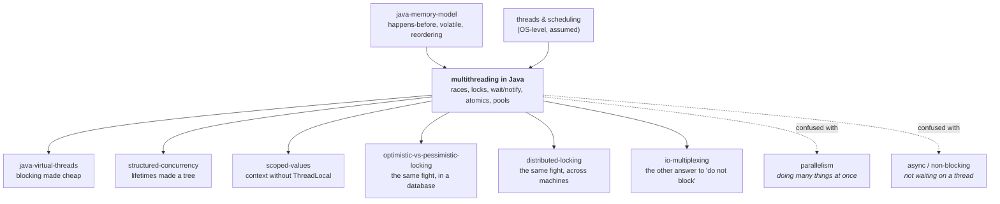

# Multithreading in Java — how one program does several things at once, and every way that goes wrong

> **The one sentence.** Threads are cheap to start and almost free to reason about
> **right up to the moment two of them touch the same piece of memory** — and from
> that moment on, the only questions that matter are *can they be inside this code
> at the same time?* and *is there any guarantee that one of them can see what the
> other wrote?*

> **The sentence people get wrong.** "Concurrency bugs are rare, so they are not a
> priority." They are not rare. They are **rare per run** and certain per fleet: a
> race that shows up in one execution in ten thousand happens roughly forty times a
> second in a service handling four hundred thousand requests a second. And it never
> throws. The number is just wrong, and it stays wrong.

**Lab contents**

| File | What it is |
|---|---|
| `README.md` | this document — 16 stages, four depth layers |
| `visualization.html` | **The Interleaving Machine** — you choose which thread runs next · <https://claude.ai/code/artifact/10d168d6-8a4f-49fe-9b39-471e067a6bc7> |
| `EXERCISES.md` | eight rungs, pencil-and-paper plus the visualization |
| `SOLUTIONS.md` | worked answers |
| `validate-visualization.sh` | replays both simulation engines headlessly — 42 engine checks + 12 render checks |

---

## Where this sits in your other labs — and why it is arriving late on purpose

You have already done `java-virtual-threads`, `structured-concurrency` and
`scoped-values`. Those are the 2025 answers. This lab is **the machine underneath
them** and the pile of problems they were invented to hide. Reading it now is not
going backwards; it is finally seeing what those three labs were arguing *with*.

Three specific joins to things you already know:

- **`java-memory-model`** gave you *happens-before*, `volatile`, reordering and the
  store buffer. That lab answered "which values is a thread allowed to see?" This
  lab answers "which **interleavings** are possible, and what do I do about them?"
  What that lab covered turns out to be only one of the two problems in this one,
  and stage 4 is where you will see why they are genuinely separate.
- **`optimistic-vs-pessimistic-locking`** is this lab's twin one level up. Its
  version column (`UPDATE … WHERE id = ? AND version = ?`, where the update count is
  the only witness) is the same trick this lab reaches in stage 10 under the name
  *compare-and-set* — written in SQL, across a network, between requests instead of
  between two CPU registers. Its `lunch` measurement — one client pausing mid-save
  under a pessimistic lock cost five neighbours **all** their saves and produced 15
  lock timeouts — is the database-sized version of a failure you will meet in stage
  11, where one slow lock-holder makes everybody else slow.
- **`distributed-locking`** taught that a lock between machines needs a **lease with
  a TTL**, because death and slowness are indistinguishable from outside. Notice
  what is *missing* from every lock in this lab: there is no TTL anywhere, and no
  fencing token. That is not sloppiness. Inside one JVM the runtime genuinely knows
  when a thread has died and releases every lock it held; there is no network, no ghost
  packet, no partition. **A single JVM is the one place where a lock can be exactly
  a lock.** Everything that lab called a compromise was the price of leaving this
  building.

---

## How the numbers in this document were produced

Every executed trace, count and tick figure below comes from the two simulation
engines inside `visualization.html`, replayed headlessly by
`./validate-visualization.sh` — **42 engine checks and 12 render checks, all
passing**. Two of the checks are *exhaustive*: they enumerate every possible
interleaving of the threads in scenarios 1, 3 and 6 rather than sampling one.

Where a statement is about the real JVM rather than the model, it is marked
**[JVM, not measured here]** and sourced to the specification or to a prior lab. The
page is a model of Java's rules, not a JVM; the honest boundaries are listed at the
bottom of the page itself and again in stage 13.

---

# BEGINNER MODEL — stages 1 to 9

## 1. WHY — the problem this exists to solve

A program normally does one thing at a time. It reads a line, does it, reads the
next. That is fine until one of those things is *slow* — waiting for a database, a
payment provider, a file. While your program waits, it does nothing else. Every
other customer queues behind the slow one.

A modern machine has many CPU cores sitting idle during that wait. **Multithreading
is the ability to have several places in your program running at once**, so a slow
customer no longer blocks a fast one, and so eight cores do eight things instead of
one.

If nobody solves this: a web server handles one request at a time, so 100 users
sharing one 200-millisecond database call wait 20 seconds for the last one; a report
that could use eight cores uses one and takes eight times as long; and any program
that has to watch two things at once — a socket and a timer — cannot be written at
all without contorting it.

That is the good news, and it is the entire upside. Everything from here on is the
bill.

## 2. PROBLEM — the stockroom tally

A warehouse has a whiteboard in the stockroom with one number on it: **how many
boxes of paper we have**. Two workers, Ana and Ben, both need to record that they
have added a box.

Here is what a worker actually does. She walks to the stockroom, **reads** the
number off the board, writes it on her own notepad, walks back to her desk, **adds
one** on the notepad, walks back to the stockroom, and **writes** her new number on
the board.

Three separate actions, with walking in between: **read, change, write.**

Today the board says **10**. Ana adds a box. Ben adds a box. The board should say
**12**.

- Ana walks in, reads **10**, notes it down, walks out.
- Ben walks in, reads **10** — Ana has not written anything yet — notes it down, walks out.
- Ana comes back and writes **11**.
- Ben comes back and writes **11**.

The board says **11**. Two boxes were added. One of them has vanished from the
record, and nothing anywhere went wrong in a way anyone can see. Ana did her job
perfectly. Ben did his job perfectly. Nobody made a mistake. There is no complaint
to file, no alarm to ring, no way to tell later that it happened.

> **🔮 Predict:** Ana and Ben each add exactly one box, starting from 10. Over every
> possible ordering of their walks, what values can the board end up showing?
>
> <details><summary>Reveal</summary>
>
> **11 or 12, never 13.** 12 when one finishes completely before the other starts;
> 11 when both read before either writes. It can never be 13, because neither worker
> ever writes anything other than *the number they read, plus one* — nobody invents a
> value out of nothing.
>
> This is not a guess. Scenario 1 of the visualization is exactly this, and
> `validate-visualization.sh` enumerates **every** interleaving of the two threads
> exhaustively: the complete set of reachable answers is `{1, 2}` from a start of 0.
> The bad outcome is not exotic. It is half the state space.
> </details>

## 3. NAIVE SOLUTION — "just write it in one line"

The obvious objection is that Ana and Ben made it complicated. In Java the whole
thing is *one line*:

```java
count++;              // surely this is one action?
```

It looks atomic. It is one statement, one semicolon, one keystroke's worth of
thought. Surely the machine does it in one go.

## 4. FAILURE — one line is three actions, and it gets worse

It is not one action. `count++` compiles to roughly:

```java
int r = count;        // read  memory      -> CPU register
r     = r + 1;        // add   inside the CPU only
count = r;            // write CPU register -> memory
```

Those are Ana's three trips. **Open scenario 1 in the visualization and cause the
bug yourself**: run Thread A one step (it reads 0), then run Thread B one step (it
also reads 0), then let each finish. Final count: **1**. The validator confirms this
run takes exactly 8 machine steps and lands on 1, and that a sequential run of the
identical code lands on 2.

Now here is the part that makes this a *deep* problem rather than an annoying one.
A reasonable person, having understood the above, says: *fine — the problem is that
Ana and Ben can't see each other's writes, so let me make the board more visible.*
Java has a keyword for exactly that: `volatile`.

**It does not fix this.** `volatile` guarantees that every read goes to memory and
every write is published to memory. It says nothing about what happens *between*
your read and your write. Ana still reads 10, and while she is walking back to her
desk with her notepad, Ben reads a genuinely fresh, perfectly visible 10.

So there are **two different problems wearing the same clothes**, and no single
keyword covers both:

- **Nobody can see my write.** (Scenario 2 of the visualization. Ben never even
  looks at the board again.)
- **Someone slipped in between my read and my write.** (Scenario 1. Ben looked, and
  what he saw was true at the time.)

Scenario 2 is worth running now, because it is the one that surprises experienced
engineers. A worker loops on `while (!stop)`. Another thread sets `stop = true`.
Memory genuinely holds `true` — the visualization shows it in the shared-memory
panel. The worker read `stop` once, kept the value, and **has no reason to ever look
again**. The validator confirms: without `volatile` the worker never terminates and
keeps reading `false` from its own private copy while memory says `true`; with
`volatile` it terminates.

That hang uses 100% of a CPU, throws nothing, logs nothing, and looks like a healthy
thread. In production it is "the service will not shut down".

## 5. THE REAL REQUIREMENT — what we actually have to guarantee

Stated in plain words, and this is the whole rest of the lesson:

1. **When a piece of work must happen as a unit, no other thread may be part-way
   through the same piece of work at the same time.**
2. **When one thread finishes writing, there must be some guarantee that another
   thread will actually see it.**

Requirement 1 is about **which orderings are possible**. Requirement 2 is about
**which values are legal to see**. They are separate, and a correct program needs
both.

## 6. KEY IDEA — a lock is not a speed limit, it is a deletion of possibilities

The invention is embarrassingly simple: **put a single key on the stockroom door.**
You may not enter without holding the key, and there is only one key.

The key does not make Ana walk faster. It does not make her three trips into one
trip. It makes the *interleaving where Ben walks in during Ana's trips* **cease to
exist**. And — this is the part people miss — Java attaches the second guarantee to
the same key: handing the key back publishes everything you wrote; taking the key up
throws away everything you were remembering privately.

**One mechanism, both requirements.** That is why `synchronized` is the default
answer and everything else in this lab is a refinement of it or an escape from it.

## 7. TERMINOLOGY — the words, now that you have felt what they name

Each of these names a distinction you have already hit. Minor terms are defined at
first use later; these are the load-bearing ones.

**Thread**
*Plain:* one place in your program that is currently running.
*Technical:* an independent flow of execution with **its own program counter and its
own stack** (its local variables and method-call chain), sharing **one heap** (all
objects and all fields) with every other thread in the process.
*Why the word exists:* to separate the *thing that runs* from the *program*. A
program is text; a thread is a position in that text, and there can be many.
*Concrete:* in scenario 1, Thread A and Thread B run identical code but have their
own `r`. `r` is on the stack, so it is private. `count` is a field, so it is shared.
*Connects to:* in `java-virtual-threads` you learned a **virtual thread** is one of
these whose stack lives on the heap and is multiplexed onto a small number of
**carrier threads**. Everything in this lab applies to virtual threads unchanged —
same memory model, same locks, same bugs.

**Shared mutable state**
*Plain:* data more than one thread can both read and change.
*Technical:* any location reachable from two threads where at least one access is a
write.
*Why the word exists:* because it names the **only** thing that causes these bugs.
Shared-and-immutable is safe. Mutable-but-not-shared is safe. Only the intersection
hurts, and naming the intersection tells you where to attack.
*Concrete:* `count` in scenario 1. `r` is mutable but not shared; a `String` is
shared but not mutable; neither can produce a race.

**Race condition**
*Plain:* the answer depends on who happened to get there first.
*Technical:* correctness depends on the relative timing of operations in different
threads, when nothing in the program constrains that timing.
*Why the word exists:* to make the point that the bug is not in any one line. Every
line in scenario 1 is correct. The defect lives in the *set of orderings the program
permits*.
*Concrete:* the specific race in scenario 1 is a **check-then-act** / **read-modify-write**
race, and its result is called a **lost update** — a completed write that is silently
overwritten by a write derived from stale data.
*Connects to:* `isolation-levels` and `optimistic-vs-pessimistic-locking` both call
this exact thing a lost update. It is the same bug at three scales: between two CPU
registers, between two database transactions, and between two HTTP requests.

**Atomicity**
*Plain:* all of it happens, or none of it, with no visible middle.
*Technical:* an operation is atomic **with respect to a set of threads** if those
threads can never observe it half-done.
*Why the word exists:* because "one line of code" and "one indivisible action" are
different things, and only the second one is worth anything. `count++` is one line
and three actions.
*Concrete:* `count = 5` is atomic for an `int`. `count++` is not. `long` and
`double` assignment is not guaranteed atomic on 32-bit JVMs unless `volatile`
**[JVM, not measured here — JLS §17.7]**.

**Visibility**
*Plain:* whether your write ever shows up for somebody else.
*Technical:* whether a read in thread B is permitted to return a value written by
thread A.
*Why the word exists:* to separate "when did it happen?" from "who is allowed to see
it?". Scenario 2 has no timing problem at all — the write definitely happened first
— and is still broken.
*Connects to:* this is `java-memory-model` territory. **happens-before** is the
formal name of the guarantee: if action X *happens-before* action Y, then whatever X
wrote is visible to Y. Releasing a lock happens-before any later acquisition of that
same lock; a `volatile` write happens-before any later read of that same field.
Without such an edge, there is no promise at all.

**Critical section / mutual exclusion**
*Plain:* the bit of code only one thread may be inside at a time; and the property of
enforcing that.
*Technical:* a region of code protected such that at most one thread executes it
concurrently for a given lock.
*Why these are two words:* the critical section is *where*; mutual exclusion is *the
guarantee*. You choose the first; the runtime provides the second.
*Concrete:* the three lines between `synchronized (lock) {` and `}` in scenario 3.

**Lock / monitor / intrinsic lock**
*Plain:* the single key on the stockroom door.
*Technical:* every Java object has an **intrinsic lock** (also called its
**monitor**). `synchronized (obj)` acquires it and releases it on exit — including
when an exception is thrown. A monitor has an **owner**, an **entry set** (threads
blocked trying to get in) and a **wait set** (threads that have deliberately gone to
sleep inside it). All three are shown in the visualization's Locks panel.
*Why the word "monitor" exists:* it is Hoare's 1974 name for "a lock plus a place to
wait", because mutual exclusion alone cannot express "wait until there is something
to consume" — you need both, and Java bolted them onto every object.
*Concrete:* in scenario 5, `buffer` is the monitor; two consumers sit in its wait
set while the producer holds it.
*Connects to:* `distributed-locking`'s lock service is this, reimplemented out of
messages — and it loses mutual exclusion in the process. Here, the JVM releases a
dead thread's monitors for you; there, nobody can tell death from slowness.

**Deadlock**
*Plain:* everyone is politely waiting for someone else, forever.
*Technical:* a cycle in the "thread X holds a lock thread Y wants" graph. With plain
`synchronized` there is no timeout and no detection: the threads simply stop.
*Why the word exists:* to distinguish *stopped because of a cycle* from *stopped
because it is slow*. They look identical from outside and have completely different
cures.
*Concrete:* scenario 4. Two transfers in opposite directions, each holding one
account and asking for the other. The validator confirms both threads end BLOCKED
with each holding what the other wants.

**Thread pool / executor**
*Plain:* a fixed crew of threads and a queue of jobs to feed them.
*Technical:* an `ExecutorService` holding N worker threads that repeatedly take
tasks from a shared queue.
*Why it exists:* creating a thread costs a system call and roughly a megabyte of
reserved stack **[JVM, not measured here]**, so per-request threads stop scaling.
*Concrete:* the pool tab. Twelve tasks of five ticks each: 2 workers finish at tick
**30**, 4 workers at **15**, 6 workers at **10** — all verified.

**Compare-and-set (CAS)**
*Plain:* "write this, but only if nobody has touched it since I looked."
*Technical:* a single CPU instruction that compares a memory location to an expected
value and, only if they match, writes a new one — with no gap in between. Returns
whether it succeeded.
*Why it exists:* because the gap between read and write is the entire bug, and
hardware can eliminate the gap without any thread having to block.
*Concrete:* scenario 6. Both threads read 0; A's CAS succeeds, B's is refused, B
retries from 1 and wins. Verified: final 2, exactly 1 refusal, 1 retry, and no
thread ever blocked.
*Connects to:* `optimistic-vs-pessimistic-locking`'s conditional `UPDATE … WHERE
version = ?` **is** compare-and-set. `linearizability` named `compareAndSet` as the
canonical atomic operation. Same primitive, three labs.

## 8. MENTAL MODELS — two pictures, and where the friendly one lies

**The simple model — the stockroom.** Workers walk between their desks and a
whiteboard. Reading takes a trip, thinking happens at the desk, writing takes
another trip. One key on the door. A bell to call people from the waiting room.

**The engineering model.** Several **program counters** advance independently
through code. Each has a **private stack** (locals, parameters, call chain) and each
may keep field values in **CPU registers**. All of them share **one heap**. Between
any two machine instructions of any thread, any other thread may execute any number
of its own. A **monitor** is a record `{owner, entry set, wait set}`. The Java
Memory Model defines a partial order called **happens-before**; a read may return a
write's value only where that order (or an unlucky data race) allows it.

**The mapping.**

| Stockroom | Java | Where you see it in the visualization |
|---|---|---|
| A worker | a thread | the coloured thread cards |
| Her notepad | CPU registers / the private copy | "Private registers" and "Private copy" rows |
| The whiteboard | a field on the heap | the Shared memory panel |
| Walking to the board and back | the read / write machine steps | each `LOAD` and `STORE` line |
| The single door key | an object's intrinsic lock | the Locks panel, "Held by" |
| Waiting outside the locked door | thread state `BLOCKED`, entry set | "Queued to enter" |
| Going to the waiting room until the bell | `wait()`, wait set | "Asleep in `wait()`" |
| Ringing the bell | `notifyAll()` | scenario 5 |
| Two workers each holding a key the other needs | deadlock | scenario 4 |

**Where the analogy breaks — three places, and each one matters.**

1. **A person will eventually glance at the board again. A CPU may genuinely never
   look.** This is the biggest lie in the analogy. In the stockroom, "stale" means
   "out of date for a while". In Java it can mean **forever**: the compiler is
   allowed to hoist a non-`volatile` field read out of a loop entirely, so the
   machine code contains no re-read at all. Scenario 2 is not a slow worker; it is a
   worker who has been *optimised into never checking*.
2. **The analogy makes your own actions look ordered. They are not, from outside.**
   If Ana writes the board and then writes her diary, everyone agrees that is the
   order. In Java, without a happens-before edge, another thread may observe those
   two writes in the opposite order — the `java-memory-model` lab's reordering and
   store-buffer material. This lab's visualization does **not** model reordering; it
   models one shared memory with private copies. That is a deliberate simplification
   and it is why the two labs are separate.
3. **A locked door with a dead worker inside is obvious. A hung thread holding a
   monitor is not.** In real terms this is better than it sounds — if a thread
   *dies*, the JVM releases its monitors. But if it merely *hangs* (an HTTP call
   with no timeout, say) it holds the lock forever and every other thread piles into
   the entry set. That is the single most common Java production incident in this
   whole area, and stage 13 shows what it looks like on a dashboard.

## 9. VISUALIZATION — what to open and what to look at

**<https://claude.ai/code/artifact/10d168d6-8a4f-49fe-9b39-471e067a6bc7>**
(also `visualization.html` in this folder, works offline).

The page has two tabs. On the first, six scenarios; on each, the *interleaving
ribbon* under the verdict records every machine step as a coloured tick — that strip
**is** the interleaving, and clicking any tick rewinds to that moment.

Do these in order, and answer each prediction card before pressing anything:

1. **Scenario 1** — press Thread A once, then Thread B once, then finish both. Watch
   the moment two threads hold `r = 0` at the same time. That single screen is the
   whole subject.
2. **Scenario 2** — run the demonstration and then stare at the Worker's *private
   copy* row: it says `stop = false — memory says true`. Then tick the `volatile`
   box and run it again.
3. **Scenario 3** — deliberately try to reproduce scenario 1. Run Thread A once
   (it takes the lock), then try to press Thread B. **The button is disabled.** That
   is mutual exclusion made physical: not slower, just fewer possible worlds.
4. **Scenario 4** — give each thread its first lock, then ask each for its second.
   Then turn on lock ordering and watch the cycle become impossible.
5. **Scenario 5** — put both consumers to sleep first, then run the producer once.
   Watch `notifyAll()` move both sleepers from the wait set into the entry set (not
   into "running"), and watch the buffer go to **−1**.
6. **Scenario 6** — interleave the two reads, then let it run. One compare-and-set
   is refused and retried; nothing blocks.

Then open the **Thread pool** tab, set workers to 2 and press Play; then tick
*"each task submits a sub-task to the same pool and waits for it"* and press Play
again.

> **✅ CHECKPOINT — end of the beginner model.**
> You can now say what a race condition is, why `count++` is not one action, why a
> loop can miss a flag forever, and what a lock buys you (two things, not one).
> **Next:** the actual rules — how a monitor really behaves, why `notify` is not a
> message, and what you use instead of writing any of this by hand.

---

# INTERMEDIATE MODEL — stage 10

## 10. THE ACTUAL MECHANISM — built the way you would build it, and broken four times

Rather than hand you `java.util.concurrent`, this stage builds the answer the way a
smart engineer actually arrives at it: the obvious version first, then the failure
that forces the next refinement. Every "weird" rule at the end is the scar of a
failure in the middle.

### v1 — "make it volatile"

```java
volatile int count;      // now everybody sees my writes
void increment(){ count++; }
```

**Why it looks right:** it directly attacks the visibility problem from scenario 2,
and `volatile` really does give a happens-before edge on every read and write.

**Why it breaks:** run scenario 1's interleaving in your head with perfect
visibility. A reads 0 (truthfully). B reads 0 (truthfully — A has not written yet).
Both write 1. `volatile` did its job flawlessly and the update is still lost.

**The lesson, precisely:** `volatile` makes single reads and single writes visible
and ordered. It does not join a read and a write into one action. It is the right
tool for exactly one shape — **a flag one thread writes and others read**, which is
scenario 2 — and the wrong tool for anything of the form *read, decide, write*.

### v2 — one lock

```java
synchronized (lock) { count++; }
```

This is scenario 3, and the visualization proves it exhaustively: the validator
enumerates **every possible schedule** of both threads through the locked version
and finds no schedule producing anything but 2. Compare with the same code with the
lock removed under the identical interleaving: 1.

Hand-worked trace, taken from the engine's own log (scenario 3, "let the scheduler
choose"):

| Step | Thread | Instruction | Result |
|---:|---|---|---|
| 1 | A | `LOCK lock` | A owns the monitor; A's private copies are discarded |
| 2 | B | `LOCK lock` | **refused** — B goes to `BLOCKED`, and its program counter does not move |
| 3 | A | `r = count` | A reads 0 from memory |
| 4 | A | `r = r + 1` | A's register holds 1; memory still 0 |
| 5 | A | `count = r` | memory now 1 |
| 6 | A | `UNLOCK lock` | everything A wrote is published to whoever takes this lock next |
| 7 | B | `LOCK lock` | B owns it, and discards its private copies |
| 8 | B | `r = count` | B reads **1** — because of step 6, this is guaranteed, not lucky |
| … | | | final `count = 2` |

Two things in that trace deserve their own sentence.

**Step 2 is the whole of mutual exclusion.** B did not run slower. B did not run at
all. Its program counter stayed put. Interleavings were not discouraged; they were
removed from the set of possible executions.

**Step 8's guarantee comes from step 6, not from luck.** The monitor gave a
*happens-before* edge. Had A used no lock, B could legally have read 0 at step 8
even after A wrote 1.

> **🔮 Predict:** A lock's first job is mutual exclusion. What is its second, and
> which earlier scenario does that second job fix?
>
> <details><summary>Reveal</summary>
>
> **Visibility — it fixes scenario 2 as well.** Releasing a monitor publishes
> everything you wrote inside it; acquiring the same monitor discards your private
> copies. So `synchronized` is a complete answer to both requirements from stage 5,
> which is exactly why it is the default and why `volatile` is a specialist tool.
>
> The guarantee is one-way and *lock-specific*: it only helps threads that acquire
> **the same** monitor. A reader that skips the lock gets no promise, even if every
> writer takes it religiously. This is the mistake behind almost every "but I do
> synchronize the writes" bug report.
> </details>

### v3 — two locks, and the first thing that kills a service

One lock around everything is correct and slow: two threads touching completely
unrelated accounts still queue for the same key. So you use one lock per account.
Now a transfer needs two.

```java
synchronized (from) {
  synchronized (to) { … }        // Thread A: from=accountA, to=accountB
}                                // Thread B: from=accountB, to=accountA
```

This is scenario 4, and it stops dead. Verified: `run = STUCK`, both threads
`BLOCKED`, `accountA` owned by A and `accountB` owned by B.

The cause fits in one sentence, and it is worth memorising: **a thread was holding
a lock while asking for another one.** Every deadlock has that shape. The four
classic conditions (mutual exclusion, hold-and-wait, no preemption, circular wait)
are just that sentence expanded, and the practical attack is always the last one.

**The refinement: impose a global order on locks.** Always take `accountA` before
`accountB` — by account id, by `System.identityHashCode`, by anything, as long as
everybody agrees. A cycle needs someone to go "up" while someone goes "down"; a
total order makes that impossible. Turn on the ordering option in scenario 4 and the
same code completes.

The second refinement, when a global order is impractical: **be able to give up.**
`ReentrantLock.tryLock(timeout)` returns `false` instead of blocking forever, so you
can release what you hold and retry. `synchronized` cannot do this — it has no
timeout, no interruption, and no way to abandon the attempt. That single missing
capability is most of the reason `ReentrantLock` exists.

### v4 — waiting for a condition, and the signal that lies

Locks answer "not at the same time". They do not answer "not yet" — a consumer
needs to *wait until there is something to consume*, without holding the key while
it waits. That is what the wait set is for.

```java
synchronized (buffer) {
  if (items == 0) buffer.wait();      // <- the bug
  items--;                            
  consume();
}
```

> **🔮 Predict:** Consumer 1 is inside `synchronized (buffer)` — it holds the lock —
> and it calls `buffer.wait()`. While it sleeps, can the producer get in to add an
> item?
>
> <details><summary>Reveal</summary>
>
> **Yes — and it has to, or nothing could ever work.** `wait()` **releases the
> lock** as it puts the thread to sleep, and re-acquires it before returning. If it
> did not, a consumer would fall asleep holding the only key, and the producer that
> is supposed to wake it could never get in — a guaranteed deadlock on the first
> empty buffer.
>
> This is the single most-forgotten fact about `wait()`, and it is also why the
> thread has to **queue for the lock again** after being notified: waking up and
> running are two different events, with an unbounded amount of other threads'
> execution possible in between. That gap is the entire bug in this section.
> </details>

`wait()` does something people consistently forget: **it gives the lock back** and
puts the thread in the monitor's wait set. `notify()` / `notifyAll()` moves sleepers
out of the wait set — **into the entry set**, not into "running". They still have to
acquire the lock like anyone else.

Scenario 5 runs this with two consumers and one producer that adds **one** item.
Verified result: `items = −1`. Two consumers each took an item; one item existed.

The trace, from the engine:

| Step | Thread | What happens |
|---:|---|---|
| 1–4 | Consumer 1 | takes lock, reads `items = 0`, calls `wait()` → **gives the lock back**, sleeps |
| 5–8 | Consumer 2 | takes lock, reads `items = 0`, calls `wait()` → sleeps |
| 9–13 | Producer | takes lock, sets `items = 1`, `notifyAll()` wakes **both** into the entry set, releases |
| 14 | Consumer 1 | re-acquires the lock, returns from `wait()`, and with `if` **does not re-check** |
| 15–17 | Consumer 1 | `items` 1 → 0, consumes, unlocks |
| 18 | Consumer 2 | re-acquires, returns from `wait()`, with `if` **does not re-check** |
| 19–21 | Consumer 2 | `items` 0 → **−1**, and "consumes" an item that does not exist |

**The refinement: `wait()` must always be inside a `while`, never an `if`.**

```java
while (items == 0) buffer.wait();     // correct
```

Turn on the `while` option and re-run: verified `items = 0`, with Consumer 2 back
asleep in the wait set. That is not a failure — one item genuinely cannot feed two
consumers — it is the correct outcome.

The reason the rule is absolute is that **being woken tells you only that something
changed, never that your condition is true**. Three independent ways it can be
false: another thread got there first (what you just watched); `notifyAll` wakes
everyone including threads waiting for a different condition; and the JVM is
explicitly permitted **spurious wakeups** — a return from `wait()` with no `notify()`
at all **[JVM, not measured here — `Object.wait` javadoc]**.

There is a second trap the same scenario exposes. Run the producer *before* any
consumer sleeps: verified, the log says **"called notifyAll() and woke nobody"**. A
notification is not a message. It is not queued, counted or remembered. If nobody is
in the wait set, it is gone — which is why the *condition* (`items`) is the source
of truth and the notification is only a nudge to go and look.

### v5 — stop writing any of this

Everything above is the machinery. You should almost never touch it. The refinement
that ends the sequence is: **use the library that already got this right.**

| Instead of | Use | Because |
|---|---|---|
| `synchronized` + `wait`/`notify` for a producer/consumer | `ArrayBlockingQueue` / `LinkedBlockingQueue` | `put`/`take` block correctly, loop correctly, and cannot miss a signal |
| `synchronized` around a counter | `AtomicInteger`, `LongAdder` | no blocking; `LongAdder` splits the counter across cells to kill contention |
| `synchronized` around a map | `ConcurrentHashMap` | lock-free reads; per-bin locking for writes; `compute`/`merge` are atomic |
| `synchronized` with a timeout you cannot have | `ReentrantLock.tryLock(…)` | can time out, be interrupted, and be fair if you ask |
| hand-rolled thread creation | `ExecutorService` | bounded threads, a queue, and a shutdown story |
| hand-rolled "wait for these 3 things" | `CompletableFuture`, or a structured-concurrency scope | composition and error propagation |

### v6 — the one that needs no lock at all

For the counter specifically there is a better answer than a lock, and it is
scenario 6:

```java
int old, next;
do {
  old  = count.get();
  next = old + 1;
} while (!count.compareAndSet(old, next));
```

The CPU compares and writes in one indivisible instruction — the gap that lost the
update in scenario 1 does not exist. Verified: final 2, **1** compare-and-set
refused, **1** retry, and **no thread ever entered `BLOCKED`**. Exhaustively checked
across every interleaving to depth 18: the answer is always 2.

**The trade, stated honestly.** The cost has not disappeared; it has moved from
*waiting* to *redoing*. A blocked thread costs a context switch and sleeps. A
retrying thread costs CPU and stays hot. Under low contention retries are ~0 and
atomics win easily. Under heavy contention many threads spin, redo arithmetic and
throw it away — which is exactly the waste
`optimistic-vs-pessimistic-locking` measured in its `crossover` experiment (862
retries, 2124 ms burned against 400 ms of useful work, hidden by spare cores until
the cores stop being spare). Same shape, one level down.

> **✅ CHECKPOINT — end of the intermediate model.**
> You can now read `synchronized`, `wait`/`notify` and an atomic, and say what each
> one guarantees and what it does not. **Next:** the failure modes as a catalogue —
> how each one is created, what it protects, what it sacrifices, and how it appears
> on a production dashboard.

---

# ENGINEERING MODEL — stages 11 and 12

## 11. FAILURE SCENARIOS — every way this breaks, and what survives each one

The important split throughout: **safety** = nothing wrong ever happens;
**liveness** = something right eventually happens. Almost every mechanism here
trades one for the other, and knowing which one you have lost tells you how urgent
the incident is. A safety failure has already corrupted something. A liveness
failure has not corrupted anything — yet.

**1 · Race condition (lost update)** — *safety lost, liveness fine.*
*Create:* scenario 1; interleave two reads before either write.
*What/why:* both threads read 0, both write 1. The write is based on a value that
was true when read and stale when used.
*Response:* none. Nothing detects it. Both threads report success.
*Kept:* the program keeps running, fast, forever.
*Lost:* the value. Permanently — there is no later moment at which the system
notices.
*Production:* a balance that drifts, a stock count that goes negative over months, a
"processed" flag set twice. Found by reconciliation, never by monitoring. The
`isolation-levels` lab's 8 × 40 = 320 experiment is this same bug in a database.

**2 · Visibility failure (stale read / non-terminating loop)** — *liveness lost.*
*Create:* scenario 2 with `volatile` off.
*What/why:* the reader kept a private copy. Verified: memory holds `true`, the
worker has looped 13 more times, every read returning `false`.
*Response:* none, ever. No timeout exists.
*Kept:* safety — nothing incorrect is written.
*Lost:* termination.
*Production:* "the pod will not drain", a shutdown hook that never completes, one
core pinned at 100%. Cure: `volatile`, or read inside the same lock the writer used,
or `AtomicBoolean`.

**3 · Deadlock** — *liveness lost, totally and permanently.*
*Create:* scenario 4, opposite lock order.
*What/why:* a cycle in the holds/wants graph. Verified: both `BLOCKED`, each holding
what the other wants.
*Response:* **nothing.** `synchronized` has no detection and no timeout.
*Kept:* safety, perfectly. Nothing incorrect happened.
*Lost:* those threads, forever. If they are pool workers, the pool dies with them.
*Production:* requests time out while CPU sits at zero and the error rate looks
*calm*. Diagnosed with `jstack <pid>`, which prints **"Found one Java-level
deadlock"** and names both threads and both monitors — one of the few times the JVM
hands you the exact answer. Cure: global lock ordering, or `tryLock` with a timeout,
or holding one lock at a time.

**4 · Livelock** — *liveness lost, and it looks busy.*
*Create:* not in the visualization — **not built**, flagged honestly. The shape: two
threads each detect a conflict, politely back off and retry in lockstep, forever;
or two `tryLock` users who each release and retry at identical intervals.
*Why it is worse than deadlock:* CPU is high and threads are `RUNNABLE`, so a thread
dump shows nothing obviously wrong and every automated deadlock detector says
"fine".
*Cure:* randomised back-off — the same trick, for the same reason, as the randomised
election timeouts in the `raft` lab.

**5 · Starvation and the convoy** — *liveness lost for one thread; throughput lost
for everyone.*
*What/why:* plain `synchronized` promises nothing about who enters next. A thread
can lose the race many times running. Worse is the **convoy**: one thread holding a
lock across a slow call (an HTTP request with no timeout, a `synchronized` method
that logs to a blocking appender) turns *its* delay into *everyone's* delay, because
they are all in the entry set.
*Production:* this is the classic Java incident. Latency goes vertical, CPU goes to
near zero, thread dumps show fifty threads `BLOCKED` on one monitor and one thread
in a socket read.
*Rule:* **never hold a lock across I/O.** `optimistic-vs-pessimistic-locking`
measured the database version of exactly this: one client pausing 2 s mid-save cost
five neighbours all their saves and produced 15 lock timeouts, where the optimistic
version cost only the sleeper.
*Cure:* shrink the critical section to the state change; do the I/O outside it. If
fairness genuinely matters, `new ReentrantLock(true)` gives FIFO — at a real
throughput cost, because it forbids **barging**: letting a thread that has just
arrived take a free lock ahead of the queue. Barging is what makes an uncontended
lock cheap, so banning it is not free.

**6 · Missed signal / `if` instead of `while`** — *safety lost.*
*Create:* scenario 5 with `if`.
*What/why:* verified `items = −1`; two consumers took the single item.
*Kept:* nothing useful — this one corrupts state.
*Lost:* the invariant `items >= 0`.
*Production:* the second consumer reads element −1 of an array, or processes a null,
or double-charges. Cure: `while`, always. Better cure: `BlockingQueue`, which
removes the opportunity.
*Sibling failure:* `notifyAll()` with an empty wait set — verified, "woke nobody".
The signal is gone. Cure: the condition is the truth, the notification is only a
nudge.

> **🔮 Predict:** A pool of 2 workers deadlocks because each task submits a sub-task
> to the same pool and waits for it. You raise the pool to 8 workers and it now
> completes. Is the bug fixed?
>
> <details><summary>Reveal</summary>
>
> **No — and "it completes" is the worst possible outcome.** Verified both ways: 2
> workers deadlock at tick 4; the identical configuration with 8 workers finishes
> normally. Nothing structural changed: a task still blocks on work that needs a
> worker from the same pool. All you altered is *how many parent tasks must be
> in flight simultaneously* before every worker is consumed.
>
> So you have converted a deterministic bug that fails on the first test run into a
> load-dependent one that waits for a traffic spike, a slow downstream, or a retry
> storm — and then hangs permanently, at peak, with no code change to blame. A fix
> that makes a bug harder to reproduce without removing it has made things worse.
> </details>

**7 · Thread-pool starvation deadlock** — *liveness lost, and it is invisible.*
*Create:* pool tab, workers 2, tick *"each task submits a sub-task to the same pool
and waits for it"*, press Play.
*What/why:* verified — `DEADLOCK` at tick 4, with every worker `blockedOn` a
sub-task and every sub-task queued waiting for a worker. Each worker is holding a
pool thread hostage while waiting for work that needs a pool thread.
*Response:* none. `ThreadPoolExecutor` has no idea this is happening.
*Kept:* safety.
*Lost:* the entire pool, permanently.
*Production:* the classic form is a task that calls a service which uses the same
executor, or a parallel stream inside a task on the common ForkJoinPool. A bigger
pool does not fix it — verified: at 8 workers the same configuration completes, so
the bug simply hides until load rises. **Cure: never block, inside a pool task, on
work submitted to that same pool.** Use a separate pool, or make it non-blocking.

**8 · Rejection, and the queue that eats your heap** — *pick your poison.*
*Create:* pool tab, queue capacity 0, 12 tasks, 2 workers.
*What/why:* verified — **10 of 12 tasks rejected**. In real Java that is
`RejectedExecutionException`, once per lost task. Now tick *CallerRunsPolicy*:
verified — **0 rejected, all 12 completed, 4 of them run by the submitting thread**,
which could not submit anything else while it did so.
*The trade:* a bounded queue makes you choose between **dropping work** (rejection)
and **slowing the producer down until it stops outrunning you** — which is what
"back-pressure" means, and is exactly what `CallerRunsPolicy` does by making the
submitter do the work itself. An *unbounded* queue
refuses the choice and pays in heap: `Executors.newFixedThreadPool` uses an
unbounded `LinkedBlockingQueue`, so under sustained overload it accepts everything,
latency climbs without limit, and the process eventually dies of `OutOfMemoryError`
having never rejected a single task. **A queue never creates throughput; it only
decides who waits.**

**9 · The exception nobody saw** — *safety lost silently.*
*What/why:* `executor.submit(task)` catches any exception the task throws and stores
it in the returned `Future`. If you never call `future.get()`, **the exception is
gone** — no stack trace, no log line, and the worker thread quietly picks up the
next task. Half your pipeline stops working and nothing is logged.
*[JVM, not measured here — `AbstractExecutorService.submit` wraps in `FutureTask`.]*
*Cure:* use `execute()` when you do not need a result (uncaught exceptions then
reach the thread's uncaught-exception handler), or always consume the `Future`, or
wrap every task body in try/catch-and-log.

**10 · Cancellation ignored** — *liveness lost on shutdown.*
*What/why:* `Thread.interrupt()` does not stop a thread. It sets a flag, and causes
blocking calls like `sleep`/`wait`/`take` to throw `InterruptedException`. A
`catch (InterruptedException e) {}` that logs and continues **destroys the only
evidence** that cancellation was requested — the flag was cleared when the exception
was thrown.
*Cure:* either rethrow, or restore the flag with
`Thread.currentThread().interrupt()` and return. Then `shutdownNow()` works.
*Connects to:* `structured-concurrency`'s cooperative cancellation is built entirely
on this, which is why that lab stressed that cancellation flows down and that side
effects do not roll back.

**11 · `ThreadLocal` in a pool** — *safety and memory both lost.*
*What/why:* pool threads live forever, so a `ThreadLocal` set during request 1 is
still set during request 5000 — leaking user context between unrelated requests, and
pinning the object it holds for the lifetime of the pool.
*Cure:* remove it in a `finally`; or use `ScopedValue`, whose entire design is this
bug's autopsy. Your `scoped-values` lab called these the *write-from-anywhere* and
*lifetime-until-remove* diseases; this is where they bite.

**12 · Unsafe publication** — *safety lost, and unreproducible.*
*What/why:* writing a reference into a shared field publishes the reference, but
without a happens-before edge another thread may see the reference and **not** see
the object's fields as initialised.
*Cure:* publish through a `volatile` field, an `AtomicReference`, a lock, a `final`
field set in the constructor, or a `static` initialiser. This is
`java-memory-model` territory; the `Publication` and `DoubleCheckedLocking`
experiments in that lab are exactly this failure.

## 12. CORRECTNESS — what is guaranteed, what is not, and what it cost

**Guaranteed by acquiring monitor M:**
- No other thread executes any block synchronized on **M** while you are inside.
- Everything written by any thread before *its* release of M is visible to you.
- The monitor is released on every exit path, including exceptions and thread death.
- It is **reentrant** — the thread already holding M can acquire it again (a
  `synchronized` method calling another one on the same object does not self-deadlock).

**Explicitly not guaranteed:**
- **Fairness.** No promise about who enters next. A thread can be passed over
  repeatedly; barging is permitted and is what makes uncontended locks fast.
- **Any protection from threads that do not take M.** The guarantee is per-lock. A
  reader that skips the lock gets nothing, no matter how careful the writers are.
- **Progress.** Nothing prevents deadlock, livelock or starvation.
- **Ordering across different locks.** Two monitors give you no relationship at all.
- **Atomicity of anything larger than the block.** Two correctly synchronized calls
  in a row are two atomic operations, not one. `if (!map.containsKey(k)) map.put(k, v)`
  on a `ConcurrentHashMap` is a race even though both calls are individually atomic —
  which is why `putIfAbsent` and `compute` exist.

**The three ways to be thread-safe** — in order of preference, because the first two
require no reasoning at all:

1. **Do not share.** Confine the state to one thread (a local variable, a
   `ScopedValue`, one owning actor). No sharing, no race, nothing to prove.
2. **Do not mutate.** An immutable object — all fields `final`, no setters — is
   safe to share with everyone, forever, with no synchronization. This is why
   `String`, `Integer` and records are safe.
3. **Synchronize.** Only when you actually need shared mutable state. Then: pick one
   lock per invariant, document it, and hold it for every access — read *and* write.

**Safety versus liveness, as a decision rule.** A safety failure (races 1, 6, 9, 12)
means data is already wrong and no amount of waiting fixes it. A liveness failure
(2, 3, 4, 5, 7, 10) means nothing is wrong yet but nothing will progress. That
distinction sets the incident severity: a deadlocked pool is an outage you can
restart out of; a lost update is a data problem you may have to reconstruct.

**What locking costs you, in the shape of an argument you already know.** Every
critical section is a serial section. If a fraction *s* of the work must be serial,
then no matter how many cores you add, the speed-up is capped at 1/*s* — Amdahl's
law. A pool sweep shows the benign version: verified makespans of 60, 30, 20, 15,
15, 10 ticks for 1–6 workers on 12 five-tick tasks. Note the shape — **4 workers and
5 workers both finish at 15**, because whole tasks cannot be split. Adding capacity
stops helping long before the graph looks full, and locks make that ceiling arrive
much sooner.

> **✅ CHECKPOINT — end of the engineering model.**
> You can now name what a lock does and does not promise, classify a failure as
> safety or liveness, and argue about the cost. **Next:** what all of this looks
> like from an on-call rotation, and which parts of this lab a real system replaces.

---

# PRODUCTION MODEL — stage 13

## 13. PRODUCTION — from this lab to a real service

### The chain

**This lab's model** → three-step `count++` over a shared field, one monitor, a
scheduler you control.
**Real Java** → the same semantics, plus reordering, plus a JIT compiler that
deletes redundant reads, plus 64 threads instead of 2, plus an OS scheduler that
preempts anywhere.
**A production service** → a servlet container or a Netty event loop, a connection
pool, a thread pool per subsystem, and shared state you did not know was shared
(a `SimpleDateFormat` field, a lazily-built cache, a `HashMap` someone assumed was
per-request).

### What the educational version leaves out — named, not hidden

| Omitted here | What real systems do |
|---|---|
| **Instruction reordering** | The JMM allows compiler and CPU reordering; `java-memory-model` covers it. This page models one memory with private copies — enough for visibility, not for reordering. |
| **The JIT compiler** | Hoists reads out of loops, inlines, and can turn scenario 2's loop into a genuinely infinite one at machine level. The model shows the *effect*, not the mechanism. |
| **`ReentrantLock`, `Condition`, `ReadWriteLock`, `StampedLock`** | Timeouts, interruptibility, fairness, multiple wait sets per lock, and read/write separation. All are refinements of the monitor shown here. |
| **`ConcurrentHashMap` internals** | Per-bin locking, lock-free reads, resizing while readers run. |
| **`ForkJoinPool` and work stealing** | Per-worker deques; idle workers steal from the tails of busy ones. Backs parallel streams and `CompletableFuture` by default. |
| **False sharing** | Two unrelated fields in one 64-byte cache line make independent threads fight. `@Contended`, `LongAdder`'s padded cells. |
| **Thread priorities, affinity, NUMA** | Mostly advisory, mostly ignored, occasionally decisive. |
| **Memory-model strength on real hardware** | x86 is strongly ordered and hides many bugs that ARM (Apple silicon, Graviton) exposes. Code that "works" on your laptop can fail in production for this reason alone. |

### Sizing the pool — the only formula you need

- **CPU-bound work:** threads ≈ number of cores (`Runtime.availableProcessors()`),
  plus one. More threads add context switches, not throughput. The sweep above is
  this case: past the point where every task has a worker, extra workers finish
  nothing sooner.
- **I/O-bound work:** threads ≈ cores × target utilisation × (1 + wait / compute).
  A task that waits 90 ms and computes 10 ms has a ratio of 9, so a 8-core box
  targeting full utilisation wants roughly 80 threads — which is precisely the
  number that used to force people to a reactive framework, and precisely what
  `java-virtual-threads` made unnecessary.
- **Always bound the queue.** An unbounded queue converts overload into
  `OutOfMemoryError` instead of into back-pressure. Choose deliberately between
  rejection and `CallerRunsPolicy` — the pool tab lets you feel the difference:
  10 rejections versus 0 rejections with a throttled submitter.
- **Name your threads.** `Executors.newFixedThreadPool(n, namedFactory("payments-"))`.
  This costs nothing and is the difference between a readable thread dump and an
  unreadable one at 3 a.m.
- **Separate pools per dependency.** One pool per downstream service means a slow
  dependency starves only its own pool — the bulkhead pattern. One shared pool means
  a slow dependency takes the whole service down.

### What on-call actually sees, and what to do

| Symptom | Likely cause | First move |
|---|---|---|
| Latency vertical, **CPU near zero**, error rate calm | deadlock, or a lock held across a hung I/O call | `jstack <pid>` — look for "Found one Java-level deadlock", then count threads `BLOCKED` on one monitor |
| Latency vertical, **CPU pinned**, no progress | livelock, or CAS retry storm on a hot atomic | thread dump twice, 5 s apart: same stacks *and* `RUNNABLE` = livelock/spin |
| Pool queue depth climbing without limit | unbounded queue plus arrival rate above service rate | bound the queue; then choose rejection or caller-runs |
| `RejectedExecutionException` in logs | queue full — the pool is doing its job | this is back-pressure working; fix capacity or shed load deliberately |
| Everything fine, then permanently hung after a deploy | pool starvation from a nested submit | look for a `.get()` or `.join()` inside a task on the same executor |
| A counter that is slightly wrong, forever | lost update | reconciliation query, then make the write conditional |
| One user seeing another user's data, intermittently | `ThreadLocal` not cleared in a pooled thread | clear in `finally`, or move to `ScopedValue` |

**Instrument these four numbers** for every pool: active threads, queue depth,
rejection count, and task latency split into *queue wait* versus *execution time*.
The split is the one that matters — rising queue wait with flat execution time means
you need capacity; rising execution time means the dependency is slow and more
threads will make it worse.

### Where the story goes next — the labs you have already done

Everything in this document exists because **a platform thread is expensive and
blocking it wastes it**. That single fact forced pools, forced bounded queues,
forced the whole reactive-programming detour, and forced you to think about pool
sizing at all.

`java-virtual-threads` removed that fact. A virtual thread's stack lives on the
heap; blocking parks it and frees the carrier, so waiting becomes nearly free and
`Executors.newVirtualThreadPerTaskExecutor()` makes "a thread per task" sane again
at 100k concurrency. Two things carry over exactly and are worth stating plainly:

- **Every bug in this lab still happens on virtual threads.** Same memory model,
  same locks, same lost updates, same deadlocks. Cheap threads changed the cost of
  *waiting*, not the rules of *sharing*.
- **Pool starvation deadlock (failure 7) genuinely goes away** when there is no pool
  to starve — which is the strongest single argument for the model. But CPU-bound
  work still needs a bounded pool, and pinning (native frames; `synchronized` before
  JDK 24 / JEP 491) brings the old ceiling straight back, which is why that lab
  flagged it.

And `structured-concurrency` is what you use *instead of* raw threads once they are
cheap: fork subtasks into a scope, join by a policy, and leaving the block guarantees
nothing is left running. Read that lab's "close guarantee" again now — it is a
direct answer to failure 10 in this lab, the thread you asked to stop that never
stopped.

---

## 14. EXERCISES

See `EXERCISES.md` — eight rungs from "explain it back" to "design a payment worker
pool", all pencil-and-paper or visualization work. Answers in `SOLUTIONS.md`.

## 15. KNOWLEDGE MAP — where this sits



**Commonly confused, one sentence each.**

- **Concurrency vs parallelism.** Concurrency is *structuring* a program as
  independent tasks so they can make progress in overlapping periods; parallelism is
  *actually executing* things simultaneously on multiple cores. You can have
  concurrency on one core (and all of this lab's bugs with it), and parallelism
  without any shared state (and none of them).
- **Concurrency vs asynchrony.** Async means "do not sit on a thread while waiting";
  it is a way to spend fewer threads, not a way to avoid races. Two async callbacks
  touching the same field race exactly like two threads.
- **`volatile` vs `synchronized`.** `volatile` makes individual reads and writes
  visible and ordered; `synchronized` additionally makes a *sequence* of them
  indivisible. If your operation is read-modify-write, `volatile` is not enough.
- **Atomic vs thread-safe.** `ConcurrentHashMap` is thread-safe; a `containsKey`
  followed by a `put` on it is still a race. Thread-safe per call ≠ thread-safe per
  business operation.
- **`BLOCKED` vs `WAITING`.** `BLOCKED` = queuing for a monitor somebody holds (it
  will run when they leave). `WAITING` = deliberately asleep in a wait set (it runs
  only if someone signals). In a thread dump these mean completely different things:
  fifty `BLOCKED` on one monitor is a convoy; fifty `WAITING` is usually normal.

**Real technologies using this.** Tomcat/Jetty request pools; Netty event loops and
its `EventExecutor` confinement rules; HikariCP's connection pool; Kafka's consumer
(single-threaded by contract, and it will throw if you break it);
`ConcurrentHashMap` in essentially every Java service; `ForkJoinPool.commonPool`
under every parallel stream — including in library code you did not write.

**Next `/learn` suggestions.**

- `/learn java-concurrent-collections` — `ConcurrentHashMap`, `CopyOnWriteArrayList`
  and `BlockingQueue` internals; the natural sequel to stage 10's v5 table.
- `/learn amdahls-law` — put a number on what stage 12 argued qualitatively.
- `/learn queueing-theory` — why the pool tab's queue behaves as it does, and why
  latency explodes near full utilisation rather than at it.
- `/learn completable-future` — composing asynchronous work without the callback
  pyramid, and where its default executor bites.
- `/learn jvm-thread-dumps` — reading `jstack` output properly, which is the actual
  on-call skill implied by stage 13.
- `/learn reactive-streams` — the back-pressure model, and the design space virtual
  threads were arguing against.

## 16. GLOSSARY

In order of first appearance.

- **Thread** — one independently running position in your program, with its own stack, sharing the heap.
- **Shared mutable state** — data two or more threads can both read and change; the only thing that causes these bugs.
- **Race condition** — the result depends on timing that nothing in the program controls.
- **Lost update** — a completed write silently overwritten by a write derived from stale data.
- **Read-modify-write** — the read/change/write shape that all lost updates have.
- **Atomicity** — no other thread can observe the operation half-done.
- **Visibility** — whether one thread's write is ever seen by another thread's read.
- **`volatile`** — makes every read and write of a field go to memory and be ordered; does not make sequences atomic.
- **happens-before** — the Java Memory Model's ordering relation; if X happens-before Y, X's writes are visible to Y.
- **Critical section** — the region of code that must not be entered by two threads at once.
- **Mutual exclusion** — the guarantee that it is not.
- **Lock / monitor / intrinsic lock** — every Java object's built-in lock; has an owner, an entry set and a wait set.
- **Entry set** — threads `BLOCKED` waiting to acquire a monitor.
- **Wait set** — threads asleep inside `wait()` on a monitor, waiting to be notified.
- **Reentrant** — a lock the holding thread may acquire again without blocking itself.
- **`wait()` / `notify()` / `notifyAll()`** — release the lock and sleep / move one or all sleepers from the wait set to the entry set.
- **Spurious wakeup** — a permitted return from `wait()` with no notification; the reason `wait()` must sit in a `while`.
- **Deadlock** — a cycle of threads each holding a lock another one needs; permanent, silent, no timeout.
- **Lock ordering** — imposing one global order on lock acquisition so a cycle cannot form.
- **Livelock** — threads busily retrying forever without progress; looks healthy in a dump.
- **Starvation** — a thread that keeps losing the race for a lock it is entitled to.
- **Convoy** — one slow lock-holder turning its own delay into every waiter's delay.
- **Fairness** — FIFO lock granting; available from `ReentrantLock(true)`, never from `synchronized`.
- **Barging** — a newly arrived thread taking a free lock ahead of the queue; the reason unfair locks are fast.
- **Safety** — nothing wrong ever happens.
- **Liveness** — something right eventually happens.
- **Thread confinement** — keeping state reachable by exactly one thread so no synchronization is needed.
- **Immutability** — all fields `final` and never changed, therefore safe to share unsynchronized.
- **Safe publication** — making a new object's fields visible along with its reference.
- **Compare-and-set (CAS)** — one indivisible instruction: write only if the value still matches what I read.
- **Atomic classes** — `AtomicInteger`, `AtomicReference`, `LongAdder`: CAS-based, non-blocking.
- **Thread pool / executor** — a fixed set of worker threads consuming a shared task queue.
- **Bounded / unbounded queue** — a queue with a capacity limit, versus one that grows until the heap does not.
- **Rejection policy** — what a full pool does: throw (`AbortPolicy`), run on the caller (`CallerRunsPolicy`), or discard.
- **Back-pressure** — slowing the producer instead of dropping or buffering its work.
- **Pool starvation deadlock** — every worker blocked on work that needs a worker.
- **Bulkhead** — separate pools per dependency, so one slow dependency cannot sink the service.
- **Interruption** — a cooperative cancellation request; a flag plus an exception from blocking calls, not a stop.
- **`ThreadLocal`** — per-thread storage; leaks between requests when the thread is pooled.
- **Thread dump / `jstack`** — a snapshot of every thread's stack and state; the primary diagnostic for all of stage 11.
- **`BLOCKED` / `WAITING` / `RUNNABLE`** — queuing for a monitor / asleep awaiting a signal / able to run.
- **False sharing** — unrelated fields in one cache line causing contention between threads that share nothing logically.
- **Amdahl's law** — the speed-up ceiling imposed by the serial fraction of the work.
