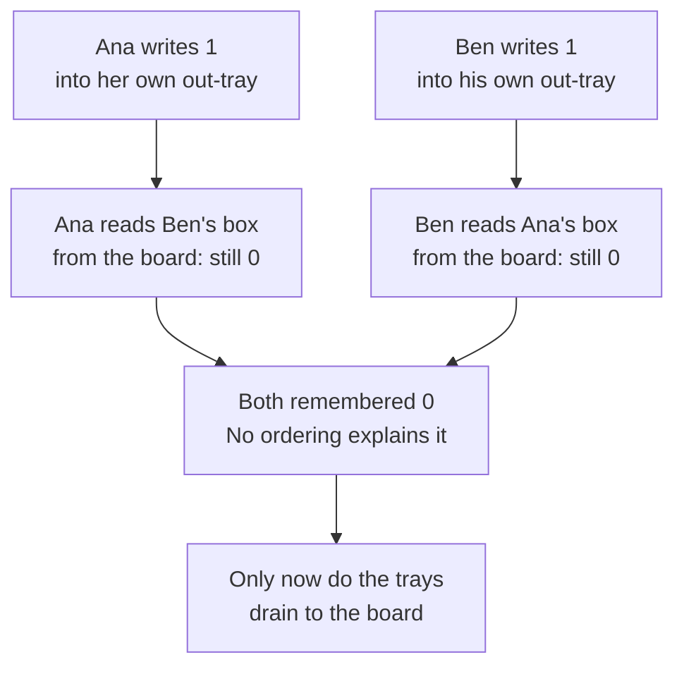
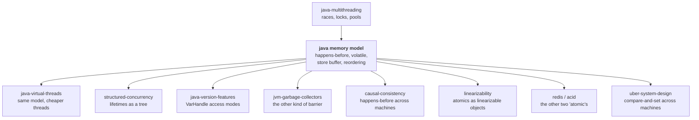

# The Java Memory Model — the rules that decide which of your writes another thread is allowed to see

> **Tell a friend:** Ana and Ben share one whiteboard in a stockroom. Ana rubs
> out the number and writes a new one, and Ben can carry on reading the old one
> — not for a moment, for ever. Nobody made a mistake. The compiler is allowed
> to give Ben a private copy in his pocket. The CPU is allowed to leave Ana's
> new number in her out-tray. Both are legal, because each of those workers
> alone still sees a sensible story. The Java Memory Model is the short list of
> handshakes that force those two to line up, and *happens-before* is its name
> for "you must see what I did". Skip the handshake and you do not have a slow
> program or an unlucky one. You have a program whose answer the language
> declines to define.

Step the two threads yourself in **Store Buffer Theatre**:
[`visualization.html`](visualization.html) — every button is a legal next move.
What this lab is made of, and which command printed which number, is section 22.

---

# BEGINNER MODEL — sections 1 to 8

## 1. Why isn't "the same variable in the same program" enough?

> **In one breath:** Two threads sharing one field feels like two people sharing
> one whiteboard. It is not. Each of them may be reading a private copy, and
> each may be writing into a tray that nobody has emptied yet.

You already know this stockroom. In `java-multithreading`, Ana and Ben each
added a box of paper and each wrote the new total on the whiteboard. Both read
**10**, both wrote **11**, and one box vanished from the record. That bug was
about *overlap*: two people doing a three-step job at the same time.

This lab is about something worse, and it starts with a question that sounds
silly.

When Ana writes **11** on the board, is Ben looking at the board at all?

Meet the third person in the building. **Omar** is the efficiency manager. His
whole job is to make the work faster, and he has exactly one rule:

> Rearrange the work however you like, as long as **a person working alone**
> ends the shift with the same answer.

That rule is not a loophole. It is the deal that makes fast code possible.
Engineers call it **as-if-serial semantics**: the optimiser must preserve what a
single thread would compute, and it owes nothing at all to anybody else.

Read the next table as three things Omar is allowed to do. The middle column is
why a solo worker never notices. The right column is what it does to a second
worker in the room.

| What Omar does | Why a solo worker cannot tell | What it does to a second worker |
|---|---|---|
| copies the board's number onto Ben's notepad once, then has him reuse it | nobody else changes the board on a solo shift | Ben never sees Ana's update, ever |
| lets Ana drop her new number in an out-tray and walk away | the tray reaches the board eventually | the board is stale while the tray is full |
| swaps two of Ana's unrelated steps | the end state is identical | Ben sees them in the swapped order |

Those three rows are the whole lab. Everything after this is one of them, made
concrete, with a command you can run.

And notice what none of them is: a bug. Every row is the optimiser doing its job
correctly. The problem is that *you* were reasoning as if there were one
whiteboard and no trays.

## 2. What did Ana and Ben leave unfinished in the last lab?

> **In one breath:** The last lab found two separate promises hiding inside one
> bug. It nailed the first one and pointed at this lab for the second. This is
> the second.

`java-multithreading` ended up with two questions, and it was careful to keep
them apart.

1. Can Ana and Ben both be inside the stockroom at once?
2. Is either of them guaranteed to **see** what the other did?

A lock answers both. `volatile` answers only the second. And the second question
never got a precise answer in that lab — it got a name, *happens-before*, and a
pointer to this door.

So this lab has one job: turn "is either guaranteed to see the other" into a
rule you can apply to a specific piece of code and get a yes or a no.

Here is how the document is laid out, and what each layer leaves you able to do.

| Layer | Sections | After it you can… |
|---|---|---|
| Beginner | 1–8 | run the first three experiments in your head, and say why a clean run proves nothing |
| Intermediate | 9–12 | name every handshake that creates the promise, and every look-alike that does not |
| Engineering | 13–17 | hand an object to another thread safely, and read double-checked locking correctly |
| Production | 18 | pick the right tool per situation, and explain a vanishing bug to an on-call peer |

## 3. Can Ana write on the board and Ben never see it?

> **In one breath:** Yes. Not "after a delay". Never.

Ben's job today is simple. Keep counting until the board says stop. Ana will
write **stop** on the board in a second or so.

Omar looks at Ben's loop and notices something true: *Ben's loop never changes
the board.* So why should Ben walk to the board a billion times? Omar has him
copy the value onto his notepad once, before he starts, and check the notepad
each time round instead.

Ben is now roughly a hundred times faster and permanently wrong.

The experiment is `Visibility.java`. One field, `plainFlag`, is a plain
`boolean`. The same field declared `volatile` is `volatileFlag`. A worker thread
spins on whichever one you picked. The main thread waits one second, writes
`true`, then waits three more seconds and reports.

> 🔮 **Predict.** The main thread writes `true` at one second and then waits
> three whole seconds. What does the plain worker do?
> **(a)** stops immediately · **(b)** stops within a few milliseconds ·
> **(c)** is still spinning three seconds later.

```
./run.sh Visibility plain            # the plain boolean
./run.sh Visibility volatile         # the same field, declared volatile
./run.sh -Xint Visibility plain      # plain again, with the JIT switched off
```

The answer is **(c)**, and the program says so out loud. Here is what those
three commands printed on one run.

| Command | How the flag was declared | What the worker did | What that tells you |
|---|---|---|---|
| `Visibility plain` | plain `boolean` | still spinning 3 s after the write | the load was lifted out of the loop; it will spin for ever |
| `Visibility volatile` | `volatile boolean` | exited after 1,820,894,830 spins | picked up on the very next pass of the loop |
| `-Xint Visibility plain` | plain `boolean` | exited after 147,698,840 spins | same source, same CPU, only the optimiser changed |

If you guessed **(b)**, you were thinking about cache latency — the small delay
before one core's write shows up in another core's cache. That delay is real and
it is measured in nanoseconds. It is not what happened here. Caches are
*coherent*: they agree with each other automatically, and quickly. What happened
here is that Ben never read a cache at all. He read his notepad.

The engineers' name for Omar's trick is **hoisting the load out of the loop**,
and the notepad is a **CPU register**. Once the value is in a register, no cache,
no bus and no other core can change it. Only Ben's own code can.

## 4. Why did switching the optimiser off *fix* the program?

> **In one breath:** Because the bug was never in the source you wrote. It is in
> the faster program the optimiser is allowed to build out of your source.

`-Xint` tells the JVM to interpret every bytecode and never compile anything.
Omar goes home. Ben walks to the board on every single pass. The program is
maybe a hundred times slower and completely correct.

Stare at rows one and three of the table in section 3 until it is uncomfortable.
Same file. Same laptop. Same JVM. One is correct and one hangs for ever, and the
only difference is whether the optimiser was allowed to work.

That is why **"it worked on my machine" is not evidence of correctness here.**
It is evidence about one optimiser's mood on one afternoon.

> 🔮 **Predict.** Your service hangs in production. You add a
> `System.out.println` inside the spinning loop to see the stale value. What
> happens to the hang?

It usually disappears. Two reasons, and neither is the one people expect.
`System.out` is a synchronized stream, so the print itself is a handshake of the
kind section 10 lists. And a loop with a call in it is no longer simple enough
for Omar to rewrite the way he wanted to.

If you predicted "the print will show me the stale value", you assumed the print
is a passive observer. It is not. It joins in, and it fixes the thing you were
trying to watch.

A bug that vanishes when you look at it has a name: a **heisenbug**. Almost
every memory-model bug is one. Almost every debugging tool you would reach for
adds synchronisation or defeats an optimisation: a print, a breakpoint, a
sleep, a profiler attach.

The practical rule that falls out of this: **never let a print statement, a
`sleep`, or a debugger be your fix.** They change the odds. The rules in section
10 change the guarantee.

## 5. Can both of them read the old number, when both wrote first?

> **In one breath:** Ana writes her number, then reads Ben's. Ben writes his,
> then reads Ana's. Both can come away with zero. No ordering of those four
> steps explains that.

Two boxes on the board, one for Ana and one for Ben. Both start at **0**. Each
of them does exactly two things, in this order.

| Ana does | Ben does |
|---|---|
| write **1** in her own box | write **1** in his own box |
| read Ben's box, remember it | read Ana's box, remember it |

Now reason about it the way everybody naturally does. Assume the four steps get
shuffled together in *some* order, but that neither person's own two steps swap
places. There are only three shapes of answer.

| How it played out | What Ana read | What Ben read |
|---|---|---|
| Ana finished completely first | 0 | 1 |
| Ben finished completely first | 1 | 0 |
| they interleaved | 1 | 1 |

There is no shuffle at all that gives **0 and 0**. For Ana to read 0, she must
have read before Ben wrote. For Ben to read 0, he must have read before Ana
wrote. But each of them wrote *before* they read. It is a flat contradiction.

> 🔮 **Predict.** `Reordering.java` runs that pair of threads a million times
> and counts the outcomes. How many times does 0-and-0 come up?
> **(a)** never · **(b)** a handful · **(c)** tens of thousands.

```
./run.sh Reordering plain               # plain int x, y
./run.sh Reordering volatile            # the same variables, declared volatile
./run.sh -Dtrials=5000000 Reordering plain
```

The answer is **(c)**. Read the last row of the next table first; it is the one
that is supposed to be impossible.

| What the two of them read | What it means | plain, 1,000,000 trials | volatile, 1,000,000 trials |
|---|---|---:|---:|
| 1 and 1 | each saw the other's write | 1,093 | 43,931 |
| 1 and 0 | Ben effectively went first | 88,961 | 304,554 |
| 0 and 1 | Ana effectively went first | 848,592 | 651,515 |
| **0 and 0** | **no ordering explains it** | **61,354** | **0** |

The whole run took 256 ms with plain variables and 413 ms with volatile ones.

If you guessed **(a)**, you were doing exactly what the code encourages: treating
threads as steps that get dealt together like cards. That model is called
**sequential consistency**, and it is the model your intuition ships with. Java
does not give it to you unless you ask.

Now the part that matters more than the count. That count is not a property of
Java. It is a property of one afternoon on one laptop. Here are three answers to
the very same question, from the very same machine and code.

| Where the count came from | Trials | Times 0-and-0 appeared | Roughly |
|---|---:|---:|---|
| `Reordering plain`, the run above | 1,000,000 | 61,354 | 1 in 16 |
| `Tests`, its Dekker observation | 500,000 | 122,096 | 1 in 4 |
| the figure printed on the visualization page | 1,000,000 | 23,500 | 1 in 42 |

One in four, one in sixteen, one in forty-two. Same question, same rules, three
different rates. Never quote a rate like this as a fact about a program. The
verdict is the fact: *it happens, and volatile forbids it.*

## 6. Where does the impossible answer actually come from?

> **In one breath:** Ana's write never went to the board. It went into her own
> out-tray, and she walked away without waiting.

Writing to memory is slow. A core that waited for every write to land in the
shared cache line would spend most of its life stalled, on the order of a
hundred cycles at a time. So it does not wait. It posts the write into a small
private queue and carries straight on. That queue is the **store buffer**, and
it is Ana's out-tray.

Two things about the out-tray decide everything in section 5.

- Ana can read her own out-tray. If she looks up her own number, she gets the
  new one even though the board still shows the old one.
- Nobody else can read Ana's out-tray. Ben sees the board, and only the board.

Now replay the four steps with the tray in the picture.



Neither of them ran their two lines out of order. If you froze each of them with
a debugger you would see the write happen before the read, every time, in both
threads. The write simply had not reached the place the other one was looking.

**Go and drive it.** Open [`visualization.html`](visualization.html), tab **The
impossible outcome**. Press these four buttons, in this order:

1. *Core 0: run next line* — Ana's write lands in her tray, not memory.
2. *Core 1: run next line* — Ben's write lands in his tray.
3. *Core 0: run next line* — Ana reads Ben's box from memory: 0.
4. *Core 1: run next line* — Ben reads Ana's box from memory: 0.

The verdict panel turns red and the forbidden row of the tally goes to 1. The
*Run the classic sequence* button plays exactly that, one step every second and
a half, with commentary. *Auto-run randomly* picks a legal move at random for
you, which is a fair picture of what the machine is actually doing.

> 🔮 **Predict.** Switch the page to `volatile int x, y;` and press the same four
> buttons. What changes?

The stores never sit in a tray. A volatile write forces the core to drain its
whole buffer to memory before it is allowed to run another instruction, so steps
3 and 4 read numbers that are already on the board. The forbidden row stays at
zero no matter how you click. If you predicted "it becomes rarer", you have the
model backwards: this is not a probability being lowered, it is a move being
removed from the board.

One more thing to hold on to. Sections 3 and 5 are two *different* machines
producing two *different* symptoms, and people merge them constantly.

| Who did it | What they did | Which experiment showed it | What stops it |
|---|---|---|---|
| the JIT compiler | kept the flag in a register for the life of the loop | Experiment 1, section 3 | `volatile` forbids caching the field in a register |
| the CPU core | let a store sit in its own private buffer | Experiment 2, section 5 | a volatile write drains the buffer before continuing |

Neither of those is "the CPU running your lines out of order", which is the
phrase everybody reaches for. Out-of-order execution is real and it is a third
mechanism again. The model does not care which of the three did it. It defines
what you are allowed to observe, and leaves the implementers to hit that target
however they like.

## 7. So is `volatile` the fix for everything?

> **In one breath:** No. It fixes *whether you can see a value*. It does nothing
> about somebody changing that value between your read and your write.

Back to the original stockroom bug. Eight workers, each adding one to the board
a million times. The board should end on eight million.

The experiment is `LostUpdate.java`, and it has four modes.

> 🔮 **Predict.** The counter is declared `volatile long`. Every read and every
> write now goes to real memory. What does the board say at the end?
> **(a)** exactly 8,000,000 · **(b)** a bit under · **(c)** wildly under.

```
./run.sh LostUpdate plain
./run.sh LostUpdate volatile
./run.sh LostUpdate synchronized
./run.sh LostUpdate atomic
```

The answer is **(c)**. One run of all four modes:

| Mode | Final total | Increments lost | Share lost | Elapsed |
|---|---:|---:|---:|---:|
| plain | 1,954,887 | 6,045,113 | 75.6% | 69 ms |
| `volatile` | 2,237,736 | 5,762,264 | 72.0% | 328 ms |
| `synchronized` | 8,000,000 | 0 | 0% | 1,254 ms |
| atomic | 8,000,000 | 0 | 0% | 302 ms |

Look at the volatile row twice. It lost nearly six million increments **and** it
took nearly five times as long as the plain version. It paid the entire bill and
bought nothing.

Why? Because `count++` is not one action. It is three:

1. read the board into a register,
2. add one in the register,
3. write the register back to the board.

`volatile` makes step 1 and step 3 hit real memory. It does absolutely nothing
about the gap between them. Two workers can both read 41, both compute 42, and
both write 42. Two increments happened and the board moved by one.

If you predicted **(a)**, you merged two promises that the model deliberately
keeps apart. **Visibility** is "does my write ever reach you". **Atomicity** is
"can anyone observe my job half-done". `volatile` sells the first one only.

Two more things from that table are worth carrying. The atomic version was about
four times faster than the lock on this run, because a compare-and-set retries in
user space instead of parking a thread. And `synchronized`, the slowest of the
four, was still finishing eight million contended increments in about 1.25
seconds — "correct" is rarely as expensive as people fear.

## 8. What are all these things called?

> **In one breath:** You have now met every moving part in the machine. Here are
> their real names, and where in this lab each of them bit you.

Nothing in these tables is new. Each row points back at the section where you
watched the thing happen.

**The moving parts.** Who runs, and where a value can be hiding.

| Term | What it is | Where you met it |
|---|---|---|
| **Thread** | one independently running position in your program | Ana and Ben, section 1 |
| **Shared field** | data on the heap that two threads can both reach | the whiteboard, section 1 |
| **Register** | a CPU's private scratch slot; nobody else can touch it | Ben's notepad, section 3 |
| **Store buffer** | a core's private queue of writes not yet in memory | Ana's out-tray, section 6 |
| **Cache coherence** | the hardware protocol that keeps cores' caches agreeing | ruled out as the cause, section 3 |

**What goes wrong.** The vocabulary for the three experiments so far.

| Term | What it is | Where you met it |
|---|---|---|
| **Visibility failure** | one thread's write is never seen by another thread's read | Experiment 1, section 3 |
| **Hoisting** | the optimiser lifting a load out of a loop into a register | Omar's notepad trick, section 3 |
| **Reordering** | writes and reads becoming visible in an order the source does not have | Experiment 2, section 5 |
| **Sequential consistency** | the model you assumed: one shuffle of everybody's steps | the impossible outcome, section 5 |
| **Lost update** | a finished write silently overwritten from stale data | Experiment 3, section 7 |
| **Heisenbug** | a bug that disappears when you try to observe it | the debugging print, section 4 |

> ✅ **CHECKPOINT — end of the beginner model.**
> You can now say what a store buffer is, why a hoisted load is worse than a
> stale one, and why 0-and-0 happens. You can also say why the counts you saw
> are not facts about Java. **Next:** the actual contract — the rule that tells
> you, for a specific piece of code, whether a write is guaranteed to arrive.

> **Say it back.** Without using the words *volatile*, *visibility* or *store
> buffer*, tell a friend why a thread can spin for ever on a flag that another
> thread already set to true.
> <details><summary>A good answer sounds like</summary>
> "The thing checking the flag never actually looks at it. Someone decided that
> since the loop never changes the flag, there was no point re-reading it, so it
> copied the value once at the start and has been checking that copy ever since.
> The real flag did change. Nothing is ever going to go and look."
> </details>

# INTERMEDIATE MODEL — sections 9 to 12

## 9. What promise does the model actually make?

> **In one breath:** The model never promises that threads see each other's
> writes. It promises something narrower and far more useful: make one specific
> kind of handshake, and everything you did before it is visible after it.

Here is the rule of the building, written on the stockroom door.

> When you take the key from someone, you must first go and read the board.
> Before they hand it over, they must first empty their out-tray.

That is the whole idea. The handshake is what drags the memory along with it.
Without a handshake, Ana's work and Ben's work are simply two unrelated piles of
events, and nothing connects them.

Engineers call the relation **happens-before**, and it is the single most
important term in this lab. Said in words first:

> If Ana's action *happens-before* Ben's action, then every write Ana made
> before that point is guaranteed visible to Ben after it. And no optimiser is
> allowed to move Ben's action in front of Ana's.

Only now the shape of it. It is written `A → B`, read aloud as "A happens-before
B". Three properties, and each of them is doing work.

| Property | In words | In the stockroom |
|---|---|---|
| program order | your own steps are ordered with each other | Ana's second step is after her first |
| transitivity | if A is before B and B is before C, then A is before C | Ana hands to Ben, Ben hands to Dev, Dev sees Ana's work |
| partial order | most pairs of actions are ordered by nothing at all | Ana and Ben on separate jobs are simply unrelated |

That third row is the one people never believe, so say it plainly. **Most pairs
of actions in a running program have no order between them, and that is legal.**
The model is not a timeline with some gaps. It is a sparse graph of edges you
deliberately created, floating in an enormous cloud of events that are related to
nothing.

> 🔮 **Predict.** Ana writes to a plain field at 10:00:00 exactly, by the clock
> on the wall. Ben reads that field at 10:00:05, five seconds later. Is Ben
> guaranteed to see Ana's value?

No. Five seconds of wall clock creates no edge whatsoever. Ben has an excellent
chance in practice, which is precisely what makes this so dangerous — it will
work in every test you write.

If you said yes, you used a clock. **There is no clock in the model.** Time is
not one of the things happens-before is made of. This is the exact point that
`causal-consistency` picks up and carries across a network, where wall clocks
stop being merely irrelevant and become actively harmful.

## 10. Which handshakes create the promise, and which only look like they do?

> **In one breath:** There is a short list of things that create an edge.
> Everything on the list works. Everything not on the list is a coincidence that
> your tests will reward you for believing.

Read this table as: *if the left column happened, the right column is
guaranteed.* These are the edges you will actually use.

| The handshake | In the stockroom | What it guarantees |
|---|---|---|
| release a monitor, then acquire the **same** monitor | Ana hangs the key back, Ben takes it | everything Ana did before letting go is visible to Ben after he takes it |
| write a `volatile` field, then read that same field | Ana writes in permanent ink, Ben reads that spot | everything Ana did before the write is visible to Ben once he sees the new value |
| `Thread.start()` | Ana hires Ben | everything Ana did before starting him is visible to Ben from his first instruction |
| `Thread.join()` returning | Ana waits for Ben to clock off | everything Ben did is visible to Ana once the wait returns |
| the end of a constructor, for `final` fields | Ana pins a finished card to the board | section 14 |
| interrupting a thread | Ana taps Ben on the shoulder | the interrupt is visible to whatever detects it |

Now the look-alikes. Every row here is something engineers say out loud in code
review, and every one of them is wrong.

| What people believe | Why they believe it | What is actually true |
|---|---|---|
| "a `Thread.sleep` gives the write time to land" | it nearly always does | sleeping creates no edge at all; it changes odds, not rules |
| "the value printed, so it arrived" | it did print | the print synchronizes on the stream and hides the bug (section 4) |
| "they both take a lock, so they are ordered" | both are locks | an edge exists only between threads using **the same** monitor |
| "later on the wall clock means visible" | it looks sequential | there is no clock (section 9) |
| "reading a volatile orders everything for me" | it orders a lot | only what the writing thread did before *that* write |

The transitivity row deserves a worked example, because it is where the rule
earns its keep. Bring in **Dev**, a third worker on a later shift.

1. Ana writes three numbers on scrap paper, then writes **ready** in permanent
   ink. Her three plain writes are before her ink write, by program order.
2. Ben reads the ink, sees **ready**, and therefore sees all three numbers. That
   is the volatile edge.
3. Ben then takes the stockroom key, does some work, and hangs it back.
4. Dev takes the same key later. That is the monitor edge, so Dev sees Ben's
   work — and by transitivity, Ana's three numbers too.

Dev and Ana never interacted. Ana may have clocked off before Dev arrived. The
guarantee still holds, because there is an unbroken chain of edges between them.
That chain is the only reason it holds, and if you break any link in it the
guarantee evaporates silently.

## 11. What does one `volatile` field actually buy?

> **In one breath:** Four separate things. People buy one of them and assume they
> got all four, which is why the word has such a bad reputation.

Ana's permanent ink does four jobs at once. Here they are one at a time.

**One: every read and write really touches memory.** No register copy, no
hoisting out of a loop. That is Experiment 1 in section 3, and it is the job
most people know about.

**Two: the read and the write are indivisible, even for 64-bit values.** A plain
`long` or `double` is allowed to be written in two halves, so another thread can
legally read a value made of the top half of one write and the bottom half of
another. Declaring it `volatile` forbids that. This is a real rule of the
specification, not a hardware detail, and it is the one part of `volatile` that
has nothing to do with ordering.

**Three: release on write, acquire on read.** No write you made *before* the
volatile write can be moved after it. No read you make *after* the volatile read
can be moved before it. Those two halves are what make the handshake in section
10 work at all.

**Four: the piggyback.** This is the one worth paying attention to. Plain writes
made before a volatile write ride along with it. Any thread that reads that
volatile field and sees the new value sees those plain writes too.

Rule four has a test of its own. In `Tests.java`, a writer sets three plain
integers and then sets one `volatile boolean` gate. A reader spins on the gate
and, the moment it sees the gate open, checks whether all three integers are the
ones it expected.

> 🔮 **Predict.** Two hundred thousand rounds of that. How many times does the
> reader see the gate open but a stale number behind it?

Zero. Not "almost never" — the model forbids it, and the test is written as an
assertion for exactly that reason. If you guessed "rarely", you treated the model
as a probability distribution. It is a list of prohibitions.

`Reordering.java` is quietly the same trick, used for real. Its two threads
coordinate through a pair of `volatile` ticket counters. One thread writes its
result into a *plain* field and then bumps its volatile ticket; the other reads
the volatile ticket and then reads the plain field. That is rule four doing the
work, and it is why the harness can count outcomes correctly while measuring a
race. **The tool that catches the bug is built out of the fix.**

And here is what `volatile` does **not** buy, stated as flatly as possible.

| It does not give you | Because | Reach for |
|---|---|---|
| atomic read-modify-write | `count++` is three steps and the gap is unguarded | `AtomicLong`, or a lock |
| mutual exclusion | it never blocks anybody | `synchronized`, or `ReentrantLock` |
| an invariant across two fields | each field is ordered on its own | a lock around both |

Finally, the bill. A volatile write costs a fence, and a fence is not free. Both
figures below come from the same experiments you already ran, comparing the same
work with only the declaration changed.

| Same work, two declarations | plain | volatile | Where the gap comes from |
|---|---:|---:|---|
| 8 threads × 1M increments, section 7 | 69 ms | 328 ms | every read and write forced to real memory |
| 1,000,000 Dekker trials, section 5 | 256 ms | 413 ms | a fence after each of the two writes |

Read those as whole-program times for a specific shape of contended loop, not as
the price of one instruction. The honest summary is: a fence costs something you
can see in a hot loop, and nothing you can see anywhere else.

## 12. What is a data race, and why is "undefined" the honest word?

> **In one breath:** Two threads touch the same field, at least one of them
> writes, and no handshake orders them. At that point the language stops telling
> you what your program does.

Three conditions, all of which must hold:

1. two threads access the same memory location,
2. at least one of those accesses is a write,
3. the accesses are not ordered by happens-before.

That is a **data race**. Notice what is *not* in the definition. Nothing about
frequency. Nothing about timing. Nothing about how many cores you have. It is a
property of the program text plus the edges in it, and you can decide whether
you have one by reading.

Now, what does "undefined" mean here? Java is not C++, and the difference
matters enough to be precise about.

| What you are protected from, always | What you lose when you race |
|---|---|
| values that were never written by anybody | any guarantee about *which* written value you get |
| memory corruption, wild pointers, a crashed VM | any guarantee about the *order* you see writes in |
| the type system being violated | any guarantee that you ever see a write at all |

So the honest phrasing is not "your program becomes random". It is this:

> A data race does not make your program slow, or unlikely to work. It makes the
> set of answers the language permits **larger than the set you reasoned about**.

You reasoned about the three rows in section 5's shuffle table. The language
permits a fourth. Your program is not wrong on 6% of runs; your *model* is wrong
on 100% of them, and 94% of the time that does not show.

And now the deal the model offers you in exchange, which is the single most
useful sentence in the whole specification:

> **If your program contains no data races, it behaves exactly as if it were
> sequentially consistent.**

Engineers write that as **SC-DRF**: sequential consistency for data-race-free
programs. In plain words: *put the handshakes in, and your naive interleaving
intuition becomes correct again.* You do not have to think about store buffers
and hoisting in day-to-day code. You have to think about them exactly long
enough to make sure every shared field is reached through an edge — and then you
get your simple mental model back, with a guarantee behind it.

That is the bargain. The whole of the Java Memory Model exists to make that one
sentence true.

One more distinction, because these two terms are constantly swapped.

| | What it is | Can you have one without the other? |
|---|---|---|
| **data race** | unordered concurrent access, at least one a write | yes — a correctly locked program can still be logically wrong |
| **race condition** | the result depends on timing nobody controls | yes — check-then-act on a `ConcurrentHashMap` has no data race and is still broken |

A data race is a mechanical property you can check. A race condition is a bug in
your reasoning about your own invariants. Fixing the first does not fix the
second.

> ✅ **CHECKPOINT — end of the intermediate model.**
> You can now name the six handshakes, list the four things `volatile` buys, and
> say what SC-DRF gives you back. **Next:** how to hand a whole object to another
> thread, and the most famous memory-model bug in Java's history.

> **Say it back.** Without using the words *happens-before* or *data race*,
> explain to a colleague why "I put a `Thread.sleep(100)` in and it fixed it" is
> not a fix.
> <details><summary>A good answer sounds like</summary>
> "Waiting does not make anyone go and look at the board. It just makes it more
> likely that they happen to look after you wrote. The rules of the language say
> nothing about how long anything takes, so you have not changed what is allowed
> to happen — you have only changed how often the bad thing shows up. It will
> still show up, on a busier machine, on a different chip, at 3am."
> </details>

# ENGINEERING MODEL — sections 13 to 17

## 13. How do you hand a finished object to somebody else?

> **In one breath:** Building an object is several writes. Publishing it is one
> more. Nothing about a plain field forces the building to land before the
> publishing.

Ana fills in a stock card. Three boxes on it, all of them getting the same
number today. Then she pins the card to the board where Ben can reach it.

From Ben's side that is one action: *there is a card, take it*. From the
machine's side it is four:

1. get a blank card,
2. write the first box,
3. write the second box,
4. pin the card to the board.

Step 4 is a plain write of a reference. Steps 2 and 3 are plain writes of
fields. Nothing orders them. Ben is allowed to see a card on the board whose
boxes are still blank. The object is published, and it is half-built.

The experiment is `Publication.java`, and it comes with an unusually honest
warning in its own header, which is worth reading before you run it.

```
./run.sh Publication unsafe          # plain fields, plain reference
./run.sh Publication finalfields     # final fields, plain reference
./run.sh Publication volatileref     # plain fields, volatile reference
```

> 🔮 **Predict.** Two hundred thousand rounds of `unsafe` on an ordinary Intel
> laptop. How many half-built cards does the reader catch?

**Zero.** And that is not a pass — it is the entire reason the experiment is in
the lab. Here is what all three modes printed on one run.

| Mode | Reference field | Object fields | Half-built cards seen | Rounds the card was never seen at all |
|---|---|---|---:|---:|
| `unsafe` | plain | plain | 0 | 18,048 |
| `finalfields` | plain | `final` | 0 | 70,589 |
| `volatileref` | `volatile` | plain | 0 | 4 |

If you predicted "a few thousand", you assumed the experiment is a detector. It
is not. It is a demonstration that a clean run is not evidence.

**Why did nothing break?** Because of the chip, not the code. An x86 core never
lets one store overtake another store in hardware. So on this laptop the only
thing that could have broken the `unsafe` run was the JIT compiler choosing to
reorder the writes, and it chose not to. An ARM core reorders stores freely, so
the same bytecode really does break there. That means Apple Silicon, AWS
Graviton, and essentially every phone. Section 18 is what that costs in
practice.

Now look at the right-hand column, because it is telling you something else
entirely. "Never seen at all" is a *different* symptom from a half-built card,
and the experiment counts it separately on purpose. It means the reader spun
5,000 times and never saw a non-null reference in that round — the plain write
never became visible in time, or the plain read got hoisted. That is section 3's
bug, showing up inside section 13's experiment.

With a plain reference the reader missed 18,048 rounds out of 200,000. With a
`volatile` reference it missed **four**. The tearing never showed on this
hardware, but the visibility difference is enormous and it showed immediately.

One caveat on that column, stated plainly because the honest answer is "I do not
know": the `finalfields` mode missed the most rounds of all, 70,589, and it also
ran three times longer than `unsafe`. I did not establish why, and the experiment
is not designed to answer it. The column the experiment is actually about is the
half-built one, and it read zero everywhere.

So how *do* you publish an object safely? Four ways, and they are the whole list.

| The safe way | What creates the edge | When to use it |
|---|---|---|
| a `static` initialiser | the JVM's own class-initialisation lock | constants and singletons |
| a `volatile` field or an `AtomicReference` | the volatile write, and its piggyback (section 11) | a reference that changes over time |
| all fields `final`, and `this` never escapes | the constructor freeze (section 14) | immutable value objects |
| written and read under the same lock | the monitor edge (section 10) | anything already guarded |

Anything else is unsafe publication, whatever your laptop says. That includes a
plain field, a plain array slot, and a plain map entry.

## 14. Why do `final` fields get a promise of their own?

> **In one breath:** A `final` field written in a constructor is frozen the
> moment the constructor ends. Anyone who ever sees the reference at all sees
> those fields already set.

This is the only place in the model where you get a guarantee **without a
handshake**. Ben does not have to read a volatile, take a lock, or do anything at
all. If he can see the card, he can read its final boxes.

The specification calls the moment the constructor ends a **freeze action**. It
is the reason `String` is safe to pass between threads with no synchronisation
whatsoever. It is the reason records and value objects are the easiest
concurrency strategy there is. And it is why `java-multithreading` listed
immutability as one of its three ways to be thread-safe.

There is exactly one way to lose it, and it is worth knowing by name.

> If `this` escapes during construction, the promise is void.

In the story: Ana must not let Ben peek at the card while she is still filling it
in. If she hands it over halfway, or pins it to the board and then keeps writing,
Ben is looking at an object whose freeze has not happened yet. In code, `this`
escapes when a constructor registers a listener, starts a thread, passes itself
to a collection, or calls an overridable method that a subclass has overridden.

`Publication.java` builds this into the experiment: its `FinalConfig` class has
three `final` fields set in the constructor, and its `PlainConfig` has the same
three left plain. Same shape, one keyword apart.

The practical shape to remember: **make the fields `final`, set them all in the
constructor, and let nothing out of the constructor except the finished object.**
Then you can share it with anybody, for ever, with no volatile and no lock.

## 15. Why did double-checked locking ship broken for a decade?

> **In one breath:** The fast path deliberately skips the lock. A lock only
> orders two threads that both take it. So the fast path is ordered with nothing
> at all.

This is the most famous memory-model bug in Java's history. It was published as
a recommended idiom, it appeared in books and in production code everywhere, and
it was quietly broken for years. Nobody's tests caught it.

The goal is reasonable: build a singleton lazily, but do not pay for a lock on
every call after the first. So you check, take the lock, and check again.

```java
static class BrokenDcl {
    private static Service instance;          // NOT volatile — this is the bug

    static Service get() {
        if (instance == null) {               // fast path, no lock
            synchronized (BrokenDcl.class) {
                if (instance == null) {
                    instance = new Service("broken", 1);
                }
            }
        }
        return instance;
    }
}
```

That last assignment is four steps, exactly like Ana's card in section 13:
allocate the memory, write the name, write the id, publish the reference. Now
suppose the publish lands before the two field writes. A second thread running
the **first** check is outside the lock, so it is ordered with nothing. It sees
a non-null reference and returns it. It gets a `Service` whose name is `null`
and whose id is `0`.

The lock does not save you, and that is the part worth sitting with. The whole
point of the fast path is that it skips the lock, and a monitor creates an edge
only between threads that **both** acquire it.

> 🔮 **Predict.** Sixteen threads hammer each of four versions, 200,000 calls
> each. How many half-built objects does the broken version report?

Zero. So do all the others.

```
./run.sh DoubleCheckedLocking
```

| Version | How it gets its instance | Correct by the rules? | Half-built objects seen |
|---|---|---|---:|
| `BrokenDcl` | plain field, check-lock-check | **no** | 0 |
| `VolatileDcl` | `volatile` field, check-lock-check | yes | 0 |
| `HolderIdiom` | a lazily-initialised nested class | yes | 0 |
| `Eager` | `static final`, built at class initialisation | yes | 0 |

Three of those are correct by the rules of the model. One is correct by accident
of running on x86 today. **Nothing you can run on this machine tells the two
apart.** That is the point of the experiment, and it is the point of the lab.

What fixes it, and what to write instead:

- **`volatile` fixes it**, and has done since Java 5. The volatile write at the
  end of construction releases everything before it; the volatile read on the
  fast path acquires it. Before Java 5 and JSR-133, `volatile` did not carry the
  piggyback rule, and double-checked locking genuinely could not be fixed at all.
- **The local variable in `VolatileDcl` is not cosmetic.** Reading the volatile
  field once into a local turns two volatile reads on the hot path into one. That
  used to matter a great deal and still matters a little.
- **Use the holder idiom instead.** The JVM already initialises a class exactly
  once, under a lock it manages itself, with correct publication. The nested
  class is not loaded until `get()` is first called, so it is genuinely lazy.
  After that first call the field access is a plain static read with no
  synchronisation cost at all. No volatile, no lock, no double check.

If you take one practical thing from this section: stop writing double-checked
locking. The idiom exists to save a lock you no longer need to take.

## 16. What can a test prove here, and what can it never prove?

> **In one breath:** You can test that a guarantee holds. You can never test that
> a race is absent.

`Tests.java` is built around that split, and it labels every check with which
kind it is.

- **`[ASSERT]`** — a safety property. The model *forbids* the bad outcome, so
  seeing it even once is a genuine failure. These are real tests.
- **`[OBSERVE]`** — a permitted-but-not-required outcome. The model *allows* the
  bad thing but does not demand it, so a quiet run proves nothing. Asserting on
  these would be a lie, so the file reports what happened instead.

```
./run.sh Tests
```

The five assertions. Every one of these would be a real bug in the JVM if it
ever failed.

| What is asserted | What this run printed |
|---|---|
| a volatile write always reaches a spinning reader | pass — the reader exited its loop |
| volatile ints forbid the 0-and-0 outcome | pass — 0 occurrences in 500,000 trials |
| `synchronized` increment loses nothing | pass — 4,000,000 of 4,000,000 |
| atomic increment loses nothing | pass — 4,000,000 of 4,000,000 |
| a volatile write publishes the plain writes before it | pass — 0 torn reads in 200,000 rounds |

The four observations. A green line here means nothing at all.

| What is observed | What this run printed |
|---|---|
| a plain flag may never become visible | never saw the write; still spinning after 2.5 s |
| plain ints permit the 0-and-0 outcome | 122,096 times in 500,000 trials |
| unsynchronized increment loses updates | 586,843 of 4,000,000 — 3,413,157 vanished, 85.3% |
| volatile increment still loses updates | 858,580 of 4,000,000 |

The suite finished with **5 assertions passed, 0 failed, 4 observations
recorded**.

There is a detail in that file worth knowing, because it is a genuine
consequence of the subject. The plain-flag observation starts a daemon thread
that may never stop. When it does not, that thread spins for the rest of the
suite, competing for a core with every test after it. There is no safe way to
kill it — `Thread.stop` was removed in Java 20. So the timings of later checks in
the suite are not clean, and the file says so rather than pretending otherwise.

So what do professionals actually do?

- **Read the code.** Memory-model bugs are found by checking that every shared
  field is reached through one of section 10's edges. That is a review activity,
  not a test activity.
- **Run on weak hardware.** An ARM core reorders stores; an x86 core does not.
  Running your concurrency tests on Apple Silicon or Graviton is the single
  cheapest way to turn a hidden bug into a visible one.
- **Use jcstress.** The OpenJDK Java Concurrency Stress harness enumerates
  outcomes of tiny programs across millions of runs and classifies each as
  expected, acceptable-but-interesting, or forbidden. It is the right tool for
  exactly the questions this lab asks. It was not run here; that claim is about
  the tool, not something this lab demonstrates.

## 17. Which mental models should you carry, and where do they lie to you?

> **In one breath:** Three pictures, each useful for a different job, and none of
> them is the machine.

**The stockroom with an out-tray.** Ana, Ben, Omar, the whiteboard, the notepad
and the tray. Good for: explaining a delayed write, a stale read, and why a
hoisted load is the worst of the three. This is the picture to use when talking
to somebody who does not write concurrent code.

**Sequential consistency with a shuffle.** All the threads' steps dealt together
into one order. Good for: nothing here — this is the model that fails, and
section 5 is the demonstration. But keep it, because SC-DRF (section 12) hands it
straight back to you the moment your program is race-free. It is the model you
are *allowed* to use once you have done the work.

**A graph of edges.** Actions as nodes, happens-before as arrows, most pairs
connected by nothing. Good for: deciding whether one specific piece of code is
correct. This is the model to use in a code review, and it is the one the
specification is actually written in.

### Where does the story lie to you?

Every analogy in this lab is load-bearing, so here is the bill for each one.

| The story says | The engineering truth | Where it came up |
|---|---|---|
| a runner carries slips from the out-tray to the board | caches are coherent and fast; the delay is the buffer, not slow memory | section 6 |
| `volatile` means "empty your out-tray now" | on x86 it compiles to a locked instruction that fences both ways; ARM uses a different pair entirely | section 11 |
| Omar is one person | there are at least three optimisers — `javac`, the JIT, and the CPU's out-of-order engine | section 1 |
| the model describes hardware | it is a language specification; it constrains all three optimisers at once and deliberately promises less than any single one delivers | section 12 |
| the visualization's volatile mode drains the buffer | that is a teaching simplification of a memory fence, chosen because it is drawable | section 6 |

The last row generalises. The reason the model promises *less* than your hardware
actually does is that the promise has to hold on every machine Java runs on,
including ones nobody has built yet. Your x86 laptop is far stronger than the
model. Writing code to what the laptop does, rather than to what the model
promises, is precisely the mistake in sections 13 and 15.

> ✅ **CHECKPOINT — end of the engineering model.**
> You can now list the four safe ways to publish an object. You can explain why
> double-checked locking without `volatile` is broken even when it works. And
> you can say which of a suite's results are evidence and which are decoration.
> **Next:** what all of this looks like when it wakes you up.

> **Say it back.** Without using the words *reorder*, *publish* or *volatile*,
> explain to a teammate why "we ran it ten million times on CI and it never
> failed" is not an argument that their singleton is correct.
> <details><summary>A good answer sounds like</summary>
> "CI runs on one kind of chip, and that chip happens to be strict about the
> order it makes your writes visible in. The rules of the language are much
> looser than that chip. So the test tells you the code works on that chip, on
> that day, with that compiler's choices — not that it is allowed to work
> anywhere else. The first time we deploy to a different processor, nothing about
> the code has changed and the answer can."
> </details>

# PRODUCTION MODEL — section 18

## 18. What does this look like from an on-call rotation?

> **In one breath:** None of these bugs throws. They arrive as a thread that
> stops making progress, a number that is quietly wrong, or a failure that only
> exists on one instance type.

Ana and Ben are now a request handler and a background worker in a real service.
Omar is a JIT compiler that has been running for four minutes, and has finally
decided your hot loop is worth optimising. That last detail is why these
incidents so often start twenty minutes after a deploy rather than at startup.

Read the next table from the left column, which is what the graph or the ticket
actually says.

| What you see | What it probably is | What confirms it | First move |
|---|---|---|---|
| one thread pinned at 100% CPU doing nothing, for ever | a hoisted plain flag, section 3 | thread dump shows it RUNNABLE in the same tiny frame every time | make the flag `volatile` |
| a counter drifting low under load | lost updates, section 7 | the drift tracks concurrency, never elapsed time | `AtomicLong` or a lock |
| a null field that the constructor always sets | unsafe publication, section 13 | only on ARM instances, only under load | publish via `volatile`, `final`, or a lock |
| "works in staging, fails in prod" after an instance-type change | a race x86 was hiding, sections 13 and 15 | it happens again on a Graviton or Apple Silicon box | read the code; do not add sleeps |
| the bug vanishes as soon as you add logging | a heisenbug, section 4 | taking the log back out brings it back | never ship the log as the fix |

Two of those rows deserve a sentence more.

**The 100% CPU row is the signature failure of this lab.** A deadlock shows up as
threads doing nothing. This shows up as a thread doing everything, at full speed,
for ever. It looks like a busy healthy server right up until you notice one core
has been saturated since Tuesday.

**The instance-type row is the expensive one.** A team moves from Intel to
Graviton for the cost saving, and a class of bug that has been dormant since the
code was written wakes up all at once. No code changed. Nothing in the diff
explains it. This is the concrete reason section 15 tells you to stop writing
double-checked locking rather than telling you it is probably fine.

### What should you actually reach for?

The decision is almost always determined by the shape of the data, not by taste.

| Situation | Reach for | Why not the others |
|---|---|---|
| one thread writes a flag, others only read it | `volatile` | a lock is more than you need; an atomic buys nothing extra |
| read-modify-write on a single number | `AtomicLong`, or `LongAdder` when contended | `volatile` does not turn three steps into one |
| two or more fields must change together | a lock | no single-field tool can cover an invariant across fields |
| build it once, then share it for ever | `final` fields, or a static holder | lazy plain publication is the trap in section 15 |
| a shared map or queue | `ConcurrentHashMap`, `BlockingQueue` | safety per call is not safety per business operation |

### What does the hardware underneath actually do?

Worth knowing, because it explains why your laptop is a bad witness. This is a
statement about published hardware memory models, not something this lab runs.

| Architecture | What it reorders | What that means for you |
|---|---|---|
| x86-64 | store→load only, via the store buffer | section 5 breaks; sections 13 and 15 hide |
| ARM / AArch64 | stores past stores, loads past loads, and more | sections 13 and 15 break too |
| POWER | weaker again | everything in this lab is live |

And one non-fix, because somebody always suggests it. `-Xint` made section 3's
program correct. It is not a production option. Interpreting every bytecode
costs roughly two orders of magnitude in throughput. And turning the optimiser
off to hide a race leaves the race in the code for the next person.

> ✅ **CHECKPOINT — end of the production model.**
> You can now read a symptom back to a mechanism, pick a tool from the shape of
> the data, and say why moving to a new instance type is a memory-model event.
> **Next:** the exercises, the map of neighbouring labs, and the glossary.

> **Say it back.** A dashboard shows one thread at 100% CPU for six hours,
> throughput unchanged, no errors in the log. Without using the words *hoist*,
> *register* or *cache*, say what is probably happening.
> <details><summary>A good answer sounds like</summary>
> "Something is in a loop waiting for a signal that already arrived. It is
> checking a copy of the signal that it took once at the start, so the copy will
> never change, and it will keep checking it as fast as the machine allows. It is
> not stuck waiting for anything, which is why nothing looks blocked — it is
> extremely busy being wrong."
> </details>

## 19. Where are the exercises?

They are in `EXERCISES.md`: eight rungs climbing from "explain it back" to
"design the review rule that would have caught it". Everything is
pencil-and-paper, plus the two tabs of the visualization and the commands in this
document. Worked answers are in `SOLUTIONS.md`.

Rung 1 asks you to explain Ben's endless loop to a non-programmer. Rung 8 asks
you to design the concurrency review checklist for a service moving from Intel to
ARM. Attempt each rung before opening the answers.

## 20. What does this connect to, and what should you learn next?

> **In one breath:** This lab is the floor under four Java labs and the same idea
> one scale down from four distributed ones. The map shows which is which, and
> the sentences after it separate the ideas people keep merging.



### Which pairs of ideas keep getting merged?

Six pairs, one sentence each, and every one of them has cost somebody a week.

- **happens-before versus happened earlier.** The first is an edge you created on
  purpose. The second is a wall clock, and the model does not have one. This is
  the exact distinction `causal-consistency` carries across a network.
- **Visibility versus atomicity.** Visibility is whether your write ever reaches
  me. Atomicity is whether I can catch your job half-done. `volatile` sells the
  first only, which is section 7 in one line.
- **A memory barrier versus a GC write barrier.** The first is a CPU instruction
  that constrains reordering. The second is bookkeeping code the JIT injects so
  the collector learns about a pointer. Same word, no shared mechanism, and
  `jvm-garbage-collectors` calls this the most confused pair in its own subject.
- **Java's `volatile` versus C's `volatile`.** In C it means "this address may
  change outside the program, do not optimise the access" and it carries no
  thread guarantees at all. In Java it is a full ordering contract. Code
  translated between the two languages on the strength of the keyword is broken.
- **Compiler reordering versus CPU reordering.** Section 3 was the compiler,
  section 5 was the chip, and they need different explanations but have the same
  fix. The model deliberately does not distinguish them, which is why one rule
  covers both.
- **A data race versus a race condition.** Section 12 has the full version. The
  short one: the first is mechanical and checkable, the second is a bug in your
  own reasoning, and fixing either leaves the other untouched.

### Where does this show up in real systems?

`AtomicInteger` and `ConcurrentHashMap` in essentially every Java service.
`CompletableFuture`'s completion, which publishes a result across threads.
Netty's event-loop confinement rules, which exist so that most of its state needs
no synchronisation at all. Kafka's consumer, which is single-threaded by contract
and throws if you break it. Every `Executor` submission and every `Future.get`,
each of which is a happens-before edge you are using without naming.

### What should you learn next?

Five suggestions, ordered so each makes the next one easier.

- `/learn java-concurrent-collections` — how `ConcurrentHashMap` gets away with
  so little locking, and what its per-call guarantee does not cover.
- `/learn jcstress` — the harness section 16 names, and how to write a test that
  can actually catch a reordering.
- `/learn cpu-caches-and-false-sharing` — the layer below the store buffer, and
  why two unrelated fields can contend.
- `/learn jit-and-escape-analysis` — what else Omar is allowed to do, including
  deleting allocations outright.
- `/learn varhandles-and-atomics` — `VarHandle` access modes are this lab's
  happens-before rules exposed at a finer grain than `volatile` offers.

## 21. Glossary — what does each word mean again?

Grouped by the part of the story where each one was earned, so you can find a
term by remembering where you were when it bit you.

**The machinery.** Where a value can be hiding at any moment.

| Term | One-line meaning | Where you met it |
|---|---|---|
| **Register** | a CPU's private scratch slot; invisible to every other thread | Ben's notepad, section 3 |
| **Store buffer** | a core's private queue of writes that have not reached memory | Ana's out-tray, section 6 |
| **Store-to-load forwarding** | a core reading its own pending write out of its own buffer | section 6 |
| **Cache coherence** | the hardware protocol that keeps cores' caches in agreement | ruled out as the cause, section 3 |
| **Memory fence / barrier** | a CPU instruction that forbids certain reorderings around it | what `volatile` compiles to, section 11 |
| **As-if-serial semantics** | the optimiser may do anything a single thread cannot detect | Omar's one rule, section 1 |

**What goes wrong.** The names for the four experiments' symptoms.

| Term | One-line meaning | Where you met it |
|---|---|---|
| **Visibility failure** | one thread's write never reaches another thread's read | Experiment 1, section 3 |
| **Hoisting** | lifting a load out of a loop into a register, once | Omar's notepad trick, section 3 |
| **Reordering** | writes becoming visible in an order the source does not contain | Experiment 2, section 5 |
| **Word tearing** | reading half of one 64-bit write and half of another | rule two of `volatile`, section 11 |
| **Unsafe publication** | a reference visible before the object's own fields are | Experiment 4, section 13 |
| **Heisenbug** | a bug that disappears when you try to observe it | the debugging print, section 4 |

**The contract.** The four terms the specification is built from.

| Term | One-line meaning | Where you met it |
|---|---|---|
| **happens-before** | the ordering relation; if A is before B, A's writes are visible to B | section 9 |
| **Data race** | unordered concurrent access to one field, at least one a write | section 12 |
| **Sequential consistency** | the naive model: one interleaving of everybody's steps | the impossible outcome, section 5 |
| **SC-DRF** | race-free programs behave sequentially consistent; the whole bargain | section 12 |
| **Release / acquire** | a write nothing earlier may pass; a read nothing later may precede | rule three of `volatile`, section 11 |
| **Freeze action** | the end of a constructor, which locks in the `final` fields | section 14 |

**The tools.** What you write, and what each one is actually for.

| Term | One-line meaning | Where you met it |
|---|---|---|
| **`volatile`** | four promises: memory access, 64-bit atomicity, ordering, and the piggyback | section 11 |
| **`final` field** | frozen at construction, safe to share with no handshake at all | section 14 |
| **Monitor edge** | releasing a lock is before acquiring that same lock | section 10 |
| **Compare-and-set** | one indivisible operation: write only if the value still matches | the atomic mode, section 7 |
| **Safe publication** | making an object's fields visible along with its reference | section 13 |
| **Holder idiom** | lazy initialisation via a nested class, using the JVM's own lock | section 15 |

**The practice.** How anybody finds these in real life.

| Term | One-line meaning | Where you met it |
|---|---|---|
| **Double-checked locking** | check, lock, check again; broken without `volatile` | section 15 |
| **`this` escaping** | the reference leaving the constructor before it finishes | section 14 |
| **jcstress** | the OpenJDK harness for enumerating concurrency outcomes | section 16 |
| **`-Xint`** | interpret-only mode; correct, roughly a hundred times slower | section 4 |
| **Total store order (TSO)** | x86's model: store→load reordering only | section 18 |

## 22. About this lab — where do the numbers come from?

**Lab contents.** Everything in the folder, and what each piece is for.

| File | What it is |
|---|---|
| `README.md` | this document — 21 sections, four depth layers, plus this appendix |
| `visualization.html` | **Store Buffer Theatre** — two tabs, every button a legal next move |
| `src/*.java` | six files: five experiments and a test suite, described below |
| `run.sh` | compiles `src/*.java` into `out/` and runs one experiment |
| `EXERCISES.md` | eight rungs, pencil-and-paper plus the visualization |
| `SOLUTIONS.md` | worked answers |

**The experiments, and which section uses each.**

| File | What it demonstrates | Sections |
|---|---|---|
| `Visibility.java` | a plain write that is never seen; `-Xint` makes it correct | 3, 4 |
| `Reordering.java` | the 0-and-0 outcome no interleaving can produce | 5, 6, 11 |
| `LostUpdate.java` | `volatile` fixes visibility and not atomicity | 7 |
| `Publication.java` | half-built objects, and why x86 hides them | 13, 14 |
| `DoubleCheckedLocking.java` | four singletons, one broken, all four quiet | 15 |
| `Tests.java` | nine checks split into assertions and observations | 16 |

**How to run them.** `run.sh` is a POSIX shell script; on Windows it runs under
Git Bash. It compiles first, then passes everything through to `java`, so JVM
flags work in front of the experiment name.

```
./run.sh Visibility volatile
./run.sh -Xint Visibility plain
./run.sh -Dtrials=5000000 Reordering plain
```

**Where every number in this document came from.** One machine, one afternoon,
one run per command. The JDK on the PATH was Temurin 21; these runs were done
with Temurin 25 instead, from
`C:\Program Files\Eclipse Adoptium\jdk-25.0.4.101-hotspot`.

| Setting | Value |
|---|---|
| JVM | OpenJDK 25.0.4.1, Temurin, mixed mode, sharing |
| CPU | amd64, 16 logical cores |
| OS | Windows 11 |
| Runs per figure | exactly one |

**What was observed, and what was not.** Every figure in sections 3, 5, 7, 13, 15
and 16 was printed by the command named beside it. Three of those results are
zeros, and the zeros are the interesting part:

- **`Publication unsafe` reported 0 half-built objects.** That is not evidence
  the code is safe. It is evidence that an x86 core does not reorder one store
  past another, and that the JIT chose not to either.
- **`DoubleCheckedLocking` reported 0 for all four versions**, including the
  broken one. Section 15 exists because that is the expected outcome here.
- **The 0-and-0 rate is not stable.** Three counts of the same phenomenon on this
  machine came out at 1 in 4, 1 in 16 and 1 in 42. Treat the verdict as the
  finding and the rate as noise.

**What is claimed here but was not run here.** Three things, all flagged where
they appear: the behaviour of ARM and POWER cores (sections 13, 15, 18), what
jcstress does (section 16), and the roughly hundredfold cost of `-Xint` (section
18). Those come from published hardware models and tool documentation, not from
this folder.

**The figures printed on the visualization page** were produced earlier, on an
Intel Core i9-9880H with OpenJDK 25.0.4. They disagree with the runs above by a
factor of two to three on every count. Section 5 uses that disagreement
deliberately, as the clearest available evidence that these rates are not
properties of Java.

**What the visualization is and is not.** It is a hand-driven model of a store
buffer with two cores, written to be steppable. Its volatile mode drains the
whole buffer at the write, which is a drawable stand-in for a memory fence rather
than what any real chip does. Section 17 lists that among the places the story
lies to you.

**The cast.** Ana and Ben are the two threads, carried over from
`java-multithreading`, where they are the two stockroom workers who lose a box of
paper between them. Omar is the optimiser — really `javac`, the JIT and the CPU's
out-of-order engine wearing one hat. Dev appears once, in section 10, as the
third link in a transitivity chain.
