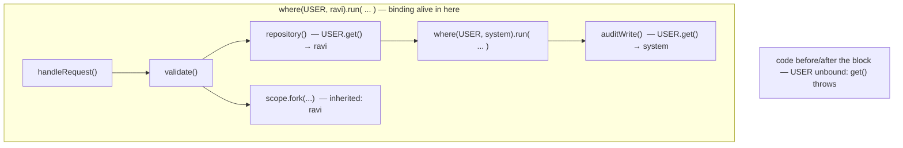
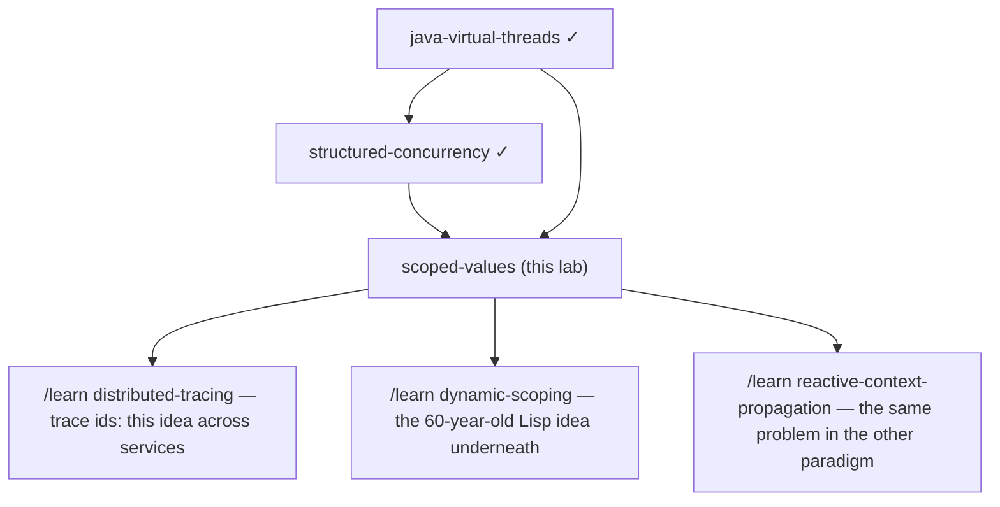

# Scoped Values — a learning lab

*From "never heard of it" to reading JEP 506 comfortably. `ScopedValue` is
**final** in this machine's JDK 25 — no preview flags except where a demo
touches `StructuredTaskScope`. All quoted output is real, from `./run.sh`.
Third lab in an arc: [java-virtual-threads](../18-java-virtual-threads/) made
threads cheap, [structured-concurrency](../19-structured-concurrency/) organized
them into trees — this lab is how *data* travels down those trees.*

---

## 1. Why does this exist?

Almost every server has "ambient" facts about the current request — who is
calling, the request id for logs, the tenant, the transaction. Threading them
through every method signature is unbearable, so Java offered `ThreadLocal`:
a per-thread pocket any code can read. But `ThreadLocal` was designed in
1997 for a world of few, long-lived, pooled threads — and in today's world
(millions of short-lived virtual threads, thread-per-request) its three
design mistakes — anyone can overwrite it, it lives forever until manually
removed, and it's expensive to inherit — became bugs, leaks, and memory
cost. `ScopedValue` is the redesign: same "ambient data" job, with the
mistakes made impossible rather than discouraged.

## 2. The problem, as a story

A hospital gives every visitor a colored badge at the front desk: the badge
says which patient you're visiting. Every ward you walk into simply reads
the badge — you never repeat yourself. Now imagine the badges work like
sticky notes anyone can rewrite: a nurse in radiology scribbles a different
patient on yours (it was convenient for one errand and she forgot to change
it back). You walk on; every subsequent ward now trusts the wrong note. And
when you leave, the badge stays on your coat — tomorrow, whoever borrows the
coat walks the hospital as *you*.

The badge idea is right — context you carry, wards that just read it. What's
broken is that the badge is **writable by everyone** and **nobody is forced
to take it off**.

## 3. The naive solution

Java's classic badge is `ThreadLocal`:

```java
static final ThreadLocal<String> CURRENT_USER = new ThreadLocal<>();
// top of request:            CURRENT_USER.set("alice");
// anywhere deeper:           CURRENT_USER.get();
// end of request (please!):  CURRENT_USER.remove();
```

## 4. Why that fails

Run `./run.sh leak` — the coat-borrowing scene, live (real output):

```
[request A] set CURRENT_USER=alice on pool-1-thread-1
[request A] ...does its work, returns. Oops: nobody called remove().
[request B] on pool-1-thread-1 — who am I? CURRENT_USER=alice
[request B] I never logged in as alice! Request A's identity LEAKED into me.
```

`ThreadLocal`'s three structural mistakes, named:

1. **Unbounded mutability.** `set()` is callable from anywhere, any time.
   You cannot look at code and know what the value is — anything below (or
   before) you may have overwritten it. Data flows *sideways* invisibly.
2. **Unbounded lifetime.** The value lives until `remove()` — a manual,
   forgettable act (our demo "refactored it away"). On a pooled thread the
   stale value greets the next request: the identity-leak bug class. At
   virtual-thread scale it's also memory: a million threads × one forgotten
   cache each.
3. **Expensive inheritance.** `InheritableThreadLocal` must deep-copy the
   parent's table at *every* thread creation (the child might mutate it) —
   painful when [structured concurrency](../19-structured-concurrency/) forks
   threads by the dozen per request.

## 5. The key idea

**Bind the value to a region of the call stack, not to the thread.** A
scoped value is written exactly once, at the top, together with the block of
code allowed to see it; everything called from that block can read it;
when the block exits — normally or by exception — the binding is simply
gone. Immutable while bound + lifetime = block lifetime: mistakes 1 and 2
have no spelling, and 3 becomes free (nobody can mutate, so children share
the parent's bindings by pointer).

## 6. The vocabulary

| Term | Plain-English meaning |
|---|---|
| **Scoped value** | The *key*: a `static final ScopedValue<T>` field. Itself holds nothing — think "badge slot". |
| **Binding** | The association key→value, alive only while its block runs. |
| **`where(key, value)`** | Prepares a binding; returns a **carrier** (a bundle of one or more bindings). |
| **Carrier** | The fluent bundle: `where(A,1).where(B,2)` binds several values for one block. |
| **`run(block)` / `call(block)`** | Executes the block *inside* the bindings (`call` returns a result). This is the only way a binding comes to exist. |
| **Dynamic scope** | What the block can see: everything it *calls*, however deep — not just its own braces. |
| **Rebinding** | Nesting a new `where` for the same key: shadows the outer value for the inner block only. |
| **Unbound** | No enclosing block bound the key: `get()` throws, `orElse(x)` answers `x`, `isBound()` says which. |
| **Inheritance** | Bindings flow into `StructuredTaskScope.fork()` children automatically — and into hand-started threads *not at all*. |

## 7. The mental model

> **A scoped value is an invisible parameter passed to every call beneath
> the binding.** Imagine every method under `where(USER,"ravi").run(...)`
> silently gaining a final parameter `user="ravi"`. That's why it can't
> change (parameters are what they were passed as), why it disappears when
> the stack unwinds (parameters die with the call), why rebinding shadows
> (an inner call passed a different argument), and why structured forks
> inherit (they're calls too — just sideways ones).



## 8. See it move

- **Interactive page** — `visualization.html` (published copy:
  <https://claude.ai/code/artifact/c14fbd9c-4e43-4ca6-82f1-379ac313dd46>): watch bindings appear and vanish with stack frames, shadow
  on rebinding, leak in ThreadLocal mode, and flow into forks. The story
  buttons narrate each scene.
- **Demo 1** (`./run.sh basic`) — the core loop in 30 lines: bound → three
  layers deep → gone, `NoSuchElementException` outside.

## 9. The actual mechanism

The canonical shape:

```java
static final ScopedValue<String> REQUEST_ID = ScopedValue.newInstance(); // the key

ScopedValue.where(REQUEST_ID, "req-7f3a")     // 1. prepare binding(s) → carrier
           .where(USER, "ravi")               //    (as many as you need)
           .run(() -> handleRequest());       // 2. the block that can see them

// ...three layers down, no parameters passed:
String id = REQUEST_ID.get();                 // 3. read: "req-7f3a"
String theme = THEME.orElse("default");       // 4. optional context
```

Step by step, with the worked example from Demo 1:

1. **The key is a constant, the value is not stored in it.** `REQUEST_ID`
   is just an identity (typically `static final`). Two requests bind it to
   different strings *at the same time* on different threads without
   touching each other (test `each_thread_sees_only_its_own_binding`).
2. **`where(...)` builds a carrier** — an immutable list of (key, value)
   pairs. Nothing is visible yet.
3. **`run`/`call` pushes the bindings and executes the block.** Internally
   the JVM keeps a small immutable chain of binding frames tied to the
   stack; `get()` walks it (with a per-thread cache making reads a few
   nanoseconds — faster than `ThreadLocal.get()`'s hash lookup).
4. **Reads anywhere below.** `get()` if the context is mandatory — unbound
   is a *bug* and throws `NoSuchElementException: ScopedValue not bound`;
   `orElse`/`orElseThrow`/`isBound` when it's optional.
5. **Rebinding = nesting.** `where(USER,"system").run(audit)` inside the
   request shadows `USER` for exactly that call; the outer value is not
   modified, merely covered (Demo 2 — including the exception path: the
   outer value is back with no `finally` anywhere).
6. **Exit = erasure.** However the block ends, the frames pop with the
   stack. There is no `remove()`, because there is nothing left to remove.
7. **Forks inherit by reference.** `StructuredTaskScope.fork()` children
   run *within* the parent's dynamic scope, so they see its bindings — and
   because bindings are immutable, "inheriting" is copying one pointer,
   not a table ([structured-concurrency](../19-structured-concurrency/)
   guarantees the child can't outlive the binding). Hand-started threads
   (`Thread.ofVirtual().start(...)`) inherit **nothing** — the JVM can't
   bound their lifetime (Demo 4 shows both, side by side).

## 10. Failure scenarios — where this bites

**(a) The async escape (the big one).** A lambda submitted to an executor
runs *later, on another thread* — outside the dynamic scope. Reading a
scoped value there throws. Real output from `src/BrokenAudit.java`:

```
Exception in thread "pool-1-thread-1" java.util.NoSuchElementException: ScopedValue not bound
```

The fix is a discipline: **capture at submit time, not at run time** —
`String id = REQUEST_ID.get(); pool.execute(() -> write(id));`. Exercise D1
makes you do it. (Note ThreadLocal here doesn't fail loudly — it silently
reads `null` or a stale value. Failing loudly is the feature.)

**(b) Mutable payloads.** The *binding* is immutable; a bound
`ArrayList` is still mutable, and deep code can `add()` to it — sideways
data flow smuggled back in (test
`the_binding_is_immutable_but_the_object_it_names_is_not` demonstrates it).
Bind records, `List.of`, unmodifiable views.

**(c) Expecting inheritance where there is none.** Bindings don't reach
hand-started threads, `CompletableFuture.supplyAsync` pool threads, or
timers. Only structured forks. If work must carry context elsewhere, pass
it explicitly (see a).

**(d) Rebinding is not mutation.** You cannot "update" a value for code
*above* you or *beside* you — only for code you call. Designs that used
`ThreadLocal` as a writable scratchpad (accumulating state across layers)
do not port; they need a real parameter or return value. This is by design:
scoped values are for *sharing downward*, not *communicating upward*.

**(e) Deep recursion + `where` per frame** builds a long binding chain;
the read cache keeps common reads fast, but don't bind inside tight loops —
bind once around them.

## 11. What is guaranteed, and what is not

**Guaranteed:** while a block runs, every `get()` in it sees exactly the
value its nearest enclosing `where` bound — no code anywhere can change
that from outside; the binding is gone on every exit path (return, throw,
even `Error`); per-thread isolation; structured forks see the parent's
bindings; reads are cheap and allocation-free.

**Not guaranteed / not provided:** no mutation, no `set()`, no
communicating results upward; no inheritance into unstructured threads; no
protection against mutating a bound *object* (10b); no persistence beyond
the block — nothing to read after the request, by design.

**The trade:** you give up write-anywhere flexibility and get local
reasoning — the value at any point is determined by the enclosing `where`,
readable directly from the source code, the way a final parameter is.

## 12. The code in this lab

| File | What it proves |
|---|---|
| `src/BasicFlow.java` | Bind at the top, read three layers down; unbound = exception; `orElse`. |
| `src/Rebinding.java` | Shadow for a sub-call; auto-restore, even through an exception. |
| `src/ThreadLocalLeak.java` | The disease: request B wakes up as `alice` on a pooled thread. |
| `src/Inheritance.java` | Structured forks inherit; hand-started threads don't. |
| `src/ScenarioTests.java` | 11 scenario tests: every rule in §9–§11. |
| `src/P1.java`, `src/BrokenAudit.java` | Exercise files (predict puzzle; the async-escape crash). |

## 13. Run the experiments

```bash
./run.sh basic     # the canonical shape
./run.sh rebind    # shadowing and restoration
./run.sh leak      # the ThreadLocal identity leak, live
./run.sh inherit   # who inherits bindings (preview flags: StructuredTaskScope only)
./run.sh test      # 11 scenario tests
./run.sh all
```

## 14. From this lab to production

- **Status:** final since JDK 25 (JEP 506) — usable in production today,
  unlike `StructuredTaskScope` (still preview).
- **Migration reality:** the ecosystem's context plumbing —
  `SecurityContextHolder`, MDC in Logback/Log4j, OpenTelemetry
  `Context`, Micrometer context-propagation — is ThreadLocal-based today;
  frameworks are migrating gradually. New *application* code with a clear
  request boundary is where you adopt ScopedValue now.
- **The adoption pattern:** one `RequestContext` record bound at the filter/
  interceptor at the top of each request, read by logging, auditing, and
  authorization below — replacing a fistful of separate ThreadLocals.
- **Fit with the stack:** thread-per-request on virtual threads binds at
  the top of each request; structured fan-out inherits it for free — the
  three labs in this arc are one architecture.
- **Async boundaries** (queues, schedulers, reactive pipelines) remain
  explicit-capture territory (§10a) — ScopedValue deliberately does not
  follow work across them.
- **Diagnostics:** an unbound read failing with a stack trace at the exact
  wrong `get()` is your friend; contrast with ThreadLocal's silent `null`
  that surfaces three services later.

## 15. Exercises

See [`EXERCISES.md`](EXERCISES.md); answers in [`SOLUTIONS.md`](SOLUTIONS.md).

## 16. Scoped values vs. the neighbors

| | `ScopedValue` | `ThreadLocal` | `InheritableThreadLocal` | Explicit parameters |
|---|---|---|---|---|
| Mutable after binding | no — that's the point | yes, from anywhere | yes | n/a |
| Lifetime | the block, enforced | until `remove()`, manual | until `remove()` | the call |
| Child threads | structured forks only, by reference | none | all, by copy (cost!) | n/a |
| Unbound read | throws (loud) | `null` (silent) | `null` | compile error (loudest) |
| Best for | ambient per-request context | legacy code; JDK <21 | avoid | few values, few layers |

Rule of thumb: a value 2–3 layers deep → just pass the parameter. A value
read in 20 places across every layer of a request → ScopedValue. ThreadLocal
→ only where a framework hands you no better hook.

## 17. Where to go next



*Read next from the source: JEP 506 (scoped values) — and its "Motivation"
section, which is this README's §4 with the JDK team's own war stories.*
