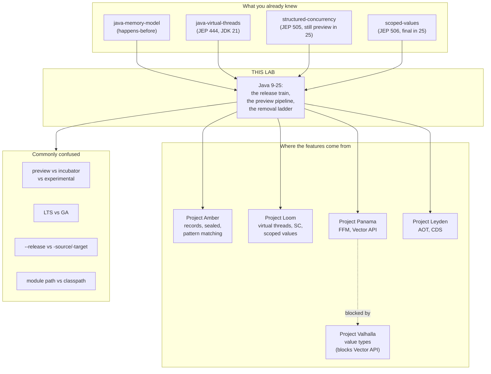

# Java 9 → 25 — how the language actually changes, and why it nearly stopped

> **Tell a friend:** Asha's team at Peepal Pay stayed on Java 8 for six years,
> because every upgrade had become a project nobody could schedule. Java had the
> same illness: a release shipped only when its slowest feature was ready, so
> each one arrived late and enormous, and enormous upgrades get skipped. The
> cure was not a feature. Java began shipping on a fixed date every March and
> September, ready or not, plus two ways to hand you a feature that is finished
> but still allowed to change. Records, virtual threads and the errors that
> break Asha's build all fall out of that.

The trainer for this lab is [`visualization.html`](visualization.html), also
published as [The Release Train](https://claude.ai/code/artifact/7b7a1370-fb28-4a44-bcfe-32b4e499a35d).
What this lab is made of, where its numbers come from, and which of the
seventeen per-release files to read is in [section 17](#17-about-this-lab).

---

# BEGINNER MODEL — stages 1 to 9

## 1. Why does a language everybody likes start to die?

> **In one breath:** Java 8 was loved, and the next version took three and a
> half years to arrive. In that gap, upgrading became frightening, so teams
> stopped doing it. A platform that nobody upgrades stops being able to fix
> anything for anybody.

**Asha** is the platform lead at Peepal Pay, a payments company in Pune. She
owns one decision that everybody else's work depends on: which version of Java
the company's forty services run.

For six years her answer was "eight". Not because Java 8 was best. Because
moving off it was a piece of work nobody could find room for, and it got bigger
every year they waited.

She was not unusual. She was the normal case, and the normal case is the
subject of this lab.

Java 8 came out in March 2014. It was enormously popular. Lambdas and streams
changed how people wrote Java, and the whole industry moved to it happily.

The next version, Java 9, came out in September 2017.

Read those two dates again, because the gap between them is the entire problem.

| The release | When it arrived | Gap since the one before |
|---|---|---|
| Java 8 | March 2014 | — |
| Java 9 | September 2017 | three and a half years |

In that gap something bad happened, and it had nothing to do with Java's
technical quality. **Teams stopped upgrading.** Years after Java 11 shipped,
surveys of production Java still found version 8 in the majority of
deployments. An enormous share of the world's backend software was sitting on a
version whose free public updates had ended.

That is the problem this lab is about. It is not "Java lacked feature X". It is
that **the way Java shipped releases made upgrading feel dangerous**.

And a platform nobody upgrades slowly dies. Its security fixes reach nobody,
because nobody takes the new version. Its new work reaches nobody, for the same
reason. The platform can still be excellent and still be irrelevant.

Everything below is the story of how that got fixed, and of the features that
fell out of the fix.

## 2. What is wrong with a shuttle that waits for everybody?

> **In one breath:** Picture the office shuttle that will not leave until the
> last colleague has boarded. One late colleague delays everyone. Worse, when it
> finally arrives, ninety-one people get off at once and nobody can tell whose
> ticket jammed the barrier.

Forget compilers for a page.

Peepal Pay runs one shuttle from the office to the train station. It is the
only shuttle. Its rule is simple and, on a normal day, sensible:

> The shuttle leaves when the last passenger has boarded.

On a normal day everybody arrives, everybody boards, the shuttle goes. Fine.

Then comes the day **Priya** is late. Priya is bringing a large and complicated
piece of luggage, and she has been running late for a while now.

Everybody already aboard sits and waits. **Meera** is aboard with a laptop bag.
**Dev** is aboard with nothing at all. Sam has a small backpack. Wei is
carrying nothing. Forty other people who arrived on time are in their seats.
Every one of them is ready. Their journeys are trivially simple. They wait
anyway, because the rule says the shuttle leaves when the last passenger has
boarded, and Priya has not boarded.

Priya eventually arrives. Three and a half years late.

Now here is the part that matters, and it is **not** the delay.

When the shuttle finally pulls in at the station, **ninety-one people get off at
once.** The station staff who have to check every ticket now face a crowd. If
anything is wrong with anybody's ticket, it is wrong in the middle of ninety-one
people, and nobody can tell whose ticket caused the jam.

That crowd is exactly what a Java upgrade felt like in 2017. Here is the
mapping, so the story has somewhere to land later.

| In the shuttle story | In Java | Where you meet it again |
|---|---|---|
| Priya's large luggage | the module system, in development since 2008 and slipping repeatedly | section 11, failures F1 and F3 |
| The other ninety passengers | the finished features of Java 9 — a REPL, factory methods for collections, a stack-walking API, a new HTTP client, dozens more | section 10 |
| The station staff | you, on the Monday morning your service will not compile on the new version | section 13 |
| The crowd at the barrier | the migration cost of one upgrade | section 11 |

**Ninety-one is a real count**, not a figure of speech. It comes from the
OpenJDK release page. Read the two rows below together; the second one is the
whole point of this lab.

| Release | Changes delivered | Time since previous release |
|---|---|---|
| Java 9 | **91** | three and a half years |
| Java 10 | **12** | six months |

Before you go further, here is the shape of the road ahead. Four layers, and
what you can do at the end of each.

| Layer | Sections | After it you can… |
|---|---|---|
| Beginner | 1–9 | say why Java ships twice a year, and what LTS and preview really mean |
| Intermediate | 10 | trace any feature from proposal to production, and read the bytes that enforce preview |
| Engineering | 11–12 | name what will break on a version jump before you try it |
| Production | 13 | run a real upgrade, and know which of Java's promises covers each dependency |

## 3. Why not just cut the late feature?

> **In one breath:** The obvious fix is to hold the date and drop whatever is
> not ready. Every engineer proposes it within ten seconds. It is also how most
> software teams already work.

Dev says it out loud in the retro, and he is right to.

Hold the deadline. Drop whatever is not finished. If Priya's luggage is not
packed by the departure time, the shuttle goes without her and she catches the
next one. If the module system is not done by the date, ship Java 9 without it
and put it in Java 10.

Reasonable. Standard practice. And it does not work here. The next section is
why.

## 4. Why does cutting the late feature not help either?

> **In one breath:** It fails twice. Under a slow schedule, "catch the next one"
> means "wait three more years", so the deadline always loses. And even a
> release with the late feature cut still arrives as a crowd.

The shallow reason first.

Under a schedule where releases are years apart, "put it in the next one" means
"delay it by three more years". Nobody agrees to that. So the pressure to hold
the shuttle is enormous, and it wins every time. **A deadline everybody knows
will slip is not a deadline.**

The deep reason is the interesting one.

Cutting the late feature does not fix the crowd at the ticket barrier. Suppose
Java 9 had shipped on time in 2016 *without* the module system, carrying only
its other ninety features. That is still a two-and-a-half-year gap from Java 8.
It is still ninety changes arriving at once. Asha's upgrade is still a project
with a plan, a risk register and a name.

And here is the trap that closes behind her:

> An upgrade that is a *project* gets scheduled against other projects.
> It loses. So you skip it. So the next upgrade is even bigger.
> So it loses even harder.

Engineers call a mechanism like that a **ratchet**: it only turns one way.
Every skipped upgrade makes the next one more expensive, which makes skipping
it more likely, which makes the one after that worse again.

Asha's team did not get stuck on Java 8 because they liked Java 8. They got
stuck because by the time they looked up, the jump was too big to justify — and
it grew every year they waited.

> **🔮 Predict:** Java's answer was to release *more often* — every six months
> instead of every few years. But that means *more* upgrades for Asha, not
> fewer. How does adding upgrades make upgrading less painful?
>
> <details><summary>Reveal</summary>
>
> If you guessed "it doesn't, they just made peace with the pain", you are
> reading upgrade cost as if it adds up. It does not.
>
> Upgrade pain is not linear in the number of upgrades. It is *superlinear in
> the size of each one*. Twelve small steps cost far less in total than one step
> containing the same total content. Three reasons:
>
> 1. **You can tell what broke.** When 4 things changed and Meera's test suite
>    goes red, she can find which of the 4 did it. When 400 things changed, she
>    cannot, and that debugging is what actually eats the schedule.
> 2. **It stops being a project.** A change small enough to absorb inside normal
>    maintenance never gets scheduled against a feature. It just happens. That
>    is the ratchet running backwards.
> 3. **Warnings get runway.** Small frequent releases let the platform warn you
>    in one release, warn louder two later, and only remove five later. You
>    always meet a removal you were told about twice. You will see that exact
>    three-step ladder again and again below; it is the single most important
>    pattern in this lab.
>
> The bet Java made in 2017 was that **frequency is a safety feature**. The rest
> of this document is that bet being paid off — and the places where it was not.
> </details>

## 5. What has to be true for a thirty-year-old platform to keep moving?

> **In one breath:** Strip the story away and three things must hold at the same
> time. Steps must be small and land on a date. It must be possible to ship a
> language feature and still change it later. And there must be a version a
> conservative bank can sit on.

Asha does not need a story. She needs a list of conditions. Here they are.

**First, each step must be small enough to absorb, and must arrive on a date she
can plan around.** Not "when it's ready". A date. Asha schedules people against
calendars, not against hopes. That is condition one.

**Second, it must be possible to ship a language feature and still change it
afterwards.** That is condition two. It is the hard one, and it looks
impossible.

A library method that turns out wrong can be deprecated and eventually removed.
A piece of *language syntax* that turns out wrong is in a hundred million source
files forever. Java is still carrying `Object.finalize()`, Java serialization
and `java.util.Date` — mistakes from the 1990s that can never be taken back.

Getting language design right requires real user feedback. Real user feedback
requires shipping. Shipping, under Java's compatibility promise, means
committing forever. Those two requirements appear to contradict each other, and
section 6 is where the contradiction gets broken.

**Third, there must be a version a conservative organisation can sit on.** Call
that condition three. A bank that will not move every six months needs a target
that keeps receiving security fixes for years. Without it, condition one relocates
the problem: Asha would be choosing between upgrading twice a year forever and
running unpatched.

The rest of this lab is three inventions, one per condition.

## 6. What are the three inventions?

> **In one breath:** The shuttle leaves on the timetable whether or not Priya
> boarded. Some passengers wear a badge saying "I may be redesigned". And a few
> routes keep running for years after the next shuttle departs.

**Invention one — the release train.** The shuttle leaves in March and in
September, every year, whether or not Priya has boarded. A feature that is not
ready rides the next one, six months later. Because six months is a short wait,
"it isn't ready, hold it" becomes a cheap and ordinary decision instead of a
disaster.

**Invention two — preview features.** A feature can ship *complete and
finished* but explicitly **not permanent**. You must pass a flag to both compile
and run it, and the platform marks the compiled output so the feature physically
cannot escape into production unnoticed. This is how condition two stops being a
contradiction. The feature is in real users' hands generating real feedback,
while the design is still legally changeable.

**Invention three — long-term support.** Every so often one of the trains is
designated as the one vendors keep patching for years. Everyone else's train
stops receiving updates the moment the next one departs, six months later.

Those three, together, are the entire mechanism. Everything else in this lab is
consequence.

| Condition from section 5 | The invention that answers it | In one line |
|---|---|---|
| Small steps on a planned date | the release train | March and September, ready or not |
| Ship a language feature and still change it | preview features | finished, shipped, and explicitly impermanent |
| A version a conservative team can sit on | long-term support | a vendor's promise to keep patching one release for years |

> **🔮 Predict:** Invention two says a preview feature "physically cannot escape
> into production unnoticed". Dev compiles a jar using one, publishes it to
> Peepal Pay's shared artifact repository, and six months later the platform
> team upgrades the JDK. What stops that jar?
>
> <details><summary>Reveal</summary>
>
> If you guessed "a warning in the build log" or "a note in the documentation",
> you are describing something that gets ignored within a week. A docs-only
> label is not a label.
>
> The answer is a number written into the compiled class file itself, which the
> JVM checks before it will load the class. Dev's jar refuses to start. Not
> subtly, not at some random later moment — at class-load time, with a message
> naming the flag it wanted.
>
> The exact bytes, and the two rules the JVM applies to them, are taken apart in
> section 10. The consequence for Dev is failure F5 in section 11.
> </details>

## 7. What do engineers call all of this?

> **In one breath:** Six words appear in every Java release note. You have now
> met the problems each of them names, so each one is a short story rather than
> a definition.

Asha opens the release note for a new JDK. Six words she half-knows are in the
first paragraph. Each one below is introduced here because you have already met
the problem it names. The precise definitions are collected in the glossary in
section 16.

### What is a JEP, and why does everyone quote numbers?

Somebody wants to change Java. Before any code is written, they write a
numbered public document proposing that one change. It gets discussed in the
open, it gets a number, and that number becomes the permanent record of the
change. That document is a **JEP**, a JDK Enhancement Proposal.

The process itself is defined by JEP 1, and the release process by JEP 3. Java
is a platform that describes itself in its own numbering scheme.

A JEP moves through a fixed set of stages and is *targeted* at a specific
release. Read the middle column as "what it means when you see this in a
tracker".

| Stage of a JEP's life | What it means | Where it matters to you |
|---|---|---|
| Draft | somebody is writing it up; nothing is promised | ignore it |
| Candidate | accepted as worth considering | early signal only |
| Proposed to Target | aimed at a named release | this is when a date first appears |
| Targeted | accepted into that release's plan | plan around it, carefully |
| Integrated | the code is in the build | it will very likely ship |
| Closed / Delivered | it shipped in that release | this is what section 10's tables record |

Why does Java need this word at all? Because it needed a way to discuss a change
publicly and durably *before* building it, separate from the legal
specification process. That legal process is the JCP, and its documents are
JSRs. **A JEP is engineering intent; a JSR is specification change.** Big JEPs
feed a JSR. Most JEPs never need one.

Concretely: JEP 444 is "Virtual Threads", delivered in JDK 21. When somebody in
a Java conversation says "444", they mean exactly that document, and you can
read it at `openjdk.org/jeps/444`.

You have already used this vocabulary without knowing the map it lives on. The
[java-virtual-threads](../18-java-virtual-threads/) lab is JEP 444. The
[scoped-values](../20-scoped-values/) lab is JEP 506. This lab is that map.

### What does GA mean, and what happens just before it?

**GA** stands for General Availability: the day a version is officially released
for production use.

It is the final milestone of the schedule JEP 3 defines. Before it come two
"rampdown" phases, in which the bar for accepting a fix rises twice, and then
two release candidates. Nothing new gets in during rampdown; the release is
being made boring on purpose.

The word exists to separate a release Asha may run in production from the
early-access builds that precede it by months. Early-access builds of the *next*
Java exist continuously, and she can download one today.

| Release | Its GA date |
|---|---|
| JDK 25 | September 2025 |
| JDK 26 | March 2026 |

**[CITED]**

### Why is LTS not a property of the build?

**LTS** stands for Long-Term Support: a release that keeps getting security
fixes for years.

Here is the part people get wrong, and it is worth getting right before Asha
sits in a vendor meeting. **LTS is not a technical property of the build.**
There is no code in JDK 21 that makes it LTS. There is no flag, no marker, no
different compilation.

It is a *support commitment made by vendors*. The OpenJDK project ships every
release identically. Oracle, Adoptium, Amazon, Azul, Red Hat and others then
choose which ones they will keep patching. They have converged on the same ones,
which is why it feels like a property of the release.

The word exists to give condition three a name. Without it, Asha's only choices
are "upgrade every six months" or "run unpatched", and most enterprises would
quietly pick unpatched.

> **🔮 Predict:** A colleague asks Asha: "so what is technically different about
> a JDK 25 build that makes it LTS?" What should she say?
>
> <details><summary>Reveal</summary>
>
> "Nothing." That is the whole answer, and it surprises people.
>
> If you guessed that LTS builds get extra hardening, more testing, or a
> different branch, you are describing how LTS works in some other ecosystems,
> not in Java. The JDK 25 artifact is built the same way JDK 24's was.
>
> The follow-up that matters commercially: because LTS is a promise rather than
> a build, **different vendors make different promises about the same release**.
> Two teams can both say "we're on LTS 21" and have different end dates. Asha has
> to check her actual vendor, not a table she found online.
> </details>

### How long does each release actually get supported?

Oracle's dates are below, and they are the ones most often quoted. Read the
last column as "how long after this one until the next long-support release".

| Release | GA | Oracle Premier Support until | Extended until | Gap to next LTS |
|---|---|---|---|---|
| **8 (LTS)** | March 2014 | March 2022 | December 2030 | 4 years |
| **11 (LTS)** | Sept 2018 | September 2023 | January 2032 | 3 years |
| **17 (LTS)** | Sept 2021 | September 2026 | September 2029 | 2 years |
| **21 (LTS)** | Sept 2023 | September 2028 | September 2031 | 2 years |
| **25 (LTS)** | Sept 2025 | September 2030 | September 2033 | 2 years |
| **29 (LTS)** | Sept 2027 | September 2032 | September 2035 | — |

Everything not in that table gets six months and then nothing. That is not an
oversight; it is the price of the train running on time.

| Releases | Their GA dates | How long each is supported |
|---|---|---|
| 9–10 | Sep 2017 – Mar 2018 | 6 months each |
| 12–16 | Mar 2019 – Mar 2021 | 6 months each |
| 18–20 | Mar 2022 – Mar 2023 | 6 months each |
| 22–24 | Mar 2024 – Mar 2025 | 6 months each |
| 26, 27, 28 | Mar 2026 – Mar 2027 | 6 months each |

**[CITED — Oracle Java SE Support Roadmap]**

Two things to notice in those two tables.

First, **the non-LTS table is the whole point of LTS**. A non-LTS release gets
six months of support, full stop.

Second, **the LTS gap changed**. Java 8 to 11 to 17 were three years apart.
Java 17 to 21 to 25 to 29 are two years apart. That change was deliberate, and
section 10 explains what went wrong to cause it.

One caution before Asha quotes any of this. Other vendors publish their own
dates, and some support *more* releases than Oracle does. Adoptium's Temurin,
Amazon's Corretto and Azul each have their own table. Check the vendor you
actually download from; the tables above are Oracle's.

### What makes a preview feature different from an unfinished one?

A **preview feature** is a finished language or VM feature that is deliberately
not yet permanent, so its design can still change based on what users report.

"Finished" is the surprising word. A preview feature is fully specified and
fully implemented. It is not a beta and not a half-built thing. What it lacks is
*permanence*.

The rules come from JEP 12. The feature is disabled by default. To use it you
pass `--enable-preview` to `javac`, along with `--release <current>`, *and* to
`java` at runtime. A preview feature may change, or be removed entirely, in any
later release, with no deprecation cycle at all.

Why does Java need this? Because of condition two. Without preview, the
six-month train would be actively *dangerous* for language features. Asha would
be watching the platform commit permanently to a design every six months
instead of every three years, which is worse, not better. **Preview is what
makes fast releases safe for language design.**

Dev can watch the mechanism work on his own machine. Structured concurrency is
JEP 505, a *fifth* preview in JDK 25. He compiles a program that uses
`StructuredTaskScope`:

```
$ javac --enable-preview --release 25 R.java
Note: R.java uses preview features of Java SE 25.
```

Then he runs it without the flag:

```
$ java R
Error: LinkageError occurred while loading main class R
  java.lang.UnsupportedClassVersionError: Preview features are not enabled for R
  (class file version 69.65535). Try running with '--enable-preview'
```

**[RAN]**

That `69.65535` is the enforcement mechanism, and section 10 takes it apart
byte by byte.

You already know this feature. The
[structured-concurrency](../19-structured-concurrency/) lab is JEP 505. What
that lab did not explain is *why* it is still preview after four years. This
one does.

### Why does an incubating API need a different word?

An **incubator module** is the same idea as preview, but for a whole new *API*
rather than a language change.

The rules come from JEP 11. The API ships in a module named `jdk.incubator.*`,
and you must explicitly add it with `--add-modules jdk.incubator.foo`. It is not
on the module path by default, and code compiled against it produces a warning.

So why is this a separate word rather than a synonym? Because the two are
enforced by completely different machinery, and confusing them causes real
mistakes. Preview is a language or VM thing, gated by a compiler and runtime
flag, and marked inside the class file. Incubator is a library thing, gated by
module resolution, and marked by the package name.

That last detail has a sharp edge. An incubating API that graduates **changes
its package name**. `jdk.incubator.foreign` became `java.lang.foreign`, so every
import in every early adopter's code broke on graduation. That was not an
accident. It is the design.

Concretely: the Vector API entered as an incubator in JDK 16 as JEP 338, and was
*still* incubating in JDK 25 as JEP 508 — its **tenth** incubation. Ten. Section
10 explains why, and it is the most instructive entry in the whole dataset.

### Why can a garbage collector not be previewed?

An **experimental feature** is a VM feature that is present but switched off,
because it is not yet trusted in production. It is gated behind
`-XX:+UnlockExperimentalVMOptions`. This is purely a HotSpot concept, with no
language or API involvement at all.

The reason it needs its own gate is mechanical. Garbage collectors and JIT
compilers cannot be "previewed" the way syntax can, because there is nothing to
compile differently. Your source code does not mention the collector. So the
gate has to be a runtime switch instead.

Concretely: ZGC arrived as experimental in JDK 11 as JEP 333, and became a
production feature in JDK 15 as JEP 377.

### Which gate is which?

Three gates, three mechanisms, three enforcement points. If you remember nothing
else from this section, remember that these are not synonyms.

| Gate | What it covers | How you turn it on | How it is enforced | Example |
|---|---|---|---|---|
| **Preview** | a language or VM feature | `--enable-preview` at compile *and* run | stamped into the class file | structured concurrency, JEP 505 |
| **Incubator** | a whole new API | `--add-modules` | the `jdk.incubator.*` package name | Vector API, JEP 508 |
| **Experimental** | a VM feature | `-XX:+UnlockExperimentalVMOptions` | a runtime flag only | ZGC in JDK 11, JEP 333 |

## 8. Which two pictures should you carry?

> **In one breath:** Carry the shuttle timetable in your head for talking to
> people, and the feature pipeline for reasoning about releases. Then learn the
> three places the shuttle picture lies to you, because each lie costs money.

### The simple picture: a timetable

Shuttles leave in March and September. Some routes keep running for years; the
rest terminate as soon as the next shuttle departs. Passengers who are not ready
catch the next one. Some passengers ride wearing a badge that says "I may get
off and be redesigned".

That is the picture to carry around in your head, and it is the one Asha uses
when she explains the plan to a product manager.

### The engineering picture: a pipeline

Each feature is a thing with a **state** and a count of how many releases it has
been in that state. Read the diagram top to bottom: a JEP enters at the top,
picks one of three gates, and either advances, holds, or leaves.

```
        ┌──────────────┐
        │    Draft     │  (a JEP exists; nothing ships)
        └──────┬───────┘
               │ targeted at a release
     ┌─────────┼─────────┐
     ▼         ▼         ▼
┌─────────┐ ┌────────┐ ┌──────────────┐
│Incubator│ │Preview │ │ Experimental │   ← the three gates
│  (API)  │ │ (lang) │ │    (VM)      │
└────┬────┘ └───┬────┘ └──────┬───────┘
     │          │             │
     │  each 6-month tick: advance, hold, or WITHDRAW
     │          │             │
     └──────────┼─────────────┘
                ▼
          ┌───────────┐
          │   FINAL   │  (permanent; compatibility promise begins)
          └───────────┘
```

Three properties of that pipeline are worth stating precisely, because they are
exactly what the visualization lets you watch.

**A tick advances at most one step.** Six months of real elapsed time per
transition. That is why "how many previews did it take" is a question answered
in *years*, not in iterations.

**A feature can hold.** Structured concurrency was a preview in JDK 21, 22, 23,
24 and 25. That is five ticks. The API was substantially redesigned in the
middle of that run.

**A feature can leave the pipeline without ever reaching final.** This is the
property that justifies the whole design, and it has actually been exercised.
String templates, JEP 430 and then JEP 459, previewed in JDK 21 and 22 and were
then **withdrawn**, removed from JDK 23 with no replacement. That is the system
working correctly, not failing.

### How do the two pictures line up?

| In the shuttle story | In the pipeline | Where you see it |
|---|---|---|
| The shuttle | a six-month release | JDK 21, JDK 22, … |
| Departure time | the GA date | March and September |
| A passenger | a JEP | JEP 444 |
| A passenger wearing the "may be redesigned" badge | a preview or incubator feature | `--enable-preview` |
| A passenger who misses this shuttle | a feature held for another tick | structured concurrency, five previews |
| A passenger who gives up and goes home | a withdrawn feature | string templates |
| A route that keeps running for years | an LTS release | 8, 11, 17, 21, 25 |
| A route that terminates at the next stop | a non-LTS release | 9, 10, 12–16, 18–20, 22–24 |
| The crowd at the ticket barrier | the migration cost of one upgrade | section 11 |

### Where does the shuttle story lie to you?

Three places. Each one costs somebody money.

**Lie one: a late passenger is unchanged when they board the next shuttle. A
held feature is not.** This is the biggest lie in the whole analogy. The point
of holding a feature for another preview is precisely that it gets *redesigned
in between*.

Take `StructuredTaskScope`. In JDK 21 you used static factory methods called
`ShutdownOnFailure` and `ShutdownOnSuccess`. By JDK 25 the whole shape had
changed to `StructuredTaskScope.open()` with a *joiner* policy. Same passenger
name, different passenger. If Dev learned the JDK 21 API, he has to relearn it.
The pipeline has a mutation step the shuttle has no room for.

**Lie two: an LTS release is not a different vehicle.** JDK 25 is not built
differently from JDK 24. Nothing in the artifact is special. LTS is a promise
made *about* it afterwards, by vendors, and different vendors make different
promises. The analogy makes LTS look like a bigger, sturdier bus. It is the same
bus with a longer maintenance contract.

**Lie three: shuttles are independent; releases are cumulative.** Missing the
3pm shuttle costs Priya thirty minutes. Skipping JDK 22 costs her nothing *at
the time*, and then appears in full when she jumps from 21 to 25, because 25
contains everything 22, 23 and 24 did.

That third lie has a consequence Asha needs on a slide. The train departs every
six months, but **the delta you actually swallow is set by how long you waited,
not by the cadence**. Frequent releases do not reduce your migration cost.
*Frequent upgrading* does. The cadence only makes frequent upgrading possible.

## 9. What does the timetable actually show you?

> **In one breath:** Go and play with it. Four tabs: the timetable, the
> pipeline, the class-file lock, and a scanner that lists what will break
> between any two versions.

Open **`visualization.html`** in this directory, or the hosted version:
**<https://claude.ai/code/artifact/7b7a1370-fb28-4a44-bcfe-32b4e499a35d>**

Here is what each tab is for and what to look at.

**Tab 1 — "The timetable."** The release train drawn to scale, with support
windows. *Look at:* the difference between an LTS bar and a non-LTS bar. Then
use the "I am running / I want to reach" control. Watch the delta counter,
which is the number of JEPs you swallow, change as you widen the jump.

Set it to Asha's two candidate jumps and read the figures.

| The jump | Changes swallowed | Releases crossed |
|---|---|---|
| 8 → 25 | **298** | 17 |
| 21 → 25 | **66** | 4 |

The lesson is in the difference between those two numbers, not in the picture.

**Tab 2 — "The pipeline."** Step through releases 9 to 25 one tick at a time and
watch features move through incubator, preview and final. *Look at:* the Vector
API row, which never moves, and the string templates row, which reverses. Step
**backwards** too — the button is there, and it is the fastest way to see which
release a given feature was in.

**Tab 3 — "The class-file lock."** Compile a file with and without
`--enable-preview`, then try to run it on different JDKs, and watch the class
file's version bytes change. *Look at:* the two bytes that go from `0000` to
`ffff`. This tab replays the exact bytes and the exact error text from section
10.

**Tab 4 — "The hazard scanner."** Pick a from-version and a to-version and get
the ordered list of things that will break. *Look at:* how the list changes
between 8 → 17 and 8 → 25. Every hazard listed there is expanded in section 11.

Each tab asks you to predict before it shows you the answer. Take the
predictions seriously. They are placed where being wrong teaches something.

> **CHECKPOINT — end of the BEGINNER MODEL.**
> You can now say why Java releases every six months, what LTS is (a vendor
> promise, not a build), and what preview means. That is enough to have the
> "which JDK should we target" conversation with Asha's team.
> **Next (INTERMEDIATE): how a feature actually travels, why some take eight
> years, and how the platform physically stops a preview feature from escaping
> into Dev's production jar.**

> **Say it back.** Without using the words *preview*, *LTS* or *JEP*, explain to
> a friend why releasing Java more often made upgrading it easier rather than
> harder.
> <details><summary>A good answer sounds like</summary>
> "The trouble was never how often you had to change. It was how much changed at
> once. When three years of work arrives on one day, something breaks and you
> cannot tell which of the four hundred changes did it, so finding out becomes a
> project, and projects get postponed. Ship a small pile every six months and
> each broken thing has an obvious culprit. It stops being a project and starts
> being Tuesday."
> </details>

---

# INTERMEDIATE MODEL — stage 10

## 10. How does a feature actually travel, and why does it look so strange?

> **In one breath:** We are going to build the release mechanism the way a smart
> engineer would, and let each version break. Every strange detail of the real
> system is the scar of one of these failures.

Asha and Dev are now going to design the thing themselves. Five attempts. Each
one fails in a specific place, and the fix for that place is a feature of real
Java that otherwise looks arbitrary.

### v1 — what if you just release every six months?

The simplest possible answer to condition one. March and September, fixed dates,
whatever is ready ships.

**Trace it on a real case.** Switch expressions are the change that lets you
write `int x = switch (day) { case MON -> 1; ... };` instead of a statement
switch full of `break`. Suppose Java ships it, final, in the first train that
has it working: JDK 12, March 2019.

Now feedback arrives. In the version that shipped, producing a value from a
multi-statement branch used `break value;`:

```java
// The design that shipped in this hypothetical
int n = switch (day) {
    case MON -> { int t = compute(); break t; }   // 'break' with a value
    default  -> 0;
};
```

Users report that overloading `break` this way is confusing. `break` already
means "leave the loop". Now it also means "return this value". Inside a loop
inside a switch, you cannot tell which is meant.

**Where v1 breaks.** It has shipped. It is final. `break value;` is now in a
hundred thousand source files. Java's compatibility promise means it can never
be removed.

Java is now stuck with a syntax everybody agreed was wrong, forever. That is
exactly the `Object.finalize()` disease from section 5 — except it now arrives
twice a year instead of every three years. Version one has made condition two
*worse*.

> **🔮 Predict:** How do you ship a language feature to real users, get real
> feedback, and still be allowed to change it afterwards?
>
> <details><summary>Reveal</summary>
>
> If you guessed "put a warning in the release notes", that is the answer that
> gets ignored within a week. A label only works if something enforces it.
>
> You ship the feature with an explicit, *enforced* label saying "this is not
> permanent". That is JEP 12, preview features.
>
> And it worked on exactly this example. Switch expressions previewed in
> **JDK 12** (JEP 325) with `break value;`. The feedback came in. The **second
> preview in JDK 13** (JEP 354) replaced it with a new contextual keyword,
> `yield`. It went final in **JDK 14** (JEP 361) with `yield`. The wrong syntax
> existed for exactly one release, in preview, and was thrown away.
>
> The syntax you write today:
>
> ```java
> int n = switch (day) {
>     case MON -> { int t = compute(); yield t; }   // 'yield', not 'break'
>     default  -> 0;
> };
> ```
>
> `yield` exists because of a mistake that was caught in preview. Every odd
> corner of modern Java has a story like this one.
> </details>

### v2 — what if a flag on the compiler is enough?

So add a flag. `javac --enable-preview` lets you use the impermanent feature.
Without it, a compile error. Done?

**Trace it.** It is 2019. Dev is enthusiastic about switch expressions. He adds
`--enable-preview` to the build, writes `break value;`, compiles `orders.jar`,
and ships it to Peepal Pay's artifact repository. The jar runs fine on JDK 12 in
production.

Six months later Meera upgrades production to JDK 13. Nothing in `orders.jar`
changed. It is a compiled artifact, and Java's whole promise is that a compiled
artifact keeps working on newer JDKs.

But in JDK 13 the meaning of that construct changed. The bytecode inside Dev's
jar was generated by a compiler whose rules no longer exist.

**Where v2 breaks.** The jar either misbehaves subtly or crashes in a way that
points at nothing. The compile-time flag protected the *compiler*. It did
nothing to protect the *artifact*.

And the artifact is the thing that travels. Into repositories, into containers,
into other teams' dependency trees — long after everybody has forgotten that
`--enable-preview` was ever passed.

### v3 — how do you stamp the artifact itself?

The fix is to put the mark **in the class file**, and make the JVM refuse to
load it unless the conditions are exactly right.

Every Java class file starts with the same eight bytes. Read the diagram as four
magic bytes, then a two-byte minor number, then a two-byte major number.

```
ca fe ba be   <minor:2>  <major:2>
└─ magic ─┘
```

`cafebabe` is the magic number that says "this is a class file". Then comes a
two-byte **minor version** and a two-byte **major version**.

The major version is the Java release, offset by 44. Here are the four you will
actually meet.

| Major version | Java release |
|---|---|
| 52 | Java 8 |
| 61 | Java 17 |
| 65 | Java 21 |
| 69 | Java 25 |

Dev dumps the first eight bytes of a normal class compiled on JDK 25:

```
$ javac T.java && xxd -l 8 T.class
00000000: cafe babe 0000 0045
                     ^^^^ ^^^^
                     minor  major = 0x45 = 69 = Java 25
```

**[RAN]**

And now the same class compiled with the preview flag:

```
$ javac --enable-preview --release 25 R.java && xxd -l 8 R.class
00000000: cafe babe ffff 0045
                     ^^^^ ^^^^
                     minor = 0xFFFF = 65535   major = 69
```

**[RAN]**

**One value changed: the minor version went from 0 to 65535.** That is the
entire mechanism. The JVM's class loader has exactly two rules about it.

| Rule | In words | What it prevents |
|---|---|---|
| 1 | if the minor version is 65535, refuse to load unless `--enable-preview` was passed | running preview code by accident |
| 2 | if the minor version is 65535, refuse to load unless the major version is **exactly** this JVM's own version | carrying preview code across a JDK upgrade |

Rule 1, observed on Dev's machine:

```
$ java R
Error: LinkageError occurred while loading main class R
  java.lang.UnsupportedClassVersionError: Preview features are not enabled for R
  (class file version 69.65535). Try running with '--enable-preview'

$ java --enable-preview R
42
```

**[RAN]**

Rule 2 is the one that closes the hole v2 left open. A normal class file
compiled for Java 8 has major version 52, and it runs on every later JVM. That
is the compatibility promise. A **preview** class file compiled on JDK 25 has
major 69 and minor 65535, and JDK 26 will refuse it, because 69 is not 70.
**[CITED — JEP 12; not executed here, since only one JDK is installed for this
lab.]**

The consequence, stated plainly, because it is the single most practically
important fact in this section:

> **A jar containing preview-compiled classes runs on exactly one Java version
> and nothing else.** It cannot be published to a shared repository and used by
> others. It cannot survive a JDK upgrade. This is not a bug or an
> inconvenience. It is the *designed* property that makes preview features safe
> to ship. The mechanism deliberately makes it impossible for a preview feature
> to quietly become load-bearing infrastructure.

Which is why "we'll just use the preview API and deal with it later" is never a
viable plan for a library. It is at most a viable plan for an application you
control end to end and rebuild on every upgrade. Dev meets the consequence in
person as failure F5.

> **🔮 Predict:** Meera compiles a jar on JDK 21 with no flags at all, and runs
> it on JDK 25. Dev compiles a jar on JDK 25 *with* `--enable-preview`, and runs
> it on JDK 26 *also* with `--enable-preview`. One of those two loads. Which?
>
> <details><summary>Reveal</summary>
>
> Meera's loads. Dev's does not.
>
> If you guessed that Dev's is fine because he passed the flag both times, you
> have applied rule 1 and stopped. Rule 2 is the one that catches him: minor
> 65535 demands an *exact* major-version match, and his class file says 69 while
> the JVM says 70. The flag is necessary and not sufficient.
>
> Meera's jar has minor version 0, so neither rule applies. Major 65 on a JDK 25
> JVM is ordinary forward compatibility, and it is the strongest promise Java
> makes. Section 12 says exactly how strong.
> </details>

### v4 — how many six-month ticks does a feature really take?

Now that the states are clear, the natural question is how many ticks a feature
takes to cross them. Here is the real data, drawn from the OpenJDK release
pages. **[CITED]**

#### What does a healthy feature look like?

Three ticks: preview, second preview, final. Eighteen months from first sight to
permanent.

| Feature | Preview | 2nd preview | Final |
|---|---|---|---|
| Switch expressions | 12 (JEP 325) | 13 (JEP 354) | 14 (JEP 361) |
| Text blocks | 13 (JEP 355) | 14 (JEP 368) | 15 (JEP 378) |
| Pattern matching for `instanceof` | 14 (JEP 305) | 15 (JEP 375) | 16 (JEP 394) |
| Records | 14 (JEP 359) | 15 (JEP 384) | 16 (JEP 395) |
| Sealed classes | 15 (JEP 360) | 16 (JEP 397) | 17 (JEP 409) |
| Record patterns | 19 (JEP 405) | 20 (JEP 432) | 21 (JEP 440) |
| Virtual threads | 19 (JEP 425) | 20 (JEP 436) | 21 (JEP 444) |
| Class-File API | 22 (JEP 457) | 23 (JEP 466) | 24 (JEP 484) |
| Stream gatherers | 22 (JEP 461) | 23 (JEP 473) | 24 (JEP 485) |

Two previews then final is **the shape of a healthy feature**. If Asha sees that
pattern starting, she can predict the final release date with confidence and
plan around it.

#### What does a hard feature look like?

Pattern matching for `switch` took five ticks: 17 (JEP 406) → 18 (JEP 420) → 19
(JEP 427) → 20 (JEP 433) → **21, final (JEP 441)**. Two and a half years.

It took that long because it touches four other things at once. Sealed classes,
for exhaustiveness checking. Records, for deconstruction patterns. Generics.
Null handling. Each of those interactions had to be settled before the syntax
could freeze.

#### What does eight years look like?

The Foreign Function & Memory API. It started as *two separate* incubating APIs
and merged into one. Read the third column as the state it was in at that
release.

| Release | JEP | State |
|---|---|---|
| 14 | 370 | Foreign-Memory Access API (incubator) |
| 15 | 383 | Foreign-Memory Access (2nd incubator) |
| 16 | 389 | Foreign *Linker* API (incubator) — a second, separate API |
| 16 | 393 | Foreign-Memory Access (3rd incubator) |
| 17 | 412 | **Foreign Function & Memory API** (incubator) — the two merged |
| 18 | 419 | FFM (2nd incubator) |
| 19 | 424 | FFM (**preview** — graduated from incubator to preview) |
| 20 | 434 | FFM (2nd preview) |
| 21 | 442 | FFM (3rd preview) |
| **22** | **454** | **Foreign Function & Memory API — final** |

Notice the transition at JDK 19. It moved from *incubator* to *preview*. That is
the graduation that renames the package: `jdk.incubator.foreign` became
`java.lang.foreign`, breaking every import in every early adopter's code, by
design.

That saga also explains something Meera will care about later. FFM is the
replacement for `sun.misc.Unsafe` and for JNI. Its arrival is what made
deprecating `Unsafe` possible at all. Hold that thought; it returns as failure
F4.

#### What does ten incubations mean?

The Vector API entered the pipeline in JDK 16 and has never left it. Read the
right-hand column as which incubation this was.

| Release | Which incubation, and its JEP |
|---|---|
| 16 | first — JEP 338 |
| 17 | second — JEP 414 |
| 18 | third — JEP 417 |
| 19 | fourth — JEP 426 |
| 20 | fifth — JEP 438 |
| 21 | sixth — JEP 448 |
| 22 | seventh — JEP 460 |
| 23 | eighth — JEP 469 |
| 24 | ninth — JEP 489 |
| **25** | **tenth — JEP 508** |

> **🔮 Predict:** A feature has been incubating for nine years and ten releases.
> Is the team incompetent, is the API design unusually hard, or is something
> else going on?
>
> <details><summary>Reveal</summary>
>
> Something else, and if you guessed either of the first two you have read a
> long incubation as a verdict on the people. It is not.
>
> The Vector API's own JEP text states that it will remain in incubation until
> **Project Valhalla**'s value types are available, because the API is designed
> around value semantics the language does not yet have. Finalising it now would
> freeze a design against a language that is about to change underneath it.
> **[CITED — JEP 508 and its predecessors]**
>
> This is the pipeline being used for a fourth purpose you have not seen yet.
> Not "we are still designing". Not "we are gathering feedback". But **"we are
> blocked on another project and will not commit until it lands."**
>
> Ten incubations is not ten failures. It is a nine-year refusal to make a
> permanent mistake — which, given `Object.finalize()` and `java.util.Date`, is
> a lesson the platform learned expensively.
>
> The practical read for Asha: **a long incubation is a signal about
> dependencies, not about quality.** Read the JEP text. It usually says outright
> what it is waiting for.
> </details>

#### What does the brake actually working look like?

String templates. Read the third column as what happened to anyone using it.

| Release | JEP | What happened |
|---|---|---|
| 21 | 430 | String Templates (preview) — `STR."Hello \{name}"` |
| 22 | 459 | String Templates (2nd preview) |
| 23 | — | **Removed. No JEP. Gone.** |

The feature was withdrawn during JDK 23 development. The design used a
processor-and-template-expression shape. Reviewers concluded it was carrying too
much complexity for the benefit. Rather than finalise it, or preview it a third
time, it was pulled out of the JDK entirely with no replacement.

This is the load-bearing event of the whole lab. **Preview is only meaningful if
withdrawal actually happens.** If every previewed feature eventually shipped,
preview would be a delay with extra flags and nothing more.

String templates prove the brake works. They also prove the warning in v3 was
not theoretical. Anyone whose code used `STR."..."` on JDK 21 or 22 found that
code uncompilable on JDK 23 — exactly as the preview contract said it might.

### v5 — why did the LTS gap shrink from three years to two?

The original plan was one long-support release every three years. Java 11 in
2018, then Java 17 in 2021.

**Where v5 broke.** Three years is six releases. An 11-to-17 jump swallows a
great deal at once. The module system's encapsulation tightening, sealed
classes, records, pattern matching for `instanceof` and text blocks all arrive
together. So do three removals: Nashorn, RMI activation and the CMS collector.
And a good deal more besides.

The encapsulation change in particular broke a large fraction of the
ecosystem's reflective libraries at once. The crowd at the ticket barrier was
back. Not as bad as 8 to 9, but bad enough that "we'll wait for the next LTS"
became a common decision again — which is the ratchet from section 4
restarting.

**The refinement.** The cadence moved to **two years**: 17 in 2021, 21 in 2023,
25 in 2025, 29 in 2027. Four releases per jump instead of six.

It is the same argument as the original six-month decision, applied one level
up. Smaller deltas, more often. Look back at the support tables in section 7
with this in mind. The change from three-year to two-year gaps is visible in
the last column, and it is the only structural change to Java's release process
since 2017.

> **CHECKPOINT — end of the INTERMEDIATE MODEL.**
> You can now read the pipeline. Given a feature, you can find its ladder,
> predict when it will finalise, and explain the class-file bytes that keep
> Dev's preview code from escaping. **Next (ENGINEERING): what actually breaks
> when Asha jumps versions, and the compatibility contract that tells her in
> advance.**

> **Say it back.** Without using the words *class file*, *minor version* or
> *65535*, explain to a friend why a jar built with a preview feature cannot be
> shared with another team.
> <details><summary>A good answer sounds like</summary>
> "When you compile with the experimental switch on, the compiler writes a mark
> into the finished file. The mark says two things: these rules are allowed to
> change, and this is the exact version of Java I was built for.
> Before Java runs any file, it reads that mark. If the mark is there and the
> Java running it is not the exact version named, Java refuses to start it. So
> the file works on one machine with one Java, and nowhere else. That is on
> purpose: it stops something temporary from quietly becoming something
> everybody depends on."
> </details>

---

# ENGINEERING MODEL — stages 11 and 12

## 11. What actually breaks when Asha's team jumps versions?

> **In one breath:** Twelve things. Eleven of them fail loudly and cost an
> afternoon. One fails silently and reaches customers. Almost all of them were
> announced years in advance and ignored.

Everything so far has been the happy path. Now the failures. These are not
hypothetical. They are the things that make a real upgrade take three weeks.

Before the individual stories, here is the pattern that connects most of them.

> **The three-step removal ladder.** Java almost never removes something in one
> step. It **deprecates** it, which is a compile-time warning. Then it
> **terminally deprecates** it with `@Deprecated(forRemoval=true)`, a louder
> warning that says removal is now committed. Then it **removes** it. Frequent
> releases are what make this affordable: each step gets its own release, so you
> get years of notice. Most upgrade pain is somebody having ignored steps one
> and two and meeting step three as a surprise. It was not a surprise.

Each failure below belongs to a member of Asha's team, because in a real
upgrade each one lands on somebody's desk on a different day. Tab 4 of the
visualization is a scanner over exactly this list, and you can filter it by your
own from-version and to-version.

### F1 — why does Priya's service refuse to start on JDK 9?

Priya (who owns the oldest service, `ledger`) puts two jars on the module path.
Both contain classes in the same package. One is an old `javax.annotation` jar
sitting alongside the JDK's own copy. Two shaded copies of the same library do
it just as well.

The service does not start. At startup she gets
`java.lang.LayerInstantiationException`, saying the package `javax.annotation`
is in both module A and module B. At compile time she would instead get a module
resolution error naming both modules.

The reason is the module system's core rule: **a package belongs to exactly one
module.** That is not a style preference. It is what makes reliable
configuration possible, because the runtime can decide which module exports a
given package without ambiguity. Java 8's flat classpath allowed duplicates and
silently picked whichever appeared first, which is where a decade of "works on
my machine" classpath bugs came from.

The platform's answer is a hard failure at resolution time, deliberately not a
warning. The whole value of the rule is that it holds.

What Priya actually does is nothing at all — and this is the single most useful
fact in this section. **The classpath is exempt.** Everything on the classpath
lands in the *unnamed module*, where split packages are still tolerated. That is
why the vast majority of applications moved to Java 9 and beyond **without ever
writing a `module-info.java`**. You do not have to adopt modules to use modern
Java. The JDK itself is modular; your application does not have to be.

### F2 — why does Arjun's SOAP integration stop compiling on JDK 11?

Arjun owns the integrations that talk to banks over SOAP. His code imports
`javax.xml.bind.*` for JAXB. On JDK 11 it stops compiling with
`package javax.xml.bind does not exist` — a plain compile error, as if he had
made a typo.

The same thing happens for `javax.xml.ws.*` (JAX-WS), `javax.annotation.*`,
`javax.activation.*`, `javax.transaction.*` and `org.omg.*`. All of them went in
JDK 11, under JEP 320.

The reason is that these were Java EE specifications that had been bundled into
Java SE. Java EE moved to the Eclipse Foundation and became Jakarta EE. Shipping
a frozen copy inside the JDK meant every Java SE user was carrying a stale
implementation of somebody else's specification.

The ladder ran here too. JDK 9 laid the groundwork and deprecated them for
removal, JDK 9 and 10 both warned, and both offered
`--add-modules java.xml.bind` as a temporary bridge. JDK 11 removed them.

Arjun's fix is to add the artifacts as ordinary dependencies:
`jakarta.xml.bind:jakarta.xml.bind-api` plus a runtime such as
`org.glassfish.jaxb:jaxb-runtime`. Note the package rename from `javax.*` to
`jakarta.*` in current versions. That rename is a *separate* migration caused by
a trademark constraint, not by the JDK. In a Spring codebase it is the same
`javax.*` to `jakarta.*` move that Spring Boot 3 required.

### F3 — why does Arjun's ORM throw `InaccessibleObjectException` on JDK 17?

This is the big one. It is the failure that made 8 to 17 hard for the entire
ecosystem, so read it twice.

Arjun's ORM reflects into a JDK internal field. Reduced to two lines, that is:

```java
Field f = String.class.getDeclaredField("value");
f.setAccessible(true);
```

On JDK 25 it throws:

```
java.lang.reflect.InaccessibleObjectException: Unable to make field
private final byte[] java.lang.String.value accessible: module java.base
does not "opens java.lang" to unnamed module @2b2fa4f7
```

**[RAN]**

Why does Java care? `setAccessible(true)` is **deep reflection**: it lets code
read and write private fields of classes it does not own. Half the Java
ecosystem was built on it — serialisation frameworks, mocking libraries, ORMs,
dependency injection containers.

It also means the JDK can never safely change any private field of any class,
because somebody out there is reaching into it. The module system's answer is
that a module must explicitly `opens` a package for deep reflection into it, and
`java.base` opens nothing.

The platform's response here is the ladder at its most careful, stretched over
five years. Read the second column as what Arjun's two lines did in that
release.

| Release | What `setAccessible(true)` on a JDK internal did |
|---|---|
| 9 | Allowed, with a one-time warning per offending package. `--illegal-access=permit` is the default. |
| 10–15 | Same. Warning stays. Five releases of notice. |
| 16 (JEP 396) | Default flips to `--illegal-access=deny`. Now it **fails** — but `--illegal-access=permit` gets the old behaviour back. |
| 17 (JEP 403) | The `--illegal-access` option is **removed entirely**. There is no global escape hatch left. |
| 25 | As above. Only per-package `--add-opens` works. **[RAN]** |

The escape hatch that remains is explicit and narrow:

```
$ java U
BLOCKED: java.lang.reflect.InaccessibleObjectException: ...

$ java --add-opens java.base/java.lang=ALL-UNNAMED U
setAccessible OK
```

**[RAN]**

Arjun has three moves, in order of preference. **First, upgrade the library.**
Every major framework fixed this years ago; if he is hitting it, he is usually
running a 2019 version of something. **Second, add the narrowest `--add-opens`
he can** to the launch flags, and treat each one as tracked technical debt with
a ticket, not a permanent setting. **Third, if the code is his own**, replace
deep reflection with `VarHandle` (JEP 193, JDK 9),
`MethodHandles.privateLookupIn`, or the Class-File API from JDK 24.

One trap Meera watches for: `--add-opens` hidden in `JAVA_TOOL_OPTIONS` or
`MAVEN_OPTS` is a common way teams hide this from themselves. Grep the CI config
for it before claiming you are clean.

### F4 — why is `sun.misc.Unsafe` warning in Meera's build?

Meera's build log grows a warning she did not add. Some dependency is calling
`Unsafe.objectFieldOffset` and `Unsafe.putInt`, as a great deal of
high-performance Java does indirectly.

At compile time:

```
W.java:1: warning: Unsafe is internal proprietary API and may be removed in a future release
import sun.misc.Unsafe;
```

At run time:

```
WARNING: A terminally deprecated method in sun.misc.Unsafe has been called
WARNING: sun.misc.Unsafe::objectFieldOffset has been called by W (file:...)
WARNING: Please consider reporting this to the maintainers of class W
WARNING: sun.misc.Unsafe::objectFieldOffset will be removed in a future release
unsafe wrote x=7
```

**[RAN — note the code still ran and produced `x=7`]**

`sun.misc.Unsafe` is a 2004-era internal class that became the foundation of the
JVM's performance ecosystem. Netty, Cassandra, Hazelcast and many serialisers
sit on it. It offers unchecked memory access with no safety net at all; a wrong
offset corrupts the heap or crashes the VM.

It could not be removed until supported replacements existed for everything it
does. They now do. `VarHandle` from JDK 9 covers the atomic and field-access
uses. The **Foreign Function & Memory API**, final in JDK 22, covers the
off-heap memory uses. That is why the eight-year FFM saga in section 10
mattered.

The ladder again: JDK 23 (JEP 471) terminally deprecates the memory-access
methods, JDK 24 (JEP 498) adds the runtime warning above, and a future release
removes them. As of JDK 26 that removal is not yet scheduled. **[CITED]**

The warning names the calling class, so Meera reads it. It is usually a
dependency, not her code. If it is hers, field access goes to `VarHandle` and
off-heap memory goes to `java.lang.foreign.MemorySegment` and `Arena`. She adds
`-Xlog:deprecation` style checks to CI, so a new offender fails the build
instead of quietly accumulating.

### F5 — why does Dev's preview jar run on exactly one JDK?

Dev builds with `--enable-preview`, publishes the jar, and the JDK gets
upgraded. This is the story from section 10, now happening to a real artifact.

He sees either `UnsupportedClassVersionError: Preview features are not enabled`
when the flag is missing, or a class-version mismatch when the JDK moved. The
mechanism is the one from v3: minor version 65535, plus an exact major-version
match.

The platform refuses to load the class. Loudly, at class-load time, not subtly
at runtime.

What Dev should do is never publish preview-compiled artifacts to a shared
repository. For an application he fully controls, it is defensible if and only
if he rebuilds on every JDK bump. That means the build must pin the JDK version,
and CI must fail if it drifts.

### F6 — why does Ben see wrong characters in a report on JDK 18?

Ben is on call. A customer report comes back with mangled names in it. Nothing
threw. Nothing logged. This is the failure that reaches customers.

The trigger is any API that uses the *default* charset: `new FileReader(f)`,
`new String(bytes)`, `Files.readAllLines(p)` and their relatives, on a platform
whose default charset was not UTF-8. Most commonly that is Windows with a
`windows-1252` or Shift_JIS locale.

What Ben sees is **nothing**. No exception, no warning. Text that used to decode
correctly now decodes to mojibake, or the reverse. A test comparing strings
fails somewhere far away from the read.

Before JDK 18, the default charset came from the operating system locale, so the
same program produced different results on different machines. That is the
classic "it works on Linux CI and fails on a developer's Windows laptop". JEP 400
made UTF-8 the default everywhere.

The platform's response was a silent change, and that is the important contrast
with every other failure here.

`-Dfile.encoding=COMPAT` restores the JDK 17 behaviour as a temporary bridge.
The real fix is to **stop using default-charset APIs entirely** and always pass
an explicit `StandardCharsets.UTF_8`. That advice predates JEP 400 by fifteen
years.

> **🔮 Predict:** F1 through F5 all fail loudly. F6 fails silently. Which class
> is more dangerous in a version upgrade, and what does that imply about how
> Asha should test one?
>
> <details><summary>Reveal</summary>
>
> The silent ones, by a wide margin, and it is not close.
>
> If you guessed the loud ones because they stop the service, you are pricing
> the outage and not the detection. A loud failure is *found by compiling and
> starting the application*. It costs an afternoon and it is impossible to miss.
> Every hazard in this section that throws is, in practice, cheap.
>
> A silent behaviour change is only found by a test that asserts on the changed
> behaviour, or by a customer. If Meera's suite does not cover the encoding of
> one particular file read, JEP 400 ships to production and shows up two weeks
> later as corrupted names in a report.
>
> So: **compiling and booting on the new JDK proves almost nothing.** What Asha
> actually needs is the full behavioural test suite running on the new JDK. And
> specifically, tests that assert on *output content*, not just on "it returned
> 200".
>
> The single most valuable practice is to run the existing test suite against
> the next JDK in a **non-blocking CI job, continuously**, starting long before
> anyone plans to upgrade. That converts the upgrade from a project into a
> stream of small known-in-advance fixes — the ratchet from section 4, run
> backwards.
>
> The other members of the silent class, for the record: the removal of biased
> locking (F8 below), garbage collector default changes, and any performance
> characteristic at all.
> </details>

### F7 — why does Omar's rules engine throw a NullPointerException on JDK 15?

Omar owns the scripted business rules — the ones written in JavaScript and
evaluated at runtime. On JDK 15 his code calls
`new ScriptEngineManager().getEngineByName("nashorn")`.

It returns **`null`**. His next line throws `NullPointerException`. He gets a
null return, not a helpful error, and the stack trace mentions nothing about
JavaScript.

Nashorn, the JavaScript engine inside the JDK, was removed in JDK 15 under
JEP 372. Maintaining a full ECMAScript implementation inside the JDK was a large
ongoing cost that only a small fraction of users needed, and JavaScript was
evolving faster than the JDK release cycle could track. It was deprecated in
JDK 11 under JEP 335 and removed in 15. The `ScriptEngineManager` service
interface itself remains.

Omar's fix is to add `org.openjdk.nashorn:nashorn-core` as a dependency. That is
the same engine, now maintained as a standalone project. His other option is to
migrate to GraalVM's JavaScript.
This one is worth knowing because scripted business rules in older enterprise
Java frequently sit on Nashorn, and the failure surfaces as an NPE in a rules
engine rather than as anything that mentions JavaScript.

### F8 — why did Priya's throughput drop with no code change on JDK 15?

Priya's service acquires an uncontended `synchronized` lock in a hot loop,
single-threaded. After the upgrade, nothing functional changes. Throughput
regresses.

Biased locking was an optimisation that let the *first* thread to acquire a
monitor keep it cheaply, on the assumption that most locks are never contended.
It was hugely effective on 2000s-era code. But revoking a bias required
expensive global safepoint operations. Its complexity was also blocking work on
the VM's object header. That work became compact object headers: JEP 450 in
JDK 24, and product feature JEP 519 in JDK 25. It was disabled and deprecated in
JDK 15 under JEP 374, and removed later.

The platform's response was silent, with a deprecation warning on the flag only.

Nothing about `synchronized` *semantics* changed. **Nothing in the
[java-memory-model](../17-java-memory-model/) lab's happens-before rules is
affected.** What Priya lost is a performance characteristic that was never
promised.

Her fix is to measure before and after. If it bites, the answer is usually to
stop locking in the hot path rather than to chase the flag. In practice that
means `java.util.concurrent` atomics and `ConcurrentHashMap`.

One related change matters more than the regression. Since JDK 24 under JEP 491,
`synchronized` no longer pins a virtual thread to its carrier. The pinning
problem the [java-virtual-threads](../18-java-virtual-threads/) lab describes is
fixed as of 24, which changes the advice that lab gives for JDK 21.

### F9 — why does Omar's Security Manager stop working on JDK 24?

Omar calls `System.setSecurityManager(...)`, or starts the JVM with
`-Djava.security.manager=...`. On JDK 24 he gets `UnsupportedOperationException`,
or the JVM simply refuses to start, depending on how it was set.

The Security Manager was designed in the 1990s for untrusted applets. It was
never effective for server-side sandboxing, because it protects against
*accidental* misbehaviour rather than a determined attacker inside the same JVM.
It imposed a permission check on every sensitive operation, and it was blocking
platform work. It was deprecated for removal in JDK 17 under JEP 411 and
permanently disabled in JDK 24 under JEP 486. Seven years of notice.

Everything else Omar relies on survives — TLS, the crypto providers,
deserialisation filters from JEP 415. What is gone is in-JVM sandboxing.

The replacement is not another in-JVM sandbox. It is process-level isolation:
containers, seccomp, separate JVMs, least-privilege service accounts. If Omar
was relying on the Security Manager for a real security boundary, the honest
reading is that he had less protection than he thought even before it was
removed.

### F10 — why does Meera's shared library warn about `--release 8`?

Meera builds a library that Java 8 consumers still use, on a JDK 25 toolchain:

```
$ javac --release 8 T.java
warning: [options] source value 8 is obsolete and will be removed in a future release
warning: [options] target value 8 is obsolete and will be removed in a future release
warning: [options] To suppress warnings about obsolete options, use -Xlint:-options.
3 warnings

$ javac --release 7 T.java
error: release version 7 not supported
```

The full supported set on JDK 25 is **8 through 25**. **[RAN]**

The reason is bookkeeping. `javac` keeps a table of historical platform APIs for
`--release`, and maintaining every one of them forever is unbounded work. The
policy is to keep roughly the last several LTS-era releases. Warning first, then
removal. That is the ladder again.

Note the asymmetry, because it catches people out. Meera can still *run* Java 8
bytecode, major version 52, on JDK 25. That is the core binary compatibility
promise and it is not going anywhere. What expires is the ability to *compile*
for arbitrarily old targets. **Running old bytecode is safe; compiling for old
targets is what expires.** For Meera, this warning is her notice to plan the
baseline bump.

### F11 — why does Ben's profiler print a warning on JDK 21?

Ben attaches a profiler to a running JVM to investigate a latency spike. That is
what profilers, APM tools such as Datadog, New Relic and Dynatrace, and some
mocking libraries all do.

He gets: `WARNING: A Java agent has been loaded dynamically ... If a
serviceability tool is in use, please run with -XX:+EnableDynamicAgentLoading to
hide this warning`.

An agent can redefine any class at runtime, which is a complete bypass of the
encapsulation that F3 spent five releases establishing. JEP 451's title is the
interesting part: *"Prepare to Disallow the Dynamic Loading of Agents"*. It is a
JEP whose entire content is a warning, filed to start the ladder. It warns now;
a future release will require the flag.

Agents loaded at startup with `-javaagent:` are unaffected and always will be.
What is going away is silent attach-to-a-running-JVM.

Ben passes `-XX:+EnableDynamicAgentLoading` explicitly when he genuinely wants a
profiler to attach. Better, he treats the warning as an inventory tool: if it
fires and nobody knows why, something is instrumenting the JVM and somebody
should find out what.

### F12 — why does Asha's JVM refuse to start on JDK 24?

Asha's launch flags include `-XX:+UseZGC -XX:-ZGenerational`, copied from a blog
post years ago. On JDK 24 the JVM fails to start, or the flag is rejected.

ZGC's generational mode arrived as JEP 439 in JDK 21 and was better on
essentially every workload. Maintaining two modes doubled the testing surface.
JDK 23 (JEP 474) made generational the default. JDK 24 (JEP 490) removed the
non-generational mode. Default flip first, removal second.

`-XX:+UseZGC` still works and is still a low-pause collector. What is gone is
the specific non-generational implementation.

Asha deletes the flag. More generally, **GC flags are the most common source of
upgrade failures that have nothing to do with your code.** That line belongs in
her upgrade checklist. She audits JVM flags on every LTS jump. A flag
copied from a 2016 blog post is a liability. `-XX:+PrintFlagsFinal` and
`-XX:+IgnoreUnrecognizedVMOptions` are her inventory tools.

### What did each failure take away, and what did it leave?

One table over all twelve. The middle column is the one that decides how
expensive each is to find.

| Failure | How it fails | What still holds | What you can no longer count on |
|---|---|---|---|
| **F1** split packages | loudly, at startup or resolution | if it starts, the module graph is unambiguous | the classpath's permissiveness; code that worked by accident |
| **F2** Java EE and CORBA gone | loudly, as a compile error | everything in `java.*` core packages | that "it's in the JDK" means it stays in the JDK |
| **F3** strong encapsulation | loudly, as an exception | the JDK can now evolve its own internals | arbitrary code reaching into arbitrary internals |
| **F4** `Unsafe` on the way out | a warning; the code still runs | your code runs today, warning and all | that an internal class you were never meant to touch is forever |
| **F5** the preview jar | loudly, at class-load time | a preview feature can never silently become infrastructure | normal forward compatibility, deliberately |
| **F6** UTF-8 default | **silently** | consistency across platforms, from now on | bug-for-bug agreement with the old platform default |
| **F7** Nashorn gone | a `null` return, then an NPE | the scripting service interface itself | a scripting engine in the box |
| **F8** biased locking gone | **silently**, as throughput | every `synchronized` semantic, unchanged | a performance characteristic that was never promised |
| **F9** Security Manager | loudly, at startup or on the call | TLS, crypto providers, deserialisation filters | in-JVM sandboxing |
| **F10** `--release 8` warns | a warning, then an error for older | running Java 8 bytecode on JDK 25 | compiling for arbitrarily old targets |
| **F11** dynamic agents warn | a warning for now | `-javaagent:` at startup, always | silent attach to a running JVM |
| **F12** non-generational ZGC | loudly, at startup | `-XX:+UseZGC` and low-pause collection | the specific non-generational implementation |

> **🔮 Predict:** Ten of those twelve had a ladder — a warning release, then a
> committed-removal release, then the removal. Two did not. Which two, and what
> do they have in common?
>
> <details><summary>Reveal</summary>
>
> F5 and F6.
>
> If you guessed F1, you are close but wrong for an interesting reason. F1 was a
> new rule applying to a new place, the module path. The classpath escape hatch
> *is* its ladder. Nobody was pushed off a cliff.
>
> **F5, the preview jar, has no ladder by definition.** A preview feature may
> change or vanish in any release with no deprecation cycle at all. That is
> stated in JEP 12 and it is the price you accept when you pass the flag.
>
> **F6, the charset default, had no ladder because there was nothing to
> deprecate.** No API was removed. A default changed. You cannot warn on every
> call to `new String(bytes)`; that is most of Java.
>
> What the two have in common: **the ladder protects specified API, and neither
> of these is one.** Preview features are explicitly outside the promise, and
> "whatever the platform default happened to be" was never a promise at all.
> Section 12 draws that line precisely.
> </details>

## 12. What is guaranteed, and what did Asha pay for it?

> **In one breath:** Java's willingness to change is bounded by promises that
> are precise. Knowing exactly which promise covers each of your dependencies
> is what turns "upgrading is scary" into "upgrading is planned work".

Pull the twelve failures together. Four things are promised, and the promises
are worth reading slowly.

**Old bytecode keeps running.** Code compiled against the `java.*` and `javax.*`
public API on an old JDK loads and runs on a newer JVM. Class file major version
52, which is Java 8, still loads on JDK 25. This is the strongest promise Java
makes, and it is the reason the platform is worth building on at all. F10 is the
demonstration: the output of `--release 8` runs fine.

**Old source keeps compiling, subject to the removal ladder.** Code that
compiled on one release generally compiles on the next. Exceptions exist, such as
a new keyword or a new method on an interface you implemented. They are rare,
announced, and usually mechanical.

**Specified behaviour stays specified.** If the specification says a method
returns something, it returns it.

**The ladder itself is a promise.** Nothing in the specified API is removed
without deprecation, then terminal deprecation, then removal, across multiple
releases. You are always told twice.

### What is explicitly not guaranteed?

Read the right column as "the failure that taught this the hard way".

| Not guaranteed | Which failure showed it |
|---|---|
| Internal APIs (`sun.*`, `com.sun.*`, `jdk.internal.*`) | F3, F4 |
| Deep reflection into anything you don't own | F3 |
| Preview features — may change or vanish with no ladder | F5, string templates |
| Incubating APIs — including their **package names** | Vector API, FFM |
| Any performance characteristic | F8 |
| GC behaviour, defaults, or flags | F12 |
| Unspecified behaviour that merely happened to be stable | F6 |
| Bundled implementations of other people's specs | F2, F7 |

### What was traded away, and what did it buy?

This is the honest summary of the whole bargain. Read it left to right: Java
gave up the middle column to get the right one.

| What Java gave up | What it bought | Where you saw it |
|---|---|---|
| Unrestricted access to JDK internals | the JDK's ability to change its own internals — which is what made compact strings, hidden classes, virtual threads' continuation machinery and compact object headers possible at all | F3; without it, several chapters of modern Java could not exist |
| Permanence of newly-shipped language features | the right to be wrong once, cheaply | `yield` replacing `break value`, and string templates withdrawn entirely |
| Long support for every release | a predictable date; non-LTS gets six months | section 7's two support tables |
| A bundled Java EE, a bundled JS engine, an in-JVM sandbox | a smaller, faster-moving core, and those things surviving as properly-maintained separate projects | F2, F7, F9 |

### Is there a one-sentence test?

There is, and Asha keeps it on a slide.

> **If the thing you depend on is specified in `java.*` or `javax.*` public API,
> you are covered by the strongest promise in mainstream software. If it is
> anything else, you are on your own, and you were told. "Anything else" means an
> internal class, a reflective reach-around, a performance characteristic, a GC
> default, or a preview feature.**

Almost every painful Java upgrade in the last decade is an instance of the
second half of that sentence.

> **CHECKPOINT — end of the ENGINEERING MODEL.**
> You can now plan a version jump: enumerate the hazards, read the ladder, and
> say which promise covers each dependency. **Next (PRODUCTION): the actual
> playbook — what Asha runs, in what order, and what Ben watches.**

> **Say it back.** Without using the words *specified*, *compatibility* or
> *contract*, explain to a friend why upgrading breaks the code that reached
> into places it was not invited.
> <details><summary>A good answer sounds like</summary>
> "Java made two different kinds of promise. The front door is the set of classes
> it documents and tells you to use. About those it promised never to move
> anything without years of warning. About the back rooms, it promised nothing, because it never
> invited you in. Most of the ecosystem walked into the back rooms anyway,
> because it was quicker. When Java finally locked those doors so it could
> rearrange the furniture, everything that had walked in stopped working. The
> front door still opens exactly as it did in 2014."
> </details>

---

# PRODUCTION MODEL — stage 13

## 13. What does Asha actually do on Monday?

> **In one breath:** Turn on the warnings the platform has been giving you for
> years, get the new JDK into a non-blocking CI job long before you commit,
> upgrade tooling before code, and audit your JVM flags on every jump.

### What did this lab simplify?

Four places, and each of them adds work Asha has to plan for.

| This lab said | Reality adds |
|---|---|
| "Pick a target JDK" | Your JDK is chosen by the intersection of: your framework's supported range, your build tool's, your container base image's, your APM agent's, and your vendor's support dates. Spring Boot 3.x requires 17+; Spring Boot 4 requires 25. The framework usually decides for you. |
| "Features arrive at GA" | Your *distribution* — Temurin, Corretto, Zulu, Liberica, Oracle — ships patch releases on its own quarterly cadence. The `25.0.4` in this lab is a patch of 25, not a feature release. |
| "LTS gets support" | *Which* LTS releases, and until when, differs by vendor. Some vendors support non-LTS releases too. Check yours; don't assume Oracle's table applies. |
| "Run your tests on the new JDK" | Your test tooling has its own JDK floor. Byte-manipulating libraries — Mockito and ByteBuddy, Lombok, JaCoCo, older Gradle — frequently break on a new JDK *before your code does*, because they parse class files, and the class file format changes every release. |

### What is the playbook?

Six phases. Asha runs them in this order, and the order is the point.

**Phase 0 — before planning anything, find out what you already know.** The
platform has probably been warning her for years. Turn the warnings on:

```
javac -Xlint:all -Werror ...          # deprecation, removal, preview, options
java  -Xlog:deprecation ...           # what your dependencies are doing
jdeps --jdk-internals your-app.jar    # every JDK-internal API you touch, and its replacement
jdeps --multi-release 25 ...          # for multi-release jars
```

`jdeps --jdk-internals` is the single highest-value command in this lab. It
names each internal API you depend on **and the supported replacement**, and it
sees through your dependencies rather than only your own code. Run it before
writing an upgrade plan, because it usually changes the plan.

**Phase 1 — get the new JDK into CI before committing to anything.** Add a
**non-blocking** CI job that builds and runs the full test suite on the next
JDK. Non-blocking is the important word: it must not be able to break the team's
day, or somebody will delete it. Then let it run for weeks.

That turns the upgrade from a project into a stream of small known fixes.
Projects lose to other projects, as section 4 showed. It is also the only defence
against the silent failures F6 and F8. Compiling and booting proves almost
nothing.

**Phase 2 — upgrade the tooling first, in this order.** Build tool, then build
plugins, then test framework and bytecode libraries, then application
dependencies, and only then your own code. Most "the new JDK is broken" reports
turn out to be a five-year-old plugin.

**Phase 3 — compile with `--release`, not `-source` and `-target`.**

```
javac --release 21 ...       # correct
javac -source 21 -target 21  # subtly wrong
```

`--release N` also restricts you to the *API* of release N. `-source` and
`-target` only affect language level and bytecode version. So you can compile
against a JDK 25 method, emit JDK 21 bytecode, and get a `NoSuchMethodError` in
production. `--release` catches that at compile time. This distinction has
existed since JDK 9 under JEP 247, and it is still the most common build
misconfiguration in Java.

**Phase 4 — audit the JVM flags, every LTS jump.** Asha dumps what the JVM
actually resolved with `-XX:+PrintFlagsFinal -version`, then deletes anything
nobody can justify. `-XX:+IgnoreUnrecognizedVMOptions` will get a JVM to start across a
version boundary, but it hides exactly the signal Asha needs. Use it to survive
the first boot, then remove it.

**Phase 5 — measure, don't assume.** GC changes, JIT changes and object header
changes all move performance in both directions. Get a before-and-after on the
real workload.

### What does Ben see at 3am?

Upgrade-related incidents in Java have a small number of signatures. Ben knows
them by shape.

- **`UnsupportedClassVersionError: ... class file version 69.0`** — something
  was compiled on a *newer* JDK than the one running it. Subtract 44 from the
  major version to get the Java version: 69 is Java 25, 65 is 21, 61 is 17, 52
  is 8. A minor version of `65535` means preview, which is F5.
- **`InaccessibleObjectException` / `does not "opens"`** — F3. Find the library,
  upgrade it, or add the narrowest `--add-opens`.
- **`NoClassDefFoundError: javax/xml/bind/...`** — F2. Add the dependency.
- **`NoSuchMethodError` on a method that exists in the IDE** — phase 3; somebody
  used `-target` instead of `--release`.
- **`getEngineByName` returned null, then an NPE** — F7, Nashorn.
- **Latency changed and nothing else did** — GC or JIT. Check the flags first
  (F12), then the collector, then compare `-Xlog:gc` output either side.
- **Mojibake in output, no exception at all** — F6, the charset default. This is
  the one that reaches customers.

### What do you get for free, and what is it worth?

Two things cost Asha nothing and are often misattributed to something else.

**Class-Data Sharing has been on by default since JDK 12**, under JEP 341,
"Default CDS Archives". It memory-maps a pre-parsed archive of core JDK classes
instead of parsing them at every startup. Her services have been getting this
without asking since 2019.

Here is what it looks like on a small program that builds a 2000-entry
`TreeMap`, streams over it, formats currency and does some date arithmetic:

```
$ java -Xlog:class+load:file=cl.txt Boot
1003 classes loaded, of which 956 came from the shared archive
```

**[RAN]**

**Ahead-of-Time class loading and linking** extends that idea to *your* classes,
and to the linkage work, using a training run. It is JEP 483 in JDK 24, with
ergonomics from JEP 514 and method profiling from JEP 515 in JDK 25.

```
$ java -XX:AOTCacheOutput=app.aot -cp . Boot     # training run, writes the cache
$ java -XX:AOTCache=app.aot -cp . Boot           # subsequent runs read it
```

**[RAN — 8 runs each, wall clock]**

| Configuration | Mean startup | Classes from the archive |
|---|---|---|
| Default (CDS only) | **0.1050 s** | 956 of 1003 |
| With AOT cache (12.6 MB) | **0.0862 s** | 1039 of 1048 |

That is **18% faster startup** on this toy program. Be careful how you read that
number.

It is small in absolute terms, just 19 ms, for two reasons. The baseline was
*already* getting CDS. And a 1000-class program has very little to accelerate.
Published figures for large frameworks are much larger, because a Spring Boot
application loads tens of thousands of classes and does far more linking.
**The honest claim from this lab's own run is "18% on a tiny program"; anything
bigger is a claim not tested here.**

Here is why this matters for the *story*. The release train is what let AOT ship
as three separate JEPs across two releases, instead of waiting until it was
complete. Those were JEP 483 in JDK 24, then JEP 514 and JEP 515 in JDK 25.
Under the old model it would still be unreleased.

### What did this lab deliberately leave out?

Seven things, each of which is a lab of its own.

- **The JCP and JSRs.** The legal specification process that runs alongside
  JEPs. Relevant if you implement the spec, not if you use it.
- **`jlink` and custom runtime images**, from JEP 220 and JEP 282, with JEP 493
  in JDK 24 removing the need for JMOD files. Building a stripped-down JDK
  containing only the modules you use. Genuinely valuable for container image
  size, and the main practical reason an application team might care about
  modules at all.
- **`jpackage`**, JEP 392 in JDK 16 — native installers.
- **GraalVM native image.** A different answer to the same startup problem AOT
  addresses, with different trade-offs: no JIT, a closed-world assumption, and
  build complexity.
- **Project Valhalla, Loom, Panama, Amber and Leyden by name.** These are the
  umbrella projects the JEPs come from. Loom produced virtual threads,
  structured concurrency and scoped values. Panama produced FFM and the Vector
  API. Amber produced records, sealed classes and pattern matching. Leyden is
  producing AOT. Valhalla is the value-types work the Vector API is waiting on.
  Knowing which project a JEP belongs to is the fastest way to predict what
  comes next in that area.
- **Per-vendor differences** beyond the caution in section 7.
- **Everything about Java 8 and earlier.** This lab starts at 9.

> **CHECKPOINT — end of the PRODUCTION MODEL.**
> You now have a playbook you could run on Monday, and you know what it leaves
> out. What remains is practice, the map of where this sits, and the words.

> **Say it back.** Without using the words *CI*, *ladder* or *jdeps*, explain to
> a friend why the cheapest moment to start a Java upgrade is a year before you
> intend to do it.
> <details><summary>A good answer sounds like</summary>
> "Because the platform has already been telling you what will break, in
> warnings nobody reads. If you start a year early, you run your tests against
> the new version quietly in the background, and every problem arrives one at a
> time, on a day when nothing depends on it. If you start the week you need it,
> the same problems arrive all together, on the day everything depends on it.
> The work is identical. Only the arrival pattern changed, and the arrival
> pattern is the whole cost."
> </details>

---

## 14. Where do you practise this?

> **In one breath:** Eight rungs of exercises, none of which need a compiler.
> Rungs 3 to 6 are the ones that change how you read a release note.

See **`EXERCISES.md`** — eight rungs, from "explain the release train in your own
words" to "design your organisation's JDK upgrade policy". Answers are in
**`SOLUTIONS.md`**.

Attempt them first, especially rungs 3 to 6, which are all answerable from the
visualization. Rung 7 puts you in Asha's chair with forty services on JDK 11 and
two quarters to move them. Rung 6 hands you five arguments Dev, Priya and Omar
have each made out loud in this lab, and asks you to find the error in each.

## 15. Where does this sit, and what comes next?

> **In one breath:** Four labs you already have are individual JEPs. This lab is
> the map they live on. Five umbrella projects produce almost everything you
> will read about next.

Asha's upgrade is finished. What is left is the map she was reading from.

Read the diagram top to bottom. What you already knew feeds in at the top; the
projects that produce future features fan out at the bottom.



### Which four things get confused most often?

Four pairs, and in each one the difference is a mechanism rather than a shade of
meaning. Each bullet names the mechanism.

- **Preview vs incubator vs experimental.** Preview is a *language or VM*
  feature behind `--enable-preview`, stamped into the class file. Incubator is
  an *API* in a `jdk.incubator.*` module behind `--add-modules`, and its package
  name changes on graduation. Experimental is a *VM* feature behind
  `-XX:+UnlockExperimentalVMOptions`.
- **LTS vs GA.** GA is the day a release becomes available, and every release
  has one. LTS is a vendor's promise to keep patching it afterwards. Only some
  releases get one, and the promise differs per vendor.
- **`--release` vs `-source` / `-target`.** `--release N` also restricts you to
  release N's *API*. So it catches at compile time the `NoSuchMethodError` that
  `-source` and `-target` let you ship.
- **Module path vs classpath.** Code on the module path is in a named module
  with enforced boundaries. Code on the classpath lands in the unnamed module,
  which reads everything and tolerates split packages. Most applications are
  still, correctly, on the classpath.

### Which labs does this one correct?

**Related labs you already have:**
[java-virtual-threads](../18-java-virtual-threads/) ·
[structured-concurrency](../19-structured-concurrency/) ·
[scoped-values](../20-scoped-values/) ·
[java-memory-model](../17-java-memory-model/)

Two corrections this lab makes to those labs, worth noting because they are
exactly the kind of drift that frequent releases cause.

1. The virtual-threads lab describes `synchronized` **pinning** a virtual thread
   to its carrier. That was true on JDK 21. **JEP 491 in JDK 24 fixed it** —
   `synchronized` no longer pins. If you are on 24 or later, the "replace
   `synchronized` with `ReentrantLock`" advice no longer applies for that reason.
2. The structured-concurrency lab documents the JDK 25 API,
   `StructuredTaskScope.open()` with joiners. That is **JEP 505, a fifth
   preview**, and JDK 26 has a sixth in JEP 525. It is not final, and the shape
   has already changed once substantially. Do not build a library on it.

### What should you learn next?

**Suggested next:**

- `/learn project-valhalla` — value types; the thing the Vector API has waited
  nine years for, and the biggest pending change to the Java object model.
- `/learn java-module-system` — a full lab on JPMS: `module-info.java`,
  readability, `requires transitive`, services, `jlink`. Section 11's F1 and F3
  are the surface of it.
- `/learn foreign-function-and-memory-api` — the `Unsafe` and JNI replacement,
  JEP 454, and the reason F4's deprecation was possible.
- `/learn jvm-garbage-collectors` — G1 versus ZGC versus Shenandoah versus
  Parallel, the generational ZGC change, and how to actually choose. F8 and F12
  are its surface.
- `/learn class-file-api` — JEP 484; why every bytecode library broke on new
  JDKs, and the supported replacement for ASM.
- `/learn pattern-matching-in-java` — records, sealed types and switch patterns
  as one coherent design, rather than five separate JEPs.

## 16. GLOSSARY — which word meant what?

Every term this document introduced, grouped by the job it does, with the
section where you met it. Where a term first showed up as something happening to
Asha, Priya, Meera, Dev, Arjun, Ben or Omar, the reference points at that
moment rather than at a definition.

**How a change becomes a release.**

| Term | In one line |
|---|---|
| **JEP** | A numbered public proposal for one change to Java; the permanent record of that change — section 7 |
| **JSR** | The formal specification document in the older JCP process. A JEP is engineering intent; a JSR is legal spec — section 7 |
| **GA** | General Availability — the day a release is officially production-ready — section 7 |
| **Rampdown** | The phases before GA where the bar for accepting fixes progressively rises — section 7 |
| **Release train** | The fixed March/September schedule; features that aren't ready wait six months — section 6 |
| **LTS** | Long-Term Support — a *vendor promise* to keep patching a release for years. Not a property of the build — section 7 |

**The three gates, and the way out.**

| Term | In one line |
|---|---|
| **Preview feature** | A finished but impermanent *language or VM* feature, behind `--enable-preview`, stamped into the class file. May change or be withdrawn — section 7 |
| **Incubator module** | A non-final *API* in a `jdk.incubator.*` module, behind `--add-modules`. Its package name changes when it graduates — section 7 |
| **Experimental feature** | A *VM* feature behind `-XX:+UnlockExperimentalVMOptions` — section 7 |
| **Withdrawn** | A previewed feature removed with no replacement — string templates, dropped in JDK 23, section 10 |

**What the JVM checks before it loads your class.**

| Term | In one line |
|---|---|
| **Class file major version** | The Java release a class file targets. Subtract 44: 52 = Java 8, 61 = 17, 65 = 21, 69 = 25 — section 10 |
| **Class file minor version** | Normally 0; **65535** marks a preview class file, which requires `--enable-preview` and an exact major-version match — section 10 |

**How something is taken away.**

| Term | In one line |
|---|---|
| **Deprecated** | Marked with a compile-time warning; still works, still supported — section 11 |
| **Terminally deprecated** | `@Deprecated(forRemoval=true)` — removal is committed, not merely possible — section 11 |
| **Removal ladder** | Deprecate → terminally deprecate → remove, one step per release. You are always told twice — section 11 |

**Where code lives.**

| Term | In one line |
|---|---|
| **Module** | A named, versioned unit of code that declares what it requires and what it exports — F1 |
| **Split package** | The same package present in two modules. Forbidden on the module path; still tolerated on the classpath — F1 |
| **Unnamed module** | Where classpath code lives: reads everything, exports everything, tolerates split packages — F1 |

**Which doors are locked, and who may open them.**

| Term | In one line |
|---|---|
| **Deep reflection** | `setAccessible(true)` — reading and writing private members of classes you don't own — F3 |
| **Strong encapsulation** | The rule (default since JDK 16, no escape hatch since 17) that JDK internals are not reflectively accessible — F3 |
| **`opens`** | A module declaration permitting deep reflection into a package — F3 |
| **`--add-opens`** | A command-line override that opens a package for deep reflection without changing the module's source — F3 |

**Flags and tools you type.**

| Term | In one line |
|---|---|
| **`--release N`** | Compile against release N's language *and API*. The correct flag — section 13 |
| **`-source` / `-target`** | Language level and bytecode version only — does not restrict the API, so it can produce `NoSuchMethodError` at runtime — section 13 |
| **`jdeps`** | The JDK's dependency analyser; `--jdk-internals` lists every internal API you use and its replacement — section 13 |
| **`jlink`** | Builds a custom runtime image containing only the modules you need — section 13 |

**Startup, and the supported replacements.**

| Term | In one line |
|---|---|
| **CDS** | Class-Data Sharing — a memory-mapped archive of pre-parsed classes. On by default since JDK 12 — section 13 |
| **AOT cache** | Ahead-of-Time class loading and linking (JEP 483/514/515) — extends CDS to your own classes via a training run — section 13 |
| **VarHandle** | The supported replacement (JEP 193, JDK 9) for `Unsafe`'s field-access operations — F4 |
| **FFM API** | Foreign Function & Memory API (JEP 454, JDK 22) — the supported replacement for JNI and for `Unsafe`'s off-heap memory access — section 10 and F4 |

**The projects the features come from.**

| Term | In one line |
|---|---|
| **Project Amber** | The umbrella project for records, sealed classes and pattern matching — section 15 |
| **Project Loom** | Virtual threads, structured concurrency, scoped values — section 15 |
| **Project Panama** | FFM API and the Vector API — section 15 |
| **Project Leyden** | Startup and warmup: AOT, CDS improvements — section 15 |
| **Project Valhalla** | Value types — the language change the Vector API has been waiting nine years for — section 10 and 15 |

## 17. About this lab

Where did the numbers come from, which of the eighteen files should you read,
and where does this sit among your other labs? Everything about the lab *as an
artefact* lives here, so the lesson above can stay a lesson.

Asha, Priya, Meera, Dev, Arjun, Ben and Omar are invented, and Peepal Pay is
not a real company. Every release date, JEP number, error message and command
they meet is real.

### What is this lab made of?

This is a **no-code lab**: documents, an interactive visualization and
exercises. There is nothing to compile.

| File | What it is |
|---|---|
| `README.md` | this document — 17 sections, four depth layers, about 45 minutes |
| `visualization.html` | **The Release Train** — four tabs: the timetable, the pipeline, the class-file lock, the hazard scanner · <https://claude.ai/code/artifact/7b7a1370-fb28-4a44-bcfe-32b4e499a35d> |
| `EXERCISES.md` | eight rungs, pencil-and-paper plus the visualization |
| `SOLUTIONS.md` | worked answers |
| `java-09.md` … `java-25.md` | seventeen per-release reference pages |

### Which file answers which question?

There are two kinds of file here, and they answer two different questions.

**This file answers: *why does Java look the way it does now?*** It is a story
with one plot — Java nearly froze to death on version 8, and the fix was not a
feature, it was a change to how features ship. Read it first, start to finish.

**The seventeen version files answer: *what exactly do I get in release N?***
They are `java-09.md` through `java-25.md`, zero-padded so they sort in order.
Each one is a reference page you come back to, not a story. Read the ones for
the versions you are actually jumping between.

> Why zero-padded? Because `java-9.md` sorts *after* `java-10.md` in every file
> browser on earth. `java-09.md` sorts correctly. This is the only cosmetic
> decision in the lab.

| | Release | The one thing it is for |
|---|---|---|
| [java-09.md](java-09.md) | 9 · Sep 2017 | The release that broke the world, and then fixed how releases work |
| [java-10.md](java-10.md) | 10 · Mar 2018 | `var`, and proof that the train departs on time |
| [java-11.md](java-11.md) | **11 · LTS** | The first modern LTS, and the last one still common in the wild |
| [java-12.md](java-12.md) | 12 · Mar 2019 | The first preview feature in Java's history |
| [java-13.md](java-13.md) | 13 · Sep 2019 | `yield`, and text blocks arrive |
| [java-14.md](java-14.md) | 14 · Mar 2020 | Records, and NPEs that name what was null |
| [java-15.md](java-15.md) | 15 · Sep 2020 | Sealed classes — the missing third piece |
| [java-16.md](java-16.md) | 16 · Mar 2021 | The encapsulation door closes |
| [java-17.md](java-17.md) | **17 · LTS** | The LTS the ecosystem actually moved to |
| [java-18.md](java-18.md) | 18 · Mar 2022 | UTF-8 everywhere, silently |
| [java-19.md](java-19.md) | 19 · Sep 2022 | Virtual threads appear |
| [java-20.md](java-20.md) | 20 · Mar 2023 | A holding release — and why that is fine |
| [java-21.md](java-21.md) | **21 · LTS** | Virtual threads and pattern matching go final |
| [java-22.md](java-22.md) | 22 · Mar 2024 | The FFM API lands after eight years |
| [java-23.md](java-23.md) | 23 · Sep 2024 | The release where a feature was taken back |
| [java-24.md](java-24.md) | 24 · Mar 2025 | The release that fixed virtual threads' worst caveat |
| [java-25.md](java-25.md) | **25 · LTS** | The current LTS, and where you should be going |

**If you only read three:** [17](java-17.md), where modern Java became available
on an LTS; [21](java-21.md), virtual threads; and [25](java-25.md), where you
should be going. If you are planning a migration, read the two endpoints of your
jump and skim the ones in between for the "What broke" section.

### Where do the numbers come from?

Every factual claim in this document carries one of two tags, because confusing
them is how a toy ends up quoted in a production incident review.

| Tag | Where it comes from | How much to trust it |
|---|---|---|
| **[RAN]** | executed on **OpenJDK 25.0.4** (Homebrew, macOS, 2026-07-21) while this lab was built; the exact output is quoted verbatim | as good as one machine and one JDK patch level; the shapes generalise, the wall-clock figures do not |
| **[CITED]** | taken from the OpenJDK release pages (`openjdk.org/projects/jdk/N`), the JEP texts, or the Oracle Java SE Support Roadmap | not executed here; check your own vendor's page before acting on a support date |

Two consequences worth stating plainly. Only one JDK was installed for this
lab, so every claim about how JDK 26 will behave is **[CITED]** rather than
observed — including rule 2 of the class-file lock in section 10. And the
startup figures in section 13 are 8 runs each on one laptop, so the 18% is a
ratio worth quoting and 19 ms is not.

### Where does this sit among your other labs?

Four joins to things you have already proven you know.

- **`java-virtual-threads`** is JEP 444, delivered in JDK 21. That lab taught
  the feature; this one shows the two preview releases it went through first,
  and the JDK 24 change (JEP 491) that made its main caveat obsolete.
- **`structured-concurrency`** is JEP 505. That lab taught the JDK 25 API. This
  one explains why it is *still* preview after four years, and why building a
  library on it would be a mistake.
- **`scoped-values`** is JEP 506, final in JDK 25. Same pipeline, different
  outcome — a useful contrast with structured concurrency, which entered the
  pipeline a release *earlier* and finished later.
- **`java-memory-model`** gave you happens-before. F8 in section 11 removes a
  performance optimisation around `synchronized` and changes *nothing* about
  those rules. That distinction is the whole of section 12 in miniature:
  semantics guaranteed, performance never.

### What was checked, and what was not?

The class-file bytes, the error messages, the encapsulation behaviour and the
startup figures were all run on the single JDK named above, and the output is
quoted rather than paraphrased.

Nothing about JDK 26 was executed, because JDK 26 is not installed here. No
second vendor's distribution was tested. No large application was profiled, so
the AOT figure covers a thousand-class toy and nothing more. Every release date,
JEP number and support window comes from the published pages and was not
independently confirmed against a vendor contract.
