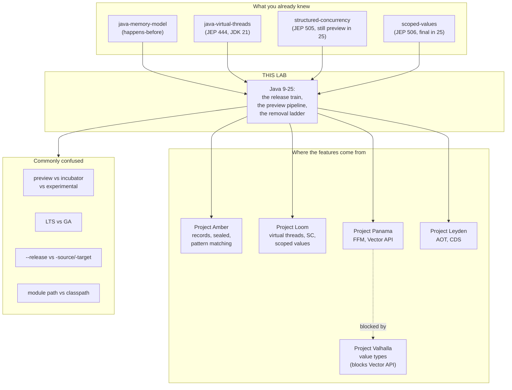

# Java 9 → 25: how the language actually changes

**Lab type:** no-code (documents + interactive visualization + exercises).
**Verified on:** OpenJDK 25.0.4 (Homebrew, macOS, 2026-07-21) — every claim in
this document marked **[measured]** was run on that JDK during the build and
the exact output is quoted. Claims marked **[documented]** come from the
OpenJDK release pages and JEP texts and were not executed here.

---

## How to read this lab

There are two kinds of file here, and they answer two different questions.

**This file answers: *why does Java look the way it does now?*** It is a story
with one plot — Java nearly froze to death on version 8, and the fix was not a
feature, it was a change to how features ship. Read this first, start to
finish. It is about 45 minutes.

**The seventeen version files answer: *what exactly do I get in release N?***
They are `java-09.md` through `java-25.md`, zero-padded so they sort in order.
Each one is a reference page you come back to, not a story. Read the ones for
the versions you are actually jumping between.

> Why zero-padded? Because `java-9.md` sorts *after* `java-10.md` in every file
> browser on earth. `java-09.md` sorts correctly. This is the only cosmetic
> decision in the lab.

The visualization (`visualization.html`) is where you watch the machinery move.
It is signposted at the right point below — don't open it yet.

### The seventeen version files

| | Release | The one thing it is for |
|---|---|---|
| [java-09.md](java-09.md) | 9 · Sep 2017 | The release that broke the world, and then fixed how releases work |
| [java-10.md](java-10.md) | 10 · Mar 2018 | `var`, and proof that the train departs on time |
| [java-11.md](java-11.md) | **11 · LTS** | The first modern LTS, and the last one still common in the wild |
| [java-12.md](java-12.md) | 12 · Mar 2019 | The first preview feature in Java's history |
| [java-13.md](java-13.md) | 13 · Sep 2019 | `yield`, and text blocks arrive |
| [java-14.md](java-14.md) | 14 · Mar 2020 | Records, and NPEs that name what was null |
| [java-15.md](java-15.md) | 15 · Sep 2020 | Sealed classes — the missing third piece |
| [java-16.md](java-16.md) | 16 · Mar 2021 | The encapsulation door closes |
| [java-17.md](java-17.md) | **17 · LTS** | The LTS the ecosystem actually moved to |
| [java-18.md](java-18.md) | 18 · Mar 2022 | UTF-8 everywhere, silently |
| [java-19.md](java-19.md) | 19 · Sep 2022 | Virtual threads appear |
| [java-20.md](java-20.md) | 20 · Mar 2023 | A holding release — and why that is fine |
| [java-21.md](java-21.md) | **21 · LTS** | Virtual threads and pattern matching go final |
| [java-22.md](java-22.md) | 22 · Mar 2024 | The FFM API lands after eight years |
| [java-23.md](java-23.md) | 23 · Sep 2024 | The release where a feature was taken back |
| [java-24.md](java-24.md) | 24 · Mar 2025 | The release that fixed virtual threads' worst caveat |
| [java-25.md](java-25.md) | **25 · LTS** | The current LTS, and where you should be going |

**If you only read three:** [17](java-17.md) (where modern Java became
available on an LTS), [21](java-21.md) (virtual threads), and
[25](java-25.md) (where you should be going). If you are planning a migration,
read the two endpoints of your jump and skim the ones in between for the
"What broke" section.

---

# BEGINNER MODEL

*Stages 1–9. By the end of this layer you can explain, to a colleague who only
knows Java 8, why Java suddenly started releasing twice a year and what "LTS"
and "preview" actually mean.*

---

## 1. WHY — the problem this whole story is about

Java 8 came out in March 2014. It was enormously popular — lambdas and streams
changed how people wrote Java.

The next version, Java 9, came out in **September 2017**. Three and a half
years later.

In that gap, something bad happened that had nothing to do with Java's
technical quality: **teams stopped upgrading.** Years after Java 11 shipped,
surveys of production Java still found version 8 in the majority of
deployments. An enormous amount of the world's backend software was running on
a version of the platform whose free public updates had ended.

That is the problem. Not "Java lacked feature X." The problem is that **the way
Java shipped releases made upgrading feel dangerous**, and a platform nobody
upgrades is a platform that slowly dies — its security fixes don't reach
anyone, and its new work doesn't reach anyone either.

Everything in this lab is the story of how that got fixed, and the features
that fell out of the fix.

## 2. PROBLEM — the bus that waits for everybody

Picture a bus that runs from your office to the train station. It is the only
bus. Its rule is: **it leaves when the last passenger has boarded.**

On a normal day that is fine. But one day Priya, who is bringing a large and
complicated piece of luggage, is running late. She's been late for a while now.

Everybody already on the bus — Sam with a small backpack, Wei with nothing at
all, forty other people who arrived on time — sits and waits. They are ready.
Their journeys are trivially simple. They wait anyway, because the rule says
the bus leaves when the last passenger has boarded, and Priya has not boarded.

Priya eventually arrives, three and a half years late.

Now here is the part that matters, and it is not the delay itself. When the bus
finally pulls in at the station, **ninety-one people get off at once**. The
station staff who have to check everybody's ticket now face a crowd. If
anything is wrong with anybody's ticket, it is wrong in the middle of a crowd of
ninety-one, and nobody can tell whose ticket caused the jam.

That crowd is what a Java upgrade felt like in 2017.

- Priya's luggage was **the module system** — a re-plumbing of how Java code is
  organised, which had been in development since 2008 and slipped repeatedly.
- The other ninety passengers were the other finished features of Java 9 —
  a REPL, factory methods for collections, a stack-walking API, a new HTTP
  client, and dozens more. All of them were done. All of them waited.
  **Ninety-one is the real count**, taken from the OpenJDK release page: Java 9
  delivered 91 JEPs. The next release, six months later, delivered **12**.
- The station staff are you, on the Monday morning you try to move your
  service from 8 to 9 and it doesn't compile.

## 3. NAIVE SOLUTION — "so cut the late feature"

The obvious fix, and the one every engineer proposes in the first ten seconds:
**hold the deadline and drop whatever isn't ready.** If the module system isn't
done by the date, ship Java 9 without it and put it in Java 10.

Reasonable. This is how most software teams operate.

## 4. FAILURE — why cutting the feature doesn't help either

It fails for two reasons, and the second one is the interesting one.

**First reason (the shallow one):** under a release schedule where releases are
years apart, "put it in the next one" means "delay it by three more years."
Nobody agrees to that. So the pressure to hold the bus is enormous, and it wins
every time. A deadline that everybody knows will slip is not a deadline.

**Second reason (the deep one):** cutting the feature does not fix the crowd at
the ticket barrier. Suppose Java 9 had shipped on time in 2016 *without*
modules, with only its other 90 features. That is still a two-and-a-half-year
delta from Java 8. It is still 90 changes arriving simultaneously. Your upgrade
is still a project with a project plan and a risk register.

And here is the trap that closes:

> An upgrade that is a *project* gets scheduled against other projects.
> It loses. So you skip it. So the next upgrade is even bigger.
> So it loses even harder.

This is a **ratchet**. Every skipped upgrade makes the next one more expensive,
which makes skipping it more likely. Teams did not get stuck on Java 8 because
they liked Java 8. They got stuck because by the time they looked up, the jump
was too big to justify, and it grew every year they waited.

> **🔮 Predict:** Java's answer was to release *more often* — every six months
> instead of every few years. But that means *more* upgrades, not fewer. How
> does adding upgrades make upgrading less painful?
>
> <details><summary>Reveal</summary>
>
> Because upgrade pain is not linear in the number of upgrades — it is
> superlinear in the **size of each one**. Twelve small deltas cost far less in
> total than one delta of the same total content, for three reasons:
>
> 1. **Attribution.** When 4 things changed and your test suite goes red, you
>    can find which of the 4 did it. When 400 things changed, you cannot, and
>    the debugging cost is what actually eats the schedule.
> 2. **It stops being a project.** A change small enough to absorb inside
>    normal maintenance never gets scheduled against a feature — it just
>    happens. This is the ratchet running backwards.
> 3. **Deprecation gets runway.** Small frequent releases let the platform warn
>    you in release N, warn louder in N+2, and only remove in N+5 — so you
>    always meet a removal you were told about twice. You'll see this exact
>    three-step ladder repeatedly below; it is the single most important
>    pattern in this lab.
>
> The bet Java made in 2017 was that *frequency is a safety feature*. The rest
> of this document is that bet being paid off — and the places it wasn't.
> </details>

## 5. THE REAL REQUIREMENT — what actually has to be true

Strip the story away. For a 30-year-old platform to keep evolving without
stranding its users, three things must all be true at once:

1. **Each step must be small enough to absorb, and must arrive on a date you
   can plan around.** Not "when it's ready." A date.
2. **It must be possible to ship a language feature and still change it
   afterwards.** This is the hard one. A library method that turns out to be
   wrong can be deprecated. A *language syntax* that turns out to be wrong is
   in a hundred million source files forever. Java is still carrying
   `Object.finalize()`, Java serialization, and `java.util.Date` — mistakes
   from the 1990s that can never be taken back. Getting language design right
   requires real user feedback, and real user feedback requires shipping.
   Those two requirements appear to contradict each other.
3. **There must be a version a conservative organisation can sit on.** A bank
   that will not move every six months needs a target that receives security
   fixes for years. Without this, requirement 1 just relocates the problem.

The rest of this lab is three inventions, one per requirement.

## 6. KEY IDEA — the three inventions

**Invention 1 — the release train.** The bus leaves in March and in September,
every year, whether or not Priya has boarded. A feature that is not ready rides
the next bus, six months later. Because six months is a short wait, "it's not
ready, hold it" is now a cheap and normal decision instead of a disaster.

**Invention 2 — preview features.** A feature can ship *complete and finished*
but explicitly **not permanent**: you must pass `--enable-preview` to both
compile and run it, and the platform marks the compiled output so it physically
cannot escape into production unnoticed. This is how requirement 2 stops being
a contradiction — the feature is in real users' hands generating real feedback,
while the design is still legally changeable.

**Invention 3 — LTS.** Every so often, one of the trains is designated
**Long-Term Support**: it keeps receiving security updates for years after it
is superseded. Everyone else's train stops receiving updates the moment the
next one departs, six months later.

Those three, together, are the entire mechanism. Everything else in this lab
is consequence.

## 7. TERMINOLOGY — the words, now that you have the ideas

Each term below is introduced here because you have now met the problem it
names. Terms introduced later in the document get the same treatment at the
point they're needed. All of them are collected in the glossary at the end.

### JEP — JDK Enhancement Proposal

**Plain meaning:** a numbered document proposing one change to Java, which
becomes the permanent public record of that change.

**Technical meaning:** a proposal in the OpenJDK process (itself defined by
JEP 1), which moves through states — Draft, Candidate, Proposed to Target,
Targeted, Integrated, Closed/Delivered — and is *targeted* at a specific
release. JEP 3 defines the release process itself.

**Why this term exists:** Java needed a way to discuss a change publicly and
durably *before* building it, separate from the legal specification process
(the JCP and its JSRs). A JEP is engineering intent; a JSR is specification
change. Big JEPs feed a JSR; most JEPs don't need one.

**Concrete example:** JEP 444 is "Virtual Threads", delivered in JDK 21. When
someone says "444" in a Java conversation they mean exactly that document, and
you can read it at `openjdk.org/jeps/444`.

**Connects to:** you have already used this vocabulary — the
[java-virtual-threads](../18-java-virtual-threads/) lab is JEP 444, and
[scoped-values](../20-scoped-values/) is JEP 506. This lab is the map those
numbers live on.

### GA — General Availability

**Plain meaning:** the day a version is officially released for production use.

**Technical meaning:** the final milestone of JEP 3's release schedule, reached
after two "rampdown" phases (where the bar for accepting fixes rises) and two
release candidates.

**Why this term exists:** to distinguish a release you may run in production
from the early-access builds that precede it by months. Early-access builds of
the *next* Java exist continuously and you can download them today.

**Concrete example:** JDK 25's GA date was **September 2025**. JDK 26's is
March 2026. **[documented — Oracle roadmap]**

### LTS — Long-Term Support

**Plain meaning:** a release that keeps getting security fixes for years.

**Technical meaning — and this is the part people get wrong:** LTS is **not a
technical property of the build**. There is no code in JDK 21 that makes it
LTS. It is a *support commitment made by vendors*. The OpenJDK project ships
all releases identically; Oracle, Adoptium, Amazon, Azul, Red Hat and others
then choose which ones they will keep patching, and they have converged on the
same ones.

**Why this term exists:** to give requirement 3 a name. Without it, "upgrade
every six months or run unpatched" is the only choice, and most enterprises
would pick unpatched.

**Concrete example** **[documented — Oracle Java SE Support Roadmap]**:

| Release | GA | Oracle Premier Support until | Extended until |
|---|---|---|---|
| **8 (LTS)** | March 2014 | March 2022 | December 2030 |
| 9–10 | Sep 2017 – Mar 2018 | 6 months each | — |
| **11 (LTS)** | Sept 2018 | September 2023 | January 2032 |
| 12–16 | Mar 2019 – Mar 2021 | 6 months each | — |
| **17 (LTS)** | Sept 2021 | September 2026 | September 2029 |
| 18–20 | Mar 2022 – Mar 2023 | 6 months each | — |
| **21 (LTS)** | Sept 2023 | September 2028 | September 2031 |
| 22–24 | Mar 2024 – Mar 2025 | 6 months each | — |
| **25 (LTS)** | Sept 2025 | September 2030 | September 2033 |
| 26, 27, 28 | Mar 2026 – Mar 2027 | 6 months each | — |
| **29 (LTS)** | Sept 2027 | September 2032 | September 2035 |

Two things to notice. **The non-LTS row is the whole point of LTS**: a non-LTS
release gets *six months* of support, full stop. And **the LTS gap changed** —
8→11→17 were three years apart; 17→21→25→29 are two years apart. That change
was deliberate and we'll come back to why.

Other vendors' dates differ from Oracle's — Adoptium/Temurin, Corretto and Azul
each publish their own, and some support *more* releases than Oracle does.
Check your actual vendor; the table above is Oracle's.

### Preview feature

**Plain meaning:** a finished language or VM feature that is deliberately not
yet permanent, so its design can still change based on what users report.

**Technical meaning (JEP 12):** a fully specified, fully implemented feature of
the Java *language* or *VM* that is impermanent. It is disabled by default. To
use it you pass `--enable-preview` to `javac` (along with `--release <current>`)
*and* to `java` at runtime. Preview features may change or be removed entirely
in any subsequent release, with no deprecation cycle.

**Why this term exists:** requirement 2. Without it, the six-month train would
be *dangerous* for language features — you'd be permanently committing to a
design every six months instead of every three years, which is worse, not
better. Preview is what makes fast releases safe for language design.

**Concrete example [measured, JDK 25.0.4]:** structured concurrency is JEP 505,
a *fifth* preview in JDK 25. Compiling a program that uses
`StructuredTaskScope`:

```
$ javac --enable-preview --release 25 R.java
Note: R.java uses preview features of Java SE 25.
```

Running it without the flag:

```
$ java R
Error: LinkageError occurred while loading main class R
  java.lang.UnsupportedClassVersionError: Preview features are not enabled for R
  (class file version 69.65535). Try running with '--enable-preview'
```

That `69.65535` is the enforcement mechanism, and we take it apart in stage 10.

**Connects to:** you already know this feature — the
[structured-concurrency](../19-structured-concurrency/) lab is JEP 505. What that
lab did not explain is *why* it is still preview after four years. This lab
does.

### Incubator module

**Plain meaning:** the same idea as preview, but for a whole new **API** rather
than a language change.

**Technical meaning (JEP 11):** a non-final API shipped in a module named
`jdk.incubator.*`, which you must explicitly add with `--add-modules
jdk.incubator.foo`. It is not on the module path by default and code compiled
against it produces a warning.

**Why this term exists as a *separate* term from preview:** they are enforced
by completely different machinery, and confusing them causes real mistakes.
Preview = language/VM, gated by a compiler+runtime flag, marked in the class
file. Incubator = library API, gated by module resolution, marked by the
package name. An incubating API that graduates **changes its package name** —
`jdk.incubator.foreign` became `java.lang.foreign` — so every import in your
code breaks on graduation, by design.

**Concrete example:** the Vector API entered as an incubator in JDK 16
(JEP 338) and was *still* incubating in JDK 25 as JEP 508 — its **tenth**
incubation. Ten. We come back to why in stage 10; it is the most instructive
entry in the whole dataset.

### Experimental feature

**Plain meaning:** a VM feature that is present but off, because it is not yet
trusted in production.

**Technical meaning:** gated behind `-XX:+UnlockExperimentalVMOptions`. Purely
a HotSpot concept — no language or API involvement.

**Why this term exists:** garbage collectors and JIT compilers can't be
"previewed" the way syntax can; there's nothing to compile differently. They
need a runtime switch instead.

**Concrete example:** ZGC arrived as experimental in JDK 11 (JEP 333) and
became a production feature in JDK 15 (JEP 377).

> **Three gates, three mechanisms — the one-line version.** Preview = language,
> `--enable-preview`, stamped in the class file. Incubator = API,
> `--add-modules`, marked by package name. Experimental = VM,
> `-XX:+UnlockExperimentalVMOptions`. If you remember nothing else from this
> stage, remember that these are not synonyms.

## 8. MENTAL MODELS — two pictures, and where the first one lies

### The simple model: the bus timetable

Buses leave in March and September. Some buses (LTS) are on routes that keep
running for years; the rest terminate as soon as the next bus departs.
Passengers who aren't ready catch the next one. Some passengers ride the bus
wearing a badge that says "I may get off and be redesigned" (preview).

This is the picture to carry around in your head.

### The engineering model: the feature pipeline

Each feature is an object with a **state** and a **release counter**:

```
        ┌──────────────┐
        │    Draft     │  (a JEP exists; nothing ships)
        └──────┬───────┘
               │ targeted at a release
     ┌─────────┼─────────┐
     ▼         ▼         ▼
┌─────────┐ ┌────────┐ ┌──────────────┐
│Incubator│ │Preview │ │ Experimental │   ← the three gates
│  (API)  │ │ (lang) │ │    (VM)      │
└────┬────┘ └───┬────┘ └──────┬───────┘
     │          │             │
     │  each 6-month tick: advance, hold, or WITHDRAW
     │          │             │
     └──────────┼─────────────┘
                ▼
          ┌───────────┐
          │   FINAL   │  (permanent; compatibility promise begins)
          └───────────┘
```

The pipeline has three properties worth stating precisely, because they are
what the visualization lets you watch:

1. **A tick advances at most one step.** Six months of real elapsed time per
   transition. This is why "how many previews did it take" is measured in
   *years*, not iterations.
2. **A feature can hold.** Structured concurrency was a preview in JDK 21, 22,
   23, 24 and 25 — five ticks, and the API was substantially redesigned in the
   middle of that run.
3. **A feature can leave the pipeline without reaching FINAL.** This is the
   property that justifies the whole design, and it has been exercised: string
   templates (JEP 430, 459) previewed in JDK 21 and 22 and were then
   **withdrawn** — removed from JDK 23 with no replacement. That is the system
   working correctly, not failing.

### Mapping the two models

| Bus timetable | Feature pipeline | Where you see it |
|---|---|---|
| The bus | A six-month release | JDK 21, JDK 22, … |
| Departure time | GA date | March / September |
| Passenger | A JEP | JEP 444 |
| Passenger with a "may be redesigned" badge | Preview / incubator feature | `--enable-preview` |
| Passenger who misses this bus | Feature held for another tick | SC preview 1→2→3→4→5 |
| Passenger who gives up and goes home | Withdrawn feature | String templates |
| Route that keeps running for years | LTS release | 8, 11, 17, 21, 25 |
| Route that terminates at the next stop | Non-LTS release | 9, 10, 12–16, 18–20, 22–24 |
| The crowd at the ticket barrier | Migration cost of one upgrade | Stage 11 |

### Where the analogy breaks

Three places. Each one matters.

**1. A late bus passenger is unchanged when they board the next bus. A held
feature is not.** This is the biggest lie in the analogy. The point of holding
a feature for another preview is precisely that it gets **redesigned in
between**. `StructuredTaskScope` in JDK 21 had static factory methods
`ShutdownOnFailure` and `ShutdownOnSuccess`; by JDK 25 the whole shape had
changed to `StructuredTaskScope.open()` with a *joiner* policy. Same passenger
name, different passenger. If you learned the JDK 21 API you must relearn it.
The engineering model has a mutation step the bus analogy has no room for.

**2. An LTS release is not a different vehicle.** JDK 25 is not built
differently from JDK 24. Nothing in the artifact is special. LTS is a promise
made *about* it afterwards, by vendors, and different vendors make different
promises. The analogy makes LTS look like a bigger, sturdier bus. It isn't —
it's the same bus with a longer maintenance contract.

**3. Buses are independent; releases are cumulative.** Missing the 3pm bus
costs you 30 minutes. Skipping JDK 22 costs you nothing *at the time* and then
appears in full when you jump 21→25, because 25 contains everything 22, 23 and
24 did. The train departs every six months; the **delta you actually swallow**
is set by how long you waited, not by the cadence. Frequent releases don't
reduce your migration cost — *frequent upgrading* does. The cadence only makes
frequent upgrading possible.

## 9. VISUALIZATION — go and play with it now

Open **`visualization.html`** in this directory, or the hosted version:
**<https://claude.ai/code/artifact/7b7a1370-fb28-4a44-bcfe-32b4e499a35d>**

Four tabs; here is what each is for and what to look at.

**Tab 1 — "The timetable."** The release train, drawn to scale, with support
windows. *Look at:* the difference between an LTS bar and a non-LTS bar. Then
use the **"I am running / I want to reach"** control and watch the delta counter
— the number of JEPs you swallow — change as you widen the jump. Set it to
8 → 25 and read the figure: **298 changes across 17 releases**. Then set it to
21 → 25: **66 across 4**. The lesson is in the difference between those two
numbers, not in the picture.

**Tab 2 — "The pipeline."** Step through releases 9 → 25 one tick at a time
and watch features move through incubator/preview/final. *Look at:* the Vector
API row, which never moves, and the string templates row, which reverses.
Step **backwards** too — the button is there and it's the fastest way to see
which release a given feature was in.

**Tab 3 — "The class-file lock."** Compile a file with and without
`--enable-preview`, then try to run it on different JDKs, and watch the class
file's version bytes change. *Look at:* the two bytes that go from `0000` to
`ffff`. This tab reproduces the exact bytes and the exact error message
measured on JDK 25.0.4 during this lab's build.

**Tab 4 — "The hazard scanner."** Pick a from-version and a to-version and get
the ordered list of things that will break. *Look at:* how the list changes
between 8→17 and 8→25. Every hazard listed there is expanded in stage 11.

Each tab asks you to predict before it shows you the answer. Take the
predictions seriously — they are placed where being wrong teaches something.

> **CHECKPOINT — end of the BEGINNER MODEL.**
> You can now explain why Java releases every six months, what LTS is (a vendor
> promise, not a build), and what preview means. That is enough to have the
> "which JDK should we target" conversation with your team.
> **Next (INTERMEDIATE): the pipeline in detail — how a feature actually
> travels, why some take eight years, and how the platform physically prevents
> a preview feature from escaping into your production jar.**

---

# INTERMEDIATE MODEL

*Stage 10. By the end of this layer you can trace any Java feature from
proposal to production, read the class file bytes that enforce the preview
gate, and explain why a feature you rely on is taking so long.*

---

## 10. ACTUAL MECHANISM — how a feature travels, and why it looks weird

We are going to build the mechanism the way a smart engineer would build it,
and let each version break. Every strange detail of the real system is the scar
of one of these failures.

### Mechanism v1: "just release every six months"

The simplest possible answer to requirement 1. March and September, fixed
dates, whatever is ready ships.

**Trace it on a real case.** Switch expressions — the change that lets you
write `int x = switch (day) { case MON -> 1; ... };` instead of a statement
switch with `break`. Suppose we ship it, final, in the first train that has it
working: JDK 12, March 2019.

Now feedback arrives. In the version that shipped, producing a value from a
multi-statement branch used `break value;`:

```java
// The design that shipped in this hypothetical
int n = switch (day) {
    case MON -> { int t = compute(); break t; }   // 'break' with a value
    default  -> 0;
};
```

Users report that overloading `break` this way is confusing — `break` already
means "leave the loop", and now it also means "return this value", and inside a
loop inside a switch you cannot tell which is meant.

**The break.** It's shipped. It's final. `break value;` is now in a hundred
thousand files. Java's compatibility promise means it can never be removed.
Java is stuck with a syntax everybody agreed was wrong, forever — exactly the
`Object.finalize()` disease we were trying to avoid, now arriving *twice a year
instead of every three years.* Mechanism v1 has made requirement 2 worse.

> **🔮 Predict:** How do you ship a language feature to real users, get real
> feedback, and still be allowed to change it?
>
> <details><summary>Reveal</summary>
>
> You ship it with an explicit, enforced label saying "this is not permanent."
> Not a comment in the docs — an *enforced* label, because a docs-only label
> would be ignored within a week.
>
> That is JEP 12, preview features. And it worked on exactly this example:
> switch expressions previewed in **JDK 12** (JEP 325) with `break value;`,
> the feedback came in, and the **second preview in JDK 13** (JEP 354) replaced
> it with a new contextual keyword, `yield`. It went final in **JDK 14**
> (JEP 361) with `yield`. The wrong syntax existed for exactly one release, in
> preview, and was thrown away.
>
> The syntax you write today:
>
> ```java
> int n = switch (day) {
>     case MON -> { int t = compute(); yield t; }   // 'yield', not 'break'
>     default  -> 0;
> };
> ```
>
> `yield` exists because of a mistake that was caught in preview. Every odd
> corner of modern Java has a story like this.
> </details>

### Mechanism v2: "preview = a compiler flag"

So add a flag. `javac --enable-preview` lets you use the impermanent feature;
without it, a compile error. Done?

**Trace it.** It is 2019. Your colleague Dev is enthusiastic about switch
expressions. He adds `--enable-preview` to the build, uses `break value;`,
compiles `orders.jar`, and ships it to the artifact repository. The jar runs
fine on JDK 12 in production.

Six months later the platform team upgrades production to JDK 13. Nothing in
`orders.jar` changed — it's a compiled artifact, and Java's whole promise is
that a compiled artifact keeps working on newer JDKs.

But in JDK 13 the semantics of that construct changed. The bytecode Dev's jar
contains was generated by a compiler whose rules no longer exist.

**The break.** The jar either misbehaves subtly or crashes in a way that points
at nothing. The compile-time flag protected the *compiler*; it did nothing to
protect the *artifact*. And the artifact is the thing that travels — into
repositories, into containers, into other teams' dependency trees, long after
everyone has forgotten that `--enable-preview` was ever passed.

### Mechanism v3 (the real one): stamp the artifact itself

The fix: put the mark **in the class file**, and make the JVM refuse to load it
unless conditions are exactly right.

Every Java class file starts with the same eight bytes:

```
ca fe ba be   <minor:2>  <major:2>
└─ magic ─┘
```

`cafebabe` is the magic number identifying a class file. Then a two-byte
**minor version** and a two-byte **major version**. Major version is the Java
release: 52 = Java 8, 61 = Java 17, 65 = Java 21, 69 = Java 25.

Here are the first eight bytes of a normal class compiled on JDK 25.0.4:

```
$ javac T.java && xxd -l 8 T.class
00000000: cafe babe 0000 0045
                     ^^^^ ^^^^
                     minor  major = 0x45 = 69 = Java 25
```
**[measured, JDK 25.0.4]**

And the same for a class using a preview feature:

```
$ javac --enable-preview --release 25 R.java && xxd -l 8 R.class
00000000: cafe babe ffff 0045
                     ^^^^ ^^^^
                     minor = 0xFFFF = 65535   major = 69
```
**[measured, JDK 25.0.4]**

**One value changed: the minor version went from 0 to 65535.** That is the
entire mechanism. The JVM's class loader has two rules about it:

1. If minor == 65535, refuse to load unless `--enable-preview` was passed.
2. If minor == 65535, refuse to load unless the major version is **exactly**
   this JVM's own version.

Rule 1, observed:

```
$ java R
Error: LinkageError occurred while loading main class R
  java.lang.UnsupportedClassVersionError: Preview features are not enabled for R
  (class file version 69.65535). Try running with '--enable-preview'

$ java --enable-preview R
42
```
**[measured, JDK 25.0.4]**

Rule 2 is the one that closes Dev's hole. A normal class file compiled for
Java 8 (major 52) runs on every later JVM — that is the compatibility promise.
A **preview** class file compiled on JDK 25 has major 69 and minor 65535, and
JDK 26 will refuse it, because 69 ≠ 70. **[documented — JEP 12; not executed
here, as only JDK 25.0.4 is installed on this machine.]**

The consequence, stated plainly, because it is the single most practically
important fact in this stage:

> **A jar containing preview-compiled classes runs on exactly one Java version
> and nothing else.** It cannot be published to a shared repository and used by
> others. It cannot survive a JDK upgrade. This is not a bug or an
> inconvenience — it is the *designed* property that makes preview features
> safe to ship. The mechanism deliberately makes it impossible for a preview
> feature to quietly become load-bearing infrastructure.

This is why "we'll just use the preview API and deal with it later" is not a
viable plan for a library, and is at most a viable plan for an application you
control end to end and rebuild on every upgrade.

### Mechanism v4: how long does a feature actually take?

Now that we know the states, the natural question is how many ticks a feature
takes. Here is the real data, drawn from the OpenJDK release pages.
**[documented — openjdk.org/projects/jdk/N for each N]**

#### The typical case — three ticks, eighteen months

| Feature | Preview | 2nd preview | Final |
|---|---|---|---|
| Switch expressions | 12 (JEP 325) | 13 (JEP 354) | 14 (JEP 361) |
| Text blocks | 13 (JEP 355) | 14 (JEP 368) | 15 (JEP 378) |
| Pattern matching for `instanceof` | 14 (JEP 305) | 15 (JEP 375) | 16 (JEP 394) |
| Records | 14 (JEP 359) | 15 (JEP 384) | 16 (JEP 395) |
| Sealed classes | 15 (JEP 360) | 16 (JEP 397) | 17 (JEP 409) |
| Record patterns | 19 (JEP 405) | 20 (JEP 432) | 21 (JEP 440) |
| Virtual threads | 19 (JEP 425) | 20 (JEP 436) | 21 (JEP 444) |
| Class-File API | 22 (JEP 457) | 23 (JEP 466) | 24 (JEP 484) |
| Stream gatherers | 22 (JEP 461) | 23 (JEP 473) | 24 (JEP 485) |

Two previews then final is the *shape of a healthy feature*. If you see that
pattern starting, you can predict the final release date with confidence.

#### The long case — pattern matching for `switch`, five ticks

17 (JEP 406) → 18 (JEP 420) → 19 (JEP 427) → 20 (JEP 433) → **21 final
(JEP 441)**. Two and a half years. It took that long because it interacts with
sealed classes (exhaustiveness checking), records (deconstruction patterns),
generics, and null handling — and each of those interactions had to be settled
before the syntax could freeze.

#### The very long case — the Foreign Function & Memory API, eight years

Started as *two separate* incubating APIs and merged:

| Release | JEP | State |
|---|---|---|
| 14 | 370 | Foreign-Memory Access API (incubator) |
| 15 | 383 | Foreign-Memory Access (2nd incubator) |
| 16 | 389 | Foreign *Linker* API (incubator) — a second, separate API |
| 16 | 393 | Foreign-Memory Access (3rd incubator) |
| 17 | 412 | **Foreign Function & Memory API** (incubator) — the two merged |
| 18 | 419 | FFM (2nd incubator) |
| 19 | 424 | FFM (**preview** — graduated from incubator to preview) |
| 20 | 434 | FFM (2nd preview) |
| 21 | 442 | FFM (3rd preview) |
| **22** | **454** | **Foreign Function & Memory API — final** |

Notice the transition at JDK 19: it moved from *incubator* to *preview*. That
is the graduation that renames the package — `jdk.incubator.foreign` became
`java.lang.foreign`, breaking every import in every early adopter's code, by
design. It is also the reason FFM matters: it is the replacement for
`sun.misc.Unsafe` and for JNI, and its arrival is what made deprecating
`Unsafe` possible at all. Hold that thought; it returns in stage 11.

#### The pathological case — the Vector API, ten incubations and counting

16 (JEP 338) → 17 (414) → 18 (417) → 19 (426) → 20 (438) → 21 (448) →
22 (460) → 23 (469) → 24 (489) → **25 (JEP 508, tenth incubator)**.

> **🔮 Predict:** A feature has been incubating for nine years and ten
> releases. Is the team incompetent, is the API design unusually hard, or is
> something else going on?
>
> <details><summary>Reveal</summary>
>
> Something else. The Vector API's own JEP text states that it will remain in
> incubation until **Project Valhalla**'s value types are available, because
> the API is designed around value semantics that the language does not yet
> have. Finalising it now would freeze a design against a language that is
> about to change underneath it. **[documented — JEP 508 and its predecessors]**
>
> This is the pipeline being used correctly for a fourth purpose you have not
> seen yet: not "we're still designing", not "we're gathering feedback", but
> **"we are blocked on another project and will not commit until it lands."**
> Ten incubations is not ten failures. It is a nine-year-long refusal to make a
> permanent mistake, which — given `Object.finalize()` and `java.util.Date` —
> is a lesson the platform learned expensively.
>
> The practical read for you: **a long incubation is a signal about
> dependencies, not quality.** Read the JEP text; it usually says outright what
> it is waiting for.
> </details>

#### The case that justifies the whole design — string templates, withdrawn

| Release | JEP | What happened |
|---|---|---|
| 21 | 430 | String Templates (preview) — `STR."Hello \{name}"` |
| 22 | 459 | String Templates (2nd preview) |
| 23 | — | **Removed. No JEP. Gone.** |

The feature was withdrawn during JDK 23 development. The design used a
processor-and-template-expression shape that reviewers concluded was carrying
too much complexity for the benefit, and rather than finalise it or preview it
a third time, it was pulled out of the JDK entirely with no replacement.

This is the load-bearing event of this lab. **Preview is only meaningful if
withdrawal actually happens.** If every previewed feature eventually shipped,
preview would just be a delay with extra flags. String templates prove the
brake works — and it proves the warning above is not theoretical: anyone whose
code used `STR."..."` on JDK 21 or 22 had that code become uncompilable on
JDK 23, exactly as the preview contract said it might.

### Mechanism v5: the LTS cadence, and why it changed

Original plan: LTS every three years. 11 (2018) → 17 (2021).

**Where it broke.** Three years is six releases. An 11→17 jump swallows the
module-system encapsulation tightening, sealed classes, records, pattern
matching for `instanceof`, text blocks, the removal of Nashorn, the removal of
RMI activation, the CMS collector's removal, and much more — and the
encapsulation change in particular broke a large fraction of the ecosystem's
reflective libraries at once. The crowd at the ticket barrier was back. Not as
bad as 8→9, but bad enough that "we'll wait for the next LTS" was again a
common decision, which is the ratchet restarting.

**The refinement.** The cadence moved to **two years**: 17 (2021) → 21 (2023) →
25 (2025) → 29 (2027). Four releases per jump instead of six. Same argument as
the original six-month decision, applied one level up: smaller deltas, more
often.

Look back at the support table in stage 7 with this in mind — the change from
three-year to two-year gaps is visible in it, and it is the only structural
change to the release process since 2017.

> **CHECKPOINT — end of the INTERMEDIATE MODEL.**
> You can now read the pipeline: given a feature, you can find its ladder,
> predict its finalisation, and explain the class-file bytes that keep preview
> code from escaping. **Next (ENGINEERING): what actually breaks when you jump
> versions, and the compatibility contract that tells you in advance.**

---

# ENGINEERING MODEL

*Stages 11–12. By the end of this layer you can plan a real version jump: name
what will break before you try it, read the warning the platform already gave
you, and say which of Java's compatibility promises covers you and which
doesn't.*

---

## 11. FAILURE SCENARIOS — what actually breaks, and why

Everything so far has been the happy path. Now the failures. These are not
hypothetical: they are the things that make a real upgrade take three weeks.

Each one is laid out the same way — **make it happen → what you see → why →
what the platform does → what's still guaranteed → what you lost → how it's
handled in production.** Tab 4 of the visualization is a scanner over exactly
this list; you can filter it by your from/to versions.

Before the individual failures, the pattern that connects most of them:

> **The three-step removal ladder.** Java almost never removes something in one
> step. It **deprecates** (a compile-time warning), then **terminally
> deprecates** (`@Deprecated(forRemoval=true)` — a louder warning that says
> removal is committed), then **removes**. Frequent releases are what make this
> affordable: each step gets its own release, so you get years of notice.
> Most upgrade pain is somebody having ignored steps 1 and 2 and meeting
> step 3 as a surprise. It was not a surprise.

### F1 — Split packages (JDK 9, the module system)

**Make it happen:** have two jars on the module path that both contain classes
in the same package — e.g. an old `javax.annotation` jar alongside the JDK's,
or two shaded copies of the same library.

**What you see:** at startup, `java.lang.LayerInstantiationException: Package
javax.annotation in both module A and module B`, or at compile time, a module
resolution error naming both modules.

**Why:** the module system's core rule is that a package belongs to **exactly
one** module. This is not stylistic — it is what makes reliable configuration
possible, because it means the runtime can decide which module exports a given
package without ambiguity. Java 8's flat classpath allowed duplicates and
silently picked whichever appeared first, which is where "works on my machine"
classpath bugs came from.

**Platform response:** hard failure at resolution time. Deliberately not a
warning — the whole value of the rule is that it holds.

**Guarantee intact:** if it starts, the module graph is unambiguous.
**Guarantee lost:** the classpath's permissiveness. Code that "worked" by
accident stops working.

**In production:** the classpath (as opposed to the module path) is exempt —
everything on the classpath lands in the *unnamed module*, where split packages
are still tolerated. This is why the vast majority of applications moved to
Java 9+ **without ever writing a `module-info.java`**, and it is the single
most useful fact in this stage. You do not have to adopt modules to use modern
Java. The JDK itself is modular; your application does not have to be.

### F2 — The Java EE and CORBA modules are gone (JDK 11, JEP 320)

**Make it happen:** compile any code using `javax.xml.bind.*` (JAXB),
`javax.xml.ws.*` (JAX-WS), `javax.annotation.*`, `javax.activation.*`,
`javax.transaction.*` or `org.omg.*` on JDK 11+.

**What you see:** `package javax.xml.bind does not exist` — a plain
compile error, as if you had made a typo.

**Why:** these were Java EE specifications that had been bundled into Java SE.
Java EE moved to the Eclipse Foundation (becoming Jakarta EE), so shipping a
frozen copy inside the JDK meant every Java SE user carried a stale
implementation of somebody else's spec. JDK 9 deprecated them for removal
(JEP 320's groundwork); JDK 11 removed them.

**Platform response:** removed. But note the ladder — JDK 9 and 10 already
warned, and offered `--add-modules java.xml.bind` as a temporary bridge.

**Guarantee intact:** everything in `java.*` core packages.
**Guarantee lost:** the assumption that "it's in the JDK" means "it will stay
in the JDK." These were always someone else's spec.

**In production:** add the artifacts as ordinary dependencies —
`jakarta.xml.bind:jakarta.xml.bind-api` and a runtime like
`org.glassfish.jaxb:jaxb-runtime`. Note the package rename from `javax.*` to
`jakarta.*` in the current versions, which is a *separate* migration caused by
a trademark constraint, not by the JDK. In a Spring context this is the same
`javax.*` → `jakarta.*` move that Spring Boot 3 required.

### F3 — `InaccessibleObjectException`: strong encapsulation (JDK 16/17)

This is the big one — the failure that made 8→17 hard for the whole ecosystem.

**Make it happen [measured, JDK 25.0.4]:** reflect into a JDK internal field.

```java
Field f = String.class.getDeclaredField("value");
f.setAccessible(true);
```

**What you see:**

```
java.lang.reflect.InaccessibleObjectException: Unable to make field
private final byte[] java.lang.String.value accessible: module java.base
does not "opens java.lang" to unnamed module @2b2fa4f7
```

**Why:** `setAccessible(true)` — "deep reflection" — lets code read and write
private fields of classes it doesn't own. Half the Java ecosystem was built on
it: serialisation frameworks, mocking libraries, ORMs, dependency injection
containers. It also means the JDK can never safely change any private field of
any class, because someone is reaching into it. The module system's answer:
a module must explicitly `opens` a package for deep reflection into it, and
`java.base` opens nothing.

**Platform response — and this is the ladder at its most careful, over five
years:**

| Release | Behaviour |
|---|---|
| 9 | Allowed, with a one-time warning per offending package. `--illegal-access=permit` is the default. |
| 10–15 | Same. Warning stays. Five releases of notice. |
| 16 (JEP 396) | Default flips to `--illegal-access=deny`. Now it **fails** — but you can set `--illegal-access=permit` to get the old behaviour back. |
| 17 (JEP 403) | The `--illegal-access` option is **removed entirely**. There is no global escape hatch. |
| 25 | As above. Only per-package `--add-opens` works. **[measured]** |

The escape hatch that remains is explicit and narrow:

```
$ java U
BLOCKED: java.lang.reflect.InaccessibleObjectException: ...

$ java --add-opens java.base/java.lang=ALL-UNNAMED U
setAccessible OK
```
**[measured, JDK 25.0.4]**

**Guarantee intact:** the JDK can now evolve its internals — which is precisely
what enabled compact strings, hidden classes, and eventually Valhalla.
**Guarantee lost:** the ability of arbitrary code to reach into arbitrary
internals. That was never a promise, but it was universal practice.

**In production:** three moves, in order of preference. **(1) Upgrade the
library** — every major framework fixed this years ago; if you are hitting it,
you are usually running a 2019 version of something. **(2) Add the narrowest
`--add-opens` you can** to your launch flags, and treat each one as a tracked
piece of technical debt with a ticket, not a permanent setting. **(3) If it's
your own code**, replace deep reflection with `VarHandle` (JEP 193, JDK 9),
`MethodHandles.privateLookupIn`, or the Class-File API (JDK 24). Note that
`--add-opens` in `JAVA_TOOL_OPTIONS` or `MAVEN_OPTS` is a common way teams hide
this from themselves — grep your CI config for it before claiming you're clean.

### F4 — `sun.misc.Unsafe` is on its way out (JDK 23, 24, and beyond)

**Make it happen [measured, JDK 25.0.4]:** use `Unsafe.objectFieldOffset` and
`Unsafe.putInt`, as a great deal of high-performance Java does indirectly.

**What you see — at compile time:**

```
W.java:1: warning: Unsafe is internal proprietary API and may be removed in a future release
import sun.misc.Unsafe;
```

**and at runtime:**

```
WARNING: A terminally deprecated method in sun.misc.Unsafe has been called
WARNING: sun.misc.Unsafe::objectFieldOffset has been called by W (file:...)
WARNING: Please consider reporting this to the maintainers of class W
WARNING: sun.misc.Unsafe::objectFieldOffset will be removed in a future release
unsafe wrote x=7
```
**[measured, JDK 25.0.4 — note the code still ran and produced `x=7`]**

**Why:** `sun.misc.Unsafe` is a 2004-era internal class that became the
foundation of the JVM's performance ecosystem — Netty, Cassandra, Hazelcast,
many serialisers. It offers unchecked memory access with no safety net at all;
a wrong offset corrupts the heap or crashes the VM. It cannot be removed until
supported replacements exist for everything it does. They now do: `VarHandle`
(JDK 9) covers the atomic/field-access uses, and the **Foreign Function &
Memory API** (JDK 22 final) covers the off-heap memory uses. That is why the
eight-year FFM saga from stage 10 mattered.

**Platform response — the ladder again:** JDK 23 (JEP 471) terminally
deprecates the memory-access methods; JDK 24 (JEP 498) adds the runtime warning
you see above; a future release removes them. As of JDK 26 the removal is not
yet scheduled. **[documented]**

**Guarantee intact:** your code runs today, warning and all.
**Guarantee lost:** the assumption that an internal class you were never
supposed to touch would be there forever.

**In production:** the warning names the calling class — read it. It is usually
a dependency, not you. Upgrade it. If it's yours: field access → `VarHandle`;
off-heap memory → `java.lang.foreign.MemorySegment` / `Arena`. Add
`-Xlog:deprecation` style checks to CI so a new offender fails the build rather
than accumulating.

### F5 — The preview jar that runs on exactly one JDK

**Make it happen:** build with `--enable-preview`, publish the jar, upgrade the
JDK.

**What you see:** `UnsupportedClassVersionError: Preview features are not
enabled` (if the flag is missing) or a class-version mismatch (if the JDK
moved).

**Why:** stage 10, mechanism v3 — minor version 65535 plus an exact major
version match.

**Platform response:** refuses to load. Loudly, at class-load time, not
subtly at runtime.

**Guarantee intact:** a preview feature can never silently become production
infrastructure. **Guarantee lost:** normal forward compatibility, deliberately.

**In production:** never publish preview-compiled artifacts to a shared
repository. For an application you fully control, it's defensible if and only
if you rebuild on every JDK bump — which means your build must pin the JDK
version and your CI must fail if it drifts.

### F6 — UTF-8 became the default charset (JDK 18, JEP 400)

**Make it happen:** call `new FileReader(f)`, `new String(bytes)`,
`Files.readAllLines(p)` or any other API that uses the *default* charset, on a
platform whose default charset was not UTF-8 — most commonly Windows with a
`windows-1252` or Shift_JIS locale.

**What you see:** **nothing.** No exception, no warning. Text that used to
decode correctly now decodes to mojibake, or vice versa. A test that compares
strings fails somewhere far away from the read.

**Why:** before JDK 18 the default charset came from the operating system
locale, so the same program produced different results on different machines —
the classic "it works on Linux CI and fails on a developer's Windows laptop."
JEP 400 made UTF-8 the default everywhere.

**Platform response:** silent change. This is the important contrast with every
other failure in this stage.

**Guarantee intact:** consistency across platforms, from now on.
**Guarantee lost:** bug-for-bug agreement with whatever the old platform
default produced.

**In production:** `-Dfile.encoding=COMPAT` restores the JDK 17 behaviour as a
temporary bridge. The real fix is to **stop using default-charset APIs
entirely** — always pass an explicit `StandardCharsets.UTF_8`. That advice
predates JEP 400 by fifteen years.

> **🔮 Predict:** F1–F5 all fail loudly. F6 fails silently. Which class is more
> dangerous in a version upgrade, and what does that imply about how you should
> test one?
>
> <details><summary>Reveal</summary>
>
> The silent ones, by a wide margin — and it is not close.
>
> A loud failure is *found by compiling and starting the application*. It costs
> you an afternoon and it is impossible to miss. Every hazard in the table that
> throws is, in practice, cheap.
>
> A silent behaviour change is only found by a test that asserts on the changed
> behaviour, or by a customer. If your test suite doesn't cover the encoding of
> a particular file read, JEP 400 ships to production and shows up two weeks
> later as corrupted names in a report.
>
> The implication for how to test an upgrade: **compiling and booting on the
> new JDK proves almost nothing.** What you actually need is your full
> behavioural test suite running on the new JDK — and specifically, tests that
> assert on *output content*, not just on "it returned 200". The most valuable
> single practice here is to run your existing test suite against the next JDK
> in a **non-blocking CI job, continuously**, starting long before you plan to
> upgrade. It converts the upgrade from a project into a stream of small
> known-in-advance fixes — which is the ratchet from stage 4, run backwards.
>
> The other members of the silent class, for the record: the removal of biased
> locking (F8 below), garbage collector default changes, and any performance
> characteristic at all.
> </details>

### F7 — Nashorn, the JavaScript engine, is gone (JDK 15, JEP 372)

**Make it happen:** `new ScriptEngineManager().getEngineByName("nashorn")` on
JDK 15+.

**What you see:** `getEngineByName` returns **`null`**, and your next line
throws `NullPointerException` — a null return, not a helpful error.

**Why:** maintaining a full ECMAScript implementation inside the JDK was a
large ongoing cost that only a small fraction of users needed, and the
JavaScript language was evolving faster than the JDK release cycle could track.
Deprecated in JDK 11 (JEP 335), removed in 15.

**Platform response:** removed; the `ScriptEngineManager` SPI remains.

**Guarantee intact:** the scripting SPI itself.
**Guarantee lost:** a scripting engine in the box.

**In production:** add `org.openjdk.nashorn:nashorn-core` as a dependency — the
same engine, now a standalone project — or migrate to GraalVM's JavaScript.
Worth knowing because scripted business rules in older enterprise Java
frequently sit on Nashorn, and this failure surfaces as an NPE in a rules
engine rather than as anything mentioning JavaScript.

### F8 — Biased locking removed (JDK 15, JEP 374) — a silent *performance* change

**Make it happen:** run code that acquires an uncontended `synchronized` lock
in a hot loop, single-threaded.

**What you see:** nothing functional. Possibly a throughput regression.

**Why:** biased locking was an optimisation that let the *first* thread to
acquire a monitor keep it cheaply, on the assumption that most locks are never
contended. It was hugely effective on 2000s-era single-threaded-ish code, but
it required expensive global safepoint operations to revoke a bias, and its
complexity was blocking work on the VM's object header — the work that became
compact object headers (JEP 450 in 24, product feature JEP 519 in 25).
Disabled and deprecated in JDK 15, removed later.

**Platform response:** silent. Deprecation warning on the flag only.

**Guarantee intact:** all `synchronized` semantics. **Nothing about the
[java-memory-model](../17-java-memory-model/) lab's happens-before rules changes.**
**Guarantee lost:** a performance characteristic that was never promised.

**In production:** measure before and after. If it bites, the fix is usually to
stop locking in the hot path (`java.util.concurrent` atomics,
`ConcurrentHashMap`), not to chase the flag. Related: since JDK 24 (JEP 491),
`synchronized` no longer pins a virtual thread to its carrier — the pinning
problem the [java-virtual-threads](../18-java-virtual-threads/) lab described is
fixed as of 24, which changes the advice that lab gives for JDK 21.

### F9 — The Security Manager is permanently disabled (JDK 24, JEP 486)

**Make it happen:** call `System.setSecurityManager(...)` or start with
`-Djava.security.manager=...` on JDK 24+.

**What you see:** `UnsupportedOperationException`, or the JVM refusing to
start, depending on how it was set.

**Why:** the Security Manager was designed in the 1990s for untrusted applets.
It was never effective for server-side sandboxing (it protects against
*accidental* misbehaviour, not a determined attacker in the same JVM), it
imposed a permission check on every sensitive operation, and it was blocking
platform work. Deprecated for removal in JDK 17 (JEP 411), permanently disabled
in JDK 24 (JEP 486).

**Platform response:** disabled. Seven years of notice.

**Guarantee intact:** every other security mechanism — TLS, the crypto
providers, deserialisation filters (JEP 415).
**Guarantee lost:** in-JVM sandboxing.

**In production:** the replacement is not another in-JVM sandbox — it is
process-level isolation: containers, seccomp, separate JVMs, least-privilege
service accounts. If you were relying on the Security Manager for real security
boundaries, the honest reading is that you had less protection than you thought
even before it was removed.

### F10 — `--release 8` warns, and older is already gone (JDK 25)

**Make it happen [measured, JDK 25.0.4]:**

```
$ javac --release 8 T.java
warning: [options] source value 8 is obsolete and will be removed in a future release
warning: [options] target value 8 is obsolete and will be removed in a future release
warning: [options] To suppress warnings about obsolete options, use -Xlint:-options.
3 warnings

$ javac --release 7 T.java
error: release version 7 not supported
```

The full supported set on JDK 25.0.4 is **8 through 25**. **[measured]**

**Why:** javac keeps a table of historical platform APIs for `--release`, and
maintaining every one forever is unbounded work. The policy is to keep roughly
the last several LTS-era releases.

**Platform response:** warning first (that's the ladder), then removal.

**Guarantee intact:** you can still *run* Java 8 bytecode (major version 52) on
JDK 25 — that is the core binary compatibility promise and it is not going
anywhere.
**Guarantee lost:** the ability to *compile* for arbitrarily old targets.

**In production:** if you are building a library for Java 8 consumers on a
JDK 25 toolchain, this warning is your notice to plan the baseline bump. Note
the asymmetry — **running old bytecode is safe; compiling for old targets is
what expires.**

### F11 — Dynamic agent loading now warns (JDK 21, JEP 451)

**Make it happen:** attach a Java agent to a *running* JVM — which is what
profilers, APM tools (Datadog, New Relic, Dynatrace) and some mocking libraries
do.

**What you see:** `WARNING: A Java agent has been loaded dynamically ... If a
serviceability tool is in use, please run with -XX:+EnableDynamicAgentLoading
to hide this warning`.

**Why:** an agent can redefine any class at runtime, which is a complete bypass
of the encapsulation that F3 spent five releases establishing. JEP 451's title
— *"Prepare to Disallow the Dynamic Loading of Agents"* — is the interesting
part: it is a JEP whose entire content is a warning, filed to start the ladder.

**Platform response:** warns now; a future release will require the flag.

**Guarantee intact:** agents loaded at startup with `-javaagent:` are
unaffected and always will be.
**Guarantee lost:** silent attach-to-running-JVM.

**In production:** pass `-XX:+EnableDynamicAgentLoading` explicitly when you
genuinely want a profiler to attach. Treat the warning as an inventory tool —
if it fires and you don't know why, something is instrumenting your JVM and you
should find out what.

### F12 — Non-generational ZGC removed (JDK 24, JEP 490)

**Make it happen:** run with `-XX:+UseZGC -XX:-ZGenerational` on JDK 24+.

**What you see:** JVM fails to start, or the flag is rejected.

**Why:** ZGC's generational mode (JEP 439, JDK 21) was better on essentially
every workload; maintaining two modes doubled the testing surface. JDK 23
(JEP 474) made generational the default; JDK 24 removed the non-generational
mode.

**Platform response:** default flip first (23), removal second (24).

**Guarantee intact:** `-XX:+UseZGC` still works and is still a low-pause
collector. **Guarantee lost:** the specific non-generational implementation.

**In production:** delete the flag. More generally — **GC flags are the most
common source of upgrade failures that have nothing to do with your code.**
Audit your JVM flags on every LTS jump; a flag copied from a 2016 blog post is
a liability. `-XX:+PrintFlagsFinal` and `-XX:+IgnoreUnrecognizedVMOptions` are
your inventory tools.

## 12. CORRECTNESS — the compatibility contract

Pull the failures together. Java's willingness to change is bounded by promises
that are precise, and knowing exactly which promise covers you is what turns
"upgrading is scary" into "upgrading is planned work."

### What is guaranteed

**Binary compatibility for the specified API.** Bytecode compiled against
`java.*` and `javax.*` public API on an old JDK loads and runs on a newer JVM.
Class file major version 52 (Java 8) still loads on JDK 25. This is the
strongest promise Java makes and it is why the platform is worth building on.
Verified above in F10: `--release 8` output runs fine.

**Source compatibility for the specified API, subject to the removal ladder.**
Code that compiled on JDK N generally compiles on N+1. Exceptions exist (a new
keyword, a new method on an interface you implemented) but they are rare,
announced, and usually mechanical.

**Behavioural compatibility for specified behaviour.** If the spec says a
method returns X, it returns X.

**The removal ladder itself is a guarantee.** Nothing in the specified API is
removed without deprecation, then terminal deprecation, then removal, across
multiple releases. You are always told twice.

### What is explicitly NOT guaranteed

| Not guaranteed | Which failure showed it |
|---|---|
| Internal APIs (`sun.*`, `com.sun.*`, `jdk.internal.*`) | F3, F4 |
| Deep reflection into anything you don't own | F3 |
| Preview features — may change or vanish with no ladder | F5, string templates |
| Incubating APIs — including their **package names** | Vector API, FFM |
| Any performance characteristic | F8 |
| GC behaviour, defaults, or flags | F12 |
| Unspecified behaviour that merely happened to be stable | F6 |
| Bundled implementations of other people's specs | F2, F7 |

### What was traded away, and for what

This is the honest summary of the whole bargain:

- **Traded:** unrestricted access to JDK internals.
  **Bought:** the JDK's ability to change its own internals — which is what
  made compact strings, hidden classes, virtual threads' continuation
  machinery, and compact object headers possible at all. Without F3, several
  chapters of modern Java could not exist.
- **Traded:** permanence of newly-shipped language features.
  **Bought:** the right to be wrong once, cheaply. Paid off by `yield`
  replacing `break value`, and by string templates being withdrawn entirely.
- **Traded:** long support for every release.
  **Bought:** a predictable date. Non-LTS gets six months; that is the price of
  the train running on time.
- **Traded:** a bundled Java EE, a bundled JS engine, an in-JVM sandbox.
  **Bought:** a smaller, faster-moving core, and those things surviving as
  properly-maintained separate projects.

### The one-sentence test

> **If the thing you depend on is specified in `java.*` or `javax.*` public
> API, you are covered by the strongest promise in mainstream software. If it
> is anything else — an internal class, a reflective reach-around, a
> performance characteristic, a GC default, a preview feature — you are on your
> own, and you were told.**

Almost every painful Java upgrade in the last decade is an instance of the
second half of that sentence.

> **CHECKPOINT — end of the ENGINEERING MODEL.**
> You can now plan a version jump: enumerate the hazards, read the ladder,
> and say which promise covers each dependency. **Next (PRODUCTION): the
> actual playbook — what to run, in what order, and what to watch.**

---

# PRODUCTION MODEL

*Stage 13. By the end of this layer you have a playbook you could actually run
on Monday, and you know what the lab left out.*

---

## 13. PRODUCTION — from this lab to a real upgrade

### The bridge: what this lab simplified

| This lab said | Reality adds |
|---|---|
| "Pick a target JDK" | Your JDK is chosen by the intersection of: your framework's supported range, your build tool's, your container base image's, your APM agent's, and your vendor's support dates. Spring Boot 3.x requires 17+; Spring Boot 4 requires 25. The framework usually decides for you. |
| "Features arrive at GA" | Your *distribution* (Temurin, Corretto, Zulu, Liberica, Oracle) ships patch releases on its own quarterly cadence. `25.0.4` in this lab is a patch of 25, not a feature release. |
| "LTS gets support" | *Which* LTS releases, and until when, differs by vendor. Some vendors support non-LTS releases too. Check yours; don't assume Oracle's table applies. |
| "Run your tests on the new JDK" | Your test tooling has its own JDK floor. Byte-manipulating libraries (Mockito/ByteBuddy, Lombok, JaCoCo, older Gradle) frequently break on a new JDK *before your code does* — because they parse class files, and the class file format changes every release. |

### The playbook

**Phase 0 — before you plan anything, find out what you already know.**
The platform has probably been warning you for years. Turn the warnings on:

```
javac -Xlint:all -Werror ...          # deprecation, removal, preview, options
java  -Xlog:deprecation ...           # what your dependencies are doing
jdeps --jdk-internals your-app.jar    # every JDK-internal API you touch, and its replacement
jdeps --multi-release 25 ...          # for multi-release jars
```

`jdeps --jdk-internals` is the single highest-value command in this lab. It
names each internal API you depend on **and the supported replacement**, and it
sees through your dependencies, not just your code. Run it before you write an
upgrade plan, because it usually changes the plan.

**Phase 1 — get the new JDK into CI before you commit to anything.**
Add a **non-blocking** CI job that builds and runs your full test suite on the
next JDK. Non-blocking is the important word: it must not be able to break the
team's day, or it will be deleted. Then let it run for weeks. This turns the
upgrade from a project (which loses to other projects — stage 4) into a stream
of small known fixes.

This is also the only defence against the silent failures (F6, F8). Compiling
and booting proves almost nothing.

**Phase 2 — upgrade the tooling first, in this order.** Build tool → build
plugins → test framework and bytecode libraries → application dependencies →
finally your code. Most "the new JDK is broken" reports are actually a
five-year-old plugin.

**Phase 3 — compile with `--release`, not `-source`/`-target`.**

```
javac --release 21 ...       # correct
javac -source 21 -target 21  # subtly wrong
```

`--release N` also restricts you to the *API* of release N. `-source`/`-target`
only affect language level and bytecode version, so you can compile against a
JDK 25 method, emit JDK 21 bytecode, and get a `NoSuchMethodError` in
production. `--release` catches that at compile time. This distinction has
existed since JDK 9 (JEP 247) and is still the most common build misconfiguration
in Java.

**Phase 4 — audit your JVM flags.** Every LTS jump. Use
`-XX:+PrintFlagsFinal -version` to dump what the JVM actually resolved, and
delete anything you cannot justify. `-XX:+IgnoreUnrecognizedVMOptions` gets a
JVM to start across a version boundary but hides exactly the signal you need,
so use it to survive the first boot and then remove it.

**Phase 5 — measure, don't assume.** GC changes, JIT changes and header changes
all move performance in both directions. Get a before/after on your real
workload.

### What an on-call engineer actually sees

Upgrade-related incidents in Java have a small number of signatures:

- **`UnsupportedClassVersionError: ... class file version 69.0`** — something
  compiled on a *newer* JDK than the one running it. Major 69 = Java 25, 65 =
  21, 61 = 17, 52 = 8. Subtract 44 from the major version to get the Java
  version. Minor `65535` means preview (F5).
- **`InaccessibleObjectException` / `does not "opens"`** — F3. Find the library,
  upgrade it, or add the narrowest `--add-opens`.
- **`NoClassDefFoundError: javax/xml/bind/...`** — F2. Add the dependency.
- **`NoSuchMethodError` on a method that exists in your IDE** — Phase 3;
  someone used `-target` instead of `--release`.
- **`getEngineByName` returned null → NPE** — F7, Nashorn.
- **Latency changed and nothing else did** — GC or JIT. Check the flags first
  (F12), then the collector, then compare `-Xlog:gc` output either side.
- **Mojibake in output, no exception at all** — F6, the charset default. This
  is the one that reaches customers.

### The performance features you get for free (and what they're worth)

Two of these are worth calling out because they cost you nothing and are often
misattributed.

**Class-Data Sharing has been on by default since JDK 12** (JEP 341, "Default
CDS Archives"). It memory-maps a pre-parsed archive of core JDK classes instead
of parsing them at every startup. You have been getting this without asking
since 2019.

**[measured, JDK 25.0.4, macOS]** — a small program that builds a 2000-entry
`TreeMap`, streams over it, formats currency and does some date arithmetic:

```
$ java -Xlog:class+load:file=cl.txt Boot
1003 classes loaded, of which 956 came from the shared archive
```

**Ahead-of-Time class loading and linking (JEP 483, JDK 24; ergonomics
JEP 514 and method profiling JEP 515, JDK 25)** extends that idea to *your*
classes, and to the linkage work, using a training run:

```
$ java -XX:AOTCacheOutput=app.aot -cp . Boot     # training run, writes the cache
$ java -XX:AOTCache=app.aot -cp . Boot           # subsequent runs read it
```

**[measured, JDK 25.0.4, macOS, 8 runs each, wall clock]**

| Configuration | Mean startup | Classes from archive |
|---|---|---|
| Default (CDS only) | **0.1050 s** | 956 of 1003 |
| With AOT cache (12.6 MB) | **0.0862 s** | 1039 of 1048 |

That is **18% faster startup** on this toy program. Be careful how you read
that number: it is small in absolute terms (19 ms) because the baseline was
*already* getting CDS, and because a 1000-class program has little to
accelerate. The published figures for large frameworks are much larger, because
a Spring Boot application loads tens of thousands of classes and does far more
linking. **The honest claim from this lab's own measurement is "18% on a tiny
program"; anything bigger is a claim I did not run here.**

The reason this matters for the *story*: the release train is what let AOT ship
as three separate JEPs across two releases (483 in 24, then 514 and 515 in 25)
instead of waiting to be complete. Under the old model it would still be
unreleased.

### What this lab intentionally left out

- **The JCP and JSRs.** The legal specification process that runs alongside
  JEPs. Relevant if you implement the spec; not if you use it.
- **`jlink` and custom runtime images** (JEP 220, 282; JEP 493 in 24 removed
  the need for JMOD files). Building a stripped-down JDK containing only the
  modules you use — genuinely valuable for container image size, and the main
  practical reason an application team might care about modules.
- **`jpackage`** (JEP 392, JDK 16) — native installers.
- **GraalVM native image.** A different answer to the same startup problem AOT
  addresses, with different trade-offs (no JIT, closed-world assumption, build
  complexity).
- **Project Valhalla, Loom, Panama, Amber, Leyden by name.** These are the
  umbrella projects the JEPs come from. Loom produced virtual threads,
  structured concurrency and scoped values; Panama produced FFM and the Vector
  API; Amber produced records, sealed classes and pattern matching; Leyden is
  producing AOT; Valhalla is the value-types work the Vector API is waiting on.
  Knowing the project a JEP belongs to is the fastest way to predict what comes
  next in that area.
- **Per-vendor differences** beyond the note in stage 7.
- **Everything about Java 8 and earlier.** This lab starts at 9.

---

## 14. EXERCISES

See **`EXERCISES.md`** — eight rungs, from "explain the release train in your
own words" to "design your organisation's JDK upgrade policy." Answers are in
**`SOLUTIONS.md`**; attempt first, especially rungs 3–6, which are all
answerable from the visualization.

---

## 15. KNOWLEDGE MAP & NEXT STEPS



**The four confusions, each separated by one sentence:**

- **Preview vs incubator vs experimental** — preview is a *language/VM* feature
  behind `--enable-preview` and stamped into the class file; incubator is an
  *API* in a `jdk.incubator.*` module behind `--add-modules`, whose package name
  changes on graduation; experimental is a *VM* feature behind
  `-XX:+UnlockExperimentalVMOptions`.
- **LTS vs GA** — GA is the day a release becomes available (every release has
  one); LTS is a vendor's promise to keep patching it afterwards (only some
  releases get one, and the promise differs per vendor).
- **`--release` vs `-source`/`-target`** — `--release N` also restricts you to
  release N's *API*, so it catches at compile time the `NoSuchMethodError` that
  `-source`/`-target` lets you ship.
- **Module path vs classpath** — code on the module path is in a named module
  with enforced boundaries; code on the classpath lands in the unnamed module,
  which reads everything and tolerates split packages. Most applications are
  still, correctly, on the classpath.

**Related labs you already have:**
[java-virtual-threads](../18-java-virtual-threads/) ·
[structured-concurrency](../19-structured-concurrency/) ·
[scoped-values](../20-scoped-values/) ·
[java-memory-model](../17-java-memory-model/)

Two corrections this lab makes to those labs, worth noting because they are the
kind of drift that frequent releases cause:

1. The virtual-threads lab describes `synchronized` **pinning** a virtual
   thread to its carrier. That was true on JDK 21. **JEP 491 (JDK 24) fixed
   it** — `synchronized` no longer pins. If you are on 24 or later, the
   "replace `synchronized` with `ReentrantLock`" advice no longer applies for
   that reason.
2. The structured-concurrency lab documents the JDK 25 API
   (`StructuredTaskScope.open()` with joiners). That is **JEP 505, a fifth
   preview**, and JDK 26 has a sixth (JEP 525). It is not final and the shape
   has already changed once substantially. Do not build a library on it.

**Suggested next:**

- `/learn project-valhalla` — value types; the thing the Vector API has waited
  nine years for, and the biggest pending change to the Java object model.
- `/learn java-module-system` — a full lab on JPMS: `module-info.java`,
  readability, `requires transitive`, services, `jlink`. Stage 11's F1 and F3
  are the surface of it.
- `/learn foreign-function-and-memory-api` — the `Unsafe`/JNI replacement
  (JEP 454), and the reason F4's deprecation was possible.
- `/learn jvm-garbage-collectors` — G1 vs ZGC vs Shenandoah vs Parallel, the
  generational ZGC change, and how to actually choose. F8 and F12 are its
  surface.
- `/learn class-file-api` — JEP 484; why every bytecode library broke on new
  JDKs, and the supported replacement for ASM.
- `/learn pattern-matching-in-java` — records, sealed types and switch patterns
  as one coherent design, rather than five JEPs.

---

## 16. GLOSSARY

Every term in this document, in order of first appearance.

| Term | Plain-English meaning |
|---|---|
| **JEP** | A numbered public proposal for one change to Java; the permanent record of that change. |
| **JSR** | The formal specification document in the older JCP process. A JEP is engineering intent; a JSR is legal spec. |
| **GA** | General Availability — the day a release is officially production-ready. |
| **Rampdown** | The phases before GA where the bar for accepting fixes progressively rises. |
| **LTS** | Long-Term Support — a *vendor promise* to keep patching a release for years. Not a property of the build. |
| **Release train** | The fixed March/September schedule; features that aren't ready wait six months. |
| **Preview feature** | A finished but impermanent *language or VM* feature, behind `--enable-preview`, stamped into the class file. May change or be withdrawn. |
| **Incubator module** | A non-final *API* in a `jdk.incubator.*` module, behind `--add-modules`. Its package name changes when it graduates. |
| **Experimental feature** | A *VM* feature behind `-XX:+UnlockExperimentalVMOptions`. |
| **Withdrawn** | A previewed feature removed with no replacement — e.g. string templates, dropped in JDK 23. |
| **Class file major version** | The Java release a class file targets. Subtract 44: 52 = Java 8, 61 = 17, 65 = 21, 69 = 25. |
| **Class file minor version** | Normally 0; **65535** marks a preview class file, which requires `--enable-preview` and an exact major-version match. |
| **Deprecated** | Marked with a compile-time warning; still works, still supported. |
| **Terminally deprecated** | `@Deprecated(forRemoval=true)` — removal is committed, not merely possible. |
| **Removal ladder** | Deprecate → terminally deprecate → remove, one step per release. You are always told twice. |
| **Module** | A named, versioned unit of code that declares what it requires and what it exports. |
| **Split package** | The same package present in two modules. Forbidden on the module path; still tolerated on the classpath. |
| **Unnamed module** | Where classpath code lives: reads everything, exports everything, tolerates split packages. |
| **`opens`** | A module declaration permitting deep reflection (`setAccessible(true)`) into a package. |
| **`--add-opens`** | A command-line override that opens a package for deep reflection without changing the module's source. |
| **Strong encapsulation** | The rule (default since JDK 16, no escape hatch since 17) that JDK internals are not reflectively accessible. |
| **Deep reflection** | `setAccessible(true)` — reading and writing private members of classes you don't own. |
| **`--release N`** | Compile against release N's language *and API*. The correct flag. |
| **`-source` / `-target`** | Language level and bytecode version only — does not restrict the API, so it can produce `NoSuchMethodError` at runtime. |
| **`jdeps`** | The JDK's dependency analyser; `--jdk-internals` lists every internal API you use and its replacement. |
| **CDS** | Class-Data Sharing — a memory-mapped archive of pre-parsed classes. On by default since JDK 12. |
| **AOT cache** | Ahead-of-Time class loading and linking (JEP 483/514/515) — extends CDS to your own classes via a training run. |
| **`jlink`** | Builds a custom runtime image containing only the modules you need. |
| **VarHandle** | The supported replacement (JEP 193, JDK 9) for `Unsafe`'s field-access operations. |
| **FFM API** | Foreign Function & Memory API (JEP 454, JDK 22) — the supported replacement for JNI and for `Unsafe`'s off-heap memory access. |
| **Project Amber** | The umbrella project for records, sealed classes and pattern matching. |
| **Project Loom** | Virtual threads, structured concurrency, scoped values. |
| **Project Panama** | FFM API and the Vector API. |
| **Project Leyden** | Startup and warmup: AOT, CDS improvements. |
| **Project Valhalla** | Value types — the language change the Vector API has been waiting nine years for. |
