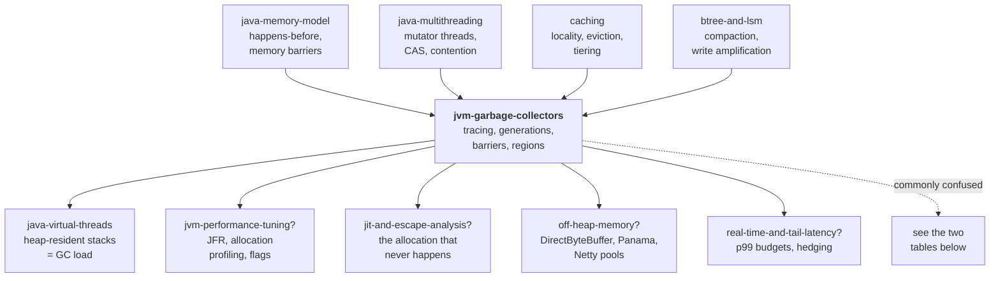

# JVM Garbage Collectors — how the JVM decides which memory is dead, and why that decision costs you latency

> **Tell a friend:** Meera manages a hotel where guests never check out, so she
> can never say which rooms are empty. She stops trying. Instead she takes the
> front desk register and walks every chain of introductions. Anna brought Ben,
> Ben brought Cara, and Meera chalks a mark on every door she reaches. Every
> unchalked door is empty *by definition*, and she opens them all without
> proving that anybody left. That single move is what a garbage collector does,
> and every collector Java ever shipped is a different answer to one question:
> how do you do that walk without freezing the hotel for too long?

The trainer for this lab is [`visualization.html`](visualization.html), also
published as [The Heap Machine](https://claude.ai/code/artifact/2bd0ad6c-047c-44bf-aacf-48cdc2b2b866).
What this lab is made of, where its numbers come from, and where it sits among
your other labs is in [section 17](#17-about-this-lab) at the end.

---

# BEGINNER MODEL — stages 1 to 9

## 1. Why does somebody have to give the memory back?

> **In one breath:** Your program asks for memory thousands of times a second,
> from a pool that is a fixed number of bytes. Somebody has to put the bytes
> back. The only question is who, and what that costs you.

Priya runs a payment authorization service in Java. It is small, it is boring,
and it is on the critical path of every card transaction her company takes.

Her program asks for memory constantly. Every `new`, every string, every boxed
`Integer`, every lambda that captures something, every `ArrayList` that grows —
each one takes a slice of a fixed pool of bytes. The operating system handed
that pool to her process at startup. It does not grow on demand. It is a
number, and it is finite.

So somebody has to give the bytes back. If nobody does, the pool fills. The
next request for memory has nowhere to go, and the program stops. In Java it
stops with `OutOfMemoryError`, usually in whichever unlucky thread happened to
allocate last. That is almost never the thread that caused the problem.

In C, "somebody" is you. You call `free()` yourself. That gives you three ways
to be wrong, and they are three of the worst bugs in computing.

| The mistake | What it does | Why it is so hard to find |
|---|---|---|
| Free too early | another piece of code keeps using a slot that has been handed to somebody else — a **dangling pointer** | it corrupts data silently and crashes somewhere unrelated ten minutes later |
| Free twice | corrupts the allocator's own bookkeeping | the damage lands inside the memory system, not your code |
| Free never | you **leak**, and the process swells until the kernel kills it | it looks like normal growth right up until it is not |

Java's answer is to take the decision away from you. It hands it to a subsystem
inside the JVM that reclaims memory automatically. That subsystem is the
**garbage collector**, and it removes all three of those bugs completely.

What it cannot remove is **cost**. Finding the dead memory takes CPU time. For
most of the last thirty years it also meant *stopping your program while it
looked*. This lab is the story of that cost being pushed down, decade by
decade, from seconds to under a millisecond, and of everything that had to be
invented on the way.

**The sentence people get wrong.** *"Java manages memory for you, so memory is
not my problem."* Java manages **reclamation** for you. It does not manage
**retention**, **rate**, or **pauses**, and those three are exactly what wakes
Priya at 3am. A 400ms freeze, in which every one of her threads simply stops,
is not a bug in her code. It is not a bug in the JVM either. It is the bill for
a design choice somebody made, possibly by default, possibly years ago.

## 2. What goes wrong at the Grand Hotel?

> **In one breath:** A hotel where nobody checks out fills up with rooms that
> look occupied and are not. The manager cannot open a door to check. And a
> guest is real if some chain of introductions leads to her, which makes the
> question about the *whole hotel*, not about the room.

Forget computers for a page.

The Grand Hotel has 100 rooms and one very unusual policy: **there is no
checkout**. Guests arrive, are given a room, and at some point simply leave.
Nobody tells the front desk. The key is not returned.

By Tuesday afternoon **Meera**, the manager, has a problem. The register says
all 100 rooms were issued. A coach party of twelve is standing in her lobby.
She walks the corridors and knows perfectly well that most of those rooms are
empty. She cannot prove which ones.

And she is not allowed to open a door on a guest who is still there. Open one
wrong door and a paying guest finds a stranger's luggage in his room. That is
the dangling pointer from section 1, in a bathrobe.

There is one more wrinkle, and it is the wrinkle that makes this hard rather
than merely tedious. **Guests bring other guests.**

**Anna** is at the front desk and is registered. She paid, she is on the list.
Anna brought her assistant **Ben**, who is not on the register but is
unquestionably a real guest occupying room 34. Ben in turn brought **Cara**, in
room 71.

So "is this room occupied?" is not a question about the room at all. It is a
question about whether there is a **chain of introductions** running from the
front desk register all the way to that room.

That chain is the whole subject of this lab. Everything else is engineering.

Here is the mapping, so the story has somewhere to land later.

| At the Grand Hotel | In your program |
|---|---|
| A room | a slice of heap memory |
| A guest | an object |
| "Anna brought Ben" | Anna's object holds a reference to Ben's object |
| The front desk register | the small set of definitely-live starting points |
| A room nobody can reach by introductions | garbage |
| Opening a door on a live guest | reclaiming memory still in use — **catastrophe** |

> **🔮 Predict:** *Meera has 100 rooms and 100 keys issued. She is certain that
> at least eighty rooms are empty. Why can she not simply issue new keys for
> the eighty rooms she believes are empty, and apologise to anyone she gets
> wrong?*
>
> <details><summary>Reveal</summary>
>
> Because being wrong is not a small failure that you apologise for. It is the
> **only** failure that has no recovery. Every other problem in this lab costs
> time or memory. This one hands a live guest's room to a stranger, and the
> program then reads a field of an object that no longer exists.
>
> If you said "she could check the rooms afterwards", notice what has happened:
> you have accepted a rule that is right *most* of the time. A collector is
> only useful if it is right *every* time. Section 5 states that as a
> requirement and never negotiates it again.
>
> </details>

**How far this lab takes you.** Stop at any checkpoint and you still have
something whole.

| Layer | Stages | After it you can… |
|---|---|---|
| Beginner | 1–9 | say why nobody can ask an object whether it is dead |
| Intermediate | 10 | derive all six collectors from the failure each one patches |
| Engineering | 11–12 | name eight production failures and the guarantee each one bends |
| Production | 13 | pick a collector, set five flags, and read a GC log at 3am |

## 3. Why not just count who is in each room?

> **In one breath:** Put a counter on every door. Add one when somebody is
> introduced, subtract one when an introduction lapses, and clean the room the
> moment it hits zero. This is a genuinely good idea, and real systems shipped
> it.

Here is what a reasonable person invents in about four seconds. Meera screws a
small brass counter onto every door.

Every time somebody is introduced to that guest, she adds one. Every time an
introduction lapses, she subtracts one. **The moment a counter hits zero, the
room is empty, so clean it immediately.**

In program terms, every object carries a **reference count**: how many
references currently point at it. Assigning `a.next = b` increments b's count.
Overwriting `a.next` with something else decrements the old target's count.
When a count reaches zero, nothing anywhere points at that object, so free it
right then. Then decrement everything *it* pointed at, which may cascade.

This is not a straw man. CPython ships it. So do Swift, C++'s `shared_ptr`, and
COM. I want you to feel why before I break it.

- **It is immediate.** Memory comes back the instant the last reference dies,
  not at some later clean-up pass. Destructors run predictably.
- **It has no pauses.** There is no "collection" event at all. The work spreads
  evenly across the program's own execution, a few instructions at a time.
- **It is local.** You never look at the whole hotel. You look at one counter.

Three real advantages. Hold on to the first two, because immediacy and no
pauses are exactly the properties every collector in this lab spends the next
thirty years trying to buy back.

> **🔮 Predict:** *Anna checks out and is struck off the front desk register.
> Before she left she had introduced Ben. Separately, Ben had introduced Anna
> to the hotel book club, so Ben holds an introduction to Anna too. What do the
> two door counters read after Anna is struck off, and what does the cleaning
> policy do?*
>
> <details><summary>Reveal</summary>
>
> Anna's counter goes from 2, the front desk plus Ben, down to **1**. Ben still
> holds an introduction to her. Ben's counter is **1**, because Anna still
> holds one to him. Neither counter is zero, so **neither room is ever
> cleaned**. Both guests left the building hours ago. The rooms are occupied
> forever, by nobody.
>
> If you guessed both counters go to zero, you were reading "Anna left" as an
> event that reaches every counter. It does not. Striking Anna off the register
> removes exactly one arrow: the register's. Ben's arrow is untouched, and Ben
> is not on the register either, so nothing ever removes his.
>
> The rule "count hits zero" answered a *local* question: how many arrows point
> at me. The real question was *global*: is there a path from the register to
> me? Anna and Ben point at each other, and that mutual pointing keeps both
> counters positive forever.
>
> </details>

## 4. Why can't a room tell you whether it is empty?

> **In one breath:** Two guests who introduced each other keep each other's
> counters above zero forever. That is not a bug in counting. It is proof that
> the answer was never stored inside the room.

The prediction you just made is the famous one. **Reference counting cannot
reclaim cycles.**

And cycles are not exotic. A doubly-linked list is a cycle. A parent node
holding children that hold a `parent` pointer back is a cycle. An observer
registered with the subject it observes is a cycle. In a typical Java object
graph they are everywhere.

So every production reference-counted system ships a **second, tracing
collector** just for cycles. CPython has one, and it is exactly the machinery
in section 6 of this lab. That alone settles the argument: if you need tracing
anyway, the counting was overhead.

There is a second failure that matters as much and gets discussed less. You can
already reason about it from `java-multithreading`.

Reference counting makes **every pointer write a memory write**. Often two,
since you increment the new target and decrement the old one. A field
assignment `this.next = node` stops being one store and becomes three memory
operations touching three separate cache lines.

Worse, in a multithreaded program those counters are shared mutable state. So
every one of them has to be a **CAS or an atomic add** — the exact contended
atomic cost you met in `java-multithreading`, now applied to *every reference
assignment in the entire program*. And the counter sits inside the object, so
two threads reading completely unrelated fields of the same object still
ping-pong its cache line between cores.

The honest scorecard, then. Reference counting spreads its cost evenly, and the
total is large. It cannot handle cycles at all. And it needs a tracing
collector as a backstop anyway.

But the cycle failure revealed something bigger, and that is the real content
of this section. The lesson is not "counting is bad". It is this:

> **Liveness is not a property of an object. It is a property of the whole
> graph, observed from the outside.**

No amount of information stored *in* Anna's room can tell you whether Anna is
reachable. The answer depends on parts of the hotel Anna has never heard of.

The question "is this object still in use?" is unanswerable locally. It is a
**global reachability** question. It can only be answered by something that
starts outside the object graph and walks in.

## 5. What must the answer promise, exactly?

> **In one breath:** Four sentences. Never free something still reachable.
> Eventually free everything unreachable. Never let the program see a
> half-finished collection. And do all that without freezing for longer than
> the program can afford.

Everything for the rest of the lab is the pursuit of these four requirements.
Keep their numbers; the exercises refer to them.

1. **Never reclaim memory the program can still reach.** This is absolute. One
   violation is heap corruption, and heap corruption in a managed runtime shows
   up as impossible behaviour far from the cause. This is the *safety*
   property.
2. **Eventually reclaim memory the program cannot reach.** Note the word
   *eventually*. Section 10 will show that insisting on *immediately* is what
   makes concurrent collection impossible. This is the *completeness* property,
   and it is negotiable in a way that safety is not.
3. **The program must never observe a half-collected heap.** If the collector
   is moving an object while a thread reads a reference to it, that thread must
   not see the old copy, a torn copy, or a wild address.
4. **Do all of that without stopping the program longer than it can afford.**
   For a batch report, "afford" is ten seconds. For Priya's payment
   authorization on a 250ms timeout budget, "afford" is single-digit
   milliseconds. A 400ms pause there is a wave of timeouts, a retry storm, and
   a pager.

Requirements 1 and 3 are correctness. Requirements 2 and 4 are where all the
engineering, all the collectors, and all the arguments live.

## 6. What if you stop looking for the dead?

> **In one breath:** Nobody can prove a guest left. So do not try. Walk out
> from the register, chalk everything you reach, and declare every unchalked
> door empty. Death is not detected. It is inferred from the absence of
> evidence of life.

Here is the invention, in four short sentences:

> **Start from the small set of places the program can definitely reach memory
> from. Those are the running threads' stacks, the static fields, and a handful
> of internal registries. Follow every reference outward, marking everything
> you touch. Everything you did not touch is unreachable, and unreachable
> memory is dead by definition, so you may take it back without ever having
> proved that any individual object is dead.**

This is **tracing**, and the inversion is the whole trick. Say it as one
sentence and carry it for the rest of the lab.

> **A garbage collector never finds the dead. It finds the living, by walking
> outward from a small set of starting points, and then declares everything it
> did not reach to be dead by definition.**

We stopped asking "is this object dead?", which is a question nobody can
answer. We started asking "is this object *reachable*?", which is answerable by
a mechanical walk. And the inference is sound: if no chain of references
reaches an object, no line of code can ever name it again.

In the hotel, Meera stops taking new bookings for a moment. She picks up the
front desk register and walks the introductions. Anna leads to Ben leads to
Cara. She chalks a mark on every door she reaches. Then she opens every
unchalked door. Anna and Ben's mutual-introduction island from section 3 is
never reached, never chalked, and so it is emptied. She never had to prove
anyone had left.

Three consequences fall straight out, and every one of them matters later.

| The consequence | Why it follows | Where it is spent |
|---|---|---|
| **Cycles are free** | the walk never arrives at Anna or Ben, so neither is marked, so both go | it kills the only real advantage counting had |
| **Cost tracks the living, not the dead** | the walk touches survivors only; 10,000 dead objects and 3 live ones is a walk of length 3 | this is the single most exploitable fact in the field, and section 10 is built on it |
| **It cannot be continuous** | the walk needs the graph to hold still, or at least to know when it moved | every pause in this lab comes from here |

Read the middle row again before you go on. A heap can be enormous and cheap to
collect, or small and expensive, and the thing that decides which is **how much
survives**, never how much was allocated.

## 7. What do engineers call all of this?

> **In one breath:** Nine ideas, each of which you have now felt. Here are the
> words the field uses for them, and for each one, why that particular word was
> chosen rather than an obvious alternative.

Every term below arrives *after* you have met the thing it names. Minor terms
are defined where they first appear, and every one of them lands in the
glossary in section 16.

### Who is the mutator, and why is it named after the trouble it causes?

Your program is the **mutator**. That is the collector's name for the
application code you wrote.

More precisely, a mutator is any thread that changes the object graph, by
allocating objects and by writing references. Priya's Spring `@RestController`
handling a payment request, running on a Tomcat worker thread, allocating a
`PaymentRequest` and assigning `order.payment = req`, is a mutator doing both
mutator jobs at once.

Why not just call it "the application"? Because that would hide the point. The
collector's problem is not that your program exists. It is that your program
**mutates the graph mid-walk**. In the hotel, guests keep introducing and
un-introducing each other while Meera is halfway down the corridor with her
chalk.

In `java-multithreading` this thread was "the racing thread". The collector is
simply another concurrent reader of the same shared state, and the whole
problem in section 10 is that classic race with a new cast.

### Where does the walk start, and why can it not discover its own beginning?

The **GC roots** are the front desk register: the places reachability starts
from.

They are the references the JVM knows are live without having to prove it.
Every local variable and parameter in every stack frame of every live thread.
Every `static` field of every loaded class. JNI global references, and a few
internal tables.

Tracing has to start *somewhere*, and that somewhere cannot itself be
discovered by tracing. It is bootstrapped from outside the heap. The word
"root" names that privileged, un-derived status.

Priya's service has a `static final Map<String,Session> CACHE`. That map is a
root. Everything in it is reachable forever, whatever else she does. [JVM] This
is the number-one cause of real Java memory leaks, and F1 in section 11 walks
one from beginning to pager.

There is a link here to `java-virtual-threads` that most people miss. A virtual
thread's stack lives on the heap. Its frames are scanned as roots when it is
mounted, and its heap-resident stack chunk is itself a live object when it is
not. Millions of parked virtual threads are millions of live objects.

### What is the difference between "reachable" and "in use"?

**Reachable** means some path of references leads here from a root. Unreachable
objects are garbage and may be reclaimed. The word exists to replace the
unanswerable word *dead*, which section 4 retired.

Now notice the gap this creates, because the collector never closes it. An
object your code will demonstrably never touch again is still *reachable* if a
field somewhere still points at it. The collector will keep it forever.

Priya removes a listener's owner from a list, but the event bus still holds the
listener. Nothing will ever call it. It is reachable. It stays.

> **Reachable is a conservative over-approximation of "in use", and that gap is
> exactly where memory leaks live.**

### Why does stopping the world take longer than the stopping?

A **stop-the-world pause**, usually written **STW**, is the moment Meera stops
all hotel business so she can walk corridors that are guaranteed not to change.
In the JVM it is an interval during which every mutator thread is suspended.

A **safepoint** is a different thing, and keeping them apart matters. It is a
point in compiled code where a thread's state is fully described and therefore
safe to suspend. The JVM cannot stop a thread at an arbitrary instruction. It
asks threads to stop, and each one runs to its next safepoint poll and parks
there.

Here is the distinction people miss. The pause you actually get is
**time-to-safepoint plus the GC work**. If one thread is stuck in a long loop
with no safepoint poll in it, *every other thread waits for that one thread*.
You get a 900ms pause from a collector that did 4ms of work.

[JVM] The classic cause is a counted `for (int i = ...)` loop, which HotSpot may
compile without a poll on the assumption that it terminates quickly. The flag
`-Xlog:safepoint` prints the two numbers separately.

This is a global barrier across all threads. It is the same
everybody-waits-for-the-slowest shape as the lock convoy in
`java-multithreading`, imposed by the runtime rather than by your code.

### Four verbs for cleaning a room — which is which?

Keeping these four apart is most of the battle, because they cost different
things and fail differently.

| Verb | What Meera does | What the JVM does | Cost scales with |
|---|---|---|---|
| **mark** | chalks every door she reaches | sets a bit on every reachable object | **live** data |
| **sweep** | walks every corridor and lists the unchalked rooms as available | walks the heap linearly, adding unmarked space to a **free list**; nothing moves | **heap size**, because you touch the dead too |
| **compact** | asks the remaining guests to shuffle down the corridor so empties are together | slides survivors together; every reference to a moved object must be updated | **live** data, expensive per object |
| **evacuate** | moves the few remaining guests to a fresh empty floor and shuts the old one | copies survivors into empty space, then frees the source area in one stroke | **live** bytes copied; the dead are never touched |

Evacuate is also called **copy**. The one sentence to hold on to: **sweep is
cheap per object and leaves a mess; evacuate is expensive per survivor and
leaves the space perfect.**

Evacuation is also where `btree-and-lsm` walks in the door. Evacuation *is* LSM
compaction: copy the live records to a new file, drop the old file whole. Same
cost model, same trade.

### Why does a hotel with forty empty rooms turn a family away?

Because the forty are not next to each other. **Fragmentation** is free memory
that exists but is split into blocks too small to satisfy a request.

Total free bytes is not the number that matters. **Largest contiguous free
block** is.

The word earns its own existence because "we ran out of memory" and "we ran out
of *usable* memory" are different failures with different fixes, and only the
second is cured by moving things. Section 10 walks a heap that is 50% free and
still cannot satisfy a 4-cell request. [MODEL] Scenario 1 of the visualization
lets you watch it build up.

### Why look for the bodies in the west wing?

Meera notices something over the years. Almost everybody who checks into the
noisy west wing near the front desk is gone within a day. The quiet east wing
holds long-stay guests who have been there for months and show no sign of
leaving.

Engineers call the corresponding claim about programs the **weak generational
hypothesis**: the vast majority of objects become unreachable very shortly
after allocation, and objects that survive a while tend to keep surviving.

Collectors exploit it by splitting the heap. The **young generation** is small,
new objects are born there, and it is collected often. The **old generation**
is larger and holds objects that have survived several young collections and
been **promoted** into it.

The word "hypothesis" is doing real work. This is an observation about real
programs, not a law. It is overwhelmingly true for request-response services,
where nearly every object dies with the request. It is **false** for a program
that loads a large cache at startup. It is false in a specific and expensive
way for one that builds a big long-lived structure gradually. When it is false,
generational collection does *more* work than a plain collector would.

If that shape feels familiar, it should. This is `caching`'s two-tier hierarchy
justified by a locality claim, exactly like an L1/L2 cache. It degrades the
same way, too, when the locality claim stops holding.

### What note does Meera make when an east-wing guest invites a newcomer?

She writes it down. A long-stay guest in the east wing has just invited a
brand-new short-stay guest into the west wing. Meera needs to know about that
introduction later, because she is about to sweep the west wing without looking
at the east wing at all.

In the JVM the note is a **write barrier**: a few instructions the JIT injects
into your compiled code at every reference field assignment, recording
something the collector will need.

What the notes add up to is a **remembered set**: the set of references
pointing *from* a region the collector is not scanning *into* a region it is.
HotSpot's classic implementation is a **card table**. The heap is divided into
512-byte "cards", and the barrier dirties one byte per card.

This is the tax that makes partial collection possible at all. If you collect
only the young generation, you must still find every old-to-young reference,
and scanning the whole old generation to find them would defeat the point
entirely. Section 10 derives the whole thing from the failure that forces it,
so do not memorise it now.

⚠️ Now the trap. `java-memory-model` taught you *memory barriers*: `volatile`,
fences, reordering. **A GC write barrier is not a memory barrier.** It is
application code injected for bookkeeping. It has nothing to do with reordering
or with visibility between threads. Same word, two unrelated machines. Section
15 lists this as the single most commonly confused pair in the whole area.

### Which three things can you want, and why can't you have all three?

| The word | What it measures | Whose number is it |
|---|---|---|
| **throughput** | fraction of CPU time spent running your code rather than collecting | the batch job that must finish by 6am |
| **pause time** | the longest single stop-the-world interval | your p99 latency, directly |
| **footprint** | memory the whole scheme needs beyond the live data itself | the container limit, and your cloud bill |

There are three of them because they genuinely trade against each other. Every
collector in section 13 is a different point on that surface.

The clearest example: a collector that does its work concurrently has short
pauses and *worse* throughput. Barriers and background collector threads cost
CPU that is no longer running your code.

If that shape is familiar too, it is the shape of `pacelc` and `cap-theorem`. A
small number of properties, a hard constraint, and every real system is a named
point on the trade surface rather than a winner.

### Where did each word come from?

Two small maps back into the story. The first is about who does what.

| Term | Where you met it | The one-line version |
|---|---|---|
| **mutator** | Priya's controller, this section | your thread, named for the trouble it causes the collector |
| **GC roots** | the front desk register, section 2 | the places the walk starts, known live without proof |
| **reachable** | Anna leads to Ben leads to Cara, section 2 | a path exists from a root; broader than "in use" |
| **safepoint** | Meera asks for quiet, this section | where a thread can be stopped and described |
| **stop-the-world** | Meera stops hotel business, section 6 | every mutator suspended so the graph holds still |

The second is about what gets done to memory.

| Term | Where you met it | The one-line version |
|---|---|---|
| **mark / sweep** | chalk and corridors, section 6 | find the living, then list the rest as free |
| **compact / evacuate** | shuffling down the corridor, this section | move survivors so the free space is one piece |
| **fragmentation** | the family of four turned away, this section | free bytes exist; a big enough run does not |
| **young / old generation** | west wing and east wing, this section | born here and swept often, or survived and left alone |
| **write barrier / card table** | Meera's note, this section | tell the collector about a pointer it would miss |

## 8. Which two pictures should you carry?

> **In one breath:** Carry the hotel, because it gets you through most of
> section 10. Then carry a directed graph with a colour on every node, because
> that is the picture the failures are actually about.

### What does the Grand Hotel get right?

Meera holds the front desk register. Periodically she stops hotel business,
walks the introduction chains from the register, chalks a mark on every door
she reaches, then opens every unchalked door and cleans the room.

Rooms get scattered, so sometimes she also asks reachable guests to shuffle
down the corridor, putting all the empties together.

Long-stay guests move to the quiet east wing and get checked rarely. New
arrivals go into the noisy west wing near the desk, which gets swept constantly
because almost everyone there leaves within a day.

That is the picture to carry around. It gets you most of section 10.

### What does the engineer's picture add?

The same machine, stated precisely.

- The heap is a set of **objects**, each holding zero or more **references** to
  other objects. That is a directed graph, and it may have cycles.
- A distinguished set of edges comes from outside the graph: the **roots**.
- Marking gives each object a colour from the **tri-colour** scheme. **White**
  is not yet reached. **Grey** is reached, but its own references are not yet
  scanned. **Black** is reached and fully scanned.
- Marking starts with the roots grey. It repeatedly takes a grey object,
  blackens it, and greys its white children. It finishes when no grey remains.
  Everything still white is unreachable.
- **The invariant that must hold at the end:** no black object holds a
  reference to a white object. If that ever becomes true and stays true, a live
  object gets freed. Section 10 is about defending this invariant while the
  mutator keeps running.

One more piece, and it surprises people. **Allocation is not "find a free
block".** In a bump-pointer space it is literally `ptr += size` plus a bounds
check, which is a couple of instructions.

[JVM] Each thread bumps within its own **TLAB**, a thread-local allocation
buffer, so there is no contention. When the TLAB is exhausted, the thread
atomically grabs a fresh one from the shared space.

That is why allocation in Java is *faster than `malloc`*. It is also why "avoid
allocation" advice is usually wrong: allocation is cheap, and **survival** is
what costs.

### How do the two pictures map onto each other?

| At the Grand Hotel | In the engineering model | Where it shows up |
|---|---|---|
| Front desk register | GC roots: thread stacks, statics, JNI globals | section 7 |
| Guest in a room | object occupying heap bytes | everywhere |
| "Anna brought Ben" | a reference field in Anna pointing at Ben | section 2 |
| Chalk mark on a door | the mark bit, the black colour | section 6 |
| Doors reached, contents unchecked | grey set: the marking worklist | section 10 |
| Meera stops hotel business | stop-the-world pause at a safepoint | section 7 |
| Opening unchalked doors | sweep | section 10 |
| Shuffling guests down the corridor | compaction | section 10 |
| Noisy west wing, quiet east wing | young generation, old generation | section 10 |
| Meera's note about a new introduction | write barrier writing a card table entry | section 10 |
| Family of four turned away, forty empties | fragmentation | section 10 |

### Where does the hotel lie to you?

The hotel is a good picture and a bad model in five specific places. Know all
five, because each one hides a real mechanism.

1. **Meera can ask; the JVM cannot.** A hotel manager could knock and ask "are
   you still here?" The collector has no such move. There is no way to
   interrogate an object about its own liveness. That was the whole lesson of
   section 4. Only the walk exists.
2. **Rooms are all the same size; objects are not.** Fragmentation in the hotel
   is about adjacency only. In a heap, objects have wildly different sizes, and
   an 8-byte hole is useless to a 64-byte request. This makes fragmentation far
   worse than the analogy suggests, and it is why size classes and region sizes
   are real design parameters.
3. **Guests notice being moved; objects must not.** When Meera shuffles guests,
   they know they are in a new room. When the collector moves an object, **every
   reference anywhere in the heap that pointed at the old address must be found
   and rewritten.** Otherwise the mutator follows a stale pointer into whatever
   now lives there. This single requirement is why moving collectors are hard,
   and why section 10's final act needs forwarding pointers and load barriers.
4. **The hotel has one manager; the JVM has many, working alongside the
   guests.** Every serious modern collector runs marking, and often copying, on
   multiple threads *while the mutators keep running*. "Stop business, walk,
   resume" is the 1990s picture, and section 10 is the story of leaving it
   behind.
5. **Nobody in the hotel dies while Meera is walking; objects do.** The graph
   the collector is reading is being rewritten under it in real time. That is
   the central difficulty of the entire field, and the analogy does not contain
   it at all.

## 9. What does the Heap Machine actually show you?

> **In one breath:** One heap, six collectors, and a log that writes a full
> sentence for every step. Every failure in sections 10 and 11 can be made to
> happen on this page.

### What are you looking at?

Open `visualization.html`.

The large grid is the heap, and each cell is one unit of memory. Cells are
coloured by what occupies them: **live and reachable**, **allocated but
unreachable** (garbage the collector has not yet noticed), **free**, or during
marking, **white / grey / black**.

Above the grid sits the object graph for the small set of objects currently
under discussion, with roots pinned at the left.

Below it is the event log, which writes a full sentence for every step. Beside
that is the pause meter, which draws one bar per stop-the-world pause. That
lets you see the *shape* of a collector's latency, not just its average.

The page must always answer three questions from the screen alone. *What just
changed* — the changed cells flash. *Why* — the log sentence. *What if* — every
arbitrary choice is a control you can move.

### What should you run first?

In this order, because each one sets up the next.

| Run this | What it shows | Why it is on the list |
|---|---|---|
| Scenario 1 — Fragmentation | mark-sweep, no compaction; a heap that is half free refuses a 4-cell allocation | it makes "largest contiguous block" a number you can see |
| Scenario 3 — The missing note | generational, write barrier switched **off**; a live object gets collected | write barriers stop feeling arbitrary and start feeling necessary |
| Scenario 4 — The lost object | concurrent marking, SATB barrier **off**; the same catastrophe from a different direction | the hardest idea in the lab, made mechanical |

Each scenario asks you to predict before it runs. Predict badly on purpose. A
wrong prediction you committed to is worth five paragraphs you agreed with.

### What do the pause numbers mean?

They are model units, not milliseconds from any JVM. [MODEL] The page computes
pause length from a formula printed on the page itself.

| The formula's term | In words | Why it is there |
|---|---|---|
| `0.02 × (objects scanned)` | marking cost | the walk touches every survivor |
| `0.05 × (cells copied)` | moving cost | copying costs more per unit than looking |
| `+ 1.0` | fixed overhead | stopping and restarting threads is never free |
| a time-to-safepoint term | added only when you switch on the stuck-thread injection | it lets you reproduce F5 |

Written out, that is `pause = 0.02·(objects scanned) + 0.05·(cells copied) +
1.0` model-ms.

The **ratios** are the lesson. That a young-only pause is 40x shorter than a
full-heap pause is true, and it is the reason generational collection won. The
**absolute values** mean nothing about any real JVM.

> **✅ CHECKPOINT — end of the BEGINNER MODEL.**
> You can now explain why memory has to be reclaimed, and why asking each
> object whether it is dead cannot work. You can say why the answer is to walk
> from the roots and treat everything unreached as dead. You know the words *mutator, root,
> reachable, safepoint, mark, sweep, compact, evacuate, fragmentation*.
> **What is missing:** you have exactly one collector — stop everything, mark,
> sweep. Nobody has shipped it for serious work since the 1990s, because its
> pause is proportional to the whole heap. The next layer is the sequence of
> failures that turned that one collector into six.

> **Say it back.** Without using the words *reachable*, *trace* or *root*,
> explain to a friend why Meera can throw out a guest's luggage without ever
> proving that the guest left.
> <details><summary>A good answer sounds like</summary>
> "She starts at the front desk with the list of people who definitely paid.
> Anyone those people brought in is real, and anyone <i>they</i> brought in is
> real, and so on. She marks every door she gets to that way. If she never got
> to your door, nobody in the building can introduce anybody to you, so nobody
> will ever knock. That is enough to clean the room. She never has to ask
> whether you are in it."
> </details>

---

# INTERMEDIATE MODEL — stage 10

## 10. How did one collector become six?

> **In one breath:** Six versions, in a chain. Each one repairs the previous
> one's failure and introduces a new failure of its own. The point is not the
> final design. It is why each part of it had to exist.

Do not skip forward. When you meet G1's "remembered set" in an interview, you
want to remember the failure it patches, not the noun.

Two people run through all six. Meera (the collector) does the walking, and
Priya (whose application threads are the mutators) pays the bill.

The running example is Priya's payment authorization service. Each request
allocates a `PaymentRequest`, a few `Money` objects, a `MerchantRecord` looked
up from cache, a validation result, a response DTO, and assorted strings. Call
it about 40 objects per request, nearly all of which are dead the microsecond
the response is written.

It also holds a long-lived `merchantCache` map with 200,000 entries that lives
for the life of the process.

Hold both of those facts. The tension between them is the whole story.

---

### v1 — why does a heap that is 65% free refuse a 5-cell allocation?

This is the direct implementation of section 6, and it is what Meera does on
her first Tuesday.

1. A collection is triggered when allocation fails. All mutator threads are
   brought to a **safepoint** and suspended.
2. **Mark.** Starting from the roots, walk the graph and set a mark bit on
   every object reached.
3. **Sweep.** Walk the heap address by address. Every object without a mark bit
   is dead, so add its space to a **free list**. Clear the survivors' mark bits.
4. Resume the mutators. Allocation now means searching the free list for a
   block big enough.

Here is a hand trace you can check line by line. [HAND] Twenty cells. One-cell
objects, except `D`, which is 3 cells. The roots are `{A}`. The graph is
`A → B`, `A → C`, and `C → A`, which loops back. Separately, `E → F` is an
island that nothing points at, and `D` is unreferenced.

This is the layout before collection, one character per cell, where `.` is
free:

```
cell:  0  1  2  3  4  5  6  7  8  9 10 11 12 13 14 15 16 17 18 19
       A  B  C  D  D  D  E  F  G  H  .  .  .  .  .  .  .  .  .  .
```

Now the mark phase. The middle column is the grey worklist: doors Meera has
reached but whose guest lists she has not yet read.

| step | grey worklist | action | result |
|---|---|---|---|
| 1 | `[A]` | pop A, mark it, push its children B and C | A black; grey `[B, C]` |
| 2 | `[B, C]` | pop B, mark it, no children | B black; grey `[C]` |
| 3 | `[C]` | pop C, mark it, child A already marked, so skip | C black; grey `[]` |
| 4 | `[]` | worklist empty, so marking is done | marked = {A, B, C} |

Look hard at step 3. The cycle `C → A` terminated harmlessly, because A was
already marked. **The cycle that permanently defeated reference counting cost
tracing one comparison.**

Look also at what was never visited: E, F, G, H and D. Five objects, and the
walk did zero work on any of them. The cost was 3 marks for a heap of 10
objects.

Sweep now walks cells 0 to 19 and frees every unmarked object:

```
cell:  0  1  2  3  4  5  6  7  8  9 10 11 12 13 14 15 16 17 18 19
       A  B  C  .  .  .  .  .  .  .  .  .  .  .  .  .  .  .  .  .
free list: [3..9] (7 cells), [10..19] (10 cells)
```

Seventeen of twenty cells free. Excellent.

Now run the mutator for a while, allocating and dropping one-cell objects, and
let it collect again a few times. Here is a plausible later state. The same 3
cells are live and 17 are free, but they are scattered:

```
cell:  0  1  2  3  4  5  6  7  8  9 10 11 12 13 14 15 16 17 18 19
       A  .  X  .  .  Y  .  .  .  Z  .  .  W  .  .  .  V  .  .  U
free: 13 cells. Largest contiguous run: 3 cells (13..15).
```

> **🔮 Predict:** *The service now needs to allocate a 5-cell object, say a
> small array. 13 of 20 cells are free, which is 65% of the heap. What
> happens?*
>
> <details><summary>Reveal</summary>
>
> **`OutOfMemoryError`, with 65% of the heap free.** The free list has thirteen
> cells in seven fragments, and the largest single run is three. There is
> nowhere to put a 5-cell object.
>
> If you said "it collects and then succeeds", notice that a collection would
> free nothing here. Everything dead is already on the free list. Sweeping
> never moves anything, so every collection leaves the survivors exactly where
> they were and the holes exactly where the dead were.
>
> The number that matters for an allocation is never *total free*. It is
> **largest contiguous free block**. Over time the heap becomes swiss cheese,
> and the cheese gets holier with every cycle. [MODEL] Scenario 1.
>
> </details>

Two failures, and both are fatal for a service.

The first is **fragmentation**, as above. It gets monotonically worse, and only
moving things fixes it.

The second is that **the pause is proportional to the whole heap**. Marking
touches all live data, and sweeping touches every byte of the heap. On Priya's
service, every single collection walks the entire 200,000-entry `merchantCache`,
which is always live and could not possibly have died. Then it sweeps all 4GB.
A 4GB heap here means a multi-second pause on every collection.

---

### v2 — what does moving the survivors fix, and what does it cost?

Meera's answer is obvious once you have seen the swiss cheese. Ask the
remaining guests to shuffle down the corridor.

Replace sweep with **compact**. After marking, slide every survivor toward one
end of the heap, in order, and update every reference that pointed at a moved
object.

```
before:  A  .  X  .  .  Y  .  .  .  Z  .  .  W  .  .  .  V  .  .  U
after:   A  X  Y  Z  W  V  U  .  .  .  .  .  .  .  .  .  .  .  .  .
                                 ^ one contiguous 13-cell free block
```

The 5-cell allocation now succeeds trivially. Better than that, allocation
stops being a free-list search and becomes **bump the pointer**, which is two
instructions. Fragmentation is gone permanently, not deferred.

The price is worth stating honestly. Compaction moves live data, and every
moved object requires a scan to fix up the references pointing at it.

[JVM] This is what HotSpot's full GC does. It is Serial's `MarkSweepCompact`,
and it is Parallel GC's old generation. It is the single most expensive event
the JVM has, and it is why "full GC" appears in incident reports as a curse.

So what did v2 fix? The *quality* of the free space. What did it do about the
*pause*? Nothing at all. Every collection still walks the entire live set,
including 200,000 cache entries that were live last time, are live this time,
and will be live every time until the process exits.

That observation is the door to the next idea, and it is worth stating as the
question it really is. **We are repeatedly proving the same objects are alive.
Can we stop doing that?**

---

### v3 — why look only where the bodies are?

Meera has watched this hotel for years, and section 7 already told you what she
noticed. Here it is as the claim the whole field is built on.

> **The weak generational hypothesis.** The overwhelming majority of objects
> die very shortly after they are allocated. Objects that survive a while tend
> to keep surviving.

For Priya's payment service this is not merely true, it is nearly total. Of
about 40 objects per request, roughly 39 are unreachable by the time the
response is serialized. The `merchantCache` entries are on the other side of
that split and stay there for hours.

So split the heap the way Meera split the hotel.

- The **young generation** is small, and every new object is allocated there.
  It is subdivided into **Eden**, where allocation happens, and two **survivor**
  spaces, `S0` and `S1`.
- The **old generation** is large, and holds objects that have survived several
  young collections.

A **minor GC**, also called a young collection, collects only the young
generation, by **evacuation**. Mark from the roots but follow references only
*into young space*. Copy every young survivor out into the empty survivor space
or into old. Then declare Eden and the just-vacated survivor space **entirely
free in one operation**.

The dead are never touched. Not marked, not swept, not visited.

Read that last line again, because it is the payoff. **The cost of a minor GC
is proportional to the number of survivors, and completely independent of how
much garbage there was.** Allocating a million objects that all die costs the
collector nothing.

**Aging and promotion** work like Meera's east wing. Each object header carries
a small **age** counter, incremented every time the object survives a
collection. When the age crosses a threshold, the object is **promoted**:
copied into the old generation instead of the survivor space, and no longer
visited by minor GCs.

| The knob | In words | The flag | What its value means |
|---|---|---|---|
| how many sweeps a guest survives before moving to the east wing | collections an object must survive before it is promoted | `-XX:MaxTenuringThreshold` | [JVM] default 15 for most collectors, though the JVM adapts the actual threshold dynamically based on how full the survivor space is |

Now a hand trace of four minor GCs. [HAND] Eden is 10 cells, `S0` and `S1` are
4 cells each, old is 20 cells. Objects are one cell. The promotion threshold is
age 3.

*Collection 1.* Eden holds 10 objects, `r1..r10`. Only `r3` is still reachable,
because it got stored in a request context that outlives the batch.

```
Eden [r1 r2 r3 r4 r5 r6 r7 r8 r9 r10]   S0 [ ]   S1 [ ]   Old [cache…]
mark from roots, following only into young: reaches r3 only.  → 1 object scanned
copy r3 → S0, set age(r3) = 1
declare all of Eden free in one stroke   ← 9 dead objects, zero work done on them
Eden [ ]   S0 [r3@1]   S1 [ ]
```

*Collection 2.* Eden refills with `s1..s10`. This time `s7` survives, and `r3`
is still live.

```
survivors this cycle: s7 (from Eden), r3 (from S0)
copy both into S1 (the empty survivor space); increment ages
Eden [ ]   S0 [ ]   S1 [r3@2, s7@1]           2 objects copied
```

*Collection 3.* `r3` survives again, `s7` dies, and Eden yields `t2`.

```
copy r3 (age→3) and t2 (age 1) into S0
r3 has now reached the threshold of 3 → promote instead
Eden [ ]   S0 [t2@1]   S1 [ ]   Old [cache…, r3]
```

*Collection 4.* `r3` is in old. **It is not scanned. It is not copied. It is
not even looked at.** The minor GC's root set no longer includes it, and it
never will again until an old-generation collection happens.

Total work across four collections: 4 marks, 4 copies. Compare v1. It would
have marked and swept the entire heap four times, including all 200,000 cache
entries on every pass.

**This is the largest single win in the history of garbage collection, and it
comes entirely from a claim about program behaviour rather than from any clever
algorithm.**

> **🔮 Predict:** *A minor GC only scans the young generation, and its roots
> are the thread stacks and statics. Now: an object `cacheEntry` sits in the
> old generation. During a request, Priya's code runs
> `cacheEntry.lastAccess = new Timestamp()`, putting a fresh young object's
> address into an old object's field. Nothing on any thread stack points to
> that `Timestamp`. The next minor GC runs. What happens to it?*
>
> <details><summary>Reveal</summary>
>
> **It is collected while still perfectly reachable, and
> `cacheEntry.lastAccess` is left pointing at freed memory.**
>
> The mark phase started from the stacks and statics and followed references
> only into young space. It never walked the old generation, so it never saw
> the pointer from `cacheEntry`. The `Timestamp` was never marked, so it was
> never copied out of Eden, and then Eden was declared free wholesale.
>
> Next time anything reads `cacheEntry.lastAccess`, it follows a dangling
> pointer into whatever object has since been allocated in that Eden slot. This
> is silent, non-deterministic heap corruption. It is the exact catastrophe
> that requirement 1 of section 5 forbids absolutely.
>
> If you guessed the collector would notice the old object's field, you were
> imagining a walk that starts everywhere. It does not. It starts at the roots,
> and the whole point of v3 was that the old generation is not in the root set.
>
> [MODEL] Watch it happen in scenario 3, with the write barrier switched off.
>
> </details>

That prediction is the failure of naive v3, and it forces the fix. Partial
collection is only sound if you can find every reference pointing *into* the
part you are collecting, from the parts you are *not* collecting.

The obvious remedy is to scan the whole old generation looking for old-to-young
pointers. That costs exactly as much as the full collection we were trying to
avoid, so it is not a remedy at all.

The actual fix is Meera's note. **Make the mutator tell us.**

The JIT injects a **write barrier** after every reference-field assignment. In
HotSpot's classic form the barrier is about two instructions, and it dirties
one byte in a **card table**, where each byte covers a 512-byte **card** of the
old generation:

```
   card_table[(address_of_field) >> 9] = DIRTY;
```

At the next minor GC, the collector adds every object in every dirty card to
its root set, alongside the thread stacks. Now `cacheEntry` is scanned, the
`Timestamp` is found and marked, and it survives.

Here is that as a hand trace. [HAND] The old generation spans addresses
`0x1000` to `0x2000`. Cards are 512 bytes, so the card index is
`(addr − 0x1000) / 512`, giving cards 0 to 7.

| event | address written | card dirtied | card table |
|---|---|---|---|
| start of cycle | — | — | `[0 0 0 0 0 0 0 0]` |
| `cacheEntry.lastAccess = ts` at `0x1240` | `0x1240` | `(0x240)/512 = 1` | `[0 1 0 0 0 0 0 0]` |
| `other.field = obj` at `0x1A08` | `0x1A08` | `(0xA08)/512 = 5` | `[0 1 0 0 0 1 0 0]` |
| minor GC starts | — | — | scan roots **plus every object in cards 1 and 5** |
| minor GC ends | — | — | cards cleared → `[0 0 0 0 0 0 0 0]` |

The collector scans two cards, which is 1KB of old generation, instead of the
whole 4GB old generation. That is the trade: **a couple of instructions on
every reference write, in exchange for making partial collection possible at
all.**

Notice the imprecision, because it is deliberate and it is a real cost. The
card records *"something in this 512-byte region was written"*, not *which
field*. The collector must re-scan every object in the card. Making cards
smaller buys precision and costs table size. This is a tuning knob, not a
solved problem.

Two honest notes before you move on. [JVM] G1 uses a richer structure than a
bare card table: per-region **remembered sets** built from a card table by
concurrent refinement threads. G1 collects an arbitrary *subset* of regions
rather than a fixed young space, so it needs to know direction, not just
dirtiness.

And this is the paragraph to re-read after `java-memory-model`. This barrier is
**not** a `volatile` fence. It emits no ordering constraint. It is bookkeeping
code, and the fact that both are called "barrier" is a historical accident that
has confused people for thirty years.

So what is left broken? Minor GCs are now fast and cheap. But the old
generation still fills up, from promotions and from those 200,000 cache
entries. When it does, you get a **full GC**: mark and compact the entire heap,
all threads stopped, every cache entry walked. [JVM] On a 4GB heap that is
commonly in the seconds.

It is rarer than v1's pause. It is just as long when it comes, and it comes at
the worst possible moment: under load, when allocation is fastest.

---

### v4 — how do you walk the corridors without closing the hotel?

The old generation is big and mostly stable, and marking it is the expensive
part. So do the marking while the mutators keep running. Stop the world only
briefly, to scan the roots.

Meera stops taking bookings just long enough to photograph the front desk
register, then reopens the hotel and walks the corridors while guests come and
go around her.

The cycle becomes four phases.

| Phase | Is the world stopped? | What happens | What its cost tracks |
|---|---|---|---|
| Initial mark | yes, briefly | mark objects directly reachable from roots | thread count, not heap size |
| Concurrent mark | no | collector threads walk the graph beside the application, greying and blackening | live data, but off the clock |
| Remark / final mark | yes, briefly | process whatever the mutators changed during the walk | how much changed |
| Concurrent sweep or evacuation | no | reclaim | heap size, or live bytes copied |

The concurrent mark is the prize. The remark is the problem, and to see why you
need the tri-colour scheme from section 8 made concrete.

**The tri-colour rules.** White is unreached. Grey is reached, children not yet
scanned. Black is reached and fully scanned. Marking ends when the grey set is
empty, and everything white is then declared garbage.

**The invariant the collector relies on: at the end of marking, no black object
points to a white object.** A black object is never re-examined, and that is
precisely what "black" buys us. So a white child of a black parent will never
be discovered.

Now let the mutator run during marking.

> **🔮 Predict:** *Mid-way through concurrent marking, the heap contains three
> objects. `X` is **black**, meaning scanned and finished with. `Y` is
> **grey**, meaning reached but not yet scanned. `Z` is **white**, and the only
> reference to `Z` in the entire heap is the field `Y.child`.*
>
> *Your application thread now runs two ordinary lines of Java:*
>
> ```java
> X.field = Y.child;   // X (black) now points at Z
> Y.child = null;      // Y (grey) no longer points at Z
> ```
>
> *`Z` is unambiguously reachable: `X.field` refers to it, and `X` is
> reachable. What colour is `Z` when marking finishes, and what happens to it?*
>
> <details><summary>Reveal</summary>
>
> **`Z` is still white, and it is reclaimed. A live, reachable object is
> freed.**
>
> Follow it precisely. `X` was already black, so the collector will never look
> at `X`'s fields again. It has no idea `X.field` changed. `Y` is grey and will
> be scanned soon, but by then `Y.child` is `null`, so scanning `Y` discovers
> nothing. No other reference to `Z` exists. `Z` is never greyed, never
> blackened, and marking terminates with `Z` white.
>
> If you said "the collector re-scans X because X changed", that is exactly one
> of the two real fixes below. It is not free, and it is not what a naive
> concurrent marker does.
>
> The mutator did nothing wrong. It performed two legal field assignments. But
> between them it **moved the only reference to `Z` from a not-yet-scanned
> object to an already-scanned object**, and in doing so it created exactly the
> forbidden state: a black object pointing at a white one.
>
> This is the **lost object problem**, and it is why concurrent collection
> needed a decade of research rather than an afternoon. [MODEL] Scenario 4 lets
> you perform those two assignments by hand and watch `Z` die.
>
> </details>

What that failure teaches is precise, and it is the key to both real fixes. The
lost-object condition needs **two** things to happen together:

1. a reference to a white object is **written into a black object**, and
2. **every** path from grey objects to that white object is destroyed before
   the grey objects are scanned.

Break either one and the object survives. That gives two families of fix, and
the real collectors are split between them.

| Family | Which condition it breaks | What the barrier does | Who uses it |
|---|---|---|---|
| **Incremental update** | condition 1 | on `X.field = Z` where `X` is black, re-grey `X` (or grey `Z`) so the new edge is followed | [JVM] the old CMS collector |
| **Snapshot-at-the-beginning (SATB)** | condition 2 | on any overwrite of a reference field, record the **old** value into a collector queue before it is lost | [JVM] G1 and Shenandoah |

Take the SATB row concretely. When `Y.child` is overwritten with `null`, its
old value `Z` is pushed onto the marking stack the moment it is overwritten. It
cannot be lost, because it was saved before it disappeared.

SATB's name is its own explanation, and it is the cleanest idea in this lab.
**The collector marks the object graph as it existed at the instant marking
started**, a logical snapshot. Anything reachable at that instant will be
marked, even if the program subsequently drops it. Nothing reachable at that
instant can be missed, so safety holds.

Meera's version: she photocopies every guest's introduction list at the moment
she starts walking, and she walks the photocopies. Guests can tear up their
real lists all afternoon. The photocopy still leads her to Cara.

The cost of that guarantee is in the name too:

> **Floating garbage.** An object that becomes unreachable *after* marking
> began is nevertheless marked live and survives this whole cycle. It is
> collected on the next one.

This is the negotiation flagged in requirement 2 of section 5. We gave up
**immediately** and kept **eventually**, and that is precisely the price of not
stopping the world.

It is a good deal: a little extra memory held for one extra cycle, in exchange
for pauses that no longer scale with the heap. But it means a concurrent
collector always needs **headroom** — free heap to absorb both floating garbage
and everything allocated during the cycle. Run a concurrent collector at 95%
heap occupancy and you have taken its headroom away.

Which brings us to its failure.

> **🔮 Predict:** *Concurrent marking of a 4GB old generation takes 800ms.
> Priya's payment service allocates 500MB/s and currently has 600MB free when
> the cycle starts. What happens?*
>
> <details><summary>Reveal</summary>
>
> The cycle needs 800ms, and in 800ms the service allocates about 400MB, plus
> floating garbage it cannot reclaim. It is close, and under a traffic spike it
> loses.
>
> When the heap fills before the concurrent cycle finishes, the JVM has one
> move left: **stop the world and do a full, compacting collection.** That is
> the multi-second event from v2, now happening at peak load.
>
> If you said "it is fine, 600MB is more than 400MB", you left out the floating
> garbage and you assumed the allocation rate holds steady. Neither assumption
> survives a spike, and a spike is exactly when the cycle is longest.
>
> [JVM] In CMS this was logged as *concurrent mode failure*. In G1 you see it
> as an evacuation failure, logged as *to-space exhausted*, and possibly a
> *Full GC (Allocation Failure)*. In ZGC and Shenandoah the milder form is an
> **allocation stall**, where the allocating thread is blocked until the
> collector frees something.
>
> The generalisation is the one that matters. **A concurrent collector is a
> race between the collector and your allocation rate, and losing that race
> costs you the very pause you bought the collector to avoid.**
>
> </details>

And v4 has a second failure, one that CMS never fixed. Concurrent *sweeping*
leaves the heap fragmented, just like v1, because sweeping does not move
anything.

CMS's answer was to fall back to a stop-the-world compacting full GC when
fragmentation got bad enough. That means a "low pause" collector whose worst
case was the longest pause the JVM has. [JVM] CMS was deprecated in JDK 9 and
removed in JDK 14, by JEP 363.

---

### v5 — why collect the emptiest blocks first?

The insight that produces G1 is not about marking at all. It is about
**choice**.

Everything so far collects a *fixed area*: the whole heap, or the whole young
generation. What if the collector could collect **any subset of the heap it
liked**, and choose that subset to fit a pause budget you declare?

Meera stops thinking about wings. She numbers the hotel into a couple of
thousand equal blocks of rooms. [JVM] G1 sizes them as heap/2048, clamped to a
power of two between 1MB and 32MB.

A region is not permanently young or old. It is *labelled* Eden, Survivor, Old
or Humongous, and its label changes as it is reused.

Collection becomes **evacuation of a chosen collection set**. Pick a set of
regions, copy their live objects into fresh empty regions, and free the source
regions entirely. Because evacuation copies survivors, it **compacts as a side
effect**. The fragmentation that killed v1 and CMS is fixed incidentally, not
by a separate expensive phase.

Two consequences make G1 the default collector.

The first is that **the pause becomes a budget rather than an outcome**. You
state a target. G1 measures how long recent evacuations took, and from those it
*predicts* how many regions it can evacuate within your budget. Then it picks
that many. It is a feedback controller.

| The knob | In words | The flag | What its value means |
|---|---|---|---|
| how long Meera is willing to close the hotel for | the pause length G1 aims at when sizing its collection set | `-XX:MaxGCPauseMillis=200` | 200ms, which is already the default |

The name **Garbage-First** is the selection rule itself: **evacuate the regions
with the most garbage first**, because those give the most free memory for the
least copying.

The second consequence is that **old-generation collection stops being
all-or-nothing**. A **mixed collection** evacuates all young regions *plus* a
handful of the most garbage-rich old ones. The old generation is collected a
slice at a time, spread over many pauses, instead of in one apocalyptic full
GC.

To choose regions freely, G1 must know which references point *into* each
candidate region from outside it. That is the direction problem from v3,
generalised. Hence a **remembered set per region**, maintained by the write
barrier plus background refinement threads.

[JVM] This is why G1's write barrier is noticeably more expensive than Parallel
GC's simple card mark, and it is the main reason G1 has lower throughput than
Parallel GC on batch workloads. The barrier cost is the fee for the pause
control.

> **🔮 Predict:** *Meera can clear exactly one block of rooms this afternoon.
> Block R1 is 5% occupied. Block R5 is 90% occupied. Which one gives her more
> empty rooms per guest carried, and by roughly what factor?*
>
> <details><summary>Reveal</summary>
>
> **R1, and the gap is about 27 times once you compare a sensible pick against
> the worst one.** The table below does the arithmetic. The short version:
> clearing a nearly empty block means carrying almost nobody and reclaiming
> almost everything.
>
> If you guessed R5 because it holds more people and therefore feels like more
> work done, you were counting guests moved rather than *rooms reclaimed per
> guest moved*. The whole selection rule is that second ratio.
>
> </details>

Here is why "garbage-first" is the right greedy rule, in numbers. [HAND] Eight
old regions of 4MB each, with these live fractions:

| region | live | copying cost | memory reclaimed | reclaimed per byte copied |
|---|---|---|---|---|
| R1 | 5% | 0.2MB copied | 3.8MB | 19.0 |
| R2 | 10% | 0.4MB | 3.6MB | 9.0 |
| R3 | 15% | 0.6MB | 3.4MB | 5.7 |
| R4 | 60% | 2.4MB | 1.6MB | 0.67 |
| R5 | 90% | 3.6MB | 0.4MB | 0.11 |

Picking R1 plus R2 plus R3 costs 1.2MB of copying and reclaims 10.8MB. Picking
R5 alone costs three times as much copying and reclaims 0.4MB. That is
**twenty-seven times worse per unit of pause.**

The greedy rule is not a heuristic hack. The ratio really is that lopsided, and
it is why a region that is 90% live may never be collected at all until a full
GC forces it.

So what breaks in v5? Three things.

**Humongous objects** are the first. [JVM] An object at least half a region in
size is *humongous*, and it is allocated in a run of contiguous regions rather
than in Eden. Allocate a 20MB byte array with 4MB regions and you need five
adjacent free regions.

Under fragmentation of the *region map*, that request can fail even with plenty
of free memory. It is the v1 fragmentation failure, resurrected one level up.
Humongous regions are also collected less flexibly, and a service that
allocates large buffers per request can drive G1 into repeated full GCs.

**Evacuation is still stop-the-world** is the second. G1 marks concurrently,
but the copying happens with all mutators paused. So the pause, while bounded
and predictable, is still **proportional to the volume of live data being
copied**. Take a heap whose live set is genuinely large, say a 200GB in-memory
cache. Even a well-tuned G1 pause there is tens to hundreds of milliseconds.
That much data physically has to be copied while nobody is looking.

**The budget is a target, not a promise** is the third. `MaxGCPauseMillis` is
honoured by prediction. Set it to 5ms and G1 will collect tiny collection sets,
fall further behind on reclamation, and eventually give you a full GC. That is
the hard lesson people report as "I tuned the pause target down and latency got
worse."

---

### v6 — how do you move a guest who is being visited?

To get pauses that do not depend on heap size *at all*, the last stop-the-world
phase has to go. The copying itself must happen concurrently.

That is genuinely hard, and it is lie number 3 from section 8 coming due. If
the collector relocates object `Z` from address `0xA00` to `0xF00` while a
mutator thread holds a reference to `0xA00` and dereferences it, the thread
reads a stale copy or a wild address. Requirement 3 of section 5 is violated.

Meera's fix is a note pinned to the old door: *moved to room 0xF00*. Anyone who
turns up at the old room reads the note, walks on, and crucially **updates
their own address book** so they never come here again.

In the JVM, that is three mechanisms working together.

| Mechanism | In words | Where it lives |
|---|---|---|
| **forwarding pointer** | a note left at the object's old address giving its new one | the vacated space, or the object header |
| pointer metadata | tag bits saying "this reference may be stale" | [JVM] ZGC stores colour bits in unused bits of the 64-bit pointer itself, which is where **colored pointers** gets its name; Shenandoah instead keeps a forwarding word in the object header |
| **load barrier** | injected code on every read of a reference field, which checks that metadata | [JVM] Shenandoah calls it a *load reference barrier* |

The load barrier is the interesting one. If the reference is "good", the load
proceeds at full speed. If it is stale, the barrier follows the forwarding
pointer, **rewrites the field in place so the next read is fast**, and returns
the new address.

This is called **self-healing**, and it is the elegant part. The barrier's slow
path runs at most once per stale reference, because taking it repairs the
reference. The mutator does the collector's pointer-fixing work, lazily, one
reference at a time, spread across normal execution.

> **🔮 Predict:** *A load barrier runs on every single reference read, and
> reference reads are among the most common operations a Java program performs.
> Self-healing makes the slow path run at most once per reference. So does the
> barrier end up free once the heap has settled down?*
>
> <details><summary>Reveal</summary>
>
> **No. Self-healing removes the slow path, not the barrier.** Even a good
> reference still has to be *checked*, on every read, forever. That check is
> the tax, and it is why ZGC and Shenandoah cost throughput even when nothing
> is being relocated.
>
> If you answered yes, you were pricing the repair and forgetting the
> inspection. The repair is rare. The inspection is universal.
>
> </details>

[JVM] The result is what these collectors are famous for. ZGC's pauses are
sub-millisecond and, by design, do not grow with heap size or live-set size.
The remaining stop-the-world phases handle only thread-root scanning. Terabyte
heaps, pauses under a millisecond.

There is no free lunch here either, and v6 has three failures of its own.

**Throughput drops.** A barrier on *every reference load* is far more code than
a barrier on every reference *store*. [JVM] Typical reported cost is in the
region of 5–15% throughput versus G1 or Parallel on allocation-heavy workloads,
and it is workload-dependent enough that you must measure your own. You bought
latency with CPU.

**Footprint is higher.** Concurrent relocation needs somewhere to relocate
*to*, plus forwarding tables. ZGC wants meaningful heap headroom, and running
it in a tight container is how you turn low pauses into allocation stalls.

**Allocation stalls replace pauses.** The failure mode did not disappear; it
changed shape. When allocation outruns the collector, threads block waiting for
memory. Your p99 still moves. It just no longer says "GC pause" in the log,
which makes it *harder* to diagnose, not easier.

---

### What did each version fix, and what did it break?

One table, six rows, and it is the whole section in miniature.

| Version | What it fixed | What it broke | The new idea it needed |
|---|---|---|---|
| **v1** mark-sweep | cycles, which counting could not do | fragments monotonically; pause tracks the whole heap | tracing outward from roots |
| **v2** mark-compact | fragmentation, permanently | nothing at all about the pause | moving survivors, and fixing references |
| **v3** generational | pause now tracks survivors, not heap | partial collection misses old-to-young pointers | write barrier and card table |
| **v4** concurrent mark | old-generation marking comes off the clock | loses objects moved grey-to-black; still fragments; races your allocation rate | SATB or incremental-update barriers |
| **v5** G1 regions | pause becomes a declared budget; compacts as it goes | humongous objects; evacuation is still stop-the-world | per-region remembered sets, greedy region choice |
| **v6** ZGC / Shenandoah | pause stops depending on heap size at all | 5–15% throughput; larger footprint; allocation stalls | forwarding pointers, self-healing load barriers |

> **✅ CHECKPOINT — end of the INTERMEDIATE MODEL.**
> You can now derive all six collectors from failures rather than memorising a
> table. You can explain to somebody else why a write barrier exists, why
> floating garbage is a feature, and why a "low pause" collector costs
> throughput. **What is missing:** you have seen each collector's headline
> failure, but not what those failures look like at 3am with a pager going off,
> and not the invariants that survive them. That is the next layer.

> **Say it back.** Without using the words *barrier*, *snapshot* or
> *tri-colour*, explain to a friend why a collector that works while the
> program is running has to be told about pointers the program moves.
> <details><summary>A good answer sounds like</summary>
> "Meera is halfway down the corridor. She has already finished checking room
> 12, so she will not go back to it. A guest in room 12 quietly writes down
> Cara's name, and the only other person who knew about Cara rubs her name out.
> Meera finishes the walk having never heard of Cara, and throws her out. So
> the guests have to leave Meera a note whenever they move a name around behind
> her back."
> </details>

---

# ENGINEERING MODEL — stages 11 and 12

## 11. What are the eight failures that actually page you?

> **In one breath:** Eight short stories, roughly in order of how often they
> wake somebody. Each one happens to Priya, Arjun or Meera. Two tables hold the
> parts that only make sense side by side.

Read the bench table first. It tells you how to make each failure happen on the
visualization, and what to keep your eye on while it runs. Then read the
stories. Then read the guarantee table at the end of the section, which is the
part you want in an incident review.

### How do you make each one happen, and what do you watch?

| # | The failure in a phrase | How to make it happen | Watch this |
|---|---|---|---|
| **F1** | the leak that is not a leak | press *Leak: pin new objects to a static field*, or scenario 8 | the heap-occupancy line after each collection |
| **F2** | the collector loses the race | scenario 6: allocation rate high, headroom low, concurrent collector | the cycle's progress bar against the heap-full marker |
| **F3** | young objects promoted too early | scenario 7: raise the survival rate, shrink the survivor space | how old objects are when they get promoted |
| **F4** | free memory that is not usable | scenario 1 for classic fragmentation, scenario 5 for G1 humongous, or the *Allocate a huge object* button | free cells against largest contiguous run |
| **F5** | the pause with no work in it | press *Stick one thread outside a safepoint*, then force a collection | the pause meter against the GC work in the log |
| **F6** | grinding at the ceiling | shrink the heap until live data is about the heap size | collections back to back, occupancy barely dropping |
| **F7** | killed with no stack trace | not simulated on the page; set a container limit of 2GB and `-Xmx2g` | nothing in the JVM; look at the kernel |
| **F8** | the pause that is not a GC pause | not simulated; give the JVM a heap larger than physical RAM | pause length against allocation rate, and watch the two stop correlating |

### F1 — why is a leak that is not a leak still fatal?

Priya (the on-call engineer) has a service that dies every 40 hours. Restart it
and the clock starts again.

Arjun added one line months ago: `merchantCache`, a `ConcurrentHashMap` keyed
by merchant ID, populated on lookup and never evicted. Meera's version of this
is a guest who checks in, never leaves, and keeps introducing new friends.

Nothing is broken. Every pinned object is genuinely reachable from a root, so
the collector is *correct* to keep it. This is the gap section 7 named:
**reachable is a conservative over-approximation of in use.** The collector
cannot know Priya will never call that entry again.

What you see is a **sawtooth with a rising floor**. Heap occupancy still drops
at every collection, but it never returns to where it started. Collections get
more frequent and less productive, because each one reclaims less.

[JVM] Eventually Parallel GC throws
`OutOfMemoryError: GC overhead limit exceeded`, which fires when it spends more
than 98% of time in GC while recovering less than 2% of the heap. Other
collectors simply throw `OutOfMemoryError: Java heap space` when an allocation
cannot be satisfied.

Safety was never in question. Nothing live was ever freed. What Priya lost is
the practical benefit of automatic memory management: the collector did its job
perfectly and her process still died.

In production the signature is a rising heap floor and an OOM after a
predictable uptime. Diagnose it with a heap dump, which means turning on
`-XX:+HeapDumpOnOutOfMemoryError` before you need it. Open the dump in Eclipse
MAT with the **dominator tree** view. You are looking for *what holds this*,
never *what is big*. The usual suspects are static maps, unbounded caches,
`ThreadLocal` on a pooled thread whose value is never removed, and listener
registries.

### F2 — what happens when the collector loses the race?

Priya's p99 goes from 30ms to 3s for one or two requests, then recovers. It
happens at traffic peaks and nowhere else.

The collector is racing her allocation rate, exactly as derived in v4. It loses
when `heap_free < allocation_rate × cycle_duration + floating_garbage`. On the
visualization you can watch the concurrent cycle's progress bar still moving
when the heap-full marker fires, and the pause meter then draws a bar an order
of magnitude taller than anything before it.

The JVM's response is the one move it has left: a stop-the-world full
compacting GC, the most expensive event it can perform. Under G1 you may first
see *to-space exhausted*, which is the same story with the copying destination
as the scarce resource.

Safety and completeness both hold. The heap is fully collected, correctly. What
is lost is the pause bound, which is everything Priya chose this collector for.

In production this is a latency cliff, not a slope, and it correlates with
traffic peaks. In `-Xlog:gc*` you look for `Pause Full` and, in G1,
`to-space exhausted`. Three fixes work, in this order of how often they work.
**More heap**, because headroom is the resource being exhausted. **Start the
concurrent cycle earlier**, via `-XX:InitiatingHeapOccupancyPercent` in G1,
although G1 adapts this automatically by default. And **allocate less**.

### F3 — why do young objects end up in the old generation?

Arjun looks at a log and cannot understand it. The old generation is filling
steadily, and his service creates nothing long-lived.

Survivor space is small by design. If a minor GC produces more survivors than
fit in it, the overflow is promoted straight to old regardless of age. Those
objects were going to die in the next few milliseconds anyway. Now they are in
the old generation, where only an expensive collection will reach them.

[JVM] HotSpot also computes a *dynamic* tenuring threshold. When the survivor
space is over-full it lowers the threshold, promoting even more aggressively,
which makes the problem compound rather than self-correct.

Meera's version: the west wing overflows, so she moves the overflow to the east
wing, where she almost never checks. Guests who would have left within the hour
now sit in the quiet wing for days.

What follows is old-generation prices for young-generation garbage. Full or
mixed collections become frequent. The generational hypothesis has effectively
been switched off. Safety holds throughout. Throughput and pause predictability
do not.

In production, turn on `-Xlog:gc+age=trace`. You will see the age histogram
collapsing toward age 1, and the "desired survivor size" repeatedly exceeded.
Common triggers are an oversized request payload, a burst of concurrent
requests each holding objects longer than usual, or a young generation sized
too small for the request-concurrency times per-request-footprint product.

### F4 — why does a 20MB array fail on a heap with room to spare?

This is v1's swiss cheese and v5's region map, arriving together at 3am.

Non-moving collectors fragment monotonically. Region-based ones fragment at
region granularity, which is usually fine until a humongous object needs
several adjacent regions. Either way you get a heap with ample free cells
refusing an allocation, because no contiguous run is long enough.

The JVM responds in three escalating steps. The allocation failure triggers a
collection. If that does not produce a contiguous run, it triggers a compacting
full GC. If that fails, `OutOfMemoryError`.

Safety holds. What is lost is the guarantee that free memory is usable memory.
The `OutOfMemoryError` message is honest and misleading at the same time: you
had memory, just not in one piece.

In production the sign is repeated full GCs that free very little, in a service
that allocates large arrays or byte buffers. [JVM] In G1 logs, humongous
allocations show up as `G1 Humongous Allocation` as a GC cause. One fix is to
increase `-XX:G1HeapRegionSize` so the object is no longer humongous. The
better fix is to stop allocating multi-megabyte arrays per request, and to
stream or pool instead.

### F5 — why is the pause longer than the work?

Priya reads a GC log that says the collector did 4ms of work. The pause was
900ms. Both numbers are correct.

The pause is *time-to-safepoint plus GC work*, and every thread waits for the
slowest to arrive. [JVM] The classic culprit is a long counted
`for (int i ...)` loop, which HotSpot may compile without a safepoint poll on
the assumption that counted loops finish quickly. Very long array copies and
some JNI transitions do it too.

Nothing responds automatically. The JVM simply waits.

Safety and correctness are untouched. Nothing is wrong here, only slow. What is
lost is the pause bound, and this time your collector choice is irrelevant. A
sub-millisecond ZGC pause preceded by 800ms of waiting for one thread is an
800ms pause.

In production you see pauses far longer than the work reported, or pauses
appearing at a fixed low rate unrelated to allocation. This is the failure most
often misdiagnosed as "GC is slow" when GC is not involved at all. Turn on
`-Xlog:safepoint`, which prints the two components separately, and look at the
*operation*. It is frequently not a GC at all, but a bias revocation, a
deoptimization, or a thread dump.

### F6 — what does grinding at the ceiling feel like?

The service is "up". Health checks pass. Throughput is near zero and CPU is
pinned.

The collector's cost is proportional to *live* data, and its benefit is
proportional to *garbage*. As live data approaches heap size, the cost stays
flat and the benefit approaches zero. The system does not degrade gracefully.
It falls off a cliff, because each collection buys less time until the next.

[JVM] Parallel GC's `GC overhead limit exceeded` heuristic exists exactly to
convert this slow death into a fast, diagnosable one. Other collectors grind
until an allocation fails.

Safety holds. Throughput is lost essentially entirely, with more than 98% of
CPU going to collection.

This is worse than crashing, because nothing restarts it. [JVM] Guard against
it with a liveness probe that measures real work rather than a port being open.
And consider seriously that a fast OOM plus a restart beats an hour of
thrashing.

### F7 — why did the container die without a stack trace?

Priya is paged. The container exited with code **137**. There is no
`OutOfMemoryError`, no stack trace, no heap dump, and a completely clean
application log. That silence is the diagnostic signature.

A JVM's memory footprint is the heap **plus** several other things. Metaspace,
the code cache, thread stacks at roughly 1MB per thread, GC data structures
such as card tables and remembered sets, direct and mapped `ByteBuffer`s, and
native library allocations. Somebody set `-Xmx` equal to the container limit,
which guarantees the process exceeds that limit long before the heap is full.

The kernel's OOM killer terminates the process. The JVM never gets to say
anything, because it was not the one that noticed. Nothing here is guaranteed
by the JVM at all; this failure lives outside its control. Everything is lost,
without a diagnostic.

In production this reads as exit 137, or `OOMKilled` in Kubernetes, with a
clean application log. [JVM] The JVM has been container-aware by default since
JDK 10, via `UseContainerSupport`. So the right move is to stop setting `-Xmx`
from the container limit by hand and set `-XX:MaxRAMPercentage=70`, or
thereabouts — lower with many threads or heavy direct-buffer use. That lets the
JVM read the cgroup limit and leave native headroom. Note that ZGC's larger
footprint makes this ceiling arrive sooner than G1's.

### F8 — why does a paged-out heap ruin every collector?

Give the JVM a heap larger than available physical RAM and the collector's
access pattern becomes the worst one in existence.

Collection *touches the whole live set*. That is the most page-fault-hostile
thing a program can do. If any of the heap is paged out, a collection that
should take 20ms takes seconds while the kernel faults pages in from disk one
at a time.

There is no response. Pauses simply become wildly variable.

Safety holds. What is lost is any relationship between your collector choice
and your observed latency, which is a strange and demoralising place to debug
from.

In production you see enormous, erratic pauses uncorrelated with allocation
rate, on hosts under memory pressure or with noisy neighbours. The rule is
absolute: **the heap must fit in RAM with room to spare, and a JVM host should
not swap.** [JVM] `-XX:+AlwaysPreTouch` touches every heap page at startup,
which makes the cost visible at boot instead of at 3am, at the price of slower
startup.

### Which guarantee does each failure bend?

Safety is never on this list, because safety is never bent. Read the last
column as "what you thought you had bought".

| # | What still holds | What bends | Where it was earned |
|---|---|---|---|
| **F1** | safety; nothing live was freed | automatic memory management as a practical benefit | section 7's reachable-versus-in-use gap |
| **F2** | safety and completeness | the pause bound, entirely | v4's race against allocation rate |
| **F3** | safety | throughput and pause predictability | v3's promotion threshold |
| **F4** | safety | free memory being usable memory | v1's free list and v5's region map |
| **F5** | safety and correctness | the pause bound, whatever collector you chose | section 7's time-to-safepoint |
| **F6** | safety | throughput, essentially entirely | section 6's cost-tracks-the-living rule |
| **F7** | nothing; the JVM is not involved | everything, with no diagnostic | section 13's heap-versus-process split |
| **F8** | safety | any link between collector choice and latency | the live set being touched in full |

## 12. What is guaranteed, and what did you pay for it?

> **In one breath:** One promise is absolute and never negotiated. One was
> deliberately weakened, and that weakening is what bought concurrency. Four
> things people assume are guaranteed are not.

Everything below was earned by a failure you just read. Nothing is listed for
completeness. Meera (the collector) makes exactly one promise she will never
break, and several that she quietly will.

### Which promise is never negotiated?

> **A reachable object is never reclaimed, and a reference the mutator can
> observe never points at reclaimed or stale memory.**

Three mechanisms defend it, one per collector family, and you met all three as
failures first.

| The threat | Where it appeared | The defence |
|---|---|---|
| Partial collection misses an old-to-young pointer | the v3 prediction | write barrier plus card table or remembered set |
| Concurrent marking loses a reference moved black-ward | the v4 prediction | SATB or incremental-update barrier |
| Concurrent relocation leaves a stale address in a field | v6 | forwarding pointer plus self-healing load barrier |

The tri-colour statement of the same thing is worth memorising, because
interviews ask for it. **Marking may only terminate in a state where no black
object references a white object.** Both barrier families are ways of
guaranteeing that, and they differ only in which of the two necessary
conditions they break.

### Why is "eventually" the word that had to give?

> **Every unreachable object is *eventually* reclaimed, and not necessarily in
> the collection that follows its death.**

Three separate things produce that "eventually", and they are worth telling
apart.

| The source | Why it delays reclamation | Where it came from |
|---|---|---|
| **Floating garbage** | it died after marking began, so the snapshot marked it live | the direct price of concurrency, v4 |
| Objects not in the collection set | a G1 old region that is 90% live is correctly skipped as bad value | v5's greedy selection rule |
| Conservative roots | [JVM] HotSpot's Java heap scanning is precise, but some runtime structures and JNI handles are handled conservatively, so an ambiguous word can keep an object alive | minor in HotSpot; a major design issue in runtimes with conservative stack scanning |

And one blunt fact underneath all three. **Nobody guarantees any object is ever
collected.** [JVM] `System.gc()` is a *hint*. It can be disabled outright with
`-XX:+DisableExplicitGC`, and calling it in application code is almost always a
bug.

Finalizers are worse. Their ordering and even their execution are unspecified,
which is why finalization was deprecated for removal by JEP 421, and why
`Cleaner` is the supported replacement.

### What is explicitly not promised?

Four things people assume, and none of them are true.

- **No maximum pause.** Even ZGC's sub-millisecond claim is about *its* phases,
  and F5 showed that one stuck thread defeats any collector. There is no hard
  real-time guarantee in a standard JVM.
- **No bound on memory usage.** The collector cannot stop you retaining
  everything. That is F1.
- **No object identity stability.** Objects move. Their addresses are not
  stable and never were. That is why `System.identityHashCode` is computed once
  and stored, rather than derived from the address.
- **No promptness.** Nothing runs "when the object dies". Use try-with-resources
  for resources. The collector is for memory only, and treating it as a
  general-purpose destructor mechanism is the mistake behind most finalizer
  bugs.

### Why can no collector win outright?

Here is the trade surface from section 7 with the real collectors placed on it.
Every one of them is a named point rather than a winner.

```
                 low pause time
                       /\
                      /  \
                     /    \
        Shenandoah  /      \  ZGC
                   /   G1   \
                  /          \
                 /  Parallel  \
   low footprint ────────────── high throughput
                    Serial
```

- **Parallel GC** buys throughput by refusing to work concurrently. Nothing is
  wasted on barriers or background threads, and every collection is a full
  stop.
- **G1** buys pause *predictability* with a more expensive write barrier and
  remembered-set maintenance. It is a middle point, and it is the right
  default.
- **ZGC and Shenandoah** buy pause *magnitude* with load barriers on every
  reference read, plus extra footprint.
- **Serial** buys the smallest footprint and the simplest behaviour, which is
  exactly right for a small container with one or two cores.

The deep reason none of them wins: **the work is conserved.** Marking live data
and copying survivors has to happen. You can do it all at once while the
program is stopped, which is cheap in total and terrible for tail latency. Or
you can interleave it with the program, which costs more work overall because
of barriers and re-scanning, and gives excellent tail latency.

You are choosing *when*, and *in what size pieces*, to pay. Not *whether*.

### What does each phase actually cost?

Stated honestly, and each one explains a failure you have already met.

| Phase | Complexity | What that means in practice |
|---|---|---|
| Marking | O(live objects + live references) | independent of garbage volume; a heap full of dead objects marks fast |
| Sweeping | O(heap size) | why sweep-based collectors scale badly as the heap grows |
| Evacuation | O(live bytes copied) | independent of garbage volume; the reason young collection is fast when the hypothesis holds |
| Write barrier | O(1) per reference store | multiplied by an enormous constant: every reference store your program performs |
| Load barrier | O(1) per reference load | multiplied by an even larger one, which is v6's throughput bill |

> **✅ CHECKPOINT — end of the ENGINEERING MODEL.**
> You can now reason about a GC incident: name the failure, say which invariant
> held and which guarantee bent, and explain the trade the collector was
> making. **What is missing:** the flags, the logs, the actual collectors
> shipping today, and what you type when the pager goes off. That is the last
> layer.

> **Say it back.** Without using the word *concurrent*, explain to a friend why
> a collector that promises very short pauses ends up using more CPU than one
> that does not.
> <details><summary>A good answer sounds like</summary>
> "The work does not go away. Meera still has to walk every corridor and carry
> every remaining guest's luggage. If she does it with the hotel closed, she
> does it once, quickly, and nobody can get in. If she does it with the hotel
> open, she has to keep asking the guests to tell her whenever they move
> something, and re-check things that changed behind her. That is extra work
> that the closed version never had to do."
> </details>

---

# PRODUCTION MODEL — stage 13

## 13. What changes when you leave this lab's model?

> **In one breath:** The Heap Machine models the rules, not a JVM. Here is
> everything it leaves out, the six collectors that actually ship, the five
> flags worth setting, and what Priya reads when the pager goes off.

Priya (the on-call engineer) is the reader of this section, and Meera (the
collector) is now six different people with six different working styles.

### What does the Heap Machine leave out?

Every omission is deliberate, and every one of them is a real mechanism worth
knowing.

| In the model | In the real JVM |
|---|---|
| One-cell objects | Objects have headers — [JVM] 12 bytes with compressed oops, or 8 with **compact object headers**, JEP 450, experimental in JDK 24 and a product feature in JDK 25, which is a real reduction in GC pressure — plus alignment padding, and sizes from 16 bytes to megabytes |
| Allocation is "take a cell" | Pointer-bump into a per-thread **TLAB**; a fresh TLAB is claimed atomically from Eden when the current one is exhausted |
| Every allocation reaches the heap | [JVM] The JIT's **escape analysis** can eliminate the allocation entirely, via scalar replacement. The cheapest collection is of an object that never existed |
| Marking is instantaneous per object | Multi-threaded marking with work-stealing queues, mark bitmaps, and prefetching |
| The card table is a byte array you can see | Real, but paired in G1 with per-region remembered sets maintained by concurrent refinement threads |
| Pause is a formula | Pause is time-to-safepoint plus root scan plus the phase's work, with per-phase logging |
| No weak references | `SoftReference`, `WeakReference`, `PhantomReference` and `Cleaner` each get a distinct reachability level and their own GC phase; **reference processing** is a real and occasionally dominant pause component |
| No class unloading | Metaspace and class unloading are separate concerns with their own failure, `OutOfMemoryError: Metaspace` |
| A single heap, no operating system | Page faults, NUMA, huge pages, `AlwaysPreTouch`, and the container cgroup limit all shape real behaviour |

### Which collectors ship today, and what does each cost?

[JVM] As of JDK 21 to 25. Where I am unsure of an exact version I say so.

| Collector | Flag | Pause | Throughput | Footprint |
|---|---|---|---|---|
| **Serial** | `-XX:+UseSerialGC` | poor, scales with heap | good on 1 core | smallest |
| **Parallel** | `-XX:+UseParallelGC` | poor, scales with heap | **best** | small |
| **G1** | `-XX:+UseG1GC` | bounded target, typically tens of ms | good | medium |
| **ZGC** | `-XX:+UseZGC` | **sub-ms, heap-independent** | −5–15% versus G1 | largest |
| **Shenandoah** | `-XX:+UseShenandoahGC` | sub-ms to low ms | similar to ZGC | large |
| **Epsilon** | `-XX:+UnlockExperimentalVMOptions -XX:+UseEpsilonGC` | none, because it never collects | n/a | n/a |

### Which one should you pick, and when?

| Collector | Pick it when |
|---|---|
| **Serial** | Small containers of two cores or fewer, small heaps, CLI tools, short-lived JVMs, functions. Genuinely the best choice more often than people think |
| **Parallel** | Batch and throughput-only work where a multi-second pause is free. Spark executors, ETL, nightly jobs |
| **G1** | **The default since JDK 9 on server-class machines.** The right answer until you have shown that it is not |
| **ZGC** | Large heaps with strict tail-latency SLOs. Generational mode became the default for ZGC in JDK 23, JEP 474, and the non-generational mode was removed in JDK 24, JEP 490 |
| **Shenandoah** | The same niche as ZGC. Production-ready since JDK 15, JEP 379, with generational mode added more recently — JDK 24 experimental, JDK 25 product, and worth checking against your build's release notes |
| **Epsilon** | Never in production. It is a **measurement tool**: run a benchmark until the heap fills, and the allocation volume tells you exactly how much your code allocates |

### Which collectors are gone, and how do you date a blog post?

**CMS** was deprecated in JDK 9 and removed in JDK 14, by JEP 363. **PermGen**
was replaced by Metaspace in JDK 8.

So if an article tunes `-XX:CMSInitiatingOccupancyFraction` or
`-XX:MaxPermSize`, it is about a JVM you are not running. That single test
dates most of the GC advice on the internet.

### Which flags earn their place?

Start with these five and stop.

```
-XX:MaxRAMPercentage=70       # NOT -Xmx. Lets the JVM read the container limit
-Xlog:gc*:file=/var/log/gc.log:time,uptime,level,tags:filecount=5,filesize=20M
-XX:+HeapDumpOnOutOfMemoryError
-XX:HeapDumpPath=/var/log/
-XX:MaxGCPauseMillis=200      # G1 only, and 200 is already the default
```

Each one, as a sentence and then as a number that means something.

| The flag | What it is for | What its value means |
|---|---|---|
| `-XX:MaxRAMPercentage=70` | size the heap as a share of the container limit, never as a hard `-Xmx` copied from it | 70 leaves 30% of the limit for stacks, metaspace, code cache, direct buffers; go lower with many threads |
| `-Xlog:gc*` | turn the log on **before** you need it | the filecount and filesize keep it bounded: five files of 20MB |
| `-XX:+HeapDumpOnOutOfMemoryError` with `-XX:HeapDumpPath` | the difference between a diagnosis and a shrug | no value to tune; the path just has to be somewhere that survives the container |
| `-XX:MaxGCPauseMillis=200` | G1's pause target, which sizes its collection set | 200ms, already the default; smaller is not better, see below |

The single most valuable line there is the logging one. [JVM] Unified logging,
which is `-Xlog` from JDK 9 onward, costs almost nothing. It is the difference
between diagnosing a GC incident in ten minutes and guessing for a week. Turn
it on everywhere, including production, before you need it.

### Which flags do not earn their place?

Treat with suspicion anything that hand-sets `-XX:NewRatio`,
`-XX:SurvivorRatio`, `-XX:MaxTenuringThreshold`, or G1's
`InitiatingHeapOccupancyPercent`.

The JVM's **ergonomics** adapt these from observed behaviour. A hand-set value
freezes an adaptation that was working. Set them only after a log has shown you
the specific adaptation failing, and change one at a time.

> **🔮 Predict:** *Priya's p99 is dominated by G1 pauses of about 120ms. She
> sets `-XX:MaxGCPauseMillis=20` to ask for shorter ones. What happens to her
> p99?*
>
> <details><summary>Reveal</summary>
>
> **It usually gets worse, and sometimes dramatically worse.**
>
> G1 honours a smaller target by collecting less per pause. Collecting less per
> pause means it reclaims more slowly. Reclaiming more slowly means it falls
> behind. Falling behind ends in the full GC of F2, which is measured in
> seconds rather than in the 120ms she was trying to shave.
>
> If you predicted "shorter pauses, obviously", you were reading the flag as a
> promise. Section 10's v5 was explicit: the budget is a target honoured by
> prediction, not a guarantee.
>
> If pauses are too long, the first thing to try is usually **more heap**, not
> a tighter target.
>
> </details>

That is the most common tuning mistake in this whole subject, and it deserved
its own prediction because it is so counter-intuitive.

### What does Priya read at 3am?

Reading `-Xlog:gc*`, in the order the questions actually arise.

1. **Are there `Pause Full` lines?** Any full GC on a latency-sensitive service
   running G1 or ZGC is an incident, not a data point. Go to F2 or F4.
2. **What is the pause distribution?** Not the mean. The max, and how often the
   max occurs. A 5ms mean with a 900ms max once a minute is a worse service
   than a flat 30ms.
3. **Does heap occupancy *after* each collection return to a baseline, or
   ratchet upward?** A rising floor is F1, and the fix is a heap dump, not a
   flag.
4. **What is the allocation rate?** Bytes allocated per second, derivable from
   the young-generation size and the collection frequency. A high allocation
   rate with low survival is *fine*; that is the generational hypothesis
   working. A high allocation rate with high survival is the actual problem.
5. **Is the pause time explained by the work done?** If not, go to F5 and turn
   on `-Xlog:safepoint`.

Four tools are worth knowing, and each answers a different question.

| Tool | The question it answers |
|---|---|
| **JFR** via `-XX:StartFlightRecording` | what happened over the last hour, including allocation profiles by call site, at very low overhead |
| **Eclipse MAT** on a heap dump | *what is holding this*, through the dominator tree — the only question that matters in a leak |
| `jcmd <pid> GC.heap_info` and `jcmd <pid> VM.native_memory` | what does the live picture look like right now, inside and outside the heap |
| **async-profiler** in allocation mode | which line of code is producing the bytes |

### What do your other labs change here?

Three connections, each of which changes a decision rather than adding a fact.

**Virtual threads change GC load, not GC rules.** From `java-virtual-threads`:
a virtual thread's stack is a heap object. A million parked virtual threads is
a million live stack-chunk objects the collector must trace and keep. [JVM]
Stack chunks are designed to be GC-friendly, but the effect is real. Switching
from a 200-thread pool to a million virtual threads moves memory out of native
thread stacks and *into the heap*, where it becomes the collector's problem.
Size the heap for it.

**Caches are the collector's hardest customer.** From `caching`: a cache is, by
construction, a large set of medium-lived objects. That is the exact population
the generational hypothesis says should not exist.

A cache that churns produces objects that survive several young collections, so
they get copied repeatedly and then promoted. Then they die in the old
generation, where only an expensive collection reclaims them. This is why an
off-heap or size-bounded cache is a GC decision as much as a capacity one. That
means Caffeine with a maximum size, or a native store like Redis, per that lab.

**The LSM analogy pays off in tuning.** From `btree-and-lsm`: when an LSM tree
falls behind on compaction, writes stall. When a concurrent collector falls
behind on evacuation, allocations stall, which is F2. Both are the same control
problem, background reclamation racing foreground mutation. Both have the same
three levers: give it more resources, make the foreground slower, or accept
more space amplification. GC headroom **is** space amplification.

### What is the advice, in order?

1. **Do not choose a collector first.** Run G1 with logging on and look at what
   it tells you.
2. **If pauses are too long:** more heap before more flags. Then check for F5,
   a stuck thread, before blaming the collector at all.
3. **If p99 must be single-digit milliseconds and the heap is large:** ZGC, and
   budget 5–15% throughput and meaningful extra footprint for it.
4. **If it is a batch job:** Parallel GC, and take the throughput.
5. **If it is a small container:** Serial GC, honestly.
6. **If you are leaking:** no collector helps. It is a heap dump and a code
   fix.

> **✅ CHECKPOINT — end of the PRODUCTION MODEL.**
> You can now pick a collector with a reason, set five flags that earn their
> place, refuse the ones that do not, and read a GC log in the order the
> questions arise. You also know which parts of this lab's model are a model.

> **Say it back.** Without using the word *flag*, explain to a friend why
> asking a collector for shorter pauses can make a service slower.
> <details><summary>A good answer sounds like</summary>
> "You told Meera she may only close the hotel for twenty seconds at a time.
> She obeys, so each closure clears fewer rooms. Rooms fill up faster than she
> can clear them. Eventually there is nowhere to put anybody, and she has to
> close the whole hotel for an hour to sort it out. The short closures were
> honoured right up to the point where the long one became unavoidable."
> </details>

---

## 14. Where do you practise this?

> **In one breath:** Eight rungs in `EXERCISES.md`, from "explain it in your
> own words" to designing the memory profile of a payment service across three
> datacentres.

Rungs 1 to 3 need only this document. Rungs 3 to 5 use `visualization.html`.
The later rungs are open design questions.

Worked answers are in `SOLUTIONS.md`, and they are worth much less if you read
them first. That goes double for the predict-then-run scenarios: a wrong
prediction you committed to teaches more than a right answer you were handed.

## 15. Where does this sit, and what comes next?

> **In one breath:** Four labs feed into this one, and four lead out of it. One
> word, *barrier*, means two unrelated things across that boundary.



### Which neighbouring ideas get confused with this one?

The first four are about words that share a name with something else.

| Pair | The separating sentence |
|---|---|
| **GC write barrier** versus **memory barrier** from `java-memory-model` | The GC one is bookkeeping code the JIT injects into your program so the collector learns about a pointer. The JMM one is a CPU instruction that constrains reordering. Same word, no shared mechanism. |
| **Concurrent** versus **parallel** collection | Parallel means the collector uses many threads *while your program is stopped*. Concurrent means the collector runs *while your program is also running*. G1 is both, in different phases. |
| **Minor GC** versus **major GC** versus **full GC** | Minor is the young generation only. Major is the old generation, often used loosely. **Full is the entire heap, stop-the-world, compacting** — the only one of the three that should alarm you. |
| **`System.gc()`** versus **a GC actually running** | The first is a hint the JVM may ignore or have disabled. There is no API that forces collection. |

The next four are about ideas that get collapsed into each other.

| Pair | The separating sentence |
|---|---|
| **Memory leak** versus **`OutOfMemoryError`** | A leak is unbounded *reachable* growth in your code. An OOM is the symptom, and it can equally be caused by a heap that is simply too small for a correct program. |
| **Mark-sweep** versus **mark-compact** | Sweep leaves survivors in place and fragments. Compact moves survivors together and does not. CMS was the first kind; every modern collector is effectively the second. |
| **Heap** versus **process memory** | The heap is what `-Xmx` bounds. The process also holds metaspace, code cache, thread stacks, direct buffers and GC structures, which is why F7 kills containers. |
| **Reachable** versus **in use** | Reachable is what the collector can prove. In use is what you meant. The gap between them is where every leak lives. |

### What should you learn next?

In the order I would take them.

- `/learn jvm-performance-tuning` — the natural sequel: JFR, allocation
  profiling, reading `-Xlog:gc*` line by line, and turning section 13's
  checklist into a practised routine.
- `/learn jit-and-escape-analysis` — the other half of allocation cost, and the
  reason "avoid allocation" advice is usually wrong.
- `/learn off-heap-memory` — `DirectByteBuffer`, memory-mapped files, the
  Foreign Function and Memory API, and why Netty and Kafka keep their biggest
  buffers where the collector cannot see them.
- `/learn tail-latency-and-hedging` — p99 as a design constraint, with GC
  pauses as one contributor among several. Pairs with
  `work-pressure-and-deadlines`.

## 16. GLOSSARY — which word meant what?

Every term this document introduced, grouped by the job it does, with the
section where you met it.

**What dies, and how you find out.**

| Term | In one line |
|---|---|
| **reference counting** | Track how many references point at each object; free at zero. Cannot reclaim cycles — section 3 |
| **cycle** | Objects referring to each other, keeping counts positive with nothing outside pointing in — Anna and Ben, section 3 |
| **tracing** | Find the live by walking from roots; everything unreached is dead by definition — section 6 |
| **mutator** | Any application thread, named for the fact that it mutates the graph the collector is reading — section 7 |
| **GC roots** | The starting points of the walk: thread stacks, static fields, JNI globals, internal tables — section 7 |
| **reachable** | Some path of references leads here from a root. A conservative over-approximation of "in use" — section 7 |

**Stopping the program.**

| Term | In one line |
|---|---|
| **stop-the-world (STW)** | An interval with every mutator suspended so the graph cannot change — section 7 |
| **safepoint** | A point in compiled code where a thread's state is describable and it can be suspended — section 7 |
| **time-to-safepoint** | How long the slowest thread takes to reach one; a pause component independent of GC work — F5 |

**The four verbs, and what they leave behind.**

| Term | In one line |
|---|---|
| **mark** | Set a bit on every object the walk reaches. Cost scales with live data — section 7 |
| **sweep** | Linearly free unmarked objects into a free list. Nothing moves; cost scales with heap size — v1 |
| **compact** | Slide survivors together so free space is contiguous, updating every reference to them — v2 |
| **evacuate / copy** | Copy survivors into a fresh area and free the source area wholesale; the dead are never touched — v3 |
| **free list** | The record of reclaimed blocks a non-moving allocator must search — v1 |
| **fragmentation** | Free memory exists but not in a large enough contiguous run — v1 and F4 |

**Where objects live, and how they age.**

| Term | In one line |
|---|---|
| **weak generational hypothesis** | Most objects die very young; survivors tend to keep surviving — section 7 and v3 |
| **young generation** | Small space where objects are born and collected often: Eden plus two survivor spaces — v3 |
| **Eden** | The part of the young generation where allocation happens — v3 |
| **survivor space** | Two small spaces objects are copied between as they age; only one is in use at a time — v3 |
| **old generation (tenured)** | The large space for objects that survived enough young collections — v3 |

**Ageing, promotion and the collections they cause.**

| Term | In one line |
|---|---|
| **age** | A small counter in the object header, incremented each time the object survives a collection — v3 |
| **promotion / tenuring** | Copying an object into the old generation once its age crosses the threshold — v3 and F3 |
| **minor GC** | Collection of the young generation only. Fast, because cost scales with survivors — v3 |
| **full GC** | Stop-the-world collection and compaction of the entire heap. The expensive one — v2 and F2 |
| **TLAB** | Thread-local allocation buffer: each thread bumps a pointer in its own slice, so allocation is uncontended — section 8 |

**Telling the collector what it would otherwise miss.**

| Term | In one line |
|---|---|
| **write barrier** | Instructions the JIT injects at every reference store so the collector learns about the new edge — v3 |
| **card table** | A byte array where the write barrier dirties one entry per 512-byte card of the heap — v3 |
| **remembered set** | Per-region record of references pointing into that region from outside it — v3 and v5 |
| **tri-colour marking** | White is unreached, grey is reached but unscanned, black is fully scanned — section 8 |
| **tri-colour invariant** | Marking may only end with no black object referencing a white object — section 8 and v4 |

**Collecting while the program keeps running.**

| Term | In one line |
|---|---|
| **lost object problem** | A live object goes unmarked because its only reference moved from grey to black mid-mark — v4 |
| **SATB (snapshot-at-the-beginning)** | Barrier that records overwritten reference values, marking the graph as it was when marking started — v4 |
| **incremental update** | The other barrier family: re-grey the black object that received the new reference — v4 |
| **floating garbage** | Objects that died after marking began, kept alive until the next cycle — v4 |
| **concurrent mode failure** | The heap fills before the concurrent cycle completes, forcing a stop-the-world full GC — v4 and F2 |
| **allocation stall** | A thread blocked waiting for the collector to free memory: the concurrent collector's version of a pause — v6 |

**Regions, and choosing what to collect.**

| Term | In one line |
|---|---|
| **region** | A fixed-size heap slice that can be labelled Eden, Survivor, Old or Humongous, and collected independently — v5 |
| **collection set** | The subset of regions a G1 pause will evacuate, chosen to fit the pause budget — v5 |
| **garbage-first** | The selection rule: evacuate the regions with the most garbage, for the most memory per byte copied — v5 |
| **mixed collection** | A G1 pause evacuating all young regions plus some old ones — v5 |
| **humongous object** | An object at least half a region in size, allocated across contiguous regions — v5 and F4 |

**Moving objects while the program reads them.**

| Term | In one line |
|---|---|
| **forwarding pointer** | A note left at an object's old address giving its new one — v6 |
| **colored pointer** | Metadata bits stored inside the reference itself, which ZGC uses to detect stale references — v6 |
| **load barrier** | Injected code on every reference *read*, which repairs stale references: the price of concurrent relocation — v6 |
| **self-healing** | The load barrier rewriting the field it just fixed, so the slow path runs at most once per reference — v6 |

**What you are trading.**

| Term | In one line |
|---|---|
| **throughput** | Fraction of CPU time spent running application code rather than collecting — section 7 |
| **pause time** | The longest single stop-the-world interval: the number your p99 feels — section 7 |
| **footprint** | Memory the scheme needs beyond the live data itself — section 7 |

**Around the collector.**

| Term | In one line |
|---|---|
| **ergonomics** | The JVM's automatic selection and adaptation of collector and sizing parameters — section 13 |
| **Metaspace** | Native memory holding class metadata; replaced PermGen in JDK 8 and has its own OOM — section 13 |
| **escape analysis** | JIT optimisation proving an object never escapes a method, allowing the allocation to be eliminated — section 13 |
| **dominator tree** | Heap-dump view answering "what is keeping this alive": the only useful question in a leak — F1 |

## 17. About this lab

Where did all these numbers come from, and what else should you read?
Everything about the lab *as an artefact* lives here, so the lesson above can
stay a lesson.

### What is this lab made of?

| File | What it is |
|---|---|
| `README.md` | this document — 17 sections, four depth layers |
| `visualization.html` | **The Heap Machine** — pick a collector, watch the heap live or die · <https://claude.ai/code/artifact/2bd0ad6c-047c-44bf-aacf-48cdc2b2b866> |
| `EXERCISES.md` | eight rungs, pencil-and-paper plus the visualization |
| `SOLUTIONS.md` | worked answers |

### Where do the numbers come from?

There are three kinds of number in this document, tagged differently on
purpose, because confusing them is how a toy ends up quoted in a production
incident review.

| Tag | Where it comes from | How much to trust it |
|---|---|---|
| **[MODEL]** | the simulation engine inside `visualization.html`; its "pause" values are in *model milliseconds* from the cost formula in section 9, which is also printed on the page | honest about **shape and ratio**, such as why one pause is 40x another, and meaningless as absolute figures about any JVM |
| **[HAND]** | a trace worked out by hand in this document, from the rules stated a few lines above it | you can check every step yourself |
| **[JVM]** | a fact about the real JVM, sourced to the specification, a JEP, or the collector's documentation | nothing in this lab executes a JVM, so every [JVM] claim is cited rather than measured; verify against your own JDK's release notes before acting on it |

### Where does this sit among your other labs?

Five joins to things you have already proven you know. Several of this lab's
hardest ideas are ideas you already own under a different name.

- **`java-memory-model`** gave you *happens-before*, `volatile`, reordering,
  and the word **barrier**. This lab uses the word *barrier* constantly and it
  means something **completely different**.
  - A JMM memory barrier is a CPU instruction that constrains *reordering*. A
    GC write barrier is a **small piece of code the JIT injects into your
    program at every reference assignment**, so the collector gets told about a
    pointer it would otherwise miss. Same word, unrelated machines. Section 10
    is where you see the GC one appear, and section 15 lists this as the single
    most commonly confused pair in the whole area.
- **`java-multithreading`** gave you *mutator threads racing over shared
  state*, CAS, and the cost of contention. Every one of your application
  threads is, in GC vocabulary, a **mutator**: a thread that mutates the
  object graph while the collector is trying to read it. The entire
  concurrent-collector problem in section 10 is one enormous instance of the
  race you already learned to see.
- **`java-virtual-threads`** taught that a virtual thread's stack lives **on
  the heap** as a chunk object. That has a direct consequence here that most
  people miss: a million virtual threads is a million heap-resident stacks the
  collector must scan and keep alive. Cheap threads are not free *to the
  collector*. Section 13 comes back to this.
- **`caching`** gave you the eviction mindset: hot data stays, cold data goes,
  and the whole design rests on a claim about *locality*. The single most
  important idea in this lab, the **weak generational hypothesis** in section
  10, is precisely a locality claim about object lifetimes, and the young/old
  split is a two-tier cache hierarchy in disguise.
- **`btree-and-lsm`** is this lab's closest structural twin, and the connection
  is exact rather than poetic.
  - An LSM tree writes cheaply by appending. It accepts that the data on disk
    becomes a mess of dead and live records, and pays later with **background
    compaction** that copies live records into fresh files and drops the rest.
  - A modern collector allocates cheaply by bumping a pointer. It accepts that
    the heap becomes a mess of dead and live objects, and pays later with
    **evacuation** that copies live objects into fresh, empty space and drops
    the rest.
  - *Write amplification* in that lab is *GC copy cost* in this one. If you
    understood why LSM chose that trade, you already understand why G1 did.

### What was checked, and what was not?

The [MODEL] figures come from one deterministic engine, so every quoted run is
reproducible: the same control positions always give the same numbers. Those
numbers are model milliseconds, not measurements of any JVM, and their ratios
are the only part worth quoting.

Nothing in this lab was measured on a real JVM. It runs no Java. Every [JVM]
statement is documented behaviour of a real virtual machine, cited rather than
observed, and where I am not certain of a version number I say so in the same
sentence. Flags and JDK version behaviour change more often than people expect,
so verify anything load-bearing against the release notes for your exact JDK.
