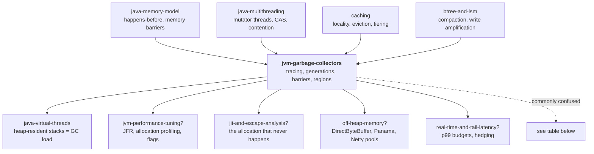

# JVM Garbage Collectors — how the JVM decides which memory is dead, and why that decision costs you latency

> **The one sentence.** A garbage collector never finds the dead — it finds the
> **living**, by walking outward from a small set of starting points, and then
> declares everything it did not reach to be dead by definition; every collector
> ever shipped is a different answer to the question *how do I do that walk
> without stopping your program for too long?*

> **The sentence people get wrong.** "Java manages memory for you, so memory is
> not my problem." Java manages *reclamation* for you. It does not manage
> *retention*, *rate*, or *pauses* — and those three are exactly what wakes you at
> 3am. A 400ms freeze, in which every one of your threads simply stops, is not a
> bug in your code and not a bug in the
> JVM. It is the bill for a design choice somebody made, possibly by default,
> possibly years ago.

**Lab contents**

| File | What it is |
|---|---|
| `README.md` | this document — 16 stages, four depth layers |
| `visualization.html` | **The Heap Machine** — pick a collector, watch the heap live or die · <https://claude.ai/code/artifact/2bd0ad6c-047c-44bf-aacf-48cdc2b2b866> |
| `EXERCISES.md` | eight rungs, pencil-and-paper plus the visualization |
| `SOLUTIONS.md` | worked answers |

---

## Where this sits in your other labs

Five joins to things you have already proven you know. Read these — several of
this lab's hardest ideas are ideas you already own under a different name.

- **`java-memory-model`** gave you *happens-before*, `volatile`, reordering, and
  the word **barrier**. This lab uses the word *barrier* constantly and it means
  something **completely different**. A JMM memory barrier is a CPU instruction
  that constrains *reordering*. A GC write barrier is a **small piece of code the
  JIT injects into your program at every reference assignment**, so the collector
  gets told about a pointer it would otherwise miss. Same word, unrelated
  machines. Stage 10 is where you will see the GC one appear, and stage 15 lists
  this as the single most commonly confused pair in the whole area.
- **`java-multithreading`** gave you *mutator threads racing over shared state*,
  CAS, and the cost of contention. Every one of your application threads is,
  in GC vocabulary, a **mutator** — a thread that mutates the object graph while
  the collector is trying to read it. The entire concurrent-collector problem in
  stage 10 is one enormous instance of the race you already learned to see.
- **`java-virtual-threads`** taught that a virtual thread's stack lives **on the
  heap** as a chunk object. That has a direct consequence here that most people
  miss: a million virtual threads is a million heap-resident stacks the collector
  must scan and keep alive. Cheap threads are not free *to the collector*. Stage
  13 comes back to this.
- **`caching`** gave you the eviction mindset — hot data stays, cold data goes,
  and the whole design rests on a claim about *locality*. The single most
  important idea in this lab, the **weak generational hypothesis** (stage 10), is
  precisely a locality claim about object lifetimes, and the young/old split is
  a two-tier cache hierarchy in disguise.
- **`btree-and-lsm`** is this lab's closest structural twin, and the connection is
  exact rather than poetic. An LSM tree writes cheaply by appending, accepts that
  the data on disk becomes a mess of dead and live records, and pays later with
  **background compaction** that copies live records into fresh files and drops
  the rest. A modern collector allocates cheaply by bumping a pointer, accepts
  that the heap becomes a mess of dead and live objects, and pays later with
  **evacuation** that copies live objects into fresh, empty space and drops the rest.
  *Write amplification* in that lab is *GC copy cost* in this one. If you
  understood why LSM chose that trade, you already understand why G1 did.

---

## How the numbers in this document were produced

There are three kinds of number in this lab and they are labelled differently on
purpose, because confusing them is how people end up quoting a toy at a
production incident review.

- **[MODEL]** — produced by the simulation engine inside `visualization.html`.
  Its "pause" values are in *model milliseconds* from a stated cost formula
  (given in stage 9 and printed on the page itself), not measurements of a JVM.
  They are correct about **shape and ratio** — why one pause is 40x another —
  and meaningless as absolute figures.
- **[HAND]** — a trace worked out by hand in this document from the rules stated
  a few lines above it. You can check every step yourself.
- **[JVM]** — a fact about the real JVM, sourced to the specification, a JEP, or
  the collector's documentation. Nothing in this lab executes a JVM, so every
  **[JVM]** claim is cited rather than measured, and where I am not certain of a
  version number I say so in the same sentence.

---

# BEGINNER MODEL — stages 1 to 9

## 1. WHY — the problem this exists to solve

Your program asks for memory constantly. Every `new`, every string, every boxed
`Integer`, every lambda that captures something, every `ArrayList` that grows —
each one takes a slice of a fixed-size pool of bytes the operating system handed
your process at startup. That pool does not grow on demand. It is a number, and
it is finite.

So somebody has to give the bytes back. If nobody does, the pool fills, the next
request for memory has nowhere to go, and the program stops — in Java, with
`OutOfMemoryError`, usually in whichever unlucky thread happened to allocate
last, which is almost never the thread that caused the problem.

In C, "somebody" is you: you call `free()`. That gives you three ways to be
wrong, and they are the three worst bugs in computing. Free too early and other
code keeps using a slot that has been handed to someone else — a **dangling
pointer**, which corrupts data silently and crashes somewhere unrelated ten
minutes later. Free twice and you corrupt the allocator itself. Free never and
you leak, and the process swells until the kernel kills it.

Java's answer is to take the decision away from you and give it to a subsystem
that runs inside the JVM and reclaims memory automatically. That subsystem is the
garbage collector. It removes all three bugs. What it cannot remove is **cost** —
finding the dead memory takes CPU time, and for most of the last thirty years it
also meant *stopping your program while it looked*. This lab is the story of that
cost being pushed down, decade by decade, from "seconds" to "under a
millisecond", and of everything that had to be invented along the way.

## 2. PROBLEM — the Grand Hotel

Forget computers for a page.

The Grand Hotel has 100 rooms and one very unusual policy: **there is no
checkout**. Guests arrive, are given a room, and at some point simply leave.
Nobody tells the front desk. The key is not returned.

By Tuesday afternoon the desk has a problem. The register says all 100 rooms were
issued. A coach party of 12 is standing in the lobby. The manager walks the
corridors and knows perfectly well that most of those rooms are empty — but she
has no way to prove which ones, and she is not allowed to open a door on a guest
who is still there. Open one wrong door and a paying guest finds a stranger's
luggage in his room. That is the dangling pointer, in a bathrobe.

There is one more wrinkle, and it is the wrinkle that makes this hard rather than
tedious. Guests bring other guests. Guest **Anna** at the front desk is
registered — she paid, she is on the list. Anna brought her assistant **Ben**,
who is not on the register but is unquestionably a real guest occupying room 34.
Ben in turn brought **Cara**, in room 71. So "is this room occupied?" is not a
question about the room. It is a question about whether there is a **chain of
introductions** running from the front desk register all the way to that room.

That chain is the whole subject. Everything else in this lab is engineering.

**The mapping, so the analogy has somewhere to land later:**

| Hotel | Program |
|---|---|
| A room | a slice of heap memory |
| A guest | an object |
| "Anna brought Ben" | Anna's object holds a reference to Ben's object |
| The front desk register | the small set of definitely-live starting points |
| A room nobody can reach by introductions | garbage |
| Opening a door on a live guest | reclaiming memory that is still in use — **catastrophe** |

## 3. NAIVE SOLUTION — make every guest count their keys

Here is what a reasonable person invents in about four seconds, and what real
systems (CPython, Swift, C++'s `shared_ptr`, COM) actually shipped.

Give every room a small counter on the door. Every time somebody is introduced to
that guest, add one. Every time an introduction lapses, subtract one. **The moment
a counter hits zero, the room is empty — clean it immediately.**

In program terms: every object carries a **reference count** of how many
references currently point at it. Assigning `a.next = b` increments b's count.
Overwriting `a.next` with something else decrements the old target's count. When a
count reaches zero, nothing anywhere points at that object any more, so free it
right then — and
decrement everything *it* pointed at, which may cascade.

This is genuinely appealing, and I want you to feel why before I break it:

- **It is immediate.** Memory comes back the instant the last reference dies, not
  at some later clean-up pass. Destructors run predictably.
- **It has no pauses.** There is no "collection" event at all. The work is spread
  evenly across the program's own execution, a few instructions at a time.
- **It is local.** You never have to look at the whole heap. You look at one
  counter.

Three real advantages. Two of them — immediacy and no pauses — are exactly the
properties every collector in this lab spends thirty years trying to buy back.

> **🔮 Predict:** Anna checks out of the hotel and is struck off the front desk
> register. Before she left, she had introduced Ben, and Ben — separately — had
> introduced Anna to the hotel's book club, so Ben holds an introduction to Anna
> too. What do the two door counters read after Anna is struck off, and what does
> the cleaning policy do?
>
> <details><summary>Reveal</summary>
>
> Anna's counter goes from 2 (front desk + Ben) to **1** — Ben still holds an
> introduction to her. Ben's counter is **1** — Anna still holds one to him.
> Neither counter is zero, so **neither room is ever cleaned**. Both guests left
> the building hours ago. The rooms are occupied forever, by nobody.
>
> The rule "count hits zero" answered a *local* question — how many arrows point
> at me — when the real question was a *global* one: is there a path from the
> register to me? Anna and Ben point at each other, and that mutual pointing is
> enough to keep both counters positive forever, even though nothing outside
> their little island points at either of them.
>
> </details>

## 4. FAILURE — cycles, and the bill for counting

The prediction above is the famous one: **reference counting cannot reclaim
cycles.** And cycles are not exotic. A doubly-linked list is a cycle. A parent
node holding children that hold a `parent` pointer back is a cycle. An observer
registered with the subject it observes is a cycle. In a typical Java object
graph they are everywhere.

Every production reference-counted system therefore ships a **second, tracing
collector** just for cycles — CPython has one, and it is exactly the machinery in
stage 6 of this lab. That alone is decisive: if you need tracing anyway, the
counting was overhead.

But there is a second failure that matters as much and gets discussed less, and
it is one you can already reason about from `java-multithreading`.

Reference counting makes **every pointer write a memory write** — often two, since
you increment the new target and decrement the old one. A field assignment
`this.next = node` stops being one store and becomes three memory operations
touching three separate cache lines. Worse, in a multithreaded program those
counters are shared mutable state, so every one of them has to be a **CAS or an
atomic add** — the exact contended-atomic cost you measured in
`java-multithreading`, now applied to *every reference assignment in the entire
program*. And the counter sits inside the object, so two threads reading
completely unrelated fields of the same object still ping-pong its cache line
between cores.

So the honest scorecard is: reference counting spreads its cost evenly, and the
total is large; it cannot handle cycles at all; and it needs a tracing collector
as a backstop anyway.

**But look at what the cycle failure actually revealed**, because that is the
real content of this stage. It is not "counting is bad". It is this:

> **Liveness is not a property of an object. It is a property of the whole graph,
> observed from the outside.**

No amount of information stored *in* Anna's room can tell you whether Anna is
reachable, because the answer depends on parts of the hotel Anna has never heard
of. The question "is this object still in use?" is unanswerable locally. It is a
**global reachability** question, and it can only be answered by something that
starts outside the object graph and walks in.

## 5. THE REAL REQUIREMENT — state it precisely

Here is what we actually need, in plain words. Everything for the rest of the lab
is the pursuit of these four sentences.

1. **Never reclaim memory the program can still reach.** This is absolute. One
   violation is heap corruption, and heap corruption in a managed runtime shows
   up as impossible behaviour far from the cause. This is the *safety* property.
2. **Eventually reclaim memory the program cannot reach.** Note the word
   *eventually*: we will discover in stage 10 that insisting on *immediately* is
   what makes concurrent collection impossible. This is the *completeness*
   property, and it is negotiable in a way that safety is not.
3. **The program must never observe a half-collected heap.** If the collector is
   moving an object while a thread reads a reference to it, that thread must not
   see the old copy, a torn copy, or a wild address.
4. **Do all of that without stopping the program for longer than the program can
   afford.** For a batch report, "afford" is ten seconds. For a payment
   authorization on a 250ms timeout budget, "afford" is single-digit
   milliseconds, and a 400ms pause is a wave of timeouts, a retry storm, and a
   pager.

Requirements 1 and 3 are correctness. Requirements 2 and 4 are where all the
engineering, all the collectors, and all the arguments live.

## 6. KEY IDEA — don't look for the dead

The invention, in two sentences:

> **Start from the small set of places the program can definitely reach memory
> from — the running threads' stacks, the static fields, and a handful of
> internal registries — and follow every reference outward, marking everything
> you touch. Everything you did not touch is unreachable, and unreachable memory
> is dead by definition, so you may take it back without ever having proved that
> any individual object is dead.**

This is **tracing**, and the inversion is the whole trick. We stopped asking "is
this object dead?", which is a question nobody can answer, and started asking "is
this object *reachable*?", which is answerable by a mechanical walk. Death is not
detected. It is **inferred from the absence of evidence of life** — and that
inference is sound, because if no chain of references reaches an object, no line
of code can ever name it again.

Three consequences fall straight out, and each of them will matter later:

- **Cycles are free.** Anna and Ben point at each other, but the walk never
  arrives at either of them, so neither is marked, so both are collected. The
  problem that killed counting simply does not exist here — it was an artifact of
  asking the local question.
- **The cost is proportional to the *live* data, not to the garbage.** The walk
  touches only survivors. A heap with 10,000 dead objects and 3 live ones is
  collected by a walk of length 3. This is the single most exploitable fact in
  the entire field and stage 10 is built on it.
- **It cannot be continuous.** The walk needs the graph to hold still, or at
  least needs to know when it moved. That requirement is where every pause in
  this lab comes from.

In the hotel: the manager stops taking new bookings for a moment, takes the front
desk register, and walks the introductions — Anna leads to Ben leads to Cara. She
chalks a mark on every door she reaches. Then she opens every unchalked door.
Anna and Ben's mutual-introduction island is never reached, so it is never
chalked, so it is emptied. She never had to prove anyone had left.

## 7. TERMINOLOGY — the vocabulary, now that you have felt the need for it

These are the load-bearing terms. Each gets its plain meaning, its precise
meaning, *why the term exists at all*, a concrete example, and its link to
something you already know. Minor terms are defined inline where they first
appear, and everything lands in the glossary at stage 16.

### mutator

- **Plain:** your program. The application code you wrote.
- **Precise:** any thread that changes the object graph — allocating objects and
  writing references — from the collector's point of view.
- **Why the term exists:** the field needed a name for "the thing that keeps
  *messing with* the data structure I am trying to read". Calling it "the
  application" would hide the point; calling it the *mutator* names the exact
  property that makes collection hard. The collector's problem is not that your
  program exists. It is that your program **mutates** the graph mid-walk.
- **Example:** your Spring `@RestController` handling a payment request, running
  on a Tomcat worker thread, allocating a `PaymentRequest` and assigning
  `order.payment = req`, is a mutator doing both mutator jobs at once.
- **Connects to:** in `java-multithreading` this thread was "the racing thread".
  The collector is simply another concurrent reader of the same shared state, and
  the entire stage-10 problem is that classic race with a new cast.

### GC roots

- **Plain:** the front desk register — the places reachability starts from.
- **Precise:** the set of references the JVM knows are live without having to
  prove it: every local variable and parameter in every stack frame of every live
  thread, every `static` field of every loaded class, JNI global references, and
  a few internal tables.
- **Why the term exists:** tracing has to start *somewhere*, and that somewhere
  cannot itself be discovered by tracing — it is bootstrapped from outside the
  heap. "Root" names that privileged, un-derived status.
- **Example:** a payment service with a `static final Map<String,Session> CACHE`
  has that map as a root. Everything in it is reachable forever, whatever else
  you do. **[JVM]** This is the number-one cause of real Java memory leaks, and
  stage 11 walks one.
- **Connects to:** `java-virtual-threads` — a virtual thread's stack lives on the
  heap, so its frames are still scanned as roots when it is mounted, and its
  heap-resident stack chunk is itself a live object when it is not. Millions of
  parked virtual threads are millions of live objects.

### reachable / unreachable (liveness)

- **Plain:** can you get here from the front desk by following introductions?
- **Precise:** an object is reachable if some path of references leads to it from
  a root. Unreachable objects are garbage and may be reclaimed.
- **Why the term exists:** to replace the unanswerable word *dead*. Note the gap
  this creates and never closes: an object your code will demonstrably never
  touch again is still *reachable* if a field somewhere still points at it, and
  the collector will keep it forever. **Reachable is a conservative
  over-approximation of "in use", and that gap is exactly where memory leaks
  live.**
- **Example:** you remove a listener's owner from a list but the event bus still
  holds the listener. Nothing will ever call it. It is reachable. It stays.

### stop-the-world (STW) pause and safepoint

- **Plain:** the moment the manager stops all hotel business to walk the
  corridors.
- **Precise:** an interval during which every mutator thread is suspended so the
  collector can work on a graph that is guaranteed not to change. A **safepoint**
  is a point in compiled code where a thread's state is fully described and
  therefore safe to suspend — the JVM cannot stop a thread at an arbitrary
  instruction, so it asks threads to stop and each one runs to its next
  safepoint poll and parks there.
- **Why the terms exist separately, and this is a distinction people miss:**
  the pause you get is **time-to-safepoint plus the actual GC work**. If one
  thread is stuck in a long loop with no safepoint poll in it, *every other
  thread waits for that one thread*, and you get a 900ms pause from a collector
  that did 4ms of work. **[JVM]** The classic cause is a `for (int i = ...)`
  counted loop, which HotSpot may compile without a poll on the assumption it
  terminates quickly. `-Xlog:safepoint` shows the two numbers separately.
- **Connects to:** this is a global barrier across all threads — the same
  everybody-waits-for-the-slowest shape as the lock convoy in
  `java-multithreading`, but imposed by the runtime rather than your code.

### mark, sweep, compact, evacuate

Four verbs, and keeping them apart is most of the battle.

- **mark** — the walk. Set a bit on every reachable object. Cost scales with
  **live** data.
- **sweep** — walk the heap linearly, add every unmarked object's space to a free
  list. Nothing moves. Cost scales with **heap size** (you touch dead objects
  too, to free them).
- **compact** — slide the surviving objects together so free space is one
  contiguous block. Everything moves; every reference to a moved object must be
  updated. Cost scales with **live** data, and it is expensive per object.
- **evacuate** (also *copy*) — copy survivors *out* into a different, empty area
  and then declare the whole source area free in one stroke. Also moving, also
  needs reference updates, but the dead are never touched at all.
- **Why four words:** they cost different things and fail differently, and stages
  10 and 11 are largely the story of trading between them. The one to hold onto:
  **sweep is cheap per object and leaves a mess; evacuate is expensive per
  survivor and leaves the space perfect.**
- **Connects to:** `btree-and-lsm`. Evacuation *is* LSM compaction: copy the live
  records to a new file, drop the old file whole. The cost model is the same and
  so is the trade.

### fragmentation

- **Plain:** the hotel has 40 empty rooms but no 4 adjacent ones, so the family
  of 4 is turned away.
- **Precise:** free memory exists but is split into blocks too small to satisfy a
  request. Total free bytes is not the number that matters; **largest contiguous
  free block** is.
- **Why the term exists:** because "we ran out of memory" and "we ran out of
  *usable* memory" are different failures with different fixes, and only the
  second one is cured by moving things.
- **Example:** stage 10 walks a heap that is 50% free and still cannot satisfy a
  4-cell request. **[MODEL]** You can reproduce it in scenario 1 of the
  visualization.

### generational hypothesis, young/old generation, promotion

- **Plain:** most things die young, so look where the bodies are.
- **Precise:** the **weak generational hypothesis** is the empirical claim that
  the vast majority of objects become unreachable very shortly after allocation.
  Collectors exploit it by splitting the heap into a small **young generation**
  where new objects are born and collected often, and a larger **old generation**
  for objects that have survived several young collections and been **promoted**
  into it.
- **Why the term "hypothesis":** it is an observation about real programs, not a
  law. It is overwhelmingly true for request-response services, where nearly every
  object dies with the request. It is **false** for a program that loads a large
  cache at startup, and false in a specific, expensive way for one that allocates
  a big long-lived structure gradually. When it is false, generational collection
  does more work than a plain collector would.
- **Connects to:** `caching`. This is a two-tier hierarchy justified by a
  locality claim, exactly like an L1/L2 cache — and it degrades the same way when
  the locality claim stops holding.

### write barrier and remembered set / card table

- **Plain:** a note the hotel makes when a long-stay guest invites a new
  short-stay guest, so the manager knows to check that introduction.
- **Precise:** a **write barrier** is a few instructions the JIT injects into
  your compiled code at every reference field assignment, which records something
  the collector will need. A **remembered set** is the record it maintains: the
  set of references pointing *from* a region the collector is not scanning *into*
  a region it is. HotSpot's classic implementation is a **card table** — the heap
  is divided into 512-byte "cards" and the barrier dirties one byte per card.
- **Why it exists:** this is the tax that makes partial collection possible at
  all. If you only collect the young generation, you must still find every
  old-to-young reference, and scanning the whole old generation to find them
  would defeat the point entirely. Stage 10 derives this from the failure that
  forces it, so do not memorise it now.
- **⚠️ Connects to — and this is the trap:** `java-memory-model` taught you
  *memory barriers* (`volatile`, fences, reordering). **A GC write barrier is not
  a memory barrier.** It is application code injected for bookkeeping, and it has
  nothing to do with reordering or visibility between threads. Same word, two
  unrelated machines. See stage 15.

### throughput, pause time, footprint

- **Plain:** the three things you want and cannot all have.
- **Precise:** **throughput** = fraction of CPU time spent running your code
  rather than collecting. **Pause time** = the longest single stop-the-world
  interval, the number your p99 latency actually feels. **Footprint** = how much
  memory the whole scheme needs beyond the live data itself.
- **Why three:** because they genuinely trade against each other, and every
  collector in stage 13 is a different point on that surface. A collector that
  does its work concurrently has short pauses and *worse* throughput — barriers
  and concurrent threads cost CPU that is no longer running your code.
- **Connects to:** the shape of `pacelc` and `cap-theorem` — a small number of
  properties, a hard constraint, and every real system is a named point on the
  trade surface rather than a winner.

## 8. MENTAL MODELS — carry two, and know where the first one lies

### The simple model: the Grand Hotel

The manager holds the front desk register. Periodically she stops hotel business,
walks the introduction chains from the register, chalks a mark on every door she
reaches, then opens every unchalked door and cleans the room. Rooms get scattered,
so sometimes she also asks reachable guests to shuffle down the corridor so the
empties are all together. Long-stay guests move to the quiet east wing and get
checked rarely; new arrivals go in the noisy west wing near the desk, which gets
swept constantly because almost everyone there leaves within a day.

This is the picture to carry around. It gets you most of stage 10.

### The engineering model: a directed graph with a colour on each node

Precisely:

- The heap is a set of **objects**. Each holds zero or more **references** to
  other objects. That is a directed graph, and it may have cycles.
- A distinguished set of edges comes from outside the graph: the **roots**.
- Marking assigns each object a colour from the **tri-colour** scheme —
  **white** = not yet reached, **grey** = reached but its own references not yet
  scanned, **black** = reached and fully scanned. Marking starts with roots grey,
  repeatedly takes a grey object, blackens it and greys its white children, and
  finishes when no grey remains. Everything still white is unreachable.
- The **invariant that must hold at the end**: no black object holds a reference
  to a white object. If that ever becomes true and stays true, a live object gets
  freed. Stage 10 is about defending this invariant while the mutator is running.
- **Allocation** is not "find a free block". In a bump-pointer space it is
  literally `ptr += size` plus a bounds check — a couple of instructions.
  **[JVM]** Each thread bumps within its own **TLAB** (thread-local allocation
  buffer) so there is no contention; when the TLAB is exhausted, the thread
  atomically grabs a fresh one from the shared space. This is why allocation in
  Java is *faster than `malloc`*, and why "avoid allocation" advice is usually
  wrong: allocation is cheap, **survival** is what costs.

### The mapping

| Hotel | Engineering model | Where it shows up |
|---|---|---|
| Front desk register | GC roots (thread stacks, statics, JNI globals) | stage 7 |
| Guest in a room | object occupying heap bytes | everywhere |
| "Anna brought Ben" | a reference field in Anna pointing at Ben | stage 2 |
| Chalk mark on a door | the mark bit / black colour | stage 6 |
| Doors reached, contents not yet checked | grey set (the marking worklist) | stage 10 |
| Manager stops hotel business | stop-the-world pause at a safepoint | stage 7 |
| Opening unchalked doors | sweep | stage 10 |
| Shuffling guests down the corridor | compaction | stage 10 |
| Noisy west wing / quiet east wing | young generation / old generation | stage 10 |
| Note when an east-wing guest invites a newcomer | write barrier writing a card table entry | stage 10 |
| Family of 4 turned away despite 40 empties | fragmentation | stage 10 |

### ⚠️ Where the analogy breaks

The hotel is a good picture and a bad model in five specific places. Know all
five, because each one is a real mechanism the analogy is hiding.

1. **The manager can ask; the JVM cannot.** A hotel manager could knock and ask
   "are you still here?" The collector has no such move. There is no way to
   interrogate an object about its own liveness — that was the whole lesson of
   stage 4. Only the walk exists.
2. **Rooms are all the same size; objects are not.** Fragmentation in the hotel
   is about adjacency only. In a heap, objects have wildly different sizes, and
   an 8-byte hole is useless to a 64-byte request. This makes fragmentation much
   worse than the analogy suggests, and it is why size classes and region sizes
   are real design parameters.
3. **Guests notice being moved; objects must not.** When the manager shuffles
   guests, they know they are in a new room. When the collector moves an object,
   **every reference anywhere in the heap that pointed at the old address must be
   found and rewritten**, or the mutator will follow a stale pointer into
   whatever now lives there. This single requirement is why moving collectors are
   hard and why stage 10's final act needs forwarding pointers and load barriers.
4. **The hotel has one manager; the JVM has many, running alongside the guests.**
   Every serious modern collector runs marking, and often copying, on multiple
   threads *while the mutators keep running*. The analogy's "stop business, walk,
   resume" is the 1990s picture, and stage 10 is the story of leaving it behind.
5. **Nobody in the hotel dies while the manager is walking; objects do.** The
   graph the collector is reading is being rewritten under it in real time. That
   is the central difficulty of the entire field and the analogy does not contain
   it at all.

## 9. VISUALIZATION — the Heap Machine

Open `visualization.html`. It is one heap you can watch under six different
collectors, and it is where every failure in stages 10 and 11 is reproducible.

**What you are looking at.** The large grid is the heap; each cell is one unit of
memory. Cells are coloured by what occupies them: **live and reachable**,
**allocated but unreachable** (garbage the collector has not yet noticed),
**free**, or during marking, **white / grey / black**. Above it sits the object
graph for the small set of objects currently under discussion, with roots pinned
at the left. Below is the event log, which writes a full sentence for every step,
and the pause meter, which draws one bar per stop-the-world pause so you can see
the *shape* of a collector's latency, not just its average.

**The three questions the page must always answer from the screen alone:**
*what just changed* (the changed cells flash), *why* (the log sentence), and
*what if* (every arbitrary choice is a control you can move).

**About the pause numbers.** **[MODEL]** The page computes pause length from a
stated formula printed on the page: `pause = 0.02·(objects scanned) +
0.05·(cells copied) + 1.0` model-ms, plus a time-to-safepoint term when you
enable the stuck-thread injection. These are model units. Their **ratios** are
the lesson — that a young-only pause is tens of times shorter than a full-heap
pause is true and is the reason generational collection won. Their **absolute
values** mean nothing about any real JVM.

**Where to start, in this order:**

1. **Scenario 1 — Fragmentation.** Mark-sweep, no compaction. Watch a heap that
   is half free refuse a 4-cell allocation.
2. **Scenario 3 — The missing note.** Generational, write barrier switched OFF.
   Watch a live object get collected. This is the one that makes write barriers
   feel necessary rather than arbitrary.
3. **Scenario 4 — The lost object.** Concurrent marking, SATB barrier OFF. The
   same catastrophe from a completely different direction, and the hardest idea
   in the lab.

Each scenario asks you to predict before it runs. Predict badly on purpose; a
wrong prediction you committed to is worth five paragraphs you agreed with.

> **✅ CHECKPOINT — end of the BEGINNER MODEL.**
> You can now explain why memory has to be reclaimed, why asking each object
> whether it is dead cannot work, and why the answer is to walk from the roots
> and treat everything unreached as dead. You know the words *mutator, root,
> reachable, safepoint, mark, sweep, compact, evacuate, fragmentation*.
> **What is missing:** you have exactly one collector — stop everything, mark,
> sweep — and it is the collector nobody has shipped for serious work since the
> 1990s, because its pause is proportional to the whole heap. The next layer is
> the sequence of failures that turned that one collector into six.

---

# INTERMEDIATE MODEL — stage 10

## 10. ACTUAL MECHANISM — six collectors, each one a scar

This stage is a chain. Every version solves the previous version's failure and
introduces a new one. Do not skip forward; the point is not the final design but
*why each part of it had to exist*. When you meet G1's "remembered set" in a job
interview, you want to remember the failure it patches, not the noun.

Our running example throughout: a **payment authorization service**. Each request
allocates a `PaymentRequest`, a few `Money` objects, a `MerchantRecord` looked up
from cache, a validation result, a response DTO, and assorted strings — call it
~40 objects per request, nearly all of which are dead the microsecond the
response is written. It also holds a long-lived `merchantCache` map with 200,000
entries that lives for the life of the process. Hold both of those facts; the
tension between them is the whole story.

---

### v1 — Serial mark-sweep. Stop, walk, free.

The direct implementation of stage 6.

1. A collection is triggered when allocation fails. All mutator threads are
   brought to a **safepoint** and suspended.
2. **Mark:** starting from the roots, walk the graph, set a mark bit on every
   object reached.
3. **Sweep:** walk the heap address by address. Every object without a mark bit
   is dead; add its space to a **free list**. Clear the mark bits of the
   survivors.
4. Resume the mutators. Allocation now means searching the free list for a block
   big enough.

**[HAND] Worked trace.** A 20-cell heap. One-cell objects, except `D` which is 3
cells. Roots are `{A}`. The graph: `A → B`, `A → C`, `C → A` (a cycle back),
`E → F` (an island — nothing points at E), `D` unreferenced.

Layout before collection, one character per cell (`.` = free):

```
cell:  0  1  2  3  4  5  6  7  8  9 10 11 12 13 14 15 16 17 18 19
       A  B  C  D  D  D  E  F  G  H  .  .  .  .  .  .  .  .  .  .
```

Mark phase, worklist in order:

| step | grey worklist | action | result |
|---|---|---|---|
| 1 | `[A]` | pop A, mark it, push its children B and C | A black; grey `[B, C]` |
| 2 | `[B, C]` | pop B, mark it, no children | B black; grey `[C]` |
| 3 | `[C]` | pop C, mark it, child A already marked — skip | C black; grey `[]` |
| 4 | `[]` | worklist empty → marking done | marked = {A, B, C} |

Note step 3: the cycle `C → A` terminated harmlessly because A was already
marked. **The cycle that permanently defeated reference counting cost tracing one
comparison.** Note also what was never visited: E, F, G, H, D — five objects, and
the walk did zero work on any of them. Cost was 3 marks for a heap of 10 objects.

Sweep phase, walking cells 0..19 and freeing every unmarked object:

```
cell:  0  1  2  3  4  5  6  7  8  9 10 11 12 13 14 15 16 17 18 19
       A  B  C  .  .  .  .  .  .  .  .  .  .  .  .  .  .  .  .  .
free list: [3..9] (7 cells), [10..19] (10 cells)
```

17 of 20 cells free. Excellent. Now run the mutator for a while, allocating and
dropping one-cell objects, and let it collect again a few times. Here is a
plausible later state — same 3 cells live, 17 free, but scattered:

```
cell:  0  1  2  3  4  5  6  7  8  9 10 11 12 13 14 15 16 17 18 19
       A  .  X  .  .  Y  .  .  .  Z  .  .  W  .  .  .  V  .  .  U
free: 13 cells. Largest contiguous run: 3 cells (13..15).
```

> **🔮 Predict:** The service now needs to allocate a 5-cell object — say a small
> array. 13 of 20 cells are free, which is 65% of the heap. What happens?
>
> <details><summary>Reveal</summary>
>
> **`OutOfMemoryError`, with 65% of the heap free.** The free list has thirteen
> cells in seven fragments and the largest single run is three. There is nowhere
> to put a 5-cell object.
>
> The number that matters for an allocation is never *total free*; it is
> **largest contiguous free block**. Sweeping never moves anything, so every
> collection leaves the survivors exactly where they were and the holes exactly
> where the dead were. Over time the heap becomes swiss cheese, and the cheese
> gets holier with every cycle. **[MODEL]** Reproduce it in scenario 1.
>
> </details>

**Failures of v1, both fatal for a service:**

- **Fragmentation**, as above. It gets monotonically worse and only moving fixes
  it.
- **The pause is proportional to the whole heap.** Marking touches all live data
  and sweeping touches every byte of the heap. On our payment service, that means
  every single collection walks the entire 200,000-entry `merchantCache` — data
  that is *always* live and could not possibly have died — and then sweeps all
  4GB. A 4GB heap here is a multi-second pause, on every collection.

---

### v2 — Mark-compact. Fix fragmentation, keep the pause.

Replace sweep with **compact**: after marking, slide every survivor toward one end
of the heap, in order, and update every reference that pointed at a moved object.

```
before:  A  .  X  .  .  Y  .  .  .  Z  .  .  W  .  .  .  V  .  .  U
after:   A  X  Y  Z  W  V  U  .  .  .  .  .  .  .  .  .  .  .  .  .
                                 ^ one contiguous 13-cell free block
```

The 5-cell allocation now succeeds trivially, and better: allocation stops being
a free-list search and becomes **bump the pointer**, which is two instructions.
Fragmentation is gone permanently, not deferred.

The price is stated honestly: compaction moves live data, and every moved object
requires a scan to fix up references pointing at it. **[JVM]** This is what
HotSpot's full GC does — Serial's `MarkSweepCompact`, and Parallel GC's old
generation — and it is the single most expensive event the JVM has. It is also
why "full GC" appears in incident reports as a curse.

**Failure of v2:** we fixed the *quality* of the free space and did nothing at all
about the *pause*. Every collection still walks the entire live set, including
200,000 cache entries that were live last time, are live this time, and will be
live every time until the process exits.

That observation is the door to the next idea, and it is worth stating as the
question it is: **we are repeatedly proving the same objects are alive. Can we
stop doing that?**

---

### v3 — Generational collection. Look where the bodies are.

The empirical observation, from decades of measurement across many languages:

> **The weak generational hypothesis.** The overwhelming majority of objects die
> very shortly after they are allocated. Objects that survive a while tend to
> keep surviving.

For our payment service this is not merely true, it is nearly total. Of ~40
objects per request, roughly 39 are unreachable by the time the response is
serialized. The `merchantCache` entries are on the other side and stay there for
hours.

So split the heap:

- **Young generation** — small, where every new object is allocated. Subdivided
  into **Eden** (where allocation happens) and two **survivor** spaces, `S0` and
  `S1`.
- **Old generation** — large, for objects that have survived several young
  collections.

A **minor GC** (or *young collection*) collects only the young generation, by
**evacuation**: mark from the roots but only follow references *into young
space*, then copy every young survivor out into the empty survivor space or into
old, then declare Eden and the just-vacated survivor space **entirely free in one
operation**. The dead are never touched. Not marked, not swept, not visited.

Read that last line again, because it is the payoff: **the cost of a minor GC is
proportional to the number of survivors, and is completely independent of how
much garbage there was.** Allocating a million objects that all die costs the
collector nothing.

**Aging and promotion.** Each object header carries a small **age** counter,
incremented each time it survives a collection. When age crosses a threshold
(**[JVM]** `-XX:MaxTenuringThreshold`, default 15 for most collectors, though the
JVM adapts the actual threshold dynamically based on how full the survivor space
is), the object is **promoted** — copied into the old generation instead of the
survivor space, and it stops being visited by minor GCs.

**[HAND] Worked trace of four minor GCs.** Eden = 10 cells, `S0` = `S1` = 4
cells, old = 20 cells. Objects are one cell. Promotion threshold: age 3.

*Collection 1.* Eden holds 10 objects `r1..r10`. Only `r3` is still reachable
(it got stored in a request context that outlives the batch).

```
Eden [r1 r2 r3 r4 r5 r6 r7 r8 r9 r10]   S0 [ ]   S1 [ ]   Old [cache…]
mark from roots, following only into young: reaches r3 only.  → 1 object scanned
copy r3 → S0, set age(r3) = 1
declare all of Eden free in one stroke   ← 9 dead objects, zero work done on them
Eden [ ]   S0 [r3@1]   S1 [ ]
```

*Collection 2.* Eden refilled with `s1..s10`; `s7` survives; `r3` still live.

```
survivors this cycle: s7 (from Eden), r3 (from S0)
copy both into S1 (the empty survivor space); increment ages
Eden [ ]   S0 [ ]   S1 [r3@2, s7@1]           2 objects copied
```

*Collection 3.* `r3` survives again, `s7` dies, Eden yields `t2`.

```
copy r3 (age→3) and t2 (age 1) into S0
r3 has now reached the threshold of 3 → promote instead
Eden [ ]   S0 [t2@1]   S1 [ ]   Old [cache…, r3]
```

*Collection 4.* `r3` is in old. **It is not scanned. It is not copied. It is not
even looked at.** The minor GC's root set no longer includes it, and it never
will again until an old-generation collection happens.

Total work across four collections: 4 marks, 4 copies. Compare v1, which would
have marked and swept the entire heap — including all 200,000 cache entries —
four times. **This is the largest single win in the history of garbage
collection, and it comes entirely from a claim about program behaviour rather
than from any clever algorithm.**

> **🔮 Predict:** A minor GC only scans the young generation, and its roots are
> the thread stacks and statics. Now: an object `cacheEntry` sits in the **old**
> generation, and during a request your code runs
> `cacheEntry.lastAccess = new Timestamp()`, putting a fresh **young** object's
> address into an **old** object's field. Nothing on any thread stack points to
> that `Timestamp`. The next minor GC runs. What happens to it?
>
> <details><summary>Reveal</summary>
>
> **It is collected while still perfectly reachable, and `cacheEntry.lastAccess`
> is left pointing at freed memory.** The mark phase started from the stacks and
> statics and only followed references into young space; it never walked the old
> generation, so it never saw the pointer from `cacheEntry`. The `Timestamp` was
> never marked, so it was never copied out of Eden, and then Eden was declared
> free wholesale.
>
> Next time anything reads `cacheEntry.lastAccess` it follows a dangling pointer
> into whatever object has since been allocated in that Eden slot. This is
> silent, non-deterministic heap corruption — the exact catastrophe requirement 1
> of stage 5 forbids absolutely.
>
> **[MODEL]** Watch it happen in scenario 3, with the write barrier switched off.
>
> </details>

**The failure of naive v3, and the fix it forces.** Partial collection is only
sound if you can find every reference pointing *into* the part you are collecting
from the parts you are *not* collecting. The obvious remedy — scan the whole old
generation to find old→young pointers — costs exactly as much as the full
collection we were trying to avoid, so it is not a remedy at all.

The actual fix: **make the mutator tell us.** The JIT injects a **write barrier**
after every reference-field assignment. In HotSpot's classic form the barrier is
about two instructions and dirties one byte in a **card table**, where each byte
covers a 512-byte **card** of the old generation:

```
   card_table[(address_of_field) >> 9] = DIRTY;
```

At the next minor GC, the collector adds every object in every dirty card to its
root set, alongside the thread stacks. Now `cacheEntry` is scanned, the
`Timestamp` is found and marked, and it survives.

**[HAND] Card table trace.** Old generation spans addresses `0x1000`–`0x2000`,
cards are 512 bytes, so card index = `(addr − 0x1000) / 512`, giving cards 0–7.

| event | address written | card dirtied | card table |
|---|---|---|---|
| start of cycle | — | — | `[0 0 0 0 0 0 0 0]` |
| `cacheEntry.lastAccess = ts` at `0x1240` | `0x1240` | `(0x240)/512 = 1` | `[0 1 0 0 0 0 0 0]` |
| `other.field = obj` at `0x1A08` | `0x1A08` | `(0xA08)/512 = 5` | `[0 1 0 0 0 1 0 0]` |
| minor GC starts | — | — | scan roots **+ every object in cards 1 and 5** |
| minor GC ends | — | — | cards cleared → `[0 0 0 0 0 0 0 0]` |

The collector scans two cards — 1KB of old generation — instead of the whole
4GB old generation. That is the trade: **a couple of instructions on every
reference write, in exchange for making partial collection possible at all.**

Notice the imprecision, because it is deliberate and it is a real cost: the card
records *"something in this 512-byte region was written"*, not *which field*.
The collector must re-scan every object in the card. Making cards smaller means
more precision and a bigger table; this is a tuning knob, not a solved problem.

**[JVM] Two honest notes.** G1 uses a richer structure than a bare card table —
per-region **remembered sets** built from a card table via concurrent refinement
threads, because G1 collects an arbitrary *subset* of regions rather than a
fixed young space, so it needs to know direction, not just dirtiness. And this
is the paragraph to re-read after `java-memory-model`: this barrier is **not** a
`volatile` fence. It emits no ordering constraint. It is bookkeeping code, and
the fact that both are called "barrier" is a historical accident that has
confused people for thirty years.

**The remaining failure of v3.** Minor GCs are now fast and cheap. But the old
generation still fills up — from promotions, and from our 200,000 cache entries.
When it does, you get a **full GC**: mark and compact the entire heap, all
threads stopped, and every one of those cache entries walked. On a 4GB heap that
is **[JVM]** commonly in the seconds. It is rarer than v1's pause. It is just as
long when it comes, and it comes at the worst possible moment — under load, when
allocation is fastest.

---

### v4 — Concurrent marking. Walk the graph while the program runs.

The old generation is big and mostly stable, and marking it is the expensive
part. So: **do the marking while the mutators keep running.** Stop the world only
briefly, to scan the roots.

The cycle becomes:

1. **Initial mark [STW, short]** — stop everything, mark objects directly
   reachable from roots. Roots are thousands of stack slots, not gigabytes of
   heap, so this is short and — crucially — its cost scales with *thread count*,
   not heap size.
2. **Concurrent mark [running]** — restart the mutators. Collector threads walk
   the graph in parallel with the application, greying and blackening.
3. **Remark / final mark [STW, short]** — stop everything again briefly to
   process whatever the mutators changed during step 2.
4. **Concurrent sweep or evacuation [running]** — reclaim.

Step 2 is the prize and step 3 is the problem, and to see why you need the
tri-colour scheme from stage 8 made concrete.

**The tri-colour rules.** White = unreached. Grey = reached, children not yet
scanned. Black = reached and fully scanned. Marking ends when the grey set is
empty, and everything white is then declared garbage. **The invariant the
collector relies on: at the end of marking, no black object points to a white
object.** A black object is never re-examined — that is precisely what "black"
buys us — so a white child of a black parent will never be discovered.

Now let the mutator run during marking.

> **🔮 Predict:** Mid-way through concurrent marking, the heap contains:
> `X` is **black** (scanned; the collector is done with it). `Y` is **grey**
> (reached; not yet scanned). `Z` is **white**, and the *only* reference to `Z` in
> the entire heap is the field `Y.child`.
>
> Your application thread now runs two ordinary lines of Java:
>
> ```java
> X.field = Y.child;   // X (black) now points at Z
> Y.child = null;      // Y (grey) no longer points at Z
> ```
>
> `Z` is unambiguously reachable — `X.field` refers to it, and `X` is reachable.
> What colour is `Z` when marking finishes, and what happens to it?
>
> <details><summary>Reveal</summary>
>
> **`Z` is still white, and it is reclaimed. A live, reachable object is freed.**
>
> Follow it precisely. `X` was already black, so the collector will never look at
> `X`'s fields again — it has no idea `X.field` changed. `Y` is grey and will be
> scanned soon, but by the time it is, `Y.child` is `null`, so scanning `Y`
> discovers nothing. No other reference to `Z` exists. `Z` is never greyed, never
> blackened, and marking terminates with `Z` white.
>
> The mutator did nothing wrong. It performed two legal field assignments. But
> between them it **moved the only reference to `Z` from a not-yet-scanned object
> to an already-scanned object**, and in doing so it created exactly the forbidden
> state: a black object pointing at a white one.
>
> This is the **lost object problem**, and it is the reason concurrent collection
> needed a decade of research rather than an afternoon. **[MODEL]** Scenario 4
> lets you perform those two assignments by hand and watch `Z` die.
>
> </details>

**What the failure teaches.** The lost-object condition needs **two** things to
happen together:

1. a reference to a white object is **written into a black object**, and
2. **every** path from grey objects to that white object is destroyed before the
   grey objects are scanned.

Break either one and the object survives. That gives two families of fix, and the
real collectors are split between them:

- **Incremental-update barriers** attack condition 1. On `X.field = Z` where `X`
  is black, the write barrier re-greys `X` (or greys `Z`) so the new edge will be
  followed. **[JVM]** This is what the old CMS collector used.
- **Snapshot-at-the-beginning (SATB) barriers** attack condition 2. On any
  overwrite of a reference field, the barrier records the **old** value into a
  collector queue before it is lost — here, `Y.child`'s old value `Z` is pushed
  onto the marking stack the moment it is overwritten with `null`. **[JVM]** This
  is what G1 and Shenandoah use.

SATB's name is its own explanation, and it is the cleanest idea in this lab:
**the collector marks the object graph as it existed at the instant marking
started**, a logical snapshot. Anything reachable at that instant will be marked,
even if the program subsequently drops it. Nothing reachable at that instant can
be missed, so safety holds.

The cost of that guarantee is stated in its own name too:

> **Floating garbage.** An object that becomes unreachable *after* marking began
> is nevertheless marked live and survives this whole cycle. It is collected on
> the next one.

This is the negotiation we flagged in requirement 2 of stage 5. We gave up
**immediately** and kept **eventually**, and that is precisely the price of not
stopping the world. It is a good deal: a little extra memory held for one extra
cycle, in exchange for pauses that no longer scale with the heap. But it means a
concurrent collector always needs **headroom** — free heap to absorb both
floating garbage and everything allocated during the cycle. Run a concurrent
collector at 95% heap occupancy and you have taken its headroom away, which
brings us to its failure.

> **🔮 Predict:** Concurrent marking of a 4GB old generation takes 800ms. Your
> payment service allocates 500MB/s and currently has 600MB free when the cycle
> starts. What happens?
>
> <details><summary>Reveal</summary>
>
> The cycle needs 800ms; in 800ms the service allocates ~400MB, plus floating
> garbage it cannot reclaim. It is close, and under a traffic spike it loses. When
> the heap fills before the concurrent cycle finishes, the JVM has one move left:
> **stop the world and do a full, compacting collection** — the multi-second
> event from v2, now happening at peak load.
>
> **[JVM]** In CMS this was logged as *concurrent mode failure*; in G1 you see it
> as an evacuation failure ("to-space exhausted") and possibly a *Full GC
> (Allocation Failure)*; in ZGC and Shenandoah the milder form is an **allocation
> stall**, where the allocating thread is blocked until the collector frees
> something. The generalisation is the one that matters: **a concurrent collector
> is a race between the collector and your allocation rate, and losing that race
> costs you the very pause you bought the collector to avoid.**
>
> </details>

**And v4 has a second failure, one CMS never fixed:** concurrent *sweeping*
leaves the heap fragmented, just like v1, because sweeping does not move
anything. CMS's answer was to fall back to a stop-the-world compacting full GC
when fragmentation got bad enough — meaning a "low-pause" collector whose worst
case was the longest pause the JVM has. **[JVM]** CMS was deprecated in JDK 9 and
removed in JDK 14 (JEP 363).

---

### v5 — G1: cut the heap into regions and collect only the best ones

The insight that produces G1 is not about marking at all. It is about **choice**.

Everything so far collects a *fixed area* — the whole heap, or the whole young
generation. What if the collector could collect **any subset of the heap it
liked**, and choose that subset to fit a pause budget you declare?

Divide the heap into a couple of thousand equal-sized **regions**. **[JVM]**
G1 sizes them as heap/2048, clamped to a power of two between 1MB and 32MB. A
region is not permanently young or old — it is *labelled* Eden, Survivor, Old, or
Humongous, and its label changes as it is reused.

Collection becomes **evacuation of a chosen collection set**: pick a set of
regions, copy their live objects into fresh empty regions, and free the source
regions entirely. Because evacuation copies survivors, it **compacts as a side
effect** — the fragmentation that killed v1 and CMS is fixed incidentally, not by
a separate expensive phase.

Two consequences that make G1 the default collector:

- **The pause is now a budget, not an outcome.** You state
  `-XX:MaxGCPauseMillis=200` (the default). G1 measures how long it took to
  evacuate live data recently, and from those measurements *predicts* how many
  regions it can evacuate within your budget — then picks that many. It is a
  feedback controller, and the name **"Garbage-First"** is its selection rule:
  **evacuate the regions with the most garbage first**, because those give the
  most free memory for the least copying.
- **Old-generation collection stops being all-or-nothing.** A **mixed
  collection** evacuates all young regions *plus* a handful of the most
  garbage-rich old ones. The old generation is collected a slice at a time,
  spread over many pauses, instead of in one apocalyptic full GC.

To choose regions freely, G1 must know which references point *into* each
candidate region from outside it — the direction problem from v3, generalised.
Hence a **remembered set per region**, maintained by the write barrier plus
background refinement threads. **[JVM]** This is why G1's write barrier is
noticeably more expensive than Parallel GC's simple card mark, and it is the
main reason G1 has lower throughput than Parallel GC on batch workloads. The
barrier cost is the fee for the pause control.

**[HAND] Why "garbage-first" is the right greedy rule.** Eight old regions, 4MB
each, with these live fractions:

| region | live | copying cost | memory reclaimed |
|---|---|---|---|
| R1 | 5% | 0.2MB copied | 3.8MB |
| R2 | 10% | 0.4MB | 3.6MB |
| R3 | 15% | 0.6MB | 3.4MB |
| R4 | 60% | 2.4MB | 1.6MB |
| R5 | 90% | 3.6MB | 0.4MB |

Reclaimed-per-byte-copied: R1 = 19.0, R2 = 9.0, R3 = 5.7, R4 = 0.67, R5 = 0.11.
Picking R1+R2+R3 costs 1.2MB of copying and reclaims 10.8MB. Picking R5 alone
costs three times as much copying and reclaims 0.4MB — **twenty-seven times worse
per unit of pause.** The greedy rule is not a heuristic hack; the ratio really is
that lopsided, and it is why a region that is 90% live may never be collected at
all until a full GC forces it.

**Failures of v5.**

- **Humongous objects.** **[JVM]** An object ≥ half a region is *humongous* and
  is allocated in a run of contiguous regions rather than in Eden. Allocate a
  20MB byte array with 4MB regions and you need five adjacent free regions. Under
  fragmentation of the *region* map, that request can fail even with plenty of
  free memory — the v1 fragmentation failure, resurrected one level up. Humongous
  regions are also collected less flexibly, and a service that allocates large
  buffers per request can drive G1 into repeated full GCs.
- **Evacuation is still stop-the-world.** G1 marks concurrently, but the copying
  happens with all mutators paused. So the pause, while bounded and predictable,
  is still **proportional to the volume of live data being copied**. On heaps
  where the live set is genuinely large — a 200GB in-memory cache — even a
  well-tuned G1 pause is tens to hundreds of milliseconds, because that much data
  physically has to be copied while nobody is looking.
- **The budget is a target, not a promise.** `MaxGCPauseMillis` is honoured by
  prediction. Set it to 5ms and G1 will collect tiny collection sets, fall
  further behind on reclamation, and eventually give you a full GC — a hard
  lesson that shows up as "I tuned the pause target down and latency got worse."

---

### v6 — ZGC and Shenandoah: move objects while the program is reading them

To get pauses that do not depend on heap size *at all*, the last stop-the-world
phase has to go: the copying itself must happen concurrently.

That is a genuinely hard problem, and it is failure #3 of the analogy in stage 8
coming due. If the collector relocates object `Z` from address `0xA00` to
`0xF00` while a mutator thread holds a reference to `0xA00` and dereferences it,
the thread reads a stale copy or a wild address. Requirement 3 of stage 5 is
violated.

The solution is to **make every reference load go through a barrier**:

1. Copy `Z` to its new home, and leave a **forwarding pointer** at the old
   address saying "I moved to `0xF00`".
2. Tag references with metadata — **[JVM]** ZGC stores colour bits in unused bits
   of the 64-bit pointer itself, which is where the name *colored pointers* comes
   from; Shenandoah instead keeps a forwarding word in the object header.
3. The JIT injects a **load barrier** (Shenandoah: *load reference barrier*) on
   every read of a reference field. It checks the metadata: if the reference is
   "good", the load proceeds at full speed. If it is stale, the barrier follows
   the forwarding pointer, **rewrites the field in place so the next read is
   fast**, and returns the new address.

This is called **self-healing**, and it is the elegant part: the barrier's slow
path runs at most once per stale reference, because taking it repairs the
reference. The mutator does the collector's pointer-fixing work, lazily,
one reference at a time, spread across normal execution.

The result: **[JVM]** ZGC's pauses are sub-millisecond and, by design, do not
grow with heap size or live-set size — the remaining stop-the-world phases handle
only thread-root scanning. Terabyte heaps, pauses under a millisecond.

**Failures of v6 — and there is no free lunch here either:**

- **Throughput drops.** A barrier on *every reference load* is far more code than
  a barrier on every reference *store*, and reference loads are one of the most
  common operations a Java program performs. **[JVM]** Typical reported cost is
  in the region of 5–15% throughput versus G1 or Parallel on allocation-heavy
  workloads, and it is workload-dependent enough that you must measure your own.
  You bought latency with CPU.
- **Footprint is higher.** Concurrent relocation needs somewhere to relocate
  *to*, plus forwarding tables. ZGC wants meaningful heap headroom, and running
  it in a tight container is how you turn low pauses into allocation stalls.
- **Allocation stalls replace pauses.** The failure mode did not disappear, it
  changed shape. When allocation outruns the collector, threads block waiting for
  memory. Your p99 still moves — it just no longer says "GC pause" in the log,
  which makes it *harder* to diagnose, not easier.

> **✅ CHECKPOINT — end of the INTERMEDIATE MODEL.**
> You can now derive all six collectors from failures rather than memorising a
> table, and you can explain to somebody else why a write barrier exists, why
> floating garbage is a feature, and why a "low pause" collector costs
> throughput. **What is missing:** you have seen each collector's headline
> failure, but not what those failures look like at 3am with a pager going off,
> and not the invariants that survive them. That is the next layer.

---

# ENGINEERING MODEL — stages 11 and 12

## 11. FAILURE SCENARIOS — the eight that actually page you

Each one follows the same shape: **how to create it · where to watch it · what
happens · why · how the system responds · what stays guaranteed · what is lost ·
how it shows up in production.** These are the failures you will meet, roughly in
order of how often they page somebody.

### F1 — The memory leak that is not a leak

**Create it:** in the visualization, press the "Leak: pin new objects to a static field" button; in
production, put anything in a `static` collection and never remove it. Our
payment service's `merchantCache` is one line away: a `ConcurrentHashMap` keyed by
merchant ID, populated on lookup, never evicted.

**Watch:** scenario 8. The heap-occupancy line ratchets upward after every
collection instead of returning to baseline — a **sawtooth with a rising floor**.

**What and why:** nothing is broken. Every pinned object is genuinely reachable
from a root, so the collector is *correct* to keep it. This is the gap named in
stage 7: **reachable is a conservative over-approximation of in-use.** The
collector cannot know you will never call that entry again.

**Response:** collections get more frequent and less productive, because each one
reclaims less. Eventually **[JVM]** Parallel GC throws
`OutOfMemoryError: GC overhead limit exceeded` when it spends >98% of time in GC
recovering <2% of the heap; other collectors simply throw
`OutOfMemoryError: Java heap space` when an allocation cannot be satisfied.

**Guaranteed:** safety — nothing live was ever freed. **Lost:** the practical
benefit of automatic memory management. The collector did its job perfectly and
your process still died.

**In production:** rising heap floor across restarts-to-restart, then OOM after
a predictable uptime ("it dies every 40 hours"). Diagnosed with a heap dump
(`-XX:+HeapDumpOnOutOfMemoryError`) and a dominator-tree view in Eclipse MAT —
you are looking for *what holds this*, never *what is big*. The usual suspects:
static maps, unbounded caches, `ThreadLocal` on a pooled thread whose value is
never removed, and listener registries.

### F2 — Concurrent mode failure / evacuation failure

**Create it:** set allocation rate high and heap headroom low, then run a
concurrent collector — scenario 6.

**Watch:** the concurrent cycle's progress bar is still moving when the heap-full
marker fires. The log announces the fallback and the pause meter draws a bar an
order of magnitude taller than any before it.

**What and why:** the collector races your allocation rate, as derived in v4. It
loses when `heap_free < allocation_rate × cycle_duration + floating_garbage`.

**Response:** stop-the-world full compacting GC — the most expensive event the
JVM has. Under G1 you may first see *to-space exhausted*, which is the same story
with the copying destination as the scarce resource.

**Guaranteed:** safety and completeness — the heap is fully collected, correctly.
**Lost:** the pause bound. Everything you chose this collector for.

**In production:** a latency cliff, not a slope. p99 goes from 30ms to 3s for one
or two requests, then recovers, and it correlates with traffic peaks. In
`-Xlog:gc*` you look for `Pause Full` and, in G1, `to-space exhausted`. The three
real fixes, in order of how often they work: **more heap** (headroom is the
resource being exhausted), **start the concurrent cycle earlier**
(`-XX:InitiatingHeapOccupancyPercent` in G1 — although G1 adapts this
automatically by default), and **allocate less**.

### F3 — Premature promotion and the survivor-space squeeze

**Create it:** scenario 7 — raise the survival rate and shrink the survivor
space.

**Watch:** objects promoted at age 1 instead of ageing to the threshold; the old
generation filling steadily even though nothing long-lived is being created.

**What and why:** survivor space is small by design. If a minor GC produces more
survivors than fit, the overflow is promoted directly to old regardless of age.
Those objects were going to die in the next few milliseconds anyway — now they
are in the old generation where only an expensive collection will reach them.
**[JVM]** HotSpot also computes a *dynamic* tenuring threshold: when the survivor
space is over-full it lowers the threshold, promoting even more aggressively,
which can make the problem compound rather than self-correct.

**Response:** old generation fills from short-lived garbage; full or mixed
collections become frequent; the generational hypothesis has effectively been
switched off.

**Guaranteed:** safety. **Lost:** throughput and pause predictability — you are
paying old-generation prices for young-generation garbage.

**In production:** in `-Xlog:gc+age=trace` you see the age histogram collapsing
toward age 1 and the "desired survivor size" repeatedly exceeded. Common triggers
are an oversized request payload, a burst of concurrent requests each holding
objects for longer than usual, or a young generation sized too small relative to
the request-concurrency × per-request-footprint product.

### F4 — Fragmentation and the humongous allocation

**Create it:** scenario 1 for classic fragmentation; scenario 5 for the G1
humongous case (or the "Allocate a huge object" button on any collector).

**Watch:** a heap with ample free cells refusing an allocation because no
contiguous run is long enough.

**What and why:** derived fully in v1 and v5. Non-moving collectors fragment
monotonically; region-based ones fragment at region granularity, which is
usually fine until a humongous object needs several adjacent regions.

**Response:** allocation failure triggers a collection; if that does not produce
a contiguous run, a compacting full GC; if that fails, `OutOfMemoryError`.

**Guaranteed:** safety. **Lost:** the guarantee that free memory is usable
memory. The `OutOfMemoryError` message is honest but misleading — you had memory,
just not in one piece.

**In production:** repeated full GCs that free very little, in a service that
allocates large arrays or byte buffers. **[JVM]** In G1 logs, humongous
allocations are visible as `G1 Humongous Allocation` as a GC cause. The fixes are
to increase `-XX:G1HeapRegionSize` so the object is no longer humongous, or —
better — to stop allocating multi-megabyte arrays per request and stream or pool
instead.

### F5 — The long time-to-safepoint

**Create it:** press "Stick one thread outside a safepoint" and then force a collection.

**Watch:** the pause meter shows a bar far taller than the GC work would explain,
and the log separates "time to safepoint" from "GC work".

**What and why:** the pause is *time-to-safepoint + GC work*, and every thread
waits for the slowest to arrive. **[JVM]** The classic culprit is a long counted
`for (int i ...)` loop, which HotSpot may compile without a safepoint poll on the
assumption that counted loops finish quickly; also very long array copies and
some JNI transitions.

**Response:** none automatic. The JVM waits.

**Guaranteed:** safety and correctness — nothing is wrong, only slow. **Lost:**
the pause bound, again, and this time your collector choice is irrelevant. A
sub-millisecond ZGC pause preceded by 800ms of waiting for one thread is an 800ms
pause.

**In production:** GC log pauses far longer than the work reported, or pauses
appearing at a fixed low rate unrelated to allocation. This is the failure most
often misdiagnosed as "GC is slow" when GC is not involved at all. Diagnose with
`-Xlog:safepoint`, which prints the two components separately, and look for the
*operation* — it is frequently not a GC at all but a bias revocation, a
deoptimization, or a thread dump.

### F6 — GC thrashing at the ceiling

**Create it:** shrink the heap until live data ≈ heap size.

**Watch:** collections back-to-back with the occupancy bar barely dropping.

**What and why:** the collector's cost is proportional to *live* data, and the
benefit is proportional to *garbage*. As live data approaches heap size, cost
stays flat and benefit approaches zero. The system does not degrade gracefully —
it falls off a cliff, because each collection buys less time until the next.

**Response:** **[JVM]** Parallel GC's `GC overhead limit exceeded` heuristic
exists exactly to convert this slow death into a fast, diagnosable one. Other
collectors grind until an allocation fails.

**Guaranteed:** safety. **Lost:** throughput, essentially entirely — >98% of CPU
can go to collection.

**In production:** the service is "up", health checks may even pass, and
throughput is near zero with CPU pinned. This is worse than crashing, because
nothing restarts it. **[JVM]** Guard it with a liveness probe that measures real
work, and consider that a fast OOM plus a restart genuinely beats an hour of
thrashing.

### F7 — The container OOM kill (the heap was never the problem)

**Create it:** not simulated on the page — this failure lives outside the heap.
Set a container limit of 2GB and `-Xmx2g`.

**What and why:** a JVM's memory footprint is the heap **plus** metaspace, code
cache, thread stacks (~1MB × thread count), GC data structures such as card
tables and remembered sets, direct/mapped `ByteBuffer`s, and native library
allocations. Setting `-Xmx` equal to the container limit guarantees the process
exceeds the limit long before the heap is full.

**Response:** the kernel OOM killer terminates the process. **[JVM]** There is no
`OutOfMemoryError`, no stack trace, no heap dump — just exit code 137 and a
`Killed` in the kernel log. That silence is the diagnostic signature.

**Guaranteed:** nothing by the JVM; this is outside its control. **Lost:**
everything, without a diagnostic.

**In production:** exit 137 / `OOMKilled` in Kubernetes with a clean application
log. **[JVM]** The JVM has been container-aware by default since JDK 10
(`UseContainerSupport`), so the right move is to stop setting `-Xmx` from the
container limit by hand and set `-XX:MaxRAMPercentage=70` (or thereabouts,
lower with many threads or heavy direct-buffer use), letting the JVM read the
cgroup limit and leave native headroom. Note that ZGC's larger footprint makes
this ceiling arrive sooner than G1's.

### F8 — Swap, or: the pause that has nothing to do with GC

**Create it:** not simulated. Give the JVM a heap larger than available physical
RAM.

**What and why:** collection *touches the whole live set*, which is the most
page-fault-hostile access pattern in existence. If any of the heap is paged out,
a collection that should take 20ms takes seconds while the kernel faults pages in
from disk one at a time.

**Response:** none. Pauses become wildly variable.

**Guaranteed:** safety. **Lost:** any relationship between your collector choice
and your observed latency.

**In production:** enormous, erratic pauses uncorrelated with allocation rate,
on hosts with memory pressure or noisy neighbours. The rule is absolute: **the
heap must fit in RAM with room to spare, and a JVM host should not swap.**
**[JVM]** `-XX:+AlwaysPreTouch` (touch every heap page at startup) makes the cost
visible at boot instead of at 3am, at the price of slower startup.

## 12. CORRECTNESS — what is guaranteed, what is not, what you paid

Everything below was earned by a failure you just read. Nothing is listed for
completeness.

### The safety invariant (absolute, never negotiated)

> **A reachable object is never reclaimed, and a reference the mutator can
> observe never points at reclaimed or stale memory.**

Three mechanisms defend it, one per collector family:

| Threat | Where it appeared | Defence |
|---|---|---|
| Partial collection misses an old→young pointer | v3 prediction | write barrier + card table / remembered set |
| Concurrent marking loses a reference moved black-ward | v4 prediction | SATB or incremental-update barrier |
| Concurrent relocation leaves a stale address in a field | v6 | forwarding pointer + self-healing load barrier |

The tri-colour statement of the same thing, worth memorising because interviews
ask it: **marking may only terminate in a state where no black object references
a white object.** Both barrier families are ways of guaranteeing that, and they
differ only in which of the two necessary conditions they break.

### Completeness (weakened deliberately, and this is the deal)

> **Every unreachable object is *eventually* reclaimed — not necessarily in the
> collection that follows its death.**

Three sources of "eventually":

- **Floating garbage** — died after marking began; collected next cycle. The
  direct price of concurrency (v4).
- **Objects not in the collection set** — a G1 old region that is 90% live is
  correctly skipped as bad value; its garbage waits (v5).
- **Conservative roots** — **[JVM]** HotSpot's Java heap scanning is precise, but
  some runtime structures and JNI handles are handled conservatively, so a few
  objects can be kept alive by an ambiguous word. Minor in HotSpot; a major
  design issue in runtimes with conservative stack scanning.

**Nobody guarantees any object is ever collected.** `System.gc()` is a *hint*;
**[JVM]** it can be disabled outright with `-XX:+DisableExplicitGC`, and calling
it in application code is almost always a bug. Finalizers are worse: their
ordering and even their execution are unspecified, which is why finalization was
deprecated for removal (JEP 421) and `Cleaner` is the supported replacement.

### What is explicitly NOT guaranteed

- **No maximum pause.** Even ZGC's sub-millisecond claim is about *its* phases,
  and F5 showed a stuck thread defeats any collector. There is no hard real-time
  guarantee in a standard JVM.
- **No bound on memory usage.** The collector cannot prevent you retaining
  everything (F1).
- **No object identity stability.** Objects move. Their addresses are not stable
  and never were, which is why `System.identityHashCode` is computed once and
  stored rather than derived from the address.
- **No promptness.** Nothing runs "when the object dies". Use try-with-resources
  for resources; the collector is for memory only, and treating it as a
  general-purpose destructor mechanism is the mistake behind most finalizer bugs.

### The trade surface: pick two

Three properties from stage 7, and every collector is a named point:

```
                 low pause time
                       /\
                      /  \
                     /    \
        Shenandoah  /      \  ZGC
                   /   G1   \
                  /          \
                 /  Parallel  \
   low footprint ────────────── high throughput
                    Serial
```

- **Parallel GC** buys throughput by refusing to work concurrently. Nothing is
  wasted on barriers or background threads; every collection is a full stop.
- **G1** buys pause *predictability* with a more expensive write barrier and
  remembered-set maintenance — a middle point, and the right default.
- **ZGC / Shenandoah** buy pause *magnitude* with load barriers on every
  reference read and extra footprint.
- **Serial** buys the smallest footprint and simplest behaviour, which is exactly
  right for a small container that only ever has one or two cores.

The deep reason no collector wins outright: **the work is conserved.** Marking
live data and copying survivors has to happen. You can do it all at once while
the program is stopped (cheap total, terrible tail latency), or interleaved with
the program (more total work because of barriers and re-scanning, excellent tail
latency). You are choosing *when* and *in what size pieces* to pay, not *whether*.

### Complexity, honestly stated

- **Marking:** O(live objects + live references). Independent of garbage volume.
- **Sweeping:** O(heap size). This is why sweep-based collectors scale badly with
  heap.
- **Evacuation:** O(live bytes copied). Independent of garbage volume — the
  reason young collection is fast when the generational hypothesis holds.
- **Write barrier:** O(1) per reference store, but multiplied by an enormous
  constant — the number of reference stores your program performs.
- **Load barrier:** O(1) per reference load, multiplied by an even larger one.

> **✅ CHECKPOINT — end of the ENGINEERING MODEL.**
> You can now reason about a GC incident: name the failure, say which invariant
> held and which guarantee bent, and explain the trade the collector was making.
> **What is missing:** the flags, the logs, the actual collectors shipping today,
> and what you type when the pager goes off. That is the last layer.

---

# PRODUCTION MODEL — stage 13

## 13. PRODUCTION — from this lab's model to the JVM you actually run

### The bridge: what the Heap Machine leaves out

`visualization.html` is a model of the *rules*, not a JVM. Everything it omits is
omitted deliberately, and each omission is a real mechanism worth knowing:

| The model | The real JVM |
|---|---|
| One-cell objects | Objects have headers (**[JVM]** 12 bytes with compressed oops; 8 with **compact object headers**, JEP 450 experimental in JDK 24 and made a product feature in JDK 25 — a real reduction in GC pressure), alignment padding, and sizes spanning 16 bytes to megabytes |
| Allocation is "take a cell" | Pointer-bump into a per-thread **TLAB**; a fresh TLAB is claimed atomically from Eden when exhausted |
| Every allocation reaches the heap | **[JVM]** The JIT's **escape analysis** can eliminate the allocation entirely via scalar replacement. The cheapest collection is of an object that never existed |
| Marking is instantaneous per object | Multi-threaded marking with work-stealing queues, mark bitmaps, and prefetching |
| Card table is a byte array you can see | Real, but paired in G1 with per-region remembered sets maintained by concurrent refinement threads |
| Pause = a formula | Pause = time-to-safepoint + root scan + the phase's work, with per-phase logging |
| No weak references | `SoftReference`, `WeakReference`, `PhantomReference` and `Cleaner` each get a distinct reachability level and their own GC phase — **reference processing** is a real and occasionally dominant pause component |
| No class unloading | Metaspace and class unloading are separate concerns with their own OOM (`OutOfMemoryError: Metaspace`) |
| Single heap, no OS | Page faults, NUMA, huge pages, `AlwaysPreTouch`, and the container cgroup limit all shape real behaviour |

### The collectors shipping today, and when to pick each

**[JVM]** As of JDK 21–25. Where I am unsure of an exact version I say so.

| Collector | Flag | Pause | Throughput | Footprint | Pick it when |
|---|---|---|---|---|---|
| **Serial** | `-XX:+UseSerialGC` | poor, scales with heap | good on 1 core | smallest | Small containers (≤2 cores, small heap), CLI tools, short-lived JVMs, functions. Genuinely the best choice more often than people think |
| **Parallel** | `-XX:+UseParallelGC` | poor, scales with heap | **best** | small | Batch and throughput-only work where a multi-second pause is free. Spark executors, ETL, nightly jobs |
| **G1** | `-XX:+UseG1GC` | bounded target, typically tens of ms | good | medium | **The default since JDK 9 on server-class machines.** The right answer until you have measured that it is not |
| **ZGC** | `-XX:+UseZGC` | **sub-ms, heap-independent** | −5–15% vs G1 | largest | Large heaps and strict tail-latency SLOs. Generational mode became the default for ZGC in JDK 23 (JEP 474) and the non-generational mode was removed in JDK 24 (JEP 490) |
| **Shenandoah** | `-XX:+UseShenandoahGC` | sub-ms to low ms | similar to ZGC | large | Same niche as ZGC; production-ready since JDK 15 (JEP 379), with generational mode added more recently (JDK 24 experimental / JDK 25 product — *verify against your build's release notes*) |
| **Epsilon** | `-XX:+UnlockExperimentalVMOptions -XX:+UseEpsilonGC` | none — it never collects | n/a | n/a | Never in production. It is a **measurement tool**: run a benchmark until the heap fills, and the allocation volume tells you exactly how much your code allocates |

Removed, so you can date any blog post you read: **CMS** deprecated in JDK 9,
removed in JDK 14 (JEP 363). **PermGen** replaced by Metaspace in JDK 8. If an
article tunes `-XX:CMSInitiatingOccupancyFraction` or `-XX:MaxPermSize`, it is
about a JVM you are not running.

### The flags that matter, and the ones that do not

Start with these five and stop:

```
-XX:MaxRAMPercentage=70       # NOT -Xmx. Lets the JVM read the container limit
-Xlog:gc*:file=/var/log/gc.log:time,uptime,level,tags:filecount=5,filesize=20M
-XX:+HeapDumpOnOutOfMemoryError
-XX:HeapDumpPath=/var/log/
-XX:MaxGCPauseMillis=200      # G1 only, and 200 is already the default
```

The single most valuable line there is the logging one. **[JVM]** Unified logging
(`-Xlog`, JDK 9+) costs almost nothing and is the difference between diagnosing a
GC incident in ten minutes and guessing for a week. Turn it on everywhere,
including production, before you need it.

Flags to treat with suspicion: anything setting `-XX:NewRatio`,
`-XX:SurvivorRatio`, `-XX:MaxTenuringThreshold`, or G1's
`InitiatingHeapOccupancyPercent` by hand. The JVM's **ergonomics** adapt these
from observed behaviour, and a hand-set value freezes an adaptation that was
working. Set them only after a log has shown you the specific adaptation failing,
and change one at a time.

**The most common tuning mistake** is worth its own line, because it is
counter-intuitive: lowering `MaxGCPauseMillis` often makes latency *worse*. G1
honours a smaller target by collecting less per pause, which means it reclaims
more slowly, which means it falls behind, which ends in the full GC of F2. If
pauses are too long, the first thing to try is usually **more heap**, not a
tighter target.

### What an on-call engineer actually looks at

Reading `-Xlog:gc*`, in the order the questions arise:

1. **Are there `Pause Full` lines?** Any full GC on a latency-sensitive service
   with G1 or ZGC is an incident, not a data point. Go to F2 or F4.
2. **What is the pause distribution?** Not the mean — the max, and how often the
   max occurs. A 5ms mean with a 900ms max once a minute is a worse service than
   a flat 30ms.
3. **Does heap occupancy *after* each collection return to a baseline, or ratchet
   upward?** Rising floor = F1, and the fix is a heap dump, not a flag.
4. **What is the allocation rate?** Bytes allocated per second, derivable from
   the young-generation size and collection frequency. High allocation rate with
   low survival is *fine* — that is the generational hypothesis working. High
   allocation rate with high survival is the actual problem.
5. **Is pause time explained by the work done?** If not, go to F5 and turn on
   `-Xlog:safepoint`.

Tools worth knowing: **JFR** (`-XX:StartFlightRecording`) for continuous
low-overhead recording including allocation profiles by call site; **Eclipse MAT**
for heap dumps, where the *dominator tree* answers "what is holding this" —
the only question that matters in a leak; **`jcmd <pid> GC.heap_info`** and
**`jcmd <pid> VM.native_memory`** for the live picture; **async-profiler** in
allocation mode to find which line of code produces the bytes.

### Three production notes specific to your other labs

- **Virtual threads change GC load, not GC rules.** From `java-virtual-threads`:
  a virtual thread's stack is a heap object. A million parked virtual threads is
  a million live stack-chunk objects the collector must trace and keep. **[JVM]**
  Stack chunks are designed to be GC-friendly, but the effect is real: switching
  from a 200-thread pool to a million virtual threads moves memory out of native
  thread stacks and *into the heap*, where it becomes the collector's problem.
  Size the heap for it.
- **Caches are the GC's hardest customer.** From `caching`: a cache is, by
  construction, a large set of medium-lived objects — the exact population the
  generational hypothesis says should not exist. A cache that churns produces
  objects that survive several young collections (so they get copied repeatedly,
  then promoted) and then die in the old generation (so only an expensive
  collection reclaims them). This is why an off-heap or size-bounded cache
  (Caffeine with a maximum size, or a native store like Redis, per that lab) is a
  GC decision as much as a capacity one.
- **The LSM analogy pays off in tuning.** From `btree-and-lsm`: when an LSM tree
  falls behind on compaction, writes stall. When a concurrent collector falls
  behind on evacuation, allocations stall (F2). Both are the same control problem
  — background reclamation racing foreground mutation — and both have the same
  three levers: give it more resources, make the foreground slower, or accept
  more space amplification. GC headroom **is** space amplification.

### The tradeoff, stated as advice

1. **Do not choose a collector first.** Run G1 with logging on and measure.
2. **If pauses are too long:** more heap before more flags. Then check for F5
   (a stuck thread) before blaming the collector at all.
3. **If p99 must be single-digit milliseconds and the heap is large:** ZGC, and
   budget 5–15% throughput and meaningful extra footprint for it.
4. **If it is a batch job:** Parallel GC, and take the throughput.
5. **If it is a small container:** Serial GC, honestly.
6. **If you are leaking:** no collector helps. It is a heap dump and a code fix.

---

## 14. EXERCISES

In `EXERCISES.md`, eight rungs from "explain it in your own words" to "design the
memory profile for a payment service across three datacentres". Worked answers in
`SOLUTIONS.md` — attempt first; the predict-then-run scenarios in particular are
worth much less if you read the answer.

---

## 15. KNOWLEDGE MAP & NEXT STEPS



**Commonly confused — one sentence each to separate them:**

| Pair | The separating sentence |
|---|---|
| **GC write barrier** vs **memory barrier** (`java-memory-model`) | The GC one is bookkeeping code the JIT injects into your program so the collector learns about a pointer; the JMM one is a CPU instruction that constrains reordering. Same word, no shared mechanism. |
| **Memory leak** vs **`OutOfMemoryError`** | A leak is unbounded *reachable* growth in your code; an OOM is the symptom, and it can equally be caused by a heap that is simply too small for a correct program. |
| **Minor GC** vs **major GC** vs **full GC** | Minor = young generation only; major = old generation (often used loosely); **full = entire heap, stop-the-world, compacting** — the only one of the three that should alarm you. |
| **Concurrent** vs **parallel** collection | Parallel = the collector uses many threads *while your program is stopped*; concurrent = the collector runs *while your program is also running*. G1 is both, in different phases. |
| **Mark-sweep** vs **mark-compact** | Sweep leaves survivors in place and fragments; compact moves survivors together and does not. CMS was the first; every modern collector is effectively the second. |
| **Heap** vs **process memory** | The heap is what `-Xmx` bounds; the process also holds metaspace, code cache, thread stacks, direct buffers and GC structures — which is why F7 kills containers. |
| **`System.gc()`** vs **a GC actually running** | The first is a hint the JVM may ignore or have disabled; there is no API that forces collection. |
| **Reachable** vs **in use** | Reachable is what the collector can prove; in use is what you meant. The gap between them is where every leak lives. |

**Next, in the order I would take them:**

- `/learn jvm-performance-tuning` — the natural sequel: JFR, allocation
  profiling, reading `-Xlog:gc*` line by line, and turning stage 13's checklist
  into a practised routine.
- `/learn jit-and-escape-analysis` — the other half of allocation cost, and the
  reason "avoid allocation" advice is usually wrong.
- `/learn off-heap-memory` — `DirectByteBuffer`, memory-mapped files, the Foreign
  Function & Memory API, and why Netty and Kafka keep their biggest buffers where
  the collector cannot see them.
- `/learn tail-latency-and-hedging` — p99 as a design constraint, with GC pauses
  as one contributor among several. Pairs with `work-pressure-and-deadlines`.

---

## 16. GLOSSARY

In order of first appearance.

| Term | One line |
|---|---|
| **reference counting** | Track how many references point at each object; free at zero. Cannot reclaim cycles. |
| **cycle** | Objects referring to each other, keeping counts positive with nothing outside pointing in. |
| **tracing** | Find the live by walking from roots; everything unreached is dead by definition. |
| **mutator** | Any application thread — named for the fact that it mutates the graph the collector is reading. |
| **GC roots** | The starting points of the walk: thread stacks, static fields, JNI globals, internal tables. |
| **reachable** | Some path of references leads here from a root. A conservative over-approximation of "in use". |
| **stop-the-world (STW)** | An interval with every mutator suspended so the graph cannot change. |
| **safepoint** | A point in compiled code where a thread's state is describable and it can be suspended. |
| **time-to-safepoint** | How long the slowest thread takes to reach one — a pause component independent of GC work. |
| **mark** | Set a bit on every object the walk reaches. Cost scales with live data. |
| **sweep** | Linearly free unmarked objects into a free list. Nothing moves; cost scales with heap size. |
| **compact** | Slide survivors together so free space is contiguous, updating every reference to them. |
| **evacuate / copy** | Copy survivors into a fresh area and free the source area wholesale; the dead are never touched. |
| **free list** | The record of reclaimed blocks a non-moving allocator must search. |
| **fragmentation** | Free memory exists but not in a large enough contiguous run. |
| **weak generational hypothesis** | Most objects die very young; survivors tend to keep surviving. |
| **young generation** | Small space where objects are born and collected often: Eden plus two survivor spaces. |
| **Eden** | The part of the young generation where allocation happens. |
| **survivor space** | Two small spaces objects are copied between as they age; only one is in use at a time. |
| **old generation (tenured)** | The large space for objects that survived enough young collections. |
| **age** | A small counter in the object header, incremented each time the object survives a collection. |
| **promotion / tenuring** | Copying an object into the old generation once its age crosses the threshold. |
| **minor GC** | Collection of the young generation only. Fast, because cost scales with survivors. |
| **full GC** | Stop-the-world collection and compaction of the entire heap. The expensive one. |
| **TLAB** | Thread-local allocation buffer: each thread bumps a pointer in its own slice, so allocation is uncontended. |
| **write barrier** | Instructions the JIT injects at every reference store so the collector learns about the new edge. |
| **card table** | A byte array where the write barrier dirties one entry per 512-byte card of the heap. |
| **remembered set** | Per-region record of references pointing into that region from outside it. |
| **tri-colour marking** | White = unreached, grey = reached but unscanned, black = fully scanned. |
| **tri-colour invariant** | Marking may only end with no black object referencing a white object. |
| **lost object problem** | A live object goes unmarked because its only reference moved from grey to black mid-mark. |
| **SATB (snapshot-at-the-beginning)** | Barrier that records overwritten reference values, marking the graph as it was when marking started. |
| **incremental update** | The other barrier family: re-grey the black object that received the new reference. |
| **floating garbage** | Objects that died after marking began, kept alive until the next cycle. |
| **concurrent mode failure** | The heap fills before the concurrent cycle completes, forcing a stop-the-world full GC. |
| **allocation stall** | A thread blocked waiting for the collector to free memory — the concurrent collector's version of a pause. |
| **region** | A fixed-size heap slice that can be labelled Eden, Survivor, Old or Humongous, and collected independently. |
| **collection set** | The subset of regions a G1 pause will evacuate, chosen to fit the pause budget. |
| **garbage-first** | The selection rule: evacuate the regions with the most garbage, for the most memory per byte copied. |
| **mixed collection** | A G1 pause evacuating all young regions plus some old ones. |
| **humongous object** | An object at least half a region in size, allocated across contiguous regions. |
| **forwarding pointer** | A note left at an object's old address giving its new one. |
| **colored pointer** | Metadata bits stored inside the reference itself, which ZGC uses to detect stale references. |
| **load barrier** | Injected code on every reference *read*, which repairs stale references — the price of concurrent relocation. |
| **self-healing** | The load barrier rewriting the field it just fixed, so the slow path runs at most once per reference. |
| **throughput** | Fraction of CPU time spent running application code rather than collecting. |
| **pause time** | The longest single stop-the-world interval — the number your p99 feels. |
| **footprint** | Memory the scheme needs beyond the live data itself. |
| **ergonomics** | The JVM's automatic selection and adaptation of collector and sizing parameters. |
| **Metaspace** | Native memory holding class metadata; replaced PermGen in JDK 8 and has its own OOM. |
| **escape analysis** | JIT optimisation proving an object never escapes a method, allowing the allocation to be eliminated. |
| **dominator tree** | Heap-dump view answering "what is keeping this alive" — the only useful question in a leak. |
