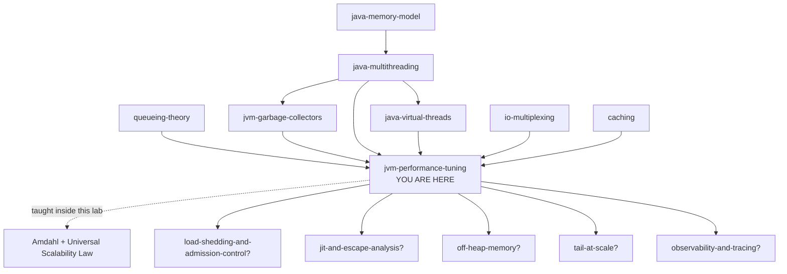

# JVM Performance Tuning — how to find the one thing that is actually slow

> **The one sentence.** Performance tuning is not choosing flags; it is
> **finding out where a request's milliseconds go** — because at any moment a
> system has exactly one thing holding it back (its **bottleneck**), and every
> change you make to anything else buys you precisely nothing.

> **The sentence people get wrong.** *"We have a latency problem, so let's tune
> the JVM."* Almost every time someone says this, they mean *let's paste in some
> flags*. But a flag can only ever change **how the JVM spends time it is
> already spending**. If 60% of your request is spent asleep waiting for a
> database, there is no flag — not one, in any JDK, ever shipped — that will
> touch that 60%. The first job is not to tune. The first job is to find out
> which 60% you have.

**Lab contents**

| File | What it is |
|---|---|
| `README.md` | this document — 16 stages, four depth layers |
| `visualization.html` | **The Bottleneck Machine** — a tunable JVM service, the scaling laws, and three ways measurement lies · <https://claude.ai/code/artifact/a12d63c9-7eaf-4596-9171-a92a41b28044> |
| `EXERCISES.md` | eight rungs, pencil-and-paper plus the visualization |
| `SOLUTIONS.md` | worked answers |

---

## Where this sits in your other labs

This lab is a junction. Six labs you have already done meet here, and this one
is mostly about **putting them in the same room and making them argue**. Read
this section — several of the hardest ideas below are ideas you already own
under a different name.

- **`jvm-garbage-collectors`** named `jvm-performance-tuning` as its own next
  step, and it left you with the single most useful sentence for this lab:
  *the work is conserved; you are choosing when and in what size pieces to pay
  it.* You already know what a **safepoint**, a **stop-the-world pause**, an
  **allocation rate**, a **live set** and **collector ergonomics** are, and you
  know that pause cost is proportional to what is **alive**, not to what is
  garbage. This lab does not re-teach any of that. It asks a harder question:
  *given that all of that is true, how do you find out whether it is your
  problem today?* Usually it is not.
- **`queueing-theory`** gave you the two formulas that generate this whole
  subject. **Little's Law** (`L = λW`) is how you size a thread pool, and
  **Kingman's formula** is why a service at 80% utilisation and a service at
  95% utilisation are different animals. You already know that **latency is set
  by spare capacity, not capacity**, that `1/(1−ρ)` is the multiplier, and that
  **coordinated omission** is a way of measuring that hides exactly the stalls
  you care about. All of that is load-bearing here.
- **`java-multithreading`** gave you locks, contention, the **convoy**, the
  thread-pool sizing arithmetic (`D × ceil(N/W)`), and the rule *never hold a
  lock across I/O*. In this lab that same lock becomes a **number** — the share
  of your work that has to happen one thread at a time — and that number turns
  out to put a hard ceiling on how fast your service can ever be.
- **`java-virtual-threads`** taught that blocking became cheap. It did not
  become free, and it did not become invisible. Stage 13 comes back to what
  virtual threads do and do not change about everything in this document.
- **`io-multiplexing`** measured that a server's real job is waiting. Its
  headline finding — 2,000 idle connections cost 0 ms of CPU with the right
  mechanism — is the reason the biggest block in this lab's default breakdown
  is usually *waiting on something else*.
- **`work-pressure-and-deadlines`** and **`caching`** show up in stage 13:
  the fastest work is work you did not do, and the cheapest millisecond is the
  one you never spent.

**One term collision to clear up before it bites you.** The
`jvm-garbage-collectors` lab warned you that a **GC write barrier** and a
**memory barrier** are unrelated things that share a word. This lab adds a
third collision: **"safepoint"**. In the GC lab a safepoint was *the moment
threads stop so the collector can look at them*. In this lab it is also *the
only moment some profilers are able to take a sample* — which turns out to be
a completely separate problem, and one of the three ways your measurements can
lie to you (stage 11, failure F8).

---

## How the numbers in this document were produced

There are three kinds of number here, labelled differently on purpose, because
confusing them is how a toy ends up quoted in a production incident review.

- **[MODEL]** — produced by the simulator inside `visualization.html`, run
  headlessly and re-checked before publishing (25 engine assertions, plus 115
  checks that every panel of the page renders; all passing). Its milliseconds
  are *model* milliseconds from cost rules printed in full on the page's fourth
  tab. They are honest about **shape and ratio** — why one number is eight times
  another — and meaningless as absolute measurements of any JVM.
- **[HAND]** — worked out by hand in this document from rules stated a few
  lines above. You can check every step yourself.
- **[JVM]** — documented behaviour of real Java virtual machines: flag
  semantics, defaults, JDK version history. **These are not measured in this
  lab** — this lab creates no runnable code — so where a [JVM] claim matters to
  a decision you are about to make, verify it against the release notes for
  your exact JDK before you act on it. Flags in particular change between
  versions more often than people expect.

---

# BEGINNER MODEL — stages 1 to 9

## 1. WHY — the problem this exists to solve

Your service answers most requests quickly. But once in every hundred, someone
waits two seconds. That one-in-a-hundred is not a rounding error: on a page
that makes twenty calls, *most page loads* contain at least one of them. So
your customers experience a service that is "usually fine and randomly awful",
which is the exact profile that destroys trust in software.

You are asked to fix it. You open a search engine, find a page titled *"Top 10
JVM flags for performance"*, add six of them to the startup command, and
deploy. Sometimes nothing changes. Sometimes it gets worse. Occasionally it
gets better and you never find out why, which is the worst outcome of the
three, because now you believe something false.

The cost of not solving this properly is concrete and it is three things:

1. **Money.** Not knowing which resource is the constraint means you buy more
   of all of them. Fleets routinely run at three times the size they need
   because the actual limit was one lock nobody measured.
2. **Latency you cannot explain to anyone.** "It's the GC" is what people say
   when they don't know. It usually is not the GC.
3. **Time.** A week spent optimising a method that accounts for 2% of the
   request is a week gone, and the graph does not move, and now nobody believes
   performance work is worth funding.

## 2. PROBLEM — the sandwich shop at lunchtime

Forget computers. There is a sandwich shop with four people working in it.

- **Asha** takes the order at the counter.
- **Bharat** toasts the bread. There is one toaster.
- **Chen** puts the fillings on.
- **Dee** wraps it and takes the money. There is one till, and only Dee has
  the key to it.

At 12:30 the queue is out the door and each customer is waiting eleven minutes.
The owner wants it fixed by Friday.

The owner does the obvious thing: hires two more people. Now there are six
people in a kitchen built for four. And the queue is **exactly as long as it
was**, except now everyone is bumping into each other, and Dee — who still has
the only till key — has a line of five colleagues standing behind her holding
finished sandwiches, waiting their turn to ring up.

Here is the thing the owner never did: **stand at the door with a stopwatch and
follow one single customer all the way through.** If they had, they would have
found this:

| Where the eleven minutes went | Time |
|---|---|
| Standing outside before reaching the counter | 6 min 10 s |
| Talking to Asha | 25 s |
| Waiting for the toaster to be free | 3 min 05 s |
| Actually toasting | 40 s |
| Fillings | 30 s |
| Waiting behind other staff for the till | 55 s |
| Paying | 15 s |

Now the answer is obvious and it is not "hire more people". It is **buy a
second toaster**, which costs sixty pounds. Everything else is noise. Chen
could be twice as fast and the customer would save thirty seconds out of
eleven minutes.

## 3. NAIVE SOLUTION — make everything bigger

The instinct, in a kitchen or in a JVM, is to increase whatever you can
increase. In Java that looks like:

- **More heap.** `-Xmx` from 512 MB to 4 GB. Memory is cheap.
- **More threads.** The pool goes from 16 to 200. There is clearly work waiting.
- **More instances.** Scale the deployment from 4 pods to 12.
- **A different collector**, because someone on the internet said theirs is
  faster.
- **A pile of flags** copied from a blog post about a different JDK, a
  different workload, and a machine with a different number of cores.

Every one of these is a real lever. Every one of them is sometimes the right
answer. And every one of them is applied here **without knowing what is
actually slow**, which makes the whole exercise a lottery.

> **🔮 Predict:** A service answers 100 requests a second on a 16-core machine.
> Its p99 is bad. The CPUs are only about 11% busy — 100 requests a second
> needing 18 ms of CPU each is 1.8 cores of demand on 16, so there is loads of
> hardware sitting idle. Somebody quadruples the heap from 512 MB to 4 GB.
> What happens to p99?
>
> <details><summary>Reveal</summary>
>
> **Nothing. p99 was 1,327 ms before and 1,327 ms after** — the same to the
> millisecond. [MODEL, scenario 1 on the visualization]
>
> The reason nothing happened is that nothing was ever wrong with memory. Over
> the whole run the collector ran **twice**, and the average request lost
> **0.0 ms** to it. What the average request actually lost was **87.3 ms
> standing in line for a lock** that only one thread at a time may hold — the
> till key, in the sandwich shop.
>
> Change the right thing instead — shrink that one-at-a-time section from 45%
> of the work to 6% — and **p99 falls from 1,327 ms to 211 ms**, on the same
> heap, on the same hardware, with no flags at all.
>
> </details>

## 4. FAILURE — why "make it bigger" breaks, and what it reveals

The heap experiment above did nothing, which is disappointing but harmless.
The other three are worse than harmless, and the thread-pool one is worth
stopping on.

Take a handler that is pure computation — 20 ms of CPU, no database call —
running on 8 cores, with more requests arriving than the machine can handle.
The queue is full, so there is definitely work for extra threads to do.

> **🔮 Predict:** You raise the pool from 8 threads to 128. Same machine, same
> cores, same code, same arriving traffic. What happens to the number of
> requests answered per second?
>
> <details><summary>Reveal</summary>
>
> It **falls by 29.6%** — 300.0/s at 8 threads, 211.3/s at 128 — and p99 goes
> from 1,623 ms to 8,798 ms [MODEL].
>
> The cores were already busy every single millisecond at 8 threads, so there
> was no capacity for the extra 120 threads to add. What they added instead was
> cost: cache traffic between cores, and an operating system shuffling 128
> runnable things onto 8. Each thread's work inflated by **1.75×**. This is the
> thing no kitchen analogy predicts, and stage 10 gives you the formula for it.
>
> </details>

Here is the whole sweep [MODEL]:

| Handler threads | Requests answered | median | p99 |
|---:|---:|---:|---:|
| 8 | **300.0 /s** | 1,531 ms | 1,623 ms |
| 16 | 300.0 /s | 1,740 ms | 2,156 ms |
| 32 | 291.0 /s | 1,828 ms | 2,777 ms |
| 64 | 250.7 /s | 2,229 ms | 4,641 ms |
| 128 | **211.3 /s** | 2,814 ms | **8,798 ms** |

Note where the damage starts — well before the pool looks absurd. Sixteen
threads on eight cores already costs **33% more p99** and buys **zero** extra
throughput.

**More instances runs out of road too**, for the same underlying reason, and
stage 10 gives you the formula that tells you exactly where the road ends.

**A different collector is a trade, not an upgrade.** Stage 11 has the numbers.

So the naive approach fails. But *how* it fails is the interesting part, and it
points at something deeper than "measure first". Look again at the sandwich
shop table. The owner's problem was not that they failed to measure. They had a
number: **eleven minutes**. It was a real, correct, honestly-collected number.
It was also completely useless, because a single total tells you *how bad* and
never *why*.

> **This is the deeper problem, and the rest of the lesson is about it:**
> the thing you naturally measure — how long did it take — cannot in principle
> identify the bottleneck. A total is one number. A diagnosis needs the total
> **split by where the time went**.

## 5. THE REAL REQUIREMENT — state it precisely

We need a method that does four things, in this order:

1. **Splits** a request's elapsed time into parts that are each attributable to
   one identifiable cause, such that the parts add up to the whole. No time may
   be unaccounted for, because unaccounted time is exactly where the problem
   hides.
2. **Names the largest part**, and does so separately for the typical request
   and for the slow ones — because, as you are about to see, those two are
   frequently slow for entirely different reasons.
3. **Predicts the ceiling before you spend the week.** If the part you plan to
   attack is 20% of the request, then even deleting it entirely leaves you 80%.
   You should know that number before you start, not after.
4. **Proves the change**, by re-splitting afterwards and showing the block you
   attacked actually shrank — not just that some number somewhere moved.

Anything that does not do all four is guessing with extra steps.

## 6. KEY IDEA — the time budget, and the one bottleneck

Two sentences.

**First: a request's elapsed time is a budget, and every millisecond of it is
being spent somewhere.** Not "roughly accounted for" — *exactly* accounted for.
If a request took 250 ms, then there are 250 milliseconds each of which was
spent doing one identifiable thing, and if you can label them all, you have a
diagnosis rather than a complaint.

**Second: at any given moment the system has one bottleneck, and improving
anything else changes nothing.** This is not a slogan, it is arithmetic. If
waiting for the toaster is 3 minutes of an 11-minute wait, making the fillings
station infinitely fast saves 30 seconds — 4.5% — and the queue outside is
still out the door.

Everything else in this lab is these two sentences applied harder. The flags
come at the very end, and there are far fewer of them than you expect.

## 7. TERMINOLOGY — the vocabulary, now that you need it

You have felt every problem these words name. Here they are.

### The three things you can want, and why you cannot have all three

**Throughput** — how much work finishes per unit of time. Requests per second,
messages per second, rows per second. *Why the word exists:* it is the only
performance measure that a **business** cares about directly, because it maps
to capacity and therefore to money. *Example:* the table in stage 4 has a
throughput column, and it is the column that shows 128 threads to be a disaster
— 211/s where 8 threads managed 300/s.

**Latency** — how long **one** unit of work takes, from the point of view of
whoever is waiting for it. *Why the word exists separately from throughput:*
because they can move in opposite directions, and constantly do. Batching
raises throughput and raises latency. A bigger queue raises throughput slightly
and raises latency enormously. *Example:* same table, the p99 column — it rose
from 1,623 ms to 8,798 ms while throughput fell. Two different numbers, two
different stories, one system.

**Footprint** — how much memory the whole process occupies, as seen by the
operating system (not by the JVM). *Why it exists:* because it is what your
container limit is compared against, and exceeding it does not make you slow,
it makes you dead. *Connection you already have:* the `jvm-garbage-collectors`
lab called this the third corner of the triangle. Here it becomes an operational
constraint with a specific failure mode (F3, stage 11).

**These three form a triangle you must trade within.** A concurrent collector
buys you low latency by spending throughput and footprint. A bigger heap buys
throughput by spending footprint. Batching buys throughput by spending latency.
There is no setting that improves all three; if you think you have found one,
you have found a bug you were previously suffering from, which is a different
and happier thing.

### How to talk about latency without lying

**Percentile** — sort every request by how long it took; the *p*th percentile
is the value below which *p*% of them fall. *Why the word exists:* because the
**mean** (the average) is a genuinely bad summary of latency, for a reason
worth internalising. Latency distributions have a long right tail — a few
requests are enormously slower than the rest — and the mean sits somewhere in
the middle of that pull, describing nobody. *Example [MODEL]:* on one run the
mean was **47.5 ms** and the p99 was **248 ms**, 5.2× higher. The mean is not
even the typical request. The **median** (p50) was 41 ms.

**Tail latency** — the slow end of that distribution: p95, p99, p99.9, and the
worst case. *Why it exists as its own term:* because the tail has its own
causes. In the baseline run, the *average* request spent its time waiting on the
database, while the *slowest 5%* spent theirs on CPU — a completely different
diagnosis from the same run [MODEL: average buckets io 25.0 ms / cpu 19.9 ms;
slowest-5% buckets cpu 93.7 ms / io 25.0 ms]. **Fix the average and the tail
stays.** The visualization has a toggle for exactly this and it is the single
most useful control on the page.

**Utilisation (ρ)** — the fraction of the time a resource is busy. You already
own this from `queueing-theory`, along with the thing that makes it dangerous:
**waiting is not proportional to load**. At 50% busy a request takes about 2×
its own work time; at 90% about 10×; at 95% about 21×.

**Headroom / spare capacity** — capacity minus offered load: the work the
resource could still absorb. `queueing-theory` proved that **this**, not
utilisation, is what sets your latency — which is why "we have 20% headroom" is
not, on its own, a sentence about safety. Keep the word; stage 13 uses it.

### The words for where time goes

**Bottleneck** — the one resource whose exhaustion currently limits the system.
*Why the word exists:* to make it sayable that there is only **one** at a time.
When you fix it, the bottleneck **moves** to whatever is now the limit — which
is why performance work is a loop and not a task. *Example:* fix the lock in
scenario 1 and the bottleneck immediately becomes CPU.

**On-CPU vs off-CPU** — at every instant, a thread is either executing
instructions on a core (**on-CPU**) or it is not (**off-CPU**: asleep waiting
for a network reply, blocked on a lock, parked, or runnable but with no free
core). *Why this distinction is the most important one in the whole lab:* your
CPU profiler can only see the first kind. *Example [MODEL]:* a handler doing
6 ms of work and one 180 ms database call spends **4.5% of its elapsed time
on-CPU**. A CPU profiler pointed at that service is describing 4.5% of the
problem and is silent about the other 95.5% — and it does not warn you.

**Time budget / decomposition** — the split of one request's elapsed time into
named parts that sum to the whole. This lab uses seven parts and stage 10
defines each one. It is the central artefact; everything else is instruments
for producing it.

### The words for the instruments

These four get confused constantly, and confusing them wastes weeks.

- **Monitoring** answers *is it bad right now, and is it getting worse?*
  Continuous, cheap, aggregated, always on. Dashboards and alerts.
- **Profiling** answers *within one process, where is the time going?*
  Sampled, detailed, usually on-demand. This is the one that produces the
  decomposition.
- **Tracing** answers *for one request, which services and which spans did it
  pass through, and how long did each take?* Follows a request **across**
  process boundaries. Complements profiling; does not replace it.
- **Benchmarking** answers *is version B faster than version A under conditions
  I control?* Deliberately artificial, and dangerous precisely because it is so
  easy to make it measure something other than what you meant (F9, stage 11).

**Sampling profiler** — instead of instrumenting every method call, it wakes up
many times a second, looks at what each thread is currently doing, and writes
it down. *Why it exists:* an instrumenting profiler that records every call
changes the program's timing so much that its answers stop describing the real
program. *Example:* at 100 samples/second over 10 seconds you have 1,000
observations; a method appearing in 600 of them was on-CPU roughly 60% of the
time.

**Flame graph** — the standard picture of a profile. Each box is a method,
box **width** is the share of samples containing it, and boxes stack upward to
show who called whom. *What to look for, and this is the whole skill:* **wide
boxes, not tall ones.** Tall means deep call stacks, which is aesthetics. Wide
means time, which is the answer.

**Safepoint** — a point in compiled code where a thread is willing to stop and
where the JVM knows the exact layout of its stack. You met this in
`jvm-garbage-collectors`: pauses can only start once every thread has reached
one. *The new consequence in this lab:* some profilers can **only take a sample
at a safepoint**, which introduces a systematic blind spot (F8). And the time
it takes the slowest thread to arrive is **time-to-safepoint**, which is added
to every pause and is invisible in the garbage-collection log (F6).

### The words for how fast code gets

**Interpreter** — when a method first runs, the JVM executes its bytecode one
instruction at a time, like reading a recipe aloud. Correct, and slow.

**JIT (just-in-time) compilation** — while running, the JVM counts how often
each method is called and how each branch behaves, and compiles the hot ones to
native machine code **using what it has observed**. *Why this beats
ahead-of-time compilation:* the compiler knows things a static compiler cannot,
such as which class actually turns up at a call site 99.9% of the time.

**Tiered compilation** — the JVM's default arrangement of the above:
interpreted first, then a fast compiler that produces mediocre code quickly
(**C1**), then a slow compiler that produces excellent code (**C2**). *Why two
compilers:* C2 is far too slow to run on everything, and C1 gets you 80% of the
benefit almost immediately.

**Warmup** — the period after startup during which your code is still slower
than it will be. *Example [MODEL]:* the same handler, same hardware, same
config, cold vs warm — **99 ms median at 1.5 seconds in, 41 ms once compiled**.
Take the database call out of that handler so it is pure computation and the
cold-start penalty grows to **4.6×**.

**Deoptimisation** — the JIT compiles based on assumptions ("this call site is
always `ArrayList`"). When an assumption is violated, the compiled code is
discarded and the method drops back to being interpreted while it re-profiles.
*Why you care:* a rare code path taken for the first time under load can make a
hot method transiently much slower, for no reason visible in your metrics.

**Escape analysis** — the compiler proves an object never leaves the method, so
it need not be allocated on the heap at all. You met this in the GC lab. Here
it matters because it is the single largest reason a benchmark of a tiny piece
of code can report that your code takes zero time — see the last term below.

### The words for the ceiling

**Serial fraction (s)** — the share of the work that must happen one thread at
a time. Locks, a single writer, one connection, one shared counter.

**Amdahl's law** — with serial fraction `s`, running on `N` threads, the best
possible speed-up is `1 / (s + (1−s)/N)`, which as `N` grows approaches
**`1/s`** and never exceeds it. *Why it exists:* to make the ceiling a number
you can compute **before** you buy anything. *Example [MODEL]:* at `s = 5%` the
ceiling is 20×, and you get 9.1× at 16 threads, 15.4× at 64, 18.6× at 256. The
last 192 threads bought 3.2×.

**Universal Scalability Law (USL)** — Amdahl plus a second cost: threads have
to keep a consistent view of shared data, and that cost grows with the *square*
of the thread count. `speed-up = N / (1 + s(N−1) + κN(N−1))`. *Why it exists:*
because Amdahl's curve flattens, and real systems **turn downward** — and only
the USL predicts that. *Example [MODEL]:* at `s = 5%, κ = 0.1%` the best you
can ever do is **9.0× at 31 threads**; at 256 threads you are back down to
**3.2×**, worse than at 16.

`queueing-theory` listed `universal-scalability-law?` as a next step. This is
it, and tab 2 of the visualization draws it.

### Two words about being fooled

**Coordinated omission** — measuring from when you got served rather than from
when you started waiting, so the delays are systematically excluded from the
data. You met this in `queueing-theory` as a load-generator problem; F7 shows
you its more common form, which lives in your own application code.

**Microbenchmark** — a benchmark of a very small piece of code. *Why it needs
its own word and its own warning:* at that size, the JIT compiler's ability to
prove your benchmark's result is unused, and delete it, exceeds your ability to
notice (F9).

## 8. MENTAL MODELS — carry two, and know where the first one lies

### The simple model: the sandwich shop

Carry the shop around in your head. It gets you further than it has any right
to:

- The queue outside the door is real and it is usually the biggest number.
- There is exactly one toaster, and it is the whole problem.
- Hiring more staff into a small kitchen makes things worse.
- The only way to find the toaster is to follow **one customer** with a
  stopwatch and write down every interval.

### The engineering model: seven buckets and a resource sheet

The precise picture has two halves that you look at together.

**Half one — the time budget.** Every millisecond of a request's elapsed life
falls into exactly one of seven buckets. They sum to the total; nothing is
unaccounted for.

| Bucket | What it means | The shop |
|---|---|---|
| **Waiting for a thread** | The request has arrived but nothing has started work on it | Standing outside the door |
| **Running your code** | On a CPU, executing your handler | Chen doing the fillings |
| **Code not yet compiled** | On a CPU, but slower than it will be, because the JIT has not got to it yet | A new hire reading the recipe card each time |
| **Waiting on the database** | Asleep, holding a thread, using no CPU | Waiting for the bread delivery |
| **Waiting for a lock** | Another thread is in the one-at-a-time section | Queuing behind colleagues for the till key |
| **Frozen for the collector** | Every application thread is stopped | The whole shop pauses for a stock-take |
| **Ready to run, no core free** | Runnable, but every core is busy | Staff standing about because there is one work surface |

**Half two — the resource sheet.** For each resource, two numbers, and the
second one is the one people forget: **how busy is it**, and **how much work is
queued behind it**. A resource at 100% busy with an empty queue is a resource
being used well. A resource at 100% busy with a growing queue is your
bottleneck, and the queue growth is the tell.

### Mapping the two models

| Sandwich shop | Engineering model |
|---|---|
| A customer | A request |
| Asha, Bharat, Chen, Dee | Handler threads |
| The work surface everyone shares | CPU cores |
| The queue outside the door | The thread pool's queue — the *"waiting for a thread"* bucket |
| The one toaster | Whatever the current bottleneck happens to be |
| The till key only Dee has | The lock — the *"waiting for a lock"* bucket, and Amdahl's `s` |
| The bread delivery you wait for | The downstream call — the *"waiting on the database"* bucket |
| A new hire reading the recipe each time | Interpreted code, before the JIT compiles it |
| The whole shop stopping for a stock-take | A stop-the-world collection pause |
| Following one customer with a stopwatch | Profiling |
| Counting customers served per hour | Monitoring throughput |

### Where the analogy breaks — four places, and they all matter

**1. In a shop the bottleneck stays put. In a JVM it moves the moment you touch
it, and it moves on its own.** Buy the second toaster and the till becomes the
constraint. That much the shop also does. But a JVM's bottleneck also moves
*without you*: the same service is compiler-bound in its first ten seconds,
CPU-bound at midday, and collector-bound at month-end when the cache is full.
**A performance diagnosis has a shelf life.**

**2. In a shop the stations are independent. In a JVM they share the same
cores.** Bharat toasting does not slow Chen down. But the garbage collector's
threads and your handler threads run on the *same* CPUs — so choosing a
collector that does its work concurrently does not make the work free, it moves
the work from a pause into a **tax on every one of your requests**. [MODEL]: at
a 200 MB/s allocation rate, ZGC in this model spends **40% of the machine** on
collecting while your code runs. Its longest freeze is 6.4 ms against Serial's
519 ms — an 81× improvement — and yet its p99 is only 2.6× better, because the
tax ate most of the win.

**3. The staff do not rewrite themselves while working.** Your code does. For
the first few hundred calls a method is interpreted, then compiled roughly,
then compiled well. **Any measurement taken during that window describes a
program that no longer exists.**

**4. In a shop, one more worker is never worse than none.** In a JVM it
routinely is. Six people in a four-person kitchen is a mild inconvenience;
128 threads on 8 cores did **29.6% less work** than 8 threads [MODEL]. No
kitchen analogy predicts a curve that turns downward, and stage 10's second
formula is the one that does.

## 9. VISUALIZATION — the Bottleneck Machine

Open **[The Bottleneck Machine](https://claude.ai/code/artifact/a12d63c9-7eaf-4596-9171-a92a41b28044)**
(also saved beside this file as `visualization.html`, and it works offline).

It is a simulated Java service with knobs. Everything on the page comes from
one deterministic engine — the same run twice gives byte-identical numbers —
and the cost rules it uses are printed in full on its fourth tab.

**Read the page in this order the first time.**

1. **The coloured bar** in the middle. That is one request's life, left to
   right, with each of the seven buckets in its own colour. The widest block is
   your bottleneck. This is the single thing to look at.
2. **The verdict panel above it** names that block in a sentence and says what
   would actually move it. When the typical request and the slowest 5% are slow
   for different reasons, it tells you that too, in bold, because that is the
   most commonly missed fact in the subject.
3. **Average request / Slowest 5%** — the two buttons above the bar. Press
   both. Watch how often the picture is completely different. On the default
   settings the average request is dominated by the database call (25.0 ms of
   45.1 ms) while the slowest 5% are dominated by CPU (93.7 ms) [MODEL].
4. **The resource sheet** below: busy-ness on the left, what is queued behind
   it on the right.
5. **The thread grid**: one square per handler thread, coloured by what it is
   doing this instant. Click one to read, in a sentence, what it is working on
   and where that request's time has gone so far.

**Then run the eight scenarios**, in order. Each one sets the knobs to a
situation that really happens, asks you to predict the outcome before it runs
it, and then shows the numbers. Being wrong is the point.

**Controls worth knowing:** *Run* / *Pause*, *Step 1 s* (advance one model
second and look carefully), *Back* (rewind two seconds — the engine is
deterministic, so this is an exact replay, not an approximation), and *Reset*.

**The other two tabs.** *Why more never scales* draws Amdahl and the USL, with
your program's numbers on them; nothing is simulated there, both formulas are
evaluated exactly. *How measurement lies* takes the run you have loaded and
shows three ways a working, un-buggy tool reports something true that is not
the answer to your question.

**One arbitrary-looking choice, made into a control on purpose.** Which thread
holds the lock, which requests are the heavy ones, and how much CPU the
container is allowed are all things you can change, because a hardcoded choice
silently teaches that it does not matter, and each of these matters enormously.

---

> ### CHECKPOINT — end of the beginner model
>
> You can now explain **why performance tuning is bottleneck-finding rather
> than flag-picking**, name the seven places a request's time goes, and say why
> an average latency is not a diagnosis. That is enough to stop the two most
> expensive mistakes: optimising the wrong thing, and buying more of a resource
> that was never the constraint.
>
> **Next** is the mechanism itself — the actual method, built the way you would
> build it, broken four times, and repaired each time by the thing that breaks
> it. Then the instruments, and how the compiler warms up, step by step.

---

# INTERMEDIATE MODEL — stage 10

## 10. ACTUAL MECHANISM — the method, and the four times it breaks

We are going to build the method the way a sensible engineer would, and then
watch it fail. Every awkward-looking detail in the final version is the scar of
one of these failures.

### Method v1 — "profile it and fix the hottest method"

The obvious first move. Attach a profiler, find the method with the widest box
in the flame graph, make it faster.

**It breaks like this.** You run the profiler on a service whose handler does
6 ms of computation and one 180 ms call to a database. The profiler reports,
truthfully, that `computePricing()` is 60% of the samples. You spend three days
making it twice as fast. The p99 moves by about 1.5%.

Here is why, and it is the most important arithmetic in the lab [MODEL]:

```
elapsed time per request      188.5 ms
of which, on a CPU              8.4 ms    =  4.5%
of which, asleep waiting      180.0 ms    = 95.5%
```

A CPU profiler samples threads **while they are running on a CPU**. A thread
asleep in a socket read is not on a CPU, so it contributes no samples at all.
The profiler was not wrong — `computePricing()` really is 60% of the CPU. It is
60% of 4.5%, which is 2.7% of the request. And nothing in the tool's output
said so.

> **The refinement:** decompose **wall-clock** time first. Only once you know
> that the time is genuinely on-CPU is a CPU profiler the right instrument.
> This is why the visualization's bar is a wall-clock bar and why its very first
> question is "how much of this is even on a CPU".

### Method v2 — "measure the wall-clock time of every stage"

Better. You add timers: one at the top of the handler, one at the bottom, and
some in between. You deploy, you watch the dashboard, and it says p99 is 120 ms
— comfortably inside your 500 ms SLA.

**It breaks like this.** Users are reporting multi-second waits. Support has
screenshots. Your metric says 120 ms. Both are correct [MODEL, the same run
measured twice]:

| Timer started when… | median | p99 |
|---|---:|---:|
| the handler picked the request up | 43 ms | **120 ms** |
| the request actually arrived | 771 ms | **880 ms** |

The gap is **7.3×**, and all of it is the **730.9 ms** the average request spent
sitting in a queue waiting for a handler thread to become free. A timer at the
top of your handler method is structurally incapable of seeing that time,
because when it starts, the waiting is already over.

This is **coordinated omission**, and it has a second form that catches load
tests: a generator with a fixed pool of client threads cannot send a new request
while it is waiting for the previous one, so during a server stall it sends
*fewer* requests — and the stall never appears in the results. Both forms are
the same mistake: **measuring from when you got served, rather than from when
you started waiting.**

> **The refinement:** the clock starts at arrival, not at dispatch. In practice:
> measure at the edge (load balancer, ingress, gateway) as your source of truth,
> and if you add exactly one metric to a service this year, make it
> **`time_in_queue`** — the gap between arrival and the start of handling.

### Method v3 — "the decomposition says garbage collection, so tune the collector"

Now the clock is honest and the decomposition is real. It says: the slow
requests are losing most of their time frozen for collections. You reach for
the obvious knob and set `-XX:MaxGCPauseMillis=10`, telling G1 you want short
pauses.

**It breaks like this.** [JVM] `MaxGCPauseMillis` is a *goal*, and the main
lever G1 has for meeting it is to **shrink the young generation** — collect
less at a time, so each pause is shorter. A smaller young generation fills up
sooner. So you get more collections, more total collector CPU, more objects
promoted before they had a chance to die, and frequently a **worse** p99 than
you started with. The number you asked for went down and the thing you wanted
got worse.

The deeper mistake is that you tuned the **symptom**. A collection pause has
exactly two dimensions, and they have completely different causes:

- **How often** a collection happens = how much garbage you make ÷ how much
  room there is to make it in.
- **How long** each one takes ≈ how much data is still **alive** when it runs.
  (This is the GC lab's central inversion: the cost is the *live* set, not the
  garbage.)

> **🔮 Predict:** A service retains 1.2 GB of long-lived data and produces about
> 1 MB of garbage per request. It is genuinely collector-bound — its longest
> freeze is over half a second. Four fixes are proposed: quadruple the heap,
> switch from Serial to G1, allocate eight times less per request, or run four
> times the handler threads. Two of them get p99 to the same place. Which two,
> and what separates them?
>
> <details><summary>Reveal</summary>
>
> **More heap and less garbage both land on p99 = 174 ms** (from 573 ms). What
> separates them is the *longest freeze*: more heap leaves it at 519 ms, while
> allocating less takes it to 8.1 ms [MODEL].
>
> That is the two-dimension point made concrete. More heap reduced how **often**
> a collection happens and did nothing about how **long** one takes. Allocating
> less did both, because with cheaper requests there is less live data to copy
> when a collection does run. And the fourth option made it **worse** — 752 ms —
> because more concurrent requests means more live data at collection time.
>
> </details>

Here they are, with a do-nothing baseline and one more thing people try [MODEL]:

| Change | p99 | Longest freeze | Collections |
|---|---:|---:|---:|
| nothing | 573 ms | 519 ms | 49 young + 6 old |
| 4× the heap | **174 ms** | 519 ms | 12 + 1 |
| switch to G1 | 200 ms | 67 ms | 49 + 6 |
| **allocate 8× less per request** | **174 ms** | **8.1 ms** | 6 + 0 |
| 4× the handler threads | **752 ms** (worse) | 519 ms | 49 + 6 |
| 4× the CPU cores | 562 ms | 519 ms | 49 + 6 |

Read the *Longest freeze* column, because it is the one that separates the two
apparent winners. More heap and less garbage both got p99 to 174 ms by reducing
**how often**. Only allocating less also fixed **how long** — 519 ms down to
8.1 ms — because with fewer, cheaper requests in flight there is less live data
to copy when a collection does run. And note the two non-fixes: more threads
made it measurably worse, more cores did essentially nothing.

> **The refinement:** attack the causes in this order — **allocation rate**
> first (it is usually a code problem and it fixes both dimensions), **retention**
> second, **heap size** third, **collector choice** fourth. Setting a pause goal
> is not on the list.

### Method v4 — "fixed in staging; ship it"

The decomposition is honest, the allocation rate is down, staging looks
beautiful. You deploy to production and p99 is worse than before you started.

**It breaks like this.** Production runs in a container on a 16-core host with
a CPU limit of 2 cores. [JVM] The JVM reads its cgroup limits — modern JDKs are
container-aware and `Runtime.availableProcessors()` respects a CPU *quota* — but
plenty of things still get this wrong: an explicitly-set `-XX:ActiveProcessorCount`,
a **CPU shares** setting rather than a quota (shares are a weight, not a limit,
and are not translated into a processor count), sidecars competing for the same
quota, and library code that sized a pool from `availableProcessors()` at class-load
time. Whatever the route, the result is a JVM sized for far more CPU than it will
ever be given.

What that looks like [MODEL]:

| | p99 | Throughput | Biggest bucket |
|---|---:|---:|---|
| 16 cores, no limit | 188 ms | 196.3 /s | waiting on the database |
| 16 cores, limit of 2 | **5,214 ms** | 74.0 /s | **waiting for a thread** |

p99 rose by a factor of **28**, not the factor of 8 you would expect from the
ratio of cores. The reason is `queueing-theory`'s cliff: capacity fell below
the arrival rate, and past that point the queue does not get longer in
proportion to anything — it grows without limit for as long as the overload
lasts.

And now the detail that makes this failure so hard to catch, which is worth
saying slowly. **The biggest bucket is not "waiting for a CPU" (266.5 ms). It
is "waiting for a handler thread" (the queue).** CPU throttling does not
announce itself as a CPU problem. On the host dashboard the machine looks
idle — 16 cores, 87% free. On your service dashboard it looks like a queueing
problem. The word "CPU" appears nowhere.

> **The refinement:** the decomposition must be read together with **what the
> JVM believes about the machine**, and that belief must be checked against
> what the machine will actually give it. Stage 13 lists the specific things to
> check.

### Method v5 — "fixed everywhere; now scale it out"

Everything is measured, the bottleneck is CPU, and CPU is a thing you can buy.
So you double the threads, and then double them again.

**It breaks like this** — the table from stage 4, and now the formula behind
it. Two costs grow as you add threads:

- **The serial fraction `s`.** Some part of the work happens one thread at a
  time. **Amdahl's law**: `speedup = 1 / (s + (1−s)/N)`. As `N` grows this
  approaches `1/s` and stops. At `s = 5%` the ceiling is 20× — you get 9.1× at
  16 threads, 15.4× at 64, 18.6× at 256 [MODEL].
- **Coherence, `κ`.** Every thread must keep a consistent view of shared data,
  and the number of pairs that have to agree grows with `N²`. The **Universal
  Scalability Law** adds this term:

```
speedup(N) = N / ( 1 + s(N−1) + κN(N−1) )
```

> **🔮 Predict:** A program has a 5% serial fraction and a small coherence cost,
> `κ = 0.1%`. Amdahl says the ceiling is 20× and that 256 threads should get you
> 18.6× of it. What does the USL say 256 threads actually gets you?
>
> <details><summary>Reveal</summary>
>
> **3.2× — which is less than the 8.0× you get from 16 threads** [MODEL]. The
> best this program can ever do is 9.0×, at 31 threads, and every thread after
> that subtracts.
>
> Amdahl's error here is not that it is too optimistic about the ceiling; it is
> that it has no term at all for the cost of threads coordinating with each
> other, so it can only ever flatten. Real systems come back down, and the peak
> is computable in advance: `N* = sqrt((1−s)/κ)`.
>
> </details>

Amdahl flattens. The USL **turns downward**, and it has a peak you can compute
before you buy anything: `N* = sqrt((1−s)/κ)`. At `s = 5%, κ = 0.1%` [MODEL]:

| Threads | 1 | 16 | 31 | 64 | 128 | 256 |
|---|---:|---:|---:|---:|---:|---:|
| Amdahl says | 1.0× | 9.1× | — | 15.4× | — | 18.6× |
| With coherence | 1.0× | 8.0× | **9.0× (best)** | 7.8× | 5.4× | 3.2× |

**256 threads does less work than 16.** This is not a modelling artefact; it is
why "just add more" eventually stops working everywhere, in every system, and
it is why the honest answer to "how many threads?" is a number you measure
rather than a number you increase.

> **The refinement:** before adding capacity, work out the ceiling. If your
> serial fraction is 10%, no amount of hardware gets you past 10×, and you
> should be shrinking `s` rather than shopping.

### The method, after four repairs

1. **Is it even this service?** Trace the request across processes first. Half
   of all "our service is slow" tickets are a downstream service.
2. **Split the elapsed time**, measured from arrival, into the seven buckets.
   Look at the typical request and the slow ones **separately**.
3. **Name the largest bucket. That is the bottleneck.** Compute the ceiling:
   even deleting this bucket entirely leaves you the rest.
4. **Pick the instrument that matches the bucket** (table below) and find the
   specific cause inside it.
5. **Check what the JVM believes about the machine** before concluding anything
   about CPU or memory.
6. **Change one thing. Re-split. Prove the block shrank.** If it did not, undo
   it — an unexplained improvement is a debt.
7. **Go to 2**, because the bottleneck has now moved.

### Which instrument answers which bucket

| Bucket | What to reach for | What you are looking for |
|---|---|---|
| Waiting for a thread | Queue-depth and `time_in_queue` metrics; a thread dump | Pool saturated, queue growing |
| Running your code | A CPU sampling profiler; a flame graph | The widest box, at the top of a wide stack |
| Code not yet compiled | `-Xlog:jit+compilation` or JFR compilation events | The service is young, or the method keeps deoptimising |
| Waiting on the database | Distributed tracing; a wall-clock profiler | Which downstream call, and how many of them per request |
| Waiting for a lock | JFR lock events; a thread dump showing `BLOCKED`; a lock-mode profile | Many threads blocked on one monitor |
| Frozen for the collector | `-Xlog:gc*` — and separately `-Xlog:safepoint*` | Pause count × pause length; and whether time-to-safepoint dominates |
| Ready to run, no core free | Container CPU-throttling metrics; run-queue length | Throttled periods per second |

[JVM] The single best default in a modern JDK is **Java Flight Recorder**: it
carries garbage-collection events, allocation profiles, lock contention,
exceptions, thread states and compilation events in one always-on recording at
a very low overhead, and it is in the JDK with nothing to install. For on-CPU
and off-CPU flame graphs specifically, **async-profiler** is the usual companion
because it samples without needing threads to be at a safepoint — which is
exactly the blind spot described in F8.

### How code actually warms up — a hand-worked trace

The rules, from the model (and the shape matches how tiered compilation really
behaves, though the exact thresholds here are the model's, not a JVM's):

- Interpreted, the handler's CPU work costs **5.0×** what it will eventually
  cost.
- After **300** calls the JIT compiles it quickly: **1.9×**.
- After **3,000** calls it compiles it properly: **1.0×**.

Take request #1 into a JVM that started three milliseconds ago. The handler
needs 18 ms of CPU when fully compiled, plus one 25 ms database call. [HAND]

```
Fully-compiled CPU work                              18.0 ms
Interpreted, so it costs 5.0x                        90.0 ms   of CPU
Database call, unaffected by any compiler            25.0 ms
                                                    --------
Elapsed                                             115.0 ms
```

Now split those 90 ms of CPU into two buckets, because "the code is slow" and
"the code is not compiled yet" are different diagnoses with different fixes.
Of every millisecond spent on a CPU at a 5× multiplier, `1/5` of it is work
that would have happened anyway and `4/5` is the penalty for being
un-compiled:

```
Running your code   90.0 x (1/5)  =  18.0 ms
Not yet compiled    90.0 x (4/5)  =  72.0 ms
Waiting on the DB                 =  25.0 ms
                                    --------
                                     115.0 ms   = elapsed. Nothing unaccounted for.
```

Watch what happens to this same request as the JVM ages [MODEL, measured on
the simulator at 80 requests/second into a cold JVM]:

| Age of the process | median | compiler state |
|---|---:|---|
| 1.5 s | **99 ms** | still interpreted, 96 calls in |
| 3 s | 102 ms | still interpreted, 193 calls |
| 6 s | 54 ms | compiled quickly (C1), 454 calls |
| 15 s | 54 ms | still C1, 1,125 calls |
| 45 s | **41 ms** | compiled properly (C2), 3,424 calls |

The median fell by **2.4×** with no change to anything you control.

And here is the detail that decides whether you should care. The handler above
waits 25 ms on a database, and **no compiler can speed up waiting** — so the
warmup penalty is diluted. Take the database call out and make the handler pure
computation, and the same cold start costs **4.6×** instead of 2.4× [MODEL].

> **So: the more compute-bound your service, the more warmup matters.** A
> proxy barely notices. A pricing engine notices enormously. This is why load
> tests must discard their first N seconds, why a canary can look terrible for
> thirty seconds and be perfectly healthy, and why sending a fresh instance
> full traffic on its first millisecond is a choice with consequences.

---

> ### CHECKPOINT — end of the intermediate model
>
> You now have the **method**, and you know why each of its awkward steps
> exists: measure wall-clock because CPU profilers cannot see waiting; measure
> from arrival because your own timer starts too late; attack allocation before
> heap because frequency and length have different causes; check what the JVM
> believes about the machine; and compute the ceiling before you buy capacity.
>
> **Next** is the failure half — twelve specific ways this goes wrong in
> production, each one with how to create it, where to watch it, and which
> guarantee it bends. Then what tuning can and cannot promise.

---

# ENGINEERING MODEL — stages 11 and 12

## 11. FAILURE SCENARIOS — thirteen ways this goes wrong

Each one: how to make it happen, where to watch it, what actually happened and
why, what the system does about it, which guarantee survives, which one does
not, and what it looks like at 3am.

### F1 — The warmup cliff

**Make it happen:** on the visualization, tick *Restart cold on every run* and
press Run. In production: deploy an instance and send it its full share of
traffic immediately.
**Watch:** the median in the stats row, and the log announcing each compilation.
**What happened [MODEL]:** median 99 ms at 1.5 seconds, 41 ms at 45 seconds —
2.4× worse, falling in two visible steps as the compiler catches up. With no
database call in the handler, 4.6×.
**Why:** Java code begins interpreted. Compilation is triggered by call counts,
so it is a function of *traffic received*, not of *wall-clock time since
startup* — a low-traffic instance stays slow for much longer.
**Response:** none needed; it fixes itself.
**Intact:** correctness, and the eventual steady state.
**Lost:** nothing permanent — but your *measurements* during the window are
worthless, and if the instance is put into rotation at full weight it may
saturate and never climb out.
**In production:** deploy with a traffic ramp, or with a readiness probe that
does not pass until the instance has served some warmup traffic. Discard the
first 30–60 seconds of any load test. [JVM] Class Data Sharing (`-Xshare`,
AppCDS) shortens startup, and JDK 24's Project Leyden AOT cache
(`-XX:AOTCache`) shortens warmup further — neither removes it. Do not reach for
`-Xcomp`; it compiles everything eagerly with no profile data and is a
debugging tool, not a production setting.

### F2 — The container that was given two cores and told it had sixteen

**Make it happen:** scenario 4. Set *CPU cores* to 16 and *CPU the container is
allowed* to 2.
**Watch:** the breakdown bar, and specifically **which** block is biggest.
**What happened [MODEL]:** p99 188 ms → **5,214 ms** (28×), throughput 196/s →
74/s. The biggest bucket is *waiting for a handler thread* (queueing), not
*waiting for a CPU*.
**Why:** capacity fell below the arrival rate. Past `ρ = 1` the queue grows
without bound for as long as the overload lasts — `queueing-theory`'s F2, which
measured 1,619 waiting jobs after 30 minutes at just 5% over capacity, and still
growing linearly.
**Response:** the queue absorbs it until it fills, then requests are refused.
**Intact:** every answer that is returned is correct.
**Lost:** any latency objective, and — because throughput sits pinned at
capacity looking perfectly healthy — your ability to see the problem on a
throughput graph.
**In production:** this is the most common containerised-Java surprise there
is, and its signature is that **the host looks idle**. Check
`Runtime.availableProcessors()` from inside the container against the cgroup
quota; check for CPU *shares* being used where a *quota* was intended; alert on
container CPU-throttling counters (`container_cpu_cfs_throttled_seconds_total`
and friends), which is a direct measurement and not an inference.

### F3 — Killed with no stack trace

**Make it happen:** set `-Xmx` to the container's memory limit.
**Watch:** not in this model — this one is described, not simulated.
**What happened:** the container exits with code **137** and there is no
`OutOfMemoryError`, no stack trace, and nothing in the application log.
**Why:** the Java heap is not the process. On top of it sit thread stacks,
metaspace, code cache, GC data structures, direct byte buffers, and whatever
native libraries allocate. When the *process* exceeds the container's memory
limit, the kernel's OOM killer terminates it — and the JVM never gets a chance
to say anything, because it was not the one that noticed.
**Intact:** nothing; the process is gone.
**Lost:** everything in flight.
**In production:** [JVM] use `-XX:MaxRAMPercentage` (a share of the limit) rather
than a hard `-Xmx` derived from it, so the JVM leaves room for its own
non-heap needs; turn on **Native Memory Tracking**
(`-XX:NativeMemoryTracking=summary`) when the resident size and the heap size
disagree; and always set `-XX:+HeapDumpOnOutOfMemoryError` so that when it *is*
a real heap exhaustion you have something to look at. This one was flagged in
`jvm-garbage-collectors` and it is repeated here because exit 137 with no stack
trace is a signature worth recognising instantly.

### F4 — Allocation rate, mistaken for a heap problem

**Make it happen:** scenario 5. Raise *Garbage made per request* and leave
everything else alone.
**Watch:** the *Allocation → collections* row on the resource sheet, and the
collection count in the log.
**What happened [MODEL]:** at 64 KB per request the collector ran twice in the
run; at 512 KB it ran 20 times — 8× the garbage, 8× the collections, exactly as
`eden ÷ allocation rate` predicts. Quadrupling the heap took it back to 2.
**Why:** collection frequency is your allocation rate divided by your available
room. Both terms are yours to change; only one of them is free.
**Response:** the collector keeps up until it cannot, at which point pauses
lengthen and eventually you get an allocation stall.
**Intact:** correctness; no reachable object is ever lost.
**Lost:** throughput (collector CPU is CPU your requests do not get) and tail
latency.
**In production:** allocation profiling — JFR's `ObjectAllocationSample`, or
async-profiler in allocation mode — points at the exact line. The usual
culprits are string concatenation in a loop, boxing in a hot path, building
intermediate collections that are immediately discarded, and logging that
formats a message before checking whether the level is enabled. **Reach for
allocation before heap**: it fixes frequency *and* pause length, where heap
fixes only frequency.

### F5 — The lock convoy

**Make it happen:** scenario 1. Raise *Share of the work under one lock* while
leaving the arrival rate alone.
**Watch:** the *waiting for a lock* block, and the *exclusive section*
utilisation on the resource sheet.
**What happened [MODEL]:** at 45% one-at-a-time on a 16-core machine that is
only 11% busy, p99 was 1,327 ms and the average request spent **87.3 ms** in
line. Dropping it to 6% took p99 to 211 ms — a 6.3× win from changing no
infrastructure at all.
**Why:** the one-at-a-time section is a queue with a single server, so
`queueing-theory` applies to it directly and the `1/(1−ρ)` cliff is waiting at
the end of it. And `java-multithreading` already showed you the mechanism: one
slow holder converts its own delay into everyone's.
**Intact:** correctness — that is what the lock is for.
**Lost:** any hope of scaling. This is Amdahl's `s`, so it is a hard ceiling.
**In production:** thread dumps showing many threads `BLOCKED` on the same
monitor, or JFR's `JavaMonitorEnter` events. The fixes, in order of preference:
do less inside the section; **never hold it across I/O**; shard it so different
keys take different locks; replace it with a compare-and-set loop; or make the
data immutable so no lock is needed.

### F6 — A 180 ms freeze with no garbage collection in it

> **🔮 Predict:** You are running ZGC, whose own collection pauses are well under
> a millisecond, and the garbage-collection log confirms it. Your service is
> nonetheless freezing for about 180 ms at a time. Where is the time going?
>
> <details><summary>Reveal</summary>
>
> Into **waiting for the last thread to stop**. A pause cannot begin until every
> thread has reached a safepoint, so the real cost is the collector's work
> **plus** the arrival time of the slowest thread. Raising time-to-safepoint to
> 180 ms in the model took the longest freeze from 2.4 ms to 181.4 ms and p99
> from 229 ms to **2,189 ms**, with the collector's own work unchanged [MODEL].
>
> The trap is that this is invisible in `-Xlog:gc*`, which reports what the
> collector did. You need `-Xlog:safepoint*`, a different log, which separates
> *reaching* the safepoint from being *at* it.
>
> </details>

**Make it happen:** scenario 6. Choose ZGC, then raise *Time to reach a safe
stopping point*.
**Watch:** *Longest freeze* on the resource sheet, against the collector's own
cost.
**What happened [MODEL]:** with ZGC — whose own pauses are around a
millisecond — raising time-to-safepoint to 180 ms took the longest freeze from
2.4 ms to **181.4 ms** and p99 from 229 ms to **2,189 ms**. The collector's work
did not change at all.
**Why:** a stop-the-world pause cannot begin until **every** thread has reached
a safepoint. The cost is the collector's work **plus** however long the slowest
thread takes to arrive. [JVM] A thread inside a tight counted loop over a
primitive array may have no safepoint check in it at all, because the JIT is
allowed to omit the check when it can prove the loop terminates — so the loop
must finish before the thread can stop.
**Response:** everyone waits for the last thread.
**Intact:** correctness, and the collector's own efficiency.
**Lost:** the entire benefit of choosing a low-pause collector.
**In production:** [JVM] this is invisible in `-Xlog:gc*`, which reports the
collector's work. You need `-Xlog:safepoint*` — a **different log** — to see the
"reaching safepoint" time separately from the "at safepoint" time. Long
time-to-safepoint is also caused by non-GC operations: `Thread.getStackTrace`,
thread dumps, class redefinition, and (in older JDKs) biased-locking revocation.

### F7 — The dashboard that was green while users waited

**Make it happen:** scenario 8, then open tab 3.
**Watch:** the two-timer table.
**What happened [MODEL]:** in-handler timer p99 **120 ms**; arrival-to-answer
p99 **880 ms**. 7.3×, and the difference is 730.9 ms of queueing.
**Why:** the timer starts after the waiting is over. See method v2 above.
**Intact:** the metric is not lying about what it measures.
**Lost:** any correspondence between your dashboard and your users' experience,
precisely during the incidents that matter.
**In production:** measure from the edge; add `time_in_queue`; and for load
tests use an open-loop generator, or one that corrects for intended start time
(wrk2, Gatling's open model, JMeter with a precise schedule). `queueing-theory`
covered the load-generator half of this as its F4.

### F8 — The profiler that pointed at a method doing nothing

**Make it happen:** open tab 3 and read the three profiler tables.
**Watch:** the disagreement between them. All three are running against the
same run.
**What happened [MODEL, computed from the stated frame shares]:** the path is
`parseRequest` (15% of CPU), `loadCustomer` (the database call), `computePricing`
(60% of CPU, containing a tight counting loop), `applyLimits` (10% of CPU plus
the lock), `writeResponse` (15% of CPU).

| Profiler | Its top answer |
|---|---|
| Samples only while on a CPU (async-profiler, JFR) | `computePricing()` **60.0%** |
| Can only sample at a safepoint (jstack-style) | `applyLimits()` **65.2%** — and `computePricing()` drops to 4.8% |
| Wall-clock | `loadCustomer()` **56.9%** |

**Why:** a safepoint-limited profiler asks each thread for its stack, and a
thread can only answer at a safepoint. `computePricing`'s counting loop has no
safepoint check, so samples that "wanted" to land inside it land at the next
place the thread can stop — the following frame. This is **safepoint bias**, and
its effect is not noise: it moved 92% of the samples from the method that is
actually hot to a method that barely computes at all.
**Intact:** nothing is broken; each tool reports exactly what it measures.
**Lost:** the correspondence between the profile and reality — silently, with
no warning in the output.
**In production:** prefer a profiler that does not need safepoints
(async-profiler uses `AsyncGetCallTrace` / perf events; JFR's method sampling
is also not safepoint-limited). And note the third row: **when the CPU profile
and the wall clock disagree, believe the wall clock about latency and the CPU
profile about CPU.** They are answering different questions.

### F9 — The microbenchmark that measured nothing

**Make it happen:** not simulated — described.
**What happens:** you write a loop that calls your method a million times and
times it. It reports 0.3 nanoseconds per call, which would be about one clock
cycle.
**Why:** the result was never used, so the JIT proved the whole computation had
no effect and deleted it — **dead-code elimination**. Related traps: the input
was a constant so it was folded at compile time; the first iterations ran
interpreted and dominated the average; **escape analysis** removed the
allocation you were trying to measure; and the loop was compiled with knowledge
of your one call site that will not exist in production.
**Intact:** nothing was measured, so nothing is at risk yet.
**Lost:** the entire result, and — much worse — the decision you based on it.
**In production:** use **JMH**, which exists specifically to defeat these
(warmup iterations, forked JVMs, `Blackhole` consumption of results,
`@State` objects the compiler cannot fold). And treat any microbenchmark
result as evidence about a microbenchmark until it shows up in a whole-system
measurement.

### F10 — The low-pause collector that made p99 worse

**Make it happen:** scenario 7. Raise the allocation rate, then compare
collectors.
**Watch:** *Collector CPU tax* on the resource sheet, next to *Longest freeze*.
**What happened [MODEL, 1.2 GB retained, 1 MB of garbage per request]:**

| Collector | median | p99 | Longest freeze | CPU tax |
|---|---:|---:|---:|---:|
| Serial | 43 ms | 573 ms | 519 ms | 0% |
| Parallel | 41 ms | 207 ms | 153 ms | 0% |
| G1 | 41 ms | 200 ms | 67 ms | 20% |
| ZGC | 44 ms | 220 ms | **6.4 ms** | **40%** |

ZGC cut the longest freeze by **81×** and its p99 came out *worse than G1's*.
**Why:** a concurrent collector does not delete the work, it moves it off the
pause and onto the CPU bill — and the bill scales with how much garbage you
make. At this allocation rate it is eating 40% of the machine, and that CPU
comes out of your requests. Drop the allocation rate and ZGC becomes cheap.
**Intact:** the pause guarantee — ZGC really does keep its freezes tiny.
**Lost:** throughput, and with it the p99 you were trying to buy.
**In production:** [JVM] G1 has been the default since JDK 9 and is the right
answer until measured otherwise. ZGC (generational by default since JDK 23, and
the non-generational mode removed in JDK 24) is for large heaps with strict tail
requirements and typically costs 5–15% throughput and extra footprint on real
workloads. **A collector change is never a free upgrade** — it is a trade, and
you need the before-and-after decomposition to know whether you won.

### F11 — Retrograde scaling

**Make it happen:** scenario 2, or tab 2 with a non-zero cross-talk value.
**Watch:** the throughput number as the pool grows.
**What happened [MODEL]:** 8 threads answered 300.0/s; 128 threads answered
211.3/s — **29.6% less work on identical hardware** — with p99 going from
1,623 ms to 8,798 ms and each thread's work inflating 1.75×.
**Why:** past the point where cores are saturated, extra threads add no
capacity but do add coherence traffic and scheduling churn. This is the USL's
`κN(N−1)` term, and it is why the curve turns down.
**Intact:** correctness.
**Lost:** throughput, latency, and the intuition that more is more.
**In production:** find the peak empirically — sweep the pool size under a
fixed load and keep the size at the top of the curve, not past it. Note that
`queueing-theory` cuts the other way and must be held simultaneously: **too few
threads makes you a smaller service** (its measurement: a 10-server pool pinned
throughput at 50/s). Both cliffs are real; the target is the flat bit between
them, and it is usually wider than people fear.

### F12 — Optimising a method that was 2% of the request

**Make it happen:** the very first thing anyone does.
**What happens:** you make a method twice as fast. It was 2% of the request.
You saved 1%. Nobody can see it on a graph.
**Why:** you never computed the ceiling. **Amdahl applies to optimisation as
well as to parallelism**: if the part you are attacking is fraction `p` of the
whole, then making it `k` times faster gives you `1 / ((1−p) + p/k)` overall,
and as `k → ∞` you asymptote at `1/(1−p)`. At `p = 2%` that ceiling is 1.02×.
**In production:** compute that number *before* the work starts. It costs a
minute and it has cancelled more badly-aimed weeks than any other single habit
in this document.

### F13 — The queue with no limit

**Make it happen:** raise the arrival rate past capacity and set *Queue
capacity* to its maximum.
**Watch:** the queue bar under the thread grid, and *asked for* against
*answered* in the stats.
**What happened [MODEL]:** offered 400/s against a capacity near 300/s — after
40 seconds the queue held 487 requests, 1,688 had been refused, throughput sat
at exactly 300/s, and p99 was 1,675 ms.
**Why:** an unbounded queue converts an overload into unbounded latency instead
of into refusals, and every request that eventually times out consumed a
handler thread for nothing.
**Intact:** throughput — which is precisely why the dashboard looks fine.
**Lost:** **goodput** — the answers delivered *within the deadline*, as opposed
to merely delivered. `queueing-theory` measured this exactly: across the whole
range of queue sizes, throughput never moved (7,711 either way) while goodput
ran from **64** requests answered in time with an unbounded queue to **7,033**
with a cap of 5.
**In production:** bound every queue, and size the bound with that lab's rule
`maxQueue ≈ deadline/S − c`. [JVM] The defaults are against you here:
`ThreadPoolExecutor` with a bare `LinkedBlockingQueue` is unbounded, and Spring
Boot's `spring.task.execution.pool.queue-capacity` defaults to `Integer.MAX_VALUE`.

## 12. CORRECTNESS — what tuning can and cannot promise

### What is guaranteed, no matter what you set

- **Correctness is not a tuning parameter.** No flag in this document changes
  what your program computes. The Java Memory Model's guarantees
  (`java-memory-model`) hold identically under every collector, every compiler
  tier, and every thread count. A race that exists at `-Xint` exists at C2; the
  compiler makes it *more likely to show*, it does not create it.
- **No reachable object is ever collected.** (`jvm-garbage-collectors`.) Every
  collector here is safe; they differ only in when and in what size pieces you
  pay.
- **The JIT will eventually compile hot code**, and its optimisations are
  semantics-preserving. Deoptimisation is the mechanism that keeps that true
  when a speculation turns out to be wrong.
- **Little's Law holds exactly.** `L = λW` is an identity, not a model — no
  assumption about arrival pattern, service distribution or ordering
  (`queueing-theory` verified it to 0.01 jobs). Your pool must be at least
  `λ × W` threads. That is a floor and it is exact.

### What is not guaranteed, and people assume it is

- **That a flag does the same thing in the next JDK.** Flags are removed
  (`-XX:+AggressiveOpts` gone in 12, CMS gone in 14, non-generational ZGC gone
  in 24), defaults change, and ergonomics rewrite your settings based on the
  machine. A tuning inherited from a JDK 8 service is a liability, not a head
  start.
- **That a p99 improvement is stable.** A percentile is a property of a
  distribution, and the distribution moves with your data, your traffic mix and
  your cache state. A 20% p99 win measured over five minutes may be noise; the
  honest test is whether the *bucket you attacked* shrank.
- **That your benchmark predicts production.** Different data shape, different
  cache hit rate, different neighbours on the machine, different serial
  fraction.
- **That adding resources helps at all.** F11: it can subtract.
- **That the bottleneck stays where you found it.** It moves the moment you fix
  it — that is what fixing it means.

### What you traded to get the win

Every improvement in this lab was paid for, and being able to name the currency
is most of what separates tuning from cargo-culting:

| The win | Paid for with |
|---|---|
| Shorter pauses (a concurrent collector) | Throughput and footprint — up to 40% of the machine at high allocation rates [MODEL] |
| Fewer collections (a bigger heap) | Footprint, and a longer worst-case pause when a full one does happen |
| Both, by allocating less | Engineering time, and sometimes less readable code |
| Higher throughput (batching, bigger queues) | Latency, always |
| Lower latency under load (shedding, small queues) | Throughput and some refused requests — traded deliberately, for goodput |
| More parallelism | Coherence cost, which grows as `N²` and eventually reverses the gain |
| Faster startup (AOT caches, CDS) | Build complexity, and an artefact that must be kept in step with the code |

### The one sentence to keep

`jvm-garbage-collectors` ended on *the work is conserved; you are choosing when
and in what size pieces to pay it*. That generalises to this whole subject, with
one important exception. Tuning moves work around. There are only three ways to
genuinely **remove** it:

1. **Do less** — a better algorithm, fewer allocations, fewer round trips, one
   query instead of N+1.
2. **Do it at a better time** — cache it (`caching`), batch it, precompute it,
   or do it asynchronously off the request path.
3. **Do not do it at all** — admission control, load shedding, returning a
   cached-but-stale answer, saying no early instead of slowly.

Every one of those is a code or design change, and none of them is a flag.
That is the honest summary of the subject: **flags redistribute; only design
removes.**

---

> ### CHECKPOINT — end of the engineering model
>
> You can now recognise thirteen specific production failures by their
> signature, say which guarantee each one bends, and state precisely what a
> given improvement cost you. You could sit in an incident review and be useful.
>
> **Next** is the bridge to the JVM you actually run: the short list of flags
> that earn their place, the longer list that does not, what to put on a
> dashboard, and what this lab's model leaves out.

---

# PRODUCTION MODEL — stage 13

## 13. PRODUCTION — from this lab's model to the JVM you actually run

Everything in this section is [JVM] — documented behaviour of real virtual
machines, **not measured in this lab**. Check anything decision-critical
against your exact JDK's release notes; flags move between versions more often
than people expect.

### The chain: from the seven buckets to a running service

**The lab's model** is one process, one pool, one lock, one downstream call,
one heap. **A real service** has five or six queues in series and is configured
about one of them (`queueing-theory`'s finding, and it is the single most
useful correction to the mental model here): the socket accept backlog, the
web-server's worker pool, your executor's queue, the connection pool to the
database, the database's own queue, and the thread pool of whatever *it* calls.
Little's Law applies to each one separately, and the one you tuned is usually
not the one that is full.

### The flags that earn their place

Nine of them. Set these and stop.

| Flag | Why |
|---|---|
| `-XX:MaxRAMPercentage=<n>` | Size the heap as a **share of the container limit**, never as a hard `-Xmx` copied from it — F3. Leave room for stacks, metaspace, code cache and direct buffers. |
| `-Xlog:gc*:file=...:time,uptime,level,tags` | Turn it on **before** you need it. The cost is negligible and the alternative is asking for a repeat of the incident. |
| `-Xlog:safepoint*` (when investigating) | The **other** log. Separates "reaching safepoint" from "at safepoint" — the only way to see F6. |
| `-XX:+HeapDumpOnOutOfMemoryError -XX:HeapDumpPath=...` | The difference between a diagnosis and a shrug. |
| `-XX:StartFlightRecording=...` or JFR on demand | One recording covering collections, allocation, locks, exceptions, thread states and compilation, at very low overhead, already in the JDK. |
| `-XX:+ExitOnOutOfMemoryError` (usually) | A JVM that has exhausted its heap rarely recovers usefully; failing fast and letting the orchestrator replace it beats limping. |
| `-XX:ActiveProcessorCount=<n>` (only when needed) | When the JVM's view of the machine is wrong and you cannot fix the cgroup — F2. Prefer fixing the container. |
| `-XX:+AlwaysPreTouch` (latency-critical only) | Touch every heap page at startup so the first requests do not pay for page faults. Costs startup time; buys a smoother first minute. |
| A collector choice, made once, with evidence | G1 by default. Parallel for batch jobs where throughput is everything and pauses do not matter. Serial for genuinely small containers. ZGC for large heaps with strict tail requirements, accepting the CPU tax — F10. |

### The flags that do not earn their place

- **`-XX:MaxGCPauseMillis` set low.** A goal, not a guarantee, and G1 meets it
  by shrinking the young generation — more collections, more promotion, often a
  worse p99. Method v3.
- **`-Xmn` / `NewRatio` / `SurvivorRatio` on G1.** G1 sizes the young
  generation adaptively to meet its pause goal; pinning it fights the collector
  and disables the adaptation you are relying on.
- **`-XX:+UseStringDeduplication`** without having measured that duplicate
  strings are a meaningful share of your live set.
- **Anything copied from a blog post about a different JDK.**
  `-XX:+AggressiveOpts` was removed in JDK 12; CMS in JDK 14; non-generational
  ZGC in JDK 24. A JVM will happily ignore an unrecognised flag or, worse,
  refuse to start.
- **`-Xint` or `-Xcomp`.** Debugging tools. `-Xcomp` compiles everything with
  no profile data, which is usually *slower* than letting tiering work.
- **A bigger thread pool, as a reflex.** F11.

### What an on-call engineer actually sees, and in what order to look

| Symptom | First place to look | The thing that usually turns out to be true |
|---|---|---|
| p99 up, median flat | Tail decomposition; pause log | Pauses, or a small population of heavy requests |
| Median and p99 both up together | Utilisation and queue depth | You crossed a utilisation cliff; capacity, not code |
| Throughput flat while latency climbs | `time_in_queue`, queue depth | Saturated: `ρ ≥ 1`. Shed load, do not tune |
| Latency bad, CPU low, memory low | Lock contention; downstream latency | F5, or the thing you are calling |
| Bad for 60 s after every deploy, then fine | Compilation events; instance age | F1, and it is not a bug |
| Container restarts, exit 137, no stack trace | Container memory limit; NMT | F3 |
| Host idle, service slow | CPU throttling counters | F2 |
| "It's fast on my machine" | Data shape, cache state, warmup | All three, usually |
| Fixed it, no improvement | The decomposition, again | You moved a block that was not the bottleneck |

### What to put on the dashboard

Four things, and the last two are the ones usually missing.

1. **Latency percentiles measured at the edge** — p50, p95, p99, p99.9 —
   *never* the mean as your primary latency signal, and never measured from
   inside the handler (F7).
2. **Throughput and goodput separately.** Goodput is answers delivered within
   the deadline. `queueing-theory` measured throughput staying constant across a
   range where goodput fell 100-fold.
3. **`time_in_queue`.** If you add one metric this year, add this one. It is
   the boundary between "the service is too small" and "the service is too
   slow", and those have completely different fixes.
4. **Spare capacity and the rate of change of queue depth**, rather than
   utilisation. `queueing-theory`: latency is set by spare capacity, not by
   capacity, and utilisation is a lagging, non-linear proxy for it.

Plus, always on: garbage-collection pause count and duration, allocation rate,
container CPU-throttling counters, and resident set size against the container
limit.

### Where virtual threads change this, and where they do not

`java-virtual-threads` made blocking cheap. Precisely what that does to this
lab:

- **It removes the "waiting for a thread" bucket as a *capacity* problem.** You
  no longer need a pool sized by Little's Law, because you can have a million
  threads. The queue does not disappear — it moves from a visible
  `ThreadPoolExecutor` queue to an invisible pile of parked continuations, so
  you must add backpressure deliberately (a `Semaphore`, a concurrency limiter)
  where the pool used to provide it for free.
- **It changes nothing about CPU.** A CPU-bound service gets no benefit
  whatever; the cores are the cores.
- **It changes nothing about locks.** F5 is identical on virtual threads —
  same memory model, same monitors.
- **It adds to the collector's job.** A virtual thread's stack lives on the
  heap, so a million of them is a million live objects the collector must keep
  and scan. `jvm-garbage-collectors` flagged this and it is real.
- **Pinning** (a native frame, or `synchronized` before JDK 24 / JEP 491) brings
  the old ceiling back without warning.

### What this lab's model deliberately leaves out

Each of these has caused real incidents, and none of them is in the simulator:

- **Class loading and metaspace** — a large application spends real time
  loading classes at startup, and metaspace has its own limit and its own OOM.
- **On-stack replacement (OSR)** — a long-running loop can be compiled *while
  it is executing*; the model compiles at method granularity only.
- **Deoptimisation storms** — a rare path taken under load can knock hot code
  back to interpreted repeatedly.
- **NUMA** — on a multi-socket machine, which socket's memory an object lives
  in matters.
- **Page faults, swap and transparent huge pages** — a heap the kernel has
  swapped out produces pauses no JVM tool can explain.
- **The CPU cache hierarchy and false sharing** — real cross-talk has structure
  the model's single `κ` coefficient does not.
- **Connection pools, downstream queues and cascading failure** — the "database"
  here is a fixed delay that never queues, never times out and never sheds.
- **Network variability, retries and retry storms** — `queueing-theory`'s F3
  measured a metastable failure that grew to 37,115 queued jobs from a single
  burst; nothing here can do that.
- **Security, TLS handshakes, serialization costs, logging I/O** — all of which
  routinely turn out to be the answer.

The model is a **teaching instrument for the shape of the problem**, not a
capacity planner. Its ratios are the lesson; its milliseconds are not.

---

## 14. EXERCISES

In `EXERCISES.md`, eight rungs from "say it back in your own words" to
"design the observability for a payments service". Answers in `SOLUTIONS.md` —
attempt first; rungs 7 and 8 have worked discussions rather than single right
answers.

## 15. KNOWLEDGE MAP & NEXT STEPS



**Commonly confused with this concept, and the sentence that separates them:**

- **Performance tuning vs capacity planning.** Tuning asks *why is this
  request slow*; capacity planning asks *how many machines do I need for next
  quarter's traffic*. Tuning uses percentiles; capacity planning uses means and
  Little's Law. Using a percentile for capacity, or a mean for latency, is the
  classic mix-up.
- **Profiling vs benchmarking.** Profiling asks *where does the time go in this
  real workload*; benchmarking asks *is B faster than A under conditions I
  invented*. A benchmark cannot find a bottleneck you did not already suspect.
- **Latency vs response time vs service time.** Service time is the work
  itself; response time is service time plus all waiting; "latency" is used
  loosely for either, which is exactly how F7 happens. Say which you mean.
- **A GC write barrier vs a memory barrier vs a safepoint.** Three unrelated
  mechanisms; `jvm-garbage-collectors` separated the first two, and F6 and F8
  here separate the two meanings of the third.
- **Throughput vs goodput.** Answers delivered, versus answers delivered *in
  time*. F13.

**Ready-to-type next steps:**

- `/learn load-shedding-and-admission-control` — the deliberate half of stage
  12's "do not do it at all". Directly continues `queueing-theory`'s F6 and F7.
- `/learn jit-and-escape-analysis` — go one level under stage 10's warmup
  trace: inlining, speculation, deoptimisation, and why escape analysis
  sometimes silently deletes your allocation and sometimes does not.
- `/learn off-heap-memory` — where the resident set goes when it is not the
  heap: direct byte buffers, memory-mapped files, the foreign memory API, and
  why F3 happens.
- `/learn tail-at-scale` — hedged requests, and why a service made of a hundred
  fast services is slow.
- `/learn observability-and-tracing` — the cross-process half of the method,
  which this lab deliberately stops short of.

## 16. GLOSSARY

Every term this document introduced, in order of first appearance.

| Term | In one line |
|---|---|
| **Bottleneck** | The one resource currently limiting the system; improving anything else changes nothing |
| **Time budget / decomposition** | A request's elapsed time split into named parts that sum to the whole |
| **Throughput** | Work finished per unit time |
| **Latency** | How long one unit of work takes, from the waiter's point of view |
| **Footprint** | Memory the whole process occupies as the operating system sees it |
| **Percentile (p50, p99)** | The value below which that share of requests fall |
| **Tail latency** | The slow end of the distribution, which usually has its own separate cause |
| **Utilisation (ρ)** | Fraction of time a resource is busy |
| **Headroom / spare capacity** | Capacity minus offered load — what actually sets your latency |
| **On-CPU / off-CPU** | Executing instructions, versus waiting for anything at all |
| **Monitoring** | Is it bad right now, and getting worse? |
| **Profiling** | Within one process, where is the time going? |
| **Tracing** | For one request, which services and spans, and how long each? |
| **Benchmarking** | Is B faster than A under conditions I control? |
| **Sampling profiler** | Periodically records what each thread is doing, rather than instrumenting every call |
| **Flame graph** | A profile drawn as stacked boxes; width is time, height is call depth — look for wide |
| **Safepoint** | A point where a thread will stop and its stack is fully described |
| **Time-to-safepoint** | How long the slowest thread takes to get there — added to every pause, logged separately |
| **Safepoint bias** | A profiler that can only sample at safepoints systematically misattributes time |
| **Interpreter** | Executes bytecode one instruction at a time; correct and slow |
| **JIT compilation** | Compiles hot methods to native code at run time, using observed behaviour |
| **Tiered compilation** | Interpreted → C1 (fast compiler, mediocre code) → C2 (slow compiler, excellent code) |
| **Warmup** | The period after startup during which your code is slower than it will be |
| **Deoptimisation** | Discarding compiled code when a speculation it relied on turns out to be wrong |
| **Escape analysis** | Proving an object never leaves a method, so it need not be heap-allocated |
| **Allocation rate** | Bytes of garbage produced per second; sets how *often* collections happen |
| **Live set / retention** | Data still reachable when a collection runs; sets how *long* each one takes |
| **Serial fraction (s)** | The share of work that must happen one thread at a time |
| **Amdahl's law** | `1/(s + (1−s)/N)` — a ceiling of `1/s` that no hardware can beat |
| **Universal Scalability Law** | Amdahl plus a coherence term that grows as `N²`, so the curve turns downward |
| **Coherence (κ)** | The cost of every thread keeping a consistent view of shared data |
| **Retrograde scaling** | Doing measurably less work after adding capacity |
| **Coordinated omission** | Measuring from when you got served rather than from when you started waiting |
| **Microbenchmark** | A benchmark small enough that the compiler can delete what you meant to measure |
| **Dead-code elimination** | The compiler removing a computation whose result is never used |
| **JMH** | The JDK's benchmark harness, built to defeat the traps above |
| **Goodput** | Answers delivered *within the deadline*, as opposed to merely delivered |
| **CPU quota / cgroup limit** | The container's hard cap on CPU, which may be far below the visible core count |
| **CPU throttling** | Being held at the door once the quota is spent, while the host looks idle |
| **Native Memory Tracking (NMT)** | The JVM's accounting for memory outside the heap |
| **Resident set size (RSS)** | What the operating system thinks the process occupies — the number the container limit checks |
| **Java Flight Recorder (JFR)** | Low-overhead always-on event recording built into the JDK |
| **`MaxRAMPercentage`** | Size the heap as a share of the container limit rather than a fixed number |
| **`AlwaysPreTouch`** | Touch every heap page at startup so the first requests do not pay page faults |
| **Class Data Sharing / AOT cache** | Startup and warmup accelerators; they shorten the warmup window, they do not remove it |
| **Pinning** | A virtual thread stuck to its carrier, restoring the old concurrency ceiling |
| **Backpressure** | Making the producer wait, rather than letting an unbounded queue absorb the overload |
| **Admission control / load shedding** | Refusing work early, deliberately, to protect goodput |
