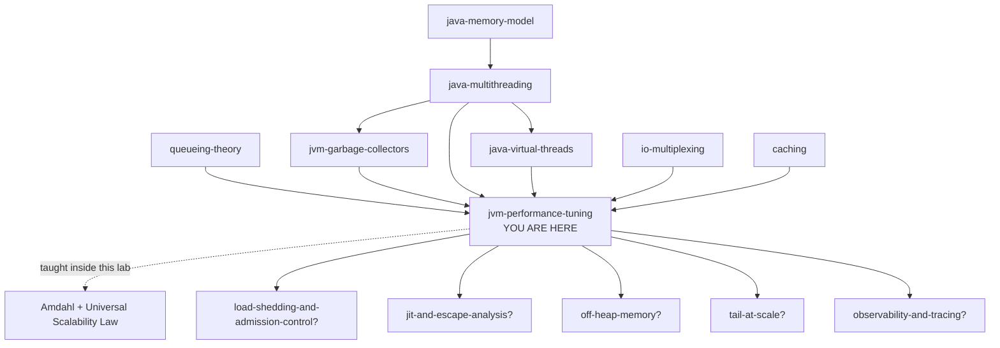

# JVM Performance Tuning — how to find the one thing that is actually slow

> **Tell a friend:** Omar waits eleven minutes for a sandwich, the owner hires
> two more staff, and the queue does not move at all. Nobody ever stood at the
> door with a stopwatch and split those eleven minutes into where they went.
> Split them, and six of the seven pieces are tiny while one is huge: the wait
> for the shop's single toaster. A request into your Java service splits the
> same way, into seven pieces, and exactly one of them is holding you back
> today. Performance tuning is finding that piece, and pasting in JVM flags is
> what people do instead — a flag can only change how the JVM spends time it is
> already spending.

The trainer for this lab is [`visualization.html`](visualization.html), also
published as [The Bottleneck Machine](https://claude.ai/code/artifact/a12d63c9-7eaf-4596-9171-a92a41b28044).
What the lab is made of, where its numbers come from, and where it sits among
your other labs is in [section 17](#17-about-this-lab) at the end.

---

# BEGINNER MODEL — stages 1 to 9

## 1. Why does this problem exist at all?

> **In one breath:** Your service is usually fast and occasionally awful. That
> is the exact shape that destroys trust. And the fix people reach for first is a
> handful of JVM flags, which cannot touch most of the problem.

Meera runs a service. It answers most requests quickly. But once in every
hundred, somebody waits two seconds.

One in a hundred sounds like a rounding error. It is not. A page that makes
twenty calls to Meera's service will contain one of those slow calls most of
the time. So her customers experience something "usually fine and randomly
awful". That is the profile that destroys trust in software.

Meera is asked to fix it by Friday. She searches, finds a page titled *"Top 10
JVM flags for performance"*, and pastes six of them into the startup command.

Three things can happen next. Sometimes nothing changes. Sometimes it gets
worse. Occasionally it gets better and she never finds out why — and that is
the worst of the three, because now she believes something false.

**The sentence people get wrong.** *"We have a latency problem, so let's tune
the JVM."* Almost every time somebody says that, they mean *let's paste in some
flags*. But a flag can only change **how the JVM spends time it is already
spending**. Suppose 60% of Meera's request is spent asleep, waiting for a
database to answer. There is no flag that touches that 60%. Not one, in any JDK ever shipped. The first job is not to tune. The first job is to find out
which 60% she has.

Not doing that job costs three things, and all three are concrete.

1. **Money.** If you do not know which resource is the constraint, you buy more
   of all of them. Fleets routinely run at three times the size they need,
   because the real limit was one lock nobody ever timed.
2. **Latency you cannot explain to anyone.** "It's the GC" is what people say
   when they do not know. It usually is not the GC.
3. **Time.** A week spent optimising a method that is 2% of the request is a
   week gone. The graph does not move. Now nobody believes performance work is
   worth funding.

## 2. What happens when you follow one customer with a stopwatch?

> **In one breath:** Four people work in a sandwich shop, the queue is out of
> the door, and the owner hires two more. Nothing improves, because nobody
> checked where the eleven minutes were actually going.

Forget computers for a moment. There is a sandwich shop with four people in it.

- **Asha** takes the order at the counter.
- **Bharat** toasts the bread. There is one toaster.
- **Chen** puts the fillings on.
- **Dee** wraps it and takes the money. There is one till, and only Dee has the
  key to it.

At 12:30 the queue is out of the door. **Omar** joins the back of it and waits
eleven minutes for one sandwich. The owner wants this fixed by Friday.

The owner does the obvious thing and hires two more people. Now six people work
in a kitchen built for four. The queue is **exactly as long as it was**.
Everyone bumps into each other. And Dee, who still has the only till key, has a
line of five colleagues standing behind her holding finished sandwiches,
waiting their turn to ring up.

Here is what the owner never did. **Stand at the door with a stopwatch and
follow Omar all the way through.** Do that, and this is what you write down.

| Where Omar's eleven minutes went | Time |
|---|---|
| Standing outside before reaching the counter | 6 min 10 s |
| Talking to Asha | 25 s |
| Waiting for the toaster to be free | 3 min 05 s |
| Actually toasting | 40 s |
| Fillings | 30 s |
| Waiting behind other staff for the till | 55 s |
| Paying | 15 s |

Seven lines. Six of them are small. One of them is not.

> **🔮 Predict:** *The owner can do exactly one thing on Friday. Hire a third
> extra person, make Chen twice as fast at fillings, or buy a second toaster
> for sixty pounds. Which one moves Omar's eleven minutes, and roughly by how
> much?*
>
> <details><summary>Reveal</summary>
>
> **The second toaster, and it is not close.** Omar spends 3 minutes 5 seconds
> waiting for the toaster to be free. That queue exists because there is one
> toaster, so a second toaster deletes most of it. It also shortens the 6
> minutes 10 seconds spent outside the door, because customers clear faster.
>
> If you said *make Chen faster*, look at the fillings row: 30 seconds. Chen
> could work at infinite speed and Omar saves 30 seconds out of 660. That is
> 4.5%, and the queue is still out of the door.
>
> If you said *hire another person*, the shop already tried that. Six people in
> a four-person kitchen did not move the queue at all, because the toaster does
> not toast faster when more people watch it.
>
> </details>

Notice what the stopwatch did. It did not tell the owner *how bad* things were
— everyone already knew it was eleven minutes. It told them **where the eleven
minutes went**, and that is a completely different kind of number. The second
one is a diagnosis. The first one is a complaint.

**How far this lab takes you.** Stop at any checkpoint and you still have
something whole.

| Layer | Stages | After it you can… |
|---|---|---|
| Beginner | 1–9 | name the seven places a request's time goes, and say why an average is not a diagnosis |
| Intermediate | 10 | run the method yourself, and say why each of its awkward steps exists |
| Engineering | 11–12 | recognise thirteen production failures, and name what each fix cost you |
| Production | 13 | set the flags that earn their place, and know what this lab's model leaves out |

## 3. Why not just make everything bigger?

> **In one breath:** The instinct in a kitchen and in a JVM is the same: buy
> more of whatever you can buy. Every one of those levers is real. Every one of
> them is a lottery ticket until you know what is slow.

Arjun looks at Meera's service and proposes the obvious things. In Java they
look like this.

- **More heap.** Push `-Xmx` from 512 MB to 4 GB. Memory is cheap.
- **More threads.** Take the pool from 16 to 200. There is clearly work waiting.
- **More instances.** Scale the deployment from 4 pods to 12.
- **A different collector**, because somebody on the internet said theirs is
  faster.
- **A pile of flags** copied from a blog post about a different JDK, a
  different workload, and a machine with a different number of cores.

Every one of these is a real lever. Every one is sometimes the right answer.
And every one here is being applied **without knowing what is actually slow**.
That is what makes the whole exercise a lottery.

> **🔮 Predict:** *A service answers 100 requests a second on a 16-core machine.
> Its p99 is bad. The CPUs are only about 11% busy — 100 requests a second
> needing 18 ms of CPU each is 1.8 cores of demand on 16, so there is loads of
> hardware sitting idle. Somebody quadruples the heap from 512 MB to 4 GB. What
> happens to p99?*
>
> <details><summary>Reveal</summary>
>
> **Nothing. p99 was 1,327 ms before and 1,327 ms after** — the same to the
> millisecond. [MODEL, scenario 1 on the visualization. The three tags used in
> this lab, `[MODEL]`, `[HAND]` and `[JVM]`, are explained in section 17.]
>
> Nothing happened because nothing was ever wrong with memory. Over the whole
> run the collector ran **twice**, and the average request lost **0.0 ms** to
> it. What the average request actually lost was **87.3 ms** standing in line
> for a lock that only one thread at a time may hold. That is Dee's till key.
>
> Change the right thing instead. Shrink that one-at-a-time section from 45% of
> the work to 6%, and **p99 falls from 1,327 ms to 211 ms** — on the same heap,
> on the same hardware, with no flags at all.
>
> If you guessed that a bigger heap would at least help a bit, you were
> reasoning that memory pressure is always in the mix somewhere. Here it was
> not in the mix at all. Zero is a real number.
>
> </details>

## 4. How does "make it bigger" break, and what does that reveal?

> **In one breath:** The heap experiment did nothing, which is merely
> disappointing. The thread-pool one does something worse: it goes backwards.

The heap change was harmless. The other three on Arjun's list are not, and the
thread-pool one is worth stopping on.

Take a handler that is pure computation. It needs 20 ms of CPU and makes no
database call. It runs on 8 cores, and more requests arrive than the machine
can handle. The queue is full, so there is definitely work sitting there for
extra threads to pick up.

> **🔮 Predict:** *You raise the pool from 8 threads to 128. Same machine, same
> cores, same code, same arriving traffic. What happens to the number of
> requests answered per second?*
>
> <details><summary>Reveal</summary>
>
> It **falls by 29.6%**: 300.0/s at 8 threads, and 211.3/s at 128. The p99 goes
> from 1,623 ms to 8,798 ms [MODEL].
>
> The cores were already busy every single millisecond at 8 threads. There was
> no spare capacity for the extra 120 threads to use. What they added instead
> was cost: cache traffic between cores, and an operating system shuffling 128
> runnable things onto 8. Each thread's work inflated by **1.75×**.
>
> If you guessed "flat, because the cores were already full", you had the right
> mechanism and stopped one step early. Extra threads do not merely fail to
> help. They charge rent. No kitchen analogy predicts this, and stage 10 gives
> you the formula that does.
>
> </details>

Here is the whole sweep [MODEL].

| Handler threads | Requests answered | median | p99 |
|---:|---:|---:|---:|
| 8 | **300.0 /s** | 1,531 ms | 1,623 ms |
| 16 | 300.0 /s | 1,740 ms | 2,156 ms |
| 32 | 291.0 /s | 1,828 ms | 2,777 ms |
| 64 | 250.7 /s | 2,229 ms | 4,641 ms |
| 128 | **211.3 /s** | 2,814 ms | **8,798 ms** |

Read the second row, not the last one. The damage starts well before the pool
looks absurd. Sixteen threads on eight cores already costs **33% more p99** and
buys **zero** extra throughput.

The other two levers fail in their own ways. **More instances runs out of road
too**, for the same underlying reason, and stage 10 gives you the formula that
says exactly where the road ends. **A different collector is a trade, not an
upgrade**, and stage 11 has the numbers.

So the naive approach fails. But *how* it fails is the interesting part, and it
points at something deeper than "measure first".

Look again at Omar's eleven minutes. The owner's problem was not that they
failed to count. They had a number: **eleven minutes**. It was real, correct
and honestly collected. It was also completely useless.

> **A single total tells you how bad, and never why.** The thing you naturally
> reach for is *how long did it take*, and that cannot in principle find the
> bottleneck. A total is one number. A diagnosis is that total **split by where the time
> went**. Everything else in this lab is that one sentence, applied harder.

## 5. What exactly must the method do?

> **In one breath:** Four jobs, in order. Split the time, name the biggest
> piece, work out the ceiling before you start, and prove afterwards that the
> piece you attacked actually shrank.

We need a method that does four things, and the order matters.

1. **Split** a request's elapsed time into parts. Each part must be blamed on
   one identifiable cause, and the parts must add up to the whole. No time may
   be unaccounted for. Unaccounted time is exactly where the problem hides.
2. **Name the largest part** — separately for the typical request and for the
   slow ones. You are about to see how often those two are slow for completely
   different reasons.
3. **Predict the ceiling before you spend the week.** If the part you plan to
   attack is 20% of the request, deleting it entirely still leaves you 80%. You
   want that number before you start, not after.
4. **Prove the change.** Split the time again afterwards and show that the part
   you attacked really shrank. Not that some number somewhere moved.

Anything that does not do all four is guessing with extra steps.

## 6. What is the one idea underneath all of it?

> **In one breath:** Two sentences. Every millisecond of a request is being
> spent on something identifiable. And at any moment, exactly one of those
> things is your limit.

**First: a request's elapsed time is a budget, and every millisecond is being
spent somewhere.** Not "roughly accounted for". *Exactly* accounted for. If a
request took 250 ms, then there are 250 milliseconds, each of which was spent
doing one nameable thing. Label them all and you have a diagnosis instead of a
complaint.

**Second: at any given moment the system has one bottleneck, and improving
anything else changes nothing.** This is not a slogan. It is arithmetic. The
toaster wait is 3 minutes of Omar's 11. Make Chen's fillings station infinitely
fast and you save 30 seconds, which is 4.5%. The queue is still out of the door.

Everything else in this lab is those two sentences pushed harder. The flags
come at the very end, and there are far fewer of them than you expect.

## 7. What do engineers call all of this?

> **In one breath:** You have already felt every problem these words name. Here
> is the terminology, grouped by the job each word does, with every one pointing
> back at the moment you met it.

This is the whole vocabulary of the subject, and it is smaller than it looks.
Nothing below is a new idea. Each word is a name for something Omar, Dee or
Meera has already run into.

### Which three things can you want, and why can't you have all three?

Omar cares how long *his* sandwich takes. The owner cares how many sandwiches
leave the shop per hour. The landlord cares how much space the shop occupies.
Those are three different questions and they pull against each other.

**Throughput** is how much work finishes per unit of time: requests per second,
messages per second, rows per second. It is the only performance number a
*business* cares about directly, because it maps to capacity and therefore to
money. You met it as the "requests answered" column in stage 4, and it is that
column that exposed 128 threads as a disaster.

**Latency** is how long **one** unit of work takes, from the point of view of
whoever is waiting for it. Omar's eleven minutes is a latency. It needs its own
word because it and throughput move in opposite directions constantly. Batching
raises throughput and raises latency. A bigger queue raises throughput slightly
and raises latency enormously.

**Footprint** is how much memory the whole process occupies **as the operating
system sees it**, not as the JVM sees it. It matters because it is what your
container limit is compared against. Exceeding it does not make you slow. It
makes you dead, and stage 11's F3 is that death.

`jvm-garbage-collectors` called these three the corners of a triangle, and you
must trade inside it. A concurrent collector buys low latency by spending
throughput and footprint. A bigger heap buys throughput by spending footprint.
Batching buys throughput by spending latency. There is no setting that improves
all three at once. If you think you have found one, you have found a bug you
were previously suffering from — which is a different and much happier thing.

| The word | What it counts | Where you met it |
|---|---|---|
| **Throughput** | work finished per unit of time | the "requests answered" column, stage 4 |
| **Latency** | how long one unit takes, for whoever waits | Omar's eleven minutes, stage 2 |
| **Footprint** | memory the whole process holds, as the OS sees it | the container that kills you, F3 in stage 11 |

### How do you talk about latency without lying?

Line every request up in order of how long it took. The **percentile** is the
value below which that share of them fall. The p99 is the number that only one
request in a hundred beats.

Why not just take the average? Because the **mean** is a genuinely bad summary
of latency, and it is worth knowing exactly why. Latency distributions have a
long right tail: a few requests are enormously slower than the rest. The mean
gets dragged part-way towards them and ends up describing nobody at all.

**Tail latency** is the name for that slow end — p95, p99, p99.9, and the worst
case. It gets its own word because the tail has its own separate causes. In
this lab's baseline run, the *average* request spent its time waiting on the
database, while the *slowest 5%* spent theirs on CPU. Same run, same code, two
completely different diagnoses. **Fix the average and the tail stays.** The
visualization has a toggle for exactly this, and it is the single most useful
control on the page.

**Utilisation** is the fraction of the time a resource is busy. Engineers write
it as the Greek letter rho, `ρ`. You already own the dangerous part from
`queueing-theory`: waiting is *not* proportional to load. **Headroom**, or
spare capacity, is capacity minus offered load — the work the resource could
still absorb. That lab proved it is headroom, not utilisation, that sets your
latency. Which is why "we have 20% headroom" is not, on its own, a sentence
about safety. Keep the word; stage 13 uses it.

Here are the numbers behind those four words [MODEL].

| The number | What it is | What it means |
|---:|---|---|
| 47.5 ms | the mean of one run | dragged upward by the tail; describes no actual request |
| 41 ms | the median (p50) of the same run | what a typical request really felt |
| 248 ms | the p99 of the same run | 5.2× the mean, and the number your users complain about |
| 25.0 ms / 19.9 ms | database wait / CPU, for the *average* request | the average request is waiting on something else |
| 93.7 ms / 25.0 ms | CPU / database wait, for the *slowest 5%* | the tail is a CPU story, not a database story |
| 2× · 10× · 21× | wait as a multiple of the work, at 50% · 90% · 95% busy | the `1/(1−ρ)` cliff from `queueing-theory` |

### What are the words for where the time actually goes?

The **bottleneck** is the one resource whose exhaustion currently limits the
system. The word exists to make it sayable that there is only **one** of them
at a time. Bharat's toaster is the shop's. And when you fix it, the bottleneck
**moves** to whatever is now the limit — fix the lock in scenario 1 and the
bottleneck becomes CPU immediately. That is why performance work is a loop and
not a task.

Now the most important distinction in the whole lab. At every instant, a thread
is doing one of exactly two things. It is executing instructions on a core,
which is **on-CPU**. Or it is not, which is **off-CPU**: asleep waiting for a
network reply, blocked on a lock, parked, or runnable with no free core to run
on. Dee ringing up a sandwich is on-CPU. Dee standing in line for the till key
is off-CPU, and she looks exactly as busy from across the room.

Why does that distinction matter more than any other? **Because your CPU
profiler can only see the first kind.** Take a handler that does 6 ms of work
and makes one 180 ms database call. It spends **4.5% of its elapsed time**
on-CPU [MODEL]. A CPU profiler pointed at that service is describing 4.5% of
the problem and is completely silent about the other 95.5%. It does not warn
you. It has no way to.

The **time budget**, also called the **decomposition**, is the split of one
request's elapsed time into named parts that sum to the whole. It is Omar's
stopwatch table. This lab uses seven parts and stage 8 names them all. It is
the central artefact of the subject; everything else is an instrument for
producing it.

### Which four instruments answer which question?

These four get confused constantly, and confusing them wastes weeks. Each one
answers a different question, and none of them answers another one's.

| The instrument | The question it answers | What it is like | Where it shows up |
|---|---|---|---|
| **Monitoring** | is it bad right now, and getting worse? | continuous, cheap, aggregated, always on | dashboards and alerts, stage 13 |
| **Profiling** | inside one process, where is the time going? | sampled, detailed, usually on demand | this is what produces the decomposition |
| **Tracing** | for one request, which services and spans, and how long each? | follows a request **across** processes | step 1 of the method, stage 10 |
| **Benchmarking** | is version B faster than A, under conditions I control? | deliberately artificial | F9, and why it is dangerous |

A **sampling profiler** does not record every method call. It wakes up many
times a second, looks at what each thread is doing right now, and writes it
down. Why work that way? Because an instrumenting profiler that records every
call changes the program's timing so much that its answers stop describing the
real program. The arithmetic is simple: at 100 samples per second over 10
seconds you have 1,000 observations, so a method appearing in 600 of them was
on-CPU roughly 60% of the time.

A **flame graph** is the standard picture of a profile. Each box is a method.
The box's **width** is the share of samples containing it. Boxes stack upward
to show who called whom. Here is the whole skill in five words: **look for wide
boxes, not tall ones.** Tall means deep call stacks, which is aesthetics. Wide
means time, which is the answer.

A **safepoint** is a point in compiled code where a thread is willing to stop,
and where the JVM knows the exact layout of that thread's stack. You met it in
`jvm-garbage-collectors`: a pause cannot start until every thread has reached
one. This lab adds two new consequences. Some profilers can **only take a
sample at a safepoint**, which gives them a systematic blind spot (F8). And the
time the slowest thread takes to arrive at one is called
**time-to-safepoint** — it is added to every pause, and it is invisible in the
garbage-collection log (F6).

### How does the same code get faster while you watch?

When a method first runs, the JVM executes its bytecode one instruction at a
time. That is the **interpreter**, and it is like a new hire reading the recipe
card aloud, line by line, for every sandwich. Correct, and slow.

While the program runs, the JVM counts how often each method is called and how
each branch behaves. It then compiles the hot ones into native machine code
**using what it has observed**. That is **JIT**, or just-in-time, compilation.
It can beat a compiler that runs before the program does, because it knows
things a static compiler cannot. One example: which class actually turns up at a
particular call site 99.9% of the time.

The JVM's default arrangement is **tiered compilation**: interpreted first,
then a fast compiler that produces mediocre code quickly (**C1**), then a slow
compiler that produces excellent code (**C2**). Why two compilers? Because C2
is far too slow to run on everything, and C1 gets you 80% of the benefit almost
immediately.

**Warmup** is the period after startup during which your code is still slower
than it will eventually be. **Deoptimisation** is what happens when the JIT's
guess turns out to be wrong. It compiled on the assumption that "this call site
is always `ArrayList`". When something else turns up, the compiled code is
thrown away and the method drops back to being interpreted while it re-profiles.
Why you care: a rare code path taken for the first time under load can make a
hot method transiently much slower, for no reason visible in your metrics.

**Escape analysis** is the compiler proving that an object never leaves the
method it was created in, so it need not be allocated on the heap at all. You
met it in the GC lab. Here it matters for one specific reason: it is the single
largest cause of a benchmark reporting that your code takes zero time.

| The word | Recipe-card version | The number attached to it |
|---|---|---|
| **Interpreter** | reading the recipe aloud every time | costs 5.0× the compiled price, stage 10 |
| **C1, then C2** | learning the recipe roughly, then properly | 1.9×, then 1.0×, stage 10 |
| **Warmup** | the window before the new hire is fluent | 99 ms median cold, 41 ms warm [MODEL] |
| **Warmup, pure compute** | the same window with no waiting to hide it | 4.6× rather than 2.4× [MODEL] |
| **Deoptimisation** | the recipe changed and nobody said | a hot method silently drops back to interpreted |
| **Escape analysis** | the sandwich that was never really made | why F9's benchmark reports 0.3 nanoseconds |

### What sets the ceiling you can never beat?

Only Dee has the till key. Every sandwich, however many staff you hire, passes
through that one till one at a time. The share of the work that must happen one
thread at a time is called the **serial fraction**, and it is written as the
letter `s`. Locks, a single writer, one connection, one shared counter — all of
them are `s`.

**Amdahl's law** turns that into a ceiling you can compute. With serial
fraction `s` running on `N` threads, the best possible speed-up is
`1 / (s + (1−s)/N)`. As `N` grows, that approaches **`1/s`** and never gets
past it. The point of the law is that the ceiling is a number you can work out
**before** you buy anything.

Amdahl's curve flattens. Real systems come back **down**, and that needs a
second cost. Every thread must keep a consistent view of shared data, and the
number of pairs of threads that have to agree grows with the *square* of the
thread count — `N²`. Add that term and you get the **Universal Scalability
Law**: `speed-up = N / (1 + s(N−1) + κN(N−1))`. The Greek letter kappa, `κ`, is
the price of that agreement. Only the USL predicts a curve that turns downward.

| At `s = 5%` | 16 threads | 64 threads | 256 threads | Ceiling |
|---|---:|---:|---:|---|
| Amdahl says | 9.1× | 15.4× | 18.6× | 20×, never passed |
| With coherence at `κ = 0.1%` | 8.0× | 7.8× | 3.2× | 9.0×, at 31 threads |

Read the top row first: Amdahl's last 192 threads bought 3.2× on their own.
Then read the bottom row, and notice that under `s = 5%, κ = 0.1%` those same
threads *subtracted*. `queueing-theory` listed `universal-scalability-law?` as a
next step. This is it, and tab 2 of the visualization draws it.

### Which two words exist because measurement fools you?

**Coordinated omission** is timing from the moment you got served rather than
from the moment you started waiting, so the delays are systematically left out
of the data. You met it in `queueing-theory` as a load-generator problem. F7
shows you its far more common form, which lives in your own application code.

**Microbenchmark** is a benchmark of a very small piece of code. It needs its
own word and its own warning because at that size the JIT compiler's ability to
prove your result is unused, and delete it, exceeds your ability to notice
(F9).

## 8. Which two pictures should you carry in your head?

> **In one breath:** Carry the sandwich shop, because it is right about most
> things and you can reason with it in a meeting. Then carry the seven buckets,
> because they are what you actually write down. Then learn the four places the
> shop lies.

### What does the shop get right?

The shop gets you further than it has any right to. Four things from it are
true of every service you will ever tune.

- The queue outside the door is real, and it is usually the biggest number.
- There is exactly one toaster, and it is the whole problem.
- Hiring more staff into a small kitchen makes things worse.
- The only way to find the toaster is to follow **one customer** with a
  stopwatch and write down every interval.

### What are the seven buckets?

Here is the precise version, and it has two halves that you look at together.

**Half one is the time budget.** Every millisecond of a request's elapsed life
falls into exactly one of seven buckets. They sum to the total. Nothing is
unaccounted for. This is Omar's stopwatch table, written for a JVM.

| Bucket, in plain words | What the request is doing | In Omar's eleven minutes | Who owns it |
|---|---|---|---|
| **Waiting for a thread** | it has arrived, but nothing has started work on it | standing outside the door | the pool and its queue |
| **Running your code** | on a CPU, executing your handler | Chen doing the fillings | your code, and the cores |
| **Code not yet compiled** | on a CPU, but slower than it will be, because the JIT has not got there | a new hire reading the recipe card each time | the compiler, and time |
| **Waiting on the database** | asleep, holding a thread, using no CPU | waiting for the bread delivery | whatever you called |
| **Waiting for a lock** | another thread is inside the one-at-a-time section | queuing behind colleagues for Dee's till key | the lock, and Amdahl's `s` |
| **Frozen for the collector** | every application thread is stopped | the whole shop pauses for a stock-take | the collector |
| **Ready to run, no core free** | runnable, but every core is busy | staff standing about, one work surface | the scheduler, or a CPU quota |

**Half two is the resource sheet.** For each resource you write two numbers,
and the second is the one people forget. How busy is it, and **how much work is
queued behind it**. A resource at 100% busy with an empty queue is a resource
being used well. A resource at 100% busy with a growing queue is your
bottleneck, and the queue growth is the tell.

### How do the two pictures map onto each other?

| In the shop | In the JVM |
|---|---|
| A customer, such as Omar | A request |
| Asha, Bharat, Chen and Dee | Handler threads |
| The work surface everyone shares | CPU cores |
| The queue outside the door | The thread pool's queue — the *waiting for a thread* bucket |
| Bharat's one toaster | Whatever the current bottleneck happens to be |
| The till key only Dee has | The lock — the *waiting for a lock* bucket, and Amdahl's `s` |
| The bread delivery you wait for | The downstream call — the *waiting on the database* bucket |
| A new hire reading the recipe each time | Interpreted code, before the JIT compiles it |
| The whole shop stopping for a stock-take | A stop-the-world collection pause |
| Following one customer with a stopwatch | Profiling |
| Counting customers served per hour | Monitoring throughput |

### Where does the shop lie to you?

Four places, and every one of them matters.

**Lie 1: in a shop the bottleneck stays put.** In a JVM it moves the moment you
touch it — buy Bharat a second toaster and Dee's till becomes the constraint.
The shop does that much too. But a JVM's bottleneck also moves **without you**.
The same service is compiler-bound in its first ten seconds, CPU-bound at
midday, and collector-bound at month-end when the cache is full. **A
performance diagnosis has a shelf life.**

**Lie 2: in a shop the stations are independent.** Bharat toasting does not
slow Chen down. But in a JVM the garbage collector's threads and your handler
threads run on the *same* CPUs. So choosing a collector that works concurrently
does not make its work free. It moves the work out of a pause and into a **tax
on every one of your requests**. At a 200 MB/s allocation rate, ZGC in this
model spends **40% of the machine** on collecting while your code runs [MODEL].
Its longest freeze is 6.4 ms against Serial's 519 ms, an 81× improvement, and
yet its p99 is only 2.6× better. The tax ate most of the win.

**Lie 3: the staff do not rewrite themselves while working.** Your code does.
For the first few hundred calls a method is interpreted, then compiled roughly,
then compiled well. **Any number you collect during that window describes a
program that no longer exists.**

**Lie 4: in a shop, one more worker is never worse than none.** In a JVM it
routinely is. Six people in a four-person kitchen is a mild inconvenience. But
128 threads on 8 cores did **29.6% less work** than 8 threads [MODEL]. No
kitchen analogy predicts a curve that turns downward, and stage 10's second
formula is the one that does.

## 9. What does the Bottleneck Machine actually show you?

> **In one breath:** It is a simulated Java service with knobs. One coloured bar
> is one request's life, split into the seven buckets. The widest block is your
> bottleneck. That is the whole page in one sentence.

Open **[The Bottleneck Machine](https://claude.ai/code/artifact/a12d63c9-7eaf-4596-9171-a92a41b28044)**,
also saved beside this file as `visualization.html`, which works offline.

Everything on the page comes from one deterministic engine. The same run twice
gives byte-identical numbers, and the cost rules it uses are printed in full on
its fourth tab.

### What should you look at first?

Read the page in this order the first time.

1. **The coloured bar** in the middle. That is one request's life, left to
   right, with each of the seven buckets in its own colour. The widest block is
   your bottleneck. This is the single thing to look at.
2. **The verdict panel above it** names that block in a sentence, and says what
   would actually move it. When the typical request and the slowest 5% are slow
   for different reasons, it tells you that too, in bold, because it is the most
   commonly missed fact in the subject.
3. **Average request / Slowest 5%** — the two buttons above the bar. Press both.
   Watch how often the picture is completely different. On the default settings
   the average request is dominated by the database call, 25.0 ms out of 45.1 ms,
   while the slowest 5% are dominated by CPU at 93.7 ms [MODEL].
4. **The resource sheet** below: busy-ness on the left, what is queued behind
   it on the right.
5. **The thread grid**: one square per handler thread, coloured by what it is
   doing this instant. Click one to read, in a sentence, what it is working on
   and where that request's time has gone so far.

Then run the eight scenarios, in order. Each one sets the knobs to a situation
that really happens, asks you to predict the outcome before it runs, and then
shows the numbers. Being wrong is the point.

### Which controls and tabs are worth knowing?

The controls are *Run* and *Pause*, *Step 1 s* to advance one model second and
look carefully, *Back* to rewind two seconds, and *Reset*. Because the engine
is deterministic, *Back* is an exact replay rather than an approximation.

There are two more tabs. *Why more never scales* draws Amdahl and the USL with
your program's numbers on them; nothing is simulated there, both formulas are
evaluated exactly. *How measurement lies* takes the run you have loaded and
shows three ways a working, un-buggy tool reports something true that is not the
answer to your question.

One last thing, and it is a deliberate choice. Which thread holds Dee's till
key, which requests are the heavy ones, and how much CPU the container is
allowed are all knobs you can change. A hardcoded choice silently teaches that
it does not matter, and each of these matters enormously.

---

> ### CHECKPOINT — end of the beginner model
>
> You can now explain **why performance tuning is bottleneck-finding rather
> than flag-picking**, name the seven places a request's time goes, and say why
> an average latency is not a diagnosis. That is enough to stop the two most
> expensive mistakes: optimising the wrong thing, and buying more of a resource
> that was never the constraint.
>
> **Say it back.** Without using the words *bottleneck*, *percentile* or
> *decomposition*, explain to a friend why hiring two more staff did nothing for
> Omar's eleven-minute wait.
> <details><summary>A good answer sounds like</summary>
> "Most of his eleven minutes was spent standing still, waiting for one toaster
> that only does one sandwich at a time. Extra people cannot make that toaster
> go faster, so they just stood around too. The only way anyone could know that
> was to time each part of his wait separately, instead of timing the whole
> thing."
> </details>
>
> **Next** is the mechanism itself — the actual method, built the way you would
> build it, broken four times, and repaired each time by the thing that breaks
> it. Then the instruments, and how the compiler warms up, step by step.

---

# INTERMEDIATE MODEL — stage 10

## 10. How do you actually do it, and where does the method break?

> **In one breath:** We build the method the way a sensible engineer would,
> then watch it fail four times. Every awkward-looking step in the final version
> is the scar of one of those failures.

Meera is going to build this method herself, one attempt at a time. Each
attempt is reasonable. Each one breaks. The repair is what you keep.

### Method v1 — why doesn't fixing the hottest method help?

The obvious first move. Attach a profiler, find the method with the widest box
in the flame graph, and make it faster.

Here is how it breaks. Meera runs the profiler on a service whose handler does
6 ms of computation and one 180 ms call to a database. The profiler reports,
truthfully, that `computePricing()` is 60% of the samples. She spends three days
making it twice as fast. The p99 moves by about 1.5%.

> **🔮 Predict:** *The profiler was not broken, and 60% was not a lie. So where
> did the three days go?*
>
> <details><summary>Reveal</summary>
>
> Into 60% of a very small slice. The handler is on a CPU for 8.4 ms of a
> 188.5 ms request, which is 4.5% of it. So `computePricing()` is 60% of 4.5%,
> which is **2.7% of the request**. Twice as fast on 2.7% saves 1.35%.
>
> If you guessed the profiler was sampling too rarely, or that the fix did not
> work, neither is true. The fix worked perfectly on the thing it fixed. Nothing
> in the tool's output said what share of the request that thing was.
>
> </details>

Here is the arithmetic, and it is the most important in the lab [MODEL].

```
elapsed time per request      188.5 ms
of which, on a CPU              8.4 ms    =  4.5%
of which, asleep waiting      180.0 ms    = 95.5%
```

A CPU profiler samples threads **while they are running on a CPU**. A thread
asleep in a socket read is not on a CPU, so it contributes no samples at all.
This is Dee standing in the till queue: perfectly busy-looking, contributing
nothing to any CPU profile.

> **The first repair.** Split **wall-clock** time first. Only once you know the
> time is genuinely on-CPU is a CPU profiler the right instrument. This is why
> the visualization's bar is a wall-clock bar, and why its very first question
> is "how much of this is even on a CPU".

### Method v2 — why is the dashboard green while users wait?

Better. Meera adds timers: one at the top of the handler, one at the bottom, and
some in between. She deploys, watches the dashboard, and it says p99 is 120 ms.
That is comfortably inside her 500 ms SLA.

It fails like this. Users report multi-second waits. Support has screenshots.
Her metric says 120 ms. Both are correct [MODEL, one run timed two ways].

| Timer started when… | median | p99 |
|---|---:|---:|
| the handler picked the request up | 43 ms | **120 ms** |
| the request actually arrived | 771 ms | **880 ms** |

The gap is **7.3×**. All of it is the **730.9 ms** the average request spent
sitting in a queue, waiting for a handler thread to become free. That is Omar
standing outside the door. A timer at the top of the handler is structurally
incapable of seeing that time, because when it starts, the waiting is over.

This is **coordinated omission**, and it has a second form that catches load
tests. A generator with a fixed pool of client threads cannot send a new request
while it waits for the previous one. So during a server stall it sends *fewer*
requests, and the stall never appears in the results. Both forms are the same
mistake: **timing from when you got served, rather than from when you started
waiting.**

> **The second repair.** The clock starts at arrival, not at dispatch. In
> practice: take your source of truth from the edge — the load balancer, the
> ingress, the gateway. And if you add exactly one metric to a service this
> year, make it **`time_in_queue`**: the gap between arrival and the start of
> handling.

### Method v3 — why does asking for shorter pauses make p99 worse?

Now the clock is honest and the split is real. It says the slow requests are
losing most of their time frozen for collections. Meera reaches for the obvious
knob and sets `-XX:MaxGCPauseMillis=10`, telling G1 she wants short pauses.

Watch it fail. [JVM] `MaxGCPauseMillis` is a *goal*, not a promise. The main
lever G1 has for meeting it is to **shrink the young generation**, so each
collection has less to do and each pause is shorter. But a smaller young
generation fills up sooner. So you get more collections, more total collector
CPU, and more objects promoted before they had a chance to die. Frequently you
get a **worse** p99 than you started with. The number she asked for went down.
The thing she wanted got worse.

The deeper mistake is that she tuned the **symptom**. A collection pause has
exactly two dimensions, and they have completely different causes.

- **How often** a collection happens = how much garbage you make ÷ how much
  room there is to make it in.
- **How long** each one takes ≈ how much data is still **alive** when it runs.
  This is the GC lab's central inversion: the cost is the *live* set, not the
  garbage.

> **🔮 Predict:** *A service retains 1.2 GB of long-lived data and produces about
> 1 MB of garbage per request. It is genuinely collector-bound — its longest
> freeze is over half a second. Four fixes are proposed: quadruple the heap,
> switch from Serial to G1, allocate eight times less per request, or run four
> times the handler threads. Two of them get p99 to the same place. Which two,
> and what separates them?*
>
> <details><summary>Reveal</summary>
>
> **More heap and less garbage both land on p99 = 174 ms**, down from 573 ms.
> What separates them is the *longest freeze*. More heap leaves it at 519 ms,
> while allocating less takes it to 8.1 ms [MODEL].
>
> That is the two-dimension point made concrete. More heap reduced how **often**
> a collection happens and did nothing about how **long** one takes. Allocating
> less did both, because cheaper requests leave less live data to copy when a
> collection does run.
>
> And the fourth option made it **worse**, at 752 ms, because more concurrent
> requests means more live data at collection time.
>
> If you picked "switch to G1" as one of the two winners, it is close at 200 ms.
> But it is the collector trade rather than the frequency fix, and stage 11's F10
> is where that trade bites.
>
> </details>

Here they are, with a do-nothing baseline and one more thing people try [MODEL].

| Change | p99 | Longest freeze | Collections |
|---|---:|---:|---:|
| nothing | 573 ms | 519 ms | 49 young + 6 old |
| 4× the heap | **174 ms** | 519 ms | 12 + 1 |
| switch to G1 | 200 ms | 67 ms | 49 + 6 |
| **allocate 8× less per request** | **174 ms** | **8.1 ms** | 6 + 0 |
| 4× the handler threads | **752 ms** (worse) | 519 ms | 49 + 6 |
| 4× the CPU cores | 562 ms | 519 ms | 49 + 6 |

Read the *Longest freeze* column. It is the one that separates the two apparent
winners. More heap and less garbage both got p99 to 174 ms by reducing **how
often**. Only allocating less also fixed **how long**, taking 519 ms down to
8.1 ms. And note the two non-fixes: more threads made it measurably worse, more
cores did essentially nothing.

> **The third repair.** Attack the causes in this order. **Allocation rate**
> first, because it is usually a code problem and it fixes both dimensions.
> **Retention** second. **Heap size** third. **Collector choice** fourth.
> Setting a pause goal is not on the list.

### Method v4 — why was it fine in staging and worse in production?

The split is honest, the allocation rate is down, and staging looks beautiful.
Meera deploys to production, and p99 is worse than before she started.

Here is the break. Dev, who owns the container, has production running on a
16-core host with a CPU limit of 2 cores.

[JVM] The JVM does read its cgroup limits. Modern JDKs are container-aware, and
`Runtime.availableProcessors()` respects a CPU *quota*. But plenty of things
still get this wrong. An explicitly-set `-XX:ActiveProcessorCount` overrides the
truth. A **CPU shares** setting is a weight, not a limit, and is not translated
into a processor count at all. Sidecars compete for the same quota. Library code
often sizes its pool from `availableProcessors()` at class-load time. Whatever
the route, the result is a JVM sized for far more CPU than it will ever get.

What that looks like [MODEL].

| The machine the JVM thinks it has | p99 | Throughput | Biggest bucket |
|---|---:|---:|---|
| 16 cores, no limit | 188 ms | 196.3 /s | waiting on the database |
| 16 cores, limit of 2 | **5,214 ms** | 74.0 /s | **waiting for a thread** |

p99 rose by a factor of **28**, not the factor of 8 you would expect from the
ratio of cores. The reason is `queueing-theory`'s cliff. Capacity fell below the
arrival rate, and past that point the queue does not grow in proportion to
anything. It grows without limit, for as long as the overload lasts.

Now the detail that makes this failure so hard to catch, and it is worth saying
slowly. **The biggest bucket is not "waiting for a CPU", which was 266.5 ms. It
is "waiting for a handler thread" — the queue.** CPU throttling does not
announce itself as a CPU problem. On Dev's host dashboard the machine looks
idle, with 16 cores and 87% of them free. On Meera's service dashboard it looks
like a queueing problem. The word "CPU" appears nowhere.

> **The fourth repair.** Read the decomposition together with **what the JVM
> believes about the machine**, and check that belief against what the machine
> will actually give it. Stage 13 lists the specific things to check.

### Method v5 — why does buying more threads eventually subtract?

Everything is now honest, the bottleneck is CPU, and CPU is a thing you can buy.
So Meera doubles the threads, and then doubles them again.

It breaks the way stage 4's table already showed, and here is the formula behind
it. Two costs grow as you add threads.

The first is **the serial fraction**, Dee's till key, written `s`. Some part of
the work happens one thread at a time. **Amdahl's law** says
`speedup = 1 / (s + (1−s)/N)`. As `N` grows this approaches `1/s` and stops. At
`s = 5%` the ceiling is 20×. You get 9.1× at 16 threads, 15.4× at 64, and 18.6×
at 256 [MODEL].

The second is **coherence**, written `κ`. Every thread must keep a consistent
view of shared data, and the number of pairs that have to agree grows with `N²`.
The **Universal Scalability Law** adds that term.

```
speedup(N) = N / ( 1 + s(N−1) + κN(N−1) )
```

> **🔮 Predict:** *A program has a 5% serial fraction and a small coherence cost,
> `κ = 0.1%`. Amdahl says the ceiling is 20× and that 256 threads should get you
> 18.6× of it. What does the USL say 256 threads actually gets you?*
>
> <details><summary>Reveal</summary>
>
> **3.2× — which is less than the 8.0× you get from 16 threads** [MODEL]. The
> best this program can ever do is 9.0×, at 31 threads. Every thread after that
> subtracts.
>
> Amdahl's error here is not that it is too optimistic about the ceiling. It is
> that it has no term at all for the cost of threads coordinating with each
> other, so it can only ever flatten. Real systems come back down.
>
> If you guessed something near 18×, you were trusting Amdahl, which is the
> normal mistake and the reason the USL exists. The peak is computable in
> advance: `N* = sqrt((1−s)/κ)`.
>
> </details>

Amdahl flattens. The USL **turns downward**, and its peak is computable before
you buy anything, at `N* = sqrt((1−s)/κ)`. At `s = 5%, κ = 0.1%` [MODEL]:

| Threads | 1 | 16 | 31 | 64 | 128 | 256 |
|---|---:|---:|---:|---:|---:|---:|
| Amdahl says | 1.0× | 9.1× | — | 15.4× | — | 18.6× |
| With coherence | 1.0× | 8.0× | **9.0× (best)** | 7.8× | 5.4× | 3.2× |

**256 threads does less work than 16.** That is not a modelling artefact. It is
why "just add more" eventually stops working everywhere, in every system. And it
is why the honest answer to "how many threads?" is a number you find by
sweeping, not a number you increase.

> **The fifth repair.** Work out the ceiling before adding capacity. If your
> serial fraction is 10%, no amount of hardware gets you past 10×. Shrink `s`
> instead of shopping.

### What does the method look like after four repairs?

1. **Is it even this service?** Trace the request across processes first. Half
   of all "our service is slow" tickets are a downstream service.
2. **Split the elapsed time**, timed from arrival, into the seven buckets. Look
   at the typical request and the slow ones **separately**.
3. **Name the largest bucket. That is the bottleneck.** Compute the ceiling:
   even deleting this bucket entirely leaves you the rest.
4. **Pick the instrument that matches the bucket**, using the table below, and
   find the specific cause inside it.
5. **Check what the JVM believes about the machine** before you conclude
   anything about CPU or memory.
6. **Change one thing. Re-split. Prove the block shrank.** If it did not, undo
   it. An unexplained improvement is a debt.
7. **Go back to step 2**, because the bottleneck has now moved.

### Which instrument answers which bucket?

| Bucket | What to reach for | What you are looking for |
|---|---|---|
| Waiting for a thread | Queue-depth and `time_in_queue` metrics; a thread dump | Pool saturated, queue growing |
| Running your code | A CPU sampling profiler; a flame graph | The widest box, at the top of a wide stack |
| Code not yet compiled | `-Xlog:jit+compilation` or JFR compilation events | The service is young, or the method keeps deoptimising |
| Waiting on the database | Distributed tracing; a wall-clock profiler | Which downstream call, and how many of them per request |
| Waiting for a lock | JFR lock events; a thread dump showing `BLOCKED`; a lock-mode profile | Many threads blocked on one monitor |
| Frozen for the collector | `-Xlog:gc*` — and separately `-Xlog:safepoint*` | Pause count × pause length; and whether time-to-safepoint dominates |
| Ready to run, no core free | Container CPU-throttling metrics; run-queue length | Throttled periods per second |

[JVM] The single best default in a modern JDK is **Java Flight Recorder**. One
always-on recording carries garbage-collection events, allocation profiles, lock
contention, exceptions, thread states and compilation events, at a very low
overhead. It is in the JDK, with nothing to install. For on-CPU and off-CPU
flame graphs specifically, **async-profiler** is the usual companion, because it
samples without needing threads to be at a safepoint. That is exactly the blind
spot described in F8.

### How does code actually warm up, step by step?

The model's rules are these three. The shape matches how tiered compilation
really behaves, though the exact thresholds are the model's and not a JVM's.

- Interpreted, the handler's CPU work costs **5.0×** what it will eventually
  cost.
- After **300** calls the JIT compiles it quickly: **1.9×**.
- After **3,000** calls it compiles it properly: **1.0×**.

Take request #1 into a JVM that started three milliseconds ago. The handler
needs 18 ms of CPU when fully compiled, plus one 25 ms database call. [HAND]

```
Fully-compiled CPU work                              18.0 ms
Interpreted, so it costs 5.0x                        90.0 ms   of CPU
Database call, unaffected by any compiler            25.0 ms
                                                    --------
Elapsed                                             115.0 ms
```

Now split those 90 ms of CPU into two buckets. "The code is slow" and "the code
is not compiled yet" are different diagnoses with different fixes. Of every
millisecond spent on a CPU at a 5× multiplier, `1/5` of it is work that would
have happened anyway, and `4/5` is the penalty for being un-compiled.

```
Running your code   90.0 x (1/5)  =  18.0 ms
Not yet compiled    90.0 x (4/5)  =  72.0 ms
Waiting on the DB                 =  25.0 ms
                                    --------
                                     115.0 ms   = elapsed. Nothing unaccounted for.
```

Watch what happens to that same request as the JVM ages [MODEL, at 80 requests
a second into a cold JVM].

| Age of the process | median | compiler state |
|---|---:|---|
| 1.5 s | **99 ms** | still interpreted, 96 calls in |
| 3 s | 102 ms | still interpreted, 193 calls |
| 6 s | 54 ms | compiled quickly (C1), 454 calls |
| 15 s | 54 ms | still C1, 1,125 calls |
| 45 s | **41 ms** | compiled properly (C2), 3,424 calls |

The median fell by **2.4×** with no change to anything you control.

Here is the detail that decides whether you should care. That handler waits
25 ms on a database, and **no compiler can speed up waiting**. So the warmup
penalty is diluted. Take the database call out, make the handler pure
computation, and the same cold start costs **4.6×** instead of 2.4× [MODEL].

> **So the more compute-bound your service, the more warmup matters.** A proxy
> barely notices. A pricing engine notices enormously. This is why load tests
> must discard their first N seconds. It is why a canary can look terrible for
> thirty seconds and be perfectly healthy. And it is why sending a fresh
> instance full traffic on its first millisecond is a choice with consequences.

---

> ### CHECKPOINT — end of the intermediate model
>
> You now have the **method**, and you know why each of its awkward steps
> exists. Split wall-clock time, because CPU profilers cannot see waiting. Time
> from arrival, because your own timer starts too late. Attack allocation before
> heap, because frequency and length have different causes. Check what the JVM
> believes about the machine. And compute the ceiling before you buy capacity.
>
> **Say it back.** Meera's profiler said one method was 60% of the samples, she
> halved it, and nothing moved. Explain to a colleague what the profiler was
> actually 60% of — without using the words *wall-clock*, *off-CPU* or
> *decomposition*.
> <details><summary>A good answer sounds like</summary>
> "The request spends almost all its life asleep, waiting for the database to
> answer. That sleeping time is invisible to the profiler, because the profiler
> only looks at threads that are running. So its 60% was 60% of the tiny slice
> that was actually running — under three per cent of what the user waited for."
> </details>
>
> **Next** is the failure half — thirteen specific ways this goes wrong in
> production, each one with how to create it, where to watch it, and which
> guarantee it bends. Then what tuning can and cannot promise.

---

# ENGINEERING MODEL — stages 11 and 12

## 11. What are the thirteen ways this goes wrong?

> **In one breath:** Thirteen short stories. Each one is a real production
> failure, told as what happened to Meera, Priya, Dev, Ben or Arjun, and each
> one ends with what to do about it. Two tables hold the parts that only make
> sense side by side.

Read the bench table first. It tells you how to make each failure happen on the
visualization, and what to keep your eye on while it runs. Then read the
stories. Then read the guarantee table at the end of the section, which is the
part you want in an incident review.

### How do you make each one happen, and what do you watch?

| # | The failure in a phrase | How to make it happen | Watch this |
|---|---|---|---|
| **F1** | a brand-new instance is slow | tick *Restart cold on every run*, press Run | the median, and each compilation in the log |
| **F2** | two cores, told it had sixteen | scenario 4: cores 16, container allowed 2 | which block on the bar is biggest |
| **F3** | killed with no stack trace | set `-Xmx` to the container's memory limit | not in the model; this one is described |
| **F4** | garbage made, blamed on the heap | scenario 5: raise *Garbage made per request* | the *Allocation → collections* row |
| **F5** | everyone queuing for Dee's till key | scenario 1: raise *Share of the work under one lock* | the *waiting for a lock* block |
| **F6** | a freeze with no collection in it | scenario 6: ZGC, then raise *Time to reach a safe stopping point* | *Longest freeze* against the collector's own cost |
| **F7** | the dashboard was green | scenario 8, then open tab 3 | the two-timer table |
| **F8** | the profiler pointed at nothing | open tab 3, read all three profiler tables | how much they disagree, on one run |
| **F9** | the benchmark measured nothing | not simulated; this one is described | the reported nanoseconds per call |
| **F10** | the low-pause collector lost | scenario 7: raise allocation, compare collectors | *Collector CPU tax* next to *Longest freeze* |
| **F11** | more threads, less work | scenario 2, or tab 2 with cross-talk above zero | throughput as the pool grows |
| **F12** | a week on 2% of the request | the very first thing anyone does | nothing moves on any graph |
| **F13** | the queue with no limit | push arrivals past capacity, queue capacity to maximum | the queue bar, and *asked for* against *answered* |

### F1 — why is a brand-new instance slow, and does it matter?

Meera deploys an instance and sends it its full share of traffic immediately.
For the first minute it is terrible, and then it is fine.

The numbers [MODEL]: median 99 ms at 1.5 seconds old, 41 ms at 45 seconds old.
That is 2.4× worse, and it falls in two visible steps as the compiler catches
up. Take the database call out of the handler and the gap grows to 4.6×.

Why it happens: Java code begins interpreted, and compilation is triggered by
call counts. So warmup is a function of *traffic received*, not of wall-clock
time since startup. A low-traffic instance stays slow for far longer than
anyone expects.

Nothing needs to respond to this. It fixes itself, correctness is never in
question, and the eventual steady state is unaffected. What you lose is your
*measurements* during the window — they are worthless. And if the instance is
put into rotation at full weight, it may saturate and never climb out.

In production: deploy with a traffic ramp, or with a readiness probe that does
not pass until the instance has served some warmup traffic. Discard the first
30–60 seconds of any load test. [JVM] Class Data Sharing (`-Xshare`, AppCDS)
shortens startup, and JDK 24's Project Leyden AOT cache (`-XX:AOTCache`)
shortens warmup further. Neither removes it. Do not reach for `-Xcomp`: it
compiles everything eagerly with no profile data, and it is a debugging tool,
not a production setting.

### F2 — why does the host look idle while the service crawls?

Dev's container has a CPU limit of 2 cores on a 16-core host. Nothing in the
JVM's configuration reflects that.

The damage [MODEL]: p99 went from 188 ms to **5,214 ms**, a factor of **28×**, and
throughput fell from 196/s to 74/s. The biggest bucket is *waiting for a handler
thread*, which is queueing. It is **not** *waiting for a CPU*.

Why: capacity fell below the arrival rate. Past `ρ = 1` the queue grows without
bound for as long as the overload lasts. This is `queueing-theory`'s F2, which
counted 1,619 waiting jobs after 30 minutes at just 5% over capacity, still
growing linearly. The queue absorbs it until it fills, and then requests are
refused.

Every answer that does come back is correct. What you lose is any latency
objective — and, worse, your ability to *see* the problem, because throughput
sits pinned at capacity looking perfectly healthy.

In production this is the most common containerised-Java surprise there is, and
its signature is that **the host looks idle**. Check
`Runtime.availableProcessors()` from inside the container against the cgroup
quota. Check whether CPU *shares* are being used where a *quota* was intended.
And alert on the container's CPU-throttling counters, such as
`container_cpu_cfs_throttled_seconds_total` — a direct reading, not an
inference.

### F3 — why did the container die without saying anything?

Priya is paged. The container exited with code **137**. There is no
`OutOfMemoryError`, no stack trace, and nothing at all in the application log.
Somebody had set `-Xmx` to the container's memory limit.

Why: the Java heap is not the process. On top of the heap sit thread stacks,
metaspace, the code cache, the collector's own data structures, direct byte
buffers, and whatever native libraries allocate. When the *process* exceeds the
container's memory limit, the kernel's OOM killer terminates it. The JVM never
gets a chance to say anything, because it was not the one that noticed.

Nothing survives this. The process is gone, and everything in flight with it.

In production: [JVM] use `-XX:MaxRAMPercentage`, which sizes the heap as a share
of the limit, rather than a hard `-Xmx` derived from it. That leaves room for
the JVM's own non-heap needs. Turn on Native Memory Tracking
(`-XX:NativeMemoryTracking=summary`) when the resident size and the heap size
disagree. And always set `-XX:+HeapDumpOnOutOfMemoryError`, so that when it *is*
a real heap exhaustion you have something to look at. `jvm-garbage-collectors`
flagged this one too. It is repeated here because exit 137 with no stack trace
is a signature worth recognising instantly.

### F4 — is it a heap problem, or is it a garbage problem?

Meera's service starts collecting far more often than it used to. Nobody
changed the heap. Somebody changed how much garbage a request makes.

The numbers [MODEL]: at 64 KB per request the collector ran twice in the run. At
512 KB it ran 20 times. Eight times the garbage, eight times the collections,
exactly as `eden ÷ allocation rate` predicts. Quadrupling the heap took it back
down to 2.

Why: collection frequency is your allocation rate divided by your available
room. Both of those terms are yours to change, and only one of them is free. The
collector keeps up until it cannot, at which point pauses lengthen and eventually
you get an allocation stall.

Correctness is untouched, and no reachable object is ever lost. What you lose is
throughput, because collector CPU is CPU your requests do not get. You also lose
tail latency.

In production, allocation profiling points straight at the line. Use JFR's
`ObjectAllocationSample`, or async-profiler in allocation mode. The usual
culprits are string concatenation in a loop, boxing in a hot path, building
intermediate collections that are immediately discarded, and logging that
formats a message before checking whether the level is enabled. **Reach for
allocation before heap.** It fixes frequency *and* pause length, where heap
fixes only frequency.

### F5 — why is the machine 11% busy and the service still slow?

This is Dee's till key, exactly. On a 16-core machine that is only 11% busy,
45% of the work was inside a one-at-a-time section [MODEL]. The p99 was
1,327 ms, and the average request spent **87.3 ms** simply standing in line.
Dropping that share to 6% took p99 to 211 ms — a 6.3× win from changing no
infrastructure at all.

Why: a one-at-a-time section is a queue with a single server. `queueing-theory`
applies to it directly, and the `1/(1−ρ)` cliff is waiting at the end of it.
`java-multithreading` already showed you the mechanism: one slow holder converts
its own delay into everyone else's.

Correctness stays intact — that is what the lock is for. What you lose is any
hope of scaling, because this is Amdahl's `s` and therefore a hard ceiling.

In production you find it in thread dumps showing many threads `BLOCKED` on the
same monitor, or in JFR's `JavaMonitorEnter` events. The fixes, in order of
preference:

1. do less inside the section;
2. **never hold it across I/O**;
3. shard it, so different keys take different locks;
4. replace it with a compare-and-set loop;
5. make the data immutable, so no lock is needed at all.

### F6 — where does a 180 ms freeze come from when there is no collection?

> **🔮 Predict:** *You are running ZGC, whose own collection pauses are well
> under a millisecond, and the garbage-collection log confirms it. Your service
> is nonetheless freezing for about 180 ms at a time. Where is the time going?*
>
> <details><summary>Reveal</summary>
>
> Into **waiting for the last thread to stop**. A pause cannot begin until every
> thread has reached a safepoint, so the real cost is the collector's work
> **plus** the arrival time of the slowest thread. Raising time-to-safepoint to
> 180 ms in the model took the longest freeze from 2.4 ms to 181.4 ms, and p99
> from 229 ms to **2,189 ms**, with the collector's own work unchanged [MODEL].
>
> If you guessed the collector was lying, it was not. The trap is that this is
> invisible in `-Xlog:gc*`, which reports what the collector did. You need
> `-Xlog:safepoint*`, a different log, which separates *reaching* the safepoint
> from being *at* it.
>
> </details>

Priya has the ZGC pause log open and it shows nothing over a millisecond. The
service is freezing for about 180 ms anyway. The collector's own work did not
change at all.

Why: a stop-the-world pause cannot begin until **every** thread has reached a
safepoint. The cost is the collector's work **plus** however long the slowest
thread takes to arrive. Everyone waits for the last thread. [JVM] A thread
inside a tight counted loop over a primitive array may have no safepoint check in
it at all. The JIT is allowed to omit the check when it can prove the loop
terminates. So the whole loop must finish before that thread can stop.

Correctness is intact, and so is the collector's own efficiency. What is lost is
the entire benefit of having chosen a low-pause collector.

In production: [JVM] this is invisible in `-Xlog:gc*`, which reports the
collector's work. You need `-Xlog:safepoint*`, which is a **different log**. It shows the
"reaching safepoint" time separately from the "at safepoint" time. Long
time-to-safepoint also comes from operations that have nothing to do with
garbage collection: `Thread.getStackTrace`, thread dumps, class redefinition,
and, in older JDKs, biased-locking revocation.

### F7 — how can the dashboard be green while users wait?

This is method v2's failure, promoted to a production story. Meera's in-handler
timer reports a p99 of **120 ms**. Timed from arrival to answer, the same run
has a p99 of **880 ms** [MODEL]. The gap is 7.3×, and the difference is 730.9 ms
of queueing.

Why: the timer starts after the waiting is over.

The metric is not lying about what it measures. What is lost is any
correspondence between the dashboard and the users' experience — precisely
during the incidents where that correspondence matters most.

In production: take latency from the edge, add `time_in_queue`, and for load
tests use an open-loop generator, or one that corrects for intended start time.
wrk2, Gatling's open model and JMeter with a precise schedule all do this.
`queueing-theory` covered the load-generator half of this as its F4.

### F8 — why do three profilers give three different answers?

Ben points three profilers at the same run and gets three different top methods.
None of them is broken.

The request path is five frames [MODEL, computed from the stated frame shares].

| Frame | Share of CPU | What else is in it |
|---|---:|---|
| `parseRequest` | 15% | nothing unusual |
| `loadCustomer` | none of it | this frame is the database call |
| `computePricing` | 60% | a tight counting loop |
| `applyLimits` | 10% | plus the lock |
| `writeResponse` | 15% | nothing unusual |

| Profiler | Its top answer | What it actually measured |
|---|---|---|
| Samples only while on a CPU (async-profiler, JFR) | `computePricing()` **60.0%** | where CPU time really goes |
| Can only sample at a safepoint (jstack-style) | `applyLimits()` **65.2%** | where threads were willing to stop |
| Wall-clock | `loadCustomer()` **56.9%** | where the request's life really goes |

Under the safepoint-limited profiler, `computePricing()` drops from 60.0% to
**4.8%**.

Why: a safepoint-limited profiler asks each thread for its stack, and a thread
can only answer at a safepoint. `computePricing`'s counting loop has no
safepoint check in it. So samples that "wanted" to land inside it land at the
next place the thread can stop, which is the following frame. This is
**safepoint bias**, and its effect is not noise. It moved 92% of the samples
from the method that is actually hot to a method that barely computes at all.

Nothing here is broken. Each tool reports exactly what it measures. What is lost
is the correspondence between the profile and reality, silently, with no warning
in the output.

In production, prefer a profiler that does not need safepoints. async-profiler
uses `AsyncGetCallTrace` and perf events, and JFR's method sampling is also not
safepoint-limited. And note the third row: **when the CPU profile and the wall
clock disagree, believe the wall clock about latency and the CPU profile about
CPU.** They are answering different questions.

### F9 — why does the benchmark say the method is free?

Ben writes a loop that calls his method a million times and times it. It reports
0.3 nanoseconds per call, which would be about one clock cycle. The team
concludes the method is free.

Why: the result was never used, so the JIT proved the whole computation had no
effect and deleted it. That is **dead-code elimination**. Four related traps sit
next to it. The input was a constant, so it was folded at compile time. The
first iterations ran interpreted and dominated the average. **Escape analysis**
removed the allocation Ben was trying to measure. And the loop was compiled with
knowledge of one call site that will not exist in production.

Nothing was measured, so nothing is at risk yet. What is lost is the entire
result — and, much worse, the decision that gets based on it.

In production, use **JMH**. It exists specifically to defeat these: warmup
iterations, forked JVMs, `Blackhole` consumption of results, and `@State`
objects the compiler cannot fold. And treat any microbenchmark result as
evidence about a microbenchmark, until it turns up in a whole-system number.

### F10 — why did the low-pause collector make p99 worse?

Arjun switches to ZGC to fix the tail. The freezes get dramatically shorter and
the p99 gets worse. Here is the comparison [MODEL, 1.2 GB retained, 1 MB of
garbage per request].

| Collector | median | p99 | Longest freeze | CPU tax |
|---|---:|---:|---:|---:|
| Serial | 43 ms | 573 ms | 519 ms | 0% |
| Parallel | 41 ms | 207 ms | 153 ms | 0% |
| G1 | 41 ms | 200 ms | 67 ms | 20% |
| ZGC | 44 ms | 220 ms | **6.4 ms** | **40%** |

ZGC cut the longest freeze by **81×** and its p99 came out *worse than G1's*.

Why: a concurrent collector does not delete the work. It moves the work off the
pause and onto the CPU bill, and that bill scales with how much garbage you
make. At this allocation rate it is eating 40% of the machine, and that CPU
comes out of your requests. Drop the allocation rate and ZGC becomes cheap.

The pause guarantee is intact — ZGC really does keep its freezes tiny. What is
lost is throughput, and with it the very p99 Arjun was trying to buy.

In production: [JVM] G1 has been the default since JDK 9, and it is the right
answer until numbers say otherwise. ZGC is generational by default since JDK 23,
and its non-generational mode was removed in JDK 24. It is for large heaps with
strict tail requirements, and on real workloads it typically costs 5–15%
throughput plus extra footprint. **A collector change is never a free upgrade.**
It is a trade, and you need the before-and-after decomposition to know whether
you won.

### F11 — why does adding threads take work away?

Meera sweeps the pool size under a fixed load. At 8 threads the service answers
300.0/s. At 128 threads it answers 211.3/s — **29.6% less work on identical
hardware** [MODEL]. The p99 goes from 1,623 ms to 8,798 ms, and each thread's
work inflates by 1.75×.

Why: past the point where the cores are saturated, extra threads add no capacity
at all, but they do add coherence traffic and scheduling churn. This is the
USL's `κN(N−1)` term, and it is why the curve turns down.

Correctness is fine. What is lost is throughput, latency, and the intuition that
more is more.

In production, find the peak empirically. Sweep the pool size under a fixed load
and keep the size at the top of the curve, not past it. And hold the opposite
lesson at the same time, because `queueing-theory` cuts the other way: **too few
threads makes you a smaller service**, and that lab pinned a 10-server pool's
throughput at 50/s. Both cliffs are real. The target is the flat bit between
them, and it is usually wider than people fear.

### F12 — why did a week of optimisation move nothing?

Somebody makes a method twice as fast. It was 2% of the request. They saved 1%.
Nobody can see it on a graph. This is the very first thing anyone does.

Why: they never computed the ceiling. **Amdahl applies to optimisation as well
as to parallelism.** Suppose the part you
are attacking is fraction `p` of the whole. Making it `k` times faster gives you
`1 / ((1−p) + p/k)` overall. As `k → ∞` you asymptote at `1/(1−p)`. At
`p = 2%` that ceiling is 1.02×.

In production, compute that number *before* the work starts. It costs a minute,
and it has cancelled more badly-aimed weeks than any other single habit in this
document.

### F13 — why is throughput perfect while everybody times out?

Meera's queue has no limit, and the arrival rate goes past capacity. The
dashboard looks completely fine.

The numbers [MODEL]: 400/s offered against a capacity near 300/s. After 40
seconds the queue held 487 requests, 1,688 requests had been refused, throughput
sat at exactly 300/s, and p99 was 1,675 ms.

Why: an unbounded queue converts an overload into unbounded latency instead of
into refusals. Every request that eventually times out consumed a handler thread
for nothing.

Throughput stays intact, which is precisely why the dashboard looks fine. What
is lost is **goodput** — the answers delivered *within the deadline*, as opposed
to merely delivered. `queueing-theory` pinned this down exactly. Across the whole
range of queue sizes, throughput never moved: 7,711 either way. Goodput ran from
**64** requests answered in time with an unbounded queue, to **7,033** with a
cap of 5.

In production, bound every queue, and size the bound with that lab's rule
`maxQueue ≈ deadline/S − c`. [JVM] The defaults are against you here. A
`ThreadPoolExecutor` with a bare `LinkedBlockingQueue` is unbounded, and Spring
Boot's `spring.task.execution.pool.queue-capacity` defaults to
`Integer.MAX_VALUE`.

### Which guarantee does each one bend?

This is the table for the incident review. Read the last column first when you
are trying to recognise a failure, and the middle two when you are trying to
explain it.

| # | What stays true | What you lose | The tell |
|---|---|---|---|
| **F1** | correctness, and the eventual steady state | nothing permanent, but every number taken in the window | bad for 60 s after each deploy, then fine |
| **F2** | every answer returned is correct | any latency objective, and your ability to see the problem | the host looks idle, the service does not |
| **F3** | nothing; the process is gone | everything in flight | exit 137, no stack trace, empty log |
| **F4** | correctness; no reachable object is lost | throughput and tail latency | collections per minute climbing, heap unchanged |
| **F5** | correctness — it is what the lock is for | any hope of scaling; this is Amdahl's `s` | low CPU, low memory, high latency |
| **F6** | correctness, and the collector's own efficiency | the entire benefit of a low-pause collector | freezes far longer than the GC log admits |
| **F7** | the metric is honest about what it measures | any link between the dashboard and the users | green alert, angry screenshots |
| **F8** | nothing is broken; each tool measures what it says | the link between the profile and reality | two profilers, two different top methods |
| **F9** | nothing was measured, so nothing is at risk yet | the result, and the decision built on it | a per-call time near one clock cycle |
| **F10** | the pause guarantee; freezes really are tiny | throughput, and the p99 you were buying | 81× shorter freezes, worse p99 |
| **F11** | correctness | throughput, latency, and "more is more" | throughput falls as the pool grows |
| **F12** | everything; nothing broke | a week, and the credibility of the next proposal | the graph does not move |
| **F13** | throughput — which is why the dashboard is fine | goodput: answers delivered *in time* | queue depth climbing, throughput flat |

## 12. What can tuning promise, and what can it never promise?

> **In one breath:** No flag changes what your program computes. Almost
> everything else people assume is guaranteed is not. And every win in this lab
> was paid for with something.

### What is guaranteed, no matter what you set?

**Correctness is not a tuning parameter.** No flag in this document changes what
your program computes. The Java Memory Model's guarantees, from
`java-memory-model`, hold identically under every collector, every compiler
tier, and every thread count. A race that exists at `-Xint` exists at C2. The
compiler makes it *more likely to show*; it does not create it.

**No reachable object is ever collected.** That is `jvm-garbage-collectors`.
Dee never throws away a sandwich somebody is still waiting for.
Every collector here is safe. They differ only in when, and in what size pieces,
you pay.

**The JIT will eventually compile hot code**, and its optimisations preserve
semantics. Deoptimisation is the mechanism that keeps that true when a
speculation turns out to be wrong.

**Little's Law holds exactly.** `L = λW` is an identity, not a model. It assumes
nothing about arrival pattern, service distribution or ordering, and
`queueing-theory` checked it to 0.01 jobs. Your pool must be at least `λ × W`
threads. That is a floor, and it is exact.

### What is not guaranteed, though people assume it is?

- **That a flag does the same thing in the next JDK.** Flags get removed:
  `-XX:+AggressiveOpts` went in 12, CMS in 14, non-generational ZGC in 24.
  Defaults change, and ergonomics rewrite your settings based on the machine. A
  tuning inherited from a JDK 8 service is a liability, not a head start.
- **That a p99 improvement is stable.** A percentile is a property of a
  distribution, and the distribution moves with your data, your traffic mix and
  your cache state. A 20% p99 win seen over five minutes may be noise. The
  honest test is whether the *bucket you attacked* shrank.
- **That your benchmark predicts production.** Different data shape, different
  cache hit rate, different neighbours on the machine, different serial
  fraction.
- **That adding resources helps at all.** F11 shows it can subtract.
- **That the bottleneck stays where you found it.** It moves the moment you fix
  it. That is what fixing it means.

### What did you trade to get the win?

Every improvement in this lab was paid for. Being able to name the currency is
most of what separates tuning from cargo-culting.

| The win | Paid for with |
|---|---|
| Shorter pauses (a concurrent collector) | Throughput and footprint — up to 40% of the machine at high allocation rates [MODEL] |
| Fewer collections (a bigger heap) | Footprint, and a longer worst-case pause when a full one does happen |
| Both, by allocating less | Engineering time, and sometimes less readable code |
| Higher throughput (batching, bigger queues) | Latency, always |
| Lower latency under load (shedding, small queues) | Throughput and some refused requests — traded deliberately, for goodput |
| More parallelism | Coherence cost, which grows as `N²` and eventually reverses the gain |
| Faster startup (AOT caches, CDS) | Build complexity, and an artefact that must be kept in step with the code |

### What is the one sentence to keep?

`jvm-garbage-collectors` ended on this: *the work is conserved; you are choosing
when and in what size pieces to pay it.* That generalises to this whole subject,
with one important exception.

Tuning moves work around. Buying Bharat a second toaster does not make Omar's
sandwich need less toasting; it stops him queuing for it. There are only three
ways to genuinely **remove** work.

1. **Do less.** A better algorithm, fewer allocations, fewer round trips, one
   query instead of N+1.
2. **Do it at a better time.** Cache it (`caching`), batch it, precompute it, or
   do it asynchronously off the request path.
3. **Do not do it at all.** Admission control, load shedding, returning a
   cached-but-stale answer, saying no early instead of slowly.

Every one of those is a code or design change, and none of them is a flag. That
is the honest summary of the subject: **flags redistribute; only design
removes.**

---

> ### CHECKPOINT — end of the engineering model
>
> You can now recognise thirteen specific production failures by their
> signature, say which guarantee each one bends, and state precisely what a
> given improvement cost you. You could sit in an incident review and be useful.
>
> **Say it back.** Arjun switched to ZGC, the freezes got 81× shorter, and the
> p99 got worse. Explain to him what he bought and what he paid, without using
> the words *concurrent*, *throughput* or *tax*.
> <details><summary>A good answer sounds like</summary>
> "The old collector stopped the whole shop for half a second at a time. The new
> one does its tidying while everyone keeps working — but it is using the same
> work surfaces your staff need, about four in every ten of them. So nobody gets
> frozen any more, and everybody is a bit slower all the time. If you make less
> mess per sandwich, the new one becomes almost free."
> </details>
>
> **Next** is the bridge to the JVM you actually run: the short list of flags
> that earn their place, the longer list that does not, what to put on a
> dashboard, and what this lab's model leaves out.

---

# PRODUCTION MODEL — stage 13

## 13. What changes when you leave this lab's model?

> **In one breath:** The model has one queue. A real service has six, and you
> are almost certainly configured about the wrong one. Then: nine flags that
> earn their place, a longer list that does not, and four things for the
> dashboard.

Everything in this section is [JVM] — documented behaviour of real virtual
machines, not something this lab ran. Check anything decision-critical against
your exact JDK's release notes. Flags move between versions more often than
people expect.

### How many queues are you actually standing in?

**This lab's model** is one process, one pool, one lock, one downstream call,
one heap. It is Omar's single queue outside a single door.

**A real service** has five or six queues in series, and it is configured about
exactly one of them. That is `queueing-theory`'s finding, and it is the single
most useful correction to the mental model here. The queues are: the socket
accept backlog, the web server's worker pool, your executor's queue, the
connection pool to the database, the database's own queue, and the thread pool
of whatever *it* calls in turn.

Little's Law applies to each one separately. The one you tuned is usually not
the one that is full.

### Which flags earn their place?

Nine of them. Set these and stop.

| Flag | Why it earns its place |
|---|---|
| `-XX:MaxRAMPercentage=<n>` | Size the heap as a **share of the container limit**, never as a hard `-Xmx` copied from it — F3. Leave room for stacks, metaspace, code cache and direct buffers. |
| `-Xlog:gc*:file=...:time,uptime,level,tags` | Turn it on **before** you need it. The cost is negligible and the alternative is asking for a repeat of the incident. |
| `-Xlog:safepoint*` (when investigating) | The **other** log. It separates "reaching safepoint" from "at safepoint" — the only way to see F6. |
| `-XX:+HeapDumpOnOutOfMemoryError -XX:HeapDumpPath=...` | The difference between a diagnosis and a shrug. |
| `-XX:StartFlightRecording=...` or JFR on demand | One recording covering collections, allocation, locks, exceptions, thread states and compilation, at very low overhead, already in the JDK. |
| `-XX:+ExitOnOutOfMemoryError` (usually) | A JVM that has exhausted its heap rarely recovers usefully. Failing fast and letting the orchestrator replace it beats limping. |
| `-XX:ActiveProcessorCount=<n>` (only when needed) | For when the JVM's view of the machine is wrong and you cannot fix the cgroup — F2. Prefer fixing the container. |
| `-XX:+AlwaysPreTouch` (latency-critical only) | Touch every heap page at startup so the first requests do not pay for page faults. Costs startup time; buys a smoother first minute. |
| A collector choice, made once, with evidence | G1 by default. Parallel for batch jobs where throughput is everything and pauses do not matter. Serial for genuinely small containers. ZGC for large heaps with strict tail requirements, accepting the CPU tax — F10. |

### Which flags do not earn their place?

- **`-XX:MaxGCPauseMillis` set low.** A goal, not a guarantee. G1 meets it by
  shrinking the young generation, which means more collections, more promotion,
  and often a worse p99. That is method v3.
- **`-Xmn`, `NewRatio` or `SurvivorRatio` on G1.** G1 sizes the young generation
  adaptively to meet its pause goal. Pinning it fights the collector and
  disables the adaptation you are relying on.
- **`-XX:+UseStringDeduplication`** without having first shown that duplicate
  strings are a meaningful share of your live set.
- **Anything copied from a blog post about a different JDK.**
  `-XX:+AggressiveOpts` was removed in JDK 12, CMS in JDK 14, non-generational
  ZGC in JDK 24. A JVM will happily ignore an unrecognised flag or, worse,
  refuse to start.
- **`-Xint` or `-Xcomp`.** Debugging tools. `-Xcomp` compiles everything with no
  profile data, which is usually *slower* than letting tiering work.
- **A bigger thread pool, as a reflex.** That is F11.

### What does Priya see at 3am, and where should she look first?

| Symptom | First place to look | What it usually turns out to be |
|---|---|---|
| p99 up, median flat | Tail decomposition; pause log | Pauses, or a small population of heavy requests |
| Median and p99 both up together | Utilisation and queue depth | You crossed a utilisation cliff; capacity, not code |
| Throughput flat while latency climbs | `time_in_queue`, queue depth | Saturated: `ρ ≥ 1`. Shed load, do not tune |
| Latency bad, CPU low, memory low | Lock contention; downstream latency | F5, or the thing you are calling |
| Bad for 60 s after every deploy, then fine | Compilation events; instance age | F1, and it is not a bug |
| Container restarts, exit 137, no stack trace | Container memory limit; NMT | F3 |
| Host idle, service slow | CPU throttling counters | F2 |
| "It's fast on my machine" | Data shape, cache state, warmup | All three, usually |
| Fixed it, no improvement | The decomposition, again | You moved a block that was not the bottleneck |

### What belongs on the dashboard?

Four things, and the last two are the ones usually missing.

1. **Latency percentiles taken at the edge** — p50, p95, p99, p99.9. *Never* the
   mean as your primary latency signal, and never taken from inside the handler
   (F7).
2. **Throughput and goodput, separately.** Goodput is answers delivered within
   the deadline. `queueing-theory` watched throughput stay constant across a
   range where goodput fell 100-fold.
3. **`time_in_queue`.** If you add one metric this year, add this one. It is the
   boundary between "the service is too small" and "the service is too slow",
   and those have completely different fixes.
4. **Spare capacity, and the rate of change of queue depth**, rather than
   utilisation. `queueing-theory`: latency is set by spare capacity, not by
   capacity, and utilisation is a lagging, non-linear proxy for it.

Plus, always on: garbage-collection pause count and duration, allocation rate,
container CPU-throttling counters, and resident set size against the container
limit.

### What do virtual threads change, and what do they leave alone?

`java-virtual-threads` made blocking cheap. Here is precisely what that does to
this lab.

- **It removes the "waiting for a thread" bucket as a *capacity* problem.** You
  no longer need a pool sized by Little's Law, because you can have a million
  threads. But the queue does not disappear. It moves from a visible
  `ThreadPoolExecutor` queue to an invisible pile of parked continuations. So
  you must add backpressure deliberately, with a `Semaphore` or a concurrency
  limiter, where the pool used to provide it for free.
- **It changes nothing about CPU.** A CPU-bound service gets no benefit
  whatever. The cores are the cores.
- **It changes nothing about locks.** Dee's till key is unchanged. F5 is
  identical on virtual threads: same memory model, same monitors.
- **It adds to the collector's job.** A virtual thread's stack lives on the
  heap, so a million of them is a million live objects the collector must keep
  and scan. `jvm-garbage-collectors` flagged this, and it is real.
- **Pinning** brings the old ceiling back without warning. It is caused by a
  native frame, or by `synchronized` before JDK 24 and JEP 491.

### What does this lab's model deliberately leave out?

Each of these has caused real incidents, and none of them is in the simulator.

- **Class loading and metaspace.** A large application spends real time loading
  classes at startup, and metaspace has its own limit and its own OOM.
- **On-stack replacement (OSR).** A long-running loop can be compiled *while it
  is executing*. The model compiles at method granularity only.
- **Deoptimisation storms.** A rare path taken under load can knock hot code
  back to interpreted, repeatedly.
- **NUMA.** On a multi-socket machine, which socket's memory an object lives in
  matters.
- **Page faults, swap and transparent huge pages.** A heap the kernel has
  swapped out produces pauses no JVM tool can explain.
- **The CPU cache hierarchy and false sharing.** Real cross-talk has structure
  that the model's single `κ` coefficient does not.
- **Connection pools, downstream queues and cascading failure.** The "database"
  here is a fixed delay that never queues, never times out and never sheds.
- **Network variability, retries and retry storms.** `queueing-theory` watched a
  metastable failure grow to 37,115 queued jobs from a single burst. Nothing
  here can do that.
- **Security, TLS handshakes, serialization costs, logging I/O** — all of which
  routinely turn out to be the answer.

The model is a **teaching instrument for the shape of the problem**, not a
capacity planner. Its ratios are the lesson. Its milliseconds are not.

---

> ### CHECKPOINT — end of the production model
>
> You can now set the nine flags that earn their place, say why each of the six
> popular ones does not, and read an on-call symptom back to a bucket. You know
> which of this lab's lessons virtual threads change and which they leave
> exactly as they were.
>
> **Say it back.** Somebody proposes tripling every thread pool and setting a
> five-millisecond pause goal, because it helped on another service. Give them
> the two-sentence reply, without using the words *bottleneck*, *Amdahl* or
> *ergonomics*.
> <details><summary>A good answer sounds like</summary>
> "Both of those change how our time is spent, and we still do not know where
> our time actually goes, so either could as easily make it worse. More threads
> took 29.6% of the work away last time we tried it. Give me an hour to split
> one request into its seven parts, and I will tell you which of your two
> changes is even aimed at the right thing."
> </details>
>
> **Next** are the exercises, the map of where this sits, and the glossary.

---

## 14. Where do you practise this?

In `EXERCISES.md` there are eight rungs, from "say it back in your own words" to
"design the observability for a payments service". Answers are in
`SOLUTIONS.md`. Attempt them first. Rungs 7 and 8 have worked discussions rather
than single right answers.

Rung 3 in particular is where you find out whether you have really absorbed
stage 4: it asks you to predict, on paper, whether 24 threads beat 16 for Meera's
service. Rung 6 does the same for the failures — six pieces of reasoning that
sound completely sensible and are each wrong once.

## 15. Where does this sit, and what comes next?



### Which neighbouring ideas get confused with this one?

| Confused pair | The sentence that separates them |
|---|---|
| Performance tuning **vs** capacity planning | Tuning asks *why is this request slow*; capacity planning asks *how many machines for next quarter*. Tuning uses percentiles; capacity planning uses means and Little's Law. Using a percentile for capacity, or a mean for latency, is the classic mix-up. |
| Profiling **vs** benchmarking | Profiling asks *where does the time go in this real workload*; benchmarking asks *is B faster than A under conditions I invented*. A benchmark cannot find a bottleneck you did not already suspect. |
| Latency **vs** response time **vs** service time | Service time is the work itself — Omar's 40 seconds of actual toasting. Response time is service time plus all waiting, which is his full eleven minutes. "Latency" gets used loosely for either, and that is exactly how F7 happens. Say which you mean. |
| A GC write barrier **vs** a memory barrier **vs** a safepoint | Three unrelated mechanisms. `jvm-garbage-collectors` separated the first two; F6 and F8 here separate the two meanings of the third. |
| Throughput **vs** goodput | Answers delivered, versus answers delivered *in time*. That is F13. |

### What should you learn next?

- `/learn load-shedding-and-admission-control` — the deliberate half of stage
  12's "do not do it at all". It continues `queueing-theory`'s F6 and F7
  directly.
- `/learn jit-and-escape-analysis` — one level under stage 10's warmup trace:
  inlining, speculation, deoptimisation, and why escape analysis sometimes
  silently deletes your allocation and sometimes does not.
- `/learn off-heap-memory` — where the resident set goes when it is not the
  heap: direct byte buffers, memory-mapped files, the foreign memory API, and
  why F3 happens.
- `/learn tail-at-scale` — hedged requests, and why a service made of a hundred
  fast services is slow.
- `/learn observability-and-tracing` — the cross-process half of the method,
  which this lab deliberately stops short of.

## 16. GLOSSARY — which word meant what?

Every term this document introduced, grouped by the job it does.

**Where the time goes.**

| Term | In one line |
|---|---|
| **Bottleneck** | The one resource currently limiting the system; improving anything else changes nothing — Bharat's toaster, stage 2 |
| **Time budget / decomposition** | A request's elapsed time split into named parts that sum to the whole — Omar's stopwatch table, stage 2 |
| **On-CPU / off-CPU** | Executing instructions, versus waiting for anything at all |
| **Utilisation (ρ)** | Fraction of time a resource is busy |
| **Headroom / spare capacity** | Capacity minus offered load — what actually sets your latency |

**What you can want, and how to say it.**

| Term | In one line |
|---|---|
| **Throughput** | Work finished per unit time |
| **Latency** | How long one unit of work takes, from the waiter's point of view |
| **Footprint** | Memory the whole process occupies as the operating system sees it |
| **Percentile (p50, p99)** | The value below which that share of requests fall |
| **Tail latency** | The slow end of the distribution, which usually has its own separate cause |
| **Goodput** | Answers delivered *within the deadline*, as opposed to merely delivered |

**The instruments.**

| Term | In one line |
|---|---|
| **Monitoring** | Is it bad right now, and getting worse? |
| **Profiling** | Within one process, where is the time going? |
| **Tracing** | For one request, which services and spans, and how long each? |
| **Benchmarking** | Is B faster than A under conditions I control? |
| **Sampling profiler** | Periodically records what each thread is doing, rather than instrumenting every call |
| **Flame graph** | A profile drawn as stacked boxes; width is time, height is call depth — look for wide |
| **Java Flight Recorder (JFR)** | Low-overhead always-on event recording built into the JDK |

**Stopping, and being fooled about stopping.**

| Term | In one line |
|---|---|
| **Safepoint** | A point where a thread will stop and its stack is fully described |
| **Time-to-safepoint** | How long the slowest thread takes to get there — added to every pause, logged separately |
| **Safepoint bias** | A profiler that can only sample at safepoints systematically misattributes time |

**How code gets faster.**

| Term | In one line |
|---|---|
| **Interpreter** | Executes bytecode one instruction at a time; correct and slow |
| **JIT compilation** | Compiles hot methods to native code at run time, using observed behaviour |
| **Tiered compilation** | Interpreted → C1 (fast compiler, mediocre code) → C2 (slow compiler, excellent code) |
| **Warmup** | The period after startup during which your code is slower than it will be |
| **Deoptimisation** | Discarding compiled code when a speculation it relied on turns out to be wrong |
| **Escape analysis** | Proving an object never leaves a method, so it need not be heap-allocated |
| **Class Data Sharing / AOT cache** | Startup and warmup accelerators; they shorten the warmup window, they do not remove it |

**Memory and the collector.**

| Term | In one line |
|---|---|
| **Allocation rate** | Bytes of garbage produced per second; sets how *often* collections happen |
| **Live set / retention** | Data still reachable when a collection runs; sets how *long* each one takes |
| **Native Memory Tracking (NMT)** | The JVM's accounting for memory outside the heap |
| **Resident set size (RSS)** | What the operating system thinks the process occupies — the number the container limit checks |
| **`MaxRAMPercentage`** | Size the heap as a share of the container limit rather than a fixed number |
| **`AlwaysPreTouch`** | Touch every heap page at startup so the first requests do not pay page faults |

**The ceiling on scaling.**

| Term | In one line |
|---|---|
| **Serial fraction (s)** | The share of work that must happen one thread at a time — Dee's till key, stage 7 |
| **Amdahl's law** | `1/(s + (1−s)/N)` — a ceiling of `1/s` that no hardware can beat |
| **Universal Scalability Law** | Amdahl plus a coherence term that grows as `N²`, so the curve turns downward |
| **Coherence (κ)** | The cost of every thread keeping a consistent view of shared data |
| **Retrograde scaling** | Doing measurably less work after adding capacity |

**Queues, containers and refusing work.**

| Term | In one line |
|---|---|
| **Coordinated omission** | Measuring from when you got served rather than from when you started waiting |
| **Microbenchmark** | A benchmark small enough that the compiler can delete what you meant to measure |
| **Dead-code elimination** | The compiler removing a computation whose result is never used |
| **JMH** | The JDK's benchmark harness, built to defeat the traps above |
| **CPU quota / cgroup limit** | The container's hard cap on CPU, which may be far below the visible core count |
| **CPU throttling** | Being held at the door once the quota is spent, while the host looks idle |
| **Backpressure** | Making the producer wait, rather than letting an unbounded queue absorb the overload |
| **Admission control / load shedding** | Refusing work early, deliberately, to protect goodput |
| **Pinning** | A virtual thread stuck to its carrier, restoring the old concurrency ceiling |

## 17. About this lab

Where did all these numbers come from, and what else should you read? Everything
about the lab *as an artefact* lives here, so that the lesson above can stay a
lesson.

### What is this lab made of?

| File | What it is |
|---|---|
| `README.md` | this document — 17 stages, four depth layers |
| `visualization.html` | **The Bottleneck Machine** — a tunable JVM service, the scaling laws, and three ways measurement lies · <https://claude.ai/code/artifact/a12d63c9-7eaf-4596-9171-a92a41b28044> |
| `EXERCISES.md` | eight rungs, pencil-and-paper plus the visualization |
| `SOLUTIONS.md` | worked answers |

### Where do the numbers come from?

There are three kinds of number in this document, tagged differently on purpose,
because confusing them is how a toy ends up quoted in a production incident
review.

| Tag | Where it comes from | How much to trust it |
|---|---|---|
| **[MODEL]** | the simulator inside `visualization.html`, run headlessly and re-checked before publishing: 25 engine assertions, plus 115 checks that every panel of the page renders, all passing | honest about **shape and ratio** — why one number is eight times another — and meaningless as an absolute measurement of any JVM |
| **[HAND]** | worked out by hand in this document, from rules stated a few lines above it | you can check every step yourself |
| **[JVM]** | documented behaviour of real Java virtual machines: flag semantics, defaults, JDK version history | **not measured in this lab**, which creates no runnable code — verify against the release notes for your exact JDK before acting on it |

[MODEL] milliseconds are *model* milliseconds, produced by cost rules that are
printed in full on the visualization's fourth tab. Flags in particular change
between JDK versions more often than people expect, which is why every [JVM]
claim that matters to a decision deserves a look at your own release notes.

### Where does this sit among your other labs?

This lab is a junction. Six labs you have already done meet here, and this one is
mostly about **putting them in the same room and making them argue**. Several of
the hardest ideas above are ideas you already own under a different name.

- **`jvm-garbage-collectors`** named `jvm-performance-tuning` as its own next
  step. It left you with the single most useful sentence for this lab: *the work
  is conserved; you are choosing when and in what size pieces to pay it.* You
  already know what a **safepoint**, a **stop-the-world pause**, an **allocation
  rate**, a **live set** and **collector ergonomics** are. You know that pause
  cost is proportional to what is **alive**, not to what is garbage. This lab
  re-teaches none of that. It asks a harder question: given all of that is true,
  how do you find out whether it is your problem today? Usually it is not.
- **`queueing-theory`** gave you the two formulas that generate this whole
  subject. **Little's Law**, `L = λW`, is how you size a thread pool.
  **Kingman's formula** is why a service at 80% utilisation and a service at 95%
  utilisation are different animals. You already know that **latency is set by
  spare capacity, not capacity**, that `1/(1−ρ)` is the multiplier, and that
  **coordinated omission** is a way of measuring that hides exactly the stalls
  you care about. All of that is load-bearing here.
- **`java-multithreading`** gave you locks, contention, the **convoy**, the
  thread-pool sizing arithmetic `D × ceil(N/W)`, and the rule *never hold a lock
  across I/O*. In this lab that same lock becomes a **number**: the share of your
  work that has to happen one thread at a time. That number turns out to put a
  hard ceiling on how fast your service can ever be.
- **`java-virtual-threads`** taught that blocking became cheap. It did not
  become free, and it did not become invisible. Stage 13 comes back to what
  virtual threads do and do not change about everything in this document.
- **`io-multiplexing`** established that a server's real job is waiting. Its
  headline finding was that 2,000 idle connections cost 0 ms of CPU with the
  right mechanism. That is the reason the biggest block in this lab's default
  breakdown is usually *waiting on something else*. It is why Omar's shop spends most of its
  day waiting for a bread delivery rather than making sandwiches.
- **`work-pressure-and-deadlines`** and **`caching`** show up in stage 12: the
  fastest work is work you did not do, and the cheapest millisecond is the one
  you never spent.

### Which word collides with a word you already have?

`jvm-garbage-collectors` warned you that a **GC write barrier** and a **memory
barrier** are unrelated things that share a word. This lab adds a third
collision: **safepoint**.

| The word | In `jvm-garbage-collectors` | In this lab |
|---|---|---|
| **Safepoint** | the moment threads stop so the collector can look at them | also the only moment some profilers can take a sample — a completely separate problem, and one of the three ways measurement lies (F8) |

### What was checked, and what was not?

The [MODEL] figures come from one deterministic engine, so every quoted run is
reproducible byte for byte: the same knob positions always give the same
numbers. Where the text quotes a single run, it is one representative run at the stated
settings rather than an average over many. That applies to the cold-start table,
the two-timer table and the collector comparison.

Nothing in this lab was measured on a real JVM. It creates no runnable code.
Every [JVM] statement is documented behaviour, and the honest instruction is the
one at the top of stage 13: verify it against your own JDK's release notes
before you act on it.
