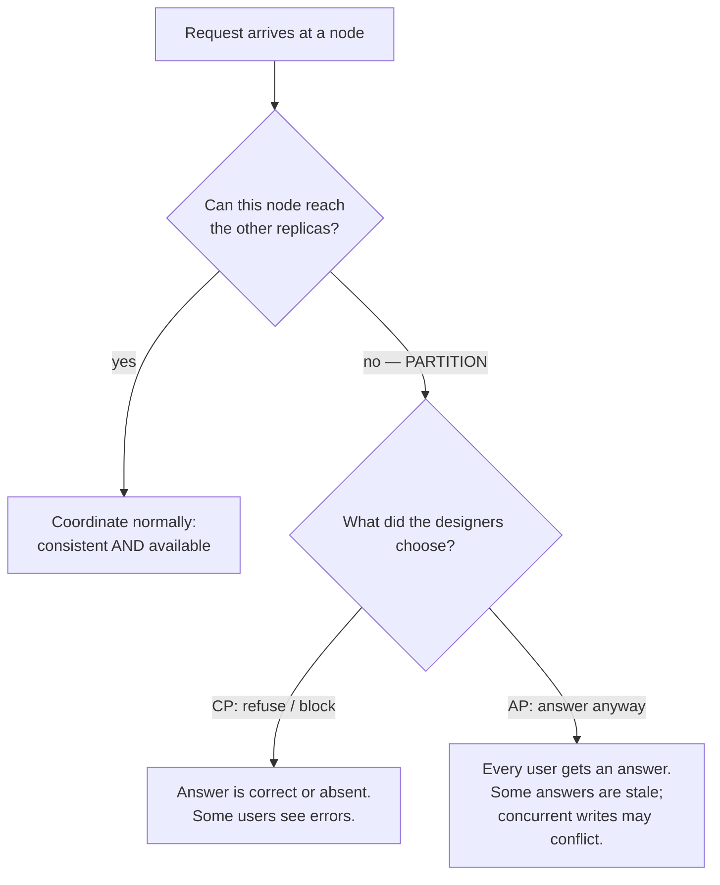
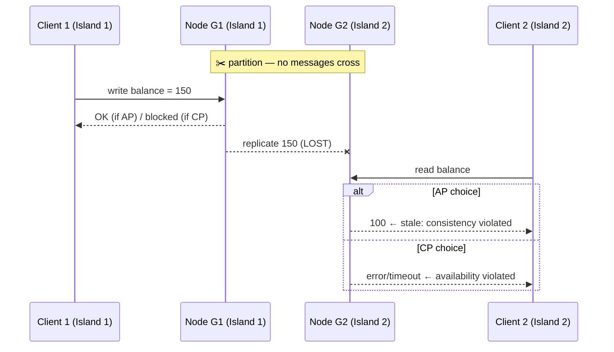
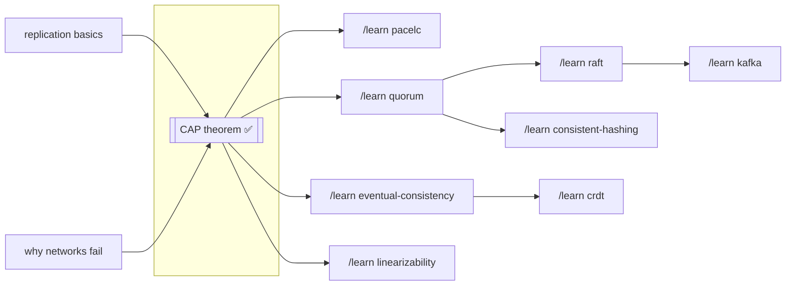

# The CAP Theorem — A Learning Lab

> **The three-sentence version:** When your data lives on more than one computer
> and the network between them breaks, you must choose: refuse to answer until
> the network heals (stay *consistent*), or keep answering with possibly-stale
> data (stay *available*). You cannot do both — that impossibility is the CAP
> theorem. Every distributed database you will ever use has made this choice,
> and knowing which one it made tells you how it will hurt you.

---

## 1. WHY — why does this idea exist?

Once your application's data lives on **more than one computer** — for speed,
for surviving crashes, or for serving users on different continents — those
computers have to keep their copies in sync by talking over a network. But
networks fail. Cables get cut, routers die, a whole data center goes dark for
ten minutes. The CAP theorem exists because engineers kept promising systems
that would stay perfectly in sync AND always answer requests, even during
network failures — and kept failing to deliver. In 2000, Eric Brewer
conjectured this wasn't bad engineering, it was *impossible*, and in 2002
Gilbert and Lynch proved it. Knowing something is impossible is incredibly
useful: it stops you searching for it and makes you design for the tradeoff
instead.

## 2. PROBLEM — the story of the two bank tellers

Imagine a small bank with two branches: one downtown, one uptown. Your account
balance is written in a ledger book, and **each branch keeps its own copy** so
you can walk into either one. Whenever a teller changes a balance, she phones
the other branch so both books stay identical.

You have $100. One stormy day, the phone line between the branches goes dead.

You walk into the downtown branch: "I'd like to withdraw $100."
At the same moment, your roommate (who shares the account) walks into the
uptown branch: "I'd like to withdraw $100."

Each teller looks at her book. Each book says $100. Neither teller can call
the other branch to check or to announce the withdrawal.

**What should the tellers do?**

## 3. NAIVE SOLUTION — "just keep both books updated"

The bank's original plan was exactly that: every change is phoned to the other
branch immediately, so both books always match, and every customer is served
at either branch instantly. When the phone line works, this plan is fine.

## 4. FAILURE — the storm breaks the plan

With the line dead, each teller has exactly two options, and both hurt:

- **Option 1 — serve the customer anyway.** Both you and your roommate walk
  out with $100 each. Total withdrawn: $200 from a $100 account. When the
  line is repaired, the books disagree ($0 downtown, $0 uptown, but the bank
  is missing $100). The bank stayed **open** but its books became **wrong**.
- **Option 2 — refuse until the line is fixed.** The teller says "Sorry, I
  can't safely do this right now, come back later." The books stay **correct**
  but the bank was effectively **closed** to you.

There is no third option. The teller cannot both give a guaranteed-correct
answer *and* serve you, because being correct requires information sitting on
the other side of a dead phone line. That's the entire theorem, in a storm.

## 5. KEY IDEA

**When replicas of your data cannot communicate, every request forces a
choice: answer possibly-wrongly, or don't answer. Correctness and
responsiveness cannot both survive a communication failure.**

## 6. TERMINOLOGY — the same story, in professional words

Now let's name the pieces the way engineers do. Every term defined at first
use:

| Term | Plain-English meaning (in our story) |
|---|---|
| **Node** / **replica** | One computer holding a copy of the data (one bank branch with its ledger book). |
| **Replication** | Keeping copies of the same data on several nodes (the phone-call protocol between branches). |
| **Network partition** | A network failure that splits nodes into groups that cannot talk to each other, while each group is still running (the dead phone line — both branches are open, they just can't communicate). |
| **Consistency (the C in CAP)** | Every read returns the most recent write — as if there were only ONE ledger book that everyone shares. Formally called **linearizability**. ⚠️ *Not* the same "C" as in ACID transactions (that one means "no rule of the database is violated"). |
| **Availability (the A in CAP)** | Every request sent to any working node gets a real (non-error) answer, without waiting for the partition to heal (no teller ever says "come back later"). |
| **Partition tolerance (the P in CAP)** | The system keeps operating *in some form* even when a partition happens (the bank as a whole doesn't burn down just because the phone line died). |
| **CP system** | A system that, during a partition, chooses Consistency: some requests get refused or blocked (Option 2 — the teller says no). |
| **AP system** | A system that, during a partition, chooses Availability: all requests get answers, some possibly stale or conflicting (Option 1 — everyone gets their $100). |
| **Split-brain** | The dangerous situation where both sides of a partition keep accepting writes, each believing it's authoritative — the two ledger books diverging. |
| **Quorum** | A majority of the nodes; enough that any two majorities always share at least one member. A common trick for building CP systems: only the side of the partition holding a majority may proceed. |
| **Eventual consistency** | The AP world's consolation prize: replicas may disagree during the partition, but once it heals, they reconcile and converge to the same value — *eventually*. |
| **Stale read** | A read that returns an old value because the node answering hasn't heard about a newer write. |

## 7. MENTAL MODEL — two islands

Carry this picture: a partition turns your cluster into **two islands with no
boats between them**. A write lands on Island 1. Now someone on Island 2 asks
to read that data. There are only two honest behaviors:

- Island 2 says **"I can't answer safely"** → you preserved consistency,
  sacrificed availability. **CP.**
- Island 2 answers **with what it has** (the old value) → you preserved
  availability, sacrificed consistency. **AP.**

And the most important correction to the popular "pick 2 of 3" picture:
**partitions are not optional.** You don't get to "not pick P" — networks
*will* partition; that's physics and backhoes, not a design choice. A "CA
system" would be one that never experiences partitions, which means a system
that isn't distributed at all (one node — one ledger book). So the real
decision is never "which 2 of 3?" It is:

> **When (not if) a partition happens, do we give up C or A?**

## 8. VISUALIZATION

Two static diagrams here; the **interactive simulator** is in
[`visualization.html`](visualization.html) — open it and actually cut the
network yourself.

The decision, as a flowchart:



The two-island moment, as a sequence (this is also the shape of the formal
proof — see stage 9):



## 9. ACTUAL MECHANISM — the proof, with real numbers

CAP isn't a rule of thumb; it's a two-paragraph proof (Gilbert & Lynch, 2002).
Walk it with concrete values:

1. Setup: nodes **G1** and **G2**, both storing `balance = 100`. The network
   between them partitions. Assume the system claims to be **both** consistent
   and available during this partition.
2. Client 1 sends `write balance = 150` to G1. Because the system is
   *available*, G1 must complete it and answer OK. The replication message to
   G2 cannot arrive — the partition eats it.
3. Client 2 sends `read balance` to G2. Because the system is *available*, G2
   must answer with a real value, now, without hearing from G1. The only value
   G2 has is `100`.
4. G2 answers `100`. But the most recent completed write was `150`. That read
   is stale — **consistency is violated.** The only way G2 could have avoided
   it was to block or error — **violating availability.**

Contradiction either way. So no system can guarantee all three of C, A, P.
Notice the proof needs only two nodes, one write, and one read — the
impossibility is that fundamental. Everything real systems do (quorums,
leaders, retries, clever clocks) only decides *which* guarantee bends and how
gracefully — never escapes the choice.

**How real designs pick a side, mechanically:**

- **CP via quorum:** with N replicas, require a majority (⌊N/2⌋+1) to
  acknowledge each write, and a majority to serve each read. Any two
  majorities overlap in at least one node, so every read intersects the
  latest write. During a partition, the minority side can't assemble a
  majority → it refuses. Correct, but partially unavailable.
- **AP via accept-locally:** every node accepts reads and writes with what it
  has, records them (often with version metadata), and syncs when the
  partition heals. Always answers, but reads can be stale and concurrent
  writes conflict.

A tiny code sketch of the fork in the road (pseudo-Python, not a project —
the interactive simulator is the real "runnable" here):

```python
def handle_write(node, key, value):
    acks = replicate_to_peers(node, key, value, timeout=1.0)
    if mode == "CP":
        if acks + 1 < majority(N):          # couldn't reach a quorum
            raise Unavailable("partition: refusing rather than diverge")
        commit(node, key, value)             # safe: any future quorum read sees this
    else:  # AP
        commit(node, key, value)             # answer now, sync later
        queue_for_reconciliation(key, value) # divergence is now possible
```

The **R + W > N** rule generalizes this: with N replicas, W acks per write and
R nodes per read, reads are guaranteed to see the latest write iff the read
and write sets must overlap — `R + W > N`. Cassandra exposes exactly these
knobs (`ONE`, `QUORUM`, `ALL`), letting you slide between CP-ish and AP-ish
per query.

## 10. FAILURE SCENARIOS — walking through the ways it hurts

**Scenario 1 — the stale read (AP).** Partition splits {G1} from {G2}. User
updates their shipping address via G1; the confirmation page (served from G2)
shows the old address. Harmless-looking, until it's a password change that
"didn't take" on half the site.

**Scenario 2 — split-brain writes (AP).** During the partition, you write
`balance = 0` (withdrew $100) on Island 1; your roommate writes `balance = 0`
on Island 2. The partition heals. Both islands now sync… two different
histories for the same account. The system must **reconcile**:
- *Last-write-wins (LWW):* keep the write with the newest timestamp, silently
  discard the other. Simple — and quietly **loses data** (one withdrawal
  vanishes from history; the bank eats the loss).
- *Keep both, ask the application:* version metadata (vector clocks) detects
  the conflict and hands both values to the app (Amazon's Dynamo did this —
  the shopping cart merged by union, which is why deleted items sometimes
  reappeared).
- *Design values to merge themselves:* CRDTs — data types (counters, sets)
  built so concurrent updates merge deterministically. `/learn crdt` later.

**Scenario 3 — the minority island (CP).** A 5-node quorum system partitions
3-vs-2. The 3-side keeps a majority and keeps working; every client routed to
the 2-side gets errors until the partition heals. Users on the wrong side of
the backhoe see an outage — *by design*. This is also why quorum clusters
have **odd** node counts: 4 nodes can split 2-2 and then *nobody* has a
majority — the whole system stalls.

**Scenario 4 — retries turn one write into two.** Client writes to G1, the
ACK is lost (partitions eat answers too, not just requests), client retries
against G2. The write happened twice. CAP-world systems need idempotency
(safe-to-repeat operations) on top of everything else — a preview of
`/learn idempotency` and `/learn transactional-outbox`.

**Scenario 5 — the partition heals.** CP systems: minority catches up from
the majority, life resumes; nothing to reconcile because the minority never
accepted anything. AP systems: anti-entropy kicks in — replicas exchange
version metadata (hashes/Merkle trees), detect divergence, run the
reconciliation policy from Scenario 2. The pain of an AP system is deferred,
not avoided.

## 11. CORRECTNESS — what CAP does and does not say

**The guarantee, precisely:** in an asynchronous network (messages can be
delayed or lost, no shared clock), no read-write system can guarantee both
linearizable consistency and total availability under arbitrary partitions.
It is a *safety vs liveness* tradeoff:

- **Consistency is a safety property** — "nothing bad ever happens" (no read
  ever returns stale data).
- **Availability is a liveness property** — "something good eventually
  happens, for every request" (every request gets an answer).
- A partition forces you to break one. Pick which, per system — or even per
  operation.

**What CAP does NOT say — the famous misreadings:**

1. *"Pick 2 of 3."* No — P isn't optional (stage 7). The choice is C-vs-A,
   and only during partitions.
2. *"An AP system is never consistent."* No — the theorem constrains behavior
   **during partitions**. Most of the time there is no partition, and the
   tradeoff that dominates daily life is **latency vs consistency**: waiting
   for replicas before ACKing costs milliseconds on *every* write. PACELC
   captures both: *if Partitioned, choose A or C; Else, choose Latency or
   Consistency.* (`/learn pacelc`.)
3. *"C means ACID."* No — CAP's C is linearizability (single-copy illusion);
   ACID's C is "constraints hold." Unrelated claims sharing a letter.
4. *"Availability = high availability / five nines."* No — CAP availability
   is a strict formal property (*every* request to *any* live node answers).
   A CP system can still have superb uptime in practice; it just can't
   *guarantee* answers under partition.
5. *"It's binary."* Real systems are dials, not switches: R/W/N quorum knobs,
   per-query consistency levels, bounded-staleness modes. CAP marks the ends
   of the dial; engineering picks the position.

## 12–13. CODE & EXPERIMENT → the simulator

For a theorem there is no protocol to implement — the "lab equipment" is the
interactive simulator, [`visualization.html`](visualization.html): three
replicas holding one bank balance, two customers, a partition switch you flip
yourself, CP/AP modes, and R/W quorum sliders. Every event is narrated in
plain English ("Customer R was shown the wrong balance") with the protocol
detail underneath, and a scoreboard counts the two casualties separately:
times a customer saw wrong data (C violated) and times a customer was refused
(A violated). Four guided experiments play themselves if you press
**Run this for me**.

Two controls carry more weight than they look like:

- **Which machine each customer talks to.** Nothing about a customer decides
  whether they experience the outage — only which replica their connection
  happens to land on. Move customer L from machine A to machine B before
  cutting the network and L's outage disappears entirely, while the storm is
  identical. This is why real clients are handed a *list* of nodes to try.
- **Where the network tears** (`{A} | {B,C}` vs `{A,B} | {C}`). Same cluster,
  same mode, same requests — the tear location alone decides who is refused.

Both are exercises 2.2 and 2.2b in [`EXERCISES.md`](EXERCISES.md).

## 14. PRODUCTION — where the real systems sit

| System | Choice during partition | How it does it |
|---|---|---|
| **ZooKeeper, etcd, Consul** | **CP** | Raft/ZAB consensus; the majority side elects a leader and serves; the minority refuses. Used exactly where wrong answers are worse than no answers: locks, leader election, config. |
| **Cassandra, DynamoDB (Dynamo lineage), Riak** | **AP (tunable)** | Accept-locally + anti-entropy; per-query consistency levels (`ONE`…`QUORUM`…`ALL`) move individual reads/writes along the C↔A dial. |
| **MongoDB** | **CP-leaning** | Single-primary replica set; a partitioned-away primary steps down, minority side stops accepting writes; read preferences can relax C for reads. |
| **Kafka** | **Configurable** | In-sync-replica (ISR) machinery: `acks=all` + `min.insync.replicas=2` ≈ CP for produce; `acks=1` trades toward availability/latency and can lose acknowledged writes on failover. |
| **Google Spanner** | **CP** (marketed "effectively CA") | Still refuses when it must — but Google's private network plus TrueTime (GPS/atomic-clock time bounds) makes partitions so rare that users almost never observe the C-vs-A moment. The theorem isn't beaten; the P is engineered toward zero. |
| **Plain old single-node Postgres** | Not in the game | One node — no partition between replicas is possible. This is the "CA" corner, and the price is that it's not distributed (its replication add-ons re-enter the game: synchronous ≈ CP, asynchronous ≈ AP). |

The production question is never "is this database CP or AP?" as trivia — it's
**"when the network partitions at 3 a.m., which page do I get: 'error rate
up' (CP) or 'customers seeing wrong data' (AP)?"** Pick the page you'd rather
receive, per use case: payments and inventory counters usually CP; shopping
carts, likes, presence indicators usually AP.

## 15. EXERCISES

In [`EXERCISES.md`](EXERCISES.md) — predict / modify / debug, most of them
runnable against the simulator. Answers in [`SOLUTIONS.md`](SOLUTIONS.md);
attempt first.

## 16. RELATED CONCEPTS

- **PACELC** — CAP's needed upgrade: adds the *no-partition* tradeoff
  (latency vs consistency) that dominates normal operation.
- **Consensus (Raft/Paxos)** — the machinery that makes the CP choice safely:
  how a majority side agrees on a leader and a log. CAP says you must
  sometimes refuse; Raft is *how* you refuse correctly.
- **Eventual consistency & CRDTs** — the machinery that makes the AP choice
  livable: how diverged replicas converge without losing your shopping cart.
- **ACID vs BASE** — single-database transaction guarantees vs the
  "Basically Available, Soft-state, Eventually consistent" posture of AP
  stores; CAP is the *why* behind BASE's existence.
- **Linearizability vs serializability** — CAP's C is linearizability (one
  object, real-time order); serializability is about multi-object
  transactions. Different guarantees, frequently confused.

## 17. NEXT STEPS — knowledge map



**Prerequisites you used (informally):** replication, network failure. If
either felt shaky: `/learn replication`.

**Best next steps, in order:**
1. `/learn quorum` — the R+W>N math from stage 9, in full.
2. **[`../39-paxos/`](../39-paxos/README.md) — already built.** Paxos is the
   machinery that makes the CP choice *safe*: how the majority side agrees on
   one value while the minority refuses. If you played with the CP mode here
   and wondered "but how does the majority side actually agree?", that lab is
   the answer, with a runnable implementation.
3. `/learn raft` — the same job as Paxos, redesigned to be teachable
   (also a full protocol lab).
3. `/learn eventual-consistency` — how AP systems clean up after themselves.
4. `/learn pacelc` — the tradeoff you pay on the 99.9% of days without
   partitions.
