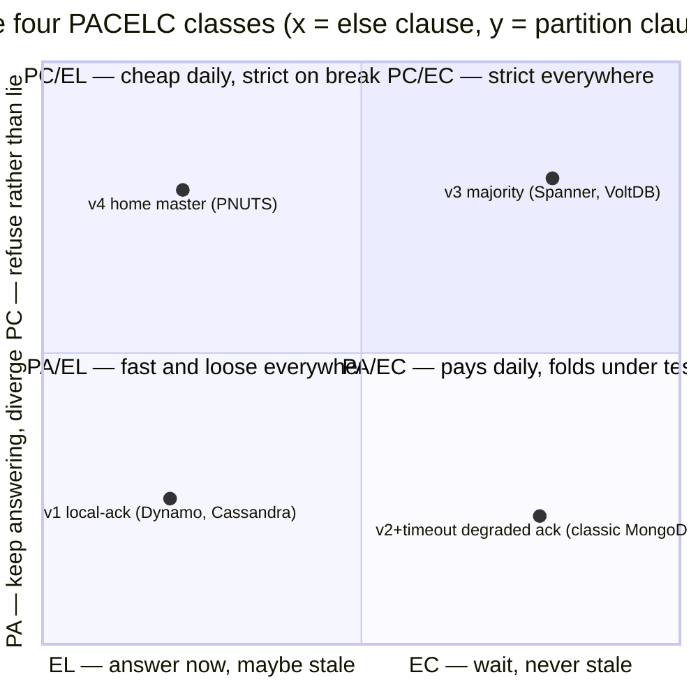
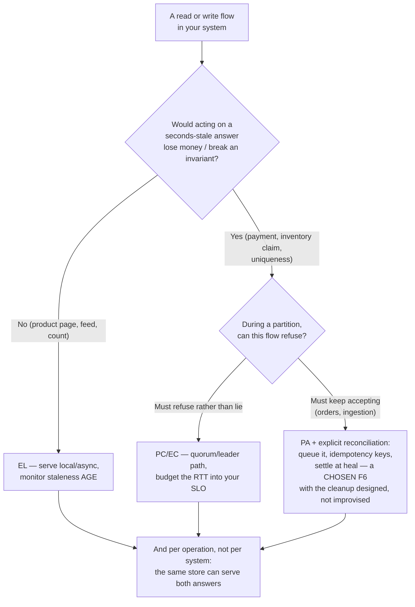
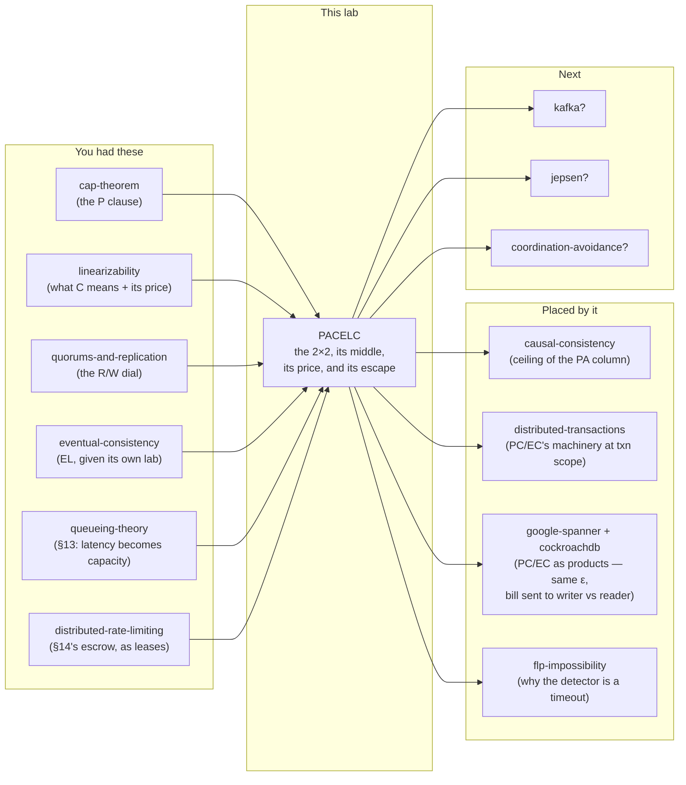

# PACELC — the tradeoff you pay every day, not just on bad days

> **Lab type:** theorem / design-space tradeoff · **No runnable code** (doc +
> interactive visualization + exercises).
> **Builds directly on:** [cap-theorem](../24-cap-theorem/) — whose knowledge-map
> entry has said `Next: [pacelc?]` since the day you learned it. This lab
> cashes that suggestion in.

---

## Where you are

> **Depth layers in this doc:**
> **BEGINNER MODEL** (§1–§9) → **INTERMEDIATE MODEL** (§10–§14) →
> **ENGINEERING MODEL** (§15–§16) → **PRODUCTION MODEL** (§17)
>
> Checkpoints at each transition tell you what you can do if you stop there.

---

## 1. WHY — the meeting that goes wrong every week

Somewhere right now, a team is designing a service whose data lives in three
datacenters. Someone asks "why is the user in Virginia seeing yesterday's
price?" and someone else answers **"CAP theorem — you can't have consistency
and availability, so we accept stale reads."**

That answer is wrong, and the wrongness matters. The network between those
datacenters is healthy today — no partition anywhere — and CAP, as you learned
in the [cap-theorem](../24-cap-theorem/) lab, only speaks about what happens
**when the network breaks**. On a healthy network CAP demands nothing and
forbids nothing. So *something else* is making that Virginia read stale, and
because the team has no name for it, they can't reason about it, tune it, or
price it. They just wave the CAP flag at it.

This lab gives the missing thing a name. It is the tradeoff you pay on **every
single request, every day, on a perfectly healthy network** — and it was hiding
in plain sight in three labs you have already done.

## 2. THE PROBLEM — one price book, two shops

Meera owns a jewellery business with two branches: one in Mumbai, one in
Delhi. Both branches sell from the same price book — gold moves daily, so the
book changes often. Head office is in Mumbai; when the gold price moves, Asha
at head office writes the new price into Mumbai's book.

Delhi has a copy of the book. The only way to move information between the
branches is the phone. A call takes **three minutes** — someone has to stop
serving customers, dial, and read out numbers. The phone line works perfectly;
nobody is cutting any wires in this story.

Now a customer walks into the Delhi branch and asks the price of a gold
necklace. Ravi, the Delhi clerk, has exactly three possible policies:

1. **Quote from the local book immediately.** Fast — but if Asha changed the
   price ten minutes ago and the update call hasn't happened yet, the customer
   gets the old price.
2. **Call Mumbai before every quote.** Always correct — and every customer
   waits three minutes to hear a number.
3. **Make Asha call Delhi before her price change "counts".** Then Ravi's
   local book is always current and he can quote instantly — but now every
   price *change* takes three minutes, and if Ravi's line is busy, the gold
   price is stuck.

Notice what just happened: **the phone line is perfect, and there is still a
problem.** Somebody has to wait — the customer, or Asha — or nobody waits and
somebody gets a stale price. The three minutes don't disappear under any
policy; the only question is who absorbs them.

## 3. THE NAIVE SOLUTION — "no partition, so we can have everything"

A reasonable engineer who just learned CAP reasons like this:

> "CAP says the C-vs-A choice only bites during a partition. Our network is
> healthy 99.99% of the time. So 99.99% of the time we can have both:
> replicate the data, answer from the nearest copy, everyone is fast AND
> consistent. Done."

Concretely, for a product catalog replicated in three regions — **Mumbai,
Frankfurt, Virginia** — the plan is:

- A write goes to the nearest replica, which applies it and immediately
  acknowledges. The replica then forwards the update to the other two.
- A read is answered by the nearest replica, from its local copy.

Fast writes, fast reads, three copies, healthy network. What could go wrong?

## 4. THE FAILURE — stale on a perfect network

Let's run it by hand with real numbers. Round trips between the regions (these
are realistic public-internet figures, used throughout this lab and in the
visualization):

| Link | Round trip (RTT) | One-way |
|---|---|---|
| Mumbai ↔ Frankfurt | 110 ms | 55 ms |
| Frankfurt ↔ Virginia | 90 ms | 45 ms |
| Mumbai ↔ Virginia | 190 ms | 95 ms |

The trace — watch the clock column (this same trace is Scenario 1 in the
visualization):

| Time | Event |
|---|---|
| t = 0 ms | Asha (Mumbai) writes: necklace ₹50,000 → **₹54,000**. Mumbai replica applies it. |
| t = 1 ms | Asha gets her acknowledgment: "saved". Update messages depart for Frankfurt and Virginia. |
| t = 40 ms | Omar (Virginia) asks the price. Virginia replica answers from its local copy: **₹50,000**. |
| t = 55 ms | Frankfurt replica receives the update, applies ₹54,000. |
| t = 95 ms | Virginia replica receives the update, applies ₹54,000. |

At t = 40 ms, Omar was told a price that had been officially replaced — write
acknowledged, done, confirmed — 39 milliseconds earlier. **No partition. No
failure. No misconfiguration. The network did everything right.** The
staleness came from a design choice: nobody waited.

Could we make Omar's read correct? Sure — but look at what each fix costs:

- **Make the writer wait** until all three replicas have applied the update
  before acknowledging Asha. Now no acknowledged price can be missing
  anywhere… and Asha's every write takes ≥ 190 ms (the Mumbai↔Virginia round
  trip), because light itself needs that long. Bombay to Virginia is
  ~13,000 km of fiber; no amount of engineering removes that.
- **Make the reader check** with other replicas before answering. Now Omar's
  every read pays a cross-ocean round trip instead.

This is exactly Meera's shop. **Consistency between distant copies has a
price in the happy case, and the currency is milliseconds — not
availability.** CAP never mentions this, because CAP's premise (Gilbert &
Lynch's proof, which you met in the cap-theorem lab) is specifically about a
network that has *stopped delivering messages*. Ours is delivering perfectly.
The cost is that delivery *takes time*.

> **🔮 Predict:** Your team "fixes" the staleness by having the writer wait
> for all three replicas (fix #1 above). A month later, the Virginia replica's
> machine dies. What happens to Asha's writes in Mumbai — a region that is
> perfectly healthy and nowhere near Virginia?
>
> <details><summary>Reveal</summary>
>
> **Every write in the world now hangs.** The acknowledgment rule was "wait
> for all three", and one of the three will never answer. A single machine's
> death in Virginia has taken away *write availability in Mumbai*. (You
> measured this exact trap in the [quorums-and-replication](../34-quorums-and-replication/)
> lab: `acks=all` with no minimum is either a total write outage or a silent
> degrade to `acks=1`.) The fix's fix — wait for a *majority*, 2 of 3 — is
> where the next section's ladder goes. The point to keep: every consistency
> mechanism is simultaneously a latency policy **and** a failure policy, which
> is why the two questions PACELC asks are separable but both always present.
> </details>

## 5. THE REAL REQUIREMENT

We need a design vocabulary that names **both regimes** a replicated system
lives in:

1. **When the network breaks** (rare, forced on you): do you keep answering
   with possibly-wrong data, or refuse to answer? — This is CAP's question,
   and it is still a real question.
2. **When the network is healthy** (~99.99% of the time, chosen by you): do
   you make someone wait for coordination, or answer immediately and accept
   staleness? — This is the question CAP cannot even express.

A vocabulary that only covers regime 1 produces engineers who justify
regime-2 choices with regime-1 arguments — "we're eventually consistent
because CAP" — which is how a decade of design discussions went sideways.

## 6. THE KEY IDEA

In 2010, Daniel Abadi wrote down the two-part question, and in 2012 he
formalized it in an IEEE Computer article ("Consistency Tradeoffs in Modern
Distributed Database System Design: CAP is Only Part of the Story"). It reads
as a single mnemonic:

> **PACELC** — if there is a **P**artition, choose **A**vailability or
> **C**onsistency; **E**lse, choose **L**atency or **C**onsistency.

Two questions, each with two answers, giving four possible system characters.
That's the whole idea. The rest of this lab is what each answer's machinery
looks like, why all four combinations genuinely exist in production systems,
and what each one costs — in numbers you have already measured.

## 7. TERMINOLOGY — the words, now that you've felt the problem

**PACELC** (pronounced "pass-elk"). Plain meaning: a checklist of two
questions for any replicated system. Technical meaning: a classification
scheme — every system gets a four-letter tag like **PA/EL** meaning "under
Partition it chooses Availability; Else it chooses Latency". It exists
because CAP's single question let the everyday tradeoff hide unnamed.
Example: the naive design of §3 is PA/EL. Connection: the P-half **is** CAP;
the E-half is new.

**Else clause / baseline mode.** Plain: "normal operation" — the network is
delivering messages. Technical: the regime in which coordination is
*possible* and therefore has a measurable price, rather than impossible. The
term exists to break the habit of only discussing the partition case.
Example: everything in the §4 trace happens in the else clause. Connection:
your [eventual-consistency](../28-eventual-consistency/) lab's staleness
measurements (t-visibility, lag) are all else-clause measurements.

**EL — latency over consistency (else clause).** Plain: nobody waits;
answers are immediate and may be stale. Technical: acknowledgments and reads
do not block on cross-replica coordination; recency is unpromised (or only
measured, never contracted). Why the term exists: to name what "eventually
consistent" systems are actually buying — it was never about partitions.
Example: the §4 trace — 1 ms writes, 1 ms reads, 39 ms-stale answer.
Connection: this is the [eventual-consistency](../28-eventual-consistency/) lab's
whole subject, now placed on the map.

**EC — consistency over latency (else clause).** Plain: someone waits so that
nobody gets a stale answer. Technical: reads and/or writes block on enough
coordination that recency holds (in this lab's judge: a read never returns a
value older than the newest write acknowledged before the read began — the
real-time rule from the [linearizability](../26-linearizability/) lab).
Example: waiting for a write quorum at 110 ms instead of acking at 1 ms.
Connection: every "bill" you measured before — ABD read write-back taking
mean read latency 11.7 → 24.4 ticks, Spanner-style commit wait taking write
acks 6.7 → 24.8 ticks — is an EC bill.

**PA / PC** — availability or consistency **under partition**: exactly the
CAP choice from the [cap-theorem](../24-cap-theorem/) lab; PA keeps answering on
both sides of the break (divergence risk), PC refuses on the side that can't
coordinate (the minority, in quorum systems).

**The four classes.** PA/EL (fast and loose everywhere: Dynamo-family),
PC/EC (strict everywhere: Spanner-family), **PC/EL** and **PA/EC** (the two
"paradoxical" corners — §10 shows real machinery that lands in each; neither
is a philosophy, both fall out of a mechanism).

**Staleness window.** Plain: how long a replica can lag behind an
acknowledged write. Technical: in the async design it is the one-way network
delay plus queueing — 55 ms to Frankfurt, 95 ms to Virginia in our matrix.
Exists because "eventually" needed a measurable everyday size. Connection:
[eventual-consistency](../28-eventual-consistency/)'s t-visibility, and PBS's
"tens of milliseconds at 99.9%" — same object.

**Per-operation dial.** Plain: the EL/EC choice need not be system-wide; many
systems let *each request* choose. Technical: Cassandra's per-query
consistency level, DynamoDB's `ConsistentRead=true` flag — the R/W dial you
built in [quorums-and-replication](../34-quorums-and-replication/) is literally a
per-request PACELC selector. This term exists to stop you asking "is this
database EL or EC?" when the honest answer is "per request, at a price."

Minor terms defined at first use later: *timeline consistency*, *per-record
master*, *degraded ack*, *ack policy*.

## 8. MENTAL MODELS

**The simple model (carry this one around):** Meera's two-branch shop. The
phone that takes three minutes is the network; the price book is the replica;
Asha's price change is a write; a customer's question is a read. The three
policies of §2 are the three places the delay can be put: on the customer
(coordinated reads), on Asha (coordinated writes), or on nobody — in which
case some customer, somewhere, hears an old price. A dead phone line is a
partition; then the question changes from *who waits* to *who gets refused*.

**The engineering model (what's actually there):** N replicas with a value
and a version each; an RTT matrix between them; an **ack policy** (how many
replicas must have applied a write before the client is told "saved") and a
**read policy** (how many replicas a read consults). Coordination = messages
crossing the RTT matrix before someone is answered. The partition-mode
behavior (PA or PC) and the else-mode behavior (EL or EC) are both
consequences of those two policies plus a timeout.

| Shop | System |
|---|---|
| Price book in a branch | Replica |
| Asha's new gold price | Write |
| Customer asking a price | Read |
| The 3-minute phone call | One-way network delay (55–95 ms) |
| "It counts once Delhi confirms" | Ack policy (W) |
| "Call Mumbai before quoting" | Read policy (R) |
| Dead phone line | Partition |
| Busy line, call takes 9 minutes | Elevated RTT — note this is *not* cleanly either |

**Where the analogy breaks** (read this — the shop lies to you in four ways):

1. **The shop picks one policy for the whole shop.** Real systems choose per
   operation, per key, even per request (the per-operation dial). PACELC tags
   are *defaults*, not destinies.
2. **A stale quote costs the shop one discount.** In a system, a stale read
   that feeds a read-modify-write *compounds* — you proved this as the
   [eventual-consistency](../28-eventual-consistency/) lab's F7 rule ("EC reads
   are for display, never decisions") and measured it as the
   [linearizability](../26-linearizability/) lab's 87%-lost increments.
3. **The shopkeeper can see the phone line is dead.** A real node cannot
   distinguish a dead peer from a slow one — silence is the only evidence
   ([distributed-locking](../43-distributed-locking/) lab). "Partition" in
   practice means "my timeout fired", which is why the P-vs-E boundary is
   *defined by a config value*, not by physics. §16 makes this precise.
4. **The phone call is a conversation.** Replication messages are one-way,
   can reorder, duplicate, and arrive after the line "died". The shop hides
   every ordering problem — which is fine here, because ordering had its own
   labs ([causal-consistency](../29-causal-consistency/), [hybrid-logical-clocks](../31-hybrid-logical-clocks/)).

## 9. VISUALIZATION — "The Price of Now"

Open **[`visualization.html`](visualization.html)** (also published as an
artifact: **"The Price of Now"**,
<https://claude.ai/code/artifact/89e61b7c-028e-45f2-8ed7-ee3a2e8793c6>). It is
the three-region catalog of §4 made live: Mumbai, Frankfurt, Virginia, one product price, clients in each region,
messages visibly crawling across links labeled with their real delays.

- **Five designs** — one per PACELC class, labeled in plain words on the page
  ("Answer locally, spread the news later" = PA/EL, "A write needs a
  majority; a read asks a majority" = PC/EC, "One home office approves every
  change; everyone quotes their own book" = PC/EL, "Wait for everyone —
  unless someone stops answering" = PA/EC) — plus **"Answer locally, but
  never show a client its own past"**, a fifth design that sits *between*
  the fast one and the strict one; §11 builds it and names it.
- **Every read is judged twice.** Against the real-time recency rule (stale
  reads flash and are counted: "Omar's read returned ₹50,000 — replaced by an
  acknowledged write 39 ms ago") **and** against the reading client's own
  history, giving two more counters: *your own change vanished* and *the
  price went backwards* — two complaints a real user files that the recency
  rule does not describe (§11 names both). Watching the three counters move
  independently is the fastest way to feel that they are three different
  promises.
- **Controls:** step / step-back / play / reset; isolate any one region
  (partition); change which region is "home"; **send any client's reads
  through a different city** (the load balancer decision that causes §15's
  F7); scale all RTTs with one slider — drag it *up* and watch EC latency
  climb into refusals (§16's unification, live), drag it *down* to 0.1× and
  watch the majority write ack fall from 110 ms to 12 ms (§12's placement
  arithmetic, live); per-region read/write buttons.
- **Nine predict-then-run scenarios** (S1–S9) — each asks for your prediction
  first, runs the script, then tells you whether you were right and why.
  They are referenced from the failure catalog in §15.

**Tab 2 — "The Last Ten Necklaces"** is a second, smaller simulator on the
same page. It swaps the price for *stock*: ten necklaces, three branches,
and a rule that must never break. Three designs (majority, sell-locally,
and split-the-stock) run against the same partition, and the counters are
**sold**, **oversold** and **refused while stock sits unsold elsewhere**.
Scenarios **S10–S12** live there. It belongs to §14 — leave it until then.

Do S1 and S2 before reading §10 — the mechanism section assumes you have
*seen* the 1 ms-vs-110 ms difference, not just read about it.

---

> **✅ CHECKPOINT — you now hold the BEGINNER MODEL.** You can explain why
> "CAP theorem" is the wrong answer to "why is this read stale on a healthy
> network", and you can say what PACELC's two questions are. Next: the
> machinery — *how* each of the four answers is actually built, and how each
> mechanism's partition behavior and everyday behavior are two shadows of the
> same ack policy.

---

## 10. THE ACTUAL MECHANISM — one ladder, four landing spots

There is really only one machine here — N replicas and an ack policy — and
the four PACELC classes are four settings of it. We'll build it the way you'd
build it, breaking it three times. All timings use the §4 RTT matrix.

### v1 — ack locally, spread later (lands on **PA/EL**)

The §3 design. Write applied at the nearest replica, acked in ~1 ms, update
messages fanned out. Reads are local, ~1 ms.

*What you saw in the trace:* staleness window = one-way delay (Omar stale for
up to 95 ms per write). And there's a second, worse problem you already
measured elsewhere: **two regions writing concurrently diverge**, and when
the dust settles a conflict rule picks a survivor — last-write-wins silently
discarded **1000 of 1000** genuinely-newer updates in the
[quorums-and-replication](../34-quorums-and-replication/) lab when one clock ran
fast. Under partition, v1 doesn't even notice: both sides keep answering and
diverge freely (that's the **PA**), then the heal hands the mess to the
conflict rule. Fast always; correct by luck.

### v2 — the writer waits for everyone (attempt at EC)

Flip one rule: don't ack Asha until all three replicas confirm they applied
the write. Now no read anywhere can miss an *acknowledged* write — the write
isn't acknowledged until it is everywhere. Reads stay local and fast. Write
ack latency: the slowest round trip, **190 ms** from Mumbai.

You already predicted the break (the 🔮 in §4): **one dead replica = global
write outage.** "All" is not a policy that survives the real world.

### v3 — majority, both sides (lands on **PC/EC**)

The fix you built in [quorums-and-replication](../34-quorums-and-replication/):
wait for a **majority** (2 of 3) on writes, and — because a write acked by
{Mumbai, Frankfurt} is invisible to a local read at Virginia — make reads
consult a majority too, taking the newest version they see. R + W > N; the
two sets must overlap; no acknowledged write can be missed.

The bills, from our RTT matrix (client next to its coordinator):

| Operation | v1 (local) | v3 (majority) |
|---|---|---|
| Write from Mumbai | ~1 ms | **110 ms** (nearest 2nd ack: Frankfurt) |
| Write from Virginia | ~1 ms | **90 ms** (Frankfurt) |
| Read from anywhere | ~1 ms | **90–110 ms** (nearest 2nd answer) |

Under partition: the isolated region can't assemble a majority for anything
and **refuses** (that's the **PC**); the majority side continues correctly.
You measured the flavor of this refusal in [causal-consistency](../29-causal-consistency/):
the linearizable store answered **0 of 600** operations on the minority side.

*Honesty flag:* full linearizability needs one more ingredient on reads — the
ABD write-back (push the value you're about to return to a quorum, so no
later reader can un-see it), which took mean read latency from 11.7 to 24.4
ticks in the [linearizability](../26-linearizability/) lab. The visualization's
majority design skips write-back and says so on the page; its judge is
"never return a value older than the newest acked write", which majority
overlap alone does satisfy in the sim's single-writer scenarios.

> **🔮 Predict:** Can a system reasonably choose **C under partition but L in
> the else clause** — strict when the network breaks, cheap and stale when
> it's healthy? What machinery would even produce that combination?
>
> <details><summary>Reveal</summary>
>
> Yes — and nobody designs it as a philosophy; it falls out of a mechanism:
> **give every record a single home master** (next rung). Writes must reach
> the master (so a partition that hides the master **refuses writes** — PC);
> reads are served locally from possibly-lagging copies (so everyday reads
> are 1 ms and stale — EL). Yahoo!'s PNUTS, the system Abadi had in mind, is
> exactly this. The class looks paradoxical only if you imagine someone
> choosing letters off a menu; the letters are shadows of the machinery.
> </details>

### v4 — one home master per record (lands on **PC/EL**)

Every record has a **per-record master** — one replica that all writes for
that record must go through (say Mumbai for our necklace, because most of its
writes originate there). The master applies writes in a single sequence and
streams updates out asynchronously. Reads are local everywhere.

- Write from Mumbai: ~1 ms (master is local). Write from Virginia: **190 ms**
  (forwarded to Mumbai and back).
- Read anywhere: ~1 ms, stale up to the one-way delay — **EL**.
- What the master's single sequence buys over v1: **no divergence, ever.**
  All replicas apply the same writes in the same order; a lagging replica is
  *behind*, never *different*. PNUTS called this **timeline consistency** —
  every copy moves along one timeline, some copies further back. (Contrast
  v1, where two timelines can genuinely fork and something must die at
  merge.)
- Partition hiding the master: writes for that record are **refused** —
  **PC**. (Reads continue from the frozen local copy. Abadi classifies this
  as PC because availability is *reduced* — you lose writes — rather than
  consistency being abandoned. "PC" does not require refusing everything.)

### And the fourth corner — **PA/EC**, waiting until it hurts

Take v2 (wait for everyone) and patch its fatal flaw with a timeout: *wait
for all replicas; if one stops answering for ~1 s, ack with whoever
responded and carry on.* This is a **degraded ack** — the ack policy itself
downgrades under failure.

Every day this system pays the full EC bill (190 ms writes from Mumbai — the
worst latency of any design here). But the moment a partition isolates a
region, both sides keep accepting writes — **PA** — and diverge exactly like
v1, with the heal handing survivors to the conflict rule. It pays for
consistency daily and abandons it the moment it's tested.

Why would anyone build this? Because "keep taking orders" is a business
requirement and the everyday consistency is real and valuable — this is
roughly classic MongoDB's character (Abadi's own classification: PA/EC), and
the failure signature is famous: writes accepted during the bad minutes that
are **thrown away at heal** (MongoDB literally wrote them to "rollback
files" for a human to look at). The class isn't stupid; it's a specific bet
that partitions are short and rare. The honest version *documents* what
degrade does; the dangerous version calls itself "strongly consistent"
unqualified.

### The 2×2, assembled



One sentence per class, the ones worth memorizing:

- **PA/EL** — *nobody waits, ever; conflicts are resolved after the fact.*
- **PC/EC** — *someone always waits; the system would rather refuse than be wrong.*
- **PC/EL** — *reads never wait, writes follow one master; lose the master, lose writes.*
- **PA/EC** — *everyone waits while waiting works; when it stops working, stop waiting.*

And the single most compressible statement of the whole else-clause: **someone
waits — the writer, the reader, or nobody; and if nobody waits, somebody gets
stale.** Every design above is just a choice of *who*.

---

> **✅ CHECKPOINT — the four classes.** You can now name them, give the
> mechanism that produces each, and compute each design's latency bill from
> an RTT matrix by hand. Next, still in the intermediate layer: the two
> mechanisms that live *between* EL and EC — the ones most production
> systems actually run — and the arithmetic that decides what any of it
> costs. After that, the failure catalog and what PACELC formally is.

---

## 11. THE MIDDLE OF THE DIAL — two designs that are not in the 2×2

§10 ended on a sentence worth re-reading: *someone waits — the writer, the
reader, or nobody.* Hidden inside it is an assumption nobody stated:
**that the waiting applies to everybody, for every operation, forever.**

Two mechanisms break that assumption, and between them they cover the way
most production systems actually run. Neither is a fifth PACELC class —
both live *inside* the else clause, between EL and EC. This is where the
binary you just learned starts to bend.

### v5 — make only the person who wrote wait (session guarantees)

Start from the complaint that actually reaches your team. Not "region B
lagged 39 ms behind region A" — nobody files that ticket. The one that
arrives is:

> **"I changed the price, hit refresh, and my change was gone."**

Watch it happen with the §4 numbers, design v1 (local ack):

| Time | Event |
|---|---|
| t = 0 ms | Asha writes ₹54,000 in Mumbai. |
| t = 1 ms | Asha is told "saved". Updates depart for Frankfurt and Virginia. |
| t = 10 ms | Asha hits refresh. Her connection is routed through **Frankfurt** this time — a load balancer decision, a mobile network hop, or an app that simply sends reads to a read replica. |
| t = 10 ms | Frankfurt answers **₹50,000** — the price Asha just replaced. |
| t = 55 ms | Frankfurt receives the update. Too late; the page is already wrong. |

Nothing here is new physics — it is the same one-way delay as F1. But it is a
*different kind of wrong*. F1's stale read broke recency **against the
clock**: some other person saw an old value. This breaks Asha's view of
**her own action**, and no amount of "it's eventually consistent" comforts
someone staring at their own missing edit. It is also the single most
frequent consistency complaint in real systems.

> **🔮 Predict:** You want to fix only *this* — everyone should see their
> own writes; strangers may still see stale prices for 55 ms. What is the
> cheapest mechanism, and who ends up paying for it?
>
> <details><summary>Reveal</summary>
>
> The client carries a **token**: "the newest write I was personally told
> was saved" — a version number, a log position, a timestamp. Every read
> the client sends carries the token, and the replica serving it must
> already hold that write, or **wait** until it does (or hand the read to
> one that does). In the trace above, Asha's t = 10 ms read is a
> **parked read** — held at Frankfurt (⏳ on that city's card in the
> visualization) and completed at t = 55 ms: **45 ms, once, paid only by the
> person who just wrote.** Compare with EC, where *every* read by
> *everybody* pays 90–110 ms forever. The waiting didn't disappear; it was
> aimed at exactly the one operation that needed it.
> </details>

That mechanism is a **session guarantee**, and it is old and well-defined:
Terry et al. named four of them in 1994 (the Bayou system).

| Guarantee | Plain meaning | What it costs |
|---|---|---|
| **Read-your-writes** | You never fail to see a write you made | Token + occasional wait, as traced above |
| **Monotonic reads** | Your successive reads never go *backwards* in time | The token also tracks the newest value you have *seen*, not just written |
| **Monotonic writes** | Your own writes are applied in the order you issued them | Sequence per client at the replica |
| **Writes-follow-reads** | A write you make after reading X lands after X everywhere | Attach the read's version to the write |

**Monotonic reads is the one people forget.** Same design, no writes by you
at all: you read Frankfurt at t = 60 ms and see the new ₹54,000; your next
read is routed to Virginia at t = 70 ms, which is still on ₹50,000. The
price **went backwards on your screen** — a value un-happening is far more
alarming to a user than a value being old. The token fixes this too,
because it records the newest version you were shown.

**Now the honest part — what a session guarantee does NOT buy.** In the
trace, Priya reading in Frankfurt at t = 20 ms still gets ₹50,000, and the
lab's recency judge still calls it **stale**, correctly. Session guarantees
make the system consistent with respect to **one client's own history**,
never with respect to real time. You can see both facts at once in the
visualization: with the session design selected, the "your own change
vanished" counter stays at 0 while the "stale reads" counter keeps
climbing. Those two numbers are measuring different promises.

Where this sits in the labs you already have: session guarantees are
exactly **[causal consistency](../29-causal-consistency/) restricted to one
client's own thread of interaction**. That restriction is why they're cheap
— a single client's history is a straight line, so there are no concurrent
branches to merge and no dependency graph to ship. Causal consistency gives
you all four guarantees plus everyone else's causality; session guarantees
give you only your own, for the price of one token.

### v6 — contract the staleness instead of removing it (bounded staleness)

EL's contract is "stale by some unknown amount". That is unusable for a
decision — the [eventual-consistency](../28-eventual-consistency/) lab's F7
rule ("EC reads are for display, never decisions") exists because of it. EC
removes staleness entirely at 90–110 ms per operation. The middle option is
to **promise a ceiling**: *this answer is at most Δ old, guaranteed*.

The interesting part is why a replica cannot do this alone. **A lagging
replica has no way to know it is lagging** — no incoming updates looks
exactly like nobody is writing. Silence carries no information (the
[distributed-locking](../43-distributed-locking/) lab's rule, in a new
costume). So the promise has to come from the write path: the master (or
the quorum leader) publishes a **closed timestamp** — "you now hold every
write stamped at or before T" — and replicas heartbeat that value forward.

Hand trace, home-office design, master = Mumbai, beacons every 100 ms:

| Time | Event |
|---|---|
| t = 0 ms | Master applies ₹54,000 (stamped t = 0). |
| t = 95 ms | Virginia receives and applies it. |
| t = 200 ms | Master publishes a beacon: *"closed through t = 100 ms"* — every write with a stamp ≤ 100 is already sent to everyone. |
| t = 295 ms | Virginia receives the beacon. It now knows it holds **everything stamped ≤ 100 ms**. |
| t = 300 ms | Omar reads. Virginia answers **as of t = 100 ms** — locally, in ~1 ms, with a *proof* that nothing older than 200 ms is hidden from it. |

Omar's answer is 200 ms old and **provably not older**. He waited for
nothing; no cross-ocean round trip happened on his read path at all. The
ceiling is (beacon interval + one-way delay + replication lag), and every
term is a number you can monitor. What he gave up is *the present*: this is
a consistent snapshot of a past instant, not a linearizable read of now.

This is real machinery, not a teaching device: CockroachDB's closed
timestamps and follower reads (`AS OF SYSTEM TIME follower_read_timestamp()`
— documented as roughly 4.8 s behind by default), Spanner's read-only
transactions with exact or bounded staleness, and Azure Cosmos DB's
**Bounded Staleness** level, where you configure the bound in both versions
and seconds. *Honesty flag: those defaults are quoted from vendor
documentation; nothing in this section is measured by this lab, and the
visualization implements v5 (session tokens) but not v6 — the beacon trace
above is done by hand.*

### The cost table that actually decides your design

This is the practical payload of the whole lab. Match the *flow's*
requirement to the cheapest mechanism that satisfies it:

| What the flow genuinely needs | Cheapest mechanism | Everyday price |
|---|---|---|
| Any answer at all | Local read (v1) | ~1 ms |
| "I must see my own edits", "it must not go backwards" | Session token + wait or sticky routing (v5) | ~0, plus one lag-length wait after your own write |
| "At most Δ stale", **Δ larger than the one-way delay** | Closed-timestamp snapshot read (v6) | ~1 ms, bounded and monitorable |
| "At most Δ stale", **Δ smaller than the one-way delay** | You are back to coordinating | One RTT |
| "The current value, no exceptions" | Quorum or leader read (v3), plus write-back for full linearizability | One RTT, every operation, forever |

Read rows 3 and 4 together, because they contain the sharpest cost insight
in this lab: **the moment your freshness requirement is larger than the
network's one-way delay, coordination becomes free.** A fraud score that
may be five minutes old and a price display that may be two seconds old are
*not* weak versions of a linearizable read — they are requirements that
asynchronous replication already satisfies, at 1 ms, with a provable
ceiling. Most flows in most systems are in row 1, 2 or 3. Paying row 5's
bill for them is the most common over-engineering in distributed systems,
and the most common cause of a global outage in a system that had no
business being globally coupled in the first place.

## 12. THE PRICE IS A DESIGN VARIABLE — latency arithmetic and placement

§10 quoted EC at "110 ms" as if that were physics. Part of it is physics.
The rest is a decision you made — usually without noticing — about **where
the coordinating replicas sit**. This section is the arithmetic, because an
engineer who can compute the bill in their head stops arguing about
philosophies.

**Step 1 — decompose one EC operation.** Three terms, and only one of them
is consensus:

```
total = (client → coordinator) + (coordinator → quorum → coordinator) + (coordinator → client)
```

Worked with our matrix, for a majority write of one record:

- Omar (Virginia) writes a record whose leader is **Mumbai**:
  95 + 110 + 95 = **300 ms**. (Cross-ocean, then a European round trip.)
- Omar writes a record whose leader is **Virginia**:
  ~0 + 90 + ~0 = **90 ms**.

Same database, same consistency level, same code — **3.3× apart**, decided
entirely by which replica holds the leadership for that record. The
consensus tax was 90–110 ms in both cases; everything else was the trip to
the coordinator.

**Step 2 — quorum arithmetic.** With N replicas and majority writes, the
coordinator's ack lands when the ⌈(N−1)/2⌉-th *nearest* peer answers:

| Deployment | Majority | What the writer waits for | Mumbai's bill |
|---|---|---|---|
| 3 regions (BOM, FRA, IAD) | 2 of 3 | 1 nearest peer | **110 ms** (Frankfurt) |
| 5 regions (+ Tokyo, São Paulo) | 3 of 5 | 2 nearest peers | **130 ms** (Frankfurt, then Tokyo) |

Adding replicas for durability *raises* everyday write latency and, worse,
**raises the tail faster than the median**, because the ack is a *maximum*
over the members you wait for — the p99 of a max, not the max of p99s. You
measured that shape in [quorums-and-replication](../34-quorums-and-replication/):
waiting on 3-of-3 vs 2-of-3 turned 2.85% slow requests into 27.31%.

**Step 3 — the placement patterns, and what each one buys.**

| Pattern | What it does | What it buys | What it costs |
|---|---|---|---|
| **Tight quorum** — put all 3 voting replicas within one continent (~10–25 ms apart) | Shrinks the middle term | EC at ~20 ms. "EC is expensive" turns out to have been a *topology* claim, not a physics claim | One correlated failure domain (one continent, sometimes one grid); distant users pay the trip to reach it |
| **Geo-partitioned leaders** — each record's leader lives near the people who write it (v4's home master, generalized) | Shrinks the *first* term for most traffic | EC at intra-region prices (~5 ms) for the common case | Only works when data partitions by geography; foreign access becomes the slow path; F5's blast radius is per-record |
| **Witness replica** — a member that votes but stores no data, placed near the leader | Cheap majority without a third full copy | Faster acks, lower storage cost | Fewer full copies for reads and recovery |
| **Read-only / non-voting replicas** — copies that never vote, so they never slow a write, serving v6's bounded-stale reads | Removes readers from the write path entirely | Local fast reads *and* strict writes, with the staleness contracted | Reads are of a past instant, not the present |
| **Quorum inside one datacenter** (Cassandra's `LOCAL_QUORUM`) | EC within a region, EL across regions | One keyword, per query | Cross-region recency is simply not promised |

**Step 4 — the physics floor, so your SLO isn't a lie.** Light in fiber
covers roughly 200 km per millisecond. Mumbai to Virginia is ~13,000 km of
cable, so **~65 ms one way is a floor** — our 95 ms is that floor plus real
routing. An SLO of "50 ms p99 for a globally coordinated write between
those two regions" is not ambitious; it is a promise to miss the SLO
forever. Write EC SLOs as `RTT floor + processing budget`, and put the
floor in the document so the next person can't argue with it.

> **🔮 Predict:** Monday morning, your PC/EC store's p99 write latency has
> doubled. No deploy went out, no partition is reported, error rates are
> flat, and CPU is normal everywhere. What is the first thing you check?
>
> <details><summary>Reveal</summary>
>
> **Where the leaders are.** A failover, a rolling restart, or an automatic
> rebalance moved the leadership for hot records into a different region,
> and now every write pays one extra cross-region hop in Step 1's first
> term. The signature is unmistakable once you know it: latency jumps by
> *exactly one RTT from your matrix* and stays there — a bimodal histogram
> with peaks separated by a known network distance, with nothing else
> unhealthy. Fix: rebalance leadership home (and dashboard "leaders per
> region" permanently — it is the cheapest chart in this lab). This is F9
> in the next section.
> </details>

---

> **✅ CHECKPOINT — you can now price a design.** Given a topology, a
> consistency requirement per flow, and an RTT matrix, you can name the
> cheapest mechanism (§11's table) and compute what it costs (§12's
> arithmetic) — including the two mechanisms that live between EL and EC.
> Next, two things that price has been hiding. §13: what that latency does
> to your system's *capacity* when thousands of operations run at once —
> because so far every bill in this lab was computed for one lonely
> operation on an idle machine. §14: whether the operation needed to wait
> at all.

---

## 13. THE BILL COMPOUNDS — coordination is a capacity decision

Every number so far — 110 ms, 190 ms, 300 ms — was the price of **one
operation, alone, on an idle system**. That is the number a benchmark
prints and the number an architecture document quotes. It is also the
number that misleads people, because a production system does not run one
operation; it runs two thousand a second, and latency at that scale stops
being a latency problem.

**Step 1 — the identity that turns milliseconds into machines.** From the
[queueing-theory](../57-queueing-theory/) lab, Little's Law: `L = λW`. It is
an identity, not a model — no assumption about arrival patterns or service
distributions, only steady state. Read it in the direction that matters
here:

> **How many operations are in flight at once = arrival rate × how long
> each one stays inside.**

Take one catalog read endpoint at **λ = 2,000 reads/s**, and switch it from
a local read to a majority read:

| Design | W (per §12's arithmetic) | L = λW — operations in flight |
|---|---|---|
| EL — local read | 2 ms | **4** |
| EC — majority read via Frankfurt | 90 ms | **180** |

Same traffic, same code, same hardware. **45× the concurrent work in the
building.** And "concurrent work" is not an abstraction: it is 45× the
threads, 45× the sockets, 45× the database sessions, 45× the request
buffers — every resource that is held *for the duration of an operation*
is multiplied by exactly the factor the latency grew.

**Step 2 — the ceiling that appears the moment you count pool slots.**
Your Java service holds a connection for the duration of the call, and the
pool has 50 of them (a Hikari default nobody revisited). Capacity is
`c / W`:

| Design | Pool | Per-op latency | Throughput ceiling `c/W` |
|---|---|---|---|
| EL | 50 | 2 ms | **25,000 ops/s** |
| EC | 50 | 90 ms | **556 ops/s** |

> **🔮 Predict:** The endpoint takes 2,000 reads/s. Someone flips it from
> eventual to strongly-consistent reads — a one-line config change, no
> deploy of application code. p99 read latency was 4 ms. What does the
> graph look like ten minutes later?
>
> <details><summary>Reveal</summary>
>
> Not "reads got slower". **The service stops.** 2,000 arrivals per second
> against a 556/s ceiling is ρ = 3.6 — the queueing lab's F2, where the
> queue grows *linearly and forever*: 5% over capacity already produced
> 1,619 waiting requests at 30 minutes and still climbing, with throughput
> pinned at exactly capacity and every utilization dashboard looking
> completely healthy. Here you are 260% over. Latency does not settle at
> 90 ms; it climbs until something times out, and the thing that times out
> is the *caller*, who then retries (step 5). The pool is the visible
> symptom — "connection timeout" from Hikari, which is the queueing lab's
> F6 unbounded queue with a 30-second multiplier — but the pool is not the
> cause. The cause is that a consistency setting is a capacity setting and
> nobody re-derived the capacity.
> </details>

Little's Law read backwards is the sizing rule: `c ≥ λW / ρ_target`, so
this endpoint needs `2000 × 0.09 / 0.8 =` **225 connections** to run the
EC path at 80% busy — 4.5× the pool, and 225 concurrent sessions is now a
question for the database team rather than a line in a properties file.

**Step 3 — and 80% busy is not 90 ms.** The queueing lab's central
measurement was that total time inside a busy system is service time
multiplied by congestion: at ρ = 0.8, **5.1×** (measured, S = 80 ms). So
the EC path sized "correctly" at 80% utilization delivers roughly
**450 ms**, not the 90 ms of §12's arithmetic. The RTT is the *floor* of
the EC bill, never the bill.

**Step 4 — contention: the per-record ceiling no hardware can lift.** The
numbers above assume operations are independent. Conflicting operations on
the *same* record are not: they must serialize, and under EC each one
holds its place across a coordination round. If a row's lock is held for
one majority round trip (110 ms), that row's ceiling is roughly **9
conflicting writes per second** — and buying more machines does not move
it, because the constraint is the round trip, not the CPU. *Honesty flag:
this is arithmetic from this lab's model, not a measurement; real systems
pipeline non-conflicting work aggressively, so the ceiling applies per
contended record, not to the system.*

Two independent confirmations from labs you have already done:

- **[google-spanner](../66-google-spanner/)** measured the tradeoff directly:
  going from 1 to 3 to 5 replicas took snapshot-read throughput
  **13.5 → 38.5 → 50.0 K ops/s** while write throughput *fell*
  **4.1 → 2.2 → 2.8 K ops/s**. Replication adds read capacity and
  subtracts write capacity — the else-clause tradeoff appearing as a
  throughput curve rather than a latency number. Its 2PC latency by
  participant count (**17.0 · 24.5 · 42.7 · 71.4 · 150.5 ms** for
  1/2/50/100/200) is the same story: coordination width is a price.
- **[cockroachdb](../67-cockroachdb/)** shows what contention does when the
  system refuses to block: conflicting transactions are *pushed* and then
  must re-verify, and the loser is thrown away as a `40001` retry — so
  under contention an EC system does not merely slow down, it starts
  **discarding completed work**, which is offered load being paid for
  twice. Worse, the refused transaction is the one that committed *second
  in real time*, so the slower client starves rather than queues fairly.

**Step 5 — the loop that converts a slow EC path into an outage.** An EC
operation that exceeds its deadline produces a timeout; a timeout produces
a retry; a retry is new offered load arriving at the component that is
already saturated. The queueing lab measured exactly this shape: a
one-instant 400-job burst into a *healthy* 85%-busy system, with clients
retrying twice on a 600 ms timeout, reached **37,115 queued at 20 minutes
and still growing**, while the identical burst without retries was absorbed
in four minutes. 99% of server time went to clients that had already given
up. And the property that makes it an incident rather than a blip:
**removing the trigger does not restore service** — which is why the fix is
a traffic shut-off and a cold start.

EL has no such loop. Nothing waits, so nothing accumulates; when an EL
system is overloaded it serves stale data faster, which is ugly but stable.
**That is the real asymmetry between the two columns: EL degrades, EC
collapses.** The four classes differ in latency by a factor; they differ in
failure *shape* by a category.

**What follows for design, in four lines:**

1. A consistency-level change is a capacity change. Re-derive `λW` before
   shipping it, and treat "turn on strong reads" as a resize, not a flag.
2. Prefer a **concurrency limit** to a rate limit on EC paths — it
   re-derives itself when W moves, and W moves every time leadership
   migrates (F9).
3. **Bulkhead the EC path** into its own pool. Otherwise the 45× in-flight
   multiplier eats the connections that the EL flows — the 95% of your
   traffic that never needed coordination — were using.
4. Give every EC call a deadline shorter than the caller's, and a retry
   budget. An unbudgeted retry on a coordinated path is the metastable
   loop above, pre-installed.

## 14. THE QUESTION BEFORE PACELC'S — when nobody has to wait

Meera's shop has been selling *information* — a price. Information can be
stale and then corrected: the customer sees ₹50,000, the page refreshes,
now it says ₹54,000, nobody died. Every mechanism in this lab so far has
been about how fresh that information is and who pays for the freshness.

Now Meera starts selling **necklaces**, and she has exactly **ten**.

The rule is no longer a preference, it is an **invariant**: never sell the
eleventh necklace. And an invariant changes the nature of a stale read.

**The trace, design v1 (local ack), during a partition:**

| Time | Event |
|---|---|
| t = 0 | Both branches believe: 10 in stock. |
| t = 1 s | The link goes down. Mumbai and Virginia can still each serve customers. |
| t = 1–5 min | Mumbai sells **6**. Every sale acked locally in ~1 ms — the design working perfectly. |
| t = 1–5 min | Virginia sells **5**. Same. |
| t = 6 min | Link heals. The two counts meet. Last-write-wins picks one. |

The *data* converges — that is what "eventually consistent" promised, and
it delivered. **Eleven customers are holding receipts for ten necklaces.**
No conflict-resolution rule can fix that, because the thing that must be
un-done is not a value in a database; five of those necklaces are in vans.

That is the distinction this section turns on, and it is sharper than the
[eventual-consistency](../28-eventual-consistency/) lab's "reads are for
display, never decisions":

> A stale read that **informs** can be repaired by a later read.
> A stale read that **authorizes an irreversible act** cannot be repaired
> at all — the repair has to happen in the world, and the world does not
> support rollback.

**The conclusion everyone jumps to, and why it is only half right.**
"Invariants need coordination, so this flow is EC — 110 ms per sale, and
refuse in the minority during a partition." That works. It is also, very
often, unnecessary.

> **🔮 Predict:** You want both branches to keep selling during a partition
> — at 1 ms, with no messages between them — and you want it to be
> *impossible* to sell the eleventh necklace. Not unlikely. Impossible.
> What would you change?
>
> <details><summary>Reveal</summary>
>
> Change the invariant, not the machinery. **Give each branch its own
> allowance:** Mumbai may sell 4, Frankfurt 3, Virginia 3. Each branch now
> enforces a purely *local* rule — "I have sold no more than my
> allowance" — that needs no messages at all, and because 4 + 3 + 3 = 10,
> the local rules together *imply* the global invariant. The eleventh sale
> is not unlikely; it is arithmetically unavailable. Sales stay at 1 ms,
> both sides keep selling through the partition, and the count is never
> wrong. This is **escrow** (O'Neil, 1986), also called the reservation
> pattern.
> </details>

### v7 — escrow: partition the constraint instead of the data

| | EC (v3, majority) | EL + LWW (v1) | **v7 escrow** |
|---|---|---|---|
| Latency per sale | 110 ms | ~1 ms | **~1 ms** |
| Messages per sale | 2+ cross-region | 0 on the critical path | **0** |
| During a partition | minority refuses everything | both sides sell — oversell | **both sides keep selling** |
| Can it oversell? | no | **yes** | **no — by arithmetic** |
| PACELC letters | PC/EC | PA/EL | **PA/EL** |

Look at the last row for a moment, because it is the point of the section:
**a PA/EL system that never violates the invariant.** The letters describe
what the *replicas* do about each other's data. They do not describe
whether your business rule can break. Those are two different questions,
and conflating them is why so many systems pay for EC on flows that never
needed it — and why some PC/EC systems still oversell (through a code path
that read one row, thought about it, and wrote another).

**Watch all three, side by side.** Open the visualization's **Tab 2 — "The
Last Ten Necklaces"**. The demand is the same every time: six customers walk
into Mumbai and five into Virginia — eleven people, ten necklaces — while
Virginia is cut off. Scenarios 10–13 run it under each design:

| Scenario | Design | Sold | Sold that don't exist | Turned away | Per sale |
|---|---|---|---|---|---|
| S10 | sell now, tell later | **11** | **1** | 0 | 1 ms |
| S11 | head-office approval | 6 | 0 | 5 | 110 ms (and a 1000 ms wait before each refusal) |
| S12 | split 4/3/3 | 7 | 0 | 4 | 1 ms |
| S13 | split 6/2/2 | 8 | 0 | 3 | 1 ms |

Two things are worth staring at. First, S10's merge is *perfect* — after the
heal every branch agrees the total is 11; nothing was lost, and the rule
broke anyway. Second, clear the cut and run S10's demand on a **completely
healthy network**: it still sells eleven, because news of a Mumbai sale
takes 95 ms to reach Virginia and customers arrive every 20 ms. The
partition made it vivid; the staleness window alone was already enough.

**You have already built this once.** In the
[distributed-rate-limiting](../60-distributed-rate-limiting/) lab, the design
that beat per-request coordination for hot keys was: hand each node a
**lease** — a block of the limit it may spend locally — and re-synchronize
periodically. Per-request coordination costs a round trip *per request*;
leases cost a round trip *per key per node per interval*. That lab even
recorded the failure mode by name: **stranded quota**. Escrow is the same
mechanism, and the same accident, applied to a stock count instead of a
rate limit. Two more places it is already in your stack: Hibernate's
**HiLo** identifier allocator (each JVM takes a block of IDs, so no
coordination per insert), and every ticketing system's reserved seat pool.

**What escrow costs — the accident it brings with it.** Split 4/3/3, and
let demand arrive 6 in Mumbai, 2 in Frankfurt, 2 in Virginia:

| Branch | Allowance | Demand | Sold | Refused |
|---|---|---|---|---|
| Mumbai | 4 | 6 | 4 | **2** |
| Frankfurt | 3 | 2 | 2 | 0 |
| Virginia | 3 | 2 | 2 | 0 |
| **Total** | 10 | 10 | **8** | **2 — with 2 necklaces unsold in the warehouse** |

This is a *new kind of refusal*, and it is worth naming precisely because
it is not any of the ones you have met. PC refuses because it cannot
coordinate. Escrow refuses **while healthy, with stock available, on a
perfect network** — it has traded some availability for locality, and the
loss shows up as stranded inventory rather than as errors during an
incident. Four ways to recover it, in the order you should reach for them:

1. **Split by demand, not equally.** 6/2/2 would have sold all ten.
2. **Rebalance in the background.** A branch that is running low asks for
   more allowance. This *is* coordination — but it happens once per
   several sales, off the critical path, and can be slow without anyone
   noticing. Moving coordination off the request path is almost always
   worth more than removing it.
3. **Fall back to coordinating when the local allowance hits zero.** Now
   you pay §12's bill on the last few percent of sales instead of on all
   of them. This is the shape most production systems should have: cheap
   local path, coordinated tail.
4. **Hold a central reserve** — split 3/2/2 and keep 3 unallocated for
   whoever needs them.

**And escrow's transfer must be fenced.** Moving allowance from Virginia to
Mumbai during a partition is exactly the handover problem from
[distributed-locking](../43-distributed-locking/) and
[partitioning-and-rebalancing](../36-partitioning-and-rebalancing/): if
Virginia is merely *slow* rather than dead and its allowance is
reassigned, both regions can sell the same three necklaces — a split-brain
with physical consequences. Allowance transfer needs an ownership epoch,
or a lease with an expiry that the recipient waits out.

### The general rule underneath escrow

Escrow is a trick that worked here. Is there a rule for when a trick like
that exists at all? Yes, and it has a name.

**Invariant confluence (I-confluence)** — Bailis et al., *Coordination
Avoidance in Database Systems*, VLDB 2014. Informally: an invariant can be
maintained **without any coordination** exactly when merging two
independently-reached valid states always produces a valid state. If two
replicas can each do something legal, and the merge of their results is
still legal, nobody ever had to ask permission. If the merge can be
illegal, some coordination is *provably* required — no amount of cleverness
removes it.

| Invariant | I-confluent? | Why |
|---|---|---|
| Add an item to a set / append to a log | **Yes** | Union of two legal sets is legal |
| Counter that only increases | **Yes** | Order does not matter, no state is illegal |
| Per-row `CHECK (age >= 0)` | **Yes** | Each row is validated where it is written |
| Foreign-key **insert** | **Yes** (with care) | Adding a child to an existing parent stays legal on merge |
| **Uniqueness** — one account per email | **No** | Two replicas each legally claim `asha@…`; the merge is illegal |
| `SUM(stock) ≥ 0` with decrements | **No** | Both sides legally sell; the merge is negative — §14's opening trace |
| "At most one row is active" | **No** | Same shape as uniqueness |

Now the reframing that makes escrow generalizable: **escrow does not make
`SUM ≥ 0` I-confluent.** It *replaces* that invariant with a stronger,
local one — "each branch's sales ≤ its allowance" — which **is**
I-confluent, and which **implies** the original. That is the transferable
move:

> When a global constraint forces coordination, look for a partition of it
> into local constraints whose conjunction implies it. You do not weaken
> the invariant; you divide it.

Every instance of the pattern is that same move: sequence-number blocks,
per-shard rate limits, regional credit limits, seat pools, per-region
inventory allocation. And the reason it cannot always be done is worth
holding onto: **you can divide a quantity; you cannot divide an identity.**
There is no way to give Mumbai "40% of the username `asha`".

*One more anchor, stated honestly as a result whose shape I am quoting
rather than proving here:* the **CALM theorem** (Hellerstein, 2010; proved
by Ameloot et al.) says a program has a coordination-free implementation
if and only if it is **monotonic** — roughly, if adding more information
never retracts a conclusion. Uniqueness is non-monotonic because it rests
on a claim about *absence* ("nobody else has taken this"), and absence is
the one thing a message cannot carry — the same rule that gave the
[eventual-consistency](../28-eventual-consistency/) lab its tombstones and the
[partitioning-and-rebalancing](../36-partitioning-and-rebalancing/) lab its
resurrected deletes.

### The three questions, in order, for any flow

This is the decision procedure the last four sections add up to. Ask them
in this order, and stop at the first one that answers:

1. **Does this read merely inform, or does it authorize something
   irreversible?** If it informs — a price, a feed, a count, a dashboard —
   you are in §11's table row 1 or 2, and the whole coordination
   conversation is over. Most flows end here.
2. **If it authorizes: can the invariant be divided into local
   allowances?** If yes — a quantity, a budget, a stock level, a rate — use
   escrow, keep 1 ms local writes, keep selling under partition, and pay
   coordination only on rebalance and on the zero-allowance tail.
3. **If it cannot be divided** — uniqueness, identity, "exactly one
   winner", a global ordering — then coordination is *required*, not
   chosen. Now, and only now, go and pay §12's bill, size the pool by §13's
   arithmetic, and pick the cheapest coordinated form from §11's table.

The mistake this lab exists to prevent is answering question 3's price
before asking questions 1 and 2.

---

> **✅ CHECKPOINT — the else-clause, complete.** You can now price
> coordination in milliseconds (§12) *and* in capacity (§13), and you can
> tell the difference between a flow that must coordinate and a flow whose
> invariant can be divided so that nobody waits (§14). Next: the failure
> catalog — the signature accident of each class, of each in-between
> mechanism, and of the two ideas you just added.

---

## 15. FAILURE SCENARIOS — each class has a signature accident

Each entry: how to create it → where to watch it → what/why → what survives.
The scenario numbers are the visualization's predict-then-run cards. F1–F6
are the four classes' signature accidents; **F7–F9 are the accidents the two
in-between mechanisms of §11–§12 bring with them** — you don't get to add a
mechanism without adding its failure; **F10–F12 are what §13's load axis and
§14's escrow bring with them**; and F13 dissolves the P/E boundary
altogether.

**F1 — The healthy-network stale read (EL's signature).** Create: v1 or v4,
no partition, write then read a lagging region within the one-way delay.
Watch: **Scenario 1**. Omar reads ₹50,000 at t=40 ms; it was replaced at
t=1 ms. Why: nobody waited; the update was still in flight. Response: none —
this is the design working as intended, which is exactly the point.
Guarantee kept: availability, latency. Lost: recency (permanently
un-promised, not temporarily). Production face: your Java shop's async SQL
read replica showing a just-changed row's old value
([eventual-consistency](../28-eventual-consistency/)'s "most-deployed EC system"
reframe); the on-call symptom is a user-visible flicker, and the *dashboard*
is replication lag age, not an error rate — nothing errors.

**F2 — The latency bill arrives (EC's signature).** Create: switch to v3
(majority) and write. Watch: **Scenario 2** — the same write that acked in
1 ms now acks in 110 ms; drag the RTT slider up and watch the bill scale.
Why: the coordination *is* the product; you're watching light commute. Kept:
recency. Lost: milliseconds, on every operation, forever. Production face:
DynamoDB pricing it explicitly — `ConsistentRead=true` costs **2×** read
capacity ([eventual-consistency](../28-eventual-consistency/)); Spanner's
commit wait taking write acks 6.7 → 24.8 ticks at ε=8
([distributed-transactions](../46-distributed-transactions/)); and the p99 tail:
waiting on 3-of-3 vs 2-of-3 made **27.31% vs 2.85%** of requests slow in
[quorums-and-replication](../34-quorums-and-replication/) — the tail is where EC
hurts first.

**F3 — The minority goes dark (PC's signature).** Create: v3, isolate
Virginia. Watch: **Scenario 3**. Omar's write times out and is **refused**;
Mumbai and Frankfurt (the majority) carry on correctly. Why: a majority
design cannot let 1-of-3 proceed without breaking the overlap argument.
Kept: consistency, and availability *on the majority side*. Lost:
availability for the minority — refusals, visible, alarmed, honest.
Production: etcd/ZooKeeper minority behavior; your causal-consistency lab's
0/600 minority-side answers. On-call sees elevated 5xx/timeouts scoped to
one region — the *loud* failure mode, and that loudness is a feature.

**F4 — Divergence and the silent execution (PA's signature).** Create: v1,
isolate Virginia, write on *both* sides, heal. Watch: **Scenario 4**. Both
writes were acknowledged; after heal, last-write-wins keeps one and the
other **vanishes without any error** — the quorums lab measured this rule
discarding 1000/1000 newer-but-clock-disadvantaged writes. Why: PA means
both sides made promises; heal means the promises meet; something must give.
Kept: availability throughout. Lost: one acknowledged write, silently.
Production: Dynamo-family sibling conflicts (if version vectors — surfaced)
or LWW loss (if timestamps — silent); the on-call symptom is a customer
saying "my change disappeared" with green dashboards everywhere.

**F5 — The home goes dark (PC/EL's signature).** Create: v4 with home =
Mumbai, isolate Mumbai. Watch: **Scenario 5**. Priya's *read* in Frankfurt:
fine, 1 ms, frozen-stale. Priya's *write*: refused. Why: reads never needed
the master; writes are meaningless without the single sequence. Kept: the
timeline (no divergence ever), read availability. Lost: write availability
for that record. Production: PNUTS; also every "primary region" CRUD app —
and the operational subtlety that *which* records die depends on where their
masters were, so the blast radius is per-record, not per-region.

**F6 — Paying daily and folding anyway (PA/EC's signature).** Create: the
degraded-ack design, isolate Virginia, keep writing on both sides, heal.
Watch: **Scenario 6**. A week of 190 ms writes bought consistency that
evaporated in the first minute of partition: Omar's isolated-side writes are
acked (after the 1 s degrade timeout) and then **discarded at heal**. Why:
the timeout converts "wait for everyone" into "wait for whoever's here", and
nobody re-examines the acks it granted. Kept: everyday recency, and
availability under partition. Lost: the isolated side's acknowledged writes
— the worst of F4 after paying the price of F2. Production: classic MongoDB
rollback files; the on-call artifact is a directory of BSON someone must
manually reconcile. The lesson isn't "never build PA/EC"; it's that *the
degrade must be a documented, alarmed event*, not a silent `if`.

**F7 — "My own change vanished" (the session failure).** Create: any EL
design, write in one region, then have that client's *next* read served by a
different replica. Watch: **Scenario 7** — Asha writes at t = 0, is told
"saved" at t = 1 ms, and at t = 10 ms her refresh is routed through
Frankfurt, which answers with the price she just replaced. **Scenario 8** is
the same script under the session design: her read parks for 45 ms and
returns her own value, while Priya's read stays immediate and stale. Why:
the ack came from replica A and the read was served by replica B, which had
not received the update yet — no failure of any kind is involved. Guarantee
kept: everything the system ever promised (recency was never promised).
Lost: **read-your-writes** — a session guarantee that nobody wrote down and
every user assumes. Production face, and this one is probably in your Java
service today: a write to the primary followed, inside the same user
request, by a read through a read replica (a `@Transactional(readOnly =
true)` method, a routing `DataSource`, a reporting connection); a load
balancer without sticky routing; a mobile client reconnecting through a
different point of presence; or a [CQRS](../51-cqrs/) read model whose
projection has not caught up — the same bug promoted to an architecture.
Detection is the hard part: **server-side it is completely invisible** —
no error, no refusal, and replication lag may be well inside its normal
band. You find it with a canary that writes and then immediately reads
*through the read path*, and counts how often its own write is missing.
Fixes, cheapest first: send that user's reads to the primary for a few
seconds after their write, make routing sticky, or do it properly — carry a
token and wait (§11's v5).

**F8 — The staleness promise cannot be kept (bounded staleness's cliff).**
Create: run a v6 design (§11) and let a replica fall behind its promised
bound Δ — a slow disk, a long GC pause, a re-indexing job, a burst of
writes. *Not simulated: the visualization implements v5, not v6, so this one
is reasoned from the mechanism rather than watched.* What happens: the
replica knows it is past the bound (that is the whole point of the closed
timestamp), and now has only two honest moves, both of which hurt. **Refuse
the read** — and an EL design has just acquired PC-shaped behavior with no
partition anywhere. Or **fall back to the leader** — which converts
thousands of local 1 ms reads into cross-region coordinated reads *at the
exact moment the system is already struggling*, so the fallback stampedes
the component that is already behind. Azure documents a third option at the
Bounded Staleness level: **throttle the writers** to hold the lag inside the
bound — pushing back on the write path instead of the read path (vendor
documentation, not measured here). Kept: the bound is never violated
silently — the promise is honest to the end. Lost: read availability or read
latency, in a correlated burst rather than a trickle. The mitigations are
the ones you built in [caching](../11-caching/): single-flight, jitter, a shed
valve — plus enough leader headroom to absorb the fallback you designed. And
one design rule that follows directly: **pick Δ larger than your one-way
delay** (the §11 table's row 3), or you have quietly built an EC system with
extra steps.

**F9 — The hidden cross-region hop (the placement failure).** Create: move
the leadership for a hot record to another region — a failover, a rolling
restart, or an automatic rebalance does it for you. Watch: §12's
decomposition, `client → coordinator` term. What happens: every write for
those records silently pays one extra cross-region trip; correctness is
untouched, latency doubles. Why: **your code contains no mention of
geography**, and the first term of that decomposition appears in no
profiler you own — the database still reports the same consistency level and
the same internal timings. Kept: consistency, availability, everything the
consistency model promises. Lost: your latency SLO, quietly and
indefinitely. The signature is unmistakable once you know it: a **bimodal
latency histogram with the two peaks separated by exactly one RTT from your
matrix**, with error rates flat and nothing unhealthy. Production: a
CockroachDB leaseholder that migrated, Kafka partition leaders sitting in
the wrong AZ or region (its `acks` path is this lab's ack policy under
another name), a MySQL primary failed over to the DR region and never failed
back, a Cosmos DB write region that no longer matches where the traffic is.
The dashboard that catches it is *leaders per region*, and it is the
cheapest chart in this lab.

**F10 — The consistency change that ate the capacity (the load failure).**
Create: take a busy endpoint and flip it from local reads to coordinated
reads — `ConsistentRead=true`, `readConcern: majority`, `LOCAL_QUORUM` →
`QUORUM`, `synchronous_commit=remote_apply`. Watch: §13's arithmetic; the
simulator has no load model, so this one is computed, not watched. What
happens: per-operation latency rises by the RTT (visible, expected, in the
change ticket) and **in-flight work rises by exactly the same factor**
(invisible, unbudgeted). If `λW` now exceeds the pool, ρ ≥ 1 and the queue
grows without bound — the [queueing-theory](../57-queueing-theory/) lab's F2,
where throughput sits pinned at capacity looking perfectly healthy while
the backlog climbs linearly forever. Then timeouts fire, callers retry,
and offered load rises again: its F3, which reached **37,115 queued at 20
minutes** from a single burst and did **not** recover when the trigger was
removed. Why it fools people: **every component is behaving exactly as
specified.** The database is answering at its documented consistency level
and its documented latency; nothing is broken; the service is down.
Guarantee kept: consistency — perfectly. Lost: the service. On-call sees
connection-pool timeouts (Hikari's 30 s `connectionTimeout`), a thread
pool at 100%, and a database that looks *idle*, because 200 of your
threads are waiting on the network rather than on it. Dashboard: split
latency into **queue time vs service time**, alarm on **in-flight count**
against the pool size, and treat every consistency-level change as a
resize. Cheapest structural defence: a separate pool for coordinated calls
(bulkhead), so the 5% of traffic that needs EC cannot starve the 95% that
does not.

**F11 — The oversell (the invariant that reconciliation cannot repair).**
Create: any PA/EL design, a stock count, a partition, sales on both sides.
Watch: **Scenario 10** in Tab 2 — Mumbai sells 6 and Virginia sells 5 out
of ten necklaces, both sides acknowledging every sale in ~1 ms. What
happens at heal: the *data* converges exactly as designed — LWW keeps one
count — and eleven customers hold receipts. Why it is a different failure
from F4: F4 loses an acknowledged write, which is bad but *bounded* by the
data. F11 has already moved goods, taken money, and sent emails on the
authority of a stale read, and there is no merge function for a van. What
survives: availability, latency, and eventual convergence — every promise
the system made. What is lost: an invariant the system never knew it had.
Response, in the order §14 lays them out: divide the invariant into
allowances (escrow) if it is a quantity; coordinate if it is an identity;
and if you deliberately keep accepting under partition, design the
compensation *before* the incident — reservations that expire, a queue of
provisional orders, idempotency keys, an explicit "confirmed" state
distinct from "accepted" ([saga](../47-saga/),
[idempotency](../49-idempotency/)). Production face: double-booked seats,
oversold flash-sale inventory, two accounts on one email address, a
promo code redeemed twice, a limit checked on a read replica.

**F12 — The stranded allowance (escrow's own accident).** Create: split ten
necklaces 4/3/3 and send six customers to Mumbai. Watch: **Scenario 12**.
Mumbai refuses its fifth and sixth customers while two necklaces sit
unsold in Frankfurt and Virginia — **a refusal on a perfectly healthy
network, with inventory in the building.** Why: escrow bought locality by
dividing the constraint, and a division is a bet on where demand will
land. What is kept: the invariant, absolutely, and 1 ms sales. What is
lost: utilization — and it is lost *silently*, since a refusal for "out of
stock" looks identical whether the warehouse is empty or merely elsewhere.
The metric that separates them is the one nobody builds by default:
**refusals while global stock > 0.** Second, sharper form of the same
accident: the background rebalancer moves allowance away from a region
that is *slow* rather than dead, and now both regions may sell the same
units — the [distributed-locking](../43-distributed-locking/) stale-holder
problem with physical goods attached, which is why allowance transfer must
carry an ownership epoch or a lease the recipient waits out
([partitioning-and-rebalancing](../36-partitioning-and-rebalancing/)). Also
note the shape it shares with F8: both are mechanisms that keep their
promise by refusing, so both need headroom monitoring — *how close is each
region to exhausting its allowance* — rather than error-rate alarms that
only fire after the customer has left.

**F13 — The slow partition (the boundary dissolves).** Create: any EC design;
don't cut anything — just drag the RTT slider from 90 ms toward 2000 ms.
Watch: latency climbs smoothly until the 1 s timeout starts firing, at which
point v3 begins *refusing* (F3 behavior) and the degraded-ack design begins
*degrading* (F6 behavior) — **with no partition anywhere**. Why: a node
cannot tell "dead" from "slow" ([distributed-locking](../43-distributed-locking/),
and now with its own lab: [flp-impossibility](../33-flp-impossibility/), where a
slow process and a dead one produce *literally identical evidence*);
the only partition detector that exists is a timeout. What this teaches: the
P in PACELC is not a physical event, it's a *threshold you configured*.
Which is the door into §16's unification.

> **🔮 Predict:** Given F13 — if a partition is just "latency above my
> timeout", is CAP's A-vs-C choice and PACELC's L-vs-C choice really two
> different tradeoffs, or one tradeoff at two points on a dial?
>
> <details><summary>Reveal</summary>
>
> One tradeoff. **Unavailability is unbounded latency; a partition is the
> far end of the latency axis.** CAP's choice is what you do when the
> coordination price goes to infinity; PACELC's else-clause is what you pay
> when it's finite. Abadi's own framing points here, and it's the deepest
> thing in this lab: *the fundamental tradeoff of replicated systems is
> consistency versus response time; a partition just moves the price.* The
> four classes are really answers to "how much will you pay before you stop
> paying?" — PC/EC says "any price", PA/EL says "nothing, ever", and the
> other two say "it depends which operation".
> </details>

## 16. CORRECTNESS — what PACELC is, and honestly is not

**CAP is a theorem; PACELC is not.** Gilbert & Lynch *proved* CAP (2002),
with precise definitions: C = linearizability, A = every request to a
non-failed node eventually gets a response, P = arbitrary message loss.
Under those definitions the impossibility is real math. PACELC's else-half
has no impossibility proof *of that shape* — it is a **design-space
taxonomy**: an organized, honest description of a tradeoff, not a statement
that some combination is impossible.

**But the else-half is not merely vibes either.** Two hard facts anchor it:

1. **A lower bound exists.** Attiya & Welch (1994) proved that in a network
   with message-delay uncertainty, a linearizable shared register cannot
   have both its reads and its writes answer faster than a constant fraction
   of that delay — coordination latency is *provably* unavoidable for
   linearizability, not an implementation artifact. (Stated here from
   memory of the result's shape; the constants and exact model are in the
   paper — "Sequential consistency versus linearizability", ACM TOCS 1994 —
   and the lesson survives any constant: **the speed of light is in the
   contract**.)
2. **The bills are measurable and you measured them.** 11.7 → 24.4 ticks
   (ABD write-back), 6.7 → 24.8 (commit wait), 2× (DynamoDB strong reads),
   27.31% vs 2.85% (tail at 3-of-3 vs 2-of-3). The else-clause tradeoff has
   receipts.
3. **And there is a second lower bound, of a different kind — one that
   tells you when the bill is due at all.** Attiya–Welch says *if* you want
   linearizability you must pay delay. **I-confluence** (§14; Bailis et
   al., VLDB 2014) says *whether* your application needs to pay: an
   invariant is maintainable with no coordination exactly when merging
   independently-valid states is always valid. Together they bracket the
   subject — one bounds the price of coordination, the other bounds the
   need for it. This is why §14's three questions come *before* PACELC's
   two.

**What "C" means here — and the ladder underneath it.** This lab's judge is
recency (linearizability's real-time rule, single key). But the C in the
else-clause is really a *dial*, and every rung you've climbed has a
different price: full linearizability (the prices above) → **bounded
staleness** (a *promised* ceiling — Cosmos DB contracts it; costs
enforcement) → **causal** (the strongest model that stays fully available
under partition — [causal-consistency](../29-causal-consistency/), 600/600
minority-side answers — its everyday price being dependency metadata and the
slowdown cascade, not round trips) → session guarantees (nearly free with
stickiness) → plain EC (free, un-promised). PACELC's binary EL/EC is a
teaching simplification of this dial, the same way CAP's binary was — and
Abadi says as much in the paper.

**Two axes, not one.** §11's session guarantees do not sit anywhere on the
EL↔EC line, and trying to place them there is the most common confusion in
this whole subject. The line measures *staleness against real time, for
everybody*. Session guarantees measure something else entirely:

| | What is being promised | Who it is promised to |
|---|---|---|
| **EL … bounded staleness … EC** | Freshness measured against the clock | Every reader, including one who has never touched the data |
| **Session guarantees** | Consistency with a history | One client, about its own writes and its own past reads |

A system can be at the far EL end of the first axis and fully strict on the
second — that is exactly §11's v5, and Scenario 8 shows both facts on screen
at once (stale reads climbing, own-change-vanished stuck at zero). The
formal relationship, which lets you re-use the
[causal-consistency](../29-causal-consistency/) lab whole: **causal
consistency implies all four session guarantees**, because a client's own
history is a special case of causal order — the special case with no
concurrent branches, which is precisely why it is cheap enough to buy with
one token instead of a dependency graph.

**PACELC letters belong to a flow, not to a system — per-path
classification.** The read path and the write path can, and usually do, land
in different cells — and a system
described by one four-letter tag is being described inaccurately:

| Design | Write path | Read path | The honest tag |
|---|---|---|---|
| Majority write + majority read (v3) | EC | EC | PC/EC |
| Majority write + **local** read (a very common "we're strongly consistent" architecture) | EC | **EL** | PC on writes, EL on reads — recency is *not* guaranteed, and this is Exercise 6's planted flaw |
| Local write + session-token read (v5) | EL | EL + a per-client promise | PA/EL with session guarantees |
| Local write + closed-timestamp read (v6) | EL | bounded EL | PA/EL with a contracted ceiling |
| Cassandra `LOCAL_QUORUM` | EC inside a datacentre | EC inside a datacentre | EC locally, EL globally — one keyword, two answers |

This is why "what class is Postgres?" has no answer and "what does *this
flow* wait for?" always does.

**PACELC classifies replicas, not invariants — the category error worth
being loud about.** The letters describe what copies of the data promise
each other. They say nothing about whether your business rule can break.
Both directions of the mistake are common and expensive:

- A **PA/EL** system with escrow (§14's v7) can hold "never sell the
  eleventh necklace" absolutely, through partitions, at 1 ms per sale. Its
  letters have not changed; its replicas are still stale.
- A **PC/EC** system oversells happily the moment application code reads a
  row, thinks, and writes another without a transaction, a conditional
  write, or a lock. Linearizable storage is not a linearizable
  application — you also measured this as the
  [linearizability](../26-linearizability/) lab's lost increments
  (read-modify-write over a store that was behaving correctly).

So the honest sentence is: *PACELC tells you what a read costs and what it
may be missing; it does not tell you whether your invariant holds.* For
that, §14's three questions.

**What is traded away, per class — the guarantees table:**

| Class | Guaranteed | Explicitly NOT guaranteed | The price, and who pays it |
|---|---|---|---|
| PA/EL | An answer, fast, always | Recency; survival of concurrent acked writes | Conflict-resolution casualties (readers & writers, later) |
| PC/EC | Recency, always answered-or-refused honestly | Minority-side availability; single-digit-ms operations | Milliseconds on every op (writers & readers, now) |
| PC/EL | One timeline (no divergence); fast reads | Read recency; write availability when home is dark | Staleness for readers; RTT + outage risk for remote writers |
| PA/EC | Everyday recency; an answer under partition | Survival of partition-era acked writes | Milliseconds daily AND casualties at heal |
| v5 session (PA/EL + token) | Each client's own history stays intact; fast writes for everyone | Recency for anyone but the writer; the promise itself under sustained lag | One catch-up wait on the writer's next read — and a refusal when the copy can't catch up (F7/F8) |
| v6 bounded staleness | A contracted ceiling Δ, monitorable and provable | The present; the ceiling when lag exceeds Δ | Beacon machinery, plus a latency-or-availability cliff exactly at the bound (F8) |
| v7 escrow (PA/EL + divided invariant) | The *global invariant*, unconditionally, with no coordination on the request path | Recency (unchanged); use of stock allocated elsewhere; safe transfer without fencing | Stranded capacity — refusals while the resource exists somewhere else (F12) |

**One more honesty note:** classifications describe *defaults of a version
of a system*. "MongoDB is PA/EC" was true of the system Abadi classified;
modern MongoDB with majority write + read concern behaves PC/EC-ish. A
PACELC tag on a system name without a version and a configuration is a
conversation starter, not a fact.

---

> **✅ CHECKPOINT — ENGINEERING MODEL.** You can classify a design from its
> mechanism (not its marketing), produce the signature failure of each
> class, cite the measured price of EC, and state precisely what PACELC is
> (taxonomy anchored by a lower bound) and is not (a theorem). Last layer:
> the real-world map and what an on-call engineer actually watches.

---

## 17. PRODUCTION — the map, the dials, and the pager

**The classification table** (Abadi's originals plus the moderns; every row
is "default configuration, as historically classified" — see honesty note
above):

| System | Class | The mechanism behind the letters |
|---|---|---|
| Dynamo, Cassandra, Riak | **PA/EL** | Leaderless, sloppy/tunable quorums, async repair; default R/W below overlap |
| Cassandra at `QUORUM`/`QUORUM` | per-op **EC** | Your R+W>N dial — the same database moves cells per query |
| DynamoDB | **PA/EL**, EC per read | `ConsistentRead=true`, at 2× read cost — the bill on the price sheet |
| Yahoo! PNUTS | **PC/EL** | Per-record master, async fan-out, timeline consistency |
| Classic MongoDB (as classified) | **PA/EC** | Primary-based sync-ish ack, failover accepts then rolls back |
| Modern MongoDB (majority/majority) | ~PC/EC | Majority write concern + majority read concern |
| VoltDB / H-Store, Megastore | **PC/EC** | Full coordination on the write path |
| Spanner ([lab](../66-google-spanner/)) | **PC/EC** | Paxos + TrueTime commit wait — the 2ε you measured; and the throughput curve of §13 (writes 4.1 → 2.2 K ops/s at 1 → 3 replicas while snapshot reads 13.5 → 38.5 K) |
| CockroachDB ([lab](../67-cockroachdb/)) | **PC/EC** | Raft + HLC + read-side uncertainty restarts (same ε, billed to reads); under contention it *pushes and retries* (`40001`) rather than blocking — §13's discarded work |
| Cosmos DB | a priced menu | Five contracted levels from strong to eventual — PACELC as a product page with SLAs; its **default is Session**, and **Bounded Staleness** is §11's v6 sold by the hour |
| MongoDB causally consistent sessions | session guarantees on top | Client session token (`afterClusterTime`) — §11's v5, per session |
| CockroachDB follower reads | EC writes, bounded-stale reads | Closed timestamps + `AS OF SYSTEM TIME follower_read_timestamp()` — §11's v6, and the non-voting replicas of §12 |
| Your async SQL read replica | **PA/EL** | The most-deployed EL system in any Java shop ([eventual-consistency](../28-eventual-consistency/)) |

**The dial is already in your own stack — you have just never called it
that.** Everything in this lab exists in the databases a Java service
normally talks to, spelled as configuration rather than as theory:

| Your stack | The setting | Which rung of §10–§11 it is |
|---|---|---|
| PostgreSQL | `synchronous_commit` = `off` → `local` → `remote_write` → `on` → `remote_apply` | Literally the EL→EC ladder in one parameter; `remote_apply` is v2/v3's "the standby has *applied* it before you hear saved" |
| PostgreSQL | `synchronous_standby_names = ANY 1 (s1, s2)` | The quorum ack policy of v3 — "any one of these two" is W = 2 of 3 |
| PostgreSQL read replica | Capture the primary's WAL position after commit; make the replica-side read wait until `pg_last_wal_replay_lsn()` reaches it, else fall back to the primary | v5's session token, hand-built. The LSN *is* the token |
| MySQL | Semi-synchronous replication + `rpl_semi_sync_master_wait_for_slave_count` | The same ack-policy dial, same trap: waiting for all is an outage waiting to happen |
| MySQL read replica | `WAIT_FOR_EXECUTED_GTID_SET(gtid, timeout)` before reading | v5's session token, shipped as a function — and note the `timeout` argument: that is F8's cliff, and you must decide what happens when it fires |
| Spring / JPA | A routing `DataSource` that sends `@Transactional(readOnly = true)` to a replica | The mechanism that *creates* F7 in your service, unless a token or a stickiness window rides along |
| Kafka | `acks=0 / 1 / all` with `min.insync.replicas` | This lab's ack policy as producer config; `acks=all` with a too-low `min.insync.replicas` is the degraded ack of §10's fourth corner |
| Java service | Hikari `maximumPoolSize`, or a `Semaphore` / bulkhead around the coordinated calls | §13's capacity side of the same dial: the pool *is* the in-flight limit `L`, so `c ≥ λW/ρ` is the sizing rule and a consistency change is a resize |
| Hibernate / JPA | `@GeneratedValue(strategy = SEQUENCE)` with `allocationSize` (the HiLo allocator) | §14's escrow, already in your ORM: each JVM takes a block of IDs so no insert coordinates — and its accident is the same one, gaps in the sequence when a block is stranded |

*Honesty flag: these are documented settings and standard patterns, quoted
here to place them on the map; none of them is measured by this lab.*

**The decision, as an engineer actually faces it** — never "which database
philosophy do I believe" but *per flow*:



**What the on-call engineer watches, per letter:**

- **EL**: staleness AGE (replication lag age, t-visibility probes under
  injected stress — the eventual-consistency lab's machinery-heartbeat
  rule). Nothing errors when EL fails you; only lag age tells the truth.
- **EC**: write/read p99 vs the RTT floor. An EC system's latency SLO is a
  *physics* commitment — a Mumbai↔Virginia quorum cannot beat ~90 ms, and
  promising 50 ms is promising to break the SLO.
- **PC**: refusal rates per region during incidents (they should be loud,
  scoped, and alarmed — a *quiet* PC incident means clients aren't
  retrying elsewhere).
- **PA**: divergence artifacts at heal — sibling counts, rollback-file
  growth, conflict-resolution discard counts. Every discard is an
  acknowledged promise broken; count them like dropped payments.
- **Session guarantees**: unobservable from the server — no error, no lag
  alarm — so you need a **canary that writes and then immediately reads
  through the read path**, counting how often its own write is missing, plus
  the sticky-routing hit rate. If nobody is running that canary, F7 is
  happening and you will hear about it from a user, not a dashboard.
- **Bounded staleness**: headroom, not lag — *how close is the worst replica
  to the promised bound*, as a percentage. An alarm at 80% of Δ is the only
  warning you get before F8's cliff, where the choice narrows to refusing
  reads or stampeding the leader.
- **Placement**: **leaders (or leaseholders, or primaries) per region**, and
  a latency histogram you actually look at rather than a p99 you glance at —
  F9 shows up as a second peak exactly one RTT away, and as nothing else at
  all.
- **The load axis (§13)**: **in-flight operations against the pool size**
  (that is `λW`, and it is the number that moves when anyone changes a
  consistency level), and latency split into **queue time vs service
  time** — if you add one metric to a coordinated path, add
  `time_in_queue`. Alarm on *spare capacity*, not utilization; measure
  **goodput**, not throughput, because throughput stays flat right through
  the collapse ([queueing-theory](../57-queueing-theory/)).
- **Divided invariants (§14)**: **refusals while the resource still exists
  elsewhere** — the single metric that separates "genuinely sold out" from
  "stranded in the wrong region" (F12) — plus each region's allowance
  headroom, the rebalance rate, and an **oversell counter** that should be
  identically zero and must be alarmed as a correctness signal rather than
  reconciled in a nightly job.

**What this lab's toy omits** (and where each omission lives in reality):
multiple keys and transactions (cross-key ordering — your
[distributed-transactions](../46-distributed-transactions/) and
[causal-consistency](../29-causal-consistency/) labs); real clocks and skew
(the sim has one perfect global clock — a luxury no real system has;
[hybrid-logical-clocks](../31-hybrid-logical-clocks/)); partial/gray failures
and asymmetric partitions (the sim's partition is a clean box around one
region); node recovery and catch-up (anti-entropy — [gossip-protocols](../37-gossip-protocols/),
[quorums-and-replication](../34-quorums-and-replication/)); the ABD read
write-back on the majority design (flagged in §10); **bounded staleness —
the sim implements v5's session tokens but not v6's closed-timestamp
beacons, so §11's beacon trace and F8 are reasoned, not watched**; more than
three regions, so §12's five-region arithmetic is done on paper;
**load and queueing — §13 is entirely arithmetic, because neither
simulator has an arrival rate, a service time or a pool** (RTT here is
constant and every operation runs alone; real p99 is RTT plus queues, and
the [queueing-theory](../57-queueing-theory/) lab's simulator is where that
half was measured); and, in Tab 2, money, settlement, expiring
reservations and the rebalancer itself — allowance is moved by hand there
so that the transfer's fencing problem (F12) stays visible rather than
being automated away.

## 18. EXERCISES

Eight rungs in [`EXERCISES.md`](EXERCISES.md) — explain, identify, predict,
modify, trace, spot-the-flaw, handle-failure, design (a three-region
payments platform, flow by flow). Rungs 3–8 each carry a question on the
material added in §11–§12 (the session mechanism, the beacon trace, the
placement arithmetic, the fallback stampede) and on §13–§14 (the capacity
arithmetic, the divided invariant, and the allowance that strands).
Attempt before opening
[`SOLUTIONS.md`](SOLUTIONS.md).

## 19. KNOWLEDGE MAP & NEXT STEPS



**Commonly confused, one sentence each:**

- *PACELC vs CAP*: CAP is PACELC's first clause; PACELC adds the question
  that applies the other 99.99% of the time.
- *EL vs "eventually consistent"*: EL is the **choice** (don't wait);
  eventual consistency is the resulting **contract** (the weakest promise —
  its own lab).
- *EC (else-consistency) vs EC (eventual consistency)*: the acronym
  collision is real and unfortunate — in PACELC writing, EC always means
  else-**C**onsistency; this lab never uses it the other way.
- *PC vs "down"*: PC systems refuse *the side that can't coordinate*; the
  majority side stays up — PC is a scoped, honest outage, not a global one.
- *Latency vs availability*: the same axis at two scales — unavailability is
  unbounded latency (F13/§16), which is why the two clauses rhyme.
- *Session consistency vs strong consistency*: session guarantees promise
  one client its own history; strong consistency promises **every** client
  the present. A system can give the first perfectly while every stranger
  reads stale data (Scenario 8 shows both at once).
- *Bounded staleness vs eventual consistency*: both serve stale data; only
  one of them tells you the maximum age and can be alarmed on. "Eventually"
  is a direction, Δ is a number.
- *Consistency vs an invariant*: consistency is a promise replicas make to
  each other about a value; an invariant is a promise the application makes
  about the world. Escrow keeps the second while breaking the first, and a
  read-modify-write over linearizable storage does the reverse (§16).
- *Coordination-free vs consistent*: I-confluence asks whether coordination
  is **needed**; PACELC asks what it **costs** when it is. A flow can be
  coordination-free and stale (escrow), or coordinated and still wrong (an
  unguarded read-modify-write).
- *Latency vs capacity*: the same coordination shows up twice — as
  milliseconds on one operation (§12) and as a multiplier on everything in
  flight (§13). Only the first one is in the benchmark.

**Ready to type:** `/learn kafka` (most-referenced unlearned system; its
`acks` / `min.insync.replicas` machinery is this lab's ack-policy ladder
shipped as producer config), `/learn jepsen` (how the claims in every one of
these labs get tested against real databases), `/learn coordination-avoidance`
(§14 given its own lab: I-confluence, CALM, escrow/reservation patterns, and
the RAMP transactions that came out of the same group).

**Already done since this lab was first written**, and now wired in above:
[partitioning-and-rebalancing](../36-partitioning-and-rebalancing/) (which
machines the N replicas are, and what moving one costs),
[queueing-theory](../57-queueing-theory/) (§13's whole load axis — Little's Law,
the ρ cliff, the retry storm), [google-spanner](../66-google-spanner/) and
[cockroachdb](../67-cockroachdb/) (PC/EC as two shipped products that send the
same ε bill to opposite ends of the transaction), and
[flp-impossibility](../33-flp-impossibility/) (why "partition" can only ever be
a timeout — F13's unification, proved).

## 20. GLOSSARY (in order of appearance)

| Term | One line |
|---|---|
| partition | The network stops delivering between groups of nodes (from cap-theorem lab) |
| CAP | Proven theorem: under partition, a linearizable + always-answering system is impossible |
| RTT / one-way delay | Round-trip / half-trip time between regions; the physics floor under every EC bill |
| PACELC | If Partition: Availability vs Consistency; Else: Latency vs Consistency |
| else clause / baseline mode | Normal, partition-free operation — where systems live ~99.99% of the time |
| EL | Else-clause choice: answer immediately, recency un-promised |
| EC | Else-clause choice: coordinate before answering, recency kept |
| PA | Partition choice: both sides keep answering; divergence risk |
| PC | Partition choice: the side that can't coordinate refuses |
| PA/EL, PC/EC, PC/EL, PA/EC | The four classes; mechanisms in §10, signature failures in §15 |
| staleness window | How far behind an acked write a replica's answer can be (≈ one-way delay for async) |
| ack policy | How many replicas must apply a write before the client hears "saved" |
| recency (the judge) | A read never returns a value older than the newest write acked before the read began |
| timeline consistency | All replicas apply the same single write sequence; copies lag but never fork (PNUTS) |
| per-record master | The one replica through which all writes for a record pass (v4's mechanism) |
| degraded ack | An ack policy that downgrades on timeout ("all" → "whoever answered") — PA/EC's mechanism |
| per-operation dial | Choosing EL/EC per request (Cassandra levels, DynamoDB ConsistentRead) |
| session guarantee | A promise about one client's own history rather than about real time (Terry et al., 1994) |
| session token | The version a client carries — "the newest thing I saved or was shown"; an LSN, a GTID, a timestamp |
| read-your-writes | You are never shown an answer older than a write you made yourself |
| monotonic reads | Your successive reads never move backwards in time |
| monotonic writes | Your own writes are applied everywhere in the order you issued them |
| writes-follow-reads | A write you make after reading X lands after X on every replica |
| parked read | A read held at a replica until that copy reaches the version the client is owed (the sim's ⏳) |
| bounded staleness | A *contracted* staleness ceiling Δ — the metered middle of the else-clause dial |
| closed timestamp | The leader's published "you hold everything stamped ≤ T", which is what lets a replica prove its own freshness |
| follower / stale-at-timestamp read | A local read answered as of a past instant, with the staleness bounded and provable |
| consensus tax | The middle term of §12's decomposition — the quorum round trip alone, excluding the trip to the coordinator |
| quorum arithmetic | Majority ack = the ⌈(N−1)/2⌉-th nearest peer's RTT; more replicas means a later ack and a worse tail |
| tight quorum | Placing the voting replicas close together so the consensus tax is small (and the failure domain shared) |
| geo-partitioned leaders | Each record's leader placed near the people who write it — v4's home master as a placement strategy |
| witness replica | A member that votes but stores no data, used to make a cheap majority |
| non-voting replica | A data copy that never votes, so it never slows a write; serves bounded-stale reads |
| leaseholder / partition leader | The replica that must be reached for a coordinated operation — its *location* is a latency decision |
| RTT floor | The speed-of-light-in-fibre minimum for a route (~200 km/ms); an EC SLO below it is a promise to miss it |
| Little's Law (`L = λW`) | In-flight work = arrival rate × time inside; an identity, so a latency change is a capacity change (queueing-theory lab) |
| in-flight count / concurrency | The `L` above — the number a consistency-level change actually moves, and the number your pool size caps |
| throughput ceiling `c/W` | What a pool of `c` slots can serve when each operation holds a slot for `W` — 25,000 ops/s at 2 ms, 556 at 90 ms |
| bulkhead | A separate pool for the coordinated path, so its 45× in-flight multiplier cannot starve the flows that never needed coordination |
| metastable failure | Overload sustained by its own retries; removing the trigger does not restore service (queueing-theory F3) |
| contended-record ceiling | Conflicting writes to one record serialize behind the coordination round — ~9/s at a 110 ms majority, unmovable by adding machines |
| invariant | A rule the application must never break (never sell the eleventh necklace) — a different object from replica consistency |
| informing vs authorizing read | A stale read that informs can be repaired by a later read; one that authorizes an irreversible act cannot be repaired at all |
| escrow / reservation | Divide a quantity into per-region allowances whose local rules imply the global invariant; local writes, no coordination, no violation (O'Neil 1986) |
| stranded allowance | Escrow's accident: a refusal while the resource still exists in another region — measured as *refusals while global stock > 0* (F12) |
| I-confluence | An invariant needs no coordination exactly when merging independently-valid states is always valid (Bailis et al., VLDB 2014) |
| CALM | A program has a coordination-free implementation iff it is monotonic; negation — a claim about absence — is what forces coordination |
| divide the constraint | The transferable move: replace a global invariant with local ones whose conjunction implies it. Quantities divide; identities do not |
| per-path classification | Read path and write path get their own PACELC letters; a one-tag system description is inaccurate |
| Attiya–Welch bound | Proof that linearizable reads+writes can't both beat a fraction of message delay |
| unification | Unavailability = unbounded latency; a partition is the far end of the latency dial |
| rollback files | MongoDB's artifact of F6: partition-era acked writes set aside at heal for a human |
