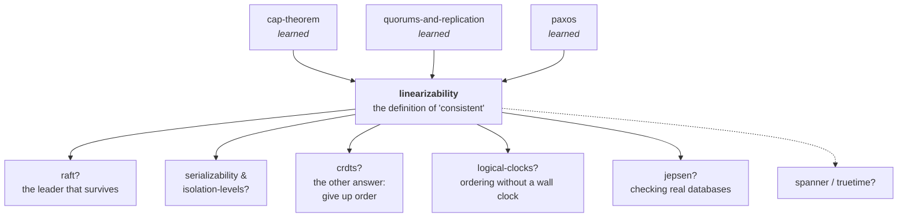

# Linearizability — when is "consistent" a promise you can check?

> **Tell a friend:** Meera sees PASS on the university results page and phones
> her father, Raghu, who opens the same page a few seconds later and sees "not
> yet published". No machine crashed and nobody lied: two of the three copies
> simply disagreed for a moment, and Meera's phone call proves that something
> already seen was then un-seen. Linearizability is the rule that forbids
> exactly this: however many machines there are, the whole system must behave
> like one notebook, read and written one request at a time. This lab builds
> a checker that reads only the requests and their answers on a clock, points
> it at six replication designs, and convicts four of them.

The checker you can drag is [`visualization.html`](visualization.html), also
published at <https://claude.ai/code/artifact/01a5e2be-a55e-470a-b3a9-ce07e3d479b1>.
How to run the code, and where every number came from, is in
[section 19](#19-about-this-lab) at the end.

---

## 1. Why does "consistent" need a definition?

> **In one breath:** Every database says it is "consistent". Until you say
> exactly what that word promises, you cannot write a test that fails, you
> cannot compare two databases, and you cannot tell a real bug from a bad
> memory.

Every distributed store advertises that it is "consistent". This lab is about
the one precise thing that word can mean, and why it is the version worth
wanting. Then the part almost nobody does: how to *check* whether a system
actually delivered it.

You already know that copies of data can disagree. You also know the counting
trick from the quorums lab that stops a reader from missing a write. So here
is a different question, and it is the one that actually bites in production:

**When is a storage system allowed to be called correct?**

That sounds like philosophy until you have to answer it for real. Someone
files a bug: "I updated the setting, my colleague refreshed, and she saw the
old one." Is that a bug in your service? A bug in the database? Or the
documented behaviour of the database you chose? You cannot answer without a
precise statement of what the database promised.

"Eventually consistent" does not help. *Eventually* has no deadline.
*Consistent* is doing no work in that sentence at all.

Without a precise definition, three things happen. You cannot write a test
that would fail. You cannot compare two databases. And you cannot tell a real
incident from someone misremembering.

## 2. What happened to Meera and her father?

> **In one breath:** Meera saw PASS and phoned her father. Raghu looked
> afterwards and saw nothing. Two honest machines gave one impossible pair of
> answers, and the phone call is what makes the pair impossible.

Meera is waiting for her exam results. The university publishes them on a
website. The website is served from three machines, call them A, B and C, so
that it does not fall over on results day.

At 10:00 the results are published. Meera refreshes, sees **PASS**, and
immediately phones her father.

> "It's up. Go and look."

Her father, Raghu, puts down the phone, opens the same page, and sees **not
yet published**.

Nothing has broken. No machine has crashed. No error was logged. Nobody was
lied to on purpose. Meera hit machine A, which had the new page. Raghu hit
machine C, which had not received it yet. Both machines answered honestly.

Here is what makes this the interesting case, rather than an ordinary
staleness complaint. **Raghu looked strictly after Meera had already been told
the answer.** There is no way to arrange these two page loads on a single
timeline such that one noticeboard could have produced both. Meera's phone
call is the proof. Something that had already happened, un-happened.

> **🔮 Predict:** *Ignore the machines for a moment. What is the smallest
> number of facts you need about these two page loads to be sure something is
> wrong, without knowing anything about how the website is built?*
> <details><summary>Reveal</summary>
> Four. When each page load **started**, when each one **finished**, and what
> each one **returned**. Nothing else. You never need to know how many machines
> there are, how they replicate, or what happened inside.
>
> If you said "two: what each returned", you have missed the clock. Two
> different answers are fine when the two loads overlap. It is the order in
> time that convicts.
>
> That is the whole idea this lab is built on. Correctness here is a property
> of what an outside observer can see: the requests and their answers, laid on
> a clock. It is not a property of the implementation.
> </details>

**Where this lab takes you.** Stop at any checkpoint and you still have
something whole.

| Layer | Sections | After it you can… |
|---|---|---|
| Beginner | 1–9 | say what "the system behaves like one copy" means, and spot a violation on a timeline |
| Intermediate | 10 | run the checking algorithm by hand, and explain the one rule that makes it strict |
| Engineering | 11–14 | say which designs provide it, which fail and how often, and prove it with code |
| Production | 15 | read etcd, ZooKeeper, Spanner and DynamoDB consistency docs and know exactly what each is promising |

## 3. Why not just make the copies catch up faster?

> **In one breath:** The obvious reading is "machine C was behind", so make
> it less behind. That genuinely helps. It cannot finish the job.

The obvious reading of Meera's bug is "machine C was behind". So the obvious
fix is to make it not be behind. Replicate faster. Replicate synchronously.
Add health checks that pull a lagging machine out of rotation.

This is what most teams try first, and it is not stupid. It genuinely reduces
how often Raghu sees the old page.

## 4. Why does "faster" never become "never"?

> **In one breath:** Faster replication has no finish line. Sticky routing
> fixes Meera and does nothing for Raghu. And the failure raises no error, so
> nobody knows it happened.

Three things go wrong with "just replicate faster".

**It has no stopping condition.** How fast is fast enough? There is no number
you can put in a ticket. "Usually within 50ms" is not a guarantee. It is a
description of a good day. Meera's phone call takes two seconds.

**The second fix is worse.** The next idea is usually "make every user always
read from the same machine", which engineers call sticky routing. That does
fix Meera reading her *own* writes. It does nothing for Raghu, because Raghu is
a different person on a different machine. And the moment that machine
restarts, the guarantee silently disappears with it.

**And the failure is invisible.** No error is raised. Your dashboards are
green. This is the killer: you cannot alert on a condition you have not
defined.

> **🔮 Predict:** *Suppose you make replication perfectly synchronous. A write
> is not acknowledged until all three machines have it. Is Meera's bug gone
> for good?*
> <details><summary>Reveal</summary>
> That specific bug, yes. But now try this: the write is **still in flight**.
> It has reached machine A and not yet B or C. Meera reads, hits A, sees PASS.
> Raghu reads a second later, hits C, sees nothing. The write has still not
> finished, so nobody has broken the "wait for all three" rule.
>
> If you said "gone for good", you were fixing lag. The problem was never lag.
> The problem is that **while an operation is in progress, different
> observers can be shown different pasts, and the system never reconciles
> them.** Making the window smaller does not make it a different kind of
> thing.
>
> This is exactly the case the last lab's counting rule cannot see. That rule
> honestly gave you 0 stale reads over 4,000 rounds. You will count the thing
> it missed in section 14.
> </details>

## 5. What do we actually want?

> **In one breath:** Not "copies agree quickly". We want a system that nobody
> outside could ever prove has more than one copy.

Step back from mechanisms and say what we actually want. Not "copies agree
quickly". This:

> **The system must be indistinguishable, from outside, from a system that has
> exactly one copy of the data and handles one request at a time.**

Read that again, because two words are carrying everything.

**Indistinguishable.** We are not asking for one copy. We are asking that no
sequence of requests and answers could ever prove there is more than one. The
implementation may have five hundred machines.

**From outside.** The only evidence admissible is what clients asked, when
they asked, when they were answered, and what they were told. If the internals
are a mess but no client can catch it, the requirement is met.

Everything else in this lab is either a way to check this, or a way to build
it.

## 6. What is the one idea that makes this checkable?

> **In one breath:** Every request takes a stretch of time. Pretend it
> happened at one instant somewhere inside that stretch. If you can pick the
> instants so that a single notebook explains every answer, the impersonation
> held.

Here is the invention, and it fits in two sentences.

A request is not an instant. It is a *stretch* of time, from when Meera's
browser sent it to when Meera was answered. But if the system really were one
notebook handling one request at a time, then somewhere inside that stretch
there would be a single moment when the operation actually took effect.

> **Pick one instant inside each request's stretch. If you can pick them such
> that reading the requests in instant-order tells a sensible one-notebook
> story, the system's impersonation held. If no such choice exists, it did
> not.**

That is the entire concept. Everything after this is vocabulary, algorithms,
and consequences.

Notice what makes it powerful: **overlapping requests are free**. If Meera's
read and the publish overlap in time, both answers are defensible. The instant
could have fallen on either side. It is only when a request *finishes* before
another one *starts* that the order is nailed down and cannot be argued with.

> **🔮 Predict:** *Two facts about the story: Meera's read overlapped the
> publish, and Raghu's read started after Meera's had finished. Which of the
> two facts convicts the website?*
> <details><summary>Reveal</summary>
> Only the second. Meera's read overlapping the publish is free: her PASS is
> explained by putting the publish's instant just before her read's instant.
> Raghu's read starting *after* Meera was answered is the fact that cannot be
> argued with. His instant must come after hers, so his answer must include
> whatever hers included.
>
> If you picked the first fact, you are treating "overlapped a write" as
> suspicious. It never is. Overlap is where the system is allowed to choose.
> </details>


## 7. What do engineers call all these things?

> **In one breath:** Every word below names something that has already
> happened to Meera and Raghu. The phone records are a *history*. The moment a
> request "really happened" is its *linearization point*. The rule that makes
> the phone call count is *real-time order*.

Each of these names something you have already met in the story. Now they get
their real names, their precise meanings, and their connections to the labs
you have already done. The story keeps going while the words arrive.

### What is the evidence called?

Imagine the university's lawyer collecting evidence. She asks for exactly
four facts per page load: who asked, when they asked, when they were answered,
and what they were told. That list is the **history**. It is the recording of
what happened, as seen from outside.

Precisely: a history is the list of operations, each with the time its client
sent it, the time its client was answered, and the answer it got. The term
exists to name the *only* evidence that is admissible. Everything about
internals is deliberately excluded. That is what makes the property checkable
against any system, including one you did not write.

Meera and Raghu's two page loads are a two-operation history. This lab writes
histories in a compact form. Here is that form beside its meaning, so you
never have to decode it in the middle of a sentence.

| Written | In words |
|---|---|
| `C1 put(1) [0,4]` | client 1 asked to store the value 1 at tick 0, and was told "done" at tick 4 |
| `C2 get()→0 [6,10]` | client 2 asked for the value at tick 6, and was told "0" at tick 10 |
| the two lines together | a two-operation history: a write, then a read that missed it |

The Java class is literally called [`History`](src/History.java). It is the
input to everything in this lab.

### Where does a request start and end?

Each page load is a bar on a timeline. The bar's left end is the moment Meera
pressed refresh. The right end is the moment the page appeared. Engineers call
the left end the **invocation** and the right end the **response**.

Precisely: the invocation is the moment the request left the client. The
response is the moment the answer arrived back. Two operations are
**concurrent** if their stretches overlap. A history is **sequential** if no
two operations overlap at all; everything happened one at a time.

These terms exist because the gap between them is where all the interesting
behaviour hides. A system is only ever caught out by what it does *during* an
operation.

| Written | In words | Concurrent? |
|---|---|---|
| `put [0,24]` and `get [2,8]` | a write from tick 0 to 24; a read from tick 2 to 8, inside it | yes, they overlap |
| `put [0,4]` and `get [6,10]` | a write finished at tick 4; a read began at tick 6 | no, the put finished first |

Concurrency is *permission*. The more operations overlap, the more orders are
defensible, and the harder the system is to catch.

### When did it actually happen?

Somewhere inside Meera's bar there is one moment when her page load "really"
read the noticeboard. Engineers call that moment the **linearization point**.
It is the single instant an operation took effect.

Precisely: a linearization point is a chosen point inside
`[invocation, response]` for each operation. The points are chosen so that
ordering the operations by their points produces a legal one-copy execution.

The term exists to separate *when an operation took effect* from *how long
the request took*. The point is a claim about the outcome, not about anything
the code does. It is often nowhere near the middle.

| History | Where the put's point must sit | In words |
|---|---|---|
| `put(1) [0,24]`, `get()→0 [2,8]`, `get()→1 [12,18]` | between tick 8 and tick 12 | after the read that missed it, before the read that saw it |

The put took 24 units of wall clock. Its point is a four-unit window inside
that. In the visualization, this is the black dot you can drag.

### What would one notebook have said?

To judge Raghu's page, you need to know what a single noticeboard *would*
have shown. That set of rules is the **sequential specification**, or the
"one-copy story". It is the rules the thing would obey if there were only one
of it, used by one person at a time.

Precisely, for a register: `put(v)` sets the value to `v`. `get()` returns
the current value. `cas(a,b)` sets the value to `b` and returns success only
if the value was `a`. A sequential history is **legal** if it obeys these
rules.

The term exists because "correct" is meaningless without saying correct *at
what*. The specification is the single-copy behaviour you are claiming to
imitate. It is chosen, not discovered.

| Sequential history | Legal? | In words |
|---|---|---|
| `put(1), get()→1` | yes | store 1, then read 1 |
| `put(1), get()→0` | no | store 1, then read 0: no single notebook does that |

In the code it is twelve lines: [`Checker.apply`](src/Checker.java), the
method named `apply`.

### Which rule makes the phone call count?

Meera was answered before Raghu asked. The phone call proves it. Any story
about the noticeboard must therefore put Meera's read before Raghu's.
Engineers call this the **real-time order**: if one request was already
answered before another was sent, the first one really did come first, and no
story may claim otherwise.

In words: whenever operation *a*'s response came before operation *b*'s
invocation, *a* must precede *b* in the chosen order. In symbols: if
`response(a) ≤ invocation(b)` then `a` must precede `b`. Operations that
overlap have no such constraint.

This rule is the *only* thing separating the guarantee we want from the
weaker one below it. It is the thing that makes Meera's phone call count as
evidence. Without it, "Raghu saw the old page" is perfectly acceptable
behaviour.

| Fact | Time | What the rule forces |
|---|---|---|
| Meera's read was answered | 10:00:02 | any explanation must put Meera's read first |
| Raghu's read began | 10:00:05 | since Meera's read returned PASS, Raghu's must too |

It is one `if` in the checker, the method
[`Checker.candidates`](src/Checker.java). You can switch it off and watch the
verdicts change.

### So what does "linearizable" mean?

Now the word itself. A history is **linearizable** if the single-copy
impersonation held. Precisely: there exists a choice of linearization points,
one inside each operation, such that the resulting sequential history is legal
and respects real-time order. A *system* is linearizable if every history it
can produce is. (For operations that never got an answer, see the next term.)

Herlihy and Wing coined the term in 1990. They wanted concurrent objects to
have the same kind of specification single-threaded ones have. The name means:
the concurrent execution can be *linearized*, flattened onto a line, without
anyone noticing.

| History | Verdict | Why |
|---|---|---|
| `put(1)[0,4]`, `get()→0[6,10]` | not linearizable | the put finished before the read began, and the read missed it |
| widen the put to `[0,24]` | linearizable | now the read sits inside the put; the point can fall after the read |

No answer changed between those two rows. Only the clock did. **Time is
data.**

This is the `C` in the CAP theorem you learned in
[cap-theorem](../24-cap-theorem/). CAP's consistency is precisely this, and
nothing weaker.

### What about a request that never got an answer?

Suppose the registrar's publish request timed out. Did the results go up or
not? The registrar does not know. Engineers call that a **pending** (or
indeterminate) operation: an operation with an invocation and no response.

The definition allows a pending operation to be either linearized at any
point, with any result, or discarded entirely. This is the honest model of a
timeout. A timed-out write is not "failed". It is *unknown*, and it may become
visible later. Any definition that could not express this would be useless in
practice.

Scenario F shows it (situation F in the visualization, from
`Scenarios.java`). A write times out; two later reads see its value.
Perfectly linearizable. It simply happened.

The quorums lab counted 500/500 "failed" writes that were readable
afterwards. This is the formal name for that situation. It is also the reason
**writes must be idempotent**: a retry of a pending operation might be its
second execution.

### What if you throw the clock away?

Take the phone call out of the story. Nobody knows whether Meera or Raghu
looked first. Now order the events as *Raghu's read, then the publish, then
Meera's read*. Every answer is correct. That weaker guarantee is
**sequential consistency**: the same idea with the clock thrown away.

Precisely: there must exist *some* total order producing the observed
answers, respecting each client's own order of requests, but not real time.
Every linearizable history is sequentially consistent. The reverse is not
true.

Lamport defined it in 1979 for shared-memory multiprocessors, where "real
time" between two CPUs is not observable. It is the natural weakening, and it
is the exact thing most "eventually consistent but ordered" systems actually
give you.

> **🔮 Predict:** *Run 600 histories from a design that reads any replica,
> and 600 from a design with a client cache in front of a correct store. Both
> fail linearizability often. How many of the failures are still sequentially
> consistent?*
> <details><summary>Reveal</summary>
> For the cache, almost all of them. For the read-any-replica design, only a
> few.
>
> | Design | Sequentially consistent, not linearizable (of 600) | What it means |
> |---|---|---|
> | asynchronous replicas | 52 | a single client bouncing between replicas usually sees time go backwards, which breaks even per-client order |
> | client cache in front | 560 | each client sees its own consistent past; only the clock between clients convicts it |
>
> If you guessed "about the same for both", you are missing what a cache
> preserves: one client's own order. That is why cache bugs feel harmless in
> testing. Experiment 4 in section 14 produces both numbers.
> </details>

You already know its consequences under other names. *Monotonic reads* and
*read-your-own-writes* are what you ask for when you cannot afford
linearizability but need some order to survive.

### What about transactions?

Everything so far is one operation on one object: one page, one read.
Databases work in transactions over many keys. The transaction version of the
same question has two names. **Serializability** says a set of
multi-operation transactions produces the same result as *some* serial order
of them. It has no real-time requirement. **Strict serializability** adds it
back.

The terms come from databases, where the unit is a transaction over many
keys. Linearizability comes from concurrent programming, where the unit is one
operation on one object. Keeping them apart matters. Linearizability says
nothing about grouping operations, and serializability says nothing about
time.

A serializable database may commit your transaction and then serve a later
transaction an order in which yours had not happened yet. That is legal
serializability and would be an obvious bug to a user. Spanner's "external
consistency" is strict serializability.

**Linearizability is strict serializability where every transaction is a
single operation on a single object.** That one sentence places all four
terms on one map.

### Does it add up across keys?

The results website has one page per student. If Meera's page behaves like
one notebook, and Priya's page behaves like one notebook, does the whole site
behave? Yes. Engineers call this **locality**, or composability: if every key
behaves, the whole store behaves.

Precisely: a history over many objects is linearizable **if and only if** its
restriction to each object is linearizable.

The term exists because it is not obvious and it is not true of the
alternatives. It means you can make each shard, each key, each object
linearizable independently, with no coordination between them, and get a
linearizable system for free.

Experiment 10 in section 14 merged 300 pairs of independently linearizable
histories, and 300 of 300 were linearizable together. The same experiment
shows two *sequentially consistent* objects combining into a history that is
not sequentially consistent. This is the reason linearizability, and not
sequential consistency, is the property real systems chase. It is the only
one that scales with sharding.

### The map back to the story

Two small tables. Each row says where you met the thing.

**The evidence.**

| Engineers say | In the story | Where you met it |
|---|---|---|
| history | the lawyer's four facts per page load | section 2's Predict |
| invocation, response | the two ends of a bar: pressed refresh, page appeared | section 6 |
| concurrent | Meera's read and the publish overlapping | section 6 |
| linearization point | the one moment the page load "really" read the board | section 6 |
| sequential specification | what a single noticeboard would have shown | section 5 |
| real-time order | Meera's phone call | section 2 |

**The verdicts and the neighbours.**

| Engineers say | In the story | Where you met it |
|---|---|---|
| linearizable | the impersonation held | section 5 |
| pending | the registrar's publish that timed out | this section |
| sequential consistency | the same story with the phone call deleted | this section |
| serializability, strict serializability | the same question for whole transactions | this section |
| locality | each student's page behaving means the site behaves | this section |

## 8. Which two pictures should you carry?

> **In one breath:** Picture one: a single notebook and a queue. Picture two:
> the same thing written as a set of operations, an order, and two
> conditions. Then three places where the notebook picture lies.

### The simple model: the notebook

There is one notebook. Requests queue up. Each one, when its turn comes,
reads or writes the notebook and steps away. That is all.

Your job as a judge is this. Given the bars on a timeline, **can I place a
dot inside every bar such that reading them left-to-right against one
notebook produces exactly the answers the clients were given?**

### The engineer's version

The same machine, stated precisely. Words first, symbols after.

A history is a set of operations. Each operation records six things: which
client, what it did, with what arguments, what it was told, when it was sent,
and when it was answered. Engineers write the history as `H` and one
operation as `(client, op, args, result, invocation, response)`.

Some pairs of operations are ordered by real time: *a* was answered before
*b* was sent. Engineers write that as `a <ᴴ b`, defined to hold iff
`response(a) ≤ invocation(b)`. It is a partial order: overlapping pairs are
simply not related.

The history `H` is linearizable iff it can be extended, by giving responses to
some pending operations and discarding the rest, to a history `H'` such that
two conditions hold.

| Condition | In words | In symbols |
|---|---|---|
| **L1** | `H'` can be re-read as one sequential story that a single notebook would accept | `H'` is equivalent to some sequential history `S` that is legal under the object's sequential specification |
| **L2** | every "this one definitely finished first" fact in the real history survives in that story | `<ᴴ ⊆ <ˢ`; every real-time precedence in `H` survives in `S` |

`S` is the *linearization*. The point inside each operation is where it sits
in `S`.

### How the two pictures line up

Two short tables. The first is the things; the second is the verdicts.

| Notebook picture | Engineering model | On the screen |
|---|---|---|
| the notebook | the object's sequential specification | the "single notebook" replay strip |
| a request | an operation with invocation and response | a bar |
| "the moment it took effect" | its position in `S` | the black dot |
| requests that overlap | operations unordered by `<ᴴ` | overlapping bars |

| Notebook picture | Engineering model | On the screen |
|---|---|---|
| "this one had definitely finished" | `a <ᴴ b` | a gap between two bars |
| "one order that explains everything" | the linearization `S` | the numbered dots, left to right |
| "no order explains it" | no legal `S` with `<ᴴ ⊆ <ˢ` | red bars, no replay |

### Where the notebook lies to you

Three places. Each one is a mistake that is easy to make and expensive to
hold.

**1. The dot is not a real event.** Nothing in the system happens at the
linearization point. There is no line of code, no log entry, no lock
acquisition there. The dot is an *existence claim* made by an outside judge
after the fact: "you behaved as if there were a moment here." Two different
valid linearizations of the same history can put the dots in different
places, and both are correct answers. Chasing "where is the linearization
point in my code?" is often a real and useful design question. But the
property does not require you to be able to answer it.

**2. There is no notebook, so a request may have no place at all.** If a
client times out, its operation is *pending*. It might have taken effect, it
might not, and the judge is allowed to choose whichever explanation makes the
history work. The notebook picture makes it feel as though every request must
land somewhere. It does not.

**3. One notebook per key, not one notebook.** Linearizability is defined per
object. Two separate keys are two separate notebooks. The guarantee says
nothing whatsoever about them being read together: no snapshot, no atomic
multi-key update. The single-notebook image over-promises here. Locality is
what makes the under-promise safe: per-key correctness composes into
whole-store correctness *for the per-key guarantee*, not into transactions.

## 9. What should you do first in the visualization?

> **In one breath:** Open the checker, load Meera and Raghu, and drag one bar
> until the verdict flips. Five minutes here makes every later section
> easier.

Open **<https://claude.ai/code/artifact/01a5e2be-a55e-470a-b3a9-ce07e3d479b1>**
(or `open visualization.html`). Before the mechanism, spend five minutes here.
Everything after this section will be easier.

**What to look at first.** Each bar is one request, drawn from "asked" to
"was told". Situation **A** is loaded: one write, then one read. Answer the
prediction question at the top, then read the verdict.

**Then do these four things, in order.**

1. **Load situation B.** This is Meera and Raghu. Note the verdict, then
   **drag the read's left edge leftwards** until the bars overlap. The verdict
   flips to acceptable, with *no answer changed*. That is the single most
   important thing on the page: the same answers are a bug or not a bug
   depending only on the clock.
2. **Load situation D.** This is the one you will meet again in section 10
   as a real quorum bug. Turn **off** the real-time rule in the controls. The
   verdict flips. You have just switched from linearizability to sequential
   consistency and seen exactly what the difference buys.
3. **Drag the dots.** In any acceptable situation, grab a black dot and slide
   it. The notebook replay below re-runs live. Push a dot past the point where
   the story still works and the offending step turns red. It tells you what
   the notebook said versus what the client was told.
4. **Generate a real run.** In "Generate from a real design", pick *"Quorum:
   write 2 of 3, read 2 of 3"*, set hiccups to *occasional*, and press
   **Run 120 & count**, then **Find a broken run**. The number of runs it had
   to search is the lesson: a design with no guarantee at all behaves
   perfectly for dozens of runs in a row.

> **CHECKPOINT — beginner → intermediate.** You can now say what it means for
> a system to behave like a single copy, read a history off a timeline, and
> tell a genuine violation from a stale-looking but defensible one. That is
> enough to argue correctly in a design review. Next: how a machine decides
> this, mechanically, on a history it has never seen, and the one rule inside
> that algorithm that everything depends on.
>
> **Say it back.** Without using the words *linearizable*, *history* or
> *real-time*, explain to a friend why Raghu's "not yet published" is a bug,
> and why the same page would not have been a bug if he had looked while
> Meera's page was still loading.
> <details><summary>A good answer sounds like</summary>
> "Meera had already been told PASS before Raghu even asked. One noticeboard
> cannot show PASS and then show nothing. If Raghu had asked while Meera's
> page was still loading, nobody could say which of them the board answered
> first, so either answer would be fine."
> </details>

---


## 10. How does a machine decide?

> **In one breath:** You cannot walk the history in time order, because the
> order is the thing you are looking for. So you search: try an operation, run
> it against the notebook, keep going if the notebook agrees with the client,
> back up if it does not. The real-time rule is one comparison inside that
> search.

### 10.1 Why does the obvious checker fail?

The obvious algorithm: walk the history in time order and check that every
read returns the most recent write. Call it the checker, version 1.

Try it on this history and watch it fall apart. Read the picture first: three
clients, one long write, two reads inside it.

```
  C1  [------------------ put(1) ------------------]
  C2       [-- get()→0 --]
  C3                          [-- get()→1 --]
```

What is "the most recent write" at the moment of C2's read? The write has
started and not finished. Version 1 has no answer. If it says "the write
counts", C2's `get()→0` is a violation. But it obviously is not; the write was
still in flight. If it says "the write does not count yet", then C3's
`get()→1` is a violation. But it obviously is not either.

The bug in version 1 is that it assumed **the order is given**. It is not. The
order is the thing we are looking for.

### 10.2 What does version 2 do instead?

So: search. Try to build the order one operation at a time. Picture the judge
with a stack of bars and a blank notebook. She picks a bar that is allowed to
go next, runs it against the notebook, and compares the notebook's answer with
what the client was actually told. If they match, she places it and
continues. If not, that branch is dead and she backs up.

```
place(remaining operations, notebook value):
    if nothing remains:                       we found an order — accept
    for each operation that is ALLOWED to go next:
        run it against the notebook
        if the notebook's answer ≠ the answer the client actually got:
            skip it — this branch is impossible
        otherwise: place it, and recurse
    if every candidate failed:                back up and try something else
```

The entire content of the algorithm is the phrase **"allowed to go next"**,
and that is where the real-time rule lives. In Meera's terms: Raghu's read is
not allowed to go next while Meera's read, already answered before Raghu
asked, is still unplaced.

> An operation may go next if and only if **no still-unplaced operation had
> already been answered before this one was sent.**

Or in code. This is [`Checker.candidates`](src/Checker.java):

```java
long minResp = Long.MAX_VALUE;
for (int i = 0; i < ops.size(); i++)
    if (remaining(i)) minResp = Math.min(minResp, ops.get(i).resp());
for (int i = 0; i < ops.size(); i++)
    if (remaining(i) && ops.get(i).invoke < minResp) out.add(i);
    //                 ^^^^^^^^^^^^^^^^^^^^^^^^^^^^ the whole guarantee, one comparison
```

Delete that comparison, so that every unplaced operation is a candidate, and
you have a **sequential consistency** checker. That is not an analogy. It is
the same file with one option flipped. Both checkers are in
[`Checker.java`](src/Checker.java) as `Opts.linearizable()` and
`Opts.sequential()`.

### 10.3 Can you run it by hand?

History (times are ticks on one clock). Read the picture: one long write, a
read that saw the new value early, and a later read that saw the old value.

```
  C1  [----------------- put(1) ---------------------]     [0, 24]
  C2      [--- get()→1 ---]                                [2, 8]
  C3                            [--- get()→0 ---]          [12, 18]
```

Run the search. Each row is one step of the judge.

| Step | Remaining | Allowed next | What happens |
|---|---|---|---|
| 1 | put, get→1, get→0 | put (started 0) and get→1 (started 2). Not get→0: it started at 12, after C2 was answered at 8 | try get→1: notebook is 0, client was told 1. **Contradiction, skip.** Try put: notebook becomes 1. Recurse. |
| 2 | get→1, get→0 | only get→1; the earliest response is still 8 | notebook is 1, client was told 1. **Fits.** |
| 3 | get→0 | get→0 | notebook is 1, client was told 0. **Contradiction.** No candidates left. |
| back up | put, get→1, get→0 | the only other branch at step 1 was get→1 first | already dead |

**No order exists. Not linearizable.**

Now change one number. Make C3's read `[6, 18]` instead of `[12, 18]`, so it
overlaps C2's read. Re-run: at step 1, C3's read is now allowed to go first.
The notebook is still 0, it returns 0, and the rest follows.
**Linearizable.** Nothing about the answers changed. The clock did.

> **🔮 Predict:** *The search above tried at most a handful of branches. How
> does its cost grow as the history gets longer?*
> <details><summary>Reveal</summary>
> Badly, and it depends entirely on how much things overlap. If operations
> are nicely separated, only one is ever "allowed to go next" and the search
> is a straight line. If everything overlaps everything, every remaining
> operation is a candidate at every step, and you are enumerating
> permutations.
>
> If you said "about linearly, it is one pass", you were thinking of version
> 1. Version 1 was wrong precisely because there is no single pass.
>
> Deciding linearizability of a history is **NP-hard in general** (Gibbons
> and Korach, 1997). Experiment 9 in section 14 ran the checker on histories
> where every operation overlaps every other.
>
> | Checker | States explored at 18 operations | What it means |
> |---|---|---|
> | plain search | 79,457,057 | permutations, most of them dead ends explored again and again |
> | with a memo table | 239,506 | a 330× cut; "I have already failed from exactly this position with exactly this notebook value" |
>
> The verdict is identical either way. Keep the two apart: **being**
> linearizable is cheap; **proving** a history was is expensive. That
> asymmetry is why Jepsen chops a run into one small history per key before
> checking, and why nobody checks linearizability in production.
> </details>

### 10.4 The other half: how do you *provide* it?

Checking is one half. Building is the other, and it is a short story with one
twist. Three attempts, all judged by the checker over 600 histories each.

**Attempt 1: one machine.** One copy, one request at a time, is linearizable
by construction. The moment the machine executes a request *is* the
linearization point. It is also useless, because the machine dies and takes
Meera's results with it.

**Attempt 2: one leader, several copies.** Keep three copies for durability,
but send *every* request, reads included, to one designated machine, which
serializes them. Also linearizable. And this is genuinely how most
linearizable systems work.

| Attempt | Violations in 600 histories | What it means |
|---|---|---|
| one machine (`SINGLE`) | 0 | correct by construction, and dead the moment the machine is |
| one leader, three copies (`LEADER`) | 0 | correct as long as exactly one machine is the leader |

The cost of attempt 2 is that the leader must be *the* leader. If two
machines both believe they lead, you have two notebooks. Making sure exactly
one leader exists, and that its ordering survives its death, is the problem
you already solved in the [paxos](../39-paxos/) lab. In one line: **consensus is
the machinery that makes a single ordering authority survive the loss of the
authority.** That is the cleanest statement of why consensus exists at all.

**Attempt 3: no leader at all.** Now the interesting one. Can you get the
single-copy illusion out of a plain quorum, with no machine in charge?

You already have R + W > N from the last lab. Write to 2 of 3, read from 2 of
3, take the highest timestamp. The read set and the write set must intersect,
so a read cannot miss a completed write. Surely that is enough?

> **🔮 Predict:** *R = W = 2, N = 3, timestamps handed out correctly. A write
> is **still in flight**: it has reached replica A but not B or C. Reader X
> reads {A, B} and is told the new value. Reader Y starts after X was
> answered and reads {B, C}. What is Y told?*
> <details><summary>Reveal</summary>
> **The old value.** B and C have not seen the write. Y's read set is a
> perfectly legal quorum. R + W > N is satisfied at every step. Nobody did
> anything wrong.
>
> If you said "the new value, because the quorums overlap", you have the
> right rule for the wrong question. Y's quorum is guaranteed to overlap the
> *write* quorum only once the write has finished. It has not.
>
> And it is a violation: X was already answered "new" before Y was even sent,
> so any explanation must put X first. Once it does, Y must also say "new".
> This is Meera and Raghu again, with X as Meera and Y as Raghu.
>
> The counting rule guarantees you cannot miss a **completed** write. It says
> nothing about an **in-flight** one, and it says nothing about two readers
> agreeing with each other. That is precisely the gap the last lab's map entry
> named and this section counts.
> </details>

Here is that violation, found by the checker in a real simulated run and then
shrunk to its smallest broken piece. This is verbatim output from
`java src/Experiments.java writeback`:

```
  seed 41 — shrunk from 20 operations to 3:
  QUORUM_NAIVE N=3 R=2 W=2 (minimised)   (time runs left to right)
  C0  [-----------------------------------------------------------]
                                 put(1)
  C1                            [-----------]
                                  get()->0
  C3                 [------]
                    get()->1
```

C3 was told **1** and finished. C1, starting later, was told **0**. The write
is still in flight across both.

**The fix, and it is one extra round trip.** Before a reader returns a value,
it **writes that value back** to a quorum. Then the value it just revealed is
durable on enough replicas that no later reader can fail to see it. A read
becomes: ask a quorum, then tell a quorum, then answer. In the story: before
Meera's browser shows PASS, it tells two of the three machines "the answer is
PASS". Now Raghu cannot miss it.

This is the ABD algorithm (Attiya, Bar-Noy and Dolev, 1995), and the
write-back is the entire difference. Same seeds, only that phase added or
removed, 600 histories per row:

| Message hiccup rate | Quorum, no write-back | Quorum with write-back | What it means |
|---|---|---|---|
| 0% | 0 (0.0%) | 0 (0.0%) | on a calm network the two designs look identical |
| 5% | 3 (0.5%) | 0 (0.0%) | the first hiccups expose the in-flight write |
| 15% | 36 (6.0%) | 0 (0.0%) | the headline number this lab quotes |
| 25% | 72 (12.0%) | 0 (0.0%) | violations grow with jitter, not with load |
| 40% | 109 (18.2%) | 0 (0.0%) | the write-back never fails, at any rate |

Look at the top row before the rest. **On a calm network the broken design is
indistinguishable from the correct one.** Zero violations in 600 histories
from a design with no guarantee whatsoever. This is the shape of every
consistency bug that reaches production: it passes staging, and it fires
during the incident, when the pager is already going off for another reason.

**One more piece the writer needs.** With more than one writer, a writer
cannot invent its own timestamp either. It must ask a quorum for the highest
one and use *that* plus one, tagged with its own id. Two writers that ask at
the same moment get the same answer and pick the same number. The id is what
breaks the tie the same way on every replica. Drop the tie-break and different
replicas end up holding **different values under the same timestamp**: the
register quietly splits in two. That is a planted bug in this lab
(`Sim.noTiebreak`), and the test `dropping_the_writer_tiebreak_breaks_it`
catches it.

> **CHECKPOINT — intermediate → engineering.** You can now run the checking
> algorithm by hand, name the one comparison that distinguishes
> linearizability from sequential consistency, and explain why a quorum needs
> a second round trip on reads to provide the guarantee at all. Next: the six
> ways this breaks in real systems, what each one costs, and what
> linearizability still does not give you even when it holds.
>
> **Say it back.** Without using the words *quorum*, *write-back* or *ABD*,
> explain to a friend why "ask two of three machines and take the newest
> answer" let Raghu see the old page, and what the extra step does about it.
> <details><summary>A good answer sounds like</summary>
> "The new page had only reached one machine. Meera happened to ask that one,
> so she saw PASS. Raghu asked the other two, and neither had it yet. The
> extra step is: before Meera's screen shows PASS, her browser tells two
> machines 'the answer is PASS'. After that, any two machines Raghu asks
> include one that knows."
> </details>

---

## 11. How does it break in real systems?

> **In one breath:** Six failures, and Meera and Raghu are in every one. A
> replica that is behind, a quorum read with no write-back, a leader that
> does not know it was replaced, a cache in front, a clock ordering writes,
> and a lock that expires under you.

Each of these you can make happen yourself. `<lab>` commands are runnable;
the visualization situations are the letters in the "Show me" list. The story
of each failure comes first, then one table compares them all.

### F1 · What if Raghu reads from a replica that is behind?

The most ordinary failure, and the most common. The university's leader
machine acknowledges the publish before machines B and C have it. Raghu's
read is routed to C and sees the past. Nothing warns anybody.

Make it happen with `java src/Experiments.java stores`, row `ASYNC`. Or in
the visualization: *Generate from a real design → "read any of them"*. Almost
every history is convicted: **587 of 600 (97.8%)**. Even *sequential
consistency* fails in 535 of 600, because a single client bouncing between
replicas sees the value go backwards.

The system's response is none; it does not know. Durability is intact and
the write is never lost. What is lost is any ordering guarantee at all.

In production this is `Postgres read replica`, `MySQL read replica`,
`Cassandra with CL=ONE`, and every "we added read replicas to reduce load"
project. It is not a bug in those systems. It is what you asked for.

### F2 · What if the quorum read has no write-back?

This is section 10.4's story. The publish is in flight and sits on one
replica. Meera's browser reads a pair of machines that includes it; Raghu's
reads a pair that does not. The later read goes backwards.

Make it happen with `java src/Experiments.java writeback`: **36 of 600
(6.0%)** at a 15% hiccup rate, and **0 of 600 on a calm network**. The
system's response is none. You still never miss a *completed* write, so R+W>N
is doing its job exactly as advertised. What is lost is the real-time
ordering between two reads.

In production this is Cassandra `QUORUM` reads without `read_repair` in the
read path, and any hand-rolled "read from a majority and take the newest"
cache layer. Cassandra's answer when you actually need the guarantee is a
*lightweight transaction*: a Paxos round per operation, at roughly 4× the
latency.

### F3 · What if the old leader has not noticed it was replaced?

A partition splits the cluster. The majority side elects a new leader, and
the registrar's publish goes there. The old leader is still up, still holding
Raghu's connection, and still happily answering reads from its own memory. It
has no way to know it was replaced. Nobody can tell it, because it is on the
wrong side of the partition.

Make it happen in the visualization with situation B, then read this story.
The shape is identical to Meera and Raghu, which is the point. The old leader
finds out when the partition heals, and steps down. Writes are safe: the old
leader cannot get a quorum, so it commits nothing. Reads are lost. This is why
**stale reads are the classic split-brain symptom and lost writes are not.**

In production the fix is a **lease**. The leader holds a time-bounded grant
and must stop serving reads when it expires, before the new leader's term can
begin. etcd and TiKV do this. It is why a leader lease is tied to a clock
bound, and why clock skew is a correctness input, not an ops detail.

### F4 · What if there is a cache in front of a correct store?

Now the store underneath is perfect. Raghu's browser, or a caching layer in
front of the site, answers his refresh from a copy it saved a moment ago,
without asking. He is shown a value from before the publish.

Make it happen with `java src/Experiments.java cache`.

> **🔮 Predict:** *The store underneath scores 0 of 600 at every TTL. You put
> a client cache in front with a TTL of just 10 ticks. How many of the 600
> histories does the checker convict?*
> <details><summary>Reveal</summary>
> Already 555 of 600 at a TTL of 10 ticks, and 560 of 600 overall. If you
> guessed "a handful, the TTL is tiny", you are treating the cache as a
> delay. It is a second copy that nobody is keeping in order, and any
> duration of that is enough.
> </details>

| Where the read is answered | Convicted (of 600) | What it means |
|---|---|---|
| the store itself, any TTL | 0 | the store is linearizable |
| client cache, TTL 10 ticks | 555 | a tiny cache is already almost always wrong |
| client cache, overall | 560 (93.3%) | the guarantee the client *experiences* is gone |
| of those 560, still sequentially consistent | 560 of 560 | which is why they feel harmless in testing |

The system's response is none. Every guarantee of the store itself is intact.
What is lost is the guarantee the client experiences. **The lesson is the
important part:** linearizability is a property of *what a client can
observe*, not of a component. Your Redis-in-front-of-Postgres architecture is
exactly this experiment.

### F5 · What if writes are ordered by a wall clock?

The registrar publishes PASS, then a correction. Each write takes its place in
the order from the local clock of whichever machine received it. Two machines
with clocks 20 ticks apart put the correction *before* the original. The read
protocol, the write-back and the quorum are all unchanged. The *only*
difference is where the order comes from.

Make it happen with `java src/Experiments.java clock`.

| Clock skew | Convicted (of 600) | What it means |
|---|---|---|
| zero | 0 | with agreeing clocks the order happens to be right |
| 20 ticks | 112 (18.7%) | the order is now decided by a number nobody agreed on |
| 60 ticks | 270 (45.0%) | nearly half of all runs |

Nothing meaningful is intact. Everything is lost. This is the last lab's
*"your clock IS the conflict-resolution algorithm"*, restated as an ordering
failure rather than a lost-update one.

In production this is last-write-wins by timestamp, everywhere it appears.
Spanner's answer is not "better clocks" but **explicitly bounded
uncertainty**: TrueTime returns an interval, and a transaction *waits out*
the interval before committing. It buys the ordering with latency rather than
hoping.

### F6 · What if a lock expires while you are still using it?

The registrar runs a nightly job that must not run twice. It takes a
distributed lock with a time-to-live. The job's process is stopped by a
garbage-collection pause, or a scheduler hiccup, for longer than the TTL. The
lock expires. A second process takes it. Then the first process wakes up and
carries on, believing it still holds a lock that is now held by someone else.

This one is not simulated in this lab; section 19 flags it as unverified. It
belongs here because a distributed lock with a TTL is sold as mutual
exclusion, which is a linearizable guarantee. It is not one. Nothing is
intact. Mutual exclusion is lost, silently.

In production this is the core of the Redlock critique. The standard
mitigation is a **fencing token**: a monotonically increasing number issued
with the lock, which the *storage* checks and rejects if it is stale. Note
what that does: it moves the guarantee from the lock service to the resource,
where it can actually be enforced.

### The six failures side by side

| Failure | How to make it happen | How often (of 600) | What survives | What is lost |
|---|---|---|---|---|
| F1 replica behind | `stores`, row `ASYNC` | 587 (97.8%); 535 fail even sequential consistency | durability; no write is lost | any ordering guarantee |
| F2 quorum, no write-back | `writeback` | 36 (6.0%) at 15% hiccups; 0 on a calm network | never missing a *completed* write | real-time order between two reads |
| F3 deposed leader | situation B | not counted; same shape as B | writes; the old leader cannot commit | reads, until the lease expires |
| F4 cache in front | `cache` | 560 (93.3%); 555 at TTL 10 | every guarantee of the store itself | the guarantee the client experiences |
| F5 wall-clock order | `clock` | 112 (18.7%) at 20 ticks; 270 (45.0%) at 60 | nothing meaningful | everything |
| F6 expiring lock | not simulated | unverified here | nothing | mutual exclusion, silently |

## 12. What does it guarantee, what does it refuse, and what does it cost?

> **In one breath:** It promises every request happened once, at one moment,
> in an order that respects the clock, and that promise adds up across keys.
> It does not promise transactions, snapshots, a winner, or an answer at all.
> And it costs at least one round trip you cannot skip.

### What is guaranteed?

- **Every operation appears atomic.** It takes effect once, at one instant
  between its invocation and its response. Meera's refresh happened at one
  moment, not smeared across three machines.
- **Real time is respected.** Anything already answered before your request
  was sent is visible to you. This is what "no stale reads" actually means.
  It is a stronger statement than it sounds: it holds across *different
  clients*, Meera and Raghu, not just for one client's own writes.
- **It composes.** Per-object linearizability gives whole-system
  linearizability, with no coordination between objects. Experiment 10
  counted 300 of 300.
- **It is non-blocking.** A pending operation never *forces* another
  operation to wait for it in the definition. An implementation may still
  block for other reasons. This is a property of the specification, not a
  promise about your p99.

### What is explicitly not guaranteed?

**Not transactions.** Read-then-write is two operations, and anything can
happen between them. Suppose the results site keeps a counter of how many
students have checked. Two threads each read the counter and write it back
plus one. `java src/Experiments.java lostupdate` makes this physical:
`AtomicInteger` is a linearizable register shipped by the JDK.

> **🔮 Predict:** *Two virtual threads each do 20,000 `get`-then-`set`
> increments on one `AtomicInteger`. The register is linearizable
> throughout. What is the final value, to the nearest 5,000?*
> <details><summary>Reveal</summary>
> About 20,000, not 40,000. If you said 40,000 because "AtomicInteger is
> thread-safe", you are right about the register and wrong about the loop.
> Each operation was perfect. The *pair* was not one operation.
>
> | Threads × increments | Survived with get-then-set | Survived with `compareAndSet` | What it means |
> |---|---|---|---|
> | 2 × 20,000 = 40,000 | 20,112 | 40,000 | half the updates overwrote each other |
> | 8 × 20,000 = 160,000 | 21,051 | 160,000 | 87% of the updates simply gone |
>
> Nothing was violated. The register was linearizable throughout.
> </details>

**Not a multi-key snapshot.** Two linearizable keys read one after the other
can straddle someone else's update. That needs a transaction.

**No say in who wins.** Two concurrent writes get *an* order, not the order
you wanted. If the second overwrites the first, that is legal.

**No liveness.** The definition constrains what may be answered, never that
anything will be. A system that never responds is vacuously linearizable.
That is the formal reason the CP corner of CAP is allowed to refuse service.

### What does it cost?

**At least one round trip that cannot be skipped.** Experiment 5 in section
14 timed each read design.

| Read design | Mean read latency (ticks) | What it means |
|---|---|---|
| leader read | 14.8 | one machine decides, but every read travels to it |
| one-round-trip quorum read | 11.7 | fast, and not linearizable (F2) |
| write-back quorum read | 24.4 | roughly double, because it is two round trips instead of one |

This is why "strongly consistent read" is a per-request option in DynamoDB
and a billing line rather than a default.

**A theoretical floor, not just an implementation cost.** Attiya and Welch
showed that in a network with message-delay uncertainty `u`, a linearizable
read cannot beat a bound proportional to `u`. You cannot engineer this away
with a faster protocol. (This result is cited from the literature, not tested
in this lab; see section 19.)

**Availability under partition.** This is CAP, and CAP's `C` is exactly this
property. On the minority side of a partition, a linearizable system must
refuse to answer. That is not a bug and not a tuning failure. It is the
theorem.

### Which invariants must a linearizable design hold?

1. Every operation has exactly one position in one global order per object.
2. That order extends real-time precedence.
3. A read returns the value of the most recent write *in that order*.
4. A completed write is never invisible to a later operation.
5. Once a value has been returned to any client, it can never be un-returned.
   *(This is the one the naive quorum breaks, and the one write-back
   restores. It is Meera's PASS.)*

---


## 13. What is in `src/`, and which four lines carry the guarantee?

> **In one breath:** The judge from section 10 is real Java, and you can read
> her in an afternoon. Four lines inside seven small files do the actual work.
> Two more lines are bugs planted on purpose.

Seven files, no dependencies, no build tool. `java src/Tests.java` compiles and
runs the lot.

| File | What it is |
|---|---|
| [`Op.java`](src/Op.java) | one operation: client, what it did, what it was told, invocation and response |
| [`History.java`](src/History.java) | a list of operations, plus the ASCII timeline renderer used throughout |
| [`Checker.java`](src/Checker.java) | **the heart of the lab** — the search, the real-time rule, memoisation, and the violation minimiser |
| [`Sim.java`](src/Sim.java) | seven replication designs, simulated with virtual time, jittery messages and per-replica timestamps |
| [`Scenarios.java`](src/Scenarios.java) | the ten hand-built teaching histories, one point each |
| [`Tests.java`](src/Tests.java) | 41 scenario checks |
| [`Experiments.java`](src/Experiments.java) | the ten experiments |

### Which four lines would you show a colleague?

Read these four and you have read the lab. Each one is a single expression, and
each one is a whole idea from an earlier section.

1. **The real-time rule.** In `Checker.candidates`, the comparison
   `if (o.invoke < minResp)`. This is Meera's phone call, in code: an
   operation may not go next while something answered before it was sent is
   still unplaced. Remove the comparison and you have a sequential-consistency
   checker.
2. **The contradiction test.** In `Checker.search`, the line
   `if (!op.pending && r[1] != op.ret) continue;`. It compares what the
   notebook would have said with what the client was actually told. When they
   differ, that branch of the search is dead.
3. **The read's write-back.** In `Sim.addQuorumPhases`, the line
   `if (secondPhase) task.phases.add(new Phase(true, p1.decideT, w, all));`.
   One line, and the difference between 36 violations and 0. It is the extra
   round trip Meera's browser makes before it shows her PASS.
4. **The tie-break.** In the `Sim` event loop, the condition
   `p.wTs > ts[j] || (p.wTs == ts[j] && p.wWid > wid[j])`. This is the
   `(timestamp, writer)` ordering that keeps two concurrent writers from
   splitting the register. Turn it off with `Sim.noTiebreak` and watch two
   replicas end up holding different values under the same timestamp.

### Which switches are bugs, and which one is a real optimisation?

Two of the three switches in the code are planted bugs. Each disables exactly
one invariant from section 12, and each is caught by a named test.
`Sim.noTiebreak` removes the writer id from the ordering.
`Checker.Opts.dropPending` stops the judge from treating a timed-out operation
as possibly having happened.

The third switch is not a bug. `Sim.lazyWriteBack` skips the reader's
write-back when every replica in the read quorum already agreed. That is a real
optimisation used in real systems. It is correct under one condition and
silently incorrect otherwise. Finding that condition is exercise 7.2.

The simulator is deliberately quiet about some things — permanent partitions,
crashes, disks. [Section 19](#19-about-this-lab) says exactly which, and why
each one was left out.

## 14. What do the ten experiments show?

> **In one breath:** Ten commands, each answering one question with a number.
> Guess before you run each one. The lesson is usually the gap between your
> guess and the number.

`java src/Experiments.java` lists them. `java src/Experiments.java all` runs
everything. Read the last column first: it is what the run prints on your
screen.

| # | Command | The question it answers | What you should see |
|---|---|---|---|
| 1 | `stores` | which designs actually provide it? | SINGLE 0, LEADER 0, ABD 0 · ASYNC 587/600, CACHED 560/600, naive quorum 36/600 |
| 2 | `jitter` | does a calm network prove anything? | naive quorum: 0 violations at 0% hiccups, 109/600 at 40%. ABD: 0 at every level |
| 3 | `writeback` | what does the fix actually fix? | a real violation, shrunk from 20 operations to 3, printed as a timeline |
| 4 | `realtime` | what does the real-time rule catch? | 52 asynchronous-replica histories and **560** cached histories that are sequentially consistent and still not linearizable |
| 5 | `cost` | what does it cost? | read latency 11.7 → 24.4 ticks when you add the write-back |
| 6 | `cache` | is it a property of the store? | store 0/600 at every TTL; with a 10-tick client cache, 555/600 |
| 7 | `clock` | can a wall clock order writes? | 0 at zero skew, 112/600 at 20 ticks, 270/600 at 60 |
| 8 | `lostupdate` | is a linearizable register enough? | `AtomicInteger`: 21,051 of 160,000 increments survive with get-then-set; 160,000 with compare-and-set |
| 9 | `checkercost` | why is checking hard? | 18 fully-concurrent operations: 79,457,057 states without memoisation, 239,506 with |
| 10 | `locality` | does it compose? | 300/300 merged pairs stay linearizable; sequential consistency does not compose |

> **🔮 Predict, before running experiment 2:** *You have a design with no
> ordering guarantee at all. You run it 600 times on a healthy network. How
> many violations do you expect the checker to find?*
> <details><summary>Reveal</summary>
> **Zero.** Not "a few". Zero, in 600 runs at 0% hiccups and again at 2%.
>
> The violation needs a specific coincidence. A write must be in flight, two
> reads must be separated in real time, and those two reads' quorums must
> cover different replicas. On a network where every message arrives promptly,
> the gap between the write reaching its first replica and its second is a
> couple of milliseconds. No pair of reads fits inside it.
>
> If you guessed "a handful, because the design is broken", you are assuming a
> broken design misbehaves at a steady background rate. It does not. It waits.
>
> Take the operational lesson seriously: **a green test run against a
> consistency guarantee is close to worthless unless you injected latency.**
> It is why Jepsen's whole method is "introduce partitions and pauses, *then*
> check", and why the visualization's *Find a broken run* button reports how
> many runs it had to search before it found one.
> </details>

> **CHECKPOINT — engineering → production.** You can now name which designs
> provide the guarantee and which do not, say how often the broken ones
> actually misbehave, explain why that number is terrifyingly low on a healthy
> network, and state precisely what linearizability still does not give you.
> Next: what the systems on your CV are promising, in their own words.
>
> **Say it back.** Without using the words *linearizable*, *quorum* or
> *violation*, explain to a friend why a week of green tests on the staging
> environment is not evidence that Raghu will never see the old page again.
> <details><summary>A good answer sounds like</summary>
> "The bug only appears when a message is unusually slow and two people look
> in that gap. On a healthy test network the gap is a couple of milliseconds
> wide, so nobody ever lands in it. The tests were not passing because the
> design is right. They were passing because the network was being kind. To
> learn anything, you have to make the network slow on purpose and then look."
> </details>

---

## 15. What are the systems on your CV actually promising?

> **In one breath:** Every real linearizable store is one machine deciding the
> order, plus a great deal of machinery to survive that machine dying. Read
> each vendor's consistency page as an answer to one question: which of
> section 11's six failures have they left open for you?

### 15.1 What does a real system add to this lab's leader?

The chain runs **toy → real → architecture → operations**.

The `LEADER` mode in `Sim.java` is, structurally, how a real linearizable store
works: one machine decides the order. Everything a real system adds exists to
survive that machine dying.

- **In this lab:** a leader chosen at startup, ordering requests by the moment
  they arrive.
- **In a real system:** the leader is elected by consensus. Its ordering is a
  **replicated log**. A new leader may only serve once it has caught up on that
  log. That is [paxos](../39-paxos/) and Raft.
- **In the architecture around it:** clients have to discover the leader. A
  **lease** bounds how long a deposed leader may keep answering. Reads use a
  **read-index**: the leader confirms with a quorum that it is still the
  leader, then answers from its own memory without writing anything to the log.
  That is one round trip per read instead of a full log append, and it is what
  makes linearizable reads affordable.
- **In operations:** you watch the leader-election rate, lease expiries, the
  read-index round-trip time, and clock skew across the cluster. **Clock skew
  is a correctness metric in a leased system, not a hygiene metric.**

### 15.2 What does each real system actually say?

Imagine the university had to buy the results site rather than build it. Here
is what each vendor would be promising Meera and Raghu, in the vendor's own
terms.

The four that talk about linearizability directly:

| System | What it actually says |
|---|---|
| **etcd** | Linearizable reads **by default** (via read-index). `--consistency=s` opts down to serializable reads served from the local member — faster, and stale. |
| **ZooKeeper** | Writes are linearizable; **reads are not**. Reads are served locally and may be arbitrarily stale; you get FIFO order per client. Calling `sync()` before a read is what makes that read linearizable. This surprises people constantly. |
| **Spanner** | **External consistency** = strict serializability, i.e. linearizability generalised to multi-key transactions. Bought with TrueTime: commits *wait out* the clock uncertainty interval, trading latency for ordering. |
| **DynamoDB** | Eventually consistent reads by default; `ConsistentRead=true` gives a linearizable read at double the read-capacity cost. Transactions are a separate API. |

> **🔮 Predict:** *ZooKeeper is a consensus system. It runs an atomic broadcast
> protocol, it has a leader, and it is the thing half the internet uses for
> locks and leader election. Are its reads linearizable?*
> <details><summary>Reveal</summary>
> **No.** A ZooKeeper read is answered by whichever member your client is
> connected to, out of that member's own memory, with no check that the member
> is current. It can be arbitrarily stale. That is failure F1 from section 11,
> shipped as documented behaviour.
>
> If you said yes because "it uses consensus", you have made the most common
> mistake in this whole subject: treating consensus as a property rather than
> a mechanism. Consensus orders the *writes*. Serving a read from a replica
> that has not caught up throws that order away again.
>
> What ZooKeeper does give you is per-client FIFO order, so Meera would never
> see time run backwards for herself. It is Raghu who is unprotected. Call
> `sync()` first and the read becomes linearizable, at the cost of a round trip
> to the leader.
> </details>

The four where the promise depends on what you configure:

| System | What it actually says |
|---|---|
| **Cassandra** | `QUORUM` gives you R+W>N, not linearizability — exactly the gap in section 10.4. Lightweight transactions (`IF NOT EXISTS`, `IF <condition>`) run Paxos per operation and *are* linearizable, at roughly 4× the latency. |
| **Kafka** | A partition's log is a total order, which is the ordering half. `acks=all` with `min.insync.replicas=2` on RF 3 is the durability half. Consumers only see up to the high watermark, so they never see a record that could still be lost. |
| **Redis** | A single node executes commands one at a time, so a single node is linearizable for its commands. Replication is asynchronous, so a failover **can lose acknowledged writes**; `WAIT` bounds that but does not close it. Redlock is not a safe lock across pauses. |
| **PostgreSQL** | The primary is linearizable. A streaming replica is not. `synchronous_commit = remote_apply` makes the primary wait until a named standby has *applied* the commit — which is the write-back idea in a different costume, and it only helps reads routed to that standby. |

### 15.3 What does this educational version leave out?

Seven things a production version would have to add. None of them changes the
definition; all of them change what it takes to keep the promise.

| Omitted | What real systems do |
|---|---|
| **Persistence** | replicas here are in memory; real ones fsync before acknowledging, or the guarantee dies with the power |
| **Membership change** | adding or removing a replica changes what a quorum *is*; real systems use joint consensus or a two-phase reconfiguration so the old and new quorums always intersect |
| **Leases and clock bounds** | the `LEADER` mode assumes exactly one leader forever; real leaders hold time-bounded grants |
| **Read-index / lease reads** | this lab's leader reads are free; real ones need a quorum confirmation or a valid lease |
| **Partitions and crashes** | the simulator delays messages but never drops them permanently |
| **Batching and pipelining** | every operation here is one round trip; real systems amortise consensus across batches |
| **Multi-key transactions** | out of scope by definition — that is serializability, not linearizability |

### 15.4 What does an on-call engineer actually see?

Not an alert. Linearizability violations do not page you. They arrive as user
reports that sound like user error. "I saved it and it didn't save." "It showed
the old value and then the new one." "Two people got the same seat."

Meera's father would file the third kind of ticket, and someone would close it
as "cannot reproduce".

The tell is a **non-monotonic observation**: a value going backwards. That is
the one symptom neither a stale cache nor a stale replica can disguise. If two
people compare notes and one of them saw the future, you have this bug.

Three habits do most of the work.

1. **Know your reads.** For every read path, write down which node answered and
   what that node's guarantee is. Most violations are a routing decision nobody
   documented.
2. **Test with latency injected.** Experiment 2 is the whole argument. A clean
   run on a healthy network is not evidence.
3. **Use the real tool when you need proof.** Jepsen's checkers — Knossos,
   Porcupine, and Elle for transactional histories — are this lab's `Checker`
   grown up. They are how the field discovered that many databases did not
   provide what they claimed.

> **CHECKPOINT — end of the production model.** You can now read the
> consistency section of a database's documentation and say exactly what it
> promises, what it costs, and which of the six failures from section 11 it
> leaves open.
>
> **Say it back.** Your team wants to cut load on the results database by
> sending reads to a replica. Without using the words *linearizable*,
> *replica lag* or *consistency*, tell your tech lead what you would be giving
> up, and what you would need to know before agreeing.
> <details><summary>A good answer sounds like</summary>
> "Right now, if I tell you something has been saved, you will see it saved.
> If we serve reads from the second machine, that stops being true: you might
> look after me and still see the old thing, and nothing will log an error.
> Before I agree, I want to know which reads would move, and for each one,
> whether anyone acts on it after being told something by another person. Those
> are the ones that break."
> </details>

---

## 16. What should you try yourself?

> **In one breath:** Eight rungs, from saying the idea back in your own words
> to designing the read path for a payments ledger across three regions.

Everything up to here you have watched. The exercises are where you do it.

See [EXERCISES.md](EXERCISES.md). Rungs 1 to 3 need nothing but this document
and the visualization. Rungs 4 to 7 need the code: you will modify the checker,
implement a design, debug a planted bug, and handle a failure. Rung 8 needs a
whiteboard and no computer at all.

Answers are in [SOLUTIONS.md](SOLUTIONS.md). Attempt each rung first. The
prediction you get wrong is the one you will remember.

---

## 17. Where does this sit, and where do you go next?

> **In one breath:** Three labs fed into this one, and it turns each of them
> into a sharper statement. Five labs lead out of it.



### What did this build on?

- **[cap-theorem](../24-cap-theorem/)** — you now know what CAP's `C` *is*.
  Gilbert and Lynch's formal statement of the theorem is about linearizability
  specifically. That is why "we're AP so we don't need CAP's C" is a coherent
  sentence, and "we're eventually consistent, which is a kind of consistency"
  is not.
- **[quorums-and-replication](../34-quorums-and-replication/)** — R+W>N stops you
  missing a *completed* write. This lab found the in-flight write it cannot
  see, put it at 6%, and added the write-back that closes it. Your version
  vectors, read repair and anti-entropy are all *convergence* mechanisms. None
  of them is an *ordering* mechanism.
- **[paxos](../39-paxos/)** — now has a purpose statement. Consensus exists to
  make a single ordering authority survive the death of the authority.
- **[java-memory-model](../17-java-memory-model/)** — `AtomicInteger` and
  `volatile` are linearizable objects, and the JMM's `happens-before` is this
  same idea inside one machine. Experiment 8 is that connection made physical.
- **[caching](../11-caching/) and [redis](../13-redis/)** — experiment 6 is why a
  cache in front of a correct store gives you an incorrect system.
- **[event-sourcing](../50-event-sourcing/)** — `expected-version` is a
  compare-and-set, which is exactly the tool experiment 8 shows you need when
  a linearizable register is not enough.

### Where should you go next?

```
/learn raft                    # the leader-based design this lab keeps pointing at
/learn logical-clocks          # ordering without trusting a wall clock (F5's real fix)
/learn isolation-levels        # the transaction axis: serializable, snapshot, read-committed
/learn crdts                   # the opposite bet: abandon global order, converge anyway
/learn jepsen                  # how this lab's checker is used on real databases
```

### What is this most often confused with?

Seven near neighbours, each separated by one sentence.

| Confused with | The distinction |
|---|---|
| **serializability** | serializability orders *transactions* and ignores real time; linearizability orders *single operations on one object* and enforces real time |
| **strict serializability** | that is linearizability generalised to multi-operation transactions — the same real-time rule, a bigger unit |
| **sequential consistency** | drop the real-time rule and you have it; it is also not composable, which is why nobody builds on it |
| **eventual consistency** | a promise about the *limit* with no promise at any moment; linearizability is a promise at every moment |
| **read-your-own-writes** | one client's own operations only; linearizability holds across *different* clients, which is the hard part |
| **atomicity (the A in ACID)** | all-or-nothing across failures; linearizability is about ordering and visibility. Confusingly, the literature also calls linearizable registers "atomic registers" |
| **consensus** | consensus is a *mechanism* (agree on one value); linearizability is a *property* (behave like one copy). Consensus is the usual way to get it, not the same thing |

---

## 18. What does each word mean, precisely?

> **In one breath:** Every term in one place, in the order you met it, one line
> each. Section 7 is where each one was earned; this is where it is pinned
> down.

| Term | One line |
|---|---|
| **history** | the list of operations with their start times, end times and answers — the only admissible evidence |
| **invocation** | the moment a client sent a request |
| **response** | the moment the client was told the answer |
| **concurrent** | two operations whose stretches overlap; neither is ordered before the other |
| **sequential history** | a history where no two operations overlap |
| **linearization point** | the single instant, inside an operation's stretch, at which it took effect |
| **sequential specification** | the rules the object would follow if there were one of it, used one request at a time |
| **legal** | a sequential history that obeys the sequential specification |
| **real-time order** | if `a` was answered before `b` was sent, `a` must come first in any explanation |
| **linearizable** | a history that has a legal sequential explanation respecting real-time order |
| **linearization** | the specific order that explains a linearizable history |
| **pending / indeterminate operation** | a request with no response; may be treated as having happened, or not |
| **sequential consistency** | the same idea without the real-time rule; per-client order only |
| **serializability** | *some* serial order of multi-operation transactions produces the observed result; no real-time rule |
| **strict serializability** | serializability plus the real-time rule |
| **locality (composability)** | a multi-object history is linearizable exactly when each object's is |
| **non-blocking** | a pending operation never forces another to wait, by the definition |
| **write-back (ABD)** | a reader pushes what it read to a quorum before returning it, so no later reader can miss it |
| **ABD** | Attiya–Bar-Noy–Dolev: a linearizable register from message-passing quorums, with no leader |
| **(timestamp, writer) tie-break** | ordering equal timestamps by writer id so every replica breaks the tie identically |
| **lease** | a time-bounded grant of leadership; the deposed leader must stop answering when it expires |
| **read-index** | a leader confirming with a quorum that it is still leader, then answering a read locally |
| **fencing token** | a monotonically increasing number issued with a lock and checked by the resource |
| **external consistency** | Spanner's name for strict serializability |
| **memoisation (in the checker)** | remembering "this set of remaining operations with this value already failed" — the difference between 79M states and 240K |
| **violation minimiser** | shrinking a broken history to the smallest still-broken subset, so a human can read it |

---

## 19. About this lab

> **In one breath:** Everything about the lab rather than about the subject
> lives here. How to run it, where every number came from, what it deliberately
> does not model, and how to read the notation.

Where did all of this come from, and how much of it should you trust? Each
answer is below.

### What is in the folder, and how do you run it?

```bash
java src/Tests.java                    # 41 scenario checks
java src/Experiments.java              # list the ten experiments
java src/Experiments.java stores       # the headline: seven designs, judged
java src/Experiments.java writeback    # the one-line fix, isolated
java src/Experiments.java all          # every experiment, in order
open visualization.html                # or the published link below
```

| File | What it is for |
|---|---|
| `README.md` | this document |
| [`EXERCISES.md`](EXERCISES.md) | eight rungs, from explaining it to designing a payments read path |
| [`SOLUTIONS.md`](SOLUTIONS.md) | worked answers; attempt the rung first |
| [`visualization.html`](visualization.html) | the checker you can drag, published at <https://claude.ai/code/artifact/01a5e2be-a55e-470a-b3a9-ce07e3d479b1> |
| `src/` | the seven Java files listed in section 13 |

### Where does this sit relative to your other labs?

**This lab exists because of a sentence in your last one.** The
[quorums-and-replication](../34-quorums-and-replication/) lab ended with this:

> *"R + W > N is **not** linearizability: no global order, concurrent writes
> unordered, two concurrent readers can disagree."*

You then counted **0** stale reads over 4,000 rounds with R=W=2 on N=3, and
that number was honest. This lab shows you the thing those 4,000 rounds could
not see, why R+W>N does not catch it, and the extra half round trip that fixes
it. If quorums were about *not missing a write*, this is about *time not
running backwards*.

How deep this goes, and where you can stop, is the depth table in
[section 2](#2-what-happened-to-meera-and-her-father). Section 17 has the full
map of what feeds into this lab and what leads out of it.

### How were the numbers produced?

Every figure in this document is printed by the code in this folder, run
headlessly on one machine. None is copied from a vendor's documentation.

| Kind of number | How it was produced | How much to trust it |
|---|---|---|
| violation counts, such as 36 of 600 | 600 simulated histories per row, each judged by `Checker.java` | one representative run of the suite; the same seeds give the same counts |
| latencies, such as 11.7 → 24.4 | the simulator's virtual clock | ticks, not milliseconds; compare the rows to each other, never to your own p99 |
| search sizes, 79,457,057 and 239,506 | counted inside the checker's own search | exact, and the same on every machine |
| lost increments, 20,112 and 21,051 | real virtual threads on this machine, not simulated | changes on every run; the shape is stable — about half lost with two threads, **87%** lost with eight |

Two claims in this lab were not measured here, and say so where they appear.
The Attiya–Welch latency lower bound in section 12 is cited from the
literature. Failure F6, the lock that expires under a paused process, is
described but never simulated.

### What does this lab deliberately not model?

One simplification matters enough to state plainly. The simulator's message
delays are random but never *infinite*. There are no permanent partitions and
no crashed replicas.

That is on purpose. This lab is about ordering. Adding partitions would mix in
the availability half of CAP, which the [cap-theorem](../24-cap-theorem/) lab
already covers, and you would no longer be able to tell which half caused a
given failure. What the simulator does model honestly is the thing that
actually causes these bugs in the field: **variable latency**.

Section 15.3 lists the six other things a production version would need,
starting with persistence.

### How do you read the notation?

Four conventions run through the document. Each was introduced in words before
it was used.

| You will see | It means | First explained in |
|---|---|---|
| `C1 put(1) [0,4]` | client 1 asked to store 1 at tick 0 and was told "done" at tick 4 | section 7 |
| an ASCII bar diagram | one line per client, time running left to right, in the simulator's ticks | section 10.1 |
| `[invocation, response]` | the stretch of time one request occupied | section 7 |
| `H`, `S`, `<ᴴ`, `<ˢ` | the history, the sequential order that explains it, and precedence in each | section 8 |

The worked example in section 10.3 uses all four at once, and is the best place
to check that you can read them.
