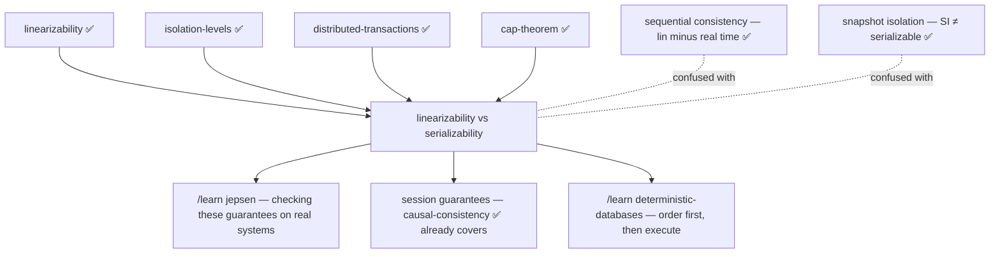

# Linearizability vs Serializability — two words for "consistent" that answer different questions

> **Lab shape (no code):** this lab is this document + an interactive
> visualization (`visualization.html` — same page as the published artifact)
> + `EXERCISES.md`/`SOLUTIONS.md`. Every claim marked **[measured]** cites a
> number you already produced in a previous lab; nothing here asks you to run
> anything new.
>
> **What you already know that this lab stands on:** the
> [linearizability](../26-linearizability/) lab (the single-copy illusion, the
> real-time rule, the draggable-bars checker) and the
> [isolation-levels](../08-isolation-levels/) lab (anomalies, write skew, the
> SERIALIZABLE level). The [distributed-transactions](../46-distributed-transactions/)
> lab already used the phrase "external consistency = strict serializability" —
> this lab is where that equation is finally earned.

---

## Layer guide

> **BEGINNER MODEL** (§1–§9) → **INTERMEDIATE MODEL** (§10) →
> **ENGINEERING MODEL** (§11–§12) → **PRODUCTION MODEL** (§13)

---

## 1. WHY — one review meeting, two confident sentences, both wrong

You will sit in design reviews where someone says *"the database is
serializable, so users can never see stale data"* and someone else says
*"the key-value store is linearizable, so the transfer can't double-spend."*
Both sentences sound airtight. Both are false — and each bug slips through
exactly the gap the *other* guarantee would have covered. These are the two
most-confused words in distributed systems: even vendor documentation mixes
them up, and a level literally named `SERIALIZABLE` can ship without
serializability (your isolation-levels lab **[measured]** H2 allowing write
skew at every level including SERIALIZABLE, and Oracle's SERIALIZABLE is
snapshot isolation by design). If you can't take the two words apart, you
can't read a database's guarantee page, and you can't tell which of your
bugs a stronger setting would actually fix.

## 2. PROBLEM — the deposit that vanished and the overdraft that wasn't

Priya and Omar run the backend of a small bank. Two incidents land in the
same week.

**Incident 1 — "my deposit disappeared."** A customer deposits ₹5,000 at a
teller. The teller's screen says **done**. The customer opens the mobile app
*eight seconds later* — balance unchanged. Support escalates. Priya checks
the database: the deposit is there, committed, safe. The mobile app's read
had gone to a lagging replica. Nothing was lost; something *old* was shown
**after** something new was acknowledged. The database is configured
`SERIALIZABLE`. The team's question: *how can a serializable database show
yesterday's balance?*

**Incident 2 — the double withdrawal.** The same bank keeps account balances
in a strongly consistent key-value store — every single read and write is
perfect, instant-looking, never stale. The withdrawal code does: read
balance (₹1,000), check ≥ 800, write balance = 200. Two ATMs run it at the
same moment. Both read ₹1,000. Both check. Both write 200. The customer
withdrew ₹1,600 from a ₹1,000 account, and the store faithfully,
*correctly*, recorded every operation. The team's question: *how can a store
where no read is ever stale lose money?*

Same week, same bank, opposite bugs: one system showed the **past**, the
other let two **groups of steps** interleave. Keep both incidents in hand —
they are the two halves of this whole lesson.

## 3. NAIVE SOLUTION — "both mean 'one at a time', so pick the stronger word"

The reasonable first belief — the one almost everyone holds — goes:
*linearizable* means "behaves like one copy handling one request at a time",
*serializable* means "behaves like transactions ran one at a time", one-at-a-time
is one-at-a-time, so these are two dialects of the same guarantee; buy
whichever the vendor prints in bigger letters, and both incidents are covered.

## 4. FAILURE — each incident walks straight through the other word's guarantee

Hold incident 1 against **serializability**. Serializability promises only:
the outcome is *as if* the transactions ran in **some** one-at-a-time order.
Watch it defend the vanished deposit — this is a hand trace, three lines:

- T1 (teller): write balance = 6,000. Committed, acknowledged at 10:00:00.
- T2 (mobile app, begins 10:00:08): read balance → returns **1,000** (old).
- The judge asks: is there ANY serial order explaining this? Yes: **T2
  first, then T1**. In that order T2 correctly sees 1,000. Verdict:
  **serializable. No violation.**

The serial order the judge accepted runs *backwards in wall-clock time* —
T2 started eight real seconds after T1 finished, and the explanation
pretends T2 came first. Serializability's definition **never mentions the
clock on the wall**. "Some order" includes orders that put the present
before the past. A stale read is not an isolation anomaly; it's an
isolation *non-event*.

Now hold incident 2 against **linearizability**. Linearizability promises:
each **single operation** on each **single object** looks like it happened
at one instant, instants consistent with real time. Trace the double
withdrawal:

- read(balance)→1000 by ATM-A: happened at some instant. Legal.
- read(balance)→1000 by ATM-B: happened at some instant, before any write. Legal.
- write(balance=200) by A: an instant. Legal. write(balance=200) by B: an
  instant. Legal.
- Verdict: **linearizable. No violation** — you watched this exact shape in
  the linearizability lab **[measured]**: `AtomicInteger`, a linearizable
  register the JDK ships, lost 87% of 160,000 read-then-write increments
  (21,051 survived) while violating nothing.

Linearizability's promise is per-operation. The bank's invariant lived
across **two operations** (the read and the write) — and nobody told the
store those two belonged together. There is no transaction here to protect.

So the naive belief dies on both sides at once: serializability says nothing
about **time**, and linearizability says nothing about **groups**.

## 5. THE REAL REQUIREMENT — know which question each word answers

What we actually need is not a winner between the two words. We need to see
that "is the system consistent?" hides **two independent questions**:

1. **The scope question:** what is the unit being protected — one operation
   on one object, or a declared *group* of operations across many objects?
2. **The time question:** must the explaining order respect the real
   wall-clock order of non-overlapping work, or is *any* order acceptable?

A guarantee is an answer to a (scope, time) pair. Confusing the two words
means answering the wrong question — and shipping the bug the right answer
would have caught.

## 6. KEY IDEA

**Linearizability and serializability sit on different axes.**
Linearizability = *single-operation* scope + *real-time* order: one object
at a time must look like one copy touched at one instant. Serializability =
*transaction* scope + *any* order: declared groups of operations must be
explainable by some one-at-a-time sequence, with no reference to the clock.
Neither implies the other; a system can have either, both, or neither. The
combination — transaction scope AND real-time order — has its own name:
**strict serializability**.

## 7. TERMINOLOGY — realigning words you already own, plus three new ones

Most of this lab's vocabulary you already earned elsewhere; what's new is
where each word *sits on the two axes*.

**Linearizability** *(known — linearizability lab)*. One-object,
one-operation, real-time. The full machinery — histories, invocation/response
bars, linearization points, the real-time rule ("if A was answered before B
was sent, A explains first") — is that lab's content; here it is one of the
two judges.

**Serializability** *(named in the isolation lab; full treatment now)*.
Plain meaning: the outcome of running transactions concurrently equals the
outcome of running them one at a time in *some* order. Precise meaning: a
concurrent schedule is serializable iff it is equivalent to **some serial
schedule** of the same transactions. *Why the term exists:* database people
in the 1970s (Eswaran, Gray; formalized by Papadimitriou 1979) needed a
correctness bar for interleaving transactions that didn't dictate *how* to
interleave — "equivalent to some serial run" judges outcomes, not
mechanisms, which is why 2PL, snapshot-based SSI, and single-threaded
execution can all honestly claim the same word. Concrete example: the
vanished-deposit trace above — T2-then-T1 is a serial order, so the schedule
passes. Connection: it is the **I** in ACID, the top of the
isolation-levels ladder; every anomaly in that lab (dirty read, write skew,
lost update…) is a way of *failing* it.

**Real-time order** *(known)*. The constraint serializability deliberately
lacks: if operation/transaction A completed before B began — provable with a
wall clock — A must come before B in the explanation.

**Strict serializability** *(named in distributed-transactions; earned
now)*. Plain meaning: serializability that also respects the wall clock.
Precise meaning: the schedule is equivalent to a serial order that is
consistent with the real-time order of non-overlapping transactions. *Why
the term exists:* to name the guarantee people *think* "serializable" means
— once you see that plain serializability legally time-travels, you need a
word for the version that doesn't. Concrete example: under strict
serializability the vanished-deposit history is **rejected** — T1 finished
before T2 began, so only T1-then-T2 may explain, and T2's read of 1,000 has
no explanation. Connection: **Spanner's "external consistency" is exactly
this** — the distributed-transactions lab **[measured]** its loss (10 stale
snapshots at clock skew 8) and its price (commit-wait, ack latency 6.7 →
24.8 ticks). Also: strict serializability restricted to one-operation
transactions collapses to linearizability — the two axes meet at the top.

**Recency / staleness** *(new, minor)*. A **recency guarantee** promises
reads reflect completed writes. Linearizability is a recency guarantee;
serializability is not — "stale" is a real-time word, invisible to a judge
with no clock.

**The C in CAP vs the I in ACID** *(new framing)*. CAP's C **is
linearizability** — Gilbert & Lynch's proof of the theorem defines
consistency as linearizability ("atomic consistency"), a fact the cap-theorem
lab recorded. It is *not* serializability; CAP says nothing about
transactions. The two words come from two research communities — shared
memory/distributed computing (Herlihy & Wing, 1990) vs databases
(Papadimitriou, 1979) — which is *why* two words exist for
"one-at-a-time-ish" and why they mismatch: each community formalized the
threat it faced. Distributed computing's threat was **replicas and time**;
databases' threat was **interleaved multi-step programs**.

**One-copy serializability (1SR)** *(new, minor)*. Serializability for a
replicated database: equivalent to a serial run on a *single copy*. Still no
real-time clause — a replicated system can be 1SR and serve stale reads.

## 8. MENTAL MODELS — the notary and the auditor

**Simple model.** Two inspectors examine the bank's day:

- The **notary** sits in the lobby with a wall clock, watching *single
  events*. Their one rule: the official record must never contradict what a
  bystander could have witnessed — if Mrs. Rao's deposit was stamped DONE at
  10:00 and Mr. Iyer asked for the balance at 10:00:08, the answer must
  include her deposit. The notary doesn't care whether a *procedure* of
  five steps made sense together; they care that no single answer betrays
  the clock.
- The **auditor** arrives at midnight with the ledger and *no clock*. Their
  one rule: the books must read as if each multi-step procedure (a transfer:
  debit here, credit there) ran start-to-finish alone, in some order the
  auditor is free to choose. The auditor will happily reorder the whole day
  — afternoon before morning — if that makes the books coherent. But they
  will catch two procedures whose steps interleaved into nonsense, which
  the notary (staring at innocent single events) never sees.

**Engineering model.** A history of invocation/response bars, some bars
grouped into transactions. Judge L (per object): choose one linearization
point inside every bar such that reading points in order reproduces every
answer, with real-time between non-overlapping *bars* respected. Judge S:
choose one position per *transaction* group in a serial order such that every
read sees the latest preceding write, real time ignored. Judge SS: judge S's
procedure plus real-time between non-overlapping *transactions*. Verdict =
does a valid choice exist.

**Mapping.**

| Story | Engineering |
|---|---|
| The notary | The linearizability judge |
| The notary's wall clock | The real-time order constraint |
| A single stamped event | One operation's bar; its stamp instant = linearization point |
| The auditor | The serializability judge |
| A multi-step procedure | A transaction |
| "The books read coherently in some order" | Equivalence to some serial schedule |
| The auditor reordering afternoon before morning | A serial order that inverts real time (legal!) |
| An inspector hired to do **both** jobs | Strict serializability |

**Where the analogy breaks.** (1) The notary sounds weaker than the auditor
— "just single events" — but neither inspector is stronger: each certifies
days the other condemns; you built both counterexamples in §4. (2) The real
notary stamps events *as they happen*; the linearizability judge works
after the fact from the recorded history alone, and an operation's "instant"
is *chosen by the judge* anywhere inside its bar — a real system never emits
visible timestamps. (3) The auditor analogy suggests checking is easy
bookkeeping; in truth deciding serializability of a recorded history is
NP-complete (Papadimitriou), just as the linearizability lab **[measured]**
its checker exploding to 79 million states — real systems *provide* the
guarantee cheaply by construction rather than *verifying* it.

## 9. VISUALIZATION — one history, three judges

Open **`visualization.html`** (also published as the artifact
[**"One History, Three Judges"**](https://claude.ai/code/artifact/db063242-8532-475f-9c60-ace03d84f0f0)). What to look at: a timeline of operation bars per client —
the same spatial language as the linearizability lab's page — with colored
outlines grouping bars into transactions, and **three verdict panels that
judge the SAME history simultaneously**: Linearizable (per object)?
Serializable? Strictly serializable? Each verdict is a full sentence naming
the order it found or the contradiction that blocks every order.

The three interactions that carry the lesson:

- **Drag a bar in time.** The serializability verdict is immune (its judge
  has no clock); the linearizability and strict verdicts flip. Time is an
  input to two judges and invisible to the third — you can *feel* the axis.
- **Toggle transaction grouping.** The double-withdrawal history judged as
  loose single operations: everything green. Group each read+write into its
  transaction: the auditor turns red, the notary stays green. Scope is the
  other axis, under your finger.
- **Predict-then-run scenario cards** — the five stories of §11, each asking
  for your prediction before the judges rule.

## 10. ACTUAL MECHANISM — how each judge decides, by hand

> **CHECKPOINT — you now hold the beginner model.** You can explain *why*
> two different words exist and place each incident under the judge that
> catches it. Next: the actual deciding procedure, executed by hand on one
> worked example — and why the auditor's missing clock is a *choice*, not
> an oversight.

One history, small enough to fully judge on paper. Two objects, `x` and `y`,
both starting 0. Time runs left to right; `[` is invocation, `]` is
response.

```
wall time  ─────────────────────────────────────────────▶
Client P:  [ T1: write x=1, write y=1 ]
Client Q:                                 [ T2: read x→1, read y→0 ]
```

T1 commits (both writes acknowledged) *before* T2 begins. T2 then reads
x = 1 but y = 0.

**Judge L, object by object** (locality — the linearizability lab
**[measured]** per-object checking composes, 300/300). Object x: write x=1
then later read x→1. Pick the write's point, then the read's point — legal.
**x: linearizable.** Object y: write y=1 completes, *then* read y→0 begins.
Real-time rule forces write-then-read; a register read after write y=1 must
return 1, not 0. No valid points exist. **y: NOT linearizable.**

**Judge S, whole transactions, no clock.** Try T1→T2: T2 must read y=1; it
read 0. Fail. Try T2→T1: T2 reads x and y before any write — must see x=0;
it read 1. Fail. Both orders exhausted. **NOT serializable** — this is
*read skew / a fractured read*, the isolation lab's anomaly and the
distributed-transactions lab's atomic-visibility failure, now expressed as
"no serial order exists."

**Judge SS.** Stricter than S; S already failed. **Not strict.** Verdicts:
L(x) ✓, L(y) ✗, S ✗, SS ✗ — one history, four different rulings, every
ruling derivable by hand.

**Mechanism v1 — "fix the auditor by giving them a clock."** Seeing
serializability time-travel in §4, the obvious repair is: always require the
serial order to match real time — i.e., make *strict* serializability the
only definition and drop the weak one.

**🔮 Predict:** *Databases had that option and refused it — every SQL
standard isolation level, Postgres SSI included, promises only clock-free
serializability. What do they buy by refusing?*

<details><summary>Reveal</summary>

**The freedom to serve reads from the past — which is the freedom that makes
MVCC, snapshots, and replicas usable.** A read-only transaction on a
snapshot taken a moment ago (Postgres `REPEATABLE READ`'s consistent
snapshot; a report on a lagging replica; a backup) is *explainable as if it
ran slightly earlier* — legal under serializability, criminal under strict
serializability. Requiring real-time order means every read must first
coordinate to prove nothing newer exists: on one machine that's cheap
(single-node serializable databases are strict "by accident" — commit order
is real-time order); across replicas and shards it costs a round of
coordination per read (the ABD write-back's 11.7 → 24.4 ticks in the
linearizability lab) or Spanner's commit-wait (6.7 → 24.8 in
distributed-transactions), both **[measured]**. The weak definition is not
sloppiness. It's a priced decision: databases sold **isolation between
programs**, and let **freshness** be bought separately — which is exactly
why the word "serializable" on the box never promised your deposit shows up
on the next read.

</details>

## 11. FAILURE SCENARIOS — the five confusions, one per scenario card

> **CHECKPOINT — intermediate model.** You can now execute all three judges
> by hand. Next: the catalogue of real-world confusions, each a history you
> can replay in the visualization (cards 1–5), each with the exact guarantee
> that holds and the exact one that fails.

**F1 — The stale read ("serializable means fresh").** Create: commit T1
(deposit), then start read-only T2 on a lagging replica (drag T2 fully after
T1). Watch: card 1. What happens: T2 returns the old balance. Why: the only
explaining order is T2-before-T1, which serializability accepts (no clock)
and strict rejects. System response: none — no error, no retry; the
serializable database is *working as specified*. Intact: serializability.
Lost: linearizability, strict serializability, recency. Production: this is
every read-replica, every cache in front of a correct store (the
linearizability lab **[measured]** a one-tick cache creating 332/600
violations), and Postgres/MySQL replica reads at any isolation level; fix
by paying for freshness (read from primary/leader, `sync()`-style barriers,
causal/session tokens from the causal-consistency lab) — **not** by raising
the isolation level; the isolation lab called stale-replica symptoms
misdiagnosed as isolation bugs "the most expensive misdiagnosis."

**F2 — The lost update outside any transaction ("linearizable means no lost
money").** Create: two clients each read x then write x+... withdrawal
shape; keep operations ungrouped. Watch: card 2, grouping toggle OFF. What
happens: every judge is green and ₹600 vanished. Why: per-operation, every
read and write is individually explainable; with each operation its own
tiny transaction, the serial order R_A, R_B, W_A, W_B explains all reads.
The invariant lived *between* operations no one declared as a group.
Response: none — nothing was violated. Intact: everything you asked for.
Lost: everything you meant. Production: this is `get`-then-`set` on
Redis/etcd/any KV store, and the JDK `AtomicInteger` 87%-lost result
**[measured]**; the fix is making the group real — a transaction, or a
single conditional operation (`compareAndSet`, `UPDATE … WHERE version=?` —
the optimistic-locking lab's whole subject).

**F3 — The same history, grouped.** Create: card 2, toggle grouping ON.
What happens: serializability flips red (T_A→T_B fails: T_B read 1000 but
T_A already wrote 200; T_B→T_A symmetric), linearizability per operation
*stays green*. Why this pair of verdicts matters: it is the cleanest proof
that the two guarantees inspect different units — identical bars, one
changed declaration, opposite rulings. Production: this is why
`@Transactional` on the method (plus a serializable level or a version
check) fixes what no storage upgrade can — the boundary is *declared by the
application*, and the guarantee cannot protect a group it was never told
about.

**F4 — Write skew ("each row is perfect, the rule is dead").** Create: card
4 — the isolation lab's two doctors: T1 reads both on-call flags, unsets
doctor A; T2 reads both, unsets doctor B; disjoint writes. What happens:
L green per object, S red (T1→T2: T2 would see A already off and the
`≥ 1 on call` check fails — its actual read saw both on; symmetric other
way). Why: the shared thing was a *predicate spanning objects*, precisely
what per-object real-time instants cannot express. Intact: linearizability.
Lost: serializability. Production: the isolation lab **[measured]** H2
permitting this at all five levels; Postgres SSI catches it via
rw-antidependency pivots; under snapshot-isolation-called-SERIALIZABLE
(Oracle) the app must force conflicts (the optimistic-locking lab's
force-increment fix).

**F5 — The causal reverse ("serializable, and time still runs backwards").**
Create: card 5 — T1 writes x, commits; after it fully ends, T2 writes y
(disjoint key), commits; T3 then reads y→new but x→old. What happens: S
green — order T2, T3, T1 works because disjoint-key T1 and T2 never
conflict, so the judge freely slides T1 to the end; SS red (T1 preceded T2
in real time). Why it's insidious: unlike F1 this needs no lagging replica
snapshot of *everything* — only x served stale; a downstream system seeing
y's effect can act on x's pre-state. Production: this is CockroachDB's
documented **causal reverse** — CockroachDB is serializable but *not*
strict, and its consistency docs use exactly this shape; Spanner eliminates
it by paying commit-wait ε on every write ack **[measured]** in the
distributed-transactions lab (stale snapshots 10 → 0, ack 6.7 → 24.8).

## 12. CORRECTNESS — the map, the composition asymmetry, and the prices

**The two-axis map.** Signpost: every guarantee you have learned across
seven labs sits in one grid; find the row and column, and the guarantee's
behavior follows.

| | **Any order allowed** (no clock) | **Real-time respected** |
|---|---|---|
| **Single operations** | Sequential consistency | **Linearizability** (CAP's C) |
| **Transactions** | **Serializability** (ACID's I) | **Strict serializability** (Spanner's "external consistency") |

Moving **right** buys recency; the currency is coordination on the read/ack
path. Moving **down** buys multi-object groups; the currency is conflict
detection across whole programs (2PL's waiting, SSI's refusals, SI's
versions — the isolation lab's "no fourth option that costs nothing").
Diagonal neighbors share nothing: linearizability and serializability are
the off-diagonal pair, which is *why* neither implies the other. Below and
left of this grid the causal-consistency lab's ladder continues downward.

**Composition asymmetry — the deepest structural difference.**
Linearizability is *local*: every object independently linearizable ⇒ the
whole system is (**[measured]** 300/300 merged pairs) — so you can shard a
KV store per key with zero cross-key coordination and keep the guarantee.
Serializability is **not** local: hand trace — bank X serializable, bank Y
serializable; transfer T1 debits at X, credits at Y; audit T2 reads both.
Interleave so X orders T1→T2 and Y orders T2→T1: each bank's local history
is perfectly serializable, the global history has no serial order (T2 saw
the debit but not the credit — §10's fractured read, across systems).
Guaranteeing a *global* serial order across independently-correct
serializable stores is exactly the problem 2PC and the whole
distributed-transactions lab exist to solve. **Locality is why linearizable
stores scale by sharding while serializable transactions across shards
require a protocol.**

**What each guarantee still doesn't give you.** Linearizability: no groups
(F2), and nothing below the object grain. Serializability: no freshness
(F1, F5), no protection for undeclared groups (F2), nothing across systems
(above), and — from the optimistic-locking lab — nothing across
*conversations* (read in one request, write in another: each transaction
individually harmless at SERIALIZABLE). Strict serializability: everything
above, at the price of both currencies at once — and still nothing across
conversations.

## 13. PRODUCTION — reading a guarantee page without being fooled

> **CHECKPOINT — engineering model.** You can place any guarantee on the
> grid, prove the off-diagonal words independent with two counterexamples,
> and explain why one composes and the other doesn't. Last layer: what real
> systems actually put in each cell, and the on-call symptoms each cell
> mismatch produces.

**Where real systems sit** (facts carried from prior labs unless noted):

| System | What it actually gives |
|---|---|
| Spanner | Strict serializability, marketed as "external consistency"; bought with TrueTime commit-wait |
| CockroachDB | Serializable, **not** strict — the causal-reverse (F5) is its documented gap; no stale reads *per key* in the common case |
| FoundationDB | Strict serializability (single ordering authority for commits) |
| Postgres `SERIALIZABLE` | Real serializability (SSI); on a single primary, commit order ≈ real time, so it *behaves* strictly — until a replica or pooler serves the read (F1 returns) |
| Oracle `SERIALIZABLE` | Snapshot isolation — write skew (F4) permitted; the name is on the wrong grid cell |
| etcd | Linearizable reads by default (read-index); per-key cell top-right; its `Txn` gives small strict transactions on one Raft group |
| ZooKeeper | Linearizable writes, **stale-allowed reads** unless `sync()` — one system straddling two cells |
| Redis single node | Linearizable per key (single-threaded); groups only via Lua/MULTI on that one node |
| Any DB + read replica / cache | Whatever the primary promised **minus the right column** — the replica subtracts real time, never isolation |

**On-call symptom table** — the practical payoff; the misdiagnosis in each
row wastes a week:

| Symptom | Wrong reflex | Right cell |
|---|---|---|
| "User saved, refreshed, sees old data" | Raise isolation level | Recency (right column): read-your-writes via primary reads / session token — F1 |
| "Invariant across two rows broke, no errors logged" | Blame replication/staleness | Scope (bottom row): transaction + serializable or app-level version check — F4 |
| "Money lost on concurrent updates to one key" | "Store isn't strongly consistent" | Grouping was never declared: conditional write / transaction — F2/F3 |
| "Downstream saw effect B but not its cause A" | "Impossible, we're serializable" | Strictness gap: F5 — you need the bottom-right cell or a causality token |

**What this lesson's model omits** (the honest list): real checkers don't
enumerate permutations (Jepsen's Elle infers cycles from returned versions);
real serializability theory distinguishes conflict- vs view-serializability
(judges here are view-style, brute-force); commit ≠ response subtleties
(a transaction's real-time interval properly runs to commit
acknowledgment); session guarantees (the middle ground F1 usually actually
wants — causal-consistency lab); and recovery/durability interactions
(strictness under crash-restore).

## 14. EXERCISES

Eight rungs, pencil-and-paper + visualization only — see
[`EXERCISES.md`](EXERCISES.md), answers in [`SOLUTIONS.md`](SOLUTIONS.md).

## 15. KNOWLEDGE MAP & NEXT STEPS



- Commonly confused, one sentence each: **sequential consistency** is
  linearizability minus the clock (single ops), NOT serializability minus
  anything; **snapshot isolation** is a mechanism-flavored level *below*
  serializability (write skew lives in the gap); **strong consistency** is
  a marketing phrase — make the page say which cell.
- Ready to type next: `/learn jepsen` (how Elle finds F1–F5 in the wild),
  `/learn deterministic-databases`, `/learn mvcc-and-vacuum`.

## 16. GLOSSARY

*(order of appearance; ✅ = owned by an earlier lab, re-anchored here)*

- **Linearizability** ✅ — single operations on single objects explainable
  by real-time-respecting instants; CAP's C.
- **Serializability** — concurrent transactions equivalent to *some* serial
  order; ACID's I; no clock.
- **Serial schedule** ✅ — transactions strictly one after another.
- **Real-time order** ✅ — completed-before-begun must order the
  explanation.
- **Strict serializability** — serializability + real-time order between
  non-overlapping transactions; Spanner's "external consistency".
- **Recency guarantee** — a promise that reads reflect acknowledged writes;
  right-column property.
- **Stale read** ✅ — a read returning an older value than an acknowledged
  write; legal under serializability (F1).
- **One-copy serializability (1SR)** — serializability of a replicated
  database against an imagined single copy; still clock-free.
- **Locality / composability** ✅ — per-object guarantees implying the
  global one; linearizability has it, serializability does not.
- **Causal reverse** — serializable-but-not-strict anomaly on disjoint keys
  (F5); CockroachDB's documented gap.
- **Sequential consistency** ✅ — linearizability minus real time.
- **Write skew** ✅ — disjoint writes under a shared read predicate; the
  canonical SI-vs-serializable gap (F4).
- **Snapshot isolation** ✅ — reads from one snapshot,
  first-committer-wins; below serializability.
- **External consistency** ✅ — Spanner's name for strict serializability.
