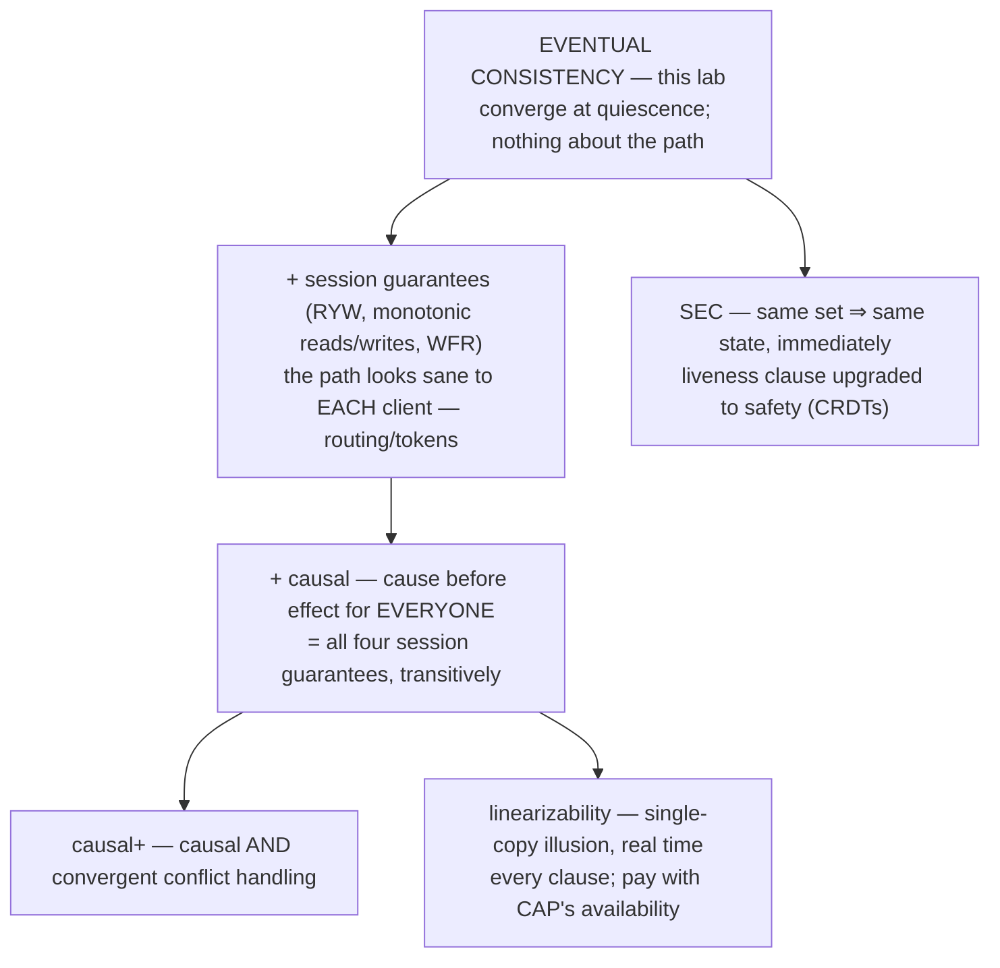

# Eventual Consistency — the weakest promise that still means something

You have spent ten labs buying **stronger** guarantees: overlap ([quorums-and-replication]),
one agreed order ([raft]), real-time recency ([linearizability]), cause-before-effect
([causal-consistency]), convergence-by-construction ([crdts]). This lab is about the thing
all of those were upgrades **from** — the two words at the bottom of every vendor page:
*eventually consistent*.

The surprise of the lab: those words are not a weak version of "consistent". They are a
**different kind of statement altogether** — a promise about a future limit that says
*nothing checkable about any present moment* — and knowing exactly where its edges are is
what separates "we use Cassandra" from "we know what Cassandra promised us".

> **Depth layers:** BEGINNER (stages 1–9) → INTERMEDIATE (stage 10) →
> ENGINEERING (stages 11–12) → PRODUCTION (stage 13). Checkpoints mark each transition.

---

## 1. WHY — two words that decide real designs

Somewhere in your system's documentation right now sits the sentence *"reads are
eventually consistent."* On the strength of those two words you must decide: can the
password-change screen read from this? The shopping cart? The account balance? If nobody
pins down what the words actually promise, engineers fail in **both directions**: they
over-trust it (build a read-modify-write on it and silently lose customer data — no error,
no log line), or they under-trust it (route every read to the leader "to be safe" and pay
double latency and half availability for reads that never needed it). Both failures are
common, both are expensive, and both come from treating "eventually consistent" as a vibe
instead of a contract.

## 2. PROBLEM — the two noticeboards of Deodar

The village of Deodar has two public noticeboards: one in the **north square**, one in the
**south square**. Villagers post notices on whichever board is nearest, and read whichever
board is nearest. Every evening, a volunteer named **Kavi** walks between the squares and
copies notices from each board onto the other.

At 9:00 on Tuesday, **Tara** pins a notice to the north board: *"Market moved to Sunday."*
At 9:05, **Ben** reads the south board. It still says *"Market on Saturday"* — Kavi hasn't
walked yet. Ben plans his week around a fact that is five minutes out of date.

Ben complains to the parish council. The council decides to print a **promise** at the top
of each board, so readers know exactly how much to trust what they see. The whole lab is
the council trying to write that sentence honestly.

## 3. NAIVE SOLUTION — promise the boards always match

The council's first draft: *"Both boards always show the same notices."*

To keep that promise, a notice can't appear on one board until it is on both. So Tara,
pinning her notice in the north square, must wait while a runner carries it south and
returns with confirmation — and if the road between the squares is flooded, **nobody can
post anything anywhere** until it drains. You have seen this exact trade before, measured:
this is the coordinated corner of [cap-theorem] — the [causal-consistency] lab measured
it: a linearizable store answered **0 requests on the minority side of a partition**
while the available design answered 600/600. The council refuses: the boards must stay useful when
the road is flooded. Posting and reading must always work, locally, immediately.

So the council swings to the weakest wording it can think of:

> *"The two boards will eventually show the same notices."*

It sounds humble and honest. Now watch it fall apart.

## 4. FAILURE — the humble promise forbids nothing

Check the draft against four situations. **Every one of them satisfies the promise as
written**, and a reader would call every one of them broken:

- **The lazy week.** Kavi skips his rounds for eight days. The south board shows nothing
  new all week. Has the promise been broken? No — *"eventually"* names no deadline. It is
  compatible with an hour, a week, a decade.
- **Time runs backwards.** Ben reads the north board at 9:10 and sees Tara's new notice.
  He walks south, reads at 9:20, and sees the *old* state of the world. The promise says
  nothing about one reader's experience across boards. Perfectly compatible.
- **The contradiction.** At 9:00 Tara posts *"market → Sunday"* on the north board; at
  9:02 the market master posts *"market cancelled"* on the south board. The boards will
  "eventually show the same notices" — **which one?** The promise doesn't say. If both
  boards eventually settle on Tara's out-of-date notice and the cancellation quietly
  vanishes, the promise as written is *satisfied*.

And the fourth situation is the sneakiest, so look at it slowly:

- **The unbreakable promise.** Suppose the council secretly never intends to sync the
  boards again. On Wednesday a villager accuses them: "you broke your promise!" The
  council answers: *"not yet — wait longer."* On Thursday: *"wait longer."* **There is no
  moment at which the accusation can ever be proven**, because at every finite moment the
  promised event is still allowed to be in the future.

> **🔮 Predict:** Three stores each claim "eventual consistency." Store A returned a
> 3-year-old value for a key written yesterday. Store B showed reader X the new value,
> then showed reader Y (who asked *later*) the old value. Store C's two replicas have
> both been idle and reachable for a month and still disagree. Which stores have
> *provably* broken the claim?
> <details><summary>Reveal</summary>
> Only **C** — and only because it has been *quiescent* (no new writes) with working
> communication for a long time and still disagrees; convergence-after-updates-stop is
> the one thing the claim contains, and C's month of idle disagreement is (informally)
> the witness. A's staleness is legal: no deadline was ever promised. B's time-travel is
> legal: nothing about the order of different readers' views was promised — that would be
> [linearizability]'s real-time rule, a different and much more expensive contract.
> Strictly speaking even C is only "violated in the limit" — a lawyer can still say
> "wait longer" — which is exactly the unfalsifiability problem stage 6 names.
> </details>

The deeper problem the council has discovered: **their promise talks only about a future
limit, and never about any present moment.** A reader standing in front of a board *now*
gets nothing from it. Any promise with teeth must either constrain the present (expensive,
as stage 3 showed) — or be honest that it doesn't, and say precisely what it *does*
constrain.

## 5. THE REAL REQUIREMENT — what the sentence must contain to be non-vacuous

For "the boards will eventually agree" to mean anything at all, two clauses have to be
true underneath it, and the council should write both down:

1. **Delivery clause** — every notice, once posted, keeps being carried toward every
   board **until it arrives**, no matter what. Kavi's rounds must never permanently stop;
   a lost copy must be re-carried. Not "we tried once".
2. **Decision clause** — two boards that have received **the same set of notices** must
   display **the same thing**. What a board shows must be a *function of the set it has
   received*, never of the order or number of times deliveries happened to arrive.

Clause 1 makes "eventually" arrive; clause 2 makes "consistent" mean one agreed answer
when it does. Everything else a reader might want — a deadline, no-time-travel for one
reader, cause before effect, a say in *which* conflicting notice wins — is a **separate,
stronger promise with its own separate price**, and you have already bought each of them
in a previous lab. This lab is what you get when you buy none of them.

## 6. KEY IDEA — a promise about the limit, not the path

> **Eventual consistency:** if updates to an item stop, then eventually all replicas
> converge to the same value for it — and until then, a read may return anything a past
> state could justify.

One sentence, three consequences, and the three consequences are the rest of this lab:

1. **It is a liveness property, so no finite observation can ever falsify it.** Every
   "violation" you catch can be answered with "wait longer". You can *test* a safety
   property by exhibiting one bad state; eventual consistency has no bad state to
   exhibit.
2. **It is silent about what value wins.** "Converge" names an agreement, not an answer.
   Some *resolver* — a rule choosing among concurrent writes — must be supplied, and the
   resolver, not the promise, decides whether your data survives.
3. **Everything that makes it usable in practice is un-promised.** Real systems are
   usually fresh within milliseconds — but that number lives in measurements and dashboards,
   never in the contract. Engineering an eventually-consistent system means engineering
   its *un-promised* behavior.

## 7. TERMINOLOGY — the professional names

Now that you have felt each idea, its industry name. Load-bearing terms get the full
treatment; the rest get a line.

**Eventual consistency (EC).** Plain: "if you stop changing it and wait, everyone will
agree on it." Technical: in an execution where updates to an object cease, there is a
point after which all reads of that object at all replicas return the same value (Werner
Vogels' formulation, from the Dynamo lineage). The term exists to name the *weakest*
replication contract worth advertising — the one that promises convergence and nothing
else. Example: Tara's notice, five minutes old on the north board only, with Kavi's
evening round guaranteeing the south board catches up. Connects to: this is the floor
under everything on the [linearizability] / [causal-consistency] ladder.

**Safety vs liveness (applied to consistency contracts).** Plain: "nothing bad ever
happens" vs "something good eventually happens." Technical (Alpern & Schneider): a safety
property is one whose every violation has a **finite witness** — a prefix of the execution
after which no continuation can repair it; a liveness property is one no finite prefix can
ever violate. You met the pair in [raft] as two things a protocol can lose independently;
here it classifies *promises*: linearizability is safety (one bad read is a witness —
that's how the linearizability lab's checker could return verdicts), **eventual consistency
is (almost) pure liveness** — which is why no checker for it can exist in the same sense,
and why the visualization's EC judge has no red light at finite time. The term pair exists
because these two kinds of promise are *verified, monitored, and broken in categorically
different ways*. Example: the council's "wait longer" defense is the definition of
liveness in one line.

**Convergence.** Plain: ending up equal. Technical here: the *decision clause* — replica
state is a deterministic function of the set of updates received. You saw convergence
engineered to perfection in [crdts]; this lab names the minimum version every EC system
needs, CRDT or not.

**Quiescence.** Plain: the writes have stopped. Technical: a period with no new updates,
which is the *only* condition under which classic EC promises anything observable.
"Quiescent consistency" is the academic name for exactly this guarantee-shape. The term
exists because the promise is conditional and the condition needs a name — production
systems are never quiescent, which is the sharpest single criticism of the contract.

**Staleness, t-visibility, k-staleness.** Plain: how old the value you read is. Technical:
a read is *t-stale* if it returns a value overwritten more than *t* ago; **t-visibility**
is the probability that a read issued *t* after a write's acknowledgment returns it;
**k-staleness** counts versions behind instead of time behind. These terms exist because
"eventually" is unbounded *in the contract* but tightly distributed *in reality*, and you
need words for the reality. Example: "at t = 100 ms after ack, 99.9% of reads return the
new value" is a t-visibility statement.

**PBS — Probabilistically Bounded Staleness** (Bailis et al., 2012). Plain: measuring
"eventually" and reporting it as a distribution. Technical: a model + measurement method
predicting t-visibility for Dynamo-style quorum stores from their replication delays. The
paper's headline (paper-reported, not re-measured here): for production-like LinkedIn/
Yammer latency traces with N=3, R=W=1, reads were fresh with 99.9% probability within
**tens of milliseconds** of a write — i.e. "eventual" in the contract, "milliseconds" in
the measurement. The term exists because it turned an argument ("EC is fine!" / "EC is
reckless!") into a number you can put an SLO on.

**Consistency window.** You've used this term since [cqrs]; it now has edges: the interval
between a write's acknowledgment and the moment every replica would serve it — the window
inside which all of stage 4's legal weirdness lives. Its width is a *measured, moving*
quantity (PBS measures exactly this), never a promised one.

**BASE.** Basically Available, Soft state, Eventually consistent — the 1997 acronym
(Fox et al.) coined as the deliberate opposite of ACID. One line each: *basically
available* = requests get answers even during partitions (the 600/600 side of
[cap-theorem]); *soft state* = a replica's local state may be revised later without any
client asking (your value can change under you as convergence runs); *eventually
consistent* = this lab. Minor term, big marketing career.

**Resolver / conflict-resolution policy.** The rule that makes the decision clause
deterministic when writes were concurrent. Not new machinery to you — LWW, version-vector
siblings, CRDT joins, all measured in [quorums-and-replication] and [crdts] — but this lab
names their shared *job*: the resolver is the part of an EC system that decides **what**
"the same value" ends up being, and therefore which writes die.

**Anti-entropy, read repair, hinted handoff** — known from [gossip-protocols] and
[quorums-and-replication]; here they get their collective job title: the **delivery
clause's machinery**. One-line refreshers where used.

## 8. MENTAL MODELS

**Simple model (carry this one):** two noticeboards and an evening courier. The promise
printed on each board reads: *"What you see here was true at some point. If everyone
stops posting, the boards will match after the courier's next full round. We do not say
when notices arrive, which of two same-day notices survives, or what you'll see if you
walk from one square to the other."* Every honest EC vendor page is a paraphrase of that
paragraph.

**Engineering model (reason with this one):** each replica *i* holds a set **Sᵢ** of
received updates and displays **resolve(Sᵢ)** for a deterministic function `resolve`.
A background process forever moves updates between replicas so that every update
eventually lands in every set. Eventual consistency = **(delivery: ∀ update u accepted at
any replica, ∀ replica i, eventually u ∈ Sᵢ) ∧ (decision: Sᵢ = Sⱼ ⇒ resolve(Sᵢ) =
resolve(Sⱼ))**. Reads return `resolve(Sᵢ)` of whichever replica you happened to hit — no
clause relates that to any other read, any wall clock, or any cause.

| Story | Engineering model |
|---|---|
| A noticeboard | A replica's set Sᵢ |
| Pinning a notice | Accepting an update locally, ack immediately |
| Kavi's evening round | An anti-entropy cycle |
| What the board displays | resolve(Sᵢ) |
| Two same-day contradictory notices | Concurrent updates — resolver decides |
| "The boards will eventually match" | Delivery clause + decision clause |
| Reading whichever board is nearest | No routing/session guarantee |

**Where the analogy breaks** — three places, each hiding a real hazard:

1. **Kavi is scheduled and visible; anti-entropy is neither.** If Kavi skips a week, the
   village notices a missing volunteer. If a repair daemon silently dies or falls behind,
   *nothing in the contract* — and often nothing in the system — makes a sound. The
   delivery clause is the half of EC that operationally rots (stage 11, F5).
2. **Noticeboards accumulate; registers overwrite.** Deodar's boards can show *both*
   contradictory notices side by side. A key-value register must show **one** value, so
   convergence includes *choosing a loser* — the analogy has no place where data
   silently dies, but LWW does (stage 11, F3).
3. **A villager stands in one square; a client hops replicas mid-session.** The story
   makes "one reader, one board" feel natural, which quietly imports a session guarantee
   the contract does not contain. Real load balancers send your next read anywhere —
   [causal-consistency] measured a roaming client missing **its own write 334/500 times**
   over a correctly-working store.

## 9. VISUALIZATION — "The Weakest Promise"

Open **`visualization.html`** (also published as an artifact:
<https://claude.ai/code/artifact/a134ee1f-49c6-4130-abe8-44d450c28ba3>).
It is a two-noticeboard village grown to three replicas, with the one thing Deodar never
had: a **panel of judges** that watches every read and rules on four different promises
simultaneously.

What to look at, in order:

- **Three replica cards** (R1, R2, R3): each shows its received-update set Sᵢ *and* what
  it currently serves — the two halves of the engineering model, kept visibly separate.
- **The judges panel** — the page's whole point. Four judges score the same run:
  **Eventual Consistency**, **Read-Your-Writes**, **Monotonic Reads**, **No Lost
  Updates**. The EC judge is special: *it has no red light during a run*. It can only say
  "cannot be violated yet — liveness" while writes flow, and reach a verdict when you
  press **Stop & settle** (quiescence: writes freeze, anti-entropy runs to a fixpoint,
  and the judge rules on the limit). Watching the other judges turn red while the EC
  judge stays serenely gray *is stage 4 rendered as UI*.
- **The staleness meter** per replica — how many ticks behind the newest acknowledged
  write it is serving — and a histogram of read staleness: the *measured* consistency
  window (the PBS idea) sitting right next to the *contract* that refuses to mention it.
- **Controls that change the promise, not just the run:** the resolver (arrival-order /
  last-write-wins / keep-all-siblings), per-replica clock skew, sync cadence, partition,
  and client routing (sticky vs random) — each one is a stage of this doc as a switch.

Six **predict-then-run** scenario cards reproduce this doc's failure stories; the page
asks for your prediction before running each. Do scenarios 1–3 after stage 10, and 4–6
after stage 11.

> ✅ **CHECKPOINT — beginner model complete.** You can now say what "eventually
> consistent" does and does not promise, and why no test can catch a violation in finite
> time. Next: the two machines that make the promise true — and how each one fails.

---

## 10. ACTUAL MECHANISM — building the two clauses

The engineering model needs two machines: one to make **delivery** true (updates reach
every replica), one to make the **decision** deterministic (same set ⇒ same value). Build
the obvious version of each, watch it break, and let the break force the real design.

### 10.1 Delivery v1: forward each write to the peers, once

A replica accepts a write, acks the client, and sends one copy to each peer. Three
network facts you have already measured each kill it in a different way:

- **Loss.** The forwarded copy dies; nobody retries; that update **never** arrives — the
  delivery clause is broken *silently and permanently*. [gossip-protocols] measured the
  shape: a rumor-mongering stop rule left **9 of 1,000 nodes never informed and never
  able to recover**. One lost packet ≠ a late update; it's a *forever* hole unless
  something keeps re-offering old updates.
- **Duplication.** Retries (the fix for loss) deliver copies twice. If applying an
  update twice differs from applying it once, replicas drift: [crdts] measured a
  sum-instead-of-max merge reading **11 where the truth was 2** after ten deliveries.
- **Reorder.** Two writes take different routes and arrive at different replicas in
  opposite orders — routine, not exotic: [causal-consistency] measured apply-on-arrival
  designs anomalous in **160/300 runs** with a single slow route.

> **🔮 Predict:** Replica R1 receives write *a* then *b*; replica R2 receives *b* then
> *a*. Both use the rule "newest arrival wins." Both have now received the same set
> {a, b}. Kavi runs anti-entropy forever between them, always re-offering both updates.
> Do they converge?
> <details><summary>Reveal</summary>
> **No — never.** R1 serves *b* (it arrived last there), R2 serves *a*. Every
> anti-entropy round re-offers updates the other side has already received, so sets never
> change, so nothing ever changes. Same set, different value: the **decision clause** is
> broken, and unlike a liveness miss this one has a finite witness — it is the one way an
> EC store is *provably* broken (viz scenario 4). "Newest arrival" made the display a
> function of the *delivery history* instead of the *set*.
> </details>

### 10.2 The fixes the failures force

Loss forces **repetition** (keep offering until acknowledged-as-present); repetition
forces **idempotence** (receiving what you already have must change nothing); reorder
forces **order-independence** (the outcome must not depend on arrival sequence). You met
this exact triple as the [crdts] merge laws and the [gossip-protocols] join rule —
here is why they are not a CRDT luxury but the *minimum* for any eventually-consistent
store: they are the decision clause restated as algebra.

**Delivery v2 — anti-entropy:** on a cadence, replicas pair up, compare what they hold
(a Merkle digest, so comparing is cheap — [quorums-and-replication]), and transfer the
difference; receipt goes through a merge that is idempotent and order-free. Because every
round re-compares *everything held*, no single lost message can permanently orphan an
update — loss only delays. Riders on top, both known, now placed: **read repair**
(when a coordinator reads several replicas and sees one behind, fix it in passing —
opportunistic, only touches what is read: measured fixing **100 of 200** stale keys) and
**hinted handoff** (a stand-in holds writes for a dead replica and forwards later —
best-effort, the hint holder can die with the only copy).

### 10.3 The decision machine: three resolvers, three prices

Concurrent writes are the case the set alone can't settle: {a, b} with neither a nor b
"later" by any causal measure ([causal-consistency]'s ∥). Someone must pick. All three
industrial answers are already in your vocabulary; the new frame is what each does to
the **decision clause**:

| Resolver | How it decides | Price, measured previously |
|---|---|---|
| **Last-write-wins** | Total order from (timestamp, replica-id); biggest wins | Concurrent writes *die silently*: **1000/1000** discarded ([quorums-and-replication]); a clock 60 s fast destroyed **1000/1000 genuinely-newer** writes ([crdts]) — your clock IS the resolver |
| **Version vectors + siblings** | Partial order; dominated versions dropped, concurrent ones **all kept**; the app merges at read | Nothing dies, but every reader inherits a merge decision; sibling counts must be watched (Riak) |
| **CRDT join** | The data type's lattice join is the resolver | Convergence *and* no lost updates by construction (= SEC), paid in metadata: **50 records per visible cart item** ([crdts]) |

The one-sentence summary worth keeping: **the EC contract promises an agreement;
the resolver decides who loses; picking a resolver is picking which of your writes are
allowed to die.**

### 10.4 A worked trace: LWW converging onto a lie

Concrete values, one step per line; derive each from the rules above. Three replicas,
one key `market`, LWW resolver, R2's wall clock **+60 s** fast. (Same setup as viz
scenario 3.)

```
t=0    all replicas: market = "Saturday" @ ts=1000
t=10   Ben  → R2:  write "cancelled"      R2 stamps ts = 10 + 60 = 1070   ack
t=25   Tara → R1:  write "moved to Sunday" R1 stamps ts = 25               ack
       (Tara wrote 15 s AFTER Ben; real-world-later; ts smaller: 25 < 1070)
t=30   anti-entropy R1↔R2: sets now equal {Sat@1000, cancel@1070, Sunday@25}
       resolve = max ts → both serve "cancelled"
t=40   anti-entropy R2↔R3: R3 catches up → serves "cancelled"
t=∞    quiescent, all replicas identical: "cancelled".  Tara's write is gone.
```

Every clause of the contract is satisfied — delivery worked, decision was deterministic,
convergence happened, fast. The system will pass every eventual-consistency check forever.
**Converged and wrong are compatible**, and no clause you bought says otherwise. (What
*would* have saved Tara's write: a resolver that refuses to lose concurrent writes —
siblings or a CRDT — or a store with a stronger contract that orders the writes by
something real.)

### 10.5 When is "eventually"? Measuring the window

The contract refuses a number, but the machinery implies a distribution, and you already
know its two terms: propagation cadence and pairing math. From [gossip-protocols]:
push-pull anti-entropy at fanout 3 converges **500 nodes in ~8.3 rounds**, and even 80%
packet loss only stretches it **4.3×** — delays, never breaks. So staleness ≈ (rounds
needed × cadence) + luck, and *that* — not the contract — is what you measure: issue a
write, read it back from each replica, record the delay, plot the distribution
(t-visibility). This is PBS as an operational practice, and it is the answer to the
stage-1 dilemma: you don't decide "is EC okay for the cart page" from the contract
(which says nothing); you decide it from the measured window (usually milliseconds)
plus the cost of the window's *tail* (stage 11).

> ✅ **CHECKPOINT — intermediate model complete.** You can now build the promise: an
> always-running re-offering sync + an idempotent, order-free, deterministic resolver —
> and you know the window is a measured distribution, not a clause. Next: the ways the
> machine and its contract fail people.

---

## 11. FAILURE SCENARIOS — seven ways to get hurt, only one of which is a breach

For each: how to create it → where to watch it → what happened and why → what the system
does → which guarantee held / which was lost → how it shows up in production. Notice the
running theme: **F1–F3 and F5–F7 break users while satisfying the contract**; only F4
breaks the contract itself.

**F1 — The stale read after ack.** Create: write to R1, immediately read from R3 before
any sync (viz: any write, then read another replica; scenario 2). What happened: the ack
meant "accepted at one replica", never "visible everywhere" — the consistency window is
open. System response: none needed; converges on the next sync. Held: EC. Lost: nothing
that was promised — only what the reader *assumed*. Production face: the #1 ticket
pattern — "I updated my profile and the app still shows the old photo"; handled with
session routing (below) or by measuring the window and confirming it's small.

**F2 — Time runs backwards for one reader.** Create: random routing; read R1 (fresh),
then R3 (behind) — viz scenario 2. Why: no clause links two reads, even by the same
client. Held: EC. Lost: **monotonic reads** — never promised, but humans assume it so
deeply that its absence reads as data loss ("my edit vanished!… no wait, it's back").
The fix is *routing, not storage* — sticky sessions, or a session token carried by the
client: [causal-consistency] measured the token taking a roaming client's anomalies from
**3759 / 1611 / 356 / 726 to 0 / 0 / 0 / 0** (its four session guarantees). Production
face: intermittent "flickering" bug reports that no server-side log will ever reproduce;
the on-call move is to ask *which* guarantee the flow assumed (RYW? monotonic?) and add
that guarantee, not to abandon EC.

**F3 — Converged onto a lie (LWW + skew).** Create: stage 10.4's trace; viz scenario 3
(skew slider +60 on one replica, two writes, settle). Why: LWW's total order is
manufactured from clocks, and clocks answer a question ("what time is it?") that is not
the question ("which write should win?"). System response: converges promptly, looks
perfect. Held: EC, delivery, decision — all of it. Lost: a **write**, silently — and no
monitor watching *consistency* will ever fire; only a monitor watching *clock skew*
can warn you. Production face: Cassandra's default is exactly this (LWW per cell,
microsecond timestamps, writer's clock); the operational rule it forces: NTP monitoring
with eviction is a *data-integrity* control there, not a nicety ([hybrid-logical-clocks]
measured what dishonest clocks do to every downstream timestamp).

**F4 — Same set, different answer: the one true breach.** Create: arrival-order resolver
+ opposite delivery orders (stage 10.1's prediction; viz scenario 4 — resolver switch to
"arrival order"). Why: the displayed value depends on delivery history, so no amount of
re-syncing changes anything: **permanent divergence with a finite witness** — the only
failure in this list a checker could ever prove. Held: nothing worth the name. Lost: the
decision clause = EC itself. Production face: hand-rolled "sync" code that applies
whatever arrives ("it'll sort itself out") — the classic home-grown-replication bug;
also any resolver that consults local non-replicated state. The audit question for any
sync design you review: *"is what a replica serves a pure function of the set of updates
it has received?"* If no, it is not eventually consistent, whatever the README says.

**F5 — "Eventually" never comes: the rotting delivery clause.** Create: viz — turn sync
cadence to "off" mid-run; nothing turns red (the EC judge just says "not yet…" — that's
the trap). Why: the delivery clause is a *forever* obligation with no finite deadline, so
its death produces **no event, no error, no failed request** — reads keep answering,
writes keep acking, entropy silently accumulates. Held: technically unfalsifiable-not-yet.
Lost: the promise's entire practical value. Production face: the most under-monitored
failure in AP systems — a dead repair daemon, a backlogged replication queue growing
without bound (the [quorums-and-replication] lag-is-a-queue result: apply rate < write
rate ⇒ unbounded). The alarms that catch it are *liveness* alarms: replication-lag age,
time-since-last-successful-repair, oldest-undelivered-update age — you must alarm on
**the machinery's heartbeat**, because the contract offers nothing to alarm on.

**F6 — The dead rise: deletion meets delayed delivery.** Create (hand trace, and
[quorums-and-replication]/[crdts] both prepared this): delete a key → delete is stored
as a **tombstone** (a "this died" record that must itself replicate) → tombstone is
garbage-collected after its grace window → a replica that was unreachable *longer than
the window* comes back carrying the pre-delete value → anti-entropy sees a value the
others lack and dutifully **re-spreads it: the deleted data resurrects everywhere**. Why:
GC destroyed the only evidence that the value was outdated, and the delivery machinery
cannot distinguish "old data you deleted" from "new data you're missing". Held: EC (it
converges — onto the resurrected value!). Lost: the delete. Production face: Cassandra's
`gc_grace_seconds` (default 10 days) and its **hard operational law** — every node must
complete repair within the grace window, or don't re-admit it; same reason [crdts] rule
says never restore a CRDT replica from backup into a live cluster.

**F7 — Read-modify-write on an EC read.** Create: read balance from a stale replica,
compute, write back (pencil exercise 5.2). Why: the read carried no promise of currency,
and the write-back **overwrites newer state the reader never saw** — this is the
[linearizability] lab's 87%-lost increment with the extra twist that *distribution makes
the window bigger*. Held: EC. Lost: updates, at whatever rate you have concurrency.
Production face: any "fetch, edit, save" flow against an eventually-consistent read path;
the fixes are the whole [optimistic-vs-pessimistic-locking] lab (conditional writes,
versions) or routing the read strongly — EC reads are for *display*, never for
*decisions*, unless the write path is conditional.

> **🔮 Predict:** Your monitoring shows zero divergent replicas for 30 straight days.
> Which of these can you conclude? (a) the store is eventually consistent, (b) the
> anti-entropy machinery is working, (c) the consistency window is small, (d) none of
> these.
> <details><summary>Reveal</summary>
> **(d)** — and the reason is the falsifying-query rule wearing a distributed-systems
> costume. "Zero divergence observed" is compatible with: divergence you didn't sample
> (the check reads a quorum that happens to overlap), a window your probe never lands in
> (the [linearizability] lab measured a broken design showing **0 violations in 600 calm
> runs**), and — worst — a dead repair daemon with divergence accumulating in keys nobody
> reads (F5: a pass on an unexercised dataset). To conclude (b) you monitor the machinery
> itself; to conclude (c) you measure t-visibility with injected probes *under injected
> network stress* — the "calm network proves nothing" lesson, now on its fourth lab.
> </details>

## 12. CORRECTNESS — what you hold, what you traded, where it sits

**Guaranteed** (by EC + a lawful resolver): convergence at quiescence; availability of
every read and write during partitions (the [causal-consistency] 600/600 side of CAP);
no coordination on any request path; and — if and only if the resolver is a pure function
of the set — determinism of the limit.

**Explicitly NOT guaranteed, each refused by name:** any bound on staleness (no deadline
clause); recency (no real-time clause — [linearizability]'s whole right column); any two
reads agreeing, even the same client's (no session clauses); cause before effect (no
causal clause — a comment can surface before its post, [causal-consistency]'s opening
wound); survival of concurrent writes (resolver's choice, F3); **any cross-replica
invariant** — the [crdts] bank measured it: two partitioned warehouses each honoring
"stock ≥ 0" locally merged to **−2**; an invariant needs a referee who can say *no*, and
EC's definition is the absence of that referee ([raft] is its price).

**The trade, stated once:** you sold every safety clause about the path to buy liveness
plus availability plus latency. Whether that sale was smart is a *per-flow* question —
display flows usually yes, decision flows usually no (F7).

**The formal seam of the lab:** classic EC is a **liveness** property — unfalsifiable,
untestable, un-alarmable directly (F5). **Strong eventual consistency** ([crdts]) is the
*safety* upgrade of the same idea: "same set ⇒ same state, immediately" has a finite
witness (exhibit two replicas, equal sets, different states), which is exactly why the
crdts lab could *fuzz its laws on 50,000 generated states* while this lab's central
property cannot be tested at all — only its companions (session guarantees, bounds,
machinery heartbeats) can. When someone says "we tested that our system is eventually
consistent", the true translations are: they tested convergence *under quiescence in
finite scenarios*, or they tested SEC. The distinction is worth a design-review question.

**The ladder, with this lab as its floor** (strength increases downward; each rung =
the floor + named extra clauses):



(SEC strengthens the *decision* clause; the session/causal chain strengthens the *path*;
linearizability strengthens both plus real time. Azure Cosmos DB literally sells this
diagram as a menu — strong / bounded staleness / session / consistent prefix / eventual —
and **bounded staleness** is the one rung you haven't met by name: EC plus a hard ceiling
"never more than K versions or T seconds behind", the contract-ification of stage 10.5's
measured window.)

> ✅ **CHECKPOINT — engineering model complete.** You can classify any consistency claim
> by which clauses it adds to this floor, say which failures are breaches vs surprises,
> and name why EC itself is untestable while SEC is not. Next: where you already run this
> in production without calling it that.

---

## 13. PRODUCTION — you have been running this for years

**The confession first: the most-deployed eventually-consistent system in your world is
an ordinary SQL read replica.** Postgres/MySQL async replication + a read-routing layer
(`@Transactional(readOnly = true)` steering to the replica) is *exactly* this lab: ack at
the primary (delivery clause = the WAL shipper — with resolver trivial, since a single
primary orders all writes, replicas replay one log: no concurrent-write problem, only
staleness), consistency window = replication lag, F1/F2/F7 all live and biting, and the
lag gauge is the delivery-clause heartbeat. Every trap in stage 11 has a Java-shop
costume: the saved-form-then-list-shows-old-row bug is F1; "sometimes the row flickers
back" is F2 (a pool with two replicas); reading the replica inside a payment decision is
F7. [isolation-levels]' warning gets its third repetition: *a stale replica produces
symptoms identical to read skew and no isolation level touches it.*

**The Dynamo lineage** (Cassandra, Riak, Voldemort — the systems the term was coined
for): everything in this doc composed — sloppy quorums + hinted handoff (delivery),
read repair + scheduled anti-entropy with Merkle trees (delivery), LWW *or* vector-clock
siblings (decision; Cassandra chose LWW and inherited F3, Riak chose siblings and later
CRDTs), tombstones + `gc_grace_seconds` (F6), tunable R/W/N per request
([quorums-and-replication]'s dial — "eventual" is the R+W≤N region of that lab's table).
Operational reality Cassandra makes explicit: **anti-entropy is an operator
responsibility** — `nodetool repair` must complete within the grace window on every node;
"we run Cassandra" means "we run a repair schedule", and the F5 alarm
(time-since-last-repair) is a first-class pager.

**DynamoDB** prices this lab: an eventually-consistent read costs **half** a strongly
consistent one — the CAP trade as a line item. **DNS** is the planet-scale specimen:
TTL-bounded staleness, no session anything, converges by expiry — and everyone accepts
it because the *data* (name→address) tolerates staleness, which is the real lesson of
choosing EC: it's a property you match to data, not a belief. **S3** is the cautionary
tale in reverse: eventually-consistent overwrite-reads from 2006, then in **December
2020** made strongly consistent — after 14 years of every S3-backed data lake carrying
list-after-write workarounds. The vendor moved the contract because *customers kept
building F1/F7 bugs*; when the platform can afford the stronger clause, un-promised
behavior that users depend on eventually gets promised (Hyrum's law, priced).

**What the on-call engineer actually watches** (the whole stage-11 list, as a runbook):
replication/apply **lag age** per replica and repair **backlog age** (F5 — the liveness
heartbeats; alarm on age, not on rate); **clock skew** with eviction if LWW anywhere
(F3); **sibling counts** if vectors (decision-machine backpressure); **t-visibility
probes under injected latency** for the window SLO (F1, and the 11.7 falsifying-query
lesson); tombstone/GC schedule compliance (F6). And the two questions for any incident
in an EC system: *which un-promised guarantee did this flow silently assume?* and *is
the delivery machinery alive?*

**What the noticeboard model omitted** (each a real subsystem): Merkle-tree digests
(comparing sets cheaply at scale); hinted handoff's failure modes; membership — *who* the
replicas even are, gossiped, [gossip-protocols]; per-key sharding of the whole story,
[consistent-hashing]; backpressure when anti-entropy competes with foreground traffic;
security of the sync channel; and cross-key anything ([distributed-transactions] is the
other end of that road).

---

## 14. EXERCISES

Eight rungs in **`EXERCISES.md`** — explain, identify (in the viz), predict, modify,
trace, spot-the-flaw, handle-failure, and a 3-datacenter design rung. Attempt before
opening **`SOLUTIONS.md`**; rungs 7–8 are graded as design discussions, not answers.

## 15. KNOWLEDGE MAP & NEXT STEPS

```mermaid
graph LR
    subgraph prerequisites — all learned
        CAP[cap-theorem]
        QR[quorums-and-replication]
        GP[gossip-protocols]
        CRDT[crdts]
        CAUS[causal-consistency]
        LIN[linearizability]
    end
    EC((eventual-consistency))
    CAP --> EC
    QR --> EC
    GP --> EC
    CRDT --> EC
    CAUS --> EC
    LIN --> EC
    EC -.confused with.-> SEC["SEC: same set ⇒ same state NOW — safety, testable;\nEC promises only the quiescent limit — liveness"]
    EC -.confused with.-> BS["bounded staleness: EC + a promised ceiling;\nEC's ceiling is measured, never promised"]
    EC --> J[jepsen? — testing the untestable via its companions]
    EC --> PR[partitioning-and-rebalancing?]
    EC --> CDC[change-data-capture? — EC pipelines between stores]
    EC --> LFS[local-first-software? — EC as a feature, not a compromise]
```

Commonly confused, one sentence each: **EC vs SEC** — SEC removes "eventually" from the
decision half (same set ⇒ same state *immediately*), turning liveness into testable
safety. **EC vs causal** — causal constrains the *path* (order of visibility), EC only
the *limit*. **EC vs bounded staleness** — bounded staleness signs a number; EC measures
one but signs nothing. **"Eventually consistent" vs "inconsistent"** — EC systems are
*converging* by construction; a system with a broken decision clause (F4) is simply
broken, not "eventually consistent, sort of".

Ready to type next: `/learn jepsen` (how you test systems whose central promise is
untestable), `/learn change-data-capture` (the EC pipeline you build between two strong
stores), `/learn local-first-software` (EC chosen on purpose, client-side),
`/learn partitioning-and-rebalancing`.

## 16. GLOSSARY

In order of appearance; terms carried from prior labs marked ↩.

- **eventual consistency (EC)** — if updates stop, all replicas eventually serve the same
  value; nothing promised before that point.
- **consistency window** ↩([cqrs], now with edges) — the interval between a write's ack and
  its visibility everywhere; measured, never promised.
- **safety property** ↩([raft], sharpened) — "nothing bad ever happens"; every violation
  has a finite witness, so it is testable.
- **liveness property** ↩ — "something good eventually happens"; no finite observation can
  violate it, so it is untestable and must be monitored via its machinery.
- **quiescence** — a period with no new updates; the only condition under which classic EC
  promises anything observable.
- **quiescent consistency** — the academic name for "converged whenever quiescent".
- **convergence / decision clause** — replica output is a deterministic function of the
  set of updates received.
- **delivery clause** — every update keeps being propagated until present at every
  replica; a forever-obligation.
- **staleness** — how far behind an acknowledged write a served value is.
- **t-visibility** — probability a read issued t after a write's ack returns it.
- **k-staleness** — staleness counted in versions rather than time.
- **PBS (probabilistically bounded staleness)** — modeling/measuring t-visibility as a
  distribution; "eventual" turned into an SLO-able number.
- **BASE** — Basically Available, Soft state, Eventually consistent; the anti-ACID
  acronym.
- **soft state** — replica state that may be revised by convergence without any client
  writing.
- **resolver / conflict-resolution policy** — the deterministic rule choosing among
  concurrent updates; decides which writes die.
- **arrival-order resolver** — the broken resolver (output depends on delivery history);
  produces provable divergence (F4).
- **last-write-wins (LWW)** ↩ — resolver by (timestamp, id); silently drops concurrent
  and clock-disadvantaged writes.
- **siblings / version vectors** ↩ — resolver that keeps all concurrent versions for the
  app to merge.
- **anti-entropy** ↩ — cadenced compare-and-merge between replicas; the delivery clause's
  workhorse.
- **read repair** ↩ — opportunistic fixing of stale replicas during reads.
- **hinted handoff** ↩ — best-effort buffering of writes for an absent replica.
- **tombstone / gc_grace_seconds** ↩ — deletion marker and its GC window; F6 lives here.
- **resurrection** — deleted data re-spread by anti-entropy after tombstone GC.
- **session guarantees** ↩ — RYW / monotonic reads / monotonic writes / WFR; path
  promises added per-client by routing or tokens.
- **bounded staleness** — EC plus a promised ceiling (≤ K versions or T seconds behind).
- **strong eventual consistency (SEC)** ↩ — same set ⇒ same state immediately; the safety
  upgrade of EC's decision clause.
- **tunable consistency** ↩ — per-request R/W dials; EC is the R+W≤N region.
- **t-visibility probe** — synthetic write-then-read-everywhere measurement of the window.
