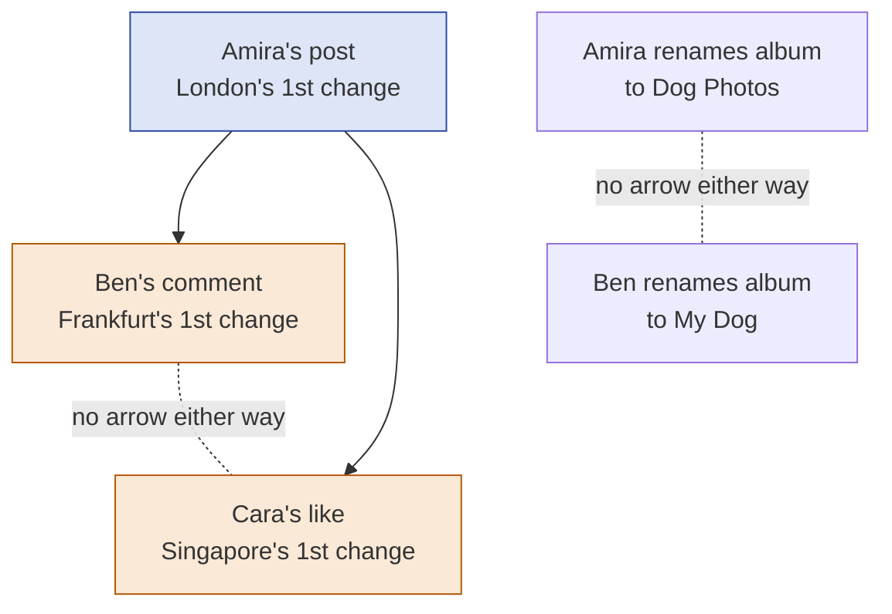
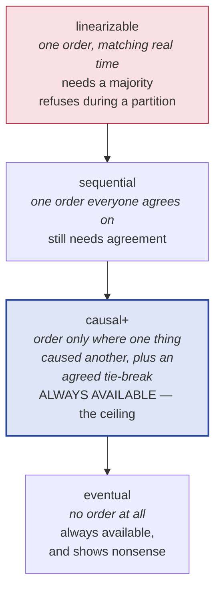
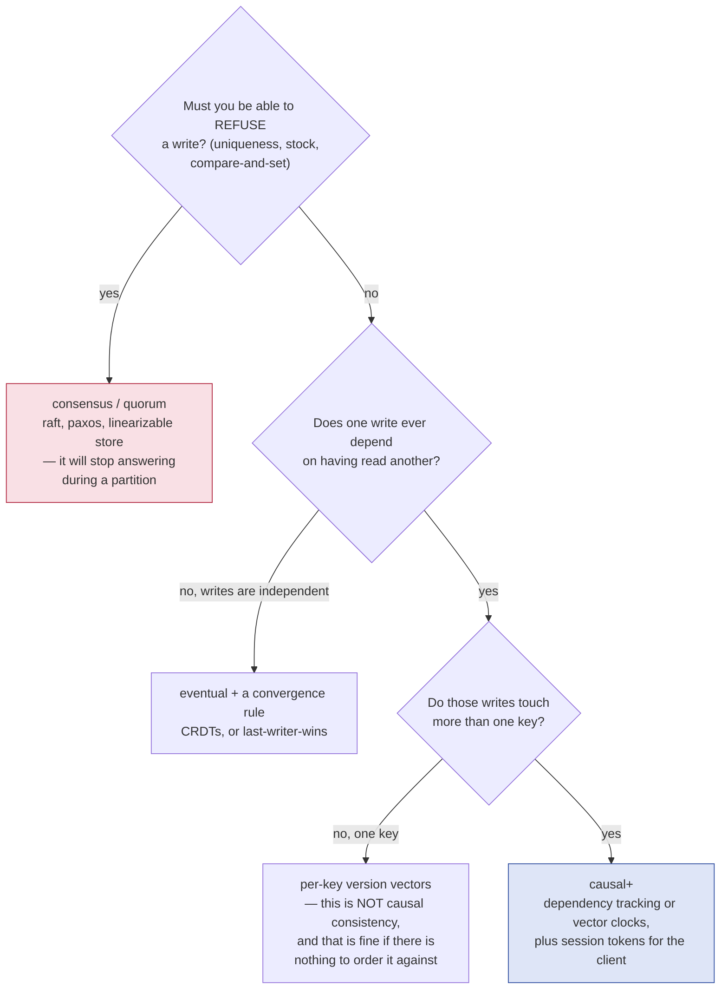
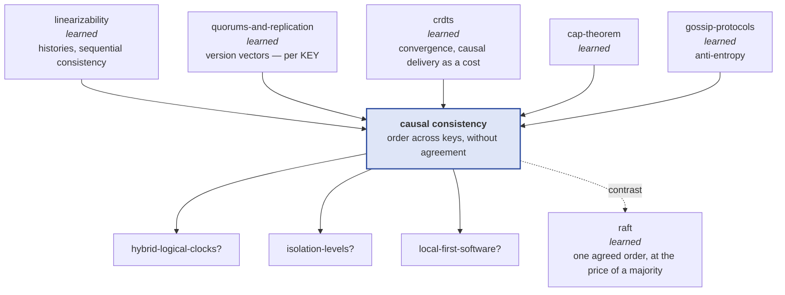

# Causal consistency — never show the reply before the message

> **Tell a friend:** Amira posts a photo of her dog in London. Ben, in
> Frankfurt, reads it and writes "lovely dog!" underneath. Cara opens the app in
> Singapore and sees Ben's comment sitting on its own, with no post above it.
> Nothing crashed and nobody misbehaved — Ben's comment simply took a faster
> road than Amira's photo, and the message carrying it never mentioned that he
> had read her post first. This lab is one rule that stops that: **never show a
> change without everything that happened before it.** You pay for it in waiting
> and nothing else, and it is the strongest promise you can keep while every
> region still answers on its own.

The trainer is [`visualization.html`](visualization.html) — *The Comment Before
the Post*. What the lab is made of, where every number came from, and where this
sits among your other labs: section 19, at the end.

---

## 1. Why can nothing be broken and the product still lie?

> **In one breath:** Your app is fast because each region answers from its own
> copy and passes changes to the others afterwards. That works perfectly until
> one change is a *reply* to another, because the reply can arrive first.

Your product runs in several regions so that people everywhere get fast answers.
A region answers immediately from its own copy. It passes the change along to
the other regions in the background. This is the design almost everyone ships.
For one person changing one thing, it is perfect.

It stops being perfect the moment one change is a *response* to another.

A comment is a response to a post. A reply is a response to a message.
"Publish this photo" is a response to "stop letting my manager see my photos".
The two changes then travel by different routes, at different speeds. The second
one can arrive first. Somewhere, a user is shown a reply to something that, as
far as that region knows, has not happened.

The damage runs from mildly confusing to genuinely serious.

| What the user sees | How bad it is | Why it happened |
|---|---|---|
| a comment on a post that is not there | confusing; looks like a UI bug | the comment overtook the post |
| a reply quoting a message you cannot find | support ticket; nobody can explain it | the reply overtook the message |
| a photo published under the *old* privacy setting | a security incident | the photo overtook the setting change |

Read the third row twice. That is the one that ends up in a postmortem. And the
worst part is the same in all three rows: **nothing is broken.** Every machine
did exactly what it was told.

---

## 2. What happens to Amira, Ben and Cara in one afternoon?

> **In one breath:** Three people in three cities, one photo, one comment, and
> two roads of very different quality. The comment gets there and the photo does
> not.

Meet the three people this lab follows all the way to the end.

> **Amira** is in London. **Ben** is in Frankfurt. **Cara** is in Singapore. All
> three use the same app, and each one is served by the region nearest to them.

Here is their afternoon, in three steps.

1. **Amira posts a photo of her dog.** London shows it to her instantly and
   starts sending a copy to Frankfurt and to Singapore.
2. **Ben reads the post.** The copy reached Frankfurt in a moment. **He leaves
   a comment**: "lovely dog!". Frankfurt shows it to him instantly and starts
   sending copies out.
3. **Cara opens the app in Singapore.**

One more fact, and it is the only unusual thing in the whole setup. The road
from London to Singapore is having a bad afternoon. The road from Frankfurt to
Singapore is fine.

Now hold on to this sentence, because everything else in the lab is a
consequence of it:

> **Ben's comment only exists because he read Amira's post.**

A human can see that at a glance. Nothing in the system can see it, because
nothing wrote it down.

**Where this lab takes you.** Stop at any checkpoint and you still have
something whole.

| Layer | Sections | After it you can… |
|---|---|---|
| **Beginner** | 1–9 | explain how an effect overtakes its cause, and what "wait for what it was based on" buys |
| **Intermediate** | 10 | derive every real implementation, from naming what a change was based on, to compressing that into counters, to the piece that has to live on the client |
| **Engineering** | 11–14 | state the guarantee and its exact edge, and cost it in latency rather than adjectives |
| **Production** | 15 | read the COPS and Bayou papers and MongoDB's causal-consistency docs and know what you are looking at |

---

## 3. What is the obvious design, and why does everyone ship it?

> **In one breath:** Show every change the moment it lands. There is nothing to
> wait for, so nothing is ever slow — and that is exactly the appeal.

Asha builds the replication path. Her first version is the one you would write
too, and it fits on a line:

> When a region receives a copy of a change, apply it and start showing it.

There is nothing to wait for, so nothing is ever slow. Every region ends up with
the same content eventually. This is what an ordinary asynchronous replicated
store does, and it is what you get by default from almost every system in this
family.

Asha ships it. Then Cara opens the app.

---

## 4. What does Cara actually see?

> **In one breath:** She sees the comment and no post. Nobody is alerted,
> because from the system's point of view nothing went wrong — and the reason it
> cannot go right is hiding in the message, not in the network.

> **🔮 Predict:** *Ben's comment took the fast road. Amira's post is still
> crawling. What is on Cara's screen, and who gets told about it?*
>
> <details><summary>Reveal</summary>
>
> She sees the comment "lovely dog!", and where the post should be there is
> nothing at all. Nobody is told anything. Singapore received one change and
> applied it, exactly as designed.
>
> If you guessed that Singapore would notice the gap and log a warning, you are
> imagining a system that knows the two changes are related. It does not. That
> is the whole problem, and the next paragraph is where it comes from.
>
> The lab's own narrated run says it like this:
>
> ```
> Cara reads comment :  lovely dog!
> Cara reads post :     null
> t=6 cara [CAUSALITY] sees comment=lovely dog! (R1#1) but post still reads
>       <absent> — the cause post=photo-of-a-dog (R0#1) is invisible here
> ```
>
> Three things in that output have short names. Here is what each one is, before
> you meet the notation again.
>
> | In the output | What it is, in words |
> |---|---|
> | `comment = "lovely dog!"` | the value Cara's screen is showing |
> | `R1#1` | the very first change Frankfurt ever accepted — Ben's comment |
> | `R0#1` | the very first change London ever accepted — Amira's post |
> | `[CAUSALITY]` | the checker's tag for "an effect is on screen and its cause is not" |
>
> Now the deeper problem, which is not about speed at all. **The message Ben's
> region sent carries no trace of the fact that his comment was written after
> reading Amira's post.** It says "set comment to 'lovely dog!'" and nothing
> else. Singapore could not have waited for the post even if it had wanted to.
> It had no way of knowing there was anything to wait for.
>
> The information was destroyed at the moment the message was built. You have
> seen this shape of failure twice before. The [`crdts`](../32-crdts/) lab opens
> with a whole list being sent where one individual change was meant. The
> google-docs lab opens with a position being sent where an identity was meant.
> Every time, *the wire format threw away what the receiver needed*.
>
> </details>

Two things stop this being a one-off curiosity.

**It is not rare. It just needs an unequal network.** Run the same design at six
levels of road slowness and the anomaly rate climbs steeply. The design never
changes between rows; only the road does.

| Extra delay on the slow road | Runs that showed an effect before its cause | What the row tells you |
|---|---|---|
| none | 30 of 300 | a calm network hides the bug nine times in ten |
| 20 ticks | **214 of 300** | the same code, on an unequal network, fails most of the time |

*A consistency test on a calm network proves nothing.* That is the same lesson
the [`linearizability`](../26-linearizability/) lab taught from the other side.

**It is not fixed by the tools you already own.** A version vector per key, from
[`quorums-and-replication`](../34-quorums-and-replication/), keeps *one key's*
copies in order. The post and the comment are different keys. A CRDT merge, from
[`crdts`](../32-crdts/), makes each key settle on one value. Neither says a word
about the order *between* two keys — and this problem lives entirely between
keys.

---

## 5. What are we really asking for?

> **In one breath:** Two demands. Never show an effect before its cause. And
> never stop answering. Everything difficult comes from wanting both.

State the requirement in plain words, with no technology in it:

> **If one change was made after seeing another, then no region may ever show
> the second without also showing the first.**

And, because Asha is not willing to give up the thing that made this
architecture worth building in the first place:

> Every region must still answer immediately, from its own copy, even while cut
> off from the others.

Now notice what we are *not* asking for. We are not asking that everybody see
changes in the same order. Only that nobody sees an effect before its cause.
Two changes that had nothing to do with each other may appear in either order,
on different machines, and that is fine.

That deliberate weakening is the whole idea. It is easiest to see against the
models you already know. Read the middle column as "the rule we are giving up".

| Model | The rule you delete | What you keep |
|---|---|---|
| **Linearizability** | — | one order, and it matches real time |
| **Sequential consistency** | real-time order | one order everybody agrees on |
| **Causal consistency** | one agreed order | order only where one thing caused another |
| **Eventual consistency** | causal order too | nothing about order at all |

Each step down buys availability and latency, and sells guarantees. This lab is
about the third row. §12 explains why that row is a far more interesting place
to stand than it first looks.

---

## 6. What is the one rule that fixes it?

> **In one breath:** Make every change carry a note of what its author had
> already seen. Make a region refuse to show a change until it has applied
> everything on that note.

Here is the rule, and the rest of the lab is either an implementation of it or a
consequence of it:

> **Make each change carry a record of what its author had already seen, and
> make a region hold a change back until it has applied all of that.**

Two halves, and both carry weight.

The first half is **record the reason**. Ben's message must say more than "set
comment to 'lovely dog!'". It must also say "…and the author had already seen
the post". Every design in §10 is a different way of writing that second clause
compactly.

The second half is **wait rather than show something wrong**. Singapore already
has Ben's comment sitting in memory. The rule does not make it arrive any
sooner. It makes the region *decline to show it* until Amira's post lands.

That is worth saying flatly, because it is the price tag on the entire lab:
**consistency here is bought with latency and nothing else.** No extra messages.
No agreement. No coordination. Just waiting.

---

## 7. Which six words carry this lab, and where did each one happen?

> **In one breath:** Six terms do all the work. Each one names something you
> have already watched happen to Amira, Ben or Cara, so you meet the thing
> first and the word second.

### Which word means "could have influenced"?

Ben read Amira's post, and then he wrote a comment. We cannot know that the post
shaped what he typed. We can know that it *could* have. That "could have
influenced" relationship is the only kind of "before" that survives having no
shared clock, and Leslie Lamport named it in 1978: **happens-before**.

Three things make it true, and nothing else does:

1. Two changes by the same person, in the order that person made them.
2. A change written after reading another change.
3. Chains: if the first happened before the second, and the second before the
   third, then the first happened before the third.

Engineers write it with a small arrow. Amira's post happens-before Ben's
comment, written `post → comment`. Read the arrow aloud as "could have
influenced", every time, until it stops needing translating.

Papers write the same three rules with single letters. Here they are with the
words kept beside them, so you never have to decode a bare arrow.

| Written as | In words |
|---|---|
| `a → b` | change `a` could have influenced change `b` |
| `b → c` | change `b` could have influenced change `c` |
| `a → c` | then `a` could have influenced `c` as well — that is the chaining rule |
| `b → a` | the reverse claim; for Amira's post and Ben's comment it is false |

The lab asserts both the reading rule and the chaining rule in
`Tests.reading_a_write_puts_it_in_your_causal_past` and in
`happens_before_is_transitive_across_three_clients`, the second across three
clients at once.

Why does this need its own word at all? To keep *could have influenced* apart
from *happened earlier on a wall clock*. The second is unknowable across
machines. It is also actively harmful when you rely on it: the
[`quorums-and-replication`](../34-quorums-and-replication/) and
[`crdts`](../32-crdts/) labs both counted a replica whose clock ran 60 seconds
fast destroying **1,000 of 1,000** genuinely newer writes.

If the name feels familiar, it should. It is the distributed twin of
*happens-before* in the [`java-memory-model`](../17-java-memory-model/) lab. Same
name, and the same job: say which writes a reader must see. One machine instead
of many.

### What do you call two changes that never heard of each other?

Amira sets the album title to "Dog Photos". At the same moment Ben sets it to
"My Dog". In the store those two changes read `title = "Dog Photos"` and
`title = "My Dog"`. Neither author had seen the other's. Neither could possibly
have influenced the other.

Engineers call that pair **concurrent**. Read the notation below aloud as
"neither one could have influenced the other", and notice that it is defined
entirely by two arrows that are *absent*.

| Written as | In words |
|---|---|
| `a ∥ b` | neither `a → b` nor `b → a` holds |
| `post ∥ comment` | said of two particular changes: this pair has no arrow either way |

The important trap: concurrent is a statement about *knowledge*, not about time.
Two changes made an hour apart are still concurrent if neither author had seen
the other's. Wall-clock distance has nothing to do with it.

This is why happens-before is a **partial order** rather than a line. Some pairs
simply are not comparable. The model needs a word for that gap, and every design
decision in §10 is really a decision about what to do inside it. There are
plenty of such pairs: one sweep of 300 workloads throws up 17,163 pairs where
neither author had seen the other's change.

### What is causal consistency, said precisely?

The plain version you already have from §5: you never see an effect before its
cause.

The precise version: every region applies changes in an order that agrees with
happens-before. Said fully — for every region there is some single ordering of
the changes it has applied that respects "could have influenced" and explains
every value it ever returned. Two regions may order a concurrent pair
differently. That freedom is the definition, not a loophole.

Why does the property deserve a name? Because it is the strongest guarantee that
costs no coordination at all. §12 gives the formal result. The practical version
is shorter: everything stronger has to stop answering during a partition.

With the rule switched on, Cara sees *neither* the post nor the comment, rather
than the comment alone. That is the test named
`Tests.causal_delivery_holds_the_effect...`, and it is the one behaviour change
the whole lab exists to produce.

### If that is the promise, what is the machinery called?

The promise is causal consistency. The machinery that delivers it is **causal
delivery**: a region applies a change only once everything that happened before
it has been applied.

Written with letters, and with the words kept alongside:

| Written as | In words |
|---|---|
| apply `w` only when every `d` with `d → w` is applied | show a change only once everything that could have influenced it is already showing |

Both words exist because you can have either without the other. A single-copy
store is trivially causally consistent and has no delivery rule anywhere in it.
And you can implement the delivery rule perfectly and still not have a system
anyone would ship — which is the next term.

You have already met this requirement once, as a cost rather than a subject. In
the [`crdts`](../32-crdts/) lab, causal delivery was the price of operation-based
CRDTs: deliver an add and a remove out of causal order, and the two copies
diverged permanently. This lab is that footnote, promoted to the subject.

### Why is causal consistency alone not enough to ship?

Turn the rule on, then have Amira and Ben set the same field at the same
instant, neither having seen the other. Causality has no opinion about that
pair. So each region keeps whichever copy happened to arrive last — and arrival
order differs per region.

The wire empties. Nothing is in flight. The regions still disagree, and nothing
will ever fix it. Across 400 runs, that happened **400 of 400** times.

So real systems ship causal consistency *plus* an agreed rule for the pairs
causality has no opinion about. Regions that have received the same changes end
up in the same state. The COPS paper coined a name for the combination:
**causal+**, short for causal consistency with convergent conflict handling.

The "+" is exactly where the [`crdts`](../32-crdts/) lab plugs in. Its strong
eventual consistency is a convergence guarantee with no ordering. This is an
ordering guarantee with no convergence. Together they are the whole package, and
that is what production systems actually ship.

### Which four smaller promises do users actually notice?

Terry and his colleagues at Xerox PARC, building Bayou in 1994, noticed
something practical. Users do not experience the whole store. They experience
their own session. So they named four promises made to *one user* rather than to
the system, and gave them names you will meet in every vendor's documentation.

| Promise | What it says | What the user notices when it is missing |
|---|---|---|
| **read-your-writes** | a read reflects your own earlier changes | Amira edits her bio, reloads, and the old bio is back |
| **monotonic reads** | you never see the store go backwards | Cara refreshes and the comment she just read disappears |
| **monotonic writes** | your changes are applied everywhere in the order you made them | Ben's second edit lands before his first |
| **writes-follow-reads** | a change you based on something you read is never applied before that thing | the comment-before-post story itself |

Two of those are nearly free. If a user always talks to the same region, the
first two cannot be violated at all. The lab counts **0** violations of
read-your-writes and monotonic reads with a sticky client. That holds even on
the design with no ordering machinery whatsoever.

And here is the theorem worth memorising: **all four together are exactly causal
consistency.** That is why the list is worth learning. It is the property, taken
apart into four pieces you can implement, test and alarm on one at a time.

### Where did each word happen?

The map back to the story. Every row names the section where you watched the
thing before it had a name.

| Word | The moment it names | Where you saw it |
|---|---|---|
| **happens-before** | Ben read the post, then wrote the comment | §2, step 2 |
| **concurrent** | Amira and Ben rename the album at once | §7, and the grey circles in §9 |
| **causal consistency** | Cara sees neither, rather than the comment alone | §5's requirement |
| **causal delivery** | Singapore holds the comment in memory, unshown | §6's second half |
| **causal+** | the wire empties and the regions still disagree | §10 v7 |
| **session guarantees** | Amira reloads and her own edit is missing | §10 v8 |

Smaller terms are defined where they first appear, and the full terminology is
collected in §18.

---

## 8. What picture should you keep in your head?

> **In one breath:** Every change is a letter, and on its envelope the author
> lists the letters they had already read. The post office may not put a letter
> on your desk until every letter named on its envelope is already there.

### What if every change were a letter with a reading list on the envelope?

Every change is a letter. On the envelope, the author writes the list of letters
they had already read when they wrote it. A post office may deliver a letter to
your desk only once every letter on that list is already on your desk.
Otherwise it goes in a tray behind the counter.

Follow the afternoon through, in letters:

- Amira's letter has an empty list. It can be delivered anywhere, immediately.
- Ben's letter says "I had read Amira's letter first". Singapore holds it in the
  tray until Amira's letter arrives.
- Two letters with each other's names absent from both envelopes have no
  relationship at all. Either may be delivered first, and nobody can complain.

That is the entire mechanism. Everything in §10 is an argument about how to
write the list compactly enough to fit on the envelope.

### What is the same picture in engineering words?

Changes form a **directed acyclic graph**: a set of dots with arrows, where the
arrows never loop back. Each arrow is "could have influenced". Every region's
set of applied changes must be **causally closed** — if a change is in the set,
everything below it in the graph is in the set too.

Reading is then safe by construction. Whatever a region returns, everything
underneath it is already there.

The exhibit below draws Amira's afternoon as that graph. Read the solid arrows
as "must be applied before". The dotted lines are **not** arrows — they mark
pairs with no arrow at all, and every region is free to order those however it
likes.



Pick any one change in that picture. The graph then splits into three regions
around it, and these three names are worth keeping:

- its **causal past** — everything that must already be visible;
- its **causal future** — everything that must not be visible before it;
- everything else — **concurrent**, and completely unconstrained.

Clicking a circle in [the visualization](visualization.html) paints exactly
those three regions in three colours. That single gesture is the fastest way to
feel that "could have influenced" is a partial order and not a timeline.

### How do the two pictures line up?

Read this table left to right: the letter, the engineering word, and the name in
the Java.

| In the letters story | In engineering words | In the Java |
|---|---|---|
| a letter | a change (a write) | `Write` |
| the reading list on the envelope | the causal past | `Write.deps` |
| the tray behind the counter | changes received but held | `Replica.pending` |
| "is every listed letter on the desk?" | the causal closure check | `Cluster.deliverable` |
| delivered to the desk | applied and visible | `Replica.store` / `applied` |
| two letters that never mention each other | concurrent changes | neither in the other's `deps` |

### Where does the story lie to you?

Three places, and each one is a whole later section.

**The reading list grows forever.** A person's list of "letters I have read" only
ever gets longer, so the envelope eventually costs more than the letter. After
320 operations it holds **102.5** entries per letter. §10 v5 and §10 v6 are two
different fixes.

**The post office does not resend.** Holding a letter in the tray is not the
same as noticing one was lost. A letter destroyed in transit is simply gone, and
every letter behind it waits forever. Causal delivery is a *when* rule and never
a *whether* rule. Resending is anti-entropy's job, from the
[`gossip-protocols`](../37-gossip-protocols/) lab. The lab asserts both halves:
healing a partition delivers nothing, and one anti-entropy round delivers
everything.

**The reader may walk to a different post office.** All of this orders *regions*
against each other. It says nothing at all about a user whose next request is
routed somewhere else. When clients roam, **334 of 500** of them fail to see
their own change. §10 v8 is that story.

---

## 9. Can you watch the order before you read the mechanism?

> **In one breath:** Before any code, spend ten minutes on the page. It draws
> three regions across time and lets you click one change to light up everything
> that caused it and everything it caused.

**[`visualization.html`](visualization.html) — *The Comment Before the Post***
(<https://claude.ai/code/artifact/497ca160-d05d-4b21-8e7e-dca6e71a732e>)

Time runs left to right, one lane per region. Filled circles are changes, hollow
rings are reads, arrows are copies in flight, and a thick dashed tail means a
copy arrived and is being deliberately held.

Do these four things, in order.

1. Start on **Show it the moment it lands**, which is the default. Run the
   first guess-first situation, *The comment with no post*. Watch the arrow from
   Frankfurt reach Singapore before the arrow from London.
2. **Click Amira's circle.** Everything caused by it turns amber. Everything
   that caused it turns indigo. Everything unrelated goes grey. That single
   gesture is the definition of happens-before, and the grey is the part
   causality has no opinion about.
3. Switch to **One counter per region** and replay the same situation. Nothing
   arrives any sooner. A dashed tail appears instead, and the verdict changes
   from "somebody saw an effect whose cause was invisible" to "one change is
   being deliberately held back". That trade is the entire subject of the lab.
4. Then break the assumptions. Change **which route is slow** and by how much.
   Cut a region off. Turn **users stay in their region** off. Press *Repair*
   after a partition and watch that healing alone delivers nothing.

Every outcome on the page matches an assertion in the Java, and §19 says how
that was checked.

---

> ### ✅ Checkpoint — end of the beginner model
>
> You can now explain how an effect overtakes its cause, why the fix has to
> change the message rather than add a repair step, and what the rule costs:
> latency, not throughput. **Next:** the actual implementations — and every odd
> detail in them will arrive as the fix to something you just watched break.
>
> **Say it back.** Without using the words *causal*, *dependency* or *order*,
> explain to a friend why Cara sees a comment with no post, and why sending the
> post again faster would not be a fix.
> <details><summary>A good answer sounds like</summary>
> "Ben's note took a quicker road than Amira's photo, so it got to Singapore
> first. Singapore showed it because it had no reason not to — the note never
> said it was written about the photo. Sending the photo faster would just make
> this rarer, not impossible. The fix has to be in what the note says, not in
> how fast it travels."
> </details>

---

## 10. How would you build this, one broken attempt at a time?

> **In one breath:** Eight designs. Nothing below is finished. Each version is
> what a careful engineer would build next, given exactly what just broke.

Asha does not design this in one go, and neither would you. She builds the
obvious thing, watches it fail, and fixes the thing that failed. Dev, Arjun and
Priya each hand her one idea along the way. Follow the eight steps and you will
have derived every real implementation in the field.

### v1 — what happens if you show every change the moment it lands?

Already done, already broken. Across 300 random workloads, **160** produce an
anomaly. §4 gave the diagnosis: the message carries no record that one change
was based on another.

The obvious repair is to put *something* in the message that says "this one
comes later". The next three versions are three different somethings.

### v2 — can a wall-clock timestamp put them back in order?

Dev suggests the thing everybody suggests first. Stamp every change with the
sending machine's clock reading — in Java, whatever
`System.currentTimeMillis()` returns at that instant. Have each region apply
changes in timestamp order. Ben's comment was written after Amira's post, so it carries the larger
number, so it is applied second.

> **🔮 Predict:** *Does stamping the wall-clock time fix the comment-before-post
> problem?*
>
> <details><summary>Reveal</summary>
>
> No, and it fails twice over, for two unrelated reasons.
>
> First, **clocks disagree**. You already have the number from two earlier labs:
> a replica whose clock ran 60 seconds fast destroyed **1,000 of 1,000**
> genuinely newer writes. If Ben's machine is slightly behind Amira's, his
> comment gets the *smaller* stamp. The ordering is inverted, with no error
> reported anywhere.
>
> Second, and more fundamental: **a region cannot know when it is safe to
> apply.** Singapore is holding a change stamped 14:32:09. Is something stamped
> 14:32:07 still in flight? A timestamp tells you where a change belongs in the
> order. It does not tell you the order is complete. Every design from here on
> has to answer that second question too, and most of the difficulty in this lab
> lives there.
>
> If you guessed that better clock synchronisation would rescue this, you fixed
> only the first reason. The second has nothing to do with clock quality. A
> perfect clock still cannot tell a region that nothing older is on the way.
>
> This is why the lab ships no wall-clock design for you to run. It fails for a
> reason you have already seen counted twice, and running it again would only
> teach you that clocks are still bad.
>
> </details>

### v3 — what about a counter that cannot lie?

Arjun's turn. Replace the clock with a counter that cannot run backwards
relative to a message. Each region keeps one integer. Every change bumps it.
Every message carries it. On receiving a message you set your integer to
whichever is larger, yours or theirs — in code, `max(yours, theirs)`. Lamport
described this in the same 1978 paper, so it is called a **Lamport clock**.

It has the property the wall clock does not: **if one change happened before
another, its counter is strictly smaller.** So order by the counter, and hold
anything that would apply out of order.

There are two problems. One is small. One is fatal.

> **🔮 Predict:** *Ordering by a counter that respects happens-before must give
> you causal consistency, surely?*
>
> <details><summary>Reveal</summary>
>
> Only if every link delivers in the order things were sent. Here are the two
> rows side by side:
>
> ```
> Lamport order, reordering links      3/300 runs      3 anomalies
> Lamport order, FIFO links            0/300 runs      0 anomalies
> ```
>
> Here is the leak. A region decides it is safe to apply a change stamped 7 once
> it has heard from every other region at 7 or higher. But "heard from" means
> whatever actually arrived. Suppose a later change from London, stamped 9,
> overtakes an earlier one from London, stamped 4, on the same link. The
> receiver's evidence now says "London has reached 9". So it releases the change
> it was holding, while London's change 4 is still in the air.
>
> If you guessed yes because the counter respects happens-before, you were
> assuming the counter arrives in counter order. **Ordering by a single counter
> is causal only over links that preserve send order.** Engineers call such a
> link **FIFO**, for first-in-first-out.
>
> That is a real dependency on your transport. It is quietly violated by UDP, by
> multi-path routing, and most commonly of all by sharding, where two keys
> travel on different connections. Scene 3 of the narrated run is exactly that
> case.
>
> </details>

Now the fatal problem, which no amount of FIFO repairs. **"Safe to apply" means
hearing from everybody.** A region that goes quiet stalls every other region's
queue. It does not matter whether it is quiet because it is idle, slow, or cut
off. From the outside, those three look identical.

The exhibit below prices that. "Held on arrival" counts changes that arrived and
were made to wait. "Write-ticks hidden" totals how long changes sat invisible.
Read the last row against the third.

| Design | Held on arrival | Write-ticks hidden | What the row says |
|---|---|---|---|
| show it the moment it lands | 0 | 0 | no waiting, and no guarantee |
| name the dependencies | 2,014 | 7,428 | the cheapest correct design |
| one counter per region | 2,995 | 16,279 | correct, and twice the waiting |
| **a single Lamport counter** | **9,583** | **89,509** | **twelve times the invisibility** |

Twelve times the invisibility of the best causal design, for exactly the same
promise. The reason is that a single counter forces a *total* order. It makes
everyone wait for everyone, including for changes they never depended on.

Put a number on that waste. Of the 17,163 pairs where neither author had seen
the other's change, a single Lamport counter puts **87.2%** of them into a
definite order. Every one of those orderings is invented, and every one costs
latency.

### v4 — what if each change names what it was based on?

Stop inferring. Asha's next version has each change carry **the actual set of
changes its author had already seen**, and a region holds it until every one of
them has been applied.

Each change needs a name for this to work. Give it two parts: which region
accepted it, and how many changes that region had accepted before. Amira's post
is London's first, so its name is `R0#1`. Ben's comment is Frankfurt's first, so
its name is `R1#1`. Engineers call that pair a **dot**. The point of it is that
any region can mint one alone, with no coordination at all. You used this exact
record in the [`crdts`](../32-crdts/) lab.

The whole idea is three lines of Java:

```java
// Cluster.deliverable, case DEPS — the whole idea, three lines
Set<Dot> need = rule.nearestOnly() ? w.nearest() : w.deps();
for (Dot d : need) if (!r.applied.contains(d)) return false;
return true;
```

This is correct with **no assumptions about the network at all**: 0 anomalies in
300 runs, no FIFO requirement, and no waiting on silent regions. It is also what
COPS does.

The cost is in the envelope. The exhibit below counts how many entries each
design puts on each change as a workload gets longer. Read down the "name them
all" column.

| Operations so far | Single counter | **Name them all** | Nearest only | One per region |
|---|---|---|---|---|
| 20 | 1.0 | 4.1 | 1.1 | 3.0 |
| 40 | 1.0 | 10.0 | 1.3 | 3.0 |
| 80 | 1.0 | 22.5 | 1.4 | 3.0 |
| 160 | 1.0 | 49.0 | 1.4 | 3.0 |
| 320 | 1.0 | **102.5** | 1.4 | 3.0 |

A person's causal past only ever grows, so the list grows without bound. At 320
operations, each change ships 102 dependency names in order to set one value.
The envelope now costs more than the letter.

### v5 — how much of that list can you throw away?

Most of that list is redundant, and the story shows you why. Ben's comment
depends on Amira's post. Cara's like depends on Ben's comment. So Cara's like
does not need to name the post at all. The comment already implies it, and the
comment cannot be applied without it.

Keep only the **nearest dependencies**, the ones no other dependency already
covers.

```java
// Cluster.nearest — a dep is redundant if another dep has it in ITS past
for (Dot other : deps)
    if (allWrites.get(other).deps().contains(d)) { covered = true; break; }
```

> **🔮 Predict:** *Throwing away most of the list must weaken something. What
> does Cara stop being protected from?*
>
> <details><summary>Reveal</summary>
>
> Nothing at all. This is a pure saving, and that is the surprise.
>
> The table above is the result: **1.4** entries per change, flat, against 102.5
> and climbing. And `Tests.full_deps_and_nearest_deps_give_the_same_visibility`
> asserts across over 100 workloads that the two produce identical region
> states. Not similar. Identical.
>
> If you guessed that some rare ordering would slip through, you were treating
> the dropped names as extra evidence. They are not evidence, they are echoes. A
> dropped name is one that some kept name already forces to be present. This is
> COPS's central optimisation, and it is what makes naming dependencies
> practical at all.
>
> </details>

### v6 — can you compress it to one counter per region?

There is a still more compact encoding, and it is the one most people have heard
of. Instead of naming individual changes, say **how much of each region's
history the author had already seen**.

Picture a row of three tally marks on the envelope, one per region. Amira's row
says "I had seen none of anybody's changes". Ben's says "one of London's, and my
own". A zero means "none of that region's changes at all".

Engineers call that row a **vector clock**: one counter per region, kept
together as a vector. Here is the row of marks, first in words and then as
notation.

| The row of marks | In words | Written as |
|---|---|---|
| London 0, Frankfurt 0, Singapore 0 | Amira's post, written before she had seen anything | `[0,0,0]` |
| London 1, Frankfurt 0, Singapore 0 | Ben, having read the post and nothing else | `[1,0,0]` |
| London 1, Frankfurt 1, Singapore 0 | the comment itself, once Frankfurt has accepted it | `[1,1,0]` |

The delivery rule then becomes two checks, and both are needed:

```java
// Cluster.deliverable, case VV
int src = w.id().replica();
if (w.vv()[src] != r.vv[src] + 1) return false;      // exactly the next write from its author
for (int j = 0; j < r.vv.length; j++)
    if (j != src && w.vv()[j] > r.vv[j]) return false;  // nothing else it saw is missing
return true;
```

The first line is the "no gaps" check: this must be exactly the next change from
its author, not one further along. The second is the "nothing missing" check:
everything else the author had seen must already be here. The lab plants a
broken build with the first line removed, to prove that check earns its place.

> **🔮 Predict:** *A vector clock is 3 numbers where the pruned dependency list
> was 1.4 names. Does the vector clock hold changes back for less time, or more?*
>
> <details><summary>Reveal</summary>
>
> **More.** Look again at the table above: 16,279 write-ticks hidden for the
> vector clock against 7,428 for the explicit list. More than double the
> waiting, for exactly the same promise.
>
> If you guessed less, you were pricing bytes on the wire rather than time on
> the clock. Smaller metadata is not the same as less waiting, and here the two
> pull in opposite directions.
>
> The reason is a distinction worth carrying out of this lab. The two designs
> answer different questions. The dependency list records **what the person
> saw**, exactly. A vector clock records **what that person's region had already
> applied** when the change was accepted, which includes plenty the person never
> looked at.
>
> The second is a safe over-approximation. It never under-orders, so it is
> always correct. But it invents dependencies that were never there. Of the
> 17,163 pairs where neither author had seen the other's change, the per-region
> counters still put **68.9%** into an order.
>
> ```
> what the CLIENT saw   — exact.        0% false ordering.   list, ~1.4 entries
> what the REGION had   — safe superset. 68.9% false ordering. 3 counters
> a single counter      — total order.   87.2% false ordering. 1 counter
> ```
>
> That is the real trade, in one sentence: **precision costs bytes, imprecision
> costs latency.** All three rows are correct. None of them ever shows an effect
> before its cause.
>
> </details>

### v7 — with the rule working perfectly, do the regions agree?

Turn causal delivery on and leave it on. Now have Amira and Ben set the same
field at the same instant, neither having seen the other.

> **🔮 Predict:** *Causal delivery is working perfectly. Do the three regions end
> up showing the same value?*
>
> <details><summary>Reveal</summary>
>
> Not necessarily, and in this lab's runs, never:
>
> ```
> causal only (no convergence rule)     replicas left disagreeing: 400 / 400
> causal+, one counter per replica      replicas left disagreeing:   0 / 400
> ```
>
> Causality has **no opinion** about a concurrent pair. So each region keeps
> whichever change arrived last, and arrival order differs per region. Every
> message has been delivered. Nothing is in flight. The regions permanently
> disagree, and no further messages will fix it.
>
> If you guessed yes, you were expecting an ordering rule to be a tie-break rule
> as well. It is not. Ordering says nothing about the pairs it refuses to order.
>
> The fix is one line, and it is not an ordering rule at all. Resolve concurrent
> changes the *same way everywhere*. This lab uses a tie-break on the pair
> `(lamport, replicaId)`, which in words means "the larger counter wins, and if
> those are equal, the lower-numbered region wins". A real system might use a
> CRDT merge instead, which is what the [`crdts`](../32-crdts/) lab built.
>
> ```java
> // Cluster.wins — the "+" in causal+
> if (current.deps().contains(incoming.id())) return false;  // ordered: incoming is the past
> if (incoming.deps().contains(current.id())) return true;   // ordered: incoming is later
> if (!rule.convergent()) return true;                       // concurrent: arrival order — diverges
> return incoming.lamport() > current.lamport() ...;          // concurrent: agreed tie-break
> ```
>
> Causal consistency plus that rule is **causal+**, and it is what every
> production system actually means when it says "causal".
>
> </details>

### v8 — what about the user who moves?

Everything so far orders *regions* against each other. Now move a person.

Amira updates her profile in London. Priya has just rolled out a load-balancer
change for better balancing, and Amira's next request is routed to Frankfurt,
before the copy of her update arrives.

> **🔮 Predict:** *Causal delivery is on and working. Does Amira see her own
> edit?*
>
> <details><summary>Reveal</summary>
>
> Usually not:
>
> ```
> stays on one replica     reads that did NOT see the client's own write:   0 / 500
> roams between replicas   reads that did NOT see the client's own write: 334 / 500
> ```
>
> If you guessed that causal delivery covers this, look closely at what is
> happening. Nothing is out of order. Frankfurt has not shown any effect before
> its cause. Amira's update is simply still in flight, and Frankfurt is
> answering honestly from what it holds.
>
> What is missing is that **the person has a position in history too**, and it
> did not travel with her.
>
> </details>

The fix is to give the client a token describing what it has seen, and to have
it present that token with every request. The region then waits until it has
caught up to that point before answering. MongoDB calls that token
`afterClusterTime`. Bayou called the general idea session guarantees. Exercise
7.1 builds it.

Now the four promises from §7 have a mechanical shape. Read the right-hand
column as "where the ordering has to live".

| Guarantee | What it needs |
|---|---|
| read-your-writes | the client's own position, carried with it |
| monotonic reads | the client's own position, carried with it |
| monotonic writes | per-author ordering between regions |
| writes-follow-reads | cross-author ordering between regions — the hard one |

And here is the split, counted. Every cell counts violations of that promise, so
lower is better and zero is the goal.

```
design                              R-Y-W   mono-R   mono-W      WFR
async, client stays put                 0        0      834     2075
async, client roams                  3359     1243      884     2340
causal, client stays put                0        0        0        0
causal, client roams                 3759     1611        0      356
```

Read the first and third rows together, and one fact jumps out. **Session
stickiness gives you the two guarantees users actually notice, for free, with no
ordering machinery at all.** Row one has no causal delivery anywhere in it and
still scores zero on both.

That is why a sticky load balancer papers over so much. It is also why Priya's
change, removing stickiness for better balancing, is a consistency change
wearing an infrastructure costume.

---

> ### ✅ Checkpoint — end of the intermediate model
>
> You can now derive every real implementation from the failure of the one
> before it, and explain why a vector clock, the cheapest encoding on the wire,
> is also the slowest to release a change. **Next:** the failure modes, and the
> precise sentence describing what causal consistency does not promise.
>
> **Say it back.** Without using the words *vector*, *dot* or *metadata*,
> explain to a friend why naming the exact changes an author saw makes people
> wait less than counting how much of each region's history they saw.
>
> <details><summary>A good answer sounds like</summary>
> "The list of names says what Ben actually read. The row of tallies says what
> Frankfurt happened to have on hand when Ben pressed send, which is more than
> he read. So the tallies make Singapore wait for things Ben never looked at.
> Both are safe. One of them just makes people wait for nothing."
> </details>

---

## 11. What goes wrong, and what does it look like on call?

> **In one breath:** Ten things break. Some break the guarantee, some break only
> your patience, and telling those two apart at three in the morning is the
> skill this section is for.

Each of the ten is a short story about Amira, Ben, Cara or the people who keep
their app running. After the ten there is one table that lines them all up.

**1 · An effect overtakes its cause.**
This is Cara's afternoon from §4. She sees a comment on a post that is not
there, and on the design with no ordering at all it happens in **160 of 300**
random workloads. The message carried no record of the dependency, so Singapore
had nothing to wait on. Every region is internally fine and will settle down
eventually. What is gone is causal consistency, visibly, to a real person. On
call it arrives as a bug report nobody can make happen again: "the reply showed
up before the message". On a calm network it hits 30 times in 300 rather than
214, which is why nobody can. The narrated run leaves this line behind:

```
t=6 cara [CAUSALITY] sees comment=lovely dog! (R1#1) but post still reads
      <absent> — the cause post=photo-of-a-dog (R0#1) is invisible here
```

**2 · The same design, on a calm network.**
Asha's staging environment has three regions in one datacentre and equal
latencies between them. She runs the consistency suite and it passes. At zero
extra route delay the anomaly shows up 30 times in 300; at 20 ticks of extra
delay, 214 times in 300. Nothing about the design changed between those two
rows. Only the network did. This is the single most useful sentence in the lab:
**a consistency test without injected asymmetry is close to worthless.** Jepsen's
entire method is built on that observation.

**3 · Ordering by a single counter over reordering links.**
Arjun's Lamport design leaks in 3 of 300 runs when links may reorder, and in 0
of 300 when every link preserves send order. The mechanism is v3's: a later
change from a region raises the receiver's evidence about that region past an
earlier change of its own that is still in flight. The design is still perfectly
correct if every link is FIFO. It stops being correct the moment two keys travel
on different connections. This is why "we use TCP, so we're causal" is wrong.
TCP preserves order per connection, and a sharded store has thousands.

**4 · A quiet region stalls everyone.**
Singapore goes idle for a while. Nobody there is doing anything. London and
Frankfurt still cannot release anything, because the single-counter rule needs
news from everybody before anything is safe. The price was in v3's table: 89,509
write-ticks hidden against 16,279 for the vector clock, same guarantee.
Correctness is untouched. What is lost is liveness of visibility — and an idle
region is indistinguishable from a slow one. Systems that need this design send
heartbeats purely so that silence cannot be mistaken for lag, exactly as Raft's
empty AppendEntries does.

**5 · The dependency list outgrows the data.**
Nothing is wrong here at all, and that is the point. Amira's causal past never
shrinks, so after 320 operations each change is carrying **102.5** dependency
entries to set one value, and still growing. Correctness is perfect throughout.
This is a bill, not a bug. COPS's nearest-only pruning takes it to 1.4, and past
that you switch to a vector clock and pay in latency instead.

**6 · One slow shard makes unrelated changes invisible.**
This is the failure that decided the history of the field, so read the numbers
slowly. One route slows down. Everything causally after a delayed change must
wait, and dependency chains carry that delay into changes about entirely
different keys.

| Extra delay on the one slow route | Write-ticks hidden | Multiple of the calm case |
|---|---|---|
| 0 | 351 | 1× |
| 4 | 1,443 | about 4× |
| 8 | 5,613 | about 16× |
| 16 | 16,697 | about 48× |
| 32 | **31,659** | about 90× |

Correctness holds all the way down that column. What is lost is visibility
latency, and it is lost *non-locally*: Cara waits for something she has no
relationship with. Engineers call this the **slowdown cascade**, and it is the
reason causal stores did not become the default. Facebook's *Existential
Consistency* paper looked at their eventually-consistent store and found it was
already causal 99.9%+ of the time. So they declined to pay this bill for the
remaining 0.1%.

**7 · A client is moved to another replica.**
Priya's load-balancer change from v8. **334 of 500** roaming clients fail to see
their own change. Nothing is out of order; the change is simply still in flight.
Causal ordering between regions is genuinely intact, and genuinely not helping.
What is lost is read-your-writes and monotonic reads — the two promises users
actually notice. The fix is the session token the client presents, which MongoDB
spells `afterClusterTime`. Until that exists, session stickiness is
load-bearing, and turning it off is a data-correctness change.

**8 · Concurrent changes leave the regions disagreeing forever.**
Amira and Ben rename the album at the same instant. In **400 of 400** runs, the
three regions end up showing different values with the wire completely empty.
Causality has no opinion about that pair, and arrival order differs per region.
This is fully legal causal consistency, which is exactly why it is dangerous.
What is lost is convergence. You never ship this. You ship causal+, with either
a timestamp tie-break, which loses updates, or a CRDT merge, which costs
metadata.

**9 · A partition, and then a heal that heals nothing.**
Singapore is cut off. Every operation Cara performs still succeeds on stale
data: **600 of 600** of them. Availability holds throughout, and so does causal
consistency. Then the partition heals, and the changes made during the outage
are *still missing*, because causal delivery is a rule about *when* a received
change may be shown, never about *whether* it arrives. What is lost is recency,
and until repair runs, cross-region visibility itself. The background repair
loop from [`gossip-protocols`](../37-gossip-protocols/) is not optional. Without
it, a causal store is a store that quietly forgets. The suite pins both halves
down in `Tests.anti_entropy_is_what_repairs_a_partition_not_causal_delivery`:
healing alone delivers nothing, and one repair round delivers everything.

**10 · Per-key causality mistaken for causal consistency.**
This is the most common misunderstanding in the whole area, so it gets the last
slot. Build the rule so it waits only for dependencies on the *same key*. That
is precisely what a per-object version vector gives you, and precisely what the
[`quorums-and-replication`](../34-quorums-and-replication/) lab taught you to
build. The lab plants it as the bug named `same-key-only`. Anomalies appear in
**99 of 200** runs, and Cara's comment-before-post afternoon replays exactly. Every individual key's history is intact. The whole
property is gone. **Causality is a statement across keys.** A per-key version
vector is a convergence tool, not an ordering one.

Now line them up. Read the third column first: it is what is still true while
you are being paged.

| # | The failure in short | What still holds | What is lost |
|---|---|---|---|
| 1 | an effect overtakes its cause | every region converges eventually | causal consistency, visibly, to a user |
| 2 | the calm network hides it | nothing about the design changed | your confidence in the test suite |
| 3 | one counter over reordering links | correct if every link is FIFO | the guarantee, silently, once you shard |
| 4 | a quiet region stalls everyone | correctness | liveness of visibility |
| 5 | the dependency list outgrows the data | correctness | nothing logical; this is a cost |
| 6 | one slow route hides unrelated changes | correctness, throughout | visibility latency, non-locally |
| 7 | the client is moved to another replica | ordering between regions | read-your-writes, monotonic reads |
| 8 | concurrent changes never converge | causal consistency; this is legal | convergence |
| 9 | a heal that heals nothing | availability, and causal consistency | recency, until repair runs |
| 10 | per-key causality mistaken for the real thing | every individual key's history | the whole property |

---

## 12. What exactly is promised, and where does the promise stop?

> **In one breath:** The promise is one sentence long. The list of things it
> deliberately does not promise is much longer, and every item on it has bitten
> somebody.

### What is guaranteed?

Five things hold, and each one has a count behind it.

The core promise: **no region ever shows a change without also showing
everything that happened before it.** All three dependency-based designs score 0
anomalies in 300 runs.

All four session guarantees hold, provided the client keeps its position:
read-your-writes, monotonic reads, monotonic writes and writes-follow-reads,
all four at 0 violations for causal plus sticky routing.

Availability is total. Every region answers every read and every change
immediately, alone, partitioned, forever — 600 of 600 operations on the isolated
side of a partition.

Amira's own changes are never delayed. A region applies its own clients' changes
with no waiting at all, which the lab pins down in
`Tests.a_replica_never_delays_its_own_clients_write`.

And with the "+", convergence: regions that have received the same changes end
up in the same state, 0 of 400 divergent with a tie-break in place.

### What is explicitly not guaranteed?

There is **no agreed order for concurrent changes**. Two regions may serialise
Amira's rename and Ben's rename differently. Without a convergence rule they can
disagree permanently, which is failure 8.

There is **no recency**. A causal read may be arbitrarily stale and still be
perfectly legal. The lab's own check,
`Tests.a_causal_read_can_be_arbitrarily_stale`, returns a value 100 ticks out of
date with zero violations recorded. There is no bound at all. Compare
[`linearizability`](../26-linearizability/), where "already answered" pins a read
to real time. Here nothing does.

There is **no compare-and-set, no uniqueness, and no global invariant**. Omar
from the compliance team asks whether the app can reserve a seat, or promise
that a username is unique. It cannot. Deciding requires agreeing, agreeing
requires coordination, and coordination is the thing we gave up. This is the
same wall the [`crdts`](../32-crdts/) lab hit at minus two bags of flour.

There are **no transactions**. Two changes are ordered if one caused the other.
They are never *atomic*. Cara can legally see the first without the second.
COPS's follow-up, Eiger, adds read-only and write-only transactions on top, and
that is extra machinery rather than a consequence of causality.

There is **no delivery**. Causal delivery orders what arrives. Loss needs
anti-entropy, which is failure 9.

And there is **nothing about the client**. Ordering between regions says nothing
about a person who moves between them, which is failure 7.

### What did you trade away, and what did you get for it?

You gave up agreement on the concurrent pairs, and any relationship to real
time. In exchange you keep answering during a partition. That is the whole
point, and it brings us to the result that makes this model interesting rather
than merely weak:

> **Causal consistency is the strongest consistency model that can be
> implemented in a system that remains available under network partition.**

Two papers make that precise. Attiya and Welch show that stronger models require
communication proportional to network delay, so they cannot be available.
Mahajan, Alvisi and Dahlin show causal consistency is the ceiling for
always-available, one-way-convergent systems.

So this is not "eventual consistency with extra steps". It is the top of the
available half of the [`cap-theorem`](../24-cap-theorem/) picture.

### Where does this sit on the ladder?

The exhibit below is the same ladder as §5's table, drawn as a fall. Each step
down gives up a rule and gains the ability to keep answering.



### Which model do you actually need?

> **🔮 Predict:** *Asha's team stores follower counts. Nobody ever reads a count
> before writing one; the writes are independent. Do they need any of this?*
>
> <details><summary>Reveal</summary>
>
> No. They need a convergence rule and nothing else. If no change is ever made
> after reading another, there is no causality in the workload, and a rule that
> orders causes before effects has nothing to order.
>
> If you guessed yes because the data is replicated, you are buying ordering for
> a workload with no order in it. That is failure 6's bill with none of failure
> 1's benefit. Follow the tree below and it lands you on the eventual branch.
>
> </details>

Follow this from the top. Each question is one you can answer about your own
product today.



### What does each design cost?

One table, and the middle column is the one people forget. "Over-orders" is the
share of genuinely unrelated pairs the design puts in an order anyway. That is
latency you pay for nothing: changes waiting on things their author never looked
at.

| Design | Metadata per change | Over-orders | Correctness needs |
|---|---|---|---|
| show it the moment it lands | 0 | — | nothing, and gives nothing |
| single counter | 1 | 87.2% | **FIFO links** plus hearing from everyone |
| name them all | grows: 102.5 at 320 ops | 0% | nothing |
| nearest only | 1.4, flat | 0% | nothing |
| one counter per region | 1 per region | 68.9% | nothing |

---

## 13. Which lines actually carry the guarantee?

> **In one breath:** Eight files, no dependencies, and the whole property lives
> in one method. Everything else is scaffolding that lets you watch that method
> work.

Read them in this order. The right-hand column is the line to look at first in
each file.

| File | What it is | The line that matters |
|---|---|---|
| `Dot.java` | a unique name for one change | `record Dot(int replica, long seq)` |
| `Write.java` | a change, and everything known about its place in history | the `deps` field — the whole subject |
| `Rule.java` | the design under test | `Ordering { NONE, LAMPORT, DEPS, VV }` |
| `Cluster.java` | regions, clients, and a network you can abuse | **`deliverable()`** — everything else is scaffolding |
| `Sim.java` | Amira, Ben and Cara's narrated afternoon | five scenes |
| `Tests.java` | 32 asserted guarantees | `an_effect_can_arrive_before_its_cause` |
| `Experiments.java` | ten measurements | `workload()` — note it *reads before writing* |
| `YourCheck.java` | exercise 5, with the rule blanked out | self-checking, 2/6 → 6/6 |

Three lines carry the concept, and all three are in `Cluster.java`.

```java
// 1. a write records what its author had already seen
Set<Dot> deps = new TreeSet<>(c.context);

// 2. a replica may not show it until all of that is applied
for (Dot d : need) if (!r.applied.contains(d)) return false;

// 3. reading a write puts it, and everything it depended on, in your past
c.context.add(w.id());
c.context.addAll(w.deps());
```

Line 1 is Ben's envelope. Line 2 is the tray behind the counter. Line 3 is what
happens the moment Ben reads Amira's post: her post, and everything her post
depended on, joins his own past.

There is no conflict-resolution step and no repair pass anywhere in the ordering
path. The property is entirely a consequence of line 2.

One deliberate choice is worth flagging, because it will save you from writing a
useless test one day. `Experiments.workload()` makes each client **read before it
writes**. A workload of independent changes has no causality in it and cannot
demonstrate any of this. Build a consistency test that never reads before
writing and it will pass on every design, including the broken ones.

Here is what the suite prints, abbreviated to the lines that matter most:

```
== The anomaly, and the rule that stops it
  PASS  apply-on-arrival: Cara sees the comment
  PASS  ...while the post is still absent
  PASS  causal delivery: Cara sees neither, not the wrong one
  PASS  ...the comment is received but deliberately held
== What causal consistency does NOT give you
  PASS  causal ordering alone leaves replicas disagreeing (100/100)
  PASS  causal+ (one agreed tie-break) converges 100/100
  PASS  a legal causal read returns a value 100 ticks out of date
32 passed, 0 failed
```

---

## 14. Can you predict the numbers before you run them?

> **In one breath:** Ten runnable measurements. Answer the question in the
> second column out loud before you type the command, then check yourself
> against the fourth.

| # | Answer before you run it | Command | What you should see |
|---|---|---|---|
| 1 | Which designs let an effect overtake its cause? | `java src/Experiments.java 1` | apply-on-arrival **160/300**; all dependency designs **0/300**; Lamport **3/300** without FIFO links, **0** with |
| 2 | Does a calm network hide a broken design? | `java src/Experiments.java 2` | **30/300** at no delay against **214/300** at 20 ticks, same design |
| 3 | What does each encoding cost per change? | `java src/Experiments.java 3` | name-them-all **102.5** and rising; nearest **1.4** flat; vector clock **3.0** flat |
| 4 | What does the guarantee cost in latency? | `java src/Experiments.java 4` | write-ticks hidden: 0 / **7,428** / **16,279** / **89,509** |
| 5 | Which promises does stickiness give you free? | `java src/Experiments.java 5` | read-your-writes and monotonic reads at **0**, even with no ordering at all |
| 6 | What breaks when a client changes replica? | `java src/Experiments.java 6` | **334/500** miss their own change |
| 7 | Does causal ordering make regions agree? | `java src/Experiments.java 7` | **400/400** disagree without a tie-break, **0/400** with |
| 8 | Can the isolated side keep working? | `java src/Experiments.java 8` | **600/600** operations answered; a linearizable store answers 0 |
| 9 | How much does each design over-order? | `java src/Experiments.java 9` | vector clock **68.9%**, Lamport **87.2%** of genuinely concurrent pairs |
| 10 | How far does one slow route reach? | `java src/Experiments.java 10` | write-ticks hidden 351 → **31,659** as the route slows 0 → 32 |

Two are worth doing by hand, because both punish a guess.

The first is the planted-bug run. Before reading any output, predict which of
the three plausible-but-wrong rules recreates Cara's exact comment-before-post
afternoon. Two of them do.

The second is a one-line edit. In `Experiments.workload()`, delete the
`c.get(...)` line that precedes each `c.put(...)`, then re-run experiment 1.
Apply-on-arrival drops from **160/300** to **28/300**. Predict *before* you run
it whether it will drop to zero, then explain the number you actually get. It
does not reach zero, and the reason is the whole point: causality is created by
reading, and the workload still has one other read path left in it.

---

> ### ✅ Checkpoint — end of the engineering model
>
> You can now name the failure modes, state the guarantee and its exact edge,
> and cost the whole thing in latency rather than adjectives. **Next:** what real
> systems ship, and everything this lab left out.
>
> **Say it back.** Without using the words *concurrent* or *converge*, explain
> to a friend why turning the rule on can leave the three regions permanently
> showing three different album titles, and why that is not a bug.
>
> <details><summary>A good answer sounds like</summary>
> "The rule only says: if one change was made after seeing another, show them in
> that order. Amira and Ben each renamed the album without seeing the other, so
> the rule has nothing to say about which of the two comes first. Each region
> keeps whichever landed last, and the landings happen in different orders. You
> need a second rule, one that picks the same winner everywhere."
> </details>

---

## 15. What does a real system add, and what does Meera watch?

> **In one breath:** The lab is one JVM and three maps. A real system adds five
> things, and the on-call engineer watches six numbers — one of which matters
> more than the other five put together.

### What is the chain from this lab to a real system?

**This lab** is one JVM, three regions, one key-value map each, a tick-driven
network, and one design at a time. It exists to make `deliverable()` visible.

**A real implementation** adds five things, roughly in this order.

1. **Sharding, and the fact that it breaks FIFO.** A real store has thousands of
   partitions, and two keys travel on different connections. This is why the
   single-counter design is not usable in practice, and why dependency tracking
   has to be explicit. See failure 3.
2. **Dependency pruning.** COPS's nearest-only rule, plus a "these are old
   enough that everyone certainly has them" cut-off, plus batching. Without it,
   experiment 3's 102.5 becomes unbounded.
3. **Session tokens.** The client-side half from v8: a compact record of the
   person's position, presented with each request, so that Amira stays ordered
   even when Priya's load balancer moves her. MongoDB's `afterClusterTime` over a
   hybrid logical clock.
4. **Anti-entropy.** Causal delivery orders; it does not deliver. The background
   repair loop from [`gossip-protocols`](../37-gossip-protocols/) does.
5. **A convergence rule.** The "+" — a timestamp tie-break, or CRDTs from the
   [`crdts`](../32-crdts/) lab, chosen per data type rather than globally.

**A production architecture** is then this. Regions, each internally a sharded
and locally-consistent store. Asynchronous replication between regions, carrying
dependency metadata. A dependency-check queue on the receiving side. A repair
loop underneath. Sticky routing plus session tokens at the edge. And, for the
small set of operations that must be able to say *no*, a completely separate
coordinated path.

### What does the on-call engineer actually watch?

Meera carries the pager for this service. Six numbers are on her dashboard.
Read the third column as "what makes her open the laptop".

| Signal | Why it is there | What bad looks like |
|---|---|---|
| dependency-queue depth per region | changes received but not yet showable | a queue that grows instead of oscillating: something upstream is stuck |
| write visibility lag, p99 | the real user-facing number | a step change right after a routing or sharding deploy |
| metadata bytes per change | the pruning is working, or it is not | steady growth with no plateau |
| the oldest blocked dependency | one lagging shard delaying everything | a single change id sitting at the head of many queues |
| session-token rejections | clients arriving ahead of the region | spikes right after a load-balancer change |
| stickiness rate | the two cheap guarantees | a drop here is a consistency regression, not an infra tweak |

If Meera may have only one alarm, it is **the age of the oldest blocked
dependency**. It catches the slowdown cascade before Cara does, and it is the
failure mode unique to this design.

### Who actually ships this?

| System | What it does | Worth knowing |
|---|---|---|
| **MongoDB** (3.6+) | causally-consistent sessions: `afterClusterTime` over a hybrid logical clock | the mainstream implementation you are most likely to meet; **per-session, opt-in**, not automatic |
| **Azure Cosmos DB** | offers *Consistent Prefix* and *Session* as named levels | Session ≈ the four session guarantees; Consistent Prefix ≈ never see changes out of order |
| **COPS / Eiger** (research) | the origin of "causal+" and nearest-dependency pruning | Eiger adds read-only and write-only transactions on top |
| **AntidoteDB** | causal+ with CRDTs and transactions, geo-replicated | the clearest working example of this lab's design end to end |
| **Bayou** (Xerox PARC, 1994) | where the four session guarantees were named | still the best paper on the client-side half |
| **Riak / Dynamo** | per-key version vectors and siblings | **not** causal consistency: no ordering across keys. See failure 10 |
| **Cassandra** | none of this | `QUORUM` gives overlap, not order — the quorums lab's distinction |
| **Facebook TAO** | eventually consistent, and causal 99.9%+ of the time anyway | *Existential Consistency* (2015): the honest reason most people never buy this |

Notice the pattern in that table. Causal consistency is *offered as an option*
far more often than it is *the default*. The reason is failure 6: nobody wants
their unrelated changes delayed by somebody else's slow shard.

### What does this lab deliberately leave out?

| Omitted | Why it matters | How real systems do it |
|---|---|---|
| **sharding** | one map per region here; real stores have thousands of partitions, which is what breaks FIFO | explicit dependency metadata, per-partition queues |
| **dependency garbage collection** | the lists here are kept forever | prune to nearest, then drop anything provably everywhere |
| **session tokens** | the client-side half of the property | `afterClusterTime`, Bayou session state |
| **hybrid logical clocks** | this lab uses a pure Lamport counter | HLC keeps a physical-time component, so timestamps stay readable and bounded |
| **transactions** | changes are ordered, never atomic | Eiger's read-only and write-only transactions; Antidote's interactive ones |
| **persistence and recovery** | everything is in memory | log plus snapshot; a recovered region must not go backwards |
| **membership changes** | three fixed regions | the vector-clock encoding is sized by membership, so adding a region is a schema change |
| **Byzantine faults** | every region is trusted to report its dependencies honestly | out of scope for this family entirely |

The membership row deserves its own sentence. **A vector clock's width is your
region count**, so "add a region" means rewriting every stored clock. That is a
real operational cost the compact encoding hides, and it is one more reason
dependency lists survive in systems that reshard often.

---

> ### ✅ Checkpoint — end of the production model
>
> You can now say what a real store adds on top of `deliverable()`, which alarm
> to build first, and why the industry offers this as an option rather than a
> default.
>
> **Say it back.** Meera is asked to move the service off sticky routing to
> balance load more evenly. In two sentences, and without using the word
> *causal*, explain what she should say back.
>
> <details><summary>A good answer sounds like</summary>
> "Right now, each person always talks to the same region, and that alone is
> what stops them seeing their own edits vanish. If we spread them across
> regions, we need every request to carry a marker saying how far that person
> has got, and every region to wait until it has caught up before answering."
> </details>

---

## 16. What should you try yourself?

> **In one breath:** Eight rungs, easiest first, from explaining the anomaly in
> your own words up to designing a multi-region product and saying which parts
> must *not* be causal.

[`EXERCISES.md`](EXERCISES.md) takes you from explaining the anomaly in your own
words, through implementing the delivery rule and finding a planted bug, up to
designing a multi-region product and saying precisely which parts must *not* be
causal. Answers are in [`SOLUTIONS.md`](SOLUTIONS.md). Attempt each rung first.

---

## 17. Where does this sit, and what comes next?

> **In one breath:** Five labs fed into this one. Three lead out of it. And six
> neighbouring ideas get confused with it, so each gets one sentence of
> separation.



### What is this commonly confused with?

Six near-neighbours, one sentence of separation each.

**Against eventual consistency.** Eventual consistency promises the regions end
up the same and says nothing about what you see on the way. Causal consistency
constrains the journey and, on its own, promises nothing about the destination.
You want both, which is causal+.

**Against a per-key version vector.** A version vector orders changes *to one
key* and detects conflicts on it. Causal consistency orders changes *across all
keys*. Confusing the two is the most common mistake in this area, and the
planted-bug run recreates it at **99 of 200** runs anomalous.

**Against sequential consistency.** Sequential consistency requires one order
that everybody agrees on. Causal consistency lets different regions order
concurrent changes differently. Sequential needs coordination; causal does not.

**Against "consistent prefix".** Consistent prefix says you see some prefix of a
single agreed order. It is stronger than causal, because it implies one order,
and it is what a single-master system with async replicas naturally gives you.

**Against causal *delivery*.** Delivery is the mechanism: hold a message until
its dependencies are applied. Consistency is the property. You can have the
property without the mechanism, and the mechanism without a usable system.

**Against read-your-writes.** Read-your-writes is one of the four session
guarantees. It is a quarter of the property, and the quarter stickiness gives
you free.

### What should you learn next?

```
/learn hybrid-logical-clocks   the clock MongoDB and CockroachDB actually ship
/learn isolation-levels        the same ladder for transactions, where the words all differ
/learn local-first-software    what you build once you accept this model
/learn jepsen                  how any of these claims gets tested for real
```

Two of those are the other half of this lab's subject. `hybrid-logical-clocks`
fuses the counter Arjun built here with a physical clock, and
`clock-synchronization` is where the physical half comes from and why it can
only ever be bounded, never fixed.

---

## 18. Glossary — which word was which?

> **In one breath:** Every term this lab earned, grouped by the part of the
> machine it belongs to, with the section where you first watched it happen.

**The picture: what is being ordered, and by what.**

| Term | One line | Where |
|---|---|---|
| **region / replica** | one machine's independently updatable copy, answering its own clients | §2 |
| **happens-before (`→`)** | "could have influenced": same-client order, plus read-from, plus chaining | §7 |
| **concurrent (`∥`)** | neither change is in the other's past — a statement about knowledge, not time | §7 |
| **partial order** | an order in which some pairs are simply not comparable; happens-before is one | §7 |
| **causal past / future** | everything that must be visible before a change / everything that must not be visible before it | §8 |

**The promise, and the machine that keeps it.**

| Term | One line | Where |
|---|---|---|
| **causal consistency** | no region ever shows a change without everything that happened before it | §5, §7 |
| **causal delivery** | the mechanism: hold a received change until its dependencies are applied | §7 |
| **causally closed** | a region's applied set contains the whole past of everything in it | §8 |
| **causal+** | causal consistency plus an agreed rule for concurrent changes, so regions converge | §10 v7 |
| **convergent conflict handling** | that agreed rule: a timestamp tie-break, or a CRDT merge | §10 v7 |

**What a change carries on its envelope.**

| Term | One line | Where |
|---|---|---|
| **dot** | a unique name for one change: `(replica, sequence number)`, e.g. `R0#1` | §10 v4 |
| **dependencies (`deps`)** | the set of changes the author had already seen | §10 v4 |
| **nearest dependencies** | the dependencies not already implied by another dependency — COPS's pruning | §10 v5 |
| **Lamport clock** | one counter per region, maxed on receive; if `a → b` its counter is smaller, but not the reverse | §10 v3 |
| **vector clock** | one counter per region, kept as a vector; detects concurrency, which a Lamport clock cannot | §10 v6 |
| **version vector** | the same structure applied to one object's copies — a *convergence* tool, not an ordering one | failure 10 |

**What it costs, and what it silently needs.**

| Term | One line | Where |
|---|---|---|
| **FIFO channel** | a link that delivers in send order; what single-counter ordering silently requires | §10 v3 |
| **over-ordering** | treating concurrent changes as ordered — always safe, always extra latency | §10 v6, §12 |
| **slowdown cascade** | one lagging shard delaying changes that never depended on it | failure 6 |
| **anti-entropy** | the background loop that resends what was lost; causal delivery does not do this | failure 9 |

**The four promises made to one person.**

| Term | One line | Where |
|---|---|---|
| **session guarantees** | read-your-writes, monotonic reads, monotonic writes, writes-follow-reads | §7 |
| **read-your-writes** | a read reflects your own earlier changes | §7, §10 v8 |
| **monotonic reads** | you never see the store go backwards | §7, §10 v8 |
| **monotonic writes** | your changes are applied everywhere in the order you made them | §7, §10 v8 |
| **writes-follow-reads** | a change based on something you read is never applied before that thing | §7, §10 v8 |

**Carrying a person's position, and two names borrowed from neighbouring labs.**

| Term | One line | Where |
|---|---|---|
| **sticky session** | a client always talks to the same region; gives the first two guarantees free | §10 v8 |
| **session token** | a compact record of a client's position, presented with each request (`afterClusterTime`) | §10 v8, §15 |
| **hybrid logical clock (HLC)** | a Lamport counter with a physical-time component, so timestamps stay meaningful | §15 |
| **existential consistency** | Facebook's measurement of how often an eventually-consistent store is causal anyway | failure 6, §15 |

---

## 19. About this lab — how was it built, and where do the numbers come from?

> **In one breath:** What you can run, how every figure was produced, where this
> sits among your other labs, and why the story stops here. None of it is needed
> to follow Amira, Ben and Cara, which is exactly why it lives at the back.

### What can you run?

```bash
java src/Sim.java             # one narrated afternoon across three regions
java src/Tests.java           # 32 guarantees, asserted
java src/Tests.java broken    # three plausible, wrong versions of the rule
java src/Experiments.java     # ten measurements
java src/Experiments.java 4   # ...or just experiment 4
java src/YourCheck.java       # exercise 5: write the rule yourself (2/6 -> 6/6)
```

No build tool and no dependencies. JDK 22+ compiles the whole `src/` directory
straight from source.

The page is [`visualization.html`](visualization.html) — *The Comment Before the
Post* (<https://claude.ai/code/artifact/497ca160-d05d-4b21-8e7e-dca6e71a732e>).
Three regions on a space-time diagram; click any change to light up everything
that caused it and everything it caused. Six guess-first situations.

### Where do the numbers come from?

Every figure in this lab is produced by the Java in `src/`, on one machine, with
a fixed seed per experiment. Nothing is an estimate and nothing is quoted from
elsewhere unless the source is named at the point of use.

| Kind of claim | How it was produced |
|---|---|
| anomaly counts (160/300, 214/300, 99/200) | `Experiments.java` and `Tests.java broken`, one representative run each |
| latency figures (write-ticks hidden) | `Experiments.java` 4 and 10, tick-driven, same workload across designs |
| metadata sizes (102.5, 1.4, 3.0) | `Experiments.java` 3, averaged per write across the run |
| over-ordering shares (68.9%, 87.2%) | `Experiments.java` 9, over 17,163 concurrent pairs |
| the six situations on the page | verified headlessly against the Java before publishing |
| the 60-seconds-fast clock destroying 1,000 of 1,000 writes | measured in the `quorums-and-replication` and `crdts` labs, not this one |
| Facebook's 99.9%+ figure | the *Existential Consistency* paper (2015), not reproduced here |

### Where does this sit in what you already know?

The [`linearizability`](../26-linearizability/) lab defined the strongest useful
consistency model, and showed you how to weaken it once: delete the real-time
rule and you get sequential consistency. **This lab deletes the second rule**,
the requirement that everybody agree on *one* order. It lands on the weakest
model that still makes sense to a human.

The [`quorums-and-replication`](../34-quorums-and-replication/) and
[`crdts`](../32-crdts/) labs both gave you machinery for keeping one key's copies
in agreement. The thing neither of them addressed is ordering *across* keys,
which is exactly what this property is.

Two neighbours pick up where this lab stops. `clock-synchronization` is the
physical-time half: what a clock actually is, why two of them drift apart, and
why the honest output of a clock is a bracket rather than an instant.
`hybrid-logical-clocks` fuses the two halves into the stamp MongoDB and
CockroachDB actually ship.

### How is the lab meant to be read?

§1 to §9 are one sitting, and that is the whole idea. §10 is the machine, built
in eight versions, each forced by a limitation in the one before. §11 to §14 are
what you need before your code depends on any of this. §15 is what you need
before it reaches a customer.
