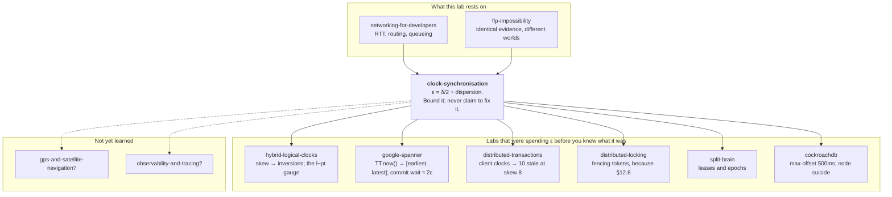

# Clock Synchronisation

*You cannot measure another machine's clock. You can only bound it — and the
bound is the product.*

> **Lab format** (no-code): this document + [`visualization.html`](visualization.html)
> (four interactive panels) + [`EXERCISES.md`](EXERCISES.md) /
> [`SOLUTIONS.md`](SOLUTIONS.md). Every behaviour here is demonstrated by a
> hand-worked trace with real numbers, by the simulator, by a result measured in
> an earlier lab, or by a citation to a primary source (RFC 5905, the chrony
> manual, AWS/Meta/Google engineering documentation) — never by code you have to
> run. Where a number is a vendor's published figure rather than something
> derivable, the vendor is named at the point of use.

> **Where you are — and why this lab is arriving late on purpose.**
>
> You have already *spent* the answer to this lab three times without being told
> where it came from:
>
> - **`google-spanner`** taught you `TT.now()` returning `[earliest, latest]`,
>   and ε as half that width — a sawtooth of about **1–7 ms**. It told you the
>   sawtooth comes from a 30-second poll interval and an assumed 200 µs/s drift.
>   It did **not** tell you why a poll cannot simply return the right answer, why
>   200 µs/s is the number, or what the "1 ms for communication delay" is made
>   of. §9 and §10 are that.
> - **`hybrid-logical-clocks`** measured what happens when clocks disagree: 65
>   causality inversions at skew 8, 341 at skew 20 — and made you carry the
>   `l − pt` drift gauge as an on-call metric. It never explained what *produces*
>   skew, or why the fix is a bound and not a repair.
> - **`distributed-transactions`** found **0 stale snapshots at skew ≤ 2** and
>   named the calm-network trap: a design with no guarantee is indistinguishable
>   from a correct one until conditions misbehave. This lab is the study of
>   *what makes conditions misbehave*.
> - **`distributed-locking`** told you to use fencing tokens instead of lease
>   expiry times. §12.6 is the concrete skew that makes that advice non-optional.
> - **`flp-impossibility`** established the shape of the argument you are about
>   to meet again: *two different worlds produce literally identical evidence, so
>   no observation separates them.* FLP takes the clock away. This lab keeps the
>   clock and takes away **the symmetry of the network** — and that alone is
>   enough to make exact synchronisation impossible.
>
> `google-spanner/README.md:1543` ends with the line `/learn clock-synchronisation
> # NTP, PTP, GPS, and what actually goes into ε`. This is that suggestion cashed
> in.
>
> **What is deliberately NOT here:** logical clocks. Lamport clocks, vector
> clocks, happens-before and HLC are already yours from `causal-consistency` and
> `hybrid-logical-clocks`; §1 says exactly where the boundary between the two
> families lies and then leaves logical time alone.

---

## Layer guide

| Layer | Sections | What you can do afterwards |
|---|---|---|
| **BEGINNER MODEL** | 1–8 | Explain why a clock drifts, why asking a server the time cannot work exactly, and why the honest output of clock synchronisation is an interval |
| **INTERMEDIATE MODEL** | 9 | Trace the eight refinements from "ask once" to a GPS receiver in the rack, and say what each one bought in microseconds |
| **ENGINEERING MODEL** | 10–13 | Read `chronyc tracking` and state your machine's actual error bound; choose monotonic vs wall clock correctly; predict what a step, a leap second, or a falseticker does |
| **PRODUCTION MODEL** | 14–16 | Pick a daemon, choose what to alert on, size the sync quality your design actually needs, and refuse the seven wrong models |

Read §1–§8 in one sitting; that is the whole idea. §9 is the machine, built in
eight refinements, each forced by a limitation in the one before. §10 is the
section that changes how you read a production host. §11–§16 is what you need
before your code touches a clock.

---

## 1. WHY — the question logical clocks cannot answer

You already have a way to order events across machines. `causal-consistency`
gave you happens-before; `hybrid-logical-clocks` gave you a stamp that never
inverts cause and effect. So why is there a whole other family of clocks?

Because there are questions about time that **have no causal answer**, and they
are extremely ordinary questions:

- *Did this certificate expire?* Nobody sent you a message when it expired.
  Expiry is not an event that happened at some node; it is a property of
  wall-clock time.
- *Has this lease run out?* The lock holder did not message you to say it had
  stopped holding the lock. That is precisely the case where it *cannot*.
- *How long did this request take?* A duration is a difference of two physical
  times. A Lamport counter difference of 4 could mean 4 microseconds or 4 hours —
  `hybrid-logical-clocks` measured one counter value spanning 34 ticks of real
  time.
- *Show me everything that happened between 09:00 and 09:05.* An auditor, a
  regulator, and a billing system all ask this. "Between counter 4100 and 4900"
  is not an answer to it.
- *Which of these two log lines, from two machines, happened first?* — when
  there is **no causal path between them at all**. `hybrid-logical-clocks`
  measured this exactly: fast-clock writer, slow-clock reader, no message
  between them, **86 of 86 reads stale**. Logical clocks are silent here by
  construction, not by accident.

So physical time is not a legacy inconvenience that logical clocks replaced. The
two families answer different questions, and every real system needs both. HLC
exists *because* it needs both at once.

Here is the split, and it is worth memorising:

| | **Logical time** | **Physical time** |
|---|---|---|
| Answers | "did A cause B?" | "was it 09:03?", "how long?", "has it expired?" |
| Source of truth | messages actually sent | a vibrating rock (§2) |
| Fails by | saying "concurrent" when you wanted an order | being **wrong**, silently, by an unknown amount |
| Fixed by | more bookkeeping | *nothing.* It can only be **bounded** |

That last cell is this entire lab.

---

## 2. THE CONCRETE PROBLEM — a computer's clock is a rock that vibrates

Strip away the software. What is a clock, physically?

Inside every server is a small piece of quartz, cut and shaped so that when you
put a voltage across it, it vibrates at a nominal frequency — commonly 32,768
times a second, or in the tens of megahertz for a CPU reference. A counter
circuit counts those vibrations. The operating system says: *when the counter
advances by 32,768, one second has passed.*

That is the whole mechanism. A clock is a rock that vibrates, plus a counter,
plus an agreement about what number of vibrations counts as a second.

Now the problem. **No two rocks vibrate at exactly the same rate.** The cut of
the crystal, the temperature of the room, the age of the part, the voltage — all
of them move the frequency slightly. A crystal specified at "±20 ppm" is
promised to be within 20 parts per million of nominal.

Let's put numbers on that, because "parts per million" sounds negligible and is
not.

**20 ppm means the clock gains or loses 20 microseconds every second.**

- In one minute: 1.2 ms
- In one hour: 72 ms
- In one day: **1.73 seconds**
- In one month: about 52 seconds

Meet the two machines we will follow through this entire lab.

> **Alba** and **Bruno** are two servers in the same rack. Alba's crystal runs
> **fast by 20 ppm**. Bruno's runs **slow by 30 ppm**. Both are well within the
> spec printed on the part. Neither is faulty. Neither will ever be replaced.

They were set to the correct time at the same instant on Monday at midnight.

| Elapsed | Alba is ahead of true time by | Bruno is behind by | **Alba − Bruno** |
|---|---|---|---|
| 1 minute | +1.2 ms | −1.8 ms | 3 ms |
| 1 hour | +72 ms | −108 ms | 180 ms |
| 1 day | +1.73 s | −2.59 s | **4.32 s** |
| 1 week | +12.1 s | −18.1 s | 30.2 s |

By Tuesday midnight, two healthy machines in the same rack, running
correctly-specified hardware, disagree about what time it is by **more than four
seconds** — and each of them will report its own answer with complete confidence.

> **🔮 Predict, before reading on:** It is Tuesday. Bruno sends Alba a request.
> The network hop between them takes **5 milliseconds** — they are in the same
> rack. Bruno logs the send; Alba logs the receive. What will the two log lines
> say?
>
> <details><summary>Reveal</summary>
>
> Work from the truth outward. Say Bruno actually sends at true time
> 10:00:00.000, and Alba actually receives at true time 10:00:00.005.
>
> - Bruno's clock is **2.59 s slow**, so at that instant it reads
>   **09:59:57.410**. That is what goes in his log.
> - Alba's clock is **1.73 s fast**, so at her instant it reads
>   **10:00:01.735**. That is what goes in hers.
>
> Stitch the two logs together, as any tracing tool will:
>
> ```
> 09:59:57.410  bruno   sent request req-8814
> 10:00:01.735  alba    received request req-8814
> ```
>
> **A 5-millisecond hop is reported as 4.325 seconds.** Every latency dashboard
> built on cross-machine timestamps is now lying by three orders of magnitude,
> and it is lying *consistently*, so it looks like a real finding. Somebody will
> spend a week optimising that network path.
>
> Now send it the other way — Alba to Bruno, same 5 ms hop:
>
> ```
> 10:00:01.730  alba    sent response  req-8814
> 09:59:57.415  bruno   received response req-8814
> ```
>
> **The message is received 4.315 seconds before it is sent.** You have seen
> this in a real trace. Everyone has. The instinct is to blame the tracing
> library, the log shipper, or a clock "glitch" — and the truth is that nothing
> glitched: two healthy machines, two in-spec crystals, one day of uptime.
>
> This is what makes clocks dangerous rather than merely imprecise. **A wrong
> clock does not throw an exception. It answers.** And its answer has the same
> type, the same format and the same confident appearance as a right one.
> </details>

---

## 3. The four words people use interchangeably and shouldn't

Before we try to fix anything, we need four distinctions. You will meet all four
in monitoring dashboards, and conflating them is the single most common source
of confused clock debugging.

**Offset** — *how wrong the clock is right now.* A single number, in seconds:
`clock_reading − true_time`. Alba's offset after one day is +1.73 s. Offset is a
**position** error.

**Drift** (also *frequency error*, *skew rate*) — *how fast the wrongness is
growing.* Measured in ppm or in seconds-per-day. Alba's drift is +20 ppm. Drift
is a **velocity** error.

> This is the distinction that matters most, and here is why in one sentence:
> **correcting the offset does not correct the drift.** If you set Alba's clock
> to the right time and change nothing else, she is perfect for an instant and
> then immediately starts gaining 20 µs every second again. §9.5 is built
> entirely on this sentence.

**Skew** — *how far apart two clocks are from each other.* Alba − Bruno = 4.32 s
after a day. Note that skew says nothing about whether either is correct: two
machines can be perfectly synchronised **to each other** and both be an hour
wrong. Conversely, this is usually the quantity your distributed system actually
cares about. `hybrid-logical-clocks` measured its inversion counts against
exactly this axis.

*(Warning about the literature: some sources, including parts of the NTP
documentation, use "skew" for the frequency error — what I am calling drift.
Both usages are common. When you read a dashboard labelled "skew", check the
units: seconds means offset-between-clocks, ppm means frequency.)*

**Jitter** — *how much the measurement bounces around.* Not a property of the
clock; a property of your ability to observe it. If you ask Bruno the time ten
times and get ten answers scattered over 3 ms, your jitter is about 3 ms.

And one more pair, borrowed from metrology, that resolves a lot of arguments:

- **Accuracy** = closeness to UTC. Needs a link to the outside world.
- **Precision** = closeness to each other. Needs only that the machines talk.

A trading system that must timestamp orders against a regulator's clock needs
*accuracy*. A distributed database that must order its own transactions needs
*precision*. They are bought differently and they cost differently. Spanner
needs both, which is why it is expensive.

---

## 4. THE OBVIOUS SOLUTION — ask a machine that knows

The fix looks trivial. Put one machine in the datacenter with a good clock. Call
it the time server. Everyone else asks it what time it is and sets their clock
to the answer.

This is a genuinely reasonable first design. It is also, in outline, what NTP
does. So let's find out exactly where it breaks, because everything else in this
lab is a repair to a specific crack.

Alba asks the time server, Bruno.

```
Alba's clock reads 10:00:00.000  →  "what time is it?"  ────────►
                                                        (network)
                                    ◄──────  "it is 10:00:00.105"
Alba's clock reads 10:00:00.040
```

Alba receives the answer "10:00:00.105" and sets her clock to 10:00:00.105.

> **🔮 Predict:** By how much is Alba's clock wrong immediately after she sets
> it, and in which direction?
>
> <details><summary>Reveal</summary>
>
> **Wrong by roughly 20 ms, and always in the same direction: behind.**
>
> Bruno's answer was true at the moment Bruno wrote it. But that moment is in
> the past by the time Alba applies it — the reply had to cross the network.
> Alba has just set her clock to a stale value, and she has done it
> *systematically*: this error never averages out, because the reply is never
> early.
>
> If you did this in a loop, you would not converge on the right time. You would
> converge on the right time *minus the one-way network delay*, forever.
> </details>

The bug is not subtle once you see it, and the fix is the obvious one.

---

## 5. THE FIRST REFINEMENT — Cristian's algorithm (1989)

Alba knows something the naive version threw away: **how long the whole exchange
took, measured on her own clock.** She sent at 10:00:00.000 and received at
10:00:00.040, so 40 ms elapsed on her clock.

If the reply took some of that 40 ms to come back, then Bruno's answer is stale
by that amount. Alba doesn't know how much of the 40 ms was the outbound leg and
how much was the return leg — so she assumes it split evenly, 20 ms each way,
and adds 20 ms to Bruno's answer.

```
Alba sets her clock to 10:00:00.105 + 20 ms = 10:00:00.125
```

This is **Cristian's algorithm**, published by Flaviu Cristian in 1989, and it
is the ancestor of every physical clock synchronisation protocol in production
today. NTP's version uses four timestamps instead of three so that the server's
own processing time can be removed:

Let's do it properly with our two machines. Four timestamps get recorded:

| | Recorded by | On whose clock | Value |
|---|---|---|---|
| **T1** | Alba, on send | Alba's | 10:00:00.**000** |
| **T2** | Bruno, on receive | Bruno's | 10:00:00.**105** |
| **T3** | Bruno, on send | Bruno's | 10:00:00.**106** |
| **T4** | Alba, on receive | Alba's | 10:00:00.**040** |

Bruno writes T2 and T3 into the reply packet, so Alba ends up holding all four.

Two quantities come out, and these two formulas are the arithmetic core of NTP
(RFC 5905 §8):

```
round-trip delay   δ = (T4 − T1) − (T3 − T2)     "total time, minus the server's own pause"
                     = (40 − 0)  − (106 − 105)
                     = 40 − 1
                     = 39 ms

clock offset       θ = ((T2 − T1) + (T3 − T4)) / 2
                     = ((105 − 0) + (106 − 40)) / 2
                     = (105 + 66) / 2
                     = 85.5 ms
```

**Read those two lines carefully, because the rest of the lab lives inside
them.** δ = 39 ms says: 39 milliseconds were spent in the network, both legs
combined. θ = +85.5 ms says: Bruno's clock appears to be 85.5 ms ahead of
Alba's.

Alba adds 85.5 ms to her clock. Both machines now read the same thing. It looks
like we are done.

**Checkpoint.** You can now explain why "just ask a server" is systematically
biased, and how a round-trip measurement removes most of that bias. What follows
is the discovery that "most" is doing an enormous amount of work in that
sentence — and that the remainder is not a small imperfection to be engineered
away, but a permanent feature of the problem.

---

## 6. THE FAILURE — two worlds, four identical numbers

The θ formula contains an assumption so quiet that most people never notice they
made it: **the message took the same time in each direction.**

Divide the round trip evenly, said Cristian. But networks are not obliged to be
symmetric. Consider three worlds. In all three, Alba and Bruno exchange exactly
the packets above, and Alba records **exactly the same four numbers**.

Let *o* = the true offset (how far Bruno's clock is genuinely ahead of Alba's),
and let the true network legs be *out* and *back*, with out + back = 39 ms.

**World A — a symmetric path.** out = 19.5 ms, back = 19.5 ms.

```
true time   0        Alba sends.       Alba's clock: 0
true time   19.5     Bruno receives.   Bruno's clock: 105    →  o = 105 − 19.5 = 85.5
true time   20.5     Bruno sends.      Bruno's clock: 106
true time   40.0     Alba receives.    Alba's clock: 40      ✓
```

True offset **85.5 ms**. Alba estimated 85.5 ms. Perfect.

**World B — the outbound leg is fast, the return is slow.** out = 4.5 ms,
back = 34.5 ms. (Perhaps the return path is congested, or takes three extra hops
because BGP is routing asymmetrically. This is entirely ordinary.)

```
true time   0        Alba sends.       Alba's clock: 0
true time   4.5      Bruno receives.   Bruno's clock: 105    →  o = 105 − 4.5 = 100.5
true time   5.5      Bruno sends.      Bruno's clock: 106
true time   40.0     Alba receives.    Alba's clock: 40      ✓
```

True offset **100.5 ms**. Alba estimated 85.5 ms. **She is wrong by 15 ms.**

**World C — the mirror image.** out = 34.5 ms, back = 4.5 ms.

```
true time   0        Alba sends.       Alba's clock: 0
true time   34.5     Bruno receives.   Bruno's clock: 105    →  o = 105 − 34.5 = 70.5
true time   35.5     Bruno sends.      Bruno's clock: 106
true time   40.0     Alba receives.    Alba's clock: 40      ✓
```

True offset **70.5 ms**. Alba estimated 85.5 ms. **Wrong by 15 ms the other
way.**

Now look at what Alba observed in each world:

| | World A | World B | World C |
|---|---|---|---|
| T1 | 0 | 0 | 0 |
| T2 | 105 | 105 | 105 |
| T3 | 106 | 106 | 106 |
| T4 | 40 | 40 | 40 |
| **True offset** | **85.5** | **100.5** | **70.5** |

**The evidence is byte-for-byte identical and the truth is different.**

This is the same shape of argument as `flp-impossibility`: a slow process and a
dead process produce identical evidence, so no observation separates them. Here,
a fast-out/slow-back path and a slow-out/fast-back path produce identical
evidence, so **no observation available to Alba separates them**. Not a better
algorithm, not more samples, not a faster CPU. She has one equation
(out + back = 39) and two unknowns, and the network will not hand her a second
equation.

> **This is worth stating as a law, because it is the load-bearing fact of the
> entire field:**
>
> **From round-trip measurements alone, the split of delay between the two
> directions is unobservable. Therefore the offset between two clocks connected
> only by a network cannot be determined exactly — only bounded.**

And the bound falls straight out of the two extremes. Push all 39 ms into the
return leg (out = 0): the true offset is 105. Push all 39 into the outbound leg
(back = 0): the true offset is 66. Every physically possible world lies between:

```
                 66 ms                85.5 ms                105 ms
                   ├───────────────────────┼───────────────────────┤
              (all delay              (best estimate)         (all delay
               outbound)                                      on return)

              ◄────────────── δ = 39 ms wide ──────────────►
              ◄─── ε = 19.5 ───►
```

**The honest output of Alba's measurement is not "85.5". It is "somewhere in
[66, 105], and my best guess is the middle."**

The half-width, 19.5 ms — exactly δ/2 — is the uncertainty. You have met this
letter before, in three labs. **This is where ε comes from.** It is not a
hardware imperfection or a conservatism bolt-on. It is half the round-trip time,
and it exists because the network refused to tell Alba which direction the delay
was in.

> **Go and see it.** [`visualization.html`](visualization.html) → **Panel 1, "The
> Measurement"**. There is a single slider called *delay split* that moves delay
> from one leg to the other **while holding the round trip constant**. Watch T1,
> T2, T3, T4 and the estimate: they never move. Watch the true offset: it sweeps
> the whole interval. That slider is the thing this section is about, and seeing
> the four numbers sit frozen while the truth slides underneath them does more
> than the table above can.

---

## 7. THE REAL REQUIREMENT

We set out to build synchronised clocks. §6 says we cannot have them. So restate
the goal as something achievable:

> **We cannot deliver a correct clock. We can deliver a clock together with an
> honest, never-underestimated bound on how wrong it might be.**

Everything from here divides cleanly into two projects, and it is worth keeping
them separate in your head because they are done by different people with
different budgets:

1. **Make ε small.** This is engineering, and §9 is eight moves' worth of it —
   from 100 ms down to under 40 µs, a factor of 2,500. It is bought with
   protocols, kernel features, network hardware and, ultimately, GPS antennas.

2. **Carry ε truthfully to whoever reads the clock.** This is API design, and it
   turns out to be the part almost everyone skips. §10 shows that NTP has been
   computing ε correctly since 1985 and that essentially every application on
   earth throws it away at the last step.

Project 2 is the one that determines whether your system is *correct*. Project 1
only determines whether it is *fast*. `google-spanner` made exactly this point
and it will land harder now: **ε appears nowhere in Spanner's correctness
argument and everywhere in its bill.** Google's atomic clocks did not make
Spanner correct. Refusing to hide ε made Spanner correct; the atomic clocks made
it affordable.

---

## 8. THE KEY IDEA — return an interval, not an instant

Here is the whole invention, in one line:

> **A time API should return `[earliest, latest]`, not `now`.**

That's it. Everything in §9 is engineering to make the interval narrow, and
everything in §10 is plumbing to stop people from discarding it.

Why does this feel so strange? Because every clock API you have ever used lies
to you with a straight face. `System.currentTimeMillis()` returns a `long`. A
`long` has no room for "± 12 ms". The API is *shaped* so that the uncertainty
cannot be expressed, so the uncertainty is dropped, so every caller behaves as
if it were zero.

And here is the fact that should convince you this is not academic
fastidiousness. **Three organisations, working separately, on different
problems, arrived at exactly the same conclusion:**

| Who | What they built | What the API returns |
|---|---|---|
| Google (2012) | **TrueTime** | `TT.now()` → `[earliest, latest]`; ε = half the width |
| AWS (2023) | **ClockBound** | a confidence interval, not a timestamp |
| Meta (2022–25) | **fbclock** | a "**Window of Uncertainty**" — a range of possible nanosecond timestamps |

Three independent reinventions of the same idea, in the three companies that
run the most clock-sensitive infrastructure on the planet. When that happens, it
is not a coincidence and it is not a fashion. It is the problem's actual shape
showing through.

**Checkpoint.** You can now explain why exact clock synchronisation is
impossible, where the number ε comes from (half the round-trip time, because the
delay split is unobservable), and why the honest interface is an interval. That
is the whole conceptual content of the field.

What you cannot yet do is say *what your machine's ε actually is right now*, or
why it is 100 ms in one setup and 40 µs in another. §9 builds the machine that
makes the difference; §10 teaches you to read the number off a live host.

---

## 9. BUILDING THE MACHINE — eight refinements, each forced by the last

We now have version 1: exchange four timestamps, compute θ and δ, set the clock,
and remember that you are uncertain by δ/2. Everything real — `ntpd`, `chrony`,
PTP, Google's time-slave daemon — is this plus eight improvements.

Read this section as a story rather than a feature list. Each version is broken
by a specific scenario, and the next version exists to fix that scenario. Where
a version's fix is a real configuration knob, the actual default is named.

---

### 9.1 v1 — one sample. Broken by: one unlucky packet.

Alba measures once, gets δ = 39 ms, and sets her clock.

The next time she measures, δ = 210 ms, because her request happened to arrive
at a switch behind a 40 KB burst from a backup job. Her offset estimate from
that sample is uncertain by ±105 ms.

She has no way to know which of the two measurements was the good one. Worse: if
she measured only the bad one, she'd apply it with the same confidence.

**The problem:** a single sample is a lottery ticket, and network delay is
enormously variable.

---

### 9.2 v2 — many samples, and keep the *minimum*. Broken by: a lying server.

Take eight samples. Now, what do you do with them?

> **🔮 Predict:** Eight round-trip measurements to Bruno come back with these
> delays: 39, 41, 118, 52, 40, 210, 44, 39.5 ms. To get the best offset estimate,
> do you (a) average all eight offsets, (b) take the median, or (c) use only the
> sample with the smallest delay and throw the other seven away?
>
> <details><summary>Reveal</summary>
>
> **(c) — and it is not close.** This is NTP's *clock filter*, and it surprises
> almost everyone, because the reflex from statistics is "more samples, average,
> noise cancels".
>
> The reflex is wrong here because **network delay noise is one-sided**. There is
> a hard physical floor — propagation at roughly two-thirds the speed of light,
> plus the time to clock the bits onto the wire — and every source of noise
> (queueing, scheduling, interrupt coalescing, contention) can only *add* to it.
> No packet ever arrives faster than the speed of light. So the delay
> distribution has a wall on the left and a long tail on the right.
>
> That changes what "best" means. Recall from §6 that a sample's error bound is
> **δ/2** — so a sample's *quality is entirely determined by its delay*:
>
> | Strategy | Effective δ | Resulting ε |
> |---|---|---|
> | Mean of all eight | 72.9 ms | ±36.5 ms |
> | Median | 42.5 ms | ±21.3 ms |
> | **Minimum** | **39 ms** | **±19.5 ms** |
>
> Averaging *contaminates* your one good measurement with six bad ones. The 39 ms
> sample is the one that spent the least time in queues, which makes it the one
> whose two legs are most likely to be nearly equal, which makes it the one whose
> ±δ/2 bracket is tightest and most honest. The other seven tell you nothing the
> minimum doesn't already tell you better.
>
> "Take the minimum" is unusual advice in measurement generally, and correct
> advice here specifically because of the one-sided distribution. NTP keeps a
> register of the last **8** samples and selects on lowest delay.
> </details>

Alba now polls Bruno eight times and keeps the best. Her ε has stopped bouncing.

**The problem:** all eight samples came from Bruno. If Bruno's clock is wrong —
misconfigured, unsynchronised, or serving 1970 because his own upstream died —
Alba will follow him precisely and confidently into being wrong.

---

### 9.3 v3 — several servers, and reject the liars. Broken by: the jump.

Ask four servers instead of one. Each gives an interval (§6): a best estimate
with a ±δ/2 bracket. Alba's job is now to find the truth among four claims,
knowing some may be false.

| Server | Claims the correct time is in |
|---|---|
| S1 | [98, 104] ms ahead of Alba |
| S2 | [101, 107] |
| S3 | [99, 106] |
| S4 | **[412, 418]** |

Here is the insight, and it is a nice one: **a correct server's interval must
contain the true time.** So all correct servers' intervals must overlap each
other — they all contain the same point. An interval that overlaps nobody cannot
be correct.

S1, S2 and S3 have a common region: **[101, 104]**. S4 shares no point with any
of them. S4 is a **falseticker**, and Alba discards it.

This is **Marzullo's algorithm** (NTP calls its variant the *intersection
algorithm*), and it is the piece named in passing in the `google-spanner`
glossary — Google's time-slave daemons run a variant of it against several
masters. It does two jobs at once:

1. **It rejects liars** without needing to know which server is lying in advance
   — the same trick as `quorums-and-replication`: trust the intersecting
   majority, evict the outlier. It is also the same reflex as the
   `hybrid-logical-clocks` finding that CockroachDB makes a node **kill itself**
   when it detects it is outside the max-offset window. Better to have no clock
   than a confidently wrong one.
2. **It narrows ε.** The intersection [101, 104] is **3 ms wide**; every
   individual interval was 6 ms wide. Combining independent honest sources
   halves the uncertainty here for free. This is why NTP configurations
   conventionally list **at least four** servers: three is the minimum to
   out-vote one falseticker, and four keeps that property when one is
   unreachable.

**The problem:** Alba has discovered she is 102.5 ms behind. She sets her clock
forward by 102.5 ms. What just happened to every piece of software on Alba that
was in the middle of measuring something?

---

### 9.4 v4 — steer, don't jump. Broken by: re-divergence.

Setting the clock is called **stepping**. It is instantaneous and it makes time
*discontinuous* — and if the correction is backwards, it makes time run
**backwards**.

Software everywhere assumes time does not do that. §12.1 and §13 have the
production outages; for now, the fix.

**Slewing** means changing the clock's *rate* temporarily rather than its value.
Rather than jumping forward 102.5 ms, Alba runs her clock 1% fast for 10.25
seconds. The clock never jumps, never repeats a value, and never goes backwards
— it just runs slightly wrong for a while, on purpose, so that it can be right
afterwards.

**These are chrony's actual defaults, and they are worth knowing because they
surprise people:**

| Directive | Default | Meaning |
|---|---|---|
| *(slewing)* | **on, always** | "Normally chronyd will cause the system to gradually correct any time offset by slowing down or speeding up the clock as required" |
| `makestep` | **not configured** | Stepping does not happen at all unless you ask for it |
| `maxslewrate` | **83333.333 ppm** ("one twelfth") | The fastest chronyd will slew |
| `corrtimeratio` | **3** | Prefers slower, longer corrections over fast ones |
| `maxdistance` | **3 seconds** | The worst root distance chronyd will accept from a source — see §10.6, and brace yourself |

Do the arithmetic on that slew rate, because it is the operationally important
consequence. One twelfth means the clock can run at most 1/12 fast or slow.
Correcting our Tuesday-morning **4.32 s** skew by slewing alone takes **at least
4.32 × 12 ≈ 52 seconds** — and with `corrtimeratio 3` in play, in practice
several minutes. During all of it, the machine's clock is deliberately running
at the wrong *rate*, and any duration it measures is off by up to 8%.

That is why nearly every distribution ships a line like `makestep 1.0 3`: *step
the clock if the offset exceeds 1 second, but only for the first 3 updates after
startup.* Step once at boot when nothing is running yet, then never again. This
is the compromise the whole industry has settled on, and now you can see both
sides of it.

**The problem:** Alba's clock is correct at 10:00:00. At 10:00:64 — her next
poll — she is 1.28 ms out again. Correcting the offset did nothing about the
*reason* the offset appeared.

---

### 9.5 v5 — correct the frequency, not the value. Broken by: measurement noise near the wire.

This is §3's offset-versus-drift distinction cashed in, and it is the single
highest-leverage refinement in the list.

Alba drifts at +20 ppm. Her poll interval is 64 seconds. So between polls she
accumulates 64 s × 20 µs/s = **1.28 ms** of new error, every time, forever. She
is on a treadmill: correct, drift, correct, drift.

The fix is to stop treating the clock reading as the thing to correct and start
correcting **the number of ticks the kernel counts as one second**. Alba
observes over several polls that she consistently gains ~20 µs/s, and tells the
kernel: *count as if the crystal were 20 ppm slower than it is.* On Linux this
is `adjtimex`/`ntp_adjtime` with `ADJ_FREQUENCY`; the frequency correction is
expressed in ppm with a 16-bit fractional part, so a value of 1 means 2⁻¹⁶ ppm.
The daemon persists what it learned in a **drift file** so that after a reboot it
starts with the right frequency rather than spending an hour rediscovering it.

The payoff:

| | Error accumulated between 64 s polls | ε just before next poll |
|---|---|---|
| Offset correction only (20 ppm raw) | 1.28 ms | ~20 ms (network) + 1.28 ms |
| **+ frequency correction** (residual ~0.1 ppm) | **6.4 µs** | ~20 ms (network) + 6.4 µs |

A **200× reduction** in the drift component, bought with a few bytes of state.
After this refinement, the drift term stops being the thing that dominates ε —
**the network does**. That is a change of regime, and it is why every remaining
refinement (9.6, 9.7, 9.8) attacks the network rather than the crystal.

> **An honesty note about Spanner's 200 µs/s.** `google-spanner` told you
> TrueTime assumes a worst-case drift of 200 µs/s = **200 ppm**, ten times worse
> than the ±20 ppm part in §2 and *two thousand times* worse than the ~0.1 ppm
> residual a disciplined clock actually achieves. That is not what Google's
> crystals do; it is what Google is willing to *promise* they will never exceed,
> including a machine in a hot aisle with a failing oscillator. ε is built from
> the number you are prepared to be held to, not the number you usually see.
> That gap — between typical and guaranteed — is where the cost of correctness
> lives, and it is exactly why `google-spanner` insisted that ε is a latency
> purchase, not an accuracy one.

**The problem:** Alba's ε is now ~20 ms and essentially all of it is δ/2. To go
further she must shrink δ, which means asking where those milliseconds actually
go.

---

### 9.6 v6 — take the timestamp closer to the wire. Broken by: switches.

Return to T1 and T4. *When exactly* is T1 taken?

In v1–v5, it is taken by the NTP daemon, in userspace, just before it calls
`send()`. Between that instant and the moment the first bit hits the fibre, the
packet must traverse: the socket layer, the network stack, a possible queue on
the NIC, and — critically — **whatever the CPU scheduler decides to do in
between**. If the machine is busy, the daemon may be descheduled for
milliseconds right after taking T1.

That entire delay is indistinguishable from network delay, and worse, it is
**variable and asymmetric** — the send path and the receive path have different
costs and different queueing. It goes straight into δ, and half of it goes
straight into ε.

The fix is a ladder, and each rung moves the timestamp closer to the physical
wire:

| Where the timestamp is taken | Typical uncertainty it contributes |
|---|---|
| Userspace, before `send()` | hundreds of µs, ms under load — scheduler-dependent |
| Kernel, in the network stack (`SO_TIMESTAMPING`, software) | tens of µs |
| **NIC hardware, as bits cross the interface** | **tens of nanoseconds** |

Hardware timestamping is not a software optimisation — it requires the network
card to contain a clock and stamp packets itself. AWS describes exactly this
capability on Nitro: hardware packet timestamping "add[s] a 64-bit
nanosecond-precision timestamp to every incoming network packet", and the reason
it matters is stated plainly — "because hardware packet timestamping occurs at
the hardware level—before the packet reaches the kernel, socket, or application
layer—you bypass any delays added by software timestamping."

**The problem:** the endpoints are now honest to nanoseconds, and δ is still
milliseconds, because the packet still spent all that time queued inside three
switches that nobody asked.

---

### 9.7 v7 — make the network participate. This is the only move that attacks the theorem.

Everything so far has treated the network as an opaque box: put a packet in, get
a delay out, divide by two, hope. §6 proved that hoping is the best you can do
**with an opaque box**.

So stop using an opaque box.

**PTP** (Precision Time Protocol, IEEE 1588) requires the switches themselves to
take part in the measurement, in one of two ways:

- **Transparent clock.** The switch measures how long the timing packet sat
  inside it — its *residence time* — and writes that number into a correction
  field in the packet as it leaves. The receiver subtracts it. Queueing delay
  stops being unknown asymmetry and becomes a **measured, subtracted quantity**.
- **Boundary clock.** The switch synchronises itself, then acts as a time server
  for the next hop down. A long uncertain path becomes a chain of short certain
  ones.

Look at what that does to §6's argument. Alba's problem was one equation
(out + back = 39) and two unknowns. The transparent clock hands her the second
equation. **This is the only refinement in the list that reduces the
*irreducible* part of ε rather than the noise around it**, and it is why PTP
reaches sub-microsecond accuracy while NTP over the same physical cable does not:
not better maths, but a network that stopped being a black box.

The price is that PTP needs the network gear to support it — you cannot deploy
PTP over the public internet, or over switches that don't speak it. This is a
capital and topology cost, not a config change. Meta moved its fleet from NTP to
PTP in late 2022 and has published extensively on what that took.

**The problem:** you still depend on a chain of devices between you and the
reference clock, and on that chain staying healthy.

---

### 9.8 v8 — delete the network entirely.

The final move: put the reference clock in the machine.

**Why GPS solves the asymmetry problem.** Each GPS satellite carries an atomic
clock and continuously broadcasts its own time and its own orbital position. A
receiver on the ground picks up several satellites and solves for four unknowns
— its own x, y, z and *the current time*. The propagation delay is no longer an
unknown to be halved: the receiver **knows where the satellite is**, so it can
*compute* how long the signal took. §6's missing second equation comes from
geometry.

The receiver then emits a **PPS** (pulse-per-second) signal — a physical
electrical edge, once a second, on a wire — which the server can latch directly.
No packets, no queues, no asymmetry.

You have already met the production form of this in `google-spanner`: GPS
receivers and atomic clocks in every Google datacenter, plus *Armageddon
masters* backed by atomic clocks specifically so that a GPS-correlated failure
(jamming, spoofing, a constellation-wide bug) doesn't take down everything at
once.

The cloud form is newer and more accessible. AWS puts GPS-disciplined reference
clocks in the **Nitro System** itself and exposes a **PTP Hardware Clock (PHC)**
as a device on the instance. There is no network between your machine and the
reference clock — the clock is on the card your machine is plugged into. AWS's
published figures:

| Path | Typical clock error bound |
|---|---|
| Amazon Time Sync over **NTP** | **under 100 µs** |
| Amazon Time Sync via **PHC** | **under 40 µs** |

That second row is a number worth sitting with. **Sub-100-microsecond
synchronisation is now a checkbox on a cloud instance.** In 2012, the fact that
Google could achieve ~4 ms was the reason nobody else shipped Spanner's design.
The moat drained.

---

### The eight refinements, and what each one bought

| v | Move | Attacks | Order of magnitude |
|---|---|---|---|
| 1 | Round-trip, four timestamps | systematic staleness | the bias, entirely |
| 2 | 8 samples, keep min delay | unlucky packets | ε 36 ms → 19.5 ms in §9.2's data |
| 3 | Several servers, intersect | **liars**; also narrows ε | 6 ms → 3 ms wide, plus safety |
| 4 | Slew instead of step | **discontinuity**, not accuracy | none — this one buys *correctness* |
| 5 | Frequency correction + drift file | drift between polls | 1.28 ms → 6.4 µs (**200×**) |
| 6 | Hardware timestamps at the NIC | endpoint jitter | hundreds of µs → tens of ns |
| 7 | PTP transparent/boundary clocks | **the asymmetry itself** | ms → sub-µs |
| 8 | GPS/atomic + PHC on the machine | the network's existence | AWS: **< 40 µs** end to end |

Note which rows are which. Rows 1, 2, 5, 6 shrink *noise*. Rows 7 and 8 attack
the actual §6 theorem, by obtaining the information the round trip cannot
provide. **Row 4 improves nothing about accuracy at all** — it is there purely to
stop time from moving backwards, and it is the row whose absence has caused the
most production outages.

**Checkpoint.** You can now explain, mechanically, why one setup achieves 100 ms
and another achieves 40 µs, and name what would have to change to move between
them. What you still cannot do is look at a running machine and say what its ε
is *right now*. That is the next section, and it is the one that changes how you
read a host.

---

## 10. THE LEDGER — ε already exists on your machines, and your code throws it away

This is the most useful section in the lab. Its claim is simple and slightly
shocking:

> **Every NTP daemon has been computing ε correctly since 1985, prints it on
> request, and essentially every application on earth discards it at the last
> step — because `clock_gettime()` has nowhere to put it.**

TrueTime is not a new *measurement*. It is the decision to stop throwing the
existing measurement away.

### 10.1 RFC 5905 already defines it, and calls it root distance

NTPv4's specification defines a quantity it calls the **root synchronisation
distance**, described in the RFC as *"the maximum error due to all causes of the
local clock relative to the primary server."*

Read that description again. That is the definition of ε, written in 1985,
refined through 2010, sitting in an IETF standard.

The formula, simplified to its two dominant terms:

```
root distance  Λ  =  root delay / 2  +  root dispersion
                     └─────┬─────┘     └──────┬───────┘
                           │                  │
        §6's ±δ/2 — accumulated       everything that has gone
        over every hop from here      wrong or could have: the
        back to the reference         residual error at last sync,
        clock, halved                 plus growth since then
```

**Root delay** is the total round-trip delay all the way up the stratum chain to
the reference clock. Halving it is §6, applied transitively: your uncertainty
includes your server's uncertainty about *its* server, and so on to the top.

**Root dispersion** is the accumulated maximum error, and here is the part that
makes it honest: it **grows on its own between updates**. RFC 5905 defines the
constant `PHI` — the assumed worst-case frequency tolerance, conventionally
**15 ppm** — and dispersion grows at PHI continuously. This is §9.5's drift term,
turned into a running total.

> **This gives you a control knob most people never connect to correctness.**
> Dispersion grows at 15 µs per second of elapsed time since your last
> successful sync. So your **poll interval sets your ε**:
>
> | Poll interval | Dispersion growth before the next update |
> |---|---|
> | 16 s | 0.24 ms |
> | 64 s | 0.96 ms |
> | 1024 s (NTP's max) | **15.4 ms** |
>
> A machine that polls rarely is not "saving bandwidth". It is choosing a wider
> ε, and — if anything downstream reads that ε, as Spanner's commit wait does —
> choosing higher latency. This is the same sawtooth `google-spanner` showed you,
> and now you can derive it rather than take it on faith.

### 10.2 Reading it off a live host

`chronyc tracking` prints the whole ledger. Here is the output annotated —
**this is an illustrative example in chrony's real output format, not a
measurement I performed** — from a machine using a close, well-connected time
source:

```
Reference ID    : A9FEA97B (169.254.169.123)      ← who we're following
Stratum         : 4                                ← hops to the reference clock
Ref time (UTC)  : Sun Aug 30 09:14:02 2026
System time     : 0.000008254 seconds slow of NTP time    ┐
Last offset     : -0.000006133 seconds                    │
RMS offset      : 0.000011907 seconds                     │  ε
Frequency       : 12.472 ppm fast    ← §9.5's correction  │  is
Residual freq   : -0.002 ppm         ← how well it's held │  built
Skew            : 0.041 ppm          ← confidence in that │  from
Root delay      : 0.000112000 seconds   ← §6, transitive  │  these
Root dispersion : 0.000021500 seconds   ← accumulated max ┘
Update interval : 16.2 seconds
Leap status     : Normal             ← §13 lives here
```

Now compute the bound. AWS publishes the formula explicitly for ClockBound:

```
CLOCK ERROR BOUND = SYSTEM TIME + (.5 * ROOT DELAY) + ROOT DISPERSION + PHC Error Bound
```

Compare it to RFC 5905's root distance. **It is the same formula.** AWS added a
term for the hardware clock and gave it a friendlier name; the structure —
half the delay plus the dispersion — is Cristian's 1989 bound plus NTP's running
error budget, unchanged.

For the host above:

```
ε = 8.3 µs  +  (0.5 × 112 µs)  +  21.5 µs
  = 8.3     +   56.0           +  21.5
  = 85.8 µs
```

Consistent with AWS's published expectation of a clock error bound "under 100 µs
using the NTP connection".

Now the same command on a machine synced to a public internet NTP pool:

```
System time     : 0.000512000 seconds slow of NTP time
Root delay      : 0.031240000 seconds
Root dispersion : 0.002100000 seconds

ε = 0.512 ms + 15.62 ms + 2.10 ms  =  18.2 ms
```

**86 microseconds versus 18 milliseconds. A factor of 212, same command, same
output format, and nothing in either machine's application code can tell the
difference.** If your design assumes "clocks are within a few milliseconds", one
of these hosts satisfies you and one does not, and you will never find out which
by reading your own logs.

> **The one thing to take from this section:** you can go and find out your
> real ε today. `chronyc tracking` on a chrony host; `ntpq -c rv` for
> `rootdelay`/`rootdisp` on ntpd. It is a number, it is printed, and almost
> nobody looks at it.

### 10.3 Why your code can't see it

So the number exists. Why does no application use it?

Because of the API. `clock_gettime(CLOCK_REALTIME, &ts)` returns a `struct
timespec` — seconds and nanoseconds. There is no field for "± 85.8 µs". The
kernel *does* track an error estimate: `ntp_adjtime()` exposes `maxerror` and
`esterror` in microseconds, and the daemon maintains them. But no ordinary
program calls `ntp_adjtime()` to read the time, because that is not what the
time API looks like.

Java is the same story one layer up:

```java
System.currentTimeMillis()   // long. wall clock. no error bar. can go backwards.
Instant.now()                // richer type, same missing information
```

Neither can express uncertainty, so neither does, so every caller behaves as
though ε = 0. **The uncertainty is not lost to physics. It is lost to a type
signature.**

Which is precisely why the three systems in §8 had to build new APIs rather than
new clocks:

| System | The API's whole point |
|---|---|
| **TrueTime** | `TT.now()` returns `[earliest, latest]`. There is no method that returns a scalar — you *cannot* accidentally ignore ε |
| **ClockBound** | returns a confidence interval; AWS describes it as giving "a reliable confidence interval by automatically calculating the clock accuracy" rather than an estimate |
| **fbclock** | returns a "Window of Uncertainty" — a range of possible nanosecond timestamps |

All three made the same design choice: **remove the scalar from the API so that
callers are forced to confront the interval.** That is the entire innovation.
The GPS receivers came second.

### 10.4 Deriving Spanner's sawtooth from scratch

You now have every part needed to rebuild `google-spanner`'s central number
without being told it.

Google's time-slave daemon polls its time masters every **30 seconds** and
assumes a worst-case drift of **200 µs/s**. Apply §10.1's dispersion rule with
Google's PHI instead of NTP's 15 ppm:

```
dispersion growth over one poll interval  =  30 s × 200 µs/s  =  6 ms
communication delay term to the masters   ≈  1 ms          (§6's δ/2, on a LAN)

ε immediately after a poll   ≈  1 ms
ε just before the next poll  ≈  1 + 6  =  7 ms
```

**The 1–7 ms sawtooth, derived.** And now every knob on it is visible: poll
faster and the tooth shrinks; buy a better-specified oscillator and the *slope*
flattens; move the time master closer and the *floor* drops.

`google-spanner` told you commit wait costs about 2ε on every write. You can now
say precisely what buys it down — and, more importantly, that AWS's 40 µs PHC
figure would make that same wait about **175× cheaper** than the paper's
average. That is the shape of what changed between 2012 and now.

### 10.5 The default that should worry you

One line from §9.4's table deserves its own section.

**chrony's `maxdistance` default is 3 seconds.**

`maxdistance` is the maximum root distance chronyd will accept from a source
before refusing to use it. Root distance is ε (§10.1). So the out-of-the-box
posture of the most widely deployed NTP client on Linux is:

> *I will happily synchronise to a source that admits it might be wrong by up to
> three seconds.*

This is a defensible default for its actual job — it is a sanity limit meant to
exclude unreachable and grossly broken sources, not a service-level objective,
and in practice a healthy source is thousands of times better than the limit.

But notice what it means for you: **nothing in the default configuration
enforces a tight ε, and nothing warns you when ε is bad.** A machine whose
upstream has quietly degraded to a root distance of 800 ms will keep
synchronising, keep reporting "Leap status: Normal", and keep serving confident
timestamps. Your alerting has to ask for the bound. It is never volunteered.

That is §15's monitoring list, and it is the practical reason this section
exists.

**Checkpoint.** You can now read a host's actual clock error bound, explain the
formula term by term, connect it to RFC 5905 and to AWS's ClockBound, and derive
Spanner's ε from its two published parameters. The remaining sections are about
what goes wrong — starting with a bug you have almost certainly written.

---

## 11. THE OTHER CLOCK — and the bug you have probably shipped

Every operating system offers at least two clocks, and confusing them is the
most common clock bug in application code by a wide margin.

**The wall clock** (`CLOCK_REALTIME`, `System.currentTimeMillis()`,
`Instant.now()`) tries to tell you what time it is in the world. It is
meaningful across machines. And — because of everything in §9 — it is
**adjusted**: the man page is explicit that CLOCK_REALTIME is "affected by
discontinuous jumps in the system time and by the incremental adjustments
performed by adjtime(3) and NTP". It can jump forward. It can jump backward. It
can run at 92% or 108% of normal speed while a slew is in progress.

**The monotonic clock** (`CLOCK_MONOTONIC`, `System.nanoTime()`) counts elapsed
time from an arbitrary, meaningless origin. It cannot be set. It never goes
backwards. It is the right tool for every duration you will ever measure.

Here is the rule, and it is absolute:

> **Wall clock for *when*. Monotonic clock for *how long*. Never the other way
> round.**

```java
// WRONG — subtracting two wall-clock readings
long start = System.currentTimeMillis();
doWork();
long elapsed = System.currentTimeMillis() - start;   // can be negative

// RIGHT
long start = System.nanoTime();
doWork();
long elapsed = System.nanoTime() - start;            // cannot be negative
```

`elapsed` going negative is not a theoretical concern. **It took Cloudflare's
DNS down on 1 January 2017.** Their RRDNS resolver, written in Go, used
`time.Now()` — Go's wall clock — to compute how long upstream servers had been
taking. A leap second (§13) made the clock step backwards; a duration went
negative; the negative value was passed to `rand.Int63n()`, which panics on a
negative argument. At peak, about 0.2% of DNS queries to Cloudflare were
affected. The language itself was changed in response: Go 1.9 made `time.Time`
carry a **monotonic reading** alongside the wall reading, specifically so that
`t2.Sub(t1)` uses the monotonic one automatically.

Two further clocks are worth knowing because they close real gaps:

- **`CLOCK_MONOTONIC_RAW`** — monotonic *and* not slewed. Plain
  `CLOCK_MONOTONIC` never jumps, but it *is* "affected by the incremental
  adjustments performed by adjtime(3) and NTP" — so during a slew it is running
  at up to 1/12 wrong rate. If you are measuring a hardware interval where an 8%
  rate error matters, this is the one.
- **`CLOCK_BOOTTIME`** — like monotonic, but *includes* time the system was
  suspended. On a laptop or a VM that can be paused, `CLOCK_MONOTONIC` stops
  during suspend, so a 6-hour sleep looks like zero elapsed time and every
  timeout you set survives it. See §12.4.

> **A trap specific to `System.nanoTime()`.** Its origin is arbitrary and
> unrelated to any other machine's. Two `nanoTime()` values from two JVMs — even
> two JVMs on the same host — cannot be compared, subtracted, or ordered. The
> only legal operation is subtracting two readings **from the same process**.
> Monotonic time is not a "safer wall clock"; it is a stopwatch, and stopwatches
> do not agree on what time it is.

---

## 12. FAILURE SCENARIOS

Six ways this breaks in production, chosen because each one reveals a different
part of the design. [`visualization.html`](visualization.html) **Panel 4** runs
several of them as predict-then-observe scenarios.

### 12.1 The step — in both directions

A step (§9.4) is a discontinuity, and the two directions fail differently.

**Backward step.** Time repeats. Every duration computed as `end − start` across
the step is wrong, and some are negative. §11's Cloudflare outage is the
canonical case. But the subtler damage is in things that *wait*: a cache entry
stamped "expires at 10:00:05" now has five extra seconds of life; a rate limiter
counting requests per second sees a window it has already counted; an
append-only log with wall-clock keys writes a key it has already written.

**Forward step.** Nothing goes negative, so it feels safe. It is not. A forward
step of 30 seconds causes **everything with a deadline in the next 30 seconds to
expire at once** — every lease, every cache TTL, every retry timer, every
connection idle timeout, simultaneously. The symptom is a thundering herd with
no traffic spike to explain it. This is the failure mode that makes people
conclude "the network had a blip" when the network was fine.

**What to watch:** `chronyc tracking`'s *Last offset* jumping by orders of
magnitude; `Leap status`; a spike in your own duration metrics at exactly the
same second on many hosts.

**What survives:** nothing about ordering; the clock is *more accurate* after
the step than before it, which is precisely why the step was applied. This is
the trade §9.4 makes explicit — accuracy bought with continuity.

### 12.2 The asymmetric route — the error that averaging cannot remove

Two datacenters, London and Frankfurt. Traffic London→Frankfurt takes a direct
fibre path, 9 ms. Traffic Frankfurt→London is routed via Amsterdam because of a
BGP policy nobody has looked at in two years: 15 ms.

δ = 24 ms. NTP halves it and assumes 12 ms each way. The truth is 9 and 15, so
every offset estimate is wrong by (15 − 9)/2 = **3 ms, permanently, in a fixed
direction**.

This is §6's World B as an operational condition rather than a thought
experiment. What makes it nasty:

- **It does not average out.** Taking a million samples gives you a beautifully
  stable estimate that is beautifully stably wrong. §9.2's minimum-delay filter
  doesn't help either — every sample has the same bias.
- **It looks like success.** Low jitter, tight RMS offset, small root dispersion.
  Every health indicator is green, because the daemon is measuring exactly what
  it claims to measure. It just can't see the asymmetry.
- **It survives everything.** Restarts, failovers, daemon upgrades. It changes
  when the *route* changes, which is why it sometimes appears to be fixed by an
  unrelated network maintenance window and then comes back.

**The only real defences** are §9.7 (make the network report residence time) and
§9.8 (remove the network), plus the honest one: your ε bracket of ±12 ms
**does** contain the true offset. The bound was never violated. The
point estimate was just wrong — which is exactly why §8 says to consume the
interval and not the midpoint.

### 12.3 The falseticker, and the liar's blast radius

A time server's own upstream fails. Depending on the implementation it may keep
serving its last known time, or serve something absurd, or — the dangerous case
— keep serving *plausible* time that is slowly drifting away from reality.

With one source (§9.2), you follow it. With intersection over four (§9.3), you
reject it. This is why "at least four sources" is the conventional advice and
not a superstition.

But the important part is what happens *downstream*, and
`hybrid-logical-clocks` already measured it: one node running +60 in a cluster
with ±8 skew **infected everyone it talked to**, pushing the measured bound from
16 to 67, and `l` never came back down — because HLC's `max` rule propagates a
high value and has no mechanism to lower it. A single lying clock is not a
single wrong machine; it is a wrong *cluster*, and the damage outlives the liar.

That is why the production answers are so blunt:

- **CockroachDB** makes a node **terminate itself** if it detects it is outside
  the configured max-offset (default 500 ms). No clock is safer than a wrong one.
- **MongoDB** **HMAC-signs** `$clusterTime` so a client cannot inject a
  fabricated future timestamp.
- **Google** runs Armageddon masters on atomic clocks so a GPS-correlated
  failure cannot make every master lie in the same direction at once.

### 12.4 The pause — VM suspend, live migration, and the stopped stopwatch

Virtual machines get suspended, migrated, and descheduled by their hypervisor.
During that gap, the guest's view of time can stop entirely.

The consequences are asymmetric and both bad:

- **The wall clock is stale on resume** — the guest wakes believing it is still
  10:00:00 when it is 10:04:30, then gets corrected by a large forward step
  (§12.1). Everything expires at once.
- **`CLOCK_MONOTONIC` does not count the suspended interval.** A 4½-minute gap
  looks like zero elapsed time, so *every timeout you set survives the pause*.
  A 30-second health-check timeout does not fire. A lease you believed had
  expired has not, from the holder's point of view. `CLOCK_BOOTTIME` is the clock
  that counts suspend, and it exists for exactly this reason.

This is also the cleanest illustration of why a lease-based design cannot be
made safe by shortening the lease: a process that is paused does not know it was
paused, and shortening the timeout does not change that.

### 12.5 The cold boot — and the chicken-and-egg

A machine boots. Its hardware real-time clock is off by minutes, or its battery
is dead and it comes up in 1970, or it is a container with no RTC at all. The
NTP daemon has not yet made contact, so `Leap status` is not yet `Normal` and no
correction has been applied.

For a few seconds to a few minutes, the machine is *confidently wrong* and
serving traffic.

The interesting part is the deadlock this creates with §12.6's security systems.
To fetch the correct time securely you would like to use TLS. To validate a TLS
certificate you must check `notBefore`/`notAfter` against your clock. If your
clock says 1970, every certificate on earth is "not yet valid" and the fetch
fails — so you cannot get the time, so you cannot fix the clock. This is why
NTP is traditionally unauthenticated UDP, why `chrony`'s
`makestep` exists with a large threshold for the first few updates (§9.4), and
why "just use HTTPS to get the time" is not the obvious improvement it appears
to be.

### 12.6 The lease that two machines both held

This is `distributed-locking`'s advice, with the number attached.

A lock service grants Alba a lease: *"you hold the lock until 10:00:05.000."*
Alba's clock reads 10:00:04.900 — she believes she still has 100 ms and proceeds
to write.

But Alba is the machine from §2, running **1.73 s fast**. True time is
10:00:03.17. Meanwhile the lock service, whose clock is correct, sees the lease
expire at true 10:00:05.000 and grants it to Bruno. Bruno's clock is 2.59 s
slow, so he believes he has until his own 10:00:02.41 — and he starts writing at
his 09:59:58, which is *true* 10:00:00.6.

**Both machines believe they hold the lock, and both are obeying the protocol
correctly.** No message was lost. No node crashed. The only fault is that three
clocks disagreed.

This is why `distributed-locking` insisted on **fencing tokens**: a
monotonically increasing number issued with the lock, checked by the storage
system, which rejects any write carrying a token lower than one it has already
seen. A fencing token is a *logical* clock doing the safety job precisely
because the *physical* clock cannot be trusted to do it.

**The general rule, and it is worth memorising:** if the correctness of your
system depends on a comparison between two clocks on two machines, you have a
bug whose severity is set by ε — and ε is a number you probably haven't
measured. Use physical time for *timeouts and heuristics* (where being wrong
costs latency), and logical mechanisms — fencing tokens, epochs, quorums — for
*safety* (where being wrong costs correctness). `split-brain` made this same
argument from the other end.

---

## 13. LEAP SECONDS — the second the world deliberately gets wrong

This deserves its own section because it is the one clock problem that is
*scheduled*, *global*, and *intentional* — and it has caused more famous outages
than drift ever has.

### What they are

Two definitions of the second have to coexist. **Atomic time** counts caesium
transitions and is perfectly regular. **Astronomical time** follows the Earth's
rotation, which is irregular and slowly slowing. UTC is defined to follow atomic
time in *rate* but stay within 0.9 s of astronomical time in *value*, and the
mechanism that reconciles them is the **leap second**: occasionally, a minute
contains 61 seconds.

```
23:59:58
23:59:59
23:59:60   ← this second exists
00:00:00
```

Which means: **`23:59:60` is a legal time, and almost no software can represent
it.** POSIX `time_t` counts seconds since the epoch on the assumption that every
day has exactly 86,400 of them. There is no room in the model for a 61-second
minute, so implementations have to fake it — usually by repeating `23:59:59`,
which is a one-second **backwards step** (§12.1) delivered simultaneously to
every machine on Earth.

### What it has actually broken

- **30 June 2012.** The leap second triggered a livelock in the Linux kernel's
  `hrtimer`/NTP subsystem: inserting the leap second caused a cascade of timer
  recalculations that pinned CPUs at ~100%. Reddit, Mozilla, LinkedIn and Qantas
  were among the publicly affected. The fix reworked the locking between the
  timekeeping and NTP subsystems.
- **1 January 2017.** Cloudflare's RRDNS, as in §11 — a duration went negative
  because Go's `time.Now()` was not monotonic.

Both are the same root cause seen from different layers: **software assumed time
does not go backwards, and once a year the standard says it does.**

### The fix everyone converged on: smearing

Rather than insert a discontinuity, **spread the extra second out**. Run every
clock slightly slow for hours so that the extra second is absorbed without any
jump. This is §9.4's slewing, applied on purpose at planetary scale.

| Who | Smear window | Note |
|---|---|---|
| Google | 24 hours | the original public smear, from 2016 |
| AWS | 24 hours | applied automatically on both local and public (`time.aws.com`) Time Sync |
| Meta | **17 hours** | chosen because the smear happens on Stratum 2, where hundreds of NTP servers must smear in step |

Meta's PTP-era version is the most interesting, because it is §8's idea applied
to a leap second: rather than smearing the clock, the `fbclock` library widens
the **Window of Uncertainty**, shifting time by one nanosecond every 62.5
microseconds. The system does not pretend to know the time more precisely than
it does during the event — it just *admits* it and lets callers decide.

**The hazard nobody expects: mixing smeared and unsmeared sources.** During the
smear, a smeared server and an unsmeared server genuinely disagree — by up to a
full second — and both are behaving correctly. Feed both to one client and §9.3's
intersection algorithm sees two mutually inconsistent sources and cannot resolve
them. AWS states this plainly: because smeared and non-smeared time differ during
a leap second event, "we do not recommend using both smeared and non-smeared time
sources in your time client configuration". Note that AWS's own PHC (§9.8) does
**not** smear — it follows UTC and inserts the leap second — so an instance using
both the PHC and a smeared NTP source is exactly the configuration being warned
about.

### They are being abolished — and that changes less than you'd hope

At the **27th General Conference on Weights and Measures in November 2022**, the
CGPM resolved to stop inserting leap seconds by or before **2035**, letting UTC
drift from astronomical time instead (a "leap minute", or some other mechanism,
to be decided later). Meta campaigned publicly for this; AWS has stated it is "in
full support".

Three reasons this does not remove leap seconds from your mental model:

1. **Until 2035, they can still happen**, and any one of them can be scheduled
   with six months' notice.
2. **Smearing means your clock is deliberately wrong for a whole day** — by up
   to a second, on purpose, during every smear window. If you have a design that
   assumes ε is a few milliseconds, a smear day violates it by two to three
   orders of magnitude, and no daemon will report an error, because nothing is
   wrong.
3. **The historical record keeps them forever.** 27 leap seconds have already
   been inserted. Any system converting between UTC and TAI across a past date
   still needs the table, and that table is in `tzdata` — which is a *data file
   that must be updated*, i.e. a dependency that can go stale.

---

## 14. CORRECTNESS — what is guaranteed, and on what

### What clock synchronisation guarantees

**One thing only:** `|clock_reading − true_time| ≤ ε`, where ε is the number
computed in §10.1 and reported by your daemon.

That is a real, useful, checkable guarantee. It is also much weaker than what
most code assumes.

### What it does not guarantee

| Not guaranteed | Why people assume it anyway |
|---|---|
| That the wall clock is **monotonic** | It usually is, between steps (§12.1) |
| That two machines' timestamps are **comparable** | They have the same format and look like numbers on one line (§2) |
| That a timestamp difference is a **duration** | It is, on one machine, between steps (§11) |
| That ε is **small right now** | It usually is, and nothing tells you when it isn't (§10.5) |
| That ordering by timestamp reflects **causality** | It correlates well enough to pass testing (`hybrid-logical-clocks`: still **79 ties at skew zero**, from finite resolution alone) |
| That a **sub-ε** difference means anything at all | Two timestamps 2 ms apart with ε = 12 ms carry **no ordering information whatsoever** |

That last row is the one to internalise. **Comparing two timestamps whose
difference is smaller than ε is not a weak signal — it is noise.** If ε is 12 ms
and you order two events 2 ms apart, you are ordering them by coin flip. This is
the mistake that produces "impossible" traces and multi-day investigations.

### The assumption stack

Every guarantee above rests on a stack, and each layer can fail independently:

| Layer | Assumption | Fails when | Detected by |
|---|---|---|---|
| Hardware | oscillator stays within its drift spec | crystal ages; hot aisle | `Frequency`/`Skew` in `chronyc tracking` moving |
| Sources | a majority of sources are honest | upstream misconfigured, GPS spoofed | §9.3 intersection; stratum changes |
| Network | delay is roughly symmetric | asymmetric routing (§12.2) | **nothing** — this one is invisible |
| Reachability | sources are reachable | partition, firewall | dispersion growing at PHI; `Update interval` climbing |
| Daemon | it is running and disciplining | crashed, container without it | `Leap status` not `Normal` |
| Application | it reads ε and respects it | **almost never true** (§10.3) | code review |

Row 3 is the honest one to sit with: **network asymmetry is not detectable from
inside the protocol.** It is bounded by ε (the true offset is always inside the
interval), but it cannot be found and removed. Only §9.7 and §9.8 address it,
and they do so by changing what information is available, not by measuring
better.

Row 6 is the one you control today.

### The tradeoff that produced all of this

| You want | You pay |
|---|---|
| Smaller ε | poll more often (bandwidth, server load); hardware timestamping (NIC support); PTP (switch support); GPS (capex, antennas, roof access) |
| A guarantee rather than an estimate | ε must be **conservative** — built from worst-case drift you'll never see (§9.5), so it is always wider than your actual error |
| To use ε for correctness | latency: Spanner's commit wait is ~2ε on every write; CockroachDB pays it as read restarts instead |
| To ignore ε | nothing, until the day conditions misbehave — the `distributed-transactions` calm-network trap, for the fourth time in this map |

---

## 15. PRODUCTION

### Which daemon

| | Use it for | Notes |
|---|---|---|
| **chrony** | the default choice on Linux today | Fast convergence, works well with intermittent connectivity and virtual machines, `chronyc tracking` gives you §10.2's ledger |
| **ntpd** (reference implementation) | long-standing deployments, reference-clock hardware | `ntpq -c rv` for `rootdelay`/`rootdisp` |
| **linuxptp** (`ptp4l`, `phc2sys`) | when you need sub-microsecond and own the switches | §9.7; requires PTP-capable network hardware |
| **systemd-timesyncd** | **not for anything that matters** | It is an SNTP client: one source, no intersection algorithm (§9.3), no falseticker rejection, and **it does not give you ε**. Fine for a laptop's clock display; not fine underneath a distributed system |

On EC2, point chrony at the link-local Amazon Time Sync endpoint
(`169.254.169.123`) rather than public pool servers; if you need better than
~100 µs, that is what the PTP Hardware Clock and precision time placement groups
are for (§9.8).

### What to alert on

Ordered by how often the alert would have caught a real incident:

1. **The error bound itself** — `System time + 0.5 × Root delay + Root
   dispersion` from §10.2. This is the metric almost nobody has and everybody
   needs. Alert on it exceeding whatever your design actually assumes — and if
   you cannot say what your design assumes, that is the finding.
2. **Daemon not synchronised** — `Leap status` not `Normal`, or the source count
   reaching zero. Cheap, and catches §12.5.
3. **Offset step events** — a `Last offset` jump of several orders of magnitude
   means §12.1 just happened to everything on the host.
4. **Frequency / Skew drifting** — `Frequency` wandering means the oscillator is
   degrading (hot aisle, ageing part). This is your early warning for a machine
   that is about to become §12.3's liar.
5. **Number of reachable sources** — below 3 you have lost falseticker
   rejection (§9.3) even though everything still looks healthy.
6. **Per-node `l − pt` drift** — `hybrid-logical-clocks` earned this one: it is
   the *downstream-of-a-liar* detector, and it catches the case where your own
   clock is fine and someone else's isn't.

### The four rules for code

1. **Monotonic for durations, wall clock for wall time.** `System.nanoTime()`
   for elapsed, `Instant.now()` for "when". Never subtract two wall-clock
   readings. (§11)
2. **Never compare timestamps from two machines for correctness.** For display
   and debugging, fine — and label the axis "±ε". For a decision that must be
   right, use a fencing token, an epoch, or a quorum. (§12.6)
3. **Never order events whose separation is smaller than ε.** If you need that
   ordering, you need a logical clock — HLC exists for exactly this. (§14)
4. **If you must use physical time for correctness, read ε and pay it.** That is
   what commit wait *is*. If you are not willing to wait 2ε, you are not willing
   to have the guarantee, and you should stop claiming it.

### How much synchronisation do you actually need?

| ε you can achieve | What it unlocks | How you get it |
|---|---|---|
| **seconds** | log correlation to the nearest "which minute", TLS certificate validity, Kerberos's 5-minute window | any NTP at all |
| **~10 ms** | HLC with a workable uncertainty window; lease-based systems with generous safety margins; CockroachDB's 500 ms default is *deliberately* far looser than this | chrony against a nearby source |
| **~1 ms** | Spanner-class external consistency at ~2 ms commit wait; meaningful cross-service latency attribution | chrony + a local stratum-1, or a cloud provider's local time service |
| **< 100 µs** | ordering events at datacenter round-trip granularity; one-way latency measurement; commit wait that rounds to nothing | AWS Time Sync over NTP (published: < 100 µs) |
| **< 40 µs** | the above, comfortably | PHC / precision time placement group (published: < 40 µs) |
| **< 1 µs** | regulated trade timestamping; hardware test and measurement | PTP with transparent clocks end-to-end (§9.7) |

**Start at the bottom of what you need, not the top of what you can buy.** Most
systems that think they need microseconds actually need a fencing token.

---

## 16. COMMON WRONG MODELS

**1. "NTP keeps my clocks in sync."**
It keeps them **bounded**, and it tells you the bound. Those are different
claims. §10.2's two hosts differ by a factor of 212 in ε and both are "in sync"
by any check you are currently running. Replace with: *NTP makes ε small and
reports it; whether small enough is a question about your design, not about NTP.*

**2. "Offset and drift are the same thing."**
Offset is position, drift is velocity (§3). Correcting offset alone puts you back
where you started one poll interval later — §9.5 measured it: 1.28 ms of fresh
error every 64 seconds, forever. This confusion is why people "fix" a clock
repeatedly and are surprised it keeps breaking.

**3. "Better hardware makes ε zero."**
Hardware shrinks ε; nothing makes it zero, because §6's asymmetry is a property
of the *network*, not the clock. And the deeper error: **a design that never
reads ε is unsafe at any ε.** `google-spanner`'s central lesson, restated —
Google's atomic clocks made Spanner *fast*; refusing to hide ε made it *correct*.

**4. "RTT/2 is the one-way delay."**
It is the *midpoint of the possible one-way delays*. §6's three worlds have
identical round trips and one-way splits of 19.5/19.5, 4.5/34.5 and 34.5/4.5.
Using RTT/2 as a measurement is exactly the assumption that §12.2 punishes.

**5. "The monotonic clock is a safer wall clock, so I'll use it everywhere."**
`System.nanoTime()` has an arbitrary origin that is meaningless outside its own
process. Two monotonic readings from two machines cannot be compared, ordered,
or subtracted — the operation is not merely inaccurate, it is undefined. It is a
stopwatch, not a clock.

**6. "We're in one datacenter, so skew is negligible."**
Possibly true, and you have not measured it. chrony's default `maxdistance` is
**3 seconds** (§10.5); nothing in a default install enforces anything tighter, or
warns you when a source degrades. The `distributed-transactions` lab found **0
stale snapshots at skew ≤ 2 and 25 at skew 20** using the same design — a system
with no guarantee is indistinguishable from a correct one right up until the day
it isn't. Go and read the number.

**7. "Leap seconds are being abolished, so this is historical trivia."**
They can still be inserted until 2035; smearing makes your clock deliberately
wrong by up to a second for a whole day, with every health check green (§13);
and the historical table of 27 past leap seconds lives in `tzdata`, which is a
dependency that can go stale.

---

## 17. KNOWLEDGE MAP AND NEXT STEPS



**Commonly confused with this concept:**

- **Logical clocks** (`causal-consistency`, `hybrid-logical-clocks`) — order
  events by *messages actually sent*. They cannot tell you the time, express a
  duration, or notice an expiry. This lab is the other half; HLC is the join.
- **Timezones and calendars** — a *presentation* problem (formatting an instant
  for a human). Entirely unrelated to whether the instant is correct. `tzdata`
  is where the two touch, and only for leap seconds.
- **`CLOCK_MONOTONIC` as "a clock"** — a stopwatch with no shared origin (§11).
- **Consensus** (`raft`, `paxos`) — makes machines agree on a *sequence*. It
  does not make them agree on the *time*, and Raft's use of timeouts is exactly
  the "physical time for liveness, logical mechanism for safety" split from
  §12.6.

**Suggested next lessons:**

```
/learn observability-and-tracing   # where §2's 4.3-second phantom latency actually lands
/learn gps-and-satellite-navigation # how §9.8 solves for time and position at once
/learn network-time-security       # NTS (RFC 8915) and §12.5's chicken-and-egg
```

---

## 18. GLOSSARY

In order of appearance.

| Term | Meaning |
|---|---|
| **Oscillator / crystal** | The vibrating quartz whose counted cycles *are* the clock (§2) |
| **ppm** | Parts per million. 20 ppm = 20 µs error per second = **1.73 s/day** |
| **Offset** | How wrong a clock is *now*, in seconds. A **position** error |
| **Drift / frequency error** | How fast the offset is growing, in ppm. A **velocity** error. Correcting offset does not correct drift |
| **Skew** | The difference between two clocks. (Some sources use "skew" for frequency error — check the units) |
| **Jitter** | Variability of the *measurement*, not of the clock |
| **Accuracy vs precision** | Closeness to UTC vs closeness to each other. Bought differently, cost differently |
| **Cristian's algorithm** | Estimate offset as server-time + RTT/2 (1989). Ancestor of NTP |
| **T1–T4** | The four timestamps of an NTP exchange: client send, server receive, server send, client receive |
| **δ (round-trip delay)** | `(T4−T1) − (T3−T2)` — total network time, server's own pause removed |
| **θ (offset estimate)** | `((T2−T1) + (T3−T4)) / 2` |
| **Delay asymmetry** | The unobservable split of δ between the two directions. **The reason exact synchronisation is impossible** (§6) |
| **ε (epsilon)** | Half the width of the honest interval; the worst-case error the clock admits to. Floor is δ/2 |
| **Clock filter** | NTP keeping 8 samples and selecting the **lowest-delay** one, because delay noise is one-sided (§9.2) |
| **Falseticker** | A source whose interval intersects nobody's. Discarded |
| **Marzullo's / intersection algorithm** | Find the largest set of mutually overlapping intervals; reject the rest. Rejects liars *and* narrows ε |
| **Step** | Setting the clock instantly. Discontinuous; can move time backwards |
| **Slew** | Correcting by temporarily changing the clock's *rate*. chrony's default; `maxslewrate` 83333.333 ppm |
| **`makestep`** | chrony directive enabling stepping. **Not on by default**; distros usually add `makestep 1.0 3` |
| **`maxdistance`** | Worst root distance chronyd accepts from a source. Default **3 seconds** (§10.5) |
| **Drift file** | Persisted frequency correction, so a rebooted machine doesn't relearn its crystal from scratch |
| **Hardware timestamping** | Taking T1–T4 at the NIC rather than in userspace; nanoseconds instead of hundreds of µs |
| **PTP (IEEE 1588)** | Time protocol where the *switches participate* — the only approach that attacks §6's asymmetry |
| **Transparent clock** | A switch that writes its own residence time into the packet, so queueing stops being unknown |
| **Boundary clock** | A switch that terminates and re-serves PTP, shortening every uncertain hop |
| **PPS** | Pulse-per-second: a physical electrical edge from a GPS receiver, with no packets involved |
| **PHC (PTP Hardware Clock)** | A clock device on the machine itself; on AWS, in the Nitro card. Published bound **< 40 µs** |
| **Stratum** | Distance in hops from a reference clock. Stratum 1 has one attached directly |
| **Root delay / root dispersion** | Transitive δ to the reference clock / accumulated maximum error. The two terms of ε |
| **Root distance (Λ)** | `rootdelay/2 + rootdisp` — RFC 5905's *"maximum error due to all causes"*. **This is ε** |
| **PHI** | RFC 5905's assumed worst-case frequency tolerance, **15 ppm**, at which dispersion grows between updates |
| **ClockBound** | AWS's interval API. `SYSTEM TIME + 0.5×ROOT DELAY + ROOT DISPERSION + PHC error bound` |
| **TrueTime** | Google's interval API. `TT.now()` → `[earliest, latest]`; no scalar accessor exists |
| **Window of Uncertainty** | Meta `fbclock`'s interval; widened rather than smeared during a leap second |
| **`CLOCK_REALTIME`** | Wall clock. Comparable across machines; steps, slews, goes backwards |
| **`CLOCK_MONOTONIC`** | Stopwatch. Never goes backwards; arbitrary origin; **still slewed**; stops during suspend |
| **`CLOCK_MONOTONIC_RAW`** | Monotonic and *unslewed* — true elapsed hardware time |
| **`CLOCK_BOOTTIME`** | Monotonic but counts suspended time (§12.4) |
| **Leap second** | An occasional 61-second minute keeping UTC near Earth's rotation. `23:59:60` is legal and unrepresentable in POSIX time |
| **Smearing** | Absorbing a leap second by running slow for hours. Google/AWS 24 h, Meta 17 h. **Never mix smeared and unsmeared sources** |
| **Fencing token** | A monotonically increasing number checked by the storage layer — the logical mechanism that makes leases safe when clocks are not |

---

## Sources

Primary sources for the specification and vendor claims used above:

- [RFC 5905 — Network Time Protocol Version 4](https://www.rfc-editor.org/rfc/rfc5905.html) — θ/δ formulas, root distance, dispersion, PHI
- [chrony.conf(5)](https://man.archlinux.org/man/chrony.conf.5.en) — `maxslewrate` 83333.333 ppm, `makestep`, `corrtimeratio` 3, `maxdistance` 3 s, slewing as default
- [clock_gettime(3)](https://www.man7.org/linux/man-pages/man3/clock_gettime.3.html) and [adjtimex(2)](https://man7.org/linux/man-pages/man2/adjtimex.2.html) — clock semantics, `maxerror`, frequency units
- [AWS — Precision clock and time synchronization on your EC2 instance](https://docs.aws.amazon.com/AWSEC2/latest/UserGuide/set-time.html) — hardware packet timestamping, leap smearing, the mixed-source warning
- [AWS — It's About Time: Microsecond-Accurate Clocks on Amazon EC2](https://aws.amazon.com/blogs/compute/its-about-time-microsecond-accurate-clocks-on-amazon-ec2-instances/) — < 100 µs NTP, < 40 µs PHC, the ClockBound formula
- [BIPM — 27th CGPM Resolution 4 (2022)](https://www.bipm.org/en/cgpm-2022/resolution-4) — leap seconds to end by or before 2035
- [Meta — How Precision Time Protocol handles leap seconds](https://engineering.fb.com/2025/02/03/production-engineering/how-precision-time-protocol-ptp-handles-leap-seconds/) — 17-hour smear, fbclock Window of Uncertainty
- [Cloudflare — How and why the leap second affected Cloudflare DNS](https://blog.cloudflare.com/how-and-why-the-leap-second-affected-cloudflare-dns/) — the 2017 RRDNS outage
- [Spanner: Google's Globally-Distributed Database (OSDI 2012)](https://www.usenix.org/system/files/conference/osdi12/osdi12-final-16.pdf) — 30 s poll, 200 µs/s drift, the 1–7 ms sawtooth
