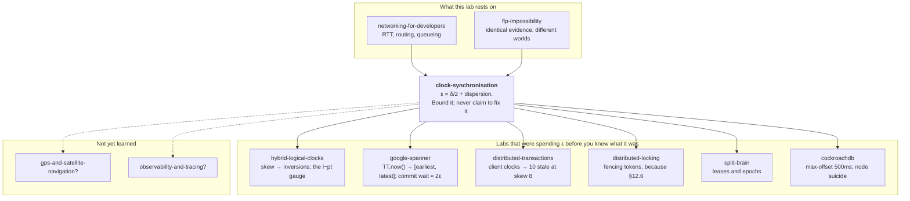

# Clock Synchronisation — the one number you can never check

> **Tell a friend:** Meera's dashboard says a message crossed a single rack in
> 4.3 seconds, and Arjun's packet capture says the same hop takes 5
> milliseconds. Nothing is broken. The two servers, Alba and Bruno, each keep
> time by counting the wobbles of a small piece of quartz, and no two pieces of
> quartz wobble at quite the same rate. You cannot repair that by asking a
> better machine what the time is, because the answer arrives late and nobody
> can say how late. So the honest output of a clock is not an instant. It is a
> bracket: *the time is somewhere between here and here.* Half the width of
> that bracket is the number your whole design is quietly built on.

The trainer is [`visualization.html`](visualization.html), four panels you can
drag. Where the numbers came from, and where this sits: section 19 at the end.

---

## 1. What question can a logical clock never answer?

> **In one breath:** You already own a clock that says which event caused
> which. It cannot tell you what time it is, how long something took, or
> whether a certificate has run out. Those questions need a different kind of
> clock, and that kind is what this lab builds.

Omar, who answers the regulator's letters, stops at Dev's desk with one
request. *Show me everything the payments service did between 09:00 and 09:05
last Tuesday.*

Dev has a good clock. `causal-consistency` gave him happens-before.
`hybrid-logical-clocks` gave him a stamp that never puts an effect in front of
its cause. He can tell Omar which of any two events came first, as long as one
of them caused the other.

He cannot answer Omar's question at all. "Between counter 4100 and counter
4900" is not a window in the morning.

So why is there a second family of clocks? Because some questions about time
have **no causal answer**, and they are the most ordinary questions in the
building.

- *Did this certificate expire?* Nobody sent Dev a message when it expired.
  Expiry is not an event at some node. It is a property of wall-clock time.
- *Has this lease run out?* The lock holder did not message Priya to say it had
  stopped holding the lock. That is precisely the case where it *cannot*.
- *How long did this request take?* A duration is the difference of two
  physical times. A Lamport counter difference of 4 could mean 4 microseconds
  or 4 hours. `hybrid-logical-clocks` found one counter value spanning 34 ticks
  of real time.
- *Show me everything between 09:00 and 09:05.* Omar asks it. So does the
  billing system. So does every auditor Omar has ever met.
- *Which of these two log lines, from two machines, happened first?* Ask it
  when there is **no causal path between them at all**. `hybrid-logical-clocks`
  counted this exactly: fast-clock writer, slow-clock reader, no message
  between them, **86 of 86 reads stale**.

Logical clocks are silent on that last one by construction, not by accident.

> **🔮 Predict:** *Dev suggests stamping every log line with an HLC value as
> well as a wall-clock time, so Omar can use whichever is better. Does that
> give Omar his 09:00–09:05 window?*
>
> <details><summary>Reveal</summary>
>
> No, and the reason is worth being precise about. The HLC half of that stamp
> carries a wall-clock reading inside it, so Omar would be reading the *wall
> clock* again, with all of this lab's problems intact. The logical half tells
> him about causal order and nothing else.
>
> If you guessed yes, you were treating an HLC as *two independent clocks in
> one field*. It is not. It is a physical clock that has been taught never to
> go backwards relative to a message it has seen. The physical reading it
> carries is exactly as wrong as the machine's own clock.
> </details>

Physical time is not a legacy inconvenience that logical clocks replaced. The
two families answer different questions. Every real system needs both. HLC
exists *because* it needs both at once.

Here is the split, and it is worth memorising.

| | **Logical time** | **Physical time** |
|---|---|---|
| Answers | "did A cause B?" | "was it 09:03?", "how long?", "has it expired?" |
| Source of truth | messages actually sent | a vibrating rock (§2) |
| Fails by | saying "concurrent" when you wanted an order | being **wrong**, silently, by an unknown amount |
| Fixed by | more bookkeeping | *nothing.* It can only be **bounded** |

That last cell is this entire lab. Logical time is now put down and not picked
up again. Lamport clocks, vector clocks, happens-before and HLC are already
yours from `causal-consistency` and `hybrid-logical-clocks`. The boundary
between the two families is the table above.

---

## 2. What is a clock, and why do two of them drift apart?

> **In one breath:** A clock is a small rock that vibrates, plus something that
> counts the vibrations. No two rocks vibrate at exactly the same rate, so two
> healthy machines set to the same time on Monday disagree by seconds by
> Tuesday.

Strip away the software. Asha opens a server and looks for the clock. What she
finds is a chip containing a sliver of quartz.

Put a voltage across that quartz and it vibrates at a nominal frequency.
Commonly 32,768 times a second. For a CPU reference, tens of megahertz. A
counter circuit counts those vibrations. The operating system makes one
agreement with the counter: *when it advances by 32,768, one second has
passed.*

That is the whole mechanism. A clock is a rock that vibrates, plus a counter,
plus an agreement about how many vibrations make a second.

Now the problem. **No two rocks vibrate at exactly the same rate.** The cut of
the crystal moves the frequency. So does the temperature of the room, the age
of the part, and the supply voltage. A crystal specified at "±20 ppm" is
promised to stay within 20 parts per million of nominal.

"Parts per million" sounds negligible. Put a number on it and it stops sounding
that way. **20 ppm means the clock gains or loses 20 microseconds every
second.**

| Time elapsed | Error a 20 ppm crystal has accumulated | Why that matters |
|---|---|---|
| 1 minute | 1.2 ms | already larger than a datacenter round trip |
| 1 hour | 72 ms | larger than a London–New York round trip |
| 1 day | **1.73 seconds** | larger than most lease durations |
| 1 month | about 52 seconds | larger than most people's imagination of "drift" |

Meet the two machines this lab follows all the way through.

> **Alba** and **Bruno** are two servers in the same rack, in Asha's Mumbai
> datacenter. Alba's crystal runs **fast by 20 ppm**. Bruno's runs **slow by
> 30 ppm**. Both are well inside the spec printed on the part. Neither is
> faulty. Neither will ever be replaced.

Asha set them both to the correct time at the same instant, on Monday at
midnight. Read the fourth column below: it is the gap Meera's dashboard will
eventually have to explain.

| Elapsed | Alba is ahead of true time by | Bruno is behind by | **Alba − Bruno** |
|---|---|---|---|
| 1 minute | +1.2 ms | −1.8 ms | 3 ms |
| 1 hour | +72 ms | −108 ms | 180 ms |
| 1 day | +1.73 s | −2.59 s | **4.32 s** |
| 1 week | +12.1 s | −18.1 s | 30.2 s |

By Tuesday midnight, two healthy machines in one rack, running
correctly-specified hardware, disagree about the time by **more than four
seconds**. Each of them reports its own answer with complete confidence.

> **🔮 Predict, before reading on:** *It is Tuesday. Bruno sends Alba a
> request. Arjun has measured the hop between them at **5 milliseconds**; they
> are in the same rack. Bruno logs the send, Alba logs the receive. What will
> Meera see when she stitches the two log lines together?*
>
> <details><summary>Reveal</summary>
>
> Work outward from the truth. Say Bruno really sends at true time
> 10:00:00.000, and Alba really receives at true time 10:00:00.005.
>
> - Bruno's clock is **2.59 s slow**. At that instant it reads
>   **09:59:57.410**. That is what goes in his log.
> - Alba's clock is **1.73 s fast**. At her instant it reads **10:00:01.735**.
>   That is what goes in hers.
>
> Meera's tracing tool stitches them together:
>
> ```
> 09:59:57.410  bruno   sent request req-8814
> 10:00:01.735  alba    received request req-8814
> ```
>
> **A 5-millisecond hop is reported as 4.325 seconds.** Meera's latency
> dashboard is now wrong by three orders of magnitude, and it is wrong
> *consistently*, so it looks like a real finding. Somebody is about to spend a
> week optimising that network path.
>
> Now send it the other way. Alba to Bruno, same 5 ms hop:
>
> ```
> 10:00:01.730  alba    sent response  req-8814
> 09:59:57.415  bruno   received response req-8814
> ```
>
> **The message is received 4.315 seconds before it is sent.** You have seen
> this in a real trace. Everyone has. The instinct is to blame the tracing
> library, or the log shipper, or a clock "glitch". Nothing glitched. Two
> healthy machines, two in-spec crystals, one day of uptime.
>
> If you guessed "the timestamps will be a few milliseconds apart, in the right
> order", you assumed the two clocks agree because the two machines are close.
> Distance has nothing to do with it. Uptime does.
>
> This is what makes clocks dangerous rather than merely imprecise. **A wrong
> clock does not throw an exception. It answers.** Its answer has the same
> type, the same format and the same confident appearance as a right one.
> </details>

Alba and Bruno now carry the whole lab. Everything after this is either an
attempt to close that 4.32-second gap, or an admission of how much of it can
never be closed.

**Where the lab takes you.** Stop at any checkpoint and you still have
something whole.

| Layer | Sections | After it you can… |
|---|---|---|
| Beginner | 1–8 | say why a clock drifts, why asking a server cannot work exactly, and why the honest output is an interval |
| Intermediate | 9 | trace the eight refinements from "ask once" to a GPS receiver in the rack, and say what each bought |
| Engineering | 10–13 | read `chronyc tracking`, state your machine's real error bound, choose the right clock, and predict a step or a leap second |
| Production | 14–16 | pick a daemon, choose what to alert on, size the sync quality your design needs, and refuse seven wrong models |

Read §1–§8 in one sitting. That is the whole idea.

---

## 3. Offset, drift, skew, jitter — which one is your dashboard showing?

> **In one breath:** Four words that get used as if they mean the same thing.
> One is how wrong the clock is. One is how fast it is getting wronger. One is
> the gap between two clocks. One is not about the clock at all.

Ben is building the first clock dashboard the team has ever had. He asks Asha
what to plot. Asha makes him learn four words first, because conflating them is
the single most common source of confused clock debugging.

**Offset** is *how wrong the clock is right now*. One number, in seconds:
the clock's reading minus true time. Alba's offset after one day is +1.73 s.
Offset is a **position** error.

**Drift**, also called *frequency error* or *skew rate*, is *how fast the
wrongness is growing*. It is measured in ppm, or in seconds per day. Alba's
drift is +20 ppm. Drift is a **velocity** error.

> That distinction matters more than the other three put together, and here is
> why in one sentence: **correcting the offset does not correct the drift.**
> Set Alba's clock right and change nothing else. She is perfect for an
> instant. Then she immediately starts gaining 20 µs every second again. §9.5
> is built entirely on this sentence.

**Skew** is *how far apart two clocks are from each other*. Alba minus Bruno is
4.32 s after a day. Skew says nothing about whether either one is correct. Two
machines can be perfectly synchronised **to each other** and both be an hour
wrong. Skew is usually the quantity your distributed system actually cares
about; `hybrid-logical-clocks` counted its inversions against exactly this
axis.

*(A warning about the literature. Some sources, including parts of the NTP
documentation, use "skew" for the frequency error, which is what Asha calls
drift. Both usages are common. When Ben reads a dashboard labelled "skew", he
checks the units: seconds means offset-between-clocks, ppm means frequency.)*

**Jitter** is *how much the measurement bounces around*. It is not a property
of the clock. It is a property of your ability to observe it. Ask Bruno the
time ten times and get ten answers scattered over 3 ms, and your jitter is
about 3 ms.

One more pair, borrowed from metrology, settles a lot of arguments:

- **Accuracy** is closeness to UTC. It needs a link to the outside world.
- **Precision** is closeness to each other. It needs only that the machines
  talk.

Omar's trading timestamps must match a regulator's clock, so Omar needs
*accuracy*. Priya's database must order its own transactions, so Priya needs
*precision*. They are bought differently and they cost differently. Spanner
needs both, which is why it is expensive.

---

## 4. Why can't Alba just ask a machine that knows?

> **In one breath:** Put one good clock in the datacenter and let everyone ask
> it. The answer is always stale by the time it arrives, and always in the same
> direction, so the error never averages away.

The fix looks trivial, and Ben proposes it in the first ten seconds. Put one
machine in the datacenter with a good clock. Call it the time server. Everyone
else asks it what time it is and sets their clock to the answer.

It is a genuinely reasonable first design. It is also, in outline, what NTP
does. So let us find exactly where it cracks, because everything else in this
lab is a repair to one specific crack.

Alba asks the time server, which today is Bruno.

```
Alba's clock reads 10:00:00.000  →  "what time is it?"  ────────►
                                                        (network)
                                    ◄──────  "it is 10:00:00.105"
Alba's clock reads 10:00:00.040
```

Alba receives the answer "10:00:00.105" and sets her clock to 10:00:00.105.

> **🔮 Predict:** *By how much is Alba's clock wrong immediately after she sets
> it, and in which direction?*
>
> <details><summary>Reveal</summary>
>
> **Wrong by roughly 20 ms, and always in the same direction: behind.**
>
> Bruno's answer was true at the moment Bruno wrote it. By the time Alba
> applies it, that moment is in the past, because the reply had to cross the
> network. Alba has set her clock to a stale value, and she has done it
> *systematically*. The error never averages out, because the reply is never
> early.
>
> If you guessed "sometimes ahead, sometimes behind, averaging to zero", you
> were thinking of random noise. This is not noise. It is a bias with a sign.
> Run this in a loop and Alba does not converge on the right time. She
> converges on the right time *minus the one-way network delay*, forever.
> </details>

The bug is not subtle once you see it. Neither is the fix.

---

## 5. What does the round trip give back? Cristian's algorithm, 1989

> **In one breath:** Alba knows how long the whole exchange took on her own
> clock. If she assumes the two legs were equal, she can add half of it back
> and remove almost all of the bias.

Alba threw away something in §4 that she already had: **how long the whole
exchange took, measured on her own clock**. She sent at 10:00:00.000 and
received at 10:00:00.040. Forty milliseconds elapsed on her clock.

If the reply took some of that 40 ms to come back, Bruno's answer is stale by
that much. Alba does not know how much of the 40 ms was the outbound leg and
how much was the return. So she assumes it split evenly, 20 ms each way, and
adds 20 ms to Bruno's answer.

```
Alba sets her clock to 10:00:00.105 + 20 ms = 10:00:00.125
```

This is **Cristian's algorithm**, published by Flaviu Cristian in 1989. It is
the ancestor of every physical clock synchronisation protocol running today.
NTP's version uses four timestamps instead of three, so that the server's own
processing time can be removed.

Think of those four timestamps as four times written on a postcard as it
travels. Alba writes one when she posts it. Bruno writes one when it lands on
his desk, and one when he posts the reply. Alba writes the last one when the
reply lands on hers. Bruno copies his two into the reply, so Alba ends up
holding all four.

| Postcard moment | Recorded by | On whose clock | Engineers call it | Value |
|---|---|---|---|---|
| posted | Alba, on send | Alba's | **T1** | 10:00:00.**000** |
| landed on his desk | Bruno, on receive | Bruno's | **T2** | 10:00:00.**105** |
| reply posted | Bruno, on send | Bruno's | **T3** | 10:00:00.**106** |
| reply landed | Alba, on receive | Alba's | **T4** | 10:00:00.**040** |

Two quantities come out of those four numbers. Say them in words before you
meet their letters.

| The quantity, in words | Its letter | How it is worked out |
|---|---|---|
| the total time the two messages spent in the network, with Bruno's own pause taken out | **δ**, said "delta", the round-trip delay | `(T4 − T1) − (T3 − T2)` |
| the best single guess at how far Bruno's clock is ahead of Alba's | **θ**, said "theta", the offset estimate | `((T2 − T1) + (T3 − T4)) / 2` |

Those two lines are the arithmetic core of NTP (RFC 5905 §8). Here they are
with our numbers in them:

```
round-trip delay   δ = (T4 − T1) − (T3 − T2)     "total time, minus the server's own pause"
                     = (40 − 0)  − (106 − 105)
                     = 40 − 1
                     = 39 ms

clock offset       θ = ((T2 − T1) + (T3 − T4)) / 2
                     = ((105 − 0) + (106 − 40)) / 2
                     = (105 + 66) / 2
                     = 85.5 ms
```

**Read those two results carefully, because the rest of the lab lives inside
them.** The round-trip delay δ of 39 ms says: 39 milliseconds were spent in the
network, both legs combined. The offset estimate θ of +85.5 ms says: Bruno's
clock appears to be 85.5 ms ahead of Alba's.

Alba adds 85.5 ms to her clock. Both machines now read the same thing. It looks
like the job is done.

**Checkpoint.** You can now say why "just ask a server" is systematically
biased, and how a round-trip measurement removes most of that bias. What
follows is the discovery that "most" is doing an enormous amount of work in
that sentence. The remainder is not a small imperfection waiting to be
engineered away. It is a permanent feature of the problem.

> **Say it back.** Without using the words *offset*, *delay* or *timestamp*,
> explain to a friend why Alba adding 20 ms to Bruno's answer is better than
> Alba using Bruno's answer as it arrived.
> <details><summary>A good answer sounds like</summary>
> "Bruno wrote down the time and then posted it. By the time the postcard got
> to Alba, the time on it was already old. Alba knows the round trip took 40
> milliseconds, so she guesses the postcard spent half of that coming back, and
> adds that half on. She is guessing at the split, but guessing half is much
> closer than pretending the postcard was instant."
> </details>

---

## 6. Why can no algorithm ever find the exact offset?

> **In one breath:** Alba assumed the message took the same time each way. It
> does not have to. Three different worlds hand Alba the same four numbers and
> three different truths, so no amount of cleverness separates them.

The θ formula contains an assumption so quiet that most people never notice
they made it: **the message took the same time in each direction.**

Divide the round trip evenly, said Cristian. But Arjun's network is under no
obligation to be symmetric, and he will tell you so at length. Consider three
worlds. In all three, Alba and Bruno exchange exactly the packets above, and
Alba records **exactly the same four numbers**.

> **🔮 Predict, before you read the three worlds:** *Alba is unhappy with one
> measurement, so she takes a thousand. Can a thousand round trips tell her
> which of the two legs was the slow one?*
>
> <details><summary>Reveal</summary>
>
> No. Not a thousand, not a million, not with a faster CPU or a cleverer
> algorithm. Each round trip gives her one equation, and every one of those
> equations has the same shape: outbound plus return equals the round trip.
> There are always two unknowns and always one equation.
>
> If you guessed yes, you were assuming the asymmetry is *noise*, and that
> noise averages away. §12.2 is the operational version of that guess, and it
> costs a permanent 3 ms.
> </details>

Let *out* and *back* be the true time the two legs took, with out + back = 39
ms. Let the true offset be how far Bruno's clock is genuinely ahead of Alba's.

**World A — the path is symmetric.** out = 19.5 ms, back = 19.5 ms.

```
true time   0        Alba sends.       Alba's clock: 0
true time   19.5     Bruno receives.   Bruno's clock: 105    →  true offset = 105 − 19.5 = 85.5
true time   20.5     Bruno sends.      Bruno's clock: 106
true time   40.0     Alba receives.    Alba's clock: 40      ✓
```

True offset **85.5 ms**. Alba estimated 85.5 ms. Perfect.

**World B — out is fast, back is slow.** out = 4.5 ms, back = 34.5 ms. Perhaps
the return path is congested. Perhaps it takes three extra hops because Arjun's
predecessor left a BGP policy routing asymmetrically. This is entirely
ordinary.

```
true time   0        Alba sends.       Alba's clock: 0
true time   4.5      Bruno receives.   Bruno's clock: 105    →  true offset = 105 − 4.5 = 100.5
true time   5.5      Bruno sends.      Bruno's clock: 106
true time   40.0     Alba receives.    Alba's clock: 40      ✓
```

True offset **100.5 ms**. Alba estimated 85.5 ms. **She is wrong by 15 ms.**

**World C — the mirror image.** out = 34.5 ms, back = 4.5 ms.

```
true time   0        Alba sends.       Alba's clock: 0
true time   34.5     Bruno receives.   Bruno's clock: 105    →  true offset = 105 − 34.5 = 70.5
true time   35.5     Bruno sends.      Bruno's clock: 106
true time   40.0     Alba receives.    Alba's clock: 40      ✓
```

True offset **70.5 ms**. Alba estimated 85.5 ms. **Wrong by 15 ms the other
way.**

Now put what Alba observed side by side. Read the bottom row against the four
above it.

| What Alba wrote down | World A | World B | World C |
|---|---|---|---|
| T1, the moment she posted | 0 | 0 | 0 |
| T2, the moment it landed on Bruno's desk | 105 | 105 | 105 |
| T3, the moment Bruno replied | 106 | 106 | 106 |
| T4, the moment the reply landed | 40 | 40 | 40 |
| **True offset** | **85.5** | **100.5** | **70.5** |

**The evidence is byte-for-byte identical and the truth is different.**

This is the same shape of argument as `flp-impossibility`, where a slow process
and a dead process produce identical evidence, so no observation separates
them. Here a fast-out/slow-back path and a slow-out/fast-back path produce
identical evidence. **No observation available to Alba separates them.** Not a
better algorithm. Not more samples. Not a faster CPU. She has one equation and
two unknowns, and the network will not hand her a second equation.

> **This is worth stating as a law, because it is the load-bearing fact of the
> whole field:**
>
> **From round-trip measurements alone, the split of delay between the two
> directions is unobservable. So the offset between two clocks connected only
> by a network cannot be determined exactly. It can only be bounded.**

### What does "bounded" actually mean here?

Take that word slowly, because it is what this lab is really about, and it
arrives in three steps.

**First, as a thing you can point at.** Asha draws a line on the whiteboard.
She marks 66 at the left end and 105 at the right end, and puts a tick in the
middle at 85.5. Underneath she writes: *"Bruno is ahead of Alba by some amount
on this line. I do not know which point. I know it is on the line."* That
whiteboard line is what Alba's measurement actually produced. The tick in the
middle was never the product.

Where did the two ends come from? From the two extreme worlds. Push all 39 ms
into the return leg, so out is zero, and the true offset is 105. Push all 39 ms
into the outbound leg, so back is zero, and the true offset is 66. Every
physically possible world lies between those two.

```
                 66 ms                85.5 ms                105 ms
                   ├───────────────────────┼───────────────────────┤
              (all delay              (best estimate)         (all delay
               outbound)                                      on return)

              ◄────────────── δ = 39 ms wide ──────────────►
              ◄─── ε = 19.5 ───►
```

**Second, as a sentence in words.** Say this out loud before you meet its
symbol, because Spanner's entire design is this sentence made operational:

> **Half the width of the honest bracket is how wrong this clock might be,
> right now, at worst.**

**Third, as the symbol.** Engineers write that half-width as **ε**, said
"epsilon". Here ε, half the width of the honest bracket, is 19.5 ms, which is
exactly δ/2.

**The honest output of Alba's measurement is not "85.5". It is "somewhere in
[66, 105], and my best guess is the middle."** The bracket is the product. The
midpoint is a convenience.

You have met the letter ε before, in three labs. **This section is where it
comes from.** It is not a hardware imperfection, and it is not caution bolted
on by a nervous engineer. It is half the round-trip time. It exists because the
network refused to tell Alba which direction the delay was in.

One thing ε is not, and `google-spanner` puts it the same way: it is not a
reading of the actual error. It is a *bound* that the clock daemon is prepared
to guarantee.

> **Go and see it.** [`visualization.html`](visualization.html) → **Panel 1,
> "The Measurement"**. One slider, called *delay split*, moves delay from one
> leg to the other **while holding the round trip constant**. Watch T1, T2, T3
> and T4: they never move. Watch the true offset: it sweeps the whole interval.
> Seeing four numbers sit frozen while the truth slides underneath them does
> more than the table above can.

---

## 7. If exactness is gone, what is the real requirement?

> **In one breath:** Stop trying to deliver a correct clock. Deliver a clock
> plus an honest promise about how wrong it might be. Two separate projects
> follow, and only one of them decides whether your system is correct.

Asha set out to build synchronised clocks. §6 says she cannot have them. So she
restates the goal as something she can actually deliver:

> **We cannot deliver a correct clock. We can deliver a clock together with an
> honest, never-underestimated bound on how wrong it might be.**

Everything from here divides cleanly into two projects. Keep them apart in your
head, because they are done by different people with different budgets.

1. **Make ε small.** Make the half-width of the honest bracket smaller. This is
   engineering, and §9 is eight moves' worth of it, from 100 ms down to under
   40 µs, a factor of 2,500. Omar signs for it. It is bought with protocols,
   kernel features, network hardware and, in the end, GPS antennas.

2. **Carry ε truthfully to whoever reads the clock.** Hand the half-width to
   the caller instead of hiding it. This is API design, and it is the part
   almost everyone skips. §10 shows that NTP has been computing this number
   correctly since 1985, and that essentially every application on earth throws
   it away at the last step.

Project 2 is the one that decides whether Priya's system is *correct*. Project
1 only decides whether it is *fast*. `google-spanner` made exactly this point,
and it should land harder now: **ε appears nowhere in Spanner's correctness
argument and everywhere in its bill.** Google's atomic clocks did not make
Spanner correct. Refusing to hide ε made Spanner correct. The atomic clocks
made it affordable.

---

## 8. What should a time API return instead of "now"?

> **In one breath:** A time API should hand back two numbers, not one. Every
> API you have ever used hands back one, which is why every caller behaves as
> if the clock were perfect.

Here is the whole invention, in one line:

> **A time API should return `[earliest, latest]`, not `now`.**

That is it. Everything in §9 is engineering to bring those two numbers closer
together. Everything in §10 is plumbing to stop people throwing the second one
away.

Why does this feel so strange? Because every clock API Dev has ever used lies
to him with a straight face. `System.currentTimeMillis()` returns a `long`. A
`long` has no room for "± 12 ms". The API is *shaped* so the uncertainty cannot
be expressed. So the uncertainty is dropped. So every caller behaves as though
it were zero.

And here is the fact that should convince you this is not academic
fastidiousness. **Three organisations, working separately, on different
problems, arrived at exactly the same conclusion.**

| Who | What they built | What the API returns |
|---|---|---|
| Google (2012) | **TrueTime** | `TT.now()` → `[earliest, latest]`; ε is half the width |
| AWS (2023) | **ClockBound** | a confidence interval, not a timestamp |
| Meta (2022–25) | **fbclock** | a "**Window of Uncertainty**", a range of possible nanosecond timestamps |

Three independent reinventions of one idea, in the three companies that run the
most clock-sensitive infrastructure on the planet. When that happens it is not
a coincidence and it is not a fashion. It is the problem's actual shape showing
through.

**Checkpoint.** You can now say why exact clock synchronisation is impossible,
where the number ε comes from, and why the honest interface is an interval.
That is the whole conceptual content of the field.

What you cannot yet do is say what *your* machine's ε is right now, or why it
is 100 ms in one setup and 40 µs in another. §9 builds the machine that makes
the difference. §10 teaches you to read the number off a live host.

> **Say it back.** Without using the words *offset*, *asymmetry* or *epsilon*,
> explain to Ben why Alba can never learn exactly how far ahead Bruno's clock
> is.
> <details><summary>A good answer sounds like</summary>
> "Alba can time the whole round trip, but she cannot see how that time was
> split between going and coming back. A world where the postcard raced there
> and crawled home looks identical, on her side, to a world where it crawled
> there and raced home. Bruno's clock is in a different place in those two
> worlds. So the best Alba can honestly say is 'somewhere between these two
> numbers', and the gap between them is the whole round trip."
> </details>

---

## 9. How do you get from 100 ms down to 40 µs? Eight refinements

> **In one breath:** Alba's version 1 is: exchange four times, work out the
> round-trip delay and the offset estimate, set the clock, and remember you are
> uncertain by half the round trip. Everything real is that plus eight
> improvements, and each one exists because a specific thing broke the one
> before it.

Everything in production is version 1 plus eight moves. `ntpd`, `chrony`, PTP,
Google's time-slave daemon: all of them.

Read this section as a story, not a feature list. Asha ships a version. Meera,
Priya, Dev or Arjun breaks it with a specific scenario. Asha ships the next
one. Where a fix is a real configuration knob, the actual default is named.

---

### 9.1 One sample — what if that packet was unlucky?

Alba measures once, gets a round-trip delay of 39 ms, and sets her clock.

The next time she measures, the delay is 210 ms. Her request happened to arrive
at a switch behind a 40 KB burst from Ben's backup job. Her offset estimate
from that sample is uncertain by ±105 ms.

She has no way to know which of the two measurements was the good one. Worse:
if she had taken only the bad one, she would have applied it with exactly the
same confidence.

So a single sample is a lottery ticket, and network delay is enormously
variable.

---

### 9.2 Many samples — average them, or keep only the best one?

Alba takes eight samples. What should she do with them?

> **🔮 Predict:** *Eight round-trip measurements to Bruno come back with these
> delays: 39, 41, 118, 52, 40, 210, 44, 39.5 ms. To get the best offset
> estimate, does Alba (a) average all eight offsets, (b) take the median, or
> (c) use only the sample with the smallest delay and throw the other seven
> away?*
>
> <details><summary>Reveal</summary>
>
> **(c), and it is not close.** This is NTP's *clock filter*, and it surprises
> almost everyone, because the reflex from statistics is "more samples,
> average, noise cancels".
>
> The reflex is wrong here because **network delay noise is one-sided**. There
> is a hard physical floor: propagation at roughly two-thirds the speed of
> light, plus the time to clock the bits onto the wire. Every source of noise
> can only *add* to that floor. Queueing, scheduling, interrupt coalescing,
> contention: all of them add, none of them subtract. No packet ever arrives
> faster than the speed of light. So the delay distribution has a wall on the
> left and a long tail on the right.
>
> That changes what "best" means. Recall from §6 that a sample's error bound is
> half its delay. So a sample's *quality is entirely decided by its delay*.
>
> | Strategy | Effective round-trip delay | Resulting ε (half of it) |
> |---|---|---|
> | Mean of all eight | 72.9 ms | ±36.5 ms |
> | Median | 42.5 ms | ±21.3 ms |
> | **Minimum** | **39 ms** | **±19.5 ms** |
>
> Averaging *contaminates* the one good measurement with six bad ones. The
> 39 ms sample spent the least time in queues. That makes it the sample whose
> two legs are most likely to be nearly equal, which makes it the sample whose
> bracket is tightest and most honest. The other seven tell Alba nothing the
> minimum does not already tell her better.
>
> "Take the minimum" is unusual advice in measurement generally. It is correct
> advice here specifically, because of the one-sided distribution. NTP keeps a
> register of the last **8** samples and selects on lowest delay.
> </details>

Alba now polls Bruno eight times and keeps the best. Her ε has stopped
bouncing.

And then Arjun points out the hole. All eight samples came from Bruno. If
Bruno's clock is wrong, whether misconfigured, unsynchronised, or serving 1970
because his own upstream died, Alba will follow him precisely and confidently
into being wrong.

---

### 9.3 Several servers — how does Alba spot the one that is lying?

Ask four servers instead of one. Each gives back a bracket, exactly as in §6: a
best estimate with a half-width either side. Alba's job is now to find the
truth among four claims, knowing some may be false.

| Server | Claims the correct time is in |
|---|---|
| S1 | [98, 104] ms ahead of Alba |
| S2 | [101, 107] |
| S3 | [99, 106] |
| S4 | **[412, 418]** |

> **🔮 Predict:** *Which of those four is lying, and what rule tells Alba so
> without her knowing the true time?*
>
> <details><summary>Reveal</summary>
>
> S4, and the rule is overlap. **A correct server's bracket must contain the
> true time.** So every correct server's bracket contains the same point, which
> means they all overlap each other. A bracket that overlaps nobody cannot be
> correct.
>
> S1, S2 and S3 share the region **[101, 104]**. S4 shares no point with any of
> them. Alba discards S4.
>
> If you guessed "she takes the majority vote on the midpoints", you get the
> same answer here and the wrong answer in general. Midpoints are single
> numbers with no width, so voting on them throws away exactly the information
> that identifies the liar.
> </details>

A server whose bracket overlaps nobody's is called a **falseticker**, and the
rule Alba just used is **Marzullo's algorithm**. NTP calls its variant the
*intersection algorithm*. It is the piece named in passing in the
`google-spanner` glossary; Google's time-slave daemons run a variant of it
against several masters.

It does two jobs at once.

1. **It rejects liars** without Alba needing to know in advance which server is
   lying. That is the same trick as `quorums-and-replication`: trust the
   intersecting majority, evict the outlier. It is also the same reflex as
   `hybrid-logical-clocks`, where CockroachDB makes a node **kill itself** when
   it detects it is outside the max-offset window. Better to have no clock than
   a confidently wrong one.
2. **It narrows ε.** The intersection [101, 104] is **3 ms wide**. Every
   individual bracket was 6 ms wide. Combining independent honest sources
   halves the uncertainty here for free. This is why NTP configurations
   conventionally list **at least four** servers: three is the minimum to
   out-vote one falseticker, and four keeps that property when one is
   unreachable.

Alba has now discovered she is 102.5 ms behind. She sets her clock forward by
102.5 ms. And Dev, whose code was in the middle of timing something on Alba,
walks over with a question.

---

### 9.4 Jump or glide? What happens to software when time moves sideways

Setting the clock instantly is called **stepping**. It makes time
*discontinuous*, and if the correction is backwards, it makes time run
**backwards**.

Dev's software assumes time does not do that. So does everybody's. §12.1 and
§13 carry the production outages; here is the fix.

**Slewing** means changing the clock's *rate* for a while instead of its value.
Rather than jumping forward 102.5 ms, Alba runs her clock 1% fast for 10.25
seconds. The clock never jumps, never repeats a value, and never goes
backwards. It just runs slightly wrong on purpose, so that afterwards it can be
right.

Asha checks chrony's actual defaults, and they surprise the team. Read the
middle column: three of these five are not what people assume.

| Directive | Default | What it means |
|---|---|---|
| *(slewing)* | **on, always** | "Normally chronyd will cause the system to gradually correct any time offset by slowing down or speeding up the clock as required" |
| `makestep` | **not configured** | stepping does not happen at all unless you ask for it |
| `maxslewrate` | **83333.333 ppm** ("one twelfth") | the fastest chronyd will slew |
| `corrtimeratio` | **3** | prefers slower, longer corrections over fast ones |
| `maxdistance` | **3 seconds** | the worst root distance chronyd will accept from a source — see §10.5, and brace yourself |

Do the arithmetic on that slew rate, because it has an operational
consequence. One twelfth means the clock can run at most 1/12 fast or slow.
Correcting Tuesday morning's **4.32 s** skew by slewing alone takes **at least
4.32 × 12 ≈ 52 seconds**. With `corrtimeratio 3` in play, in practice it takes
several minutes. Throughout, the machine's clock is deliberately running at the
wrong *rate*, and any duration it measures is off by up to 8%.

That is why nearly every distribution ships a line like `makestep 1.0 3`. In
words: *step the clock if the offset exceeds 1 second, but only for the first 3
updates after startup.* Step once at boot when nothing is running, then never
again. That is the compromise the whole industry settled on, and you can now
see both sides of it.

Alba's clock is correct at 10:00:00. At her next poll, 64 seconds later, she is
1.28 ms out again. Correcting the offset did nothing about the *reason* the
offset appeared.

---

### 9.5 Why does correcting the clock not stop it drifting again?

This is §3's offset-versus-drift distinction cashed in, and it is the single
highest-leverage refinement in the list.

Alba drifts at +20 ppm. Her poll interval is 64 seconds. Between polls she
accumulates 64 s × 20 µs/s = **1.28 ms** of new error, every time, forever. She
is on a treadmill: correct, drift, correct, drift.

The fix is to stop correcting the clock's reading and start correcting **the
number of ticks the kernel counts as one second**. Alba notices over several
polls that she consistently gains about 20 µs/s. She tells the kernel: *count
as if the crystal were 20 ppm slower than it is.*

On Linux that is `adjtimex`/`ntp_adjtime` with `ADJ_FREQUENCY`. The frequency
correction is expressed in ppm with a 16-bit fractional part, so a value of 1
means 2⁻¹⁶ ppm. The daemon persists what it learned in a **drift file**, so
after a reboot it starts with the right frequency instead of spending an hour
rediscovering it.

The payoff. Read the right-hand column, and notice which term stops mattering.

| Alba's strategy | Error accumulated between 64 s polls | ε just before the next poll |
|---|---|---|
| Offset correction only (20 ppm raw) | 1.28 ms | ~20 ms (network) + 1.28 ms |
| **Plus frequency correction** (residual ~0.1 ppm) | **6.4 µs** | ~20 ms (network) + 6.4 µs |

A **200× reduction** in the drift component, bought with a few bytes of state.
After this refinement the drift term stops dominating ε and **the network
starts dominating it**. That is a change of regime. It is why every remaining
refinement attacks the network rather than the crystal.

> **An honesty note about Spanner's 200 µs/s.** `google-spanner` told you
> TrueTime assumes a worst-case drift of 200 µs/s, which is **200 ppm**. That
> is ten times worse than the ±20 ppm part in §2, and *two thousand times*
> worse than the ~0.1 ppm residual a disciplined clock actually achieves. It is
> not what Google's crystals do. It is what Google is willing to *promise* they
> will never exceed, including a machine in a hot aisle with a failing
> oscillator. ε is built from the number you are prepared to be held to, not
> the number you usually see. That gap, between typical and guaranteed, is
> where the cost of correctness lives. It is exactly why `google-spanner`
> insisted that ε is a latency purchase and not an accuracy one.

Alba's ε is now about 20 ms, and essentially all of it is half the round-trip
delay. To go further she must shrink that delay, which means asking where those
milliseconds actually go.

---

### 9.6 Where exactly is T1 taken, and what happens before the wire?

Go back to T1 and T4, the two moments Alba wrote on the postcard. *When
exactly* is T1 taken?

In versions 1 to 5 it is taken by the NTP daemon, in userspace, just before it
calls `send()`. Between that instant and the moment the first bit hits the
fibre, the packet must cross the socket layer, then the network stack, then a
possible queue on the NIC. And, most importantly, whatever the CPU scheduler
decides to do in the middle. If the machine is busy, the daemon may be
descheduled for milliseconds right after taking T1.

That whole delay is indistinguishable from network delay. Worse, it is
**variable and asymmetric**, because the send path and the receive path have
different costs and different queueing. It goes straight into the round-trip
delay, and half of it goes straight into ε.

The fix is a ladder. Each rung moves the timestamp closer to the physical wire.

| Where the timestamp is taken | Typical uncertainty it contributes |
|---|---|
| Userspace, before `send()` | hundreds of µs, ms under load — scheduler-dependent |
| Kernel, in the network stack (`SO_TIMESTAMPING`, software) | tens of µs |
| **NIC hardware, as bits cross the interface** | **tens of nanoseconds** |

Hardware timestamping is not a software optimisation. It requires the network
card to contain a clock and stamp packets itself. AWS describes exactly this
capability on Nitro: hardware packet timestamping "add[s] a 64-bit
nanosecond-precision timestamp to every incoming network packet". The reason it
matters is stated plainly: "because hardware packet timestamping occurs at the
hardware level—before the packet reaches the kernel, socket, or application
layer—you bypass any delays added by software timestamping."

Alba's endpoints are now honest to nanoseconds. Her round-trip delay is still
milliseconds, because the packet still spent all that time queued inside three
of Arjun's switches that nobody asked.

---

### 9.7 What if the switches stopped being a black box?

Everything so far treated the network as an opaque box. Put a packet in, get a
delay out, divide by two, hope. §6 proved that hoping is the best you can do
**with an opaque box**.

So Arjun stops using an opaque box.

**PTP**, the Precision Time Protocol, IEEE 1588, requires the switches
themselves to take part in the measurement. There are two ways to do it.

A **transparent clock** measures how long the timing packet sat inside the
switch, which is its *residence time*, and writes that number into a correction
field in the packet as it leaves. The receiver subtracts it. Queueing delay
stops being unknown asymmetry and becomes a **measured, subtracted quantity**.

A **boundary clock** synchronises itself first, then acts as a time server for
the next hop down. One long uncertain path becomes a chain of short certain
ones.

Look at what a transparent clock does to §6's argument. Alba's problem was one
equation and two unknowns. The switch hands her the second equation. **This is
the only refinement in the list that reduces the *irreducible* part of ε rather
than the noise around it.** It is why PTP reaches sub-microsecond accuracy
while NTP over the same physical cable does not. Not better maths. A network
that stopped being a black box.

The price is that PTP needs the network gear to support it. You cannot deploy
PTP over the public internet, or over switches that do not speak it. That is a
capital and topology cost, not a config change. Omar signs for it. Meta moved
its fleet from NTP to PTP in late 2022 and has published extensively on what
that took.

Alba still depends on a chain of Arjun's devices between her and the reference
clock, and on that chain staying healthy.

---

### 9.8 What if there were no network at all?

The final move: put the reference clock inside the machine.

**Why GPS solves the asymmetry problem.** Each GPS satellite carries an atomic
clock. It continuously broadcasts its own time and its own orbital position. A
receiver on the ground picks up several satellites and solves for four
unknowns: its own x, y and z, plus *the current time*. The propagation delay is
no longer an unknown to be halved. The receiver **knows where the satellite
is**, so it can *compute* how long the signal took. §6's missing second
equation comes from geometry.

The receiver then emits a **PPS** signal, a pulse-per-second: a physical
electrical edge, once a second, on a wire, which the server latches directly.
No packets. No queues. No asymmetry.

You have already met the production form of this in `google-spanner`. GPS
receivers and atomic clocks in every Google datacenter, plus *Armageddon
masters* backed by atomic clocks, specifically so that a GPS-correlated failure
does not take down everything at once. Jamming, spoofing, a constellation-wide
bug: any of those hits every GPS receiver simultaneously.

The cloud form is newer and much more accessible. AWS puts GPS-disciplined
reference clocks in the **Nitro System** itself, and exposes a **PTP Hardware
Clock**, or **PHC**, as a device on the instance. There is no network between
your machine and the reference clock. The clock is on the card your machine is
plugged into. AWS's published figures:

| Path | Typical clock error bound |
|---|---|
| Amazon Time Sync over **NTP** | **under 100 µs** |
| Amazon Time Sync via **PHC** | **under 40 µs** |

That second row is worth sitting with. **Sub-100-microsecond synchronisation is
now a checkbox on a cloud instance.** In 2012, the fact that Google could
achieve about 4 ms was the reason nobody else shipped Spanner's design. The
moat drained.

---

### What did each of the eight moves actually buy?

Read the last two columns together. The third column says what the move
attacks; the fourth says how much it moved the number.

| v | Move | Attacks | Order of magnitude |
|---|---|---|---|
| 1 | Round-trip, four timestamps | systematic staleness | the bias, entirely |
| 2 | 8 samples, keep min delay | unlucky packets | ε 36 ms → 19.5 ms in §9.2's data |
| 3 | Several servers, intersect | **liars**; also narrows ε | 6 ms → 3 ms wide, plus safety |
| 4 | Slew instead of step | **discontinuity**, not accuracy | none — this one buys *correctness* |
| 5 | Frequency correction + drift file | drift between polls | 1.28 ms → 6.4 µs (**200×**) |
| 6 | Hardware timestamps at the NIC | endpoint jitter | hundreds of µs → tens of ns |
| 7 | PTP transparent/boundary clocks | **the asymmetry itself** | ms → sub-µs |
| 8 | GPS/atomic + PHC on the machine | the network's existence | AWS: **< 40 µs** end to end |

Notice which rows are which. Rows 1, 2, 5 and 6 shrink *noise*. Rows 7 and 8
attack the §6 theorem itself, by obtaining information the round trip cannot
provide. **Row 4 improves nothing about accuracy at all.** It is there purely
to stop time moving backwards, and it is the row whose absence has caused the
most production outages.

**Checkpoint.** You can now explain, mechanically, why one setup achieves
100 ms and another achieves 40 µs, and name what would have to change to move
between them. What you still cannot do is look at a running machine and say
what its ε is *right now*. That is next, and it is the section that changes how
you read a host.

> **Say it back.** Without using the words *slew*, *step* or *frequency*,
> explain to Priya why the refinement that improves accuracy by exactly zero is
> still in the list.
> <details><summary>A good answer sounds like</summary>
> "Two clocks can end up equally accurate by two different routes. One jumps to
> the right answer; the other creeps to it over a minute. The jump is more
> accurate sooner, but for the software running on that machine it means a
> moment simply never happened, or happened twice. The creep costs nothing to
> anybody except a slightly wrong stopwatch for a minute. So the move buys no
> accuracy at all. It buys every program on the machine the right to assume
> time keeps going forwards."
> </details>

---

## 10. Your machine already computes ε — so why can't your code see it?

> **In one breath:** The number is already there. Every NTP daemon works it out,
> prints it on request, and hands it to nobody, because the function your code
> calls has nowhere to put it.

This is the most useful section in the lab. Its claim is simple and slightly
shocking:

> **Every NTP daemon has been computing ε correctly since 1985, prints it on
> request, and essentially every application on earth discards it at the last
> step, because `clock_gettime()` has nowhere to put it.**

TrueTime is not a new *measurement*. It is the decision to stop throwing the
existing one away.

### 10.1 What does RFC 5905 already call the bound?

NTPv4's specification defines a quantity it calls the **root synchronisation
distance**. The RFC describes it as *"the maximum error due to all causes of
the local clock relative to the primary server."*

Read that description again. That is the definition of ε, half the width of the
honest bracket, written in 1985 and refined through 2010, sitting in an IETF
standard.

Two terms dominate the formula. In words first: take half the total round-trip
time all the way up to the reference clock, then add everything that has gone
wrong or could have gone wrong since your last successful sync.

| Term | In words | Where it came from |
|---|---|---|
| root delay ÷ 2 | half the round trip, accumulated over every hop back to the reference clock | §6, applied transitively |
| root dispersion | the residual error at the last sync, plus growth since then | §9.5's drift term, kept as a running total |

The same thing with the symbol in it, the way the RFC writes it:

```
root distance  Λ  =  root delay / 2  +  root dispersion
                     └─────┬─────┘     └──────┬───────┘
                           │                  │
        §6's ±δ/2 — accumulated       everything that has gone
        over every hop from here      wrong or could have: the
        back to the reference         residual error at last sync,
        clock, halved                 plus growth since then
```

**Root delay** is the total round-trip delay all the way up the stratum chain
to the reference clock. Halving it is §6, applied transitively: Alba's
uncertainty includes her server's uncertainty about *its* server, and so on to
the top.

**Root dispersion** is the accumulated maximum error, and here is the part that
makes it honest: it **grows on its own between updates**. RFC 5905 defines a
constant called `PHI`, the assumed worst-case frequency tolerance,
conventionally **15 ppm**. Dispersion grows at PHI continuously.

> **This gives Ben a control knob most people never connect to correctness.**
> Dispersion grows at 15 µs per second of elapsed time since the last
> successful sync. So the **poll interval sets ε**.
>
> | Poll interval | Dispersion growth before the next update |
> |---|---|
> | 16 s | 0.24 ms |
> | 64 s | 0.96 ms |
> | 1024 s (NTP's max) | **15.4 ms** |
>
> A machine that polls rarely is not "saving bandwidth". It is choosing a wider
> ε, and, if anything downstream reads that ε as Spanner's commit wait does, it
> is choosing higher latency. This is the same sawtooth `google-spanner` showed
> you, and now you can derive it rather than take it on faith.

### 10.2 What is your machine's ε right now?

`chronyc tracking` prints the whole ledger. Here is a host of Asha's, using a
close, well-connected time source, annotated. The output format is chrony's
real one; §19 says where this particular host came from.

```
Reference ID    : A9FEA97B (169.254.169.123)      ← who we're following
Stratum         : 4                                ← hops to the reference clock
Ref time (UTC)  : Sun Aug 30 09:14:02 2026
System time     : 0.000008254 seconds slow of NTP time    ┐
Last offset     : -0.000006133 seconds                    │
RMS offset      : 0.000011907 seconds                     │  ε
Frequency       : 12.472 ppm fast    ← §9.5's correction  │  is
Residual freq   : -0.002 ppm         ← how well it's held │  built
Skew            : 0.041 ppm          ← confidence in that │  from
Root delay      : 0.000112000 seconds   ← §6, transitive  │  these
Root dispersion : 0.000021500 seconds   ← accumulated max ┘
Update interval : 16.2 seconds
Leap status     : Normal             ← §13 lives here
```

Now compute the bound. AWS publishes the formula explicitly for ClockBound:

```
CLOCK ERROR BOUND = SYSTEM TIME + (.5 * ROOT DELAY) + ROOT DISPERSION + PHC Error Bound
```

Compare it with RFC 5905's root distance. **It is the same formula.** AWS added
a term for the hardware clock and gave the whole thing a friendlier name. The
structure, half the delay plus the dispersion, is Cristian's 1989 bound plus
NTP's running error budget, unchanged.

For Asha's host above:

```
ε = 8.3 µs  +  (0.5 × 112 µs)  +  21.5 µs
  = 8.3     +   56.0           +  21.5
  = 85.8 µs
```

Consistent with AWS's published expectation of a clock error bound "under
100 µs using the NTP connection".

> **🔮 Predict:** *Asha runs the same command on a second machine, one that
> syncs to a public internet NTP pool instead. Its root delay is 0.031240
> seconds. Roughly how much bigger is that machine's ε, and would any check
> Ben currently runs notice the difference?*
>
> <details><summary>Reveal</summary>
>
> **About 212 times bigger, and nothing Ben runs today would notice.** Both
> hosts say `Leap status: Normal`. Both are "synchronised". The full ledger is
> below.
>
> If you guessed "a bit worse, maybe double", you were reasoning about the
> daemon's quality. The daemon is identical. What changed is how far away the
> reference clock is, and that term enters ε at full strength.
> </details>

Here is that second host's ledger, and the same arithmetic applied to it:

```
System time     : 0.000512000 seconds slow of NTP time
Root delay      : 0.031240000 seconds
Root dispersion : 0.002100000 seconds

ε = 0.512 ms + 15.62 ms + 2.10 ms  =  18.2 ms
```

**86 microseconds versus 18 milliseconds. A factor of 212, same command, same
output format.** Nothing in either machine's application code can tell the
difference. If Priya's design assumes "clocks are within a few milliseconds",
one of these hosts satisfies her and one does not. She will never find out
which by reading her own logs.

> **The one thing to take from this section:** you can go and find out your real
> ε today. `chronyc tracking` on a chrony host. `ntpq -c rv` for
> `rootdelay`/`rootdisp` on ntpd. It is a number, it is printed, and almost
> nobody looks at it.

### 10.3 Why can't your code see it?

So the number exists. Why does no application use it?

Because of the API. `clock_gettime(CLOCK_REALTIME, &ts)` returns a `struct
timespec`, which is seconds and nanoseconds. There is no field for "± 85.8 µs".

The kernel *does* track an error estimate. `ntp_adjtime()` exposes `maxerror`
and `esterror` in microseconds, and the daemon maintains them. But no ordinary
program calls `ntp_adjtime()` to read the time, because that is not what the
time API looks like.

Dev's Java is the same story one layer up:

```java
System.currentTimeMillis()   // long. wall clock. no error bar. can go backwards.
Instant.now()                // richer type, same missing information
```

Neither can express uncertainty, so neither does, so every caller behaves as
though ε were zero. **The uncertainty is not lost to physics. It is lost to a
type signature.**

Which is precisely why the three systems in §8 had to build new APIs rather
than new clocks:

| System | The API's whole point |
|---|---|
| **TrueTime** | `TT.now()` returns `[earliest, latest]`. There is no method that returns a scalar, so you *cannot* accidentally ignore ε |
| **ClockBound** | returns a confidence interval; AWS describes it as giving "a reliable confidence interval by automatically calculating the clock accuracy" rather than an estimate |
| **fbclock** | returns a "Window of Uncertainty", a range of possible nanosecond timestamps |

All three made the same design choice: **remove the scalar from the API, so
that callers are forced to confront the interval.** That is the entire
innovation. The GPS receivers came second.

### 10.4 Can you rebuild Spanner's sawtooth from scratch?

You now have every part needed to derive `google-spanner`'s central number
without being told it.

Google's time-slave daemon polls its time masters every **30 seconds** and
assumes a worst-case drift of **200 µs/s**. Apply §10.1's dispersion rule with
Google's PHI instead of NTP's 15 ppm:

```
dispersion growth over one poll interval  =  30 s × 200 µs/s  =  6 ms
communication delay term to the masters   ≈  1 ms          (§6's δ/2, on a LAN)

ε immediately after a poll   ≈  1 ms
ε just before the next poll  ≈  1 + 6  =  7 ms
```

**The 1–7 ms sawtooth, derived.** And now every knob on it is visible. Poll
faster and the tooth shrinks. Buy a better-specified oscillator and the *slope*
flattens. Move the time master closer and the *floor* drops.

`google-spanner` told you commit wait costs about 2ε on every write. You can
now say precisely what buys it down. More usefully, AWS's 40 µs PHC figure
would make that same wait about **175× cheaper** than the paper's average. That
is the shape of what changed between 2012 and now.

### 10.5 Which default should worry you?

One line from §9.4's table deserves its own section.

**chrony's `maxdistance` default is 3 seconds.**

`maxdistance` is the maximum root distance chronyd will accept from a source
before refusing to use it. Root distance is ε (§10.1). So the out-of-the-box
posture of the most widely deployed NTP client on Linux is:

> *I will happily synchronise to a source that admits it might be wrong by up
> to three seconds.*

This is a defensible default for its actual job. It is a sanity limit meant to
exclude unreachable and grossly broken sources, not a service-level objective,
and in practice a healthy source is thousands of times better than the limit.

But notice what it means for Ben. **Nothing in the default configuration
enforces a tight ε, and nothing warns him when ε is bad.** A machine whose
upstream has quietly degraded to a root distance of 800 ms will keep
synchronising, keep reporting `Leap status: Normal`, and keep serving confident
timestamps. His alerting has to ask for the bound. It is never volunteered.

That is §15's monitoring list, and it is the practical reason this section
exists.

**Checkpoint.** You can now read a host's actual clock error bound, explain the
formula term by term, connect it to RFC 5905 and to AWS's ClockBound, and
derive Spanner's ε from its two published parameters. The remaining sections
are about what goes wrong, starting with a bug you have almost certainly
written.

> **Say it back.** Without using the words *dispersion*, *root* or *bound*,
> explain to Meera why one of Asha's two hosts is 212 times worse than the
> other while both look healthy.
> <details><summary>A good answer sounds like</summary>
> "Both machines are following a good clock properly. One of them is following
> a clock that is right there in the rack, and the other is following one
> somewhere out on the internet. The far one's answers take much longer to
> arrive, and nobody can tell how much of that time was the trip out versus the
> trip back. That not-knowing is the whole difference. Neither machine is
> broken, so neither of them complains."
> </details>

---

## 11. Which clock should Dev have used? The other one

> **In one breath:** Your machine has two clocks. One tries to tell you the
> time in the world and is allowed to jump. One is a stopwatch that can never
> go backwards. Using the first to measure a duration is the most common clock
> bug in application code.

Every operating system offers at least two clocks, and confusing them is the
most common clock bug in application code by a wide margin. Dev has shipped it.
So has almost everyone.

**The wall clock**, which is `CLOCK_REALTIME`, `System.currentTimeMillis()` and
`Instant.now()`, tries to tell you what time it is in the world. It is
meaningful across machines. And, because of everything in §9, it is
**adjusted**. The man page is explicit: `CLOCK_REALTIME` is "affected by
discontinuous jumps in the system time and by the incremental adjustments
performed by adjtime(3) and NTP". It can jump forward. It can jump backward. It
can run at 92% or 108% of normal speed while a slew is in progress.

**The monotonic clock**, which is `CLOCK_MONOTONIC` and `System.nanoTime()`,
counts elapsed time from an arbitrary, meaningless origin. It cannot be set. It
never goes backwards. It is the right tool for every duration you will ever
measure.

Here is the rule, and it is absolute:

> **Wall clock for *when*. Monotonic clock for *how long*. Never the other way
> round.**

```java
// WRONG — subtracting two wall-clock readings
long start = System.currentTimeMillis();
doWork();
long elapsed = System.currentTimeMillis() - start;   // can be negative

// RIGHT
long start = System.nanoTime();
doWork();
long elapsed = System.nanoTime() - start;            // cannot be negative
```

> **🔮 Predict:** *Dev argues the wrong version is fine, because his clock is
> only ever adjusted by a few microseconds and `elapsed` will just be a few
> microseconds off. What is he missing?*
>
> <details><summary>Reveal</summary>
>
> He is missing that the size of the error does not matter. The *sign* does. A
> duration that comes back negative is not a slightly wrong number. It is a
> number that violates an invariant every line downstream assumes.
>
> **This took Cloudflare's DNS down on 1 January 2017.** Their RRDNS resolver,
> written in Go, used `time.Now()` (Go's wall clock) to compute how long
> upstream servers had been taking. A leap second (§13) made the clock step
> backwards. A duration went negative. The negative value was passed to
> `rand.Int63n()`, which panics on a negative argument. At peak, about 0.2% of
> DNS queries to Cloudflare were affected.
>
> The language itself was changed in response. Go 1.9 made `time.Time` carry a
> **monotonic reading** alongside the wall reading, specifically so that
> `t2.Sub(t1)` uses the monotonic one automatically.
>
> If you guessed "the error is bounded by ε, so it is small", you had the right
> instinct about magnitude and the wrong model of the failure. Nothing crashes
> because a number is 3 ms out. Things crash because a number is −3 ms when the
> type system said it could not be.
> </details>

Two further clocks are worth knowing, because they close real gaps.

`CLOCK_MONOTONIC_RAW` is monotonic *and* not slewed. Plain `CLOCK_MONOTONIC`
never jumps, but it *is* "affected by the incremental adjustments performed by
adjtime(3) and NTP". So during a slew it runs at up to 1/12 wrong rate. If Dev
is measuring a hardware interval where an 8% rate error matters, this is the
one he wants.

`CLOCK_BOOTTIME` is like monotonic, but it *includes* time the system was
suspended. On a laptop or a VM that can be paused, `CLOCK_MONOTONIC` stops
during suspend. A 6-hour sleep looks like zero elapsed time, and every timeout
Dev set survives it. See §12.4.

> **A trap specific to `System.nanoTime()`.** Its origin is arbitrary and
> unrelated to any other machine's. Two `nanoTime()` values from two JVMs
> cannot be compared, subtracted, or ordered, even two JVMs on the same host.
> The only legal operation is subtracting two readings **from the same
> process**. Monotonic time is not a "safer wall clock". It is a stopwatch, and
> stopwatches do not agree on what time it is.

---

## 12. What does this actually look like when it breaks?

> **In one breath:** Six ways clocks break in production. Each one is chosen
> because it reveals a different part of the design, and each one happens to
> Alba, Bruno or somebody on Asha's team.

[`visualization.html`](visualization.html) **Panel 4** runs several of these as
predict-then-observe scenarios.

### 12.1 The step — what breaks when time jumps, in each direction?

A step (§9.4) is a discontinuity, and the two directions fail differently.

**A backward step makes time repeat.** Every duration computed as `end − start`
across the step is wrong, and some are negative. §11's Cloudflare outage
is the canonical case. The subtler damage is in things that *wait*. A cache
entry stamped "expires at 10:00:05" gains five extra seconds of life. A rate
limiter counting requests per second sees a window it has already counted. An
append-only log with wall-clock keys writes a key it has already written.

**A forward step makes nothing go negative, so it feels safe.** It is not. A
forward step of 30 seconds causes **everything with a deadline in the next 30
seconds to expire at once**. Every lease, every cache TTL, every retry timer,
every connection idle timeout, simultaneously. The symptom Ben sees is a
thundering herd with no traffic spike to explain it. This is the failure mode
that makes people conclude "the network had a blip" when Arjun's network was
fine.

What Asha watches for: `chronyc tracking`'s *Last offset* jumping by orders of
magnitude, `Leap status`, and a spike in Meera's duration metrics at exactly
the same second on many hosts.

What survives it: nothing about ordering. The clock is *more accurate* after
the step than before it, which is precisely why the step was applied. That is
the trade §9.4 makes explicit, accuracy bought with continuity.

### 12.2 The route that is longer one way — why can't averaging remove it?

Two datacenters, London and Frankfurt. Traffic London to Frankfurt takes a
direct fibre path, 9 ms. Traffic Frankfurt to London is routed via Amsterdam
because of a BGP policy nobody has looked at in two years, 15 ms.

The round-trip delay is 24 ms. NTP halves it and assumes 12 ms each way. The
truth is 9 and 15, so every offset estimate is wrong by (15 − 9)/2 = **3 ms,
permanently, in a fixed direction**.

This is §6's World B as an operational condition rather than a thought
experiment. Three things make it nasty.

**It does not average out.** Taking a million samples gives Asha a beautifully
stable estimate that is beautifully stably wrong. §9.2's minimum-delay filter
does not help either, because every sample carries the same bias.

**It looks like success.** Low jitter, tight RMS offset, small root dispersion.
Every health indicator is green, because the daemon is measuring exactly what
it claims to measure. It just cannot see the asymmetry.

**It survives everything.** Restarts, failovers, daemon upgrades. It changes
when the *route* changes, which is why it sometimes appears to be fixed by an
unrelated network maintenance window, and then comes back.

The only real defences are §9.7, where Arjun's switches report residence time,
and §9.8, where the network is removed. Plus the honest one: Alba's bracket of
±12 ms **does** contain the true offset. The bound was never violated. Only the
point estimate was wrong, which is exactly why §8 says to consume the interval
and not the midpoint.

### 12.3 The liar — how far does one wrong clock spread?

A time server's own upstream fails. Depending on the implementation, it may
keep serving its last known time. Or serve something absurd. Or, the dangerous
case, keep serving *plausible* time that is slowly drifting away from reality.

With one source (§9.2) Alba follows it. With intersection over four (§9.3) she
rejects it. That is why "at least four sources" is conventional advice and not
superstition.

But the important part is what happens *downstream*, and
`hybrid-logical-clocks` already put a number on it. One node running +60 in a
cluster with ±8 skew **infected everyone it talked to**, pushing the bound from
16 to 67, and the logical reading never came back down. HLC's `max` rule
propagates a high value and has no mechanism to lower it. A single lying clock
is not a single wrong machine. It is a wrong *cluster*, and the damage outlives
the liar.

That is why the production answers are so blunt.

- **CockroachDB** makes a node **terminate itself** if it detects it is outside
  the configured max-offset, which defaults to 500 ms. No clock is safer than a
  wrong one.
- **MongoDB** **HMAC-signs** `$clusterTime`, so a client cannot inject a
  fabricated future timestamp.
- **Google** runs Armageddon masters on atomic clocks, so a GPS-correlated
  failure cannot make every master lie in the same direction at once.

### 12.4 The pause — what happens to a stopwatch that was stopped?

Virtual machines get suspended, migrated, and descheduled by their hypervisor.
During that gap, the guest's view of time can stop entirely.

> **🔮 Predict:** *Alba is a VM. Her hypervisor pauses her for four and a half
> minutes. Dev set a 30-second health-check timeout before the pause. Does it
> fire?*
>
> <details><summary>Reveal</summary>
>
> **No.** And that is the surprising half.
>
> The consequences of a pause are asymmetric, and both are bad.
>
> **The wall clock is stale on resume.** Alba wakes believing it is still
> 10:00:00 when it is 10:04:30. Then she gets corrected by a large forward step
> (§12.1), and everything expires at once.
>
> **`CLOCK_MONOTONIC` does not count the suspended interval.** A 4½-minute gap
> looks like zero elapsed time, so *every timeout Dev set survives the pause*.
> The 30-second health check does not fire. A lease Priya believed had expired
> has not, from the holder's point of view. `CLOCK_BOOTTIME` is the clock that
> counts suspend, and it exists for exactly this reason.
>
> If you guessed "yes, it fires immediately on resume", you were picturing the
> wall clock. Dev used the monotonic one, correctly, for a duration. Being
> right about §11 is what caused this.
> </details>

This is also the cleanest illustration of why a lease-based design cannot be
made safe by shortening the lease. A process that is paused does not know it
was paused, and shortening the timeout does not change that.

### 12.5 The cold boot — how do you fetch the time when you don't know the time?

A machine boots. Its hardware real-time clock is off by minutes. Or its battery
is dead and it comes up in 1970. Or it is a container with no such clock at
all. The NTP daemon has not yet made contact, so `Leap status` is not yet
`Normal` and no correction has been applied.

For a few seconds to a few minutes, the machine is *confidently wrong* and
serving traffic.

The interesting part is the deadlock this creates with Omar's security systems.
To fetch the correct time securely you would like to use TLS. To validate a TLS
certificate you must check `notBefore`/`notAfter` against your clock. If your
clock says 1970, every certificate on earth is "not yet valid" and the fetch
fails. So you cannot get the time, so you cannot fix the clock.

That is why NTP is traditionally unauthenticated UDP. It is why chrony's
`makestep` exists with a large threshold for the first few updates (§9.4). And
it is why "just use HTTPS to get the time" is not the obvious improvement it
appears to be.

### 12.6 The lease two machines both held — whose fault was it?

This is `distributed-locking`'s advice, with the number attached. Priya owns
the lock service.

Priya's service grants Alba a lease: *"you hold the lock until 10:00:05.000."*
Alba's clock reads 10:00:04.900. She believes she still has 100 ms, and
proceeds to write.

But Alba is the machine from §2, running **1.73 s fast**. True time is
10:00:03.17. Meanwhile Priya's lock service, whose clock is correct, sees the
lease expire at true 10:00:05.000 and grants it to Bruno. Bruno's clock is
2.59 s slow, so he believes he has until his own 10:00:02.41. He starts writing
at his 09:59:58, which is *true* 10:00:00.6.

**Both machines believe they hold the lock, and both are obeying the protocol
correctly.** No message was lost. No node crashed. The only fault is that three
clocks disagreed.

This is why `distributed-locking` insisted on **fencing tokens**. A fencing
token is a monotonically increasing number issued with the lock and checked by
the storage system, which rejects any write carrying a token lower than one it
has already seen. A fencing token is a *logical* clock doing the safety job,
precisely because the *physical* clock cannot be trusted to do it.

**The general rule, worth memorising:** if the correctness of your system
depends on comparing two clocks on two machines, you have a bug whose severity
is set by ε, and ε is a number you probably have not looked up. Use physical
time for *timeouts and heuristics*, where being wrong costs latency. Use
logical mechanisms for *safety*, where being wrong costs correctness. Fencing
tokens, epochs and quorums are the logical mechanisms. `split-brain` made this
same argument from the other end.

---

## 13. Why does the world deliberately get one second wrong?

> **In one breath:** Twice a definition of "second" has to be reconciled with
> the Earth's actual rotation, and the fix is to make one minute 61 seconds
> long. Almost no software can represent that, so most of it fakes the second
> by stepping backwards, all over the planet at once.

This deserves its own section because it is the one clock problem that is
*scheduled*, *global*, and *intentional*. It has caused more famous outages
than drift ever has.

### What is a leap second, and why is 23:59:60 legal?

Two definitions of the second have to coexist. **Atomic time** counts caesium
transitions and is perfectly regular. **Astronomical time** follows the Earth's
rotation, which is irregular and slowly slowing.

UTC is defined to follow atomic time in *rate* but stay within 0.9 s of
astronomical time in *value*. The mechanism that reconciles them is the **leap
second**: occasionally, a minute contains 61 seconds.

```
23:59:58
23:59:59
23:59:60   ← this second exists
00:00:00
```

Which means **`23:59:60` is a legal time, and almost no software can represent
it.** POSIX `time_t` counts seconds since the epoch on the assumption that
every day has exactly 86,400 of them. There is no room in that model for a
61-second minute. So implementations fake it, usually by repeating `23:59:59`,
which is a one-second **backwards step** (§12.1) delivered simultaneously to
every machine on Earth.

### What has it actually broken?

> **🔮 Predict:** *A leap second arrives. Asha's fleet is fully patched and its
> code never subtracts two wall-clock readings. Is she safe?*
>
> <details><summary>Reveal</summary>
>
> Not necessarily, because one of the two famous outages had nothing to do with
> application code at all.
>
> **30 June 2012.** The leap second triggered a livelock in the Linux kernel's
> `hrtimer`/NTP subsystem. Inserting the leap second caused a cascade of timer
> recalculations that pinned CPUs at about 100%. Reddit, Mozilla, LinkedIn and
> Qantas were among the publicly affected. The fix reworked the locking between
> the timekeeping and NTP subsystems.
>
> **1 January 2017.** Cloudflare's RRDNS, as in §11. A duration went negative,
> because Go's `time.Now()` was not monotonic.
>
> If you guessed "safe, because the bug is always in application code", 2012 is
> the counterexample. Both outages are the same root cause seen from different
> layers: **software assumed time does not go backwards, and once in a while
> the standard says it does.**
> </details>

### How does everyone dodge it now? Smearing

Rather than insert a discontinuity, **spread the extra second out**. Run every
clock slightly slow for hours, so the extra second is absorbed without any
jump. This is §9.4's slewing, applied on purpose at planetary scale.

| Who | Smear window | Note |
|---|---|---|
| Google | 24 hours | the original public smear, from 2016 |
| AWS | 24 hours | applied automatically on both local and public (`time.aws.com`) Time Sync |
| Meta | **17 hours** | chosen because the smear happens on Stratum 2, where hundreds of NTP servers must smear in step |

Meta's PTP-era version is the most interesting, because it is §8's idea applied
to a leap second. Rather than smearing the clock, the `fbclock` library widens
the **Window of Uncertainty**, shifting time by one nanosecond every 62.5
microseconds. The system does not pretend to know the time more precisely than
it does during the event. It *admits* the extra doubt and lets callers decide.

**The hazard nobody expects: mixing smeared and unsmeared sources.** During the
smear, a smeared server and an unsmeared server genuinely disagree, by up to a
full second, and both are behaving correctly. Feed both to one client and
§9.3's intersection algorithm sees two mutually inconsistent sources and cannot
resolve them.

AWS states this plainly: because smeared and non-smeared time differ during a
leap second event, "we do not recommend using both smeared and non-smeared time
sources in your time client configuration". Note that AWS's own PHC (§9.8) does
**not** smear. It follows UTC and inserts the leap second. So an instance using
both the PHC and a smeared NTP source is exactly the configuration being warned
about.

### They are being abolished — so why keep this in your head?

At the **27th General Conference on Weights and Measures in November 2022**,
the CGPM resolved to stop inserting leap seconds by or before **2035**, letting
UTC drift from astronomical time instead. A "leap minute", or some other
mechanism, is to be decided later. Meta campaigned publicly for this. AWS has
stated it is "in full support".

Three reasons this does not remove leap seconds from your mental model.

1. **Until 2035, they can still happen**, and any one of them can be scheduled
   with six months' notice.
2. **Smearing means your clock is deliberately wrong for a whole day**, by up
   to a second, on purpose, during every smear window. If Priya has a design
   that assumes ε is a few milliseconds, a smear day violates it by two to
   three orders of magnitude, and no daemon will report an error, because
   nothing is wrong.
3. **The historical record keeps them forever.** 27 leap seconds have already
   been inserted. Any system converting between UTC and TAI across a past date
   still needs the table. That table lives in `tzdata`, which is a *data file
   that must be updated*, so it is a dependency that can go stale.

> **Say it back.** Without using the words *leap*, *smear* or *UTC*, explain to
> Omar why a scheduled, announced, well-understood one-second change has taken
> down more large services than years of ordinary clock drift.
> <details><summary>A good answer sounds like</summary>
> "Drift moves every machine a tiny bit at a time, in its own direction, and
> nothing notices. This one moves every machine on the planet by a whole second
> at the same instant, and it moves them the way software is least prepared
> for: backwards. So instead of a slow disagreement you get one synchronised
> jolt, everywhere, hitting every program that assumed the clock only ever goes
> forwards."
> </details>

---

## 14. What exactly is guaranteed, and what merely usually happens?

> **In one breath:** Clock synchronisation promises one thing: the clock is
> within ε of the truth. Almost everything your code assumes about clocks is
> not that promise, and each of those assumptions fails in its own way.

### What does clock synchronisation actually guarantee?

**One thing only.** The clock's reading is within ε of true time, where ε is
the number computed in §10.1 and reported by Asha's daemon. In symbols:
`|clock_reading − true_time| ≤ ε`.

That is a real, useful, checkable guarantee. It is also much weaker than what
most code assumes.

### What does it not guarantee, and why do people assume it anyway?

Read the right-hand column, because it is the reason each of these survives
code review.

| Not guaranteed | Why people assume it anyway |
|---|---|
| That the wall clock is **monotonic** | it usually is, between steps (§12.1) |
| That two machines' timestamps are **comparable** | they have the same format and look like numbers on one line (§2) |
| That a timestamp difference is a **duration** | it is, on one machine, between steps (§11) |
| That ε is **small right now** | it usually is, and nothing tells you when it isn't (§10.5) |
| That ordering by timestamp reflects **causality** | it correlates well enough to pass testing (`hybrid-logical-clocks` still counted **79 ties at skew zero**, from finite resolution alone) |
| That a **sub-ε** difference means anything at all | two timestamps 2 ms apart with ε = 12 ms carry **no ordering information whatsoever** |

That last row is the one to internalise. **Comparing two timestamps whose
difference is smaller than ε is not a weak signal. It is noise.** If ε is 12 ms
and Meera orders two events 2 ms apart, she is ordering them by coin flip. That
is the mistake that produces "impossible" traces and multi-day investigations.

### Which assumption fails first?

Every guarantee above rests on a stack, and each layer can fail on its own.
Read the last column first: it is the only one that tells you whether you would
ever find out.

| Layer | Assumption | Fails when | Detected by |
|---|---|---|---|
| Hardware | oscillator stays within its drift spec | crystal ages; hot aisle | `Frequency`/`Skew` in `chronyc tracking` moving |
| Sources | a majority of sources are honest | upstream misconfigured, GPS spoofed | §9.3 intersection; stratum changes |
| Network | delay is roughly symmetric | asymmetric routing (§12.2) | **nothing** — this one is invisible |
| Reachability | sources are reachable | partition, firewall | dispersion growing at PHI; `Update interval` climbing |
| Daemon | it is running and disciplining | crashed, container without it | `Leap status` not `Normal` |
| Application | it reads ε and respects it | **almost never true** (§10.3) | code review |

Row 3 is the honest one to sit with. **Network asymmetry is not detectable from
inside the protocol.** It is bounded by ε, so the true offset is always inside
the interval. But it cannot be found and removed. Only §9.7 and §9.8 address
it, and they do so by changing what information is available, not by measuring
better.

Row 6 is the one Dev controls today.

### What do you pay for each thing you want?

| You want | You pay |
|---|---|
| Smaller ε | poll more often (bandwidth, server load); hardware timestamping (NIC support); PTP (switch support); GPS (capex, antennas, roof access) |
| A guarantee rather than an estimate | ε must be **conservative**, built from worst-case drift you will never see (§9.5), so it is always wider than your actual error |
| To use ε for correctness | latency: Spanner's commit wait is ~2ε on every write; CockroachDB pays it as read restarts instead |
| To ignore ε | nothing, until the day conditions misbehave — the `distributed-transactions` calm-network trap, for the fourth time in this lab |

---

## 15. What do you run, watch and buy in production?

> **In one breath:** Pick a daemon that reports its own uncertainty, alert on
> that number rather than on "is it synced", and choose the sync quality your
> design actually needs rather than the best you could buy.

### Which daemon should Asha run?

| Daemon | Use it for | Notes |
|---|---|---|
| **chrony** | the default choice on Linux today | fast convergence, works well with intermittent connectivity and virtual machines, `chronyc tracking` gives you §10.2's ledger |
| **ntpd** (reference implementation) | long-standing deployments, reference-clock hardware | `ntpq -c rv` for `rootdelay`/`rootdisp` |
| **linuxptp** (`ptp4l`, `phc2sys`) | when you need sub-microsecond and own the switches | §9.7; requires PTP-capable network hardware |
| **systemd-timesyncd** | **not for anything that matters** | it is an SNTP client: one source, no intersection algorithm (§9.3), no falseticker rejection, and **it does not give you ε**. Fine for a laptop's clock display; not fine underneath a distributed system |

On EC2, point chrony at the link-local Amazon Time Sync endpoint
(`169.254.169.123`) rather than public pool servers. If Omar needs better than
about 100 µs, that is what the PTP Hardware Clock and precision time placement
groups are for (§9.8).

### What should Ben alert on?

Ordered by how often the alert would have caught a real incident.

1. **The error bound itself.** `System time + 0.5 × Root delay + Root
   dispersion`, from §10.2. This is the metric almost nobody has and everybody
   needs. Alert on it exceeding whatever Priya's design actually assumes, and
   if she cannot say what her design assumes, that is the finding.
2. **Daemon not synchronised.** `Leap status` not `Normal`, or the source count
   reaching zero. Cheap, and catches §12.5.
3. **Offset step events.** A `Last offset` jump of several orders of magnitude
   means §12.1 just happened to everything on the host.
4. **Frequency or Skew drifting.** `Frequency` wandering means the oscillator
   is degrading, from a hot aisle or an ageing part. This is Asha's early
   warning for a machine about to become §12.3's liar.
5. **Number of reachable sources.** Below 3, Alba has lost falseticker
   rejection (§9.3) even though everything still looks healthy.
6. **Per-node drift between the logical and physical readings.**
   `hybrid-logical-clocks` earned this one as `l − pt`. It is the
   *downstream-of-a-liar* detector, and it catches the case where your own
   clock is fine and someone else's is not.

### What are the four rules for Dev's code?

1. **Monotonic for durations, wall clock for wall time.** `System.nanoTime()`
   for elapsed, `Instant.now()` for "when". Never subtract two wall-clock
   readings. (§11)
2. **Never compare timestamps from two machines for correctness.** For display
   and debugging, fine, and label the axis "±ε". For a decision that must be
   right, use a fencing token, an epoch, or a quorum. (§12.6)
3. **Never order events whose separation is smaller than ε.** If you need that
   ordering, you need a logical clock, and HLC exists for exactly this. (§14)
4. **If you must use physical time for correctness, read ε and pay it.** That
   is what commit wait *is*. If you are not willing to wait 2ε, you are not
   willing to have the guarantee, and you should stop claiming it.

### How much synchronisation do you actually need?

Read the middle column and find the lowest row that covers your design.

| ε you can achieve | What it unlocks | How you get it |
|---|---|---|
| **seconds** | log correlation to the nearest "which minute", TLS certificate validity, Kerberos's 5-minute window | any NTP at all |
| **~10 ms** | HLC with a workable uncertainty window; lease-based systems with generous safety margins; CockroachDB's 500 ms default is *deliberately* far looser than this | chrony against a nearby source |
| **~1 ms** | Spanner-class external consistency at ~2 ms commit wait; meaningful cross-service latency attribution | chrony plus a local stratum-1, or a cloud provider's local time service |
| **< 100 µs** | ordering events at datacenter round-trip granularity; one-way latency measurement; commit wait that rounds to nothing | AWS Time Sync over NTP (published: < 100 µs) |
| **< 40 µs** | the above, comfortably | PHC or precision time placement group (published: < 40 µs) |
| **< 1 µs** | regulated trade timestamping; hardware test and measurement | PTP with transparent clocks end to end (§9.7) |

**Start at the bottom of what you need, not the top of what you can buy.** Most
systems that think they need microseconds actually need a fencing token.

---

## 16. Which seven ideas about clocks are wrong?

> **In one breath:** Seven sentences that sound reasonable in a design review
> and are not true. Each one is a different way of forgetting that a clock's
> real output is a bracket.

**1. "NTP keeps my clocks in sync."**
It keeps them **bounded**, and it tells you the bound. Those are different
claims. §10.2's two hosts differ by a factor of 212 in ε, and both are "in
sync" by any check Ben is currently running. Replace it with: *NTP makes ε
small and reports it; whether small enough is a question about your design, not
about NTP.*

**2. "Offset and drift are the same thing."**
Offset is position, drift is velocity (§3). Correcting offset alone puts Alba
back where she started one poll interval later. §9.5 put the number on it:
1.28 ms of fresh error every 64 seconds, forever. This confusion is why people
"fix" a clock repeatedly and are surprised it keeps breaking.

**3. "Better hardware makes ε zero."**
Hardware shrinks ε. Nothing makes it zero, because §6's asymmetry is a property
of the *network*, not the clock. And the deeper error: **a design that never
reads ε is unsafe at any ε.** `google-spanner`'s central lesson, restated:
Google's atomic clocks made Spanner *fast*; refusing to hide ε made it
*correct*.

**4. "RTT/2 is the one-way delay."**
It is the *midpoint of the possible one-way delays*. §6's three worlds have
identical round trips and one-way splits of 19.5/19.5, 4.5/34.5 and 34.5/4.5.
Using RTT/2 as a measurement is exactly the assumption §12.2 punishes.

**5. "The monotonic clock is a safer wall clock, so I'll use it everywhere."**
`System.nanoTime()` has an arbitrary origin that is meaningless outside its own
process. Two monotonic readings from two machines cannot be compared, ordered,
or subtracted. The operation is not merely inaccurate, it is undefined. It is a
stopwatch, not a clock.

**6. "We're in one datacenter, so skew is negligible."**
Possibly true, and nobody has checked. chrony's default `maxdistance` is **3
seconds** (§10.5). Nothing in a default install enforces anything tighter, or
warns you when a source degrades. The `distributed-transactions` lab found **0
stale snapshots at skew ≤ 2 and 25 at skew 20** using the same design. A system
with no guarantee is indistinguishable from a correct one right up until the
day it is not. Go and read the number.

**7. "Leap seconds are being abolished, so this is historical trivia."**
They can still be inserted until 2035. Smearing makes your clock deliberately
wrong by up to a second for a whole day, with every health check green (§13).
And the historical table of 27 past leap seconds lives in `tzdata`, which is a
dependency that can go stale.

> **Say it back.** Without using the words *bound*, *interval* or *epsilon*,
> tell Ben what to put on the clock dashboard he started building in §3, and
> why the obvious metric is the wrong one.
> <details><summary>A good answer sounds like</summary>
> "The obvious metric is 'is the clock synced', and it says yes on a machine
> that is a hundred microseconds out and on one that is eighteen milliseconds
> out. What he actually wants on the wall is the machine's own admission of how
> wrong it might be right now. The daemon already works that number out and
> prints it. Nobody reads it, and it is the only number that tells him whether
> our design's assumption still holds."
> </details>

---

## 17. Where does this sit, and what comes next?

> **In one breath:** This lab is the debt every earlier clock-touching lab was
> quietly running up. Here is the map, the things it is confused with, and
> where to go next.



**Commonly confused with this concept:**

- **Logical clocks** (`causal-consistency`, `hybrid-logical-clocks`) order
  events by *messages actually sent*. They cannot tell you the time, express a
  duration, or notice an expiry. This lab is the other half; HLC is the join.
- **Timezones and calendars** are a *presentation* problem: formatting an
  instant for a human. They are entirely unrelated to whether the instant is
  correct. `tzdata` is where the two touch, and only for leap seconds.
- **`CLOCK_MONOTONIC` as "a clock"** is a stopwatch with no shared origin
  (§11).
- **Consensus** (`raft`, `paxos`) makes machines agree on a *sequence*. It does
  not make them agree on the *time*. Raft's use of timeouts is exactly the
  "physical time for liveness, logical mechanism for safety" split from §12.6.

**Suggested next lessons:**

```
/learn observability-and-tracing   # where §2's 4.3-second phantom latency actually lands
/learn gps-and-satellite-navigation # how §9.8 solves for time and position at once
/learn network-time-security       # NTS (RFC 8915) and §12.5's chicken-and-egg
```

---

## 18. Glossary — which word was which?

> **In one breath:** Every term this lab earned, grouped by where it lives in
> the machine, with the section that introduced it.

**The clock as a piece of hardware.**

| Term | Meaning | Where |
|---|---|---|
| **Oscillator / crystal** | the vibrating quartz whose counted cycles *are* the clock | §2 |
| **ppm** | parts per million. 20 ppm = 20 µs error per second = **1.73 s/day** | §2 |

**The four words Ben had to learn before plotting anything.**

| Term | Meaning | Where |
|---|---|---|
| **Offset** | how wrong a clock is *now*, in seconds. A **position** error | §3 |
| **Drift / frequency error** | how fast the offset is growing, in ppm. A **velocity** error. Correcting offset does not correct drift | §3 |
| **Skew** | the difference between two clocks. Some sources use "skew" for frequency error, so check the units | §3 |
| **Jitter** | variability of the *measurement*, not of the clock | §3 |
| **Accuracy vs precision** | closeness to UTC vs closeness to each other. Bought differently, cost differently | §3 |

**The measurement, and the bound it produces.**

| Term | Meaning | Where |
|---|---|---|
| **Cristian's algorithm** | estimate offset as server-time + RTT/2 (1989). Ancestor of NTP | §5 |
| **T1–T4** | the four timestamps of an NTP exchange: client send, server receive, server send, client receive | §5 |
| **δ (round-trip delay)** | `(T4−T1) − (T3−T2)`: total network time, the server's own pause removed | §5 |
| **θ (offset estimate)** | `((T2−T1) + (T3−T4)) / 2`: the best single guess | §5 |
| **Delay asymmetry** | the unobservable split of δ between the two directions. **The reason exact synchronisation is impossible** | §6 |
| **ε (epsilon)** | half the width of the honest bracket; the worst-case error the clock admits to. Its floor is δ/2 | §6 |

**Choosing which source to believe.**

| Term | Meaning | Where |
|---|---|---|
| **Clock filter** | NTP keeping 8 samples and selecting the **lowest-delay** one, because delay noise is one-sided | §9.2 |
| **Falseticker** | a source whose interval intersects nobody's. Discarded | §9.3 |
| **Marzullo's / intersection algorithm** | find the largest set of mutually overlapping intervals; reject the rest. Rejects liars *and* narrows ε | §9.3 |

**Applying the correction once you have chosen.**

| Term | Meaning | Where |
|---|---|---|
| **Step** | setting the clock instantly. Discontinuous; can move time backwards | §9.4 |
| **Slew** | correcting by temporarily changing the clock's *rate*. chrony's default; `maxslewrate` 83333.333 ppm | §9.4 |
| **`makestep`** | chrony directive enabling stepping. **Not on by default**; distros usually add `makestep 1.0 3` | §9.4 |
| **`maxdistance`** | worst root distance chronyd accepts from a source. Default **3 seconds** | §10.5 |
| **Drift file** | persisted frequency correction, so a rebooted machine does not relearn its crystal from scratch | §9.5 |

**Getting closer to the wire.**

| Term | Meaning | Where |
|---|---|---|
| **Hardware timestamping** | taking T1–T4 at the NIC rather than in userspace; nanoseconds instead of hundreds of µs | §9.6 |
| **PTP (IEEE 1588)** | time protocol where the *switches participate*. The only approach that attacks §6's asymmetry | §9.7 |
| **Transparent clock** | a switch that writes its own residence time into the packet, so queueing stops being unknown | §9.7 |
| **Boundary clock** | a switch that terminates and re-serves PTP, shortening every uncertain hop | §9.7 |
| **PPS** | pulse-per-second: a physical electrical edge from a GPS receiver, with no packets involved | §9.8 |
| **PHC (PTP Hardware Clock)** | a clock device on the machine itself; on AWS, in the Nitro card. Published bound **< 40 µs** | §9.8 |

**The ledger your daemon already keeps.**

| Term | Meaning | Where |
|---|---|---|
| **Stratum** | distance in hops from a reference clock. Stratum 1 has one attached directly | §10.2 |
| **Root delay / root dispersion** | transitive δ to the reference clock / accumulated maximum error. The two terms of ε | §10.1 |
| **Root distance (Λ)** | `rootdelay/2 + rootdisp`, RFC 5905's *"maximum error due to all causes"*. **This is ε** | §10.1 |
| **PHI** | RFC 5905's assumed worst-case frequency tolerance, **15 ppm**, at which dispersion grows between updates | §10.1 |

**The three APIs that refuse to hide the bound.**

| Term | Meaning | Where |
|---|---|---|
| **ClockBound** | AWS's interval API. `SYSTEM TIME + 0.5×ROOT DELAY + ROOT DISPERSION + PHC error bound` | §8, §10.2 |
| **TrueTime** | Google's interval API. `TT.now()` → `[earliest, latest]`; no scalar accessor exists | §8, §10.3 |
| **Window of Uncertainty** | Meta `fbclock`'s interval; widened rather than smeared during a leap second | §8, §13 |

**The four clocks your operating system offers.**

| Term | Meaning | Where |
|---|---|---|
| **`CLOCK_REALTIME`** | wall clock. Comparable across machines; steps, slews, goes backwards | §11 |
| **`CLOCK_MONOTONIC`** | stopwatch. Never goes backwards; arbitrary origin; **still slewed**; stops during suspend | §11 |
| **`CLOCK_MONOTONIC_RAW`** | monotonic and *unslewed*: true elapsed hardware time | §11 |
| **`CLOCK_BOOTTIME`** | monotonic but counts suspended time | §12.4 |

**The second the world skips, and the thing that makes a lease safe anyway.**

| Term | Meaning | Where |
|---|---|---|
| **Leap second** | an occasional 61-second minute keeping UTC near Earth's rotation. `23:59:60` is legal and unrepresentable in POSIX time | §13 |
| **Smearing** | absorbing a leap second by running slow for hours. Google and AWS 24 h, Meta 17 h. **Never mix smeared and unsmeared sources** | §13 |
| **Fencing token** | a monotonically increasing number checked by the storage layer: the logical mechanism that makes leases safe when clocks are not | §12.6 |

---

## 19. About this lab — how was it built, and where did the numbers come from?

> **In one breath:** What the lab is made of, how each number was produced,
> which labs it stands on, and why it arrives so late in the path. None of this
> is needed to follow Alba and Bruno, which is why it lives back here.

### What is this lab made of?

| File | What it is |
|---|---|
| `README.md` | this document: 18 sections of lesson, plus this appendix |
| [`visualization.html`](visualization.html) | four interactive panels: the measurement, the sawtooth, deployment comparison, and failure scenarios |
| [`EXERCISES.md`](EXERCISES.md) / [`SOLUTIONS.md`](SOLUTIONS.md) | eight levels of exercises, answers kept separate |

This is a **no-code lab**. There is nothing to install and nothing to run.

### Where do the numbers come from?

Every behaviour here is demonstrated in one of four ways, and never by code you
have to run.

| How a claim is backed | Example in this lab |
|---|---|
| A hand-worked trace with real numbers | §5's four timestamps, §6's three worlds, §12.6's double lease |
| The simulator on the page | §6's delay-split slider, §10.4's sawtooth, §12's scenarios |
| A result taken from an earlier lab | `hybrid-logical-clocks`: 65 inversions at skew 8, 341 at skew 20, 86 of 86 reads stale, 79 ties at skew zero |
| A citation to a primary source | RFC 5905, the chrony manual, AWS, Meta and Google engineering documentation |

Where a number is a vendor's published figure rather than something you could
derive, the vendor is named at the point of use. AWS's "< 100 µs" and "< 40 µs"
are published expectations, not something anyone here has verified.

One correction carried over from the previous edition. §9.4's table pointed at
**§10.6** for the `maxdistance` default; there is no §10.6. The section that
discusses it is §10.5, and the pointer now says so.

Two specific notes on §10.2. The `chronyc tracking` output shown there is an
**illustrative example in chrony's real output format**, not a measurement
performed on any machine of ours. The second host's figures are constructed the
same way, chosen to be typical of a public-pool sync. The arithmetic on both is
exact, and you can reproduce it with the formula in §10.1.

`distributed-transactions`'s figures quoted in §16 (0 stale snapshots at skew
≤ 2, 25 at skew 20) and §14's calm-network trap come from that lab's own
measured runs, not from this one.

### Where does this lab sit among the others, and why is it arriving late?

You have already *spent* the answer to this lab three times without being told
where it came from.

- **`google-spanner`** taught you `TT.now()` returning `[earliest, latest]`,
  and ε as half that width, a sawtooth of about **1–7 ms**. It told you the
  sawtooth comes from a 30-second poll interval and an assumed 200 µs/s drift.
  It did **not** tell you why a poll cannot simply return the right answer, why
  200 µs/s is the number, or what the "1 ms for communication delay" is made
  of. §9 and §10 are that.
- **`hybrid-logical-clocks`** counted what happens when clocks disagree: 65
  causality inversions at skew 8, 341 at skew 20. It made you carry the `l − pt`
  drift gauge as an on-call metric. It never explained what *produces* skew, or
  why the fix is a bound and not a repair.
- **`distributed-transactions`** found **0 stale snapshots at skew ≤ 2** and
  named the calm-network trap: a design with no guarantee is indistinguishable
  from a correct one until conditions misbehave. This lab is the study of what
  makes conditions misbehave.
- **`distributed-locking`** told you to use fencing tokens instead of lease
  expiry times. §12.6 is the concrete skew that makes that advice non-optional.
- **`flp-impossibility`** established the shape of the argument you met again
  in §6: *two different worlds produce literally identical evidence, so no
  observation separates them.* FLP takes the clock away. This lab keeps the
  clock and takes away **the symmetry of the network**, and that alone is
  enough to make exact synchronisation impossible.

`google-spanner/README.md:1543` ends with the line `/learn clock-synchronisation
# NTP, PTP, GPS, and what actually goes into ε`. This lab is that suggestion
cashed in.

**What is deliberately not here: logical clocks.** Lamport clocks, vector
clocks, happens-before and HLC are already yours from `causal-consistency` and
`hybrid-logical-clocks`. §1 says exactly where the boundary between the two
families lies, and then leaves logical time alone.

### How is the lab meant to be read?

§1–§8 are one sitting; that is the whole idea. §9 is the machine, built in
eight refinements, each forced by a limitation in the one before. §10 is the
section that changes how you read a production host. §11–§16 is what you need
before your code touches a clock.

### Which sources back the claims?

Primary sources for the specification and vendor claims used above:

- [RFC 5905 — Network Time Protocol Version 4](https://www.rfc-editor.org/rfc/rfc5905.html) — θ/δ formulas, root distance, dispersion, PHI
- [chrony.conf(5)](https://man.archlinux.org/man/chrony.conf.5.en) — `maxslewrate` 83333.333 ppm, `makestep`, `corrtimeratio` 3, `maxdistance` 3 s, slewing as default
- [clock_gettime(3)](https://www.man7.org/linux/man-pages/man3/clock_gettime.3.html) and [adjtimex(2)](https://man7.org/linux/man-pages/man2/adjtimex.2.html) — clock semantics, `maxerror`, frequency units
- [AWS — Precision clock and time synchronization on your EC2 instance](https://docs.aws.amazon.com/AWSEC2/latest/UserGuide/set-time.html) — hardware packet timestamping, leap smearing, the mixed-source warning
- [AWS — It's About Time: Microsecond-Accurate Clocks on Amazon EC2](https://aws.amazon.com/blogs/compute/its-about-time-microsecond-accurate-clocks-on-amazon-ec2-instances/) — < 100 µs NTP, < 40 µs PHC, the ClockBound formula
- [BIPM — 27th CGPM Resolution 4 (2022)](https://www.bipm.org/en/cgpm-2022/resolution-4) — leap seconds to end by or before 2035
- [Meta — How Precision Time Protocol handles leap seconds](https://engineering.fb.com/2025/02/03/production-engineering/how-precision-time-protocol-ptp-handles-leap-seconds/) — 17-hour smear, fbclock Window of Uncertainty
- [Cloudflare — How and why the leap second affected Cloudflare DNS](https://blog.cloudflare.com/how-and-why-the-leap-second-affected-cloudflare-dns/) — the 2017 RRDNS outage
- [Spanner: Google's Globally-Distributed Database (OSDI 2012)](https://www.usenix.org/system/files/conference/osdi12/osdi12-final-16.pdf) — 30 s poll, 200 µs/s drift, the 1–7 ms sawtooth
