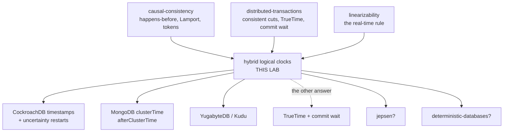

# Hybrid Logical Clocks — a learning lab

*Audience: a backend engineer who has finished the causal-consistency and
distributed-transactions labs. By the end you should be able to derive the
HLC update rules from their two failure modes, state the drift bound and
what invalidates it, explain what CockroachDB and MongoDB actually do with
this clock, and say precisely what it buys compared to TrueTime's commit
wait — and what it doesn't.*

**Lab contents**

| File | What it is |
|---|---|
| `README.md` | This document — the full story |
| `visualization.html` | Interactive space-time diagram — four clocks, skew sliders, a draggable snapshot cut |
| `src/Core.java` | The world: skewed clocks, messages, and a vector-clock ground-truth checker |
| `src/Clocks.java` | Four stamping designs behind one interface, plus the 64-bit packing |
| `src/Fuzz.java` | Randomized workloads + the metrics (inversions, drift, torn cuts) |
| `src/Tests.java` | 25 scenario-named checks — `java src/Tests.java` (add `broken` for planted bugs) |
| `src/Experiments.java` | 8 measured experiments — `java src/Experiments.java [1-8]` |
| `src/Scenes.java` | 5 narrated scenes — `java src/Scenes.java [1-5]` |
| `src/YourClock.java` | Implement the HLC receive rule yourself (self-checking, 1/6 → 6/6) |
| `validate-visualization.sh` | Proves the page's JS clock agrees with the Java (node or macOS JavaScriptCore) |
| `EXERCISES.md` / `SOLUTIONS.md` | The eight-rung ladder, answers separate |

No dependencies. Every command is plain `java src/File.java` from this directory.

Builds directly on: [`../29-causal-consistency/`](../29-causal-consistency/README.md)
(happens-before, Lamport clocks, vector clocks, session tokens — all treated as
known here) and [`../46-distributed-transactions/`](../46-distributed-transactions/README.md)
(consistent cuts, external consistency, TrueTime, commit wait — this lab is the
alternative that lab promised). Also [`../26-linearizability/`](../26-linearizability/README.md)
(the real-time rule) and [`../08-isolation-levels/`](../08-isolation-levels/README.md) (MVCC
versions — the place these timestamps will live).

---

> **Where you are: BEGINNER MODEL — stages 1–9.**

## 1. WHY does this exist?

Every distributed system stamps things — writes, messages, log lines, MVCC
versions — and the stamp has two jobs that pull in opposite directions. Job
one: **order** — if this event caused that one, its stamp must be smaller,
always, or replicas apply effects before causes and debugging becomes
archaeology of a fictional history. Job two: **meaning** — a stamp should
answer human questions: *what did the system look like at 5 p.m.? delete
everything older than 30 days.* Wall clocks do the second and betray the
first; the counters you met in the causal-consistency lab do the first and
know nothing of the second. HLC exists because real databases need one
number that does both.

## 2. THE PROBLEM, as a story

A news agency has two bureaus. **Asha** in Mumbai stamps everything with the
newsroom wall clock — which runs **5 minutes fast**. **Ben** in London
stamps with his — **5 minutes slow**. (NTP in real life keeps machines
within milliseconds-to-seconds of each other; nobody's clock is *right*.)

**Zoe**, the editor, has two needs. First, the archive must never show an
effect before its cause — a correction filed before the article it
corrects makes the archive fiction. Second, she assembles editions: *"give
me everything as of 5:00 p.m., exactly, from both bureaus"* — and that cut
through history must be whole: if it contains Ben's receipt of Asha's
story, it must contain Asha's sending of it.

Order, and meaning. Watch both fail.

## 3. THE NAIVE SOLUTION

Stamp with the wall clock — it's right there, it survives restarts, NTP
keeps it roughly honest, and everyone understands "17:42:03.114".

## 4. THE FAILURE — twice, because we own two clocks

**Failure one: the wall clock files effects before causes.** Scene 1
(`java src/Scenes.java 1`), the whole thing:

```
tick 10: Asha publishes an article and wires it to Ben. Her clock stamps it 15.
tick 12: Ben receives it. HIS clock stamps the receipt 7.
```

Sent at 15, received at 7 — the receipt precedes its own cause by 8 ticks.
Fuzzed against a vector-clock ground truth (experiment 1): at skew 8, **65
inversions** among sampled happens-before pairs; at skew 20, **341**. And
Zoe's editions? **152 of 200** candidate cut times produce a torn edition —
a receive inside, its send outside (experiment 5).

> **🔮 Predict:** *Set the skew to zero — clocks perfectly synchronized. Is
> the wall clock safe now?*
> <details><summary>Reveal</summary>
> No — it stops inverting and starts **tying**: 79 happens-before pairs per
> run that it cannot order at all, because two events inside the same clock
> tick get the identical reading. A clock has finite resolution, and a busy
> server does many things per millisecond. Even a perfect wall clock is too
> coarse to be an order. (Experiment 1, skew-0 row: 0 + 79.)
> </details>

**Failure two: the fix you already own burns the map.** The
causal-consistency lab gave you the Lamport clock — `counter =
max(own, heard) + 1` — and it is flawless at job one: **0 inversions, 0
ties**, every run. But run scene 2: after one busy afternoon, Asha's
counter reads 41 while her wall says 18; fuzzed, the counter strays up to
**+460 ahead / −13 behind** wall time, and events sharing one counter value
span **34 ticks** of real time. Ask "the newsroom at counter 20" and that
moment is mid-afternoon in Mumbai and next week in London. Ask "at
5 p.m." and there is no answer at all — the counter never heard of 5 p.m.
Consistent cuts, yes — at values no human can name.

So: two clocks, each perfect at the other one's failure. The deeper
problem is now visible — we don't need a better clock, we need **one stamp
carrying both kinds of time without letting them corrupt each other**.

## 5. THE REAL REQUIREMENT

One stamp, small enough to put on every MVCC version and message header,
such that:

1. **Order:** if e happened-before f, then stamp(e) < stamp(f) — no
   inversions, no ties, ever, regardless of skew.
2. **Meaning:** the stamp stays within a *known, bounded* distance of wall
   time, so "as of 5 p.m." and "older than 30 days" are real questions.
3. **Size:** O(1) — 64 bits, not a vector that grows with the cluster
   (the causal-consistency lab already showed you a vector clock's width
   is your replica count).

## 6. THE KEY IDEA

> **Never let logical time masquerade as physical time.** Keep the wall
> part `l` as exactly "the freshest *actual wall-clock reading* anywhere on
> my causal path" — a number some real clock really displayed — and keep a
> separate counter `c` for ordering the events that `l` cannot tell apart.

`l` can then never stray further from your own clock than the clocks
themselves disagree — the bound. And `c` gives the strict order within a
tick — the correctness. Two numbers, two jobs, one stamp: `(l, c)`,
compared lexicographically.

## 7. TERMINOLOGY

**Hybrid logical clock (HLC).** A clock producing stamps `(l, c)` where `l`
tracks the maximum physical-clock reading seen on the causal path and `c`
is a logical counter reset whenever `l` advances. From Kulkarni, Demirbas
et al., 2014. "Hybrid" because it is literally a physical clock and a
Lamport clock fused, each doing the job the other can't.

**l — the wall part.** Invariant: `l` is always a reading some node's
physical clock actually produced, and `l ≥` your own current reading.
Example from scene 3: Ben's wall reads 8, but he received a message
stamped 16 — his `l` becomes 16, a reading Asha's clock really took.

**c — the logical part.** Counts events that share one `l`. Resets to 0
the moment `l` moves. Example: three edits inside one tick at wall 15 →
stamps 15, 15.1, 15.2; next tick → 16 (c back to 0).

**Drift.** `l − pt`: how far a stamp's wall part sits ahead of the local
clock's actual reading. The number that separates every design in this
lab: unbounded for Lamport (+460) — and, as stage 10 shows, for the
obvious first fix too — but **bounded by the clock spread** for HLC
(measured: 15 at spread 16).

**Clock spread / skew.** How far apart the physical clocks are (fastest
minus slowest). The honest input to every promise HLC makes — and the
thing NTP controls in production.

**Causality token.** An HLC stamp carried by a *client* between requests
and absorbed by each server through the ordinary receive rule — the
implementation of the causal-consistency lab's session token
(`afterClusterTime`). No new machinery: a token is a message with no
payload.

**Consistent cut at a wall time** (revisited from distributed-transactions):
the set of events with stamp ≤ (T, ∞). HLC's gift is that T is an actual
time, not a counter value.

Minor terms at first use later: one-way property (recalled), uncertainty
restart, max-offset.

## 8. TWO MENTAL MODELS

**The simple model: dated pages, numbered lines.** The newsroom writes in
a shared style of notebook. Every entry lands on a **page dated with a
real calendar date** — and the rule is: use the *latest date you have
seen on any calendar*, yours or one mentioned in an incoming letter, never
a made-up one. Many entries on the same page get **line numbers**: date
15, line 0; date 15, line 1... Turn to a new page (a later date appears —
your calendar caught up, or a letter mentioned one) and line numbering
starts over at 0. Order of any two entries: compare dates, then lines.
"The archive as of the 15th" = every page up to 15, whole by
construction.

**The engineering model.** Per node: `(l, c)`. Local event or send at
wall reading `pt`: `l' = max(l, pt)`; `c' = (l'==l) ? c+1 : 0`. Receive of
message stamped `(ml, mc)`: `l' = max(l, ml, pt)`, and `c'` = (tie with
both → `max(c, mc)+1`) / (tie with own → `c+1`) / (tie with message →
`mc+1`) / (own wall won outright → `0`). Compare `(l, c)` lexicographically.
Invariants: happens-before ⟹ strictly smaller stamp; `l ≥ pt` always;
`l − pt ≤` clock spread.

| Simple model | Engineering model |
|---|---|
| the date on the page | `l` — a reading some clock actually produced |
| "use the latest date you've seen" | `l' = max(l, ml, pt)` |
| line number on the page | `c` |
| new page → numbering restarts | `l` advanced → `c = 0` |
| a letter mentioning its date | a message carrying its stamp |
| "archive as of the 15th" | consistent cut at `(T, ∞)` |

**Where the analogy breaks.** (1) The page date can come from *someone
else's* calendar — after Ben absorbs Asha's stamp, his pages are dated by
her fast clock even though his says three days earlier; "the 15th" on a
page is at most the clock spread away from anyone's calendar, but it is
not *your* 15th. (2) Notebook dates never decrease and neither does `l` —
but real wall clocks DO jump backwards (NTP corrections); the `max` means
HLC glides through a backward step while a raw wall-clock stamp would
happily file new events in the past. (3) Comparing two entries tells you
their order but never whether they were *causally related or merely
concurrent* — line numbers and dates are as one-way as Lamport's counter;
detecting concurrency still costs a vector clock.

## 9. VISUALIZATION

Open **`visualization.html`** (published: ["Dated Pages, Numbered
Lines"](https://claude.ai/code/artifact/d3546629-3719-479e-b29a-25ce29f263d0)).
A space-time diagram — nodes as rows, events
as dots stamped live, messages as arrows — with the four clock designs as
tabs, per-node skew sliders, a burst button, and the page's centerpiece:
**a draggable "as of T" cut line**. Drag it under the wall clock and
arrows cross it backwards (torn edition, flagged red); switch to HLC and
no position of the line ever cuts an arrow backwards. Every event's
`(l, c)` is inspectable; every scenario asks for your prediction first.

> **Checkpoint — you hold the beginner model.** You can say why wall
> clocks and Lamport clocks each fail one of the two jobs, and state the
> key idea: l only ever holds a real wall reading; c counts what l can't
> separate. Next: derive the actual rules — by first building the obvious
> version and watching it sink.

---

> **Where you are: INTERMEDIATE MODEL — stage 10.**

## 10. THE ACTUAL MECHANISM — one funeral, then the rules

### v1 — the obvious hybrid: one merged value

Any smart engineer's first sketch (it is also the strawman in the HLC
paper itself): keep a single value that never falls behind either clock or
causality:

```
local/send:  l = max(l + 1, pt)
receive:     l = max(l + 1, m.l + 1, pt)
```

Ordered? Perfectly — the `+1`s are a Lamport clock. Near wall time? It
*starts* there...

> **🔮 Predict:** *Does the merged value stay near wall time under load?*
> <details><summary>Reveal</summary>
> No — and the failure is structural, not a tuning matter. Every event
> adds `+1` to a number that is *supposed to be a wall reading*. Any burst
> of events inside one clock tick pushes `l` ahead of `pt`, and `max`
> means it **never comes back down** — the excess compounds forever.
> Experiment 3, same workload, growing run length:
>
> | run length | NAIVE maxDrift | HLC maxDrift |
> |---|---|---|
> | 150 | 118 | 15 |
> | 300 | 244 | 15 |
> | 600 | 470 | 15 |
> | 1200 | **898** | **15** |
>
> By tick 1200 the naive clock is 898 ticks into the future and climbing —
> as unmoored as the Lamport counter it secretly is, but *disguised as a
> time*, which is worse: "delete older than 30 days" now deletes live
> data. And you cannot even measure how bad it is from inside, because
> physical and logical ticks are fused into one indistinguishable number.
> </details>

The funeral teaches the design: **the corruption came from `+1` landing on
the wall-valued number.** So forbid it. `l` may only ever be assigned a
value some physical clock actually read — and everything `+1`-shaped moves
into a second number.

### v2 — the real HLC

**Local event or send** (node's wall reads `pt`):

```java
l' = max(l, pt);                      // l: only ever a real wall reading
c' = (l' == l) ? c + 1 : 0;          // wall stuck -> borrow a counter tick
                                      // wall advanced -> counter owes nothing
```

**Receive** of a message stamped `(ml, mc)`:

```java
l' = max(l, ml, pt);
if (l' == l && l' == ml)  c' = max(c, mc) + 1;   // tie with both sides
else if (l' == l)         c' = c + 1;            // own l leads
else if (l' == ml)        c' = mc + 1;           // message's l leads
else                      c' = 0;                // own WALL won outright
```

Walk it with scene 3's real values (`java src/Scenes.java 3`) — Asha's
clock +5, Ben's −5:

1. tick 10, Asha edits: wall reads 15, `l` adopts it → **15** (c=0).
2. tick 10, two more edits: wall still 15, `l` stuck, `c` borrows →
   **15.1**, **15.2**.
3. tick 11: wall reads 16 > l → **16**, c back to 0. Then a send → **16.1**.
4. tick 13, Ben receives it: his wall reads only 8, but the message says
   16.1 → `l' = max(0, 16, 8) = 16`, tie with the message → `c = mc+1` →
   **16.2**. Cause 16.1 < effect 16.2. ✓
5. tick 13, Ben works on: wall still 8, l still 16 → **16.3**.

> **🔮 Predict (the case that catches everyone):** *Ben's clock is at
> `(50, 2)` and a message arrives stamped `(50, 7)` — the l's tie. What
> must the new c be? Is `c+1 = 3` enough?*
> <details><summary>Reveal</summary>
> No — `(50, 3)` would stamp the receive *below* its own send `(50, 7)`:
> an inversion. When l ties, the new c must beat **both** counters:
> `max(2, 7) + 1 = 8`. This is planted as the bug `recvIgnoresMsgC` — run
> `java src/Tests.java broken` and watch it produce 8 genuine
> happens-before inversions. `src/YourClock.java` makes you implement all
> four cases yourself; this is case 4.
> </details>

**Why the bound holds** — the argument is one sentence: `l` is the maximum
over a set of *actual wall readings* (yours, and everyone's on your causal
path), so it can exceed your own reading by at most (fastest clock −
slowest clock) = the clock spread. Experiment 4 measures it as an equality,
not an inequality:

| skew | clock spread | measured drift | maxC |
|---|---|---|---|
| 2 | 4 | 3 | 17 |
| 8 | 16 | 15 | 31 |
| 20 | 40 | 39 | 49 |
| 50 | 100 | 99 | 80 |

And the division of labor is visible in the last column: crank the bursts
to 30 events/tick and drift stays **15** while `maxC` climbs to 244 —
**load spills into c, never into l**. That split is the entire invention.

Full scorecard at seed 42 (2,629 events, 28,720 happens-before pairs
checked against the vector-clock truth): WALL 65 inversions + 92 ties,
152/200 torn cuts. LAMPORT 0 + 0 but drift +460/−13. NAIVE 0 + 0 but
drift 470 and growing. **HLC: 0 inversions, 0 ties, 0 torn cuts, drift ≤
15, in 64 bits.**

**What HLC does *not* do — two honest boundaries.** First, it is as
**one-way** as the Lamport clock it contains (causal-consistency lab,
remembered): stamp(e) < stamp(f) never proves e caused f; detecting
concurrency still requires a vector clock. Second, order between events
with **no causal path and no token** rests on nothing but the clocks
being roughly right — a client writing via a fast node and a *different*
client reading via a slow node has no arrow between them, and HLC
promises that stranger nothing (that is external consistency, and it is
exactly what TrueTime's commit wait bought in the distributed-transactions
lab). Stage 11 and the token experiment put numbers on this.

> **Checkpoint — you hold the intermediate model.** You can execute both
> update rules by hand, say why the naive merge fails structurally, and
> derive the drift bound in one sentence. Next: everything that bends or
> breaks it.

---

> **Where you are: ENGINEERING MODEL — stages 11–14.**

## 11. FAILURE SCENARIOS

**A clock beyond its promised bound.** Create: one node offset +60 in a
cluster operated as ±8; watch: `java src/Experiments.java 7`. Measured:
the believed drift bound was 16; actual **67** — because `l` is the max
reading on the causal path, one liar **infects every node downstream** of
its messages, and their stamps run an hour into the future together.
What survives: ordering, completely (max doesn't care if the number is
wrong). What dies: the bound — and with it every promise phrased in real
time: staleness limits, "as of 5 p.m.", GC-by-age, and (in CockroachDB)
the correctness of the uncertainty window itself. Production: this is why
the bound is enforced, not assumed — CockroachDB **crashes** a node whose
offset exceeds max-offset (distributed-transactions lab: *crashing is the
correct response to a lying clock*), and why MongoDB **signs** its
clusterTime — an unsigned token would let any client push every server's
clock to the year 3000 (this experiment, weaponized).

**The stranger's stale read.** Create: write via the fast-clock node, read
via the slow one, carry nothing; watch: experiment 6 / scene 5. **86 of
86** reads predate the write — the reader's "now" is simply smaller than
the stamp the writer issued. Nothing is broken: there is no
happens-before edge, so HLC promised nothing. Fixes, in production form:
carry a **causality token** (the write's stamp; reader absorbs it via the
ordinary receive rule) → **0/86** — this is MongoDB's
clusterTime/afterClusterTime and the implementation of the
causal-consistency lab's session token; or CockroachDB's route — treat
every value stamped within `[readTs, readTs + maxOffset]` as ambiguous
and **restart the read above it** (an *uncertainty restart*): pay ε in
occasional read retries instead of TrueTime's 2ε on every write ack.
Same ε, three different bills: writer waits (Spanner), reader retries
(CockroachDB), client carries a token (MongoDB).

**Counter overflow.** Create: `Clocks.pack(new Stamp(5, 70000))`; watch:
test `pack_counter_overflow_fails_loudly`, and the planted bug
`neverResetC` — forget the reset-on-advance and `maxC` goes 31 → 718 in
one small run; at production rates the 16-bit budget dies in
milliseconds. Real overflow needs 65,536 *causally chained* events inside
one wall tick — rare, but CockroachDB still handles it loudly rather
than silently. The reset rule is what makes 16 bits a fortune.

**The wall clock steps backwards.** NTP corrections really do this.
Create: lower a node's offset mid-run. HLC glides: `l = max(l, pt)` just
holds `l` level while `pt` catches up, `c` absorbing the interval — no
inversion possible, monotonicity by construction. A raw wall-clock
stamper, by contrast, starts filing new events into the past. (Asserted
from the rule; the visualization's skew sliders let you do it live.)

**Messages reordered or lost.** No effect on correctness: HLC stamps
events, it does not deliver messages — there is no FIFO assumption
anywhere in the rules (contrast the causal-consistency lab, where
*delivery* needed the machinery). If you want causal *delivery*, HLC
stamps are an input to it, not a replacement for it.

## 12. CORRECTNESS — the full scorecard

| | orders hb? | detects concurrency? | wall-meaningful? | drift bound | size | waits? |
|---|---|---|---|---|---|---|
| wall clock | ✗ (65–341 inv.) | ✗ | ✓ | 0 | 8 B | no |
| Lamport | ✓ | ✗ (one-way) | ✗ (+460/−13) | none | 8 B | no |
| vector clock | ✓ | **✓** | ✗ | none | 8 B × n | no |
| naive hybrid | ✓ | ✗ | *pretends* (→898) | none | 8 B | no |
| **HLC** | ✓ | ✗ (one-way) | ✓ | **clock spread** | **8 B** | **no** |
| TrueTime | ✓ (via ts) | ✗ | ✓ | ε (hardware) | 8 B | **2ε per write** |

What is guaranteed (honest clocks assumed): happens-before ⟹ strictly
smaller stamp; `l ≥ pt`; `l − pt ≤ spread`; every cut at `(T, ∞)` is
consistent; the clock never blocks anything — stamping is a local
computation, which is the entire liveness story and the deepest contrast
with commit wait.

What is explicitly NOT guaranteed: concurrency detection (one-way,
forever); external consistency for causally-unconnected clients (buy it
with tokens, restarts, or commit wait); the drift bound under a clock
that lies beyond its declared offset — the bound is *conditional*, and
production systems spend real machinery (evictions, signatures) policing
the condition.

Traded away, relative to each neighbor: vs vector clocks — concurrency
detection, for O(1) size; vs TrueTime — external consistency for
strangers, for zero waiting and zero special hardware.

## 13. THE CODE — the lines that carry the guarantees

Read in this order (all in `src/Clocks.java` and `src/Core.java`):

1. **The HLC receive rule** — the four-branch `c` computation. The
   load-bearing subtlety is `max(c, mc) + 1` in the tie case; the planted
   bug `recvIgnoresMsgC` deletes the `max` and manufactures real
   inversions. `YourClock.java` is this rule with the branches blanked.
2. **`l' = max(l, pt)` with no `+1` anywhere** — compare the NAIVE
   implementation one screen up, whose `l + 1` is the entire 898-tick
   drift. The diff between a broken design and the real one is two
   characters.
3. **`Core.hb`** — the vector-clock comparison serving as ground truth.
   The judge is a clock you already trust from the causal-consistency
   lab; every claim in this lab is "scalar clock agrees with vector
   clock on 28,720 pairs".
4. **`Clocks.pack`** — 48+16 bits, overflow loud. The budget arithmetic
   is experiment 8.
5. **`Fuzz.tokenExperiment`** — note the token is absorbed by calling
   plain `receive()`: sessions are not a feature of the clock, just a
   use of it.

## 14. EXPERIMENTS — break it yourself

Predict first, then run. All eight: `java src/Experiments.java`.

| # | Command | Ask yourself first | You should see |
|---|---|---|---|
| 1 | `... 1` | is skew 0 safe? | WALL 0+79 at skew 0, 341+100 at 20; others 0+0 |
| 2 | `... 2` | what's wrong with Lamport? | drift +460/−13; one value spans 34 ticks |
| 3 | `... 3` | is one merged value enough? | NAIVE 118→898 with run length; HLC flat 15 |
| 4 | `... 4` | how tight is the bound? | drift = spread−1 at every skew; bursts → c |
| 5 | `... 5` | which clocks give whole cuts? | WALL 152/200 torn; LAMPORT 0 (timeless); HLC 0 |
| 6 | `... 6` | fast writer, slow reader? | 86/86 stale → 0/86 with the token |
| 7 | `... 7` | one liar at +60 — what dies? | order holds; bound 16 → 67, infection downstream |
| 8 | `... 8` | why 64 bits matter | 48+16 packing, 8,900-year budget, loud overflow |

> **Checkpoint — you hold the engineering model.** You can state the
> conditional bound, name the three ways to pay for external consistency,
> and point at the two-character diff separating NAIVE from HLC. Next:
> what ships.

---

> **Where you are: PRODUCTION MODEL — stage 15.**

## 15. PRODUCTION — where this clock actually lives

**CockroachDB** is the flagship. Every transaction timestamp and every
MVCC version (isolation-levels lab: the version chains) is an HLC stamp —
`int64` wall nanoseconds + `int32` logical, the packing of experiment 8
with wider fields. The distributed-transactions lab left you a question:
how does CockroachDB skip TrueTime's commit wait? Now you own the answer:
HLC orders everything causally connected for free, and for strangers it
declares an **uncertainty interval** `[ts, ts + max_offset]` — a value in
that window *might* have committed first by real time, so the read
**restarts above it**. ε is paid in occasional read retries instead of on
every write ack. The conditional bound is policed, not assumed: a node
whose measured offset exceeds `max_offset` (default 500ms)
**self-terminates** — experiment 7 is the incident it prevents. On
restart, a node also waits out the offset before serving, so its `l`
can't time-travel past its own crash.

**MongoDB**: `$clusterTime` is an HLC — 32-bit seconds + 32-bit counter —
piggybacked on **every** message between every node and client, absorbed
via the receive rule, which is how the whole deployment's clocks chase
each other. `afterClusterTime` (the causal-consistency lab's session
token, now with an implementation) is the token experiment shipped as a
feature. And it is **HMAC-signed**, because experiment 7 shows exactly
what an attacker could do with an unsigned one: one forged stamp poisons
every server it touches, forever (l never comes back down).

**YugabyteDB** uses HLC the CockroachDB way plus leader leases; **Kudu**
offers an HLC mode; the pattern generalizes: anywhere you meet "timestamp
= physical + logical" in a storage engine, you are looking at this lab.

**What the toy omits.** Real resolution (nanoseconds, not ticks) and real
NTP behavior (drift *rates*, not fixed offsets — the bound math is
identical); persisting the clock across restarts (or waiting out
max-offset instead, as Cockroach does); signing tokens; delivering the
stamp inside RPC frameworks (piggybacking on everything, MongoDB-style);
and the uncertainty-restart machinery itself — this lab's HLC *orders*;
building a serializable database on top of it is the
distributed-transactions lab's percolator plus these stamps.

**What on-call sees.** Clock-offset gauges with alerts long before
max-offset (the bound is an SLO on NTP); node suicides tagged
clock-offset (the correct crash); uncertainty-restart rates (the
observable price of skew — rising restarts mean drifting clocks, not
application bugs); and drift `l − pt` itself as a metric — a node whose
HLC runs persistently ahead of its wall clock is downstream of a liar
(experiment 7's infection, seen from the dashboard).

## 16. EXERCISES

The eight-rung ladder is in [`EXERCISES.md`](EXERCISES.md) — from
explaining the two jobs to designing the timestamp plan for a 3-region
database. Attempt before opening [`SOLUTIONS.md`](SOLUTIONS.md).

## 17. KNOWLEDGE MAP & NEXT STEPS



Commonly confused, one sentence each:

- **HLC vs vector clock**: an HLC *orders* (one-way, O(1) size); a vector
  clock *detects concurrency* (O(n) size) — the causal-consistency lab's
  distinction, unchanged by the hybrid.
- **HLC's l vs a Lamport counter**: `l` is only ever a reading a physical
  clock actually produced (hence the bound); a Lamport counter counts
  events (hence +460).
- **HLC vs TrueTime**: the same ε, billed differently — TrueTime makes
  every *writer wait* 2ε for external consistency for everyone; HLC waits
  never, and covers strangers with reader restarts or client tokens.
- **Causality token vs commit wait**: the token protects one client's
  session; commit wait protects *all* observers, including ones who never
  met the writer.

Next, ready to type:
- `/learn jepsen` — you now own every anomaly its reports name and every
  clock trick its tests exploit.
- `/learn deterministic-databases` — Calvin: skip timestamps *and* 2PC by
  agreeing on the order first; the remaining road not taken.
- `/learn change-data-capture` — the practical pipeline pattern; ordering
  its events correctly is precisely an HLC use case.

## 18. GLOSSARY

In order of appearance:

- **inversion** — a happens-before pair the clock stamped in the wrong
  order (cause > effect).
- **tie** — a happens-before pair the clock cannot order (equal stamps).
- **torn cut** — an "as of T" snapshot containing a receive without its
  send.
- **hybrid logical clock (HLC)** — the `(l, c)` clock: max wall reading on
  the causal path + a counter for what it can't separate (Kulkarni/
  Demirbas 2014).
- **l (wall part)** — always an actual physical-clock reading someone
  took; never incremented, only max'ed.
- **c (logical part)** — orders events sharing one `l`; resets to 0 when
  `l` advances.
- **drift** — `l − pt`: how far stamps run ahead of the local wall clock.
- **clock spread** — fastest minus slowest physical clock; the bound on
  HLC drift, and a *condition*, not a fact.
- **naive hybrid** — one merged value with `+1`s; ordered, and drifts
  without bound (118→898).
- **causality token** — an HLC stamp carried by a client and absorbed via
  the receive rule; MongoDB's afterClusterTime.
- **one-way property** — smaller stamp never proves causation; shared
  with Lamport clocks.
- **uncertainty restart** — CockroachDB's answer to strangers: retry a
  read above a value stamped within `[ts, ts+max_offset]`.
- **max-offset** — the declared clock-spread bound a node must honor or
  die (Cockroach default 500ms).
- **clusterTime** — MongoDB's signed HLC, piggybacked on every message.
- **48+16 packing** — one 64-bit long: 8,900 years of milliseconds +
  65,536 counter values, overflowing loudly.
