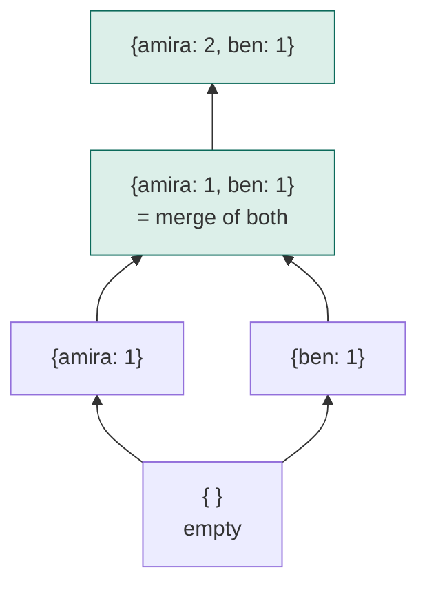
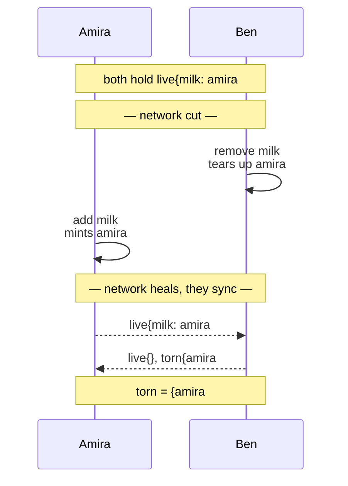
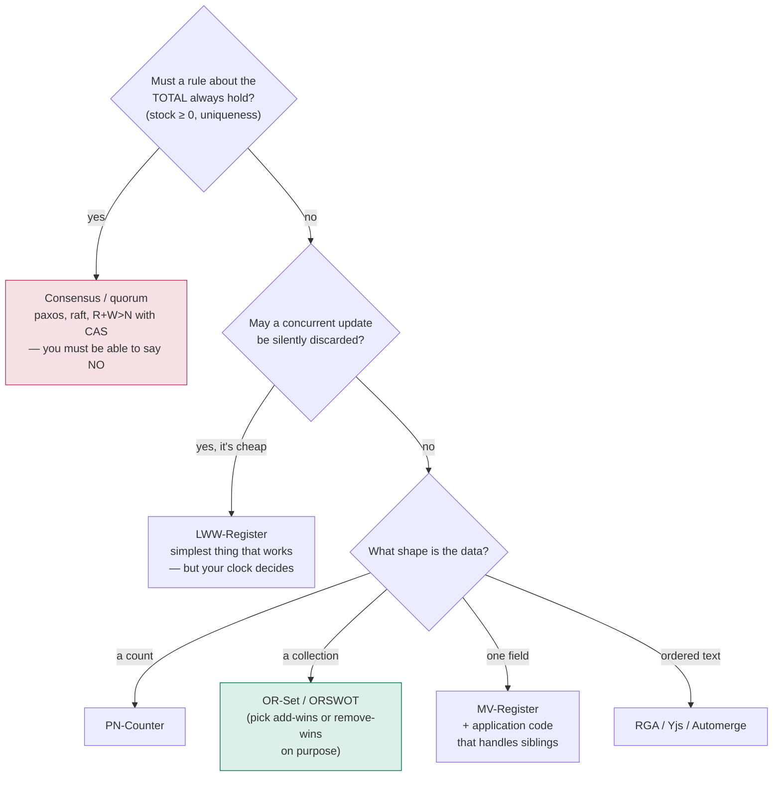
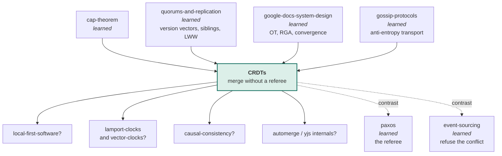

# CRDTs — how two phones with no signal still hold the same list

> **Tell a friend:** Amira is on the Tube and Ben is on a plane, and both add an
> item to the same shopping list while neither phone has signal. Most apps
> quietly destroy one of those two changes, because whichever phone syncs last
> replaces the whole list. A CRDT fixes that by changing what the phone stores
> and sends. Not "here is my list", but "here is every event I know about",
> combined by a rule that ignores order, grouping and repeats. Do that and the
> phones end up identical with no server, no leader and no vote.
> The price is that a list built this way can never refuse anything.

**Play with it:** [`visualization.html`](visualization.html) — *Merge Without a
Referee* (<https://claude.ai/code/artifact/fea9c00f-2004-4f4f-a867-7d6048751fdc>).

---

## 1. Why can't the app just wait for a signal?

> **In one breath:** Phones lose signal constantly. An app that freezes when the
> bars disappear gets deleted. So the app keeps working offline — and now two
> people can change the same thing without seeing each other.

Asha writes the shopping-list app. Her users are on phones. Phones go into
tunnels, onto planes, and into buildings with thick walls.

People keep tapping anyway. An app that freezes the moment the bars vanish is an
app they delete that evening.

So Asha does the obvious thing. The app accepts the change locally, keeps it on
the phone, and sends it up when the signal returns.

That one decision creates this whole lab. Two people can now change the same
shopping list, the same document, the same order, while neither can see what the
other is doing. Somebody's change has to be dealt with.

Here is how almost every app deals with it. Whichever change reaches the server
last replaces the other one.

Nobody wrote that rule down. It is simply what happens when nobody makes a
decision. And it means real work that a real person did stops existing. There is
no error message. There is no way for anyone to notice.

This lab is about the other road. Design the data so that both changes survive
on their own, without asking anyone for permission.

## 2. What happens when Amira and Ben both edit the list?

> **In one breath:** Two people add different things to one list while both are
> offline. They are not disagreeing about anything. There is an obviously right
> answer, and the app is about to get it wrong.

Amira is on the London Underground. Ben is on a plane to Berlin. Meera is at
home on wifi, and her phone matters from section 7 onwards.

Amira and Ben share a shopping list in Asha's app. Right now both phones show
the same thing:

```
bread
```

Amira, underground, adds **milk**. Ben, over the North Sea, adds **eggs**.
Neither phone has signal, so both changes sit in a pocket for forty minutes.

Then they land. Both phones connect. Both send their list up.

Hold on to this: **the two phones are not disagreeing about anything.** Amira
wants milk on the list. Ben wants eggs on the list. Those wishes are completely
compatible.

There is a right answer, `bread, milk, eggs`, and everybody would accept it.
The only reason the app might get it wrong is the way it stores and sends the
list.

**Where this lab takes you.** Stop at any checkpoint and you still have
something whole.

| Layer | Sections | After it you can… |
|---|---|---|
| **Beginner model** | 1–9 | explain why two offline edits normally destroy each other, and what "design the merge instead of the value" buys |
| **Intermediate model** | 10 | derive every type in the family — counter, set, register, text — from the failure of the one before it |
| **Engineering model** | 11–14 | reason about the failure modes, state the guarantee precisely, and say out loud what is *not* guaranteed |
| **Production model** | 15 | read the Shapiro paper, Riak's data-type docs and Automerge's internals, and know what you are looking at |

## 3. What naive solution does everyone write first?

> **In one breath:** Each phone keeps the whole list, sends it up with the time,
> and the server keeps the newest one. It is simple, easy to test, and perfect
> for exactly one user.

Asha's first design is the one you would write too:

> Each phone keeps the list. When you edit it, send the whole list up with the
> current time. The server keeps whichever list has the newest time.

There is nothing stupid about this. It is a naive solution in the precise sense
of the word: correct for the case in front of you, and silent about the case
that is coming.

One person, one phone, one list? Flawless. Two people, one of them in a tunnel?
Read on.

## 4. What actually arrives, and who gets told?

> **In one breath:** Two whole lists arrive. The server keeps the newer one.
> Milk stops existing, and because nothing failed, nothing is reported.

Amira's phone sends `[bread, milk]`, stamped 14:32:07.
Ben's phone sends `[bread, eggs]`, stamped 14:32:09.

> **🔮 Predict:** What does the list hold afterwards, and who is told about it?
>
> <details><summary>Reveal</summary>
>
> `[bread, eggs]`. Milk is gone. Nobody is told anything, because from the
> server's point of view nothing went wrong: it received two lists, it kept the
> newer one, exactly as designed.
>
> If you guessed "the server notices that the two lists differ", look again at
> what it is holding. It has two complete lists and two clock readings. Nothing
> in either message says which items were *decisions*.
>
> The deep problem is in the *shape of the message*. Ben's phone sent a complete
> list that happened not to contain milk. The server cannot tell the difference
> between **"Ben deleted milk"** and **"Ben has never heard of milk"** — because
> a list of items does not record which of them were decisions. The message
> threw away the information needed to combine the two.
>
> Scene 1 of `java src/Sim.java` shows exactly this. Experiment 1 runs it at
> scale: over 1,000 rounds with 3 phones editing offline, users made **8,992**
> changes and **2,971** survived. **67% of all work was destroyed**, and every
> single round "succeeded".
>
> </details>

Two more things break the same way, and it is worth seeing that the break is the
same one.

**A retry duplicates work.** Ben's phone never gets an acknowledgement, so it
sends again. If the message had been `add 1 to the counter`, the counter is now
2. The transport is at-least-once — you met that in the
[`transactional-outbox`](../48-transactional-outbox/) and
[`communication-protocols`](../02-communication-protocols/) labs. So this is not
a rare case. It is Tuesday.

**The clock decides.** Ben won because his phone's clock said a bigger number.
If Amira's phone were 60 seconds fast, Amira would win every argument for the
next minute, regardless of who actually acted later. Experiment 8 runs this: a
clock 60 seconds fast destroyed **1,000 of 1,000** genuinely-newer writes.

## 5. What does Asha really need, with no technology in it?

> **In one breath:** Four plain sentences say what the app needs. Two of them
> look like a flat contradiction, and almost every system you have studied
> resolves it by quietly giving up the first one.

Write down the requirement in plain words, with no technology in it:

1. Each machine can change its own copy immediately, with no permission from
   anyone. Otherwise the app freezes in the tunnel.
2. Machines exchange information in any order, any number of times, with any
   amount of it lost along the way, and it must not matter.
3. Once two machines have exchanged the same information, they must hold
   **exactly the same thing** — not "close enough", not "eventually if a repair
   job runs".
4. No change that a person actually made may be silently thrown away.

> **🔮 Predict:** Requirements 1 and 3 look contradictory. Which of the two do
> the systems you have already built give up, and what does that cost Amira in
> the tunnel?
>
> <details><summary>Reveal</summary>
>
> They give up requirement 1. A leader, a coordinator, a quorum or a lock is a
> referee who decides, and asking a referee means waiting for one.
>
> You have built three of those:
> [`two-phase-commit`](../45-two-phase-commit/), [`paxos`](../39-paxos/) and
> [`quorums-and-replication`](../34-quorums-and-replication/). You know what they
> cost: when the referee is unreachable, work stops. For Amira that is a frozen
> app forty metres under Oxford Circus.
>
> If you guessed they give up requirement 3, that is the *other* well-known
> road — plain eventual consistency, with a repair job that picks a winner
> later. That road loses requirement 4 as well, which is exactly the 67% you
> just watched disappear.
>
> </details>

This lab keeps requirement 1 and gets requirement 3 anyway.

## 6. What key idea makes both changes survive?

> **In one breath:** Stop sending the answer. Send the evidence, and design the
> combining rule so that combining evidence is boring.

Two halves, both load-bearing.

**Send evidence, not conclusions.** Not "the list is `[bread, eggs]`", but "an
event named `ben#1` says eggs is on the list". Evidence from two phones is not in
conflict. It is just more evidence.

**Make the combining rule immune to the network.** Design the rule so that
combining in a different order gives the same result. So that combining in
different groupings gives the same result. So that combining the same evidence
twice changes nothing.

A network that reorders, regroups and duplicates then has nothing left to break.

Everything else in this lab is working out what that combining rule has to look
like. For a counter, for a set, for a single field, and for a piece of text.

## 7. Which words do you now need, and what does each name?

> **In one breath:** Five words carry the whole lab. Every one of them names
> something you have already watched happen to Amira and Ben, so nothing here is
> new. Only the labels are.

### What is a replica, and why not just say "the data"?

Amira's phone holds a list. Ben's phone holds a list. The server holds a list.
Three copies, all editable, all allowed to differ.

Engineers call each one a **replica**: an independently updatable copy. The word
exists to stop you saying "the data". There is no "the data" here. There are only
copies, and at any moment they may all be different.

At this exact moment Amira's replica holds `[bread, milk]`, Ben's holds
`[bread, eggs]`, and the server's still holds `[bread]`.

You used the same word in
[`quorums-and-replication`](../34-quorums-and-replication/). The difference here
is sharp. A replica in this lab may accept a write with no quorum, no
coordinator and no permission at all.

### What is a merge, and what is it forbidden to do?

The rule for combining two copies into one is called a **merge**. Written as
code it is a pure function, `merge(a, b)`: it takes two complete states, returns
a state, and never changes either input.

The word exists to keep it apart from "apply", "write" and "resolve". A merge
does not decide who was right.

It is not allowed to prefer the caller over the argument. It is not allowed to
prefer the newer over the older. Unless that preference is written into the
function itself, on purpose, and you can point at the line.

Everything interesting in this lab is a choice about what `merge` does. For the
scoreboard you meet in section 8, `merge({a:3}, {b:2})` = `{a:3, b:2}`.

It is the counterpart of the `transform` function in
[`google-docs-system-design`](../71-google-docs-system-design/). Same job,
reconciling two independent edits. Completely different strategy.

### What three abuses must the merge survive?

Meera's phone has been offline all afternoon. When it reconnects, three things
happen to it in the space of a second.

First it receives Amira's news and Ben's news, in whichever order the network
felt like delivering them. Then a retry hands it Amira's news a second time.
Then a relay delivers Ben's and Amira's news bundled together, rather than
separately.

Three abuses. The network commits all three, every day. Take them one at a time.

**The order did not matter.** Meera combined Amira's news with Ben's, and she
would have got the same list combining Ben's with Amira's. A rule with that
property is **commutative**.

**The grouping did not matter.** Meera could combine Amira's and Ben's news
first and then her own, or combine her own with Amira's first and then Ben's.
Same list. A rule with that property is **associative**.

**The repeat did not matter.** The second copy of Amira's news changed nothing
at all. A rule with that property is **idempotent**.

Now, and only now, the symbols. Write the combining rule as an operator, `⊔`.
Read `a⊔b` as "the copy you get by combining copy `a` with copy `b`".

| Law | In words | In symbols | The network fault it kills |
|---|---|---|---|
| **Commutative** | order of combining doesn't matter | `a⊔b = b⊔a` | messages arriving out of order |
| **Associative** | grouping doesn't matter | `(a⊔b)⊔c = a⊔(b⊔c)` | messages batched or relayed differently |
| **Idempotent** | combining twice changes nothing | `a⊔a = a` | messages delivered more than once |

Why exactly these three? Because they are exactly the abuses an unreliable
network commits. Survive all three and the network has no move left.

That is not an analogy. Experiment 3 delivers seven pending messages in **all
5,040 possible orders** and gets **1** distinct final state.

> **🔮 Predict:** Suppose the merge added two phones' counters together instead
> of taking the larger. Which of the three laws breaks, and what does the
> counter read after one duplicated message?
>
> <details><summary>Reveal</summary>
>
> Idempotence breaks, and only idempotence. Adding is still commutative and
> still associative, so a reordered or rebatched delivery is fine.
>
> If you guessed commutativity, notice that `3 + 2` and `2 + 3` are equal.
> Addition was never the problem. Repetition was.
>
> One duplicated message now invents a count that never happened. Experiment 2
> delivers the same message ten times: the adding merge reads **11** where the
> true answer is **2**.
>
> </details>

### What does "converge" promise, and why the word "strong"?

Everyone ends up holding the same thing. That is convergence, and the precise
name for the promise in this lab is **strong eventual consistency**, or SEC.

Say it fully: any two replicas that have received the same *set* of updates are
in the same state, immediately, with no further coordination.

Notice the word *set*, not *sequence*. The order the updates arrived in is not
part of the promise, because it does not need to be.

Why "strong"? Plain eventual consistency, from
[`cap-theorem`](../24-cap-theorem/), [`eventual-consistency`](../28-eventual-consistency/)
and [`cqrs`](../51-cqrs/), only promises that things settle down *somehow*.
Usually a background repair job resolves conflicts by picking a winner.

SEC is stronger and cheaper at the same time. Sameness is a property of the
merge function itself. So there is no repair job, no conflict-resolution step,
and no window in which two replicas that have seen the same updates disagree.

Be careful with one thing. Converging is not the same as being *right*. Section
10 shows you a design where all three phones converge perfectly onto an answer
that is wrong.

### What is a CRDT, and what does the name promise?

A data type built so that copies of it can be merged without a referee. Its full
name is **conflict-free replicated data type**: a type whose merge is
commutative, associative and idempotent, so replicas reach strong eventual
consistency with no coordination.

The term exists to name a shift. Not *resolving* conflicts — *not having* them.
In a CRDT there is no conflict to resolve, because two concurrent updates are,
by construction, both representable in the merged state.

The name is a promise about where the work went. It went into the design of the
type, so it does not have to happen at runtime.

There are two families, both called CRDTs. **State-based** ones, also called
*CvRDT* for "convergent", ship whole states and merge them. **Op-based** ones,
also called *CmRDT* for "commutative", ship individual operations.

This lab builds state-based ones, because they demand nothing at all from the
network. Section 11 shows exactly what op-based ones demand instead.

### Where did each word come from?

| Word | The thing in the story | Where you watched it happen |
|---|---|---|
| **replica** | Amira's phone, Ben's phone, the server | section 2 |
| **merge** | the rule that combines two phones' copies | the piece missing from section 3 |
| **the three laws** | order, grouping and repeats not mattering to Meera | section 7, Meera's reconnect |
| **strong eventual consistency** | both phones identical the moment they hold the same news | section 5, requirement 3 |
| **CRDT** | the type that gets all of the above by construction | the rest of the lab |

## 8. Which mental models should you carry, and where do they lie?

> **In one breath:** Two mental models of the same machine. A wall scoreboard
> that nobody may rub out, and a hill you can only climb. The first one gets you
> a long way, and then it lies to you in three specific places.

### The simple model — what if it is a scoreboard nobody can rub out?

Asha pins a scoreboard on the wall, with one row for Amira, one for Ben and one
for Meera. Three rules, and that is the whole thing:

1. You may only ever **raise your own row**.
2. To combine two scoreboards, take the **higher number in each row**.
3. The score is the **sum of all rows**.

Amira and Ben raising their own rows in a tunnel cannot destroy each other's
work, because they are writing in different rows. Overwriting somebody else's
row is not an action the rules allow.

Combining is taking the larger number in each row. Taking the larger of a row
you already hold changes nothing. So a scoreboard you have already copied can be
copied again, ten times, in any order, harmlessly.

### The engineering model — what is a lattice you can only climb?

Now the same picture in the language of the papers.

A replica's state is a point in a **join-semilattice**. That is a set of states
with a partial order. The order is written `≤` and read here as "is at least as
old as". In such a set, any two states have a **least upper bound**: the
smallest state sitting at or above both of them.

The merge *is* that least upper bound. It is written `⊔` and pronounced "join".

Read the arrows below as "climbs to".



Amira and Ben go their own way, so they climb into different branches. Merging
is finding the lowest point above both of them.

There is always exactly one such point. And a local update also only ever climbs,
a property called **monotonicity**. Together those two facts mean replicas can
never reach a state from which they cannot rejoin.

That single picture explains the three laws rather than assuming them. A least
upper bound is symmetric in its arguments, which is commutativity. The least
upper bound of three elements is the same however you bracket it, which is
associativity. The least upper bound of a thing with itself is the thing, which
is idempotence.

### How do the two pictures line up?

| Scoreboard | Engineering | In the Java |
|---|---|---|
| the whole board | one replica's state | `GCounter` instance |
| one row | one replica's contribution | an entry in `rows` |
| raising your own row | a local, uncoordinated update | `increment(replica, n)` |
| taking the higher of each row | the join / least upper bound | `merge` |
| the total at the bottom | the value the user sees | `value()` |
| "you can never rub out" | monotonicity | no code path lowers a row |

### Where does the scoreboard lie to you?

The analogy breaks in three places, and each break is a whole section later on.

**You cannot lower a row.** Ben cannot subtract by writing a smaller number,
because merge would immediately restore the bigger one. The scoreboard has no way
to go down at all. Section 10 shows the actual fix.

**Rows are for counting, not for identity.** Amira's shopping list is not a
number per person. Sets need a different construction, and *deletion* in a set is
the hardest thing in this lab.

**The board grows forever.** Real CRDTs accumulate evidence. One row per replica
that ever touched the data, one record per deletion, and nothing in the algorithm
ever cleans any of it up. Experiment 7 counts it: a shopping cart with **10**
visible items was storing **500** records, **50 per item**.

## 9. What should you watch on the page before reading the mechanism?

> **In one breath:** Every design shows the user the same green list. The
> difference between the designs is in the second box, the one showing what is
> actually stored. Watch that box.

**[`visualization.html`](visualization.html) — *Merge Without a Referee***
(<https://claude.ai/code/artifact/fea9c00f-2004-4f4f-a867-7d6048751fdc>)

Three phones hold one shopping list: Amira's, Ben's and Meera's. Each phone card
shows two boxes, and the whole lesson is the difference between them:

- the **green box** — what the person sees;
- the **dashed box** — what is actually stored.

Watch the dashed box. The green box is the same in every design. The dashed box
*is* the design.

What to do, in order:

1. Start on **Receipts**, the default. The page also prints its technical name,
   OR-Set; section 10 is where that name gets earned. Press *add milk* on Amira,
   then *Sync to everyone*. Notice that syncing does **not** deliver. The
   messages sit on the wire until you deliver them, one at a time, in any order,
   or duplicate them, or throw them away. That is the experiment.
2. Switch to **Whole list, newest wins** and do the same thing on two phones.
   Watch Amira's item disappear, with no error anywhere.
3. Use the **guess-first situations** at the bottom. Each one poses a question
   with two or three answers, then plays the sequence out with a full-sentence
   narration of every step. Being wrong is the point. The explanation only lands
   after you have committed.
4. When something surprises you, use **Step back** and change one thing. Whose
   clock is fast. Which phone is cut off. Which message gets delivered first.
   Every arbitrary choice on that page is a control, deliberately.

---

> ### ✅ Checkpoint — end of the beginner model
>
> You can now explain why two offline edits normally destroy each other, why the
> fix is to change the message rather than add a resolution step, and what the
> three laws buy. **Next:** deriving the actual types — and every strange detail
> in them will arrive as the fix to something you just watched break.

> **Say it back.** Without using the words *merge*, *commutative* or *replica*,
> tell a friend why Amira's milk vanished and Ben's eggs did not.
>
> <details><summary>A good answer sounds like</summary>
>
> "Both phones sent up the entire list, and the server kept whichever list
> arrived with the later time on it. Ben's list had eggs on it and no milk, so
> keeping his list meant losing her milk. The server never knew milk had been
> deleted, because nobody ever told it that milk existed as a separate thing. It
> only ever saw two whole lists and two clock readings."
>
> </details>

---

## 10. How does the mechanism grow, one broken design at a time?

> **In one breath:** Nine designs. Each one is what a careful engineer builds
> next, given what just broke. Every strange detail in the final design is the
> scar of one specific failure.

Nothing below is presented as finished. Asha builds v1, watches it fail, and
builds v2. You are watching her think.

### v1 — what if a counter is just a number?

Amira and Ben share a counter. Both phones show `5`. Amira taps +1, Ben taps +1.
Amira's copy says 6, Ben's says 6. Merge takes the larger: **6**.

> **🔮 Predict:** Two people each added one. What should the counter read, and
> what does it read?
>
> <details><summary>Reveal</summary>
>
> It should read 7. It reads 6. One increment is gone.
>
> If you guessed the merge is at fault, look one level down. The bug is in the
> *state*. A single number cannot record who did what. So two different
> histories, `5+1` and `5+1+1`, produce the same number and become
> indistinguishable.
>
> **The state has thrown away the information the merge needs.** That sentence is
> the whole design method for the rest of this lab: when a merge cannot do its
> job, add to the state, don't add to the merge.
>
> </details>

### v2 — what if everybody gets their own row?

Keep a **row per replica**. You may only raise your own row. Merge takes the
higher number in each row. The value is the sum of the rows.

```
Amira:  {amira: 1}                Ben: {ben: 1}
merge:  {amira: 1, ben: 1}   -> value 2   ✔
```

Amira and Ben are writing in different rows, so they cannot overwrite each other.
Overwriting is not a thing you can do to somebody else's row. That is
`GCounter.java`, and the merge is one line:

```java
other.rows.forEach((replica, count) -> next.merge(replica, count, Math::max));
```

Duplicates become harmless for free, because `max(1,1) = 1`. Run
`java src/Experiments.java 2`: the same message delivered ten times still reads
2, where an adding merge reads 11.

The name is **G-Counter**, G for *grow-only*. Which is also its problem.

> **🔮 Predict:** Ben wants to subtract 3. His row says 4, so he writes 1 into it
> and syncs with Amira, whose copy still says `{ben: 4}`. What does the counter
> read afterwards?
>
> <details><summary>Reveal</summary>
>
> `{ben: 4}` — the decrement is gone. Merge takes the larger number, so a smaller
> number looks exactly like older news, and older news is what merge exists to
> discard.
>
> If you guessed the sync would carry the 1 across, remember what merge is: a
> least upper bound. It climbs. It has no way to descend.
>
> Run `java src/Experiments.java 4` for the printed before and after. The general
> rule this teaches: **in this family, the state may only ever climb.** Any
> operation that moves it down is not implementable as written. It must be
> re-expressed as something that moves it up.
>
> </details>

### v3 — how do you subtract when nothing may go down?

Re-express the decrement. Keep **two** grow-only counters. `P` holds everything
ever added. `N` holds everything ever taken away. The value is `sum(P) − sum(N)`.

Both halves still only climb, so both halves still merge by taking the larger
number in each row.

```
P{amira: 6, ben: 4}   N{ben: 3}   ->   10 − 3 = 7   ✔
```

That is `PNCounter.java`, eleven lines of real code. One pattern recurs
everywhere in this family: *if the operation goes the wrong way, add a second
monotonic pile to hold it*.

### v4 — what if the thing is a list, not a number?

Amira's shopping list is not a number. So try the simplest possible design: a
set, and merge is union.

Union is commutative, associative and idempotent for free. This converges with no
machinery at all. That is `GSet.java`.

It cannot remove anything. Removing means the set gets smaller, and smaller is
down the lattice.

### v5 — can a second pile hold the removals?

Same trick as the PN-Counter. Add a second grow-only pile. One set of things
added, one set of things removed, and the list you see is *adds minus removes*.

> **🔮 Predict:** Amira removes milk, changes her mind in the dairy aisle, and
> adds milk again. Is milk on the list?
>
> <details><summary>Reveal</summary>
>
> No — and it never can be again. The removes pile contains the word "milk". The
> new add lands in the adds pile, where the removes pile cancels it, forever.
>
> If you guessed the second add would win because it came later, notice that
> neither pile records *when*. They record *whether*.
>
> Experiment 5 runs 100 add-remove-add cycles, with
> `java src/Experiments.java 5`. This design has the item in **0 of 100** carts.
> Try it yourself in the visualization under *Adds plus a blacklist*.
>
> Now notice what kind of failure this is. All three phones agree completely. The
> merge obeys all three laws. It converges beautifully — onto the wrong answer.
> **Convergence is a property of the merge; correctness is a property of the
> design.** Nothing in the algebra will ever warn you about this.
>
> </details>

The diagnosis is the same one as v1. The state threw away information. "Milk was
removed" is not enough. Asha needs to know **which** milk.

The name is **2P-Set**, for two-phase: a thing can be added, then removed, and
that is the end of its life.

### v6 — what if a remove tears up receipts instead of words?

This is the central idea of the lab, and it is one sentence:

> **An add is not a value. It is a unique event — and a remove destroys events,
> never values.**

Every add mints a **dot**: a globally unique name for one event, made with no
coordination at all. A dot is *(which replica, how many things that replica has
done)*. So `amira#3` is the 3rd action ever taken on Amira's phone, and no
machine anywhere can accidentally produce that name.

That is `Dot.java`. It is the same idea as the site-id tie-break in
[`google-docs-system-design`](../71-google-docs-system-design/), and it is one
entry of a version vector from
[`quorums-and-replication`](../34-quorums-and-replication/).

The state becomes two piles, and the visualization's dashed box shows exactly
these:

```
live:  milk -> {amira#3}      the adds still standing, with their receipts
torn:  {amira#1, ben#2}       tombstones: receipts that have been destroyed
```

A **tombstone** is a record that something was deleted. It is kept because
"absent" and "deleted" have to be told apart. You met the word for deleted rows
in [`btree-and-lsm`](../05-btree-and-lsm/) and
[`quorums-and-replication`](../34-quorums-and-replication/); here it names a dead
receipt rather than a dead row.

Removing milk does not blacklist the word "milk". It tears up **exactly the
receipts for milk that this replica has actually seen**. Which is why the type is
called an **observed-remove set**, or OR-Set. In words: the merge keeps every
receipt either side has torn up, and keeps every standing add that no torn
receipt names.

```java
torn = torn(a) ∪ torn(b)
live = (live(a) ∪ live(b)) minus every receipt in torn
```

Re-adding now works. Amira's second add mints `amira#9`, and no torn receipt
names `amira#9`. In the same experiment that gave the 2P-Set 0 of 100, this gets
**100 of 100** carts.

> **🔮 Predict:** Both phones hold milk with receipt `amira#1`. The network is
> cut. Ben deletes milk; at the same moment Amira, in the dairy aisle, adds milk
> again. They sync. Is milk on the list — and does the answer depend on which
> message arrives first?
>
> <details><summary>Reveal</summary>
>
> Milk stays, and no, the order makes no difference.
>
> Ben's delete names one receipt: `amira#1`. Amira's new add mints `amira#4`,
> which Ben has never seen and therefore cannot have meant to destroy. The merge
> tears up `amira#1` and leaves `amira#4` standing.
>
> If you guessed "it depends who syncs last", that was true of every design
> before this one. It stopped being true the moment removes started naming
> receipts instead of words.
>
> Experiment 6 runs 1,000 randomly-ordered merges: the add won **1,000** times.
>
> </details>

The same events as a message trace, with Amira's phone and Ben's phone as the two
participants:



**"Add wins" is a policy, not an accident.** It falls out of "you may only remove
what you have observed".

It was chosen for a reason. A stray item in Amira's cart annoys her. An item that
refuses to be deleted becomes a support ticket for Omar — or a privacy incident.
Remove-wins sets exist too. The thing that matters professionally is knowing
which one you bought.

### v7 — what about a field that must hold exactly one value?

A counter merges by adding evidence. A set merges by unioning it. But what about
a field that is *supposed* to hold exactly one value — a delivery address, a
display name?

**LWW-Register** (`LwwRegister.java`) keeps the value, plus a timestamp, plus the
replica id. Merge keeps the bigger `(timestamp, replicaId)` pair.

It is a perfectly legal CRDT. All three laws hold. And the tie-break on replica
id is load-bearing, not decoration.

> **🔮 Predict:** Amira and Ben write different addresses in the same
> millisecond, and the tie-break on replica id has been deleted so ties keep
> whichever copy merge was called on. What goes wrong, and how would you ever
> notice?
>
> <details><summary>Reveal</summary>
>
> Commutativity breaks. Amira merging Ben's copy keeps her own value; Ben merging
> Amira's copy keeps his. The two phones now disagree permanently, and no further
> sync repairs it, because each one keeps winning its own merge.
>
> If you guessed "one of them wins, which is unfair but consistent", that is the
> answer with the tie-break in place. Without it there is no winner at all, only
> two replicas that will never agree again.
>
> You would notice almost never in testing, because same-millisecond writes are
> rare on a quiet machine and constant on a busy fleet. Run
> `java src/Tests.java broken`, which plants exactly this bug and catches it.
>
> </details>

The LWW-Register converges by throwing one of the two writes in the bin, and your
wall clock picks which one. Experiment 8 makes that concrete: a replica whose
clock is 60 seconds fast destroyed **1,000 of 1,000** genuinely-newer writes,
silently.

**MV-Register** (`MvRegister.java`) refuses to pick. It keeps every candidate
that nothing else supersedes, and hands the set to whoever reads it.

Each candidate carries the **version vector** it was written against. That is the
same structure you used in
[`quorums-and-replication`](../34-quorums-and-replication/) and, not
coincidentally, the same lattice as a G-Counter.

A write joins every vector it can see and bumps its own entry. That is how it
*earns* the right to replace what it saw.

Merge drops any candidate strictly dominated by another. A dominated candidate is
not a rival opinion. It is an ancestor whose author has already been overruled by
somebody who read it.

Two survivors are exactly what Riak and Dynamo call **siblings**. The trade is
plain. LWW never bothers the application and sometimes loses data. MV never loses
data and sometimes hands Asha's application a decision it must be written to
handle.

### v8 — how do you merge order itself?

Text is a set with a *position*, and position is exactly the thing that stops
being true the moment somebody else edits.

"Insert at index 3" was correct when Amira wrote it and wrong when it ran. That is
the failure the [`google-docs-system-design`](../71-google-docs-system-design/)
lab spent its whole length on.

**RGA** stands for replicated growable array, and it lives in `Rga.java`. It
applies the OR-Set trick to order. Never name a position; name an identity.

Every character gets a dot. An insert says *"this character goes immediately after
that character"*. Two concurrent inserts after the same character are ordered by
their dots, bigger first — a rule both phones can apply without talking. Deletes
are tombstones, so a delete may safely arrive before the character it deletes.

Merge is union of characters plus union of tombstones, so the three laws hold for
free.

One catch bit this lab during construction, and it is worth carrying. Union-merge
makes RGA **converge** whatever dot numbers you use. But it only produces the
order a human expected if the dot counters are **Lamport counters** — every new
dot numbered higher than every dot its author has seen.

With plain per-replica 1, 2, 3… all replicas still agree. They just agree on
`HATSC` instead of `CHATS`. **Convergence and intention preservation are two
different properties, and only one of them is free.**

### v9 — why not ship the operation instead of the whole state?

Everything so far ships a whole snapshot on every sync. For a 10,000-item set that
is absurd.

The obvious economy is to ship the operation instead of the state: "add milk
with receipt amira#3". That is the **op-based** family, and it is what Automerge,
Yjs and most collaborative editors actually do.

> **🔮 Predict:** An op-based set sends two operations: `add milk (amira#1)` and
> then `remove milk (amira#1)`. Meera receives them in that order; Ben receives
> them backwards. Do the two replicas end up the same?
>
> <details><summary>Reveal</summary>
>
> No. Experiment 9 prints it: add-then-remove gives `[]`, remove-then-add gives
> `[milk]`. Ben's remove arrived when there was nothing to remove, did nothing,
> and then the add landed with nothing left to cancel it.
>
> If you guessed yes because "the operations commute", they do not. A remove is
> only meaningful once its add has landed.
>
> Op-based CRDTs need **causal delivery**: an operation may not be applied before
> the operations it depends on. Somebody has to build that layer: sequence
> numbers, buffering, exactly-once. It is not free. This is the same bug the
> google-docs lab hit in its own CRDT: a delete arriving before its character was
> silently lost, in 428 of 500 runs.
>
> The state-based version has no such requirement, because it never applies a bare
> "remove". It merges a whole snapshot with the tombstones included. Same
> experiment: both orders give `[]`.
>
> </details>

The honest summary of the trade:

| | State-based (CvRDT) | Op-based (CmRDT) |
|---|---|---|
| ships | the whole state | one operation |
| bandwidth | large, grows with the data | small, grows with activity |
| needs from the network | **nothing** — drop, duplicate, reorder freely | causal order, exactly-once delivery |
| a wiped replica | repairs itself on the next ordinary sync | needs someone to keep and replay the log |
| used by | Riak data types, Redis Enterprise CRDBs, Akka Distributed Data | Automerge, Yjs, most collaborative editors |

**δ-state CRDTs** are the modern middle. State-based semantics, but a sync ships
only the *part* of the lattice that changed. That part is called a "delta", and
it merges by exactly the same rule. You get op-based bandwidth with state-based
network requirements.

Riak, Akka and most current research systems are delta-based. This lab ships full
states because they make the algebra visible. Deltas are an optimisation on top,
not a different idea.

### How do the eight types compare, side by side?

Read the last column first. It is the reason the next row exists.

| Type | What one replica stores | How merge combines two copies | What it still cannot do |
|---|---|---|---|
| **G-Counter** | one row per replica, counts only rising | larger number in each row; value is the sum | go down — a smaller number reads as older news |
| **PN-Counter** | two G-Counters, `P` added and `N` taken away | each half by row-wise larger; value is `sum(P) − sum(N)` | keep the value inside a bound, such as never below zero |
| **G-Set** | the things ever added | union | remove anything at all |
| **2P-Set** | an adds pile and a removes pile | union of both piles; you see adds minus removes | re-add anything it has ever removed |
| **OR-Set** | live receipts per value, plus torn receipts | union both, then drop every receipt that is torn | free its tombstones, which grow forever |
| **LWW-Register** | one value with `(timestamp, replicaId)` | keep the bigger pair | survive a wrong clock — the loser dies silently |
| **MV-Register** | every candidate with its version vector | union, then drop candidates another one dominates | decide — it hands siblings to the application |
| **RGA** | characters with dots, plus tombstones | union of characters and of tombstones | preserve intention without Lamport-numbered dots |

---

> ### ✅ Checkpoint — end of the intermediate model
>
> You can now derive the whole family from first principles. Every type is a
> monotonic state plus a join. Every awkward-looking detail is the scar of a
> specific failure you have now watched: two piles, a receipt per add, a
> tie-break on replica id, Lamport-numbered dots. **Next:** what breaks in
> production, and the precise sentence describing what a CRDT does *not* promise.

> **Say it back.** Amira removed milk and then added it again. Explain to a
> friend why the 2P-Set loses her milk forever and the OR-Set does not, without
> using the words *tombstone*, *dot* or *idempotent*.
>
> <details><summary>A good answer sounds like</summary>
>
> "The first design wrote the word 'milk' on a blacklist, and there is no way to
> take a word off a blacklist when nobody is in charge. The second design gave
> every single act of adding its own receipt number. Deleting only ever tears up
> the receipts you have actually seen. Her new add came with a brand-new receipt
> that nobody had torn up, so it stood."
>
> </details>

---

## 11. Which ten failure scenarios should you be able to name?

> **In one breath:** Ten things go wrong. Six of them turn out to be nothing at
> all, which is the point of the design. The other four are the ones that put
> Priya on a call at 3am.

Priya is on call for Asha's app. Here is what each failure does to Amira, Ben and
Meera, and what Priya sees while it happens.

**1 · The same message is delivered five times.**
The transport retries, so Meera's phone receives Amira's news five times.
Nothing happens. Taking the larger of a row you already hold is a no-op, and
unioning a receipt you already have is a no-op. That is idempotence doing its
job. In production this is why CRDT syncs can ride at-least-once transports with
no deduplication layer at all: gossip, Kafka, a retrying HTTP client. That is a
real operational saving. Contrast the adding merge: same duplicates, and the
counter reads **11** instead of 2. Cause it with `java src/Experiments.java 2`,
or press *Duplicate* on any message in the visualization.

**2 · Messages arrive in a scrambled order.**
Ben's news overtakes Amira's on the wire. Nothing happens, because the merge is
commutative and associative. Seven pending messages delivered in all **5,040**
orders produce **1** distinct final state. In production this means no sequencer
and no per-connection ordering requirement — the exact opposite of the *ordered
per-client channel* that
[`google-docs-system-design`](../71-google-docs-system-design/) needed, and whose
violation threw immediately. Cause it with `java src/Experiments.java 3`, or
*Deliver in reverse* on the page.

**3 · Messages are lost.**
Meera's phone misses a sync entirely. She stays behind, then catches up on the
next sync that gets through. Every sync carries the **whole** state, so a later
message subsumes every earlier one that was lost. Losing a message costs latency,
never data. In production this is why anti-entropy is a background loop rather
than a retry queue — see [`gossip-protocols`](../37-gossip-protocols/). The tests
run at **30–50%** loss with 46/46 passing. Cause it with `Cluster.dropRate = 0.4`
in the tests, or *Drop* on the page.

**4 · The network splits, then heals.**
Amira and Ben are on one side, Meera on the other. During the split the two sides
genuinely show different lists; `Sim` prints 2 distinct views. After healing they
agree in **1** sync round, with 76 messages dropped and 55 duplicated along the
way. Merge does not care how old the news is. Availability survived, because
everyone kept working. What was lost was **agreement, temporarily**. During the split
Amira and Meera are looking at different lists and neither is wrong. In
production this is the AP corner of [`cap-theorem`](../24-cap-theorem/), chosen on
purpose. Priya's job is to make the disagreement window visible, as sync lag per
replica, rather than to prevent it. Cause it with Scene 4 of `java src/Sim.java`,
or the *Cut the group in half* situation on the page.

> **🔮 Predict:** Meera's phone is wiped and restarts completely empty. It syncs
> once with Amira. What does it read, and does the answer depend on whether the
> app is state-based or op-based?
>
> <details><summary>Reveal</summary>
>
> State-based: it reads 0, and after one ordinary sync round it reads **60**
> again, fully repaired. Every replica carries complete evidence, so a healthy
> peer's snapshot restores the wiped one with no special recovery path.
>
> Op-based: it reads **0** forever, unless somebody replays a log. An op-based
> replica that consumed and discarded its operations has nothing to rebuild from.
>
> If you guessed the answer is the same either way, you have found the strongest
> single argument for state-based CRDTs. Run `java src/Experiments.java 10`.
>
> </details>

**5 · A replica is wiped and restarts empty.**
That is the prediction above, and it is worth naming the connection. This exact
event broke the quorum argument in
[`quorums-and-replication`](../34-quorums-and-replication/): there, two
rebuilt-empty replicas satisfied `R=2` and returned nothing. Here the same event
is a non-event.

**6 · One machine's clock is wrong.**
Under an LWW-Register, Ben's fast phone wins every argument: **1,000 of 1,000**
genuinely-newer writes destroyed. The wall clock has become the
conflict-resolution algorithm. Everyone still agrees — on the wrong value. What
is lost is the newer write, with no error, no log line and no metric for Priya to
alert on. In production you have two honest choices. Accept it explicitly for
data where losing a write is fine, such as a "last seen at" field. Or use an
MV-Register and write the application code that handles siblings. NTP skew is not a
hypothetical. It is the normal state of a fleet. Cause it with
`java src/Experiments.java 8`, or the *clock accurate / +60s fast* toggle.

**7 · The data grows forever.**
Amira's cart shows **10** items and stores **500** records — **50 per item**, 250
of them tombstones. A 206-character document stores **403** cells. Every add is
remembered as an event, every delete is remembered as a tombstone, and nothing in
the algorithm ever frees either. Correctness is untouched. Nothing logical is
lost. This is a cost, not a bug — and it is the single biggest operational
concern with CRDTs. Freeing a tombstone requires knowing that **every** replica
has seen the delete, a condition called *causal stability*, which is itself a
distributed agreement problem. So real systems either run a stability tracker, or
bound the number of replicas, or redesign the representation so version vectors
replace most per-element tombstones. That last route is Riak's ORSWOT and
Automerge's compaction. Cause it with `java src/Experiments.java 7`.

**8 · Operations arrive before the operations they depend on.**
An op-based set diverges permanently: `[]` on Meera's phone, `[milk]` on Ben's.
The remove had nothing to remove yet, so it did nothing, and the add later landed
uncancelled. Nothing is intact here. What is lost is strong eventual consistency
itself. In production, op-based systems ship a causal delivery layer, plus
exactly-once delivery on top. That layer is vector clocks plus a buffer for
operations whose dependencies have not arrived. If you adopt an op-based library, that layer is part
of what you are adopting. Check it exists before you trust it. Cause it with
`java src/Experiments.java 9`.

**9 · A replica moves *down* the lattice.**
Somebody restores Ben's phone from an old backup, or a bad deploy resets a row.
The invariant "state only ever climbs" is gone, and merges start producing
different answers depending on direction. The join is only well defined over a
lattice you climb. A state that goes backwards can be re-introduced by a peer and
then removed again, forever. Nothing reliable is intact; convergence is lost. In
production, restoring a CRDT replica from an old backup is not a neutral act. It
is a non-monotonic move, and the safe procedure is to bootstrap the replica empty
and let it re-merge, exactly as in failure 5. The three planted bugs in
`Broken.java` are all this failure in disguise, and **3 of 3** are caught by the
law checks alone. Cause it with `java src/Tests.java broken`, bugs 1 and 3.

**10 · Everything converges and the result is still wrong.**
Arjun runs the warehouse in Pune, Dev runs the one in Delhi, and the link between
them drops. There are 10 bags of flour. Each warehouse sells 6. The merged stock
level is **−2**. Or the Bayou classic, in Amira's own cart: a 2P-Set converges on
"the cart is empty" after a re-add, in **0 of 100** carts. The merge faithfully
recorded everything that happened. Nothing in it was ever asked whether the
result was *allowed*. Convergence is intact; what is lost is any rule spanning
replicas. In production this is the failure that gets people fired, and section
12 is about drawing the line before it happens. Cause it with Scene 5 of
`java src/Sim.java`, and `java src/Tests.java`'s
`pncounter_cannot_keep_the_value_above_zero`.

The same ten, as one table. The last two columns are the ones to memorise.

| # | How to cause it | What Priya sees | Still guaranteed | Lost |
|---|---|---|---|---|
| 1 | duplicate any message | nothing | everything | nothing |
| 2 | deliver in reverse | nothing | everything | nothing |
| 3 | `dropRate = 0.4` | replicas lag, then catch up | convergence, once anything arrives | nothing permanent |
| 4 | cut the group in half | two sides show different lists | availability | agreement, temporarily |
| 5 | wipe a replica's disk | 0, then 60 after one sync | everything, state-based only | nothing state-based; all of it op-based |
| 6 | a clock 60s fast | the newer address silently gone | convergence | the newer write |
| 7 | add and delete for a month | metadata climbing with no plateau | correctness | nothing logical — this is a cost |
| 8 | op-based, out of causal order | `[]` here, `[milk]` there | nothing | strong eventual consistency itself |
| 9 | restore from an old backup | merges answer differently by direction | nothing reliable | convergence |
| 10 | two warehouses, one link down | stock reads −2 | convergence | every rule spanning replicas |

## 12. What does correctness mean here, and where is the edge?

> **In one breath:** A CRDT promises that everyone ends up agreeing. It promises
> nothing at all about whether what they agree on was ever allowed. Knowing
> exactly where that line falls is the whole professional skill.

### What is actually guaranteed?

- **Strong eventual consistency.** Any two replicas that have received the same
  *set* of updates hold identical state. Not "eventually", not "after a repair
  job" — immediately, as a property of the merge function.
- **No lost updates in the type's own terms.** Every update that reaches a
  replica is represented in the merged state. A G-Counter loses no increments. An
  OR-Set loses no add that was not observed-and-removed.
- **Total availability for writes.** Any replica accepts any update at any time,
  including alone in a tunnel. There is no quorum to gather and no leader to
  find.
- **Immunity to the network.** Loss, duplication, reordering, regrouping and
  partition cost latency, never correctness — for state-based types.
- **Monotonic progress.** Replica state only climbs the lattice, so replicas can
  never reach a state from which they cannot rejoin.

### What is explicitly not guaranteed?

> **🔮 Predict:** Arjun has 10 bags of flour and Dev has the same 10 bags in his
> copy. Could a cleverer CRDT, or any CRDT at all, stop the two of them selling
> 12 bags between them while the link is down?
>
> <details><summary>Reveal</summary>
>
> No. Not a cleverer one, not any one. Two replicas that cannot see each other
> cannot both check a rule about the total. Accepting a write with no
> coordination *is* giving up the ability to refuse it.
>
> If you guessed "an OR-Set of reservations would fix it", it would not. It would
> record all 12 reservations perfectly and converge on all 12. Recording is not
> refusing.
>
> The measured result: **−2** bags of flour.
>
> </details>

- **No global invariant.** `stock ≥ 0`, `balance ≥ 0`, "this username is
  unique", "at most 5 members" — none of these can be enforced. This is not a
  weakness of a particular type. It follows directly from accepting writes
  without coordination, and it is the reason CRDTs and consensus coexist rather
  than compete.
- **No linearizability, no total order.** There is no "the order in which things
  happened". Concurrent updates are genuinely unordered, and read-your-own-writes
  holds only on your own replica.
- **No atomicity across objects.** Two CRDTs merge independently. There is no
  transaction spanning them, so Meera can see one merged and the other not.
- **No semantic conflict resolution.** The type decides *mechanically*, by its
  own rule — add-wins, last-writer-wins, keep-both. Whether that rule matches
  what a human would have wanted is your problem, not the algorithm's. A CRDT
  guarantees that everyone agrees. It does not guarantee that what they agree on
  is sensible.
- **No free garbage collection.** Metadata grows with the number of operations,
  not the size of the data.

### What was traded away to get it?

Coordination — and with it, the ability to say no.

A referee-based system can reject a write. "Insufficient stock." "Name already
taken." That rejection is precisely what a CRDT gives up in exchange for working
in Amira's tunnel.

### Where does the line fall in practice?

Follow the questions down. The left branch is where Arjun's flour belongs; the
right branch is where Amira's shopping list belongs.



The single sentence to be able to say in an interview or a design review, when
Omar asks whether the cart can be a CRDT:

> **CRDTs guarantee that everyone ends up agreeing. They do not guarantee that
> what everyone agrees on was ever allowed.**

### What does it cost — state, merge and wire?

The rows that matter are the ones with "ever" in them. Those are the ones that
grow while Amira sleeps.

| | state size | merge cost | wire cost per sync |
|---|---|---|---|
| G/PN-Counter | O(replicas) | O(replicas) | O(replicas) |
| OR-Set (this lab) | O(adds ever) | O(adds + tombstones) | O(state) |
| ORSWOT (production) | O(elements + replicas) | O(elements + replicas) | O(state), or O(δ) with deltas |
| RGA | O(characters ever typed) | O(cells) | O(state), or O(δ) |

## 13. In what order should you read the code?

> **In one breath:** Seventeen short files, no dependencies. Read the types
> first, then the ones that pick a single value or an order, then the harness
> that abuses them.

Every file is short. Read them in the order below.

Start with the shape of the idea, then the counters and sets Amira's list is
built from:

| File | What it is | The line that matters |
|---|---|---|
| `Replicated.java` | the one-method interface | the three laws, stated as a comment contract |
| `Dot.java` | a globally unique event name | `record Dot(String replica, long counter)` |
| `GCounter.java` | grow-only counter | `next.merge(replica, count, Math::max)` — the whole idea, one line |
| `PNCounter.java` | up and down | `decrement` calls `minus.increment` — a decrement is an increment in the other pile |
| `GSet.java` / `TwoPSet.java` | the naive sets | `next.removeAll(removed.value())` — converges, and is wrong |
| `OrSet.java` | the set that works | `nextKilled.addAll(observed)` — removes only what was observed |

Then the four that hold one value, or an order:

| File | What it is | The line that matters |
|---|---|---|
| `LwwRegister.java` | last writer wins | `wins()` — a **total** order, including the replica tie-break |
| `VersionVector.java` | causal context | `strictlyDominatedBy` — how a candidate is proved to be an ancestor |
| `MvRegister.java` | keep both | `assign` joins every visible clock before bumping its own |
| `Rga.java` | replicated text | `insertAfter` names an identity, never a position |

Then the harness — the part that plays the hostile network Amira and Ben are
actually on:

| File | What it is | The line that matters |
|---|---|---|
| `Cluster.java` | the hostile network | `dropRate`, `duplicateRate`, `shuffle`, `partition` |
| `Sim.java` | the narrated story | five scenes |
| `Tests.java` | 46 asserted guarantees | `laws()` on fixed samples, **plus** a 50,000-triple randomised law fuzz |
| `Broken.java` | three planted bugs | each breaks exactly one law |
| `YourMerge.java` | exercise 5 — `merge()` blanked out | self-checking: starts at 2/5, correct at 5/5 |

The load-bearing pattern is visible in every type: **the state is the evidence,
the merge is a least upper bound, and no code path ever moves the state down.**

Grep for `Math::max`, `addAll` and `putAll`. That is where all the convergence
lives. There is no conflict-resolution function anywhere in the lab, because
there is nothing to resolve.

**A bug this lab found in itself, worth keeping.** The hand-written law check
uses five sample states, and five samples are not a proof.

So this lab added a randomised law fuzz: 50,000 triples of replicas that share a
history and then diverge. It failed immediately. `a.merge(a) != a` on 995 of them.

The cause was in `OrSet.add`. Presenting a dot that had already been torn up put
it back into `live` while it was still in `killed`, and merge then subtracted it
again. One guard line fixed it.

The lesson generalises past this lab. **For a CRDT, the laws are the
specification, so test them on generated states, not on states you chose while
thinking about the happy path.**

Output of `java src/Tests.java`:

```
== The three laws — checked on every type in the lab
  PASS  G-Counter: commutative / associative / idempotent
  ... (all 7 types)
  PASS  OR-Set laws over 50000 random triples (comm/assoc/idem broken: 0/0/0)
== Sets
  PASS  2P-Set: 'milk' is dead forever after one remove
  PASS  concurrent add vs remove: the add wins
  PASS  ...and it wins in both merge directions
== Text
  PASS  500 random 3-editor sessions, 30% loss + 30% duplication: 0 diverged
46 passed, 0 failed
```

## 14. Which experiments break it, and can you call them first?

> **In one breath:** Ten commands. Each is predict-first: read the question,
> commit to an answer out loud, then run it. Being wrong is how the number
> sticks.

| # | Question to answer before you run it | Command | What you should see |
|---|---|---|---|
| 1 | Of 9,000 offline edits, how many survive last-writer-wins? | `java src/Experiments.java 1` | **67% destroyed** (2,971 of 8,992 survive); G-Counter loses 0 |
| 2 | A message is delivered 10 times. Sum-merge vs max-merge? | `…2` | **11** vs **2** |
| 3 | Seven messages, every possible order. How many outcomes? | `…3` | 5,040 orders, **1** outcome |
| 4 | Can you decrement by writing a smaller number? | `…4` | No — merge restores the bigger one |
| 5 | Add, remove, add again: is it there? | `…5` | 2P-Set **0/100**, OR-Set **100/100** |
| 6 | Concurrent delete and re-add — who wins, and is it stable? | `…6` | Add wins **1000/1000**, both merge directions |
| 7 | How much metadata per visible item? | `…7` | **50 records per cart item**; 2 cells per character |
| 8 | A clock 60s fast, against genuinely newer writes | `…8` | **1000/1000** newer writes destroyed |
| 9 | Op-based, delivered out of causal order | `…9` | `[]` vs `[milk]` — permanent divergence |
| 10 | A replica's disk is wiped | `…10` | State-based recovers in one sync; op-based never |

Two more are worth doing by hand.

Open `Tests.java`, set `dropRate = 0.9` in
`rga_fuzz_three_editors_never_diverge`, and re-run. Convergence should still be 0
diverged, because losing messages costs time, not data. Then set
`Cluster.settle`'s `maxRounds` to 1 and watch it start failing. That is the
difference between *cannot converge* and *has not converged yet*.

Then run `java src/Tests.java broken` and, before reading the output, predict
which law each of the three bugs violates.

---

> ### ✅ Checkpoint — end of the engineering model
>
> You can now name the failure modes, state the guarantee and its exact edge, and
> defend a design choice between add-wins and remove-wins, LWW and MV.
> **Next:** what real systems actually run, and everything this lab left out.

> **Say it back.** Omar asks why Asha's team cannot just make the warehouse stock
> level a PN-Counter and be done with it. Answer him without using the words
> *invariant*, *coordination* or *lattice*.
>
> <details><summary>A good answer sounds like</summary>
>
> "A counter like that records everything anyone does and adds it all up
> afterwards, which is exactly what we want for a shopping list. But Arjun in
> Pune and Dev in Delhi both need to know the stock will never go below zero.
> Neither of them can check that on their own while the line between them is
> down. The counter will happily record both sales and tell everyone the honest
> total is minus two. It is very good at agreeing and it has no way to say no."
>
> </details>

---

## 15. What does a real production system add?

> **In one breath:** Four things, in order of how much they matter: ship less on
> each sync, store less per element, put it on disk, and work out when it is safe
> to throw metadata away.

### What is the chain from this lab to a running system?

**This lab** is a single JVM, in memory, full-state syncs, a hand-driven network,
one CRDT at a time. It exists to make the algebra visible.

**A real implementation** adds four things, in roughly this order of importance.

First, **deltas**. Nobody ships a 10,000-element set on every sync. δ-state CRDTs
ship only the part of the lattice that changed and merge it with the same join.
Riak, Akka Distributed Data and most current systems are delta-based.

Second, **a smaller representation**. The OR-Set in this lab keeps one tombstone
per deleted element forever. Riak's **ORSWOT** stands for observed-remove set
without tombstones. It replaces most of them with a version vector per replica,
which is O(replicas) instead of O(deletes-ever). Automerge and Yjs do the equivalent for
sequences, plus run-length encoding of adjacent characters.

Third, **persistence and compaction**. State on disk, snapshot plus subsequent
deltas, periodic rewrite. That is structurally the same problem as
[`btree-and-lsm`](../05-btree-and-lsm/) compaction and
[`event-sourcing`](../50-event-sourcing/) snapshots.

Fourth, **garbage collection with a stability rule**. A tombstone may only be
dropped once every replica has certainly seen the delete. Tracking that is called
*causal stability*, and it needs membership and liveness. That is what
[`gossip-protocols`](../37-gossip-protocols/) provides.

**A production architecture** looks like this. A set of replicas discovered and
health-checked by gossip. Anti-entropy sync between them on a timer, gossip
again. Client requests routed to any replica, often the nearest, sometimes sticky
so Amira can read her own writes. And a completely separate path for the small
number of operations that need to be able to say no: a quorum write, a leader, a
database transaction.

### What does the on-call engineer watch?

These are Priya's five dashboard panels, in the order she checks them.

| Signal | Why | What it looks like when bad |
|---|---|---|
| metadata size per key | tombstones and dots never shrink on their own | one key at 4 MB; merges slow; sync timeouts cascade |
| sync lag between replicas | the disagreement window is a real user-visible thing | "my colleague can't see my edit" |
| tombstone / GC backlog | GC blocked by one unreachable replica | steady growth with no plateau |
| sibling count (MV / Riak) | conflicts the application must resolve | sibling explosion — a value with 10,000 siblings, a classic Riak outage |
| clock skew (only if LWW) | the clock *is* the conflict resolver | silent data loss, discovered by a customer |

### Who actually runs this?

| System | What it uses | Note |
|---|---|---|
| **Riak** | G/PN-Counter, ORSWOT, MV-Register, maps of CRDTs | the reference production implementation; siblings are visible to your code |
| **Redis Enterprise (CRDB)** | LWW + counters + sets, geo-distributed active-active | plain open-source Redis has **no** CRDTs; this is the commercial product |
| **Azure Cosmos DB** | LWW by default, pluggable merge in multi-region write mode | LWW-Register semantics, with all that implies |
| **Automerge / Yjs** | op-based sequence CRDTs (RGA-family) | what you would actually use to build a collaborative editor today |
| **Apple Notes, Figma-adjacent tools** | CRDT-style merge for offline editing | offline-first is the killer use case |
| **Akka Distributed Data** | delta-CRDTs over cluster gossip | JVM, and the closest thing to this lab's code in production form |
| **Phoenix Presence** | ORSWOT over Erlang distribution | tracks who is online across a cluster with no coordinator |
| **SoundCloud Roshi** | LWW-element-set over Redis | a whole storage service built from one CRDT |

Notice the pattern in that list: counters, sets, presence, flags, carts and text.
Not ledgers, not stock levels, not usernames.

That boundary is section 12's line, drawn by the industry rather than by theory.
Arjun's flour is on the far side of it, and always was.

### What does this lab deliberately leave out?

| Omitted | Why it matters | How real systems do it |
|---|---|---|
| **Deltas** | full-state sync is O(data) per round | δ-CRDTs; ship the changed join-irreducible part |
| **Tombstone GC** | metadata grows without bound | causal stability tracking; ORSWOT-style redesign |
| **Persistence** | everything here is in-memory | append + snapshot + compaction |
| **Real transport** | `Cluster` is hand-driven | gossip / anti-entropy, see the sibling lab |
| **Membership changes** | replica set is fixed at 3–4 | gossip membership; a new replica's dots must not collide |
| **Maps of CRDTs** | real data is nested (a cart *of* counters) | Riak maps; recursive merge, with a policy for the container |
| **Security** | any replica can mint any dot | CRDTs assume non-byzantine replicas; a malicious one can corrupt state permanently |
| **Undo** | genuinely hard in this model | Automerge and Yjs implement it as new inverse operations, not as removal |
| **Compression / encoding** | 500 dots is 500 objects here | run-length encoding of dot ranges; columnar formats (Automerge) |

The security row deserves a sentence rather than a cell. **There is no defence in
a CRDT against a replica that lies.**

Every replica trusts every dot it receives. That is fine inside Asha's own
cluster. It is dangerous the moment untrusted clients are replicas — which is
exactly the situation in a peer-to-peer or local-first app, and an open research
area.

---

> **Say it back.** Priya is handed this system on her first on-call shift. Name
> the one dashboard panel that will page her most often, and say why it grows
> even when nothing is wrong.
>
> <details><summary>A good answer sounds like</summary>
>
> "Metadata size per key. Every time somebody adds an item the system remembers
> that act forever, and every time somebody deletes one it remembers the deletion
> forever too. Neither of those is a bug — it is how the thing manages to agree
> without a referee. But it means a busy key keeps growing whether or not anyone
> is misbehaving, and the only way to free any of it is to prove every single
> replica has already seen the deletion."
>
> </details>

---

## 16. Which exercises should you attempt now?

> **In one breath:** Eight rungs, from explaining it in your own words to
> designing an offline-first cart for a payments system and naming the parts that
> must not be a CRDT.

Rung 2 puts you back on Amira's and Ben's phones in the visualization. Rung 8
hands you Asha's job: design the whole cart, and say which pieces belong on
Arjun's side of section 12's line.

[`EXERCISES.md`](EXERCISES.md) has eight rungs. They start at "explain it in your
own words". They pass through implementing a missing merge rule and finding a
planted bug. They end at designing an offline-first cart for a payments-adjacent
system, and saying precisely which parts must *not* be a CRDT.

Answers are in [`SOLUTIONS.md`](SOLUTIONS.md). Attempt first.

## 17. Where does this sit, and what should you learn next?

> **In one breath:** Four labs pointed here, and four point onwards. The contrast
> arrows matter as much as the arrows in: Paxos is the referee this lab refuses
> to hire, and it is the one thing that could have saved Arjun's flour.



**Commonly confused with — one sentence each.**

**CRDT versus operational transformation.** Both make concurrent edits converge.
OT *rewrites* an operation against the ones it did not know about, and needs a
server to fix the official order. A CRDT changes the data so no rewriting is
needed and no server is required. OT is cheaper on the wire and in memory, which
is why a product that already has a central server picks it — the
[`google-docs-system-design`](../71-google-docs-system-design/) lab built both.

**CRDT versus eventual consistency.** Eventual consistency says replicas settle
down somehow, usually via a conflict-resolution step. A CRDT says replicas that
have seen the same updates are *already* identical, because sameness is a
property of the merge. Start at [`eventual-consistency`](../28-eventual-consistency/)
if that distinction is still fuzzy.

**CRDT versus a version vector.** A version vector *detects* concurrency and hands
you siblings. A CRDT *resolves* it by construction. A version vector is a
component inside several CRDTs, not an alternative to them.

**CRDT versus consensus.** Consensus picks one value and can therefore refuse a
write. A CRDT keeps all values and can never refuse. Systems need both, for
different data.

**CRDT versus "last write wins".** LWW is a CRDT, the simplest one, not the
opposite of one. The interesting question is never "CRDT or not". It is "which
merge rule, and what does it throw away".

**Suggested next.** The nearest neighbour is
[`causal-consistency`](../29-causal-consistency/), which is the model op-based
CRDTs need and this lab sidesteps.

```
/learn lamport-clocks          the ordering machinery under dots, version vectors and causal delivery
/learn causal-consistency      the consistency model that op-based CRDTs need and this lab sidesteps
/learn local-first-software    the product philosophy CRDTs were built to serve
/learn raft                    the referee, done properly — the other half of section 12's decision tree
```

## 18. Glossary — what does each word mean, precisely?

> **In one breath:** In order of first appearance, with the place in Amira and
> Ben's story where each one was earned.

| Term | One line |
|---|---|
| **replica** | one machine's independently updatable copy of the data — Amira's phone, section 2 |
| **merge** | the pure function combining two replica states into one, section 7 |
| **commutative** | `a⊔b = b⊔a`; order of combining doesn't matter — kills reordering |
| **associative** | `(a⊔b)⊔c = a⊔(b⊔c)`; grouping doesn't matter — kills rebatching |
| **idempotent** | `a⊔a = a`; combining twice changes nothing — kills duplicate delivery |
| **converge** | all replicas end up holding the same state |
| **strong eventual consistency (SEC)** | replicas that received the same *set* of updates are identical, with no coordination step |
| **CRDT** | a data type whose merge is commutative, associative and idempotent, giving SEC |
| **state-based / CvRDT** | ships whole states; needs nothing from the network |
| **op-based / CmRDT** | ships individual operations; needs causal, exactly-once delivery |
| **join-semilattice** | the algebraic structure: states ordered so any two have a least upper bound, section 8 |
| **least upper bound / join (⊔)** | the smallest state at or above two given states — this is what merge computes |
| **monotonic** | state only ever climbs the lattice; nothing moves it down |
| **G-Counter** | grow-only counter: one row per replica, merge by per-row max — Ben's row, section 10 |
| **PN-Counter** | two G-Counters, P and N; value is `sum(P) − sum(N)` |
| **G-Set** | grow-only set; merge is union |
| **2P-Set** | adds pile plus a removes pile; converges, but re-adding is impossible |
| **dot** | a globally unique name for one event: `(replica, counter)`, such as Amira's `amira#3` |
| **tombstone** | a stored record that something was deleted, kept so "absent" and "deleted" differ |
| **OR-Set (observed-remove set)** | adds mint dots; a remove destroys only the dots it has observed — so re-add works and add wins |
| **add-wins / remove-wins** | the two possible biases for concurrent add-vs-remove; a policy you choose |
| **LWW-Register** | one value plus `(timestamp, replicaId)`; merge keeps the larger pair |
| **version vector** | per-replica counts of "how much of your history I have seen" |
| **MV-Register** | keeps every candidate not superseded by another; hands the set to the application |
| **sibling** | one of the surviving candidates in an MV-Register (Riak / Dynamo's word) |
| **RGA** | sequence CRDT: characters carry dots and are inserted *after an identity*, never at a position |
| **Lamport counter** | a counter numbered above everything its author has seen; needed for RGA's *order*, not its convergence |
| **intention preservation** | the result matching what the humans meant, as distinct from merely converging |
| **causal delivery** | applying an operation only after everything it depends on — required by op-based CRDTs |
| **δ-state CRDT** | ships only the changed part of the lattice; state-based semantics at op-based bandwidth |
| **ORSWOT** | Riak's observed-remove set that replaces most tombstones with a version vector |
| **causal stability** | knowing every replica has seen an update — the precondition for freeing a tombstone |
| **global invariant** | a rule about the whole dataset (`stock ≥ 0`); the thing CRDTs provably cannot enforce — Arjun's flour, section 11 |

## 19. About this lab — what is in it, and where do the numbers come from?

> **In one breath:** Seventeen Java files, one simulator, one test suite, ten
> experiments and a page you can click. Every figure quoted above is printed by
> one of them.

### How do you run it?

```bash
java src/Sim.java             # one narrated afternoon: two phones, one shopping list
java src/Tests.java           # 46 guarantees, asserted
java src/Tests.java broken    # three planted bugs, and which law each one breaks
java src/Experiments.java     # ten measurements
java src/Experiments.java 6   # ...or just experiment 6
java src/YourMerge.java       # exercise 5: implement merge yourself (2/5 -> 5/5)
```

No build tool, no dependencies. JDK 22+ compiles the whole `src/` directory
straight from source.

### Where do the numbers come from?

Every figure in this lab is printed by the code in `src/`, run headlessly on one
machine, one representative run per experiment. Nothing was estimated or rounded
by hand.

The eight scripted situations in `visualization.html` were verified against the
test suite, so every outcome on that page is the same outcome the Java produces.
Amira's milk disappears in the browser for exactly the reason it disappears in
`Sim.java`.

The randomised law fuzz is the one number worth naming twice. It runs 50,000
triples of replicas that share a history and then diverge. It caught a real bug
in this lab's own `OrSet`, described in section 13.

### What did you already have before this lab?

You arrived with three of the four pieces.

[`quorums-and-replication`](../34-quorums-and-replication/) measured that
last-write-wins silently discarded 1,000 of 1,000 concurrent updates, and showed
you version vectors and siblings.
[`google-docs-system-design`](../71-google-docs-system-design/) built an RGA as the
alternative to operational transformation.
[`gossip-protocols`](../37-gossip-protocols/) built the anti-entropy transport
that CRDTs ride on.

This lab is the thing all three were pointing at. Ben's eggs and Amira's milk are
the smallest example that needs every one of them.
