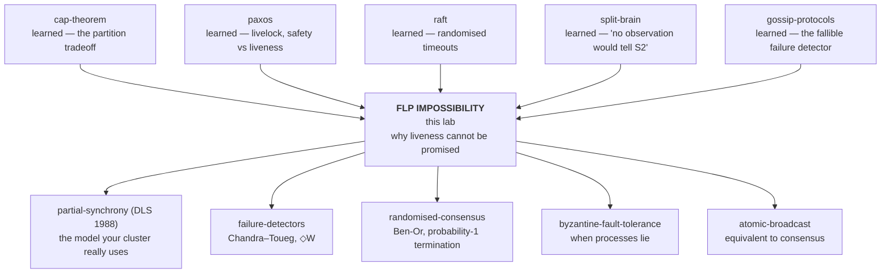

# FLP Impossibility — why no protocol can promise to finish

> **The one sentence.** In a system where messages can take *any* amount of time
> and even one machine might crash, **no protocol that always behaves the same
> way in the same situation can guarantee all three of these: that everybody
> agrees, that the answer is a real one, and that the thing always finishes.**
> You can have any two, always. You cannot have all three, ever.

> **The sentence people get wrong.** FLP does **not** say that agreeing is
> impossible. Your Raft cluster elects leaders every day. FLP says nobody can
> put a *guarantee* on the finishing part — and that every system which appears
> to have one has quietly changed the world it lives in, in a way you are
> responsible for maintaining in production.
>
> *(Stage 5 names those three properties; stage 7 explains why "always behaves
> the same way" — the technical word is* deterministic *— is one of the four
> words in the theorem you are allowed to attack.)*

**Lab contents**

| File | What it is |
|---|---|
| `README.md` | this document — 16 stages, four depth layers |
| `visualization.html` | **The Ferryman's Choice** — you play the adversary against a real protocol · <https://claude.ai/code/artifact/59306f2a-8884-4ffa-b06c-81faf73ad1d5> |
| `EXERCISES.md` | eight rungs, pencil-and-paper plus the visualization |
| `SOLUTIONS.md` | worked answers |

**Where this sits in your other labs.** You have already met this result twice
without being told what it was.

- In **`paxos`**, two proposers gazumped each other forever — round 1, round 2,
  round 3, nothing chosen — and the lab said *"it is not a bug in Paxos; it is a
  consequence of the FLP result."* This lab is that consequence.
- In **`split-brain`**, at t=70, S2 declared S1 dead and the lab wrote:
  *"This verdict is WRONG, and there is no observation available to S2 that
  would tell it so."* That sentence is FLP's engine room. You found it
  empirically; here you find out it is a theorem.
- In **`raft`**, randomised election timeouts were the scar of a measured
  disaster. This lab explains exactly which word of the theorem they attack —
  and, uncomfortably, shows they attack a *different* word than most people
  think.

---

## How the numbers in this document were produced

Every measured figure below comes from the simulation engine inside
`visualization.html`, which runs a real single-decree Paxos with attempt numbers
handed out in rotation (the `paxos` lab's protocol, with rotating proposers).
The engine is exercised by a **71-check headless harness** — every scenario's
stated outcome, both schedulers, the escapes, the commutation audit, and the
crash argument. Where a claim is a *proof* rather than a measurement, it says so.
Where something is asserted but not run, it says that too.

---

# BEGINNER MODEL — stages 1 to 9

## 1. WHY — the problem this exists to name

You run a payments service across five machines. They have to agree on one
thing: *is this transfer committed, or not?* One answer, the same on every
machine, and the machines have to actually reach it — not sit there thinking
about it while the customer refreshes the page.

You have already built systems that do this. So here is the question nobody
asked in those labs:

> **Is there a protocol that always finishes?**

Not "usually finishes". Not "finishes when the network is fine". *Always* —
the way a sorting algorithm always terminates.

In 1985 three researchers proved the answer is **no**, and the proof is so
robust that thirty-odd years of hardware improvement has not dented it. It is
not about slow networks or bad code. It holds on a perfect network that loses
nothing, with fast machines, with as many spare replicas as you like.

**What goes wrong if you don't know this.** You spend a career hunting a bug
that is a theorem. Your cluster stalls for forty seconds during a leader
election; you write a postmortem calling it a defect; you tune a timeout down;
next month it stalls again for a different reason and you tune another one.
Knowing this result tells you which knobs exist, which knobs are lies, and how
to describe the risk honestly to people who need to plan around it.

## 2. PROBLEM — three lighthouses and a ferryman

Three keepers live on three islands: **Ada** on North Rock, **Bo** on Middle
Sands, **Cy** on South Cape. Tonight they must agree on one thing.

> **Light the beacons, or leave them dark.**

Either is a defensible choice. What is *not* defensible is a half-lit coast:
a ship that sees one beacon and not the others reads the gap as clear water and
puts itself on the rocks. So whatever they do, **all three must do the same
thing**, and they must actually get around to doing it before dawn.

The rules of their world, and every one of them matters later:

1. **They can only write letters.** No island can see another. There is no
   shouting, no flag signal, no shared view of anything.
2. **A ferryman carries every letter, and never loses one.** Not one letter is
   ever destroyed, misdelivered, or forged. Every letter written is eventually
   handed over.
3. **The sea decides how long he takes.** A crossing might be an hour. It might
   be three weeks. There is no upper limit, and nobody is told which it will be.
   Letters can also overtake each other — the ferryman is not obliged to
   deliver in the order they were written.
4. **Nobody owns a working clock.** No keeper can measure elapsed time in any
   way another keeper would agree with.
5. **Any one keeper might fall ill** and simply stop — mid-sentence, without
   warning, without a farewell note. At most one, though. The other two will
   definitely stay healthy.

Rule 5 is not pessimism. It is the whole reason a *protocol* is needed at all:
if nobody could ever stop, "wait until everyone has spoken" would work fine.

> **🔮 Predict:** *One of those five rules is the one that makes this problem
> unsolvable. If you could repeal exactly one, which would you repeal?*
> <details><summary>Reveal</summary>
> Most people pick <b>rule 5</b> — "a keeper might fall ill" — because failure
> feels like the enemy. It is the wrong answer. Repeal rule 5 and the problem is
> still hard, but repeal <b>rule 3</b> — "the sea decides how long he takes" —
> and it becomes <i>easy</i>: with a known upper bound on crossing time, silence
> past that bound is <b>proof</b> of illness rather than a guess, and majority
> voting works exactly as stage 3 hopes. (Repealing rule 5 alone also works, for
> a duller reason: if nobody can ever stop, you simply wait for everyone.)
> <br><br>
> Hold on to this: <b>the enemy is not failure. The enemy is the missing
> deadline.</b> Everything real systems do about this — election timeouts,
> leases, heartbeat intervals — is an attempt to put rule 3 back, and stage 13
> is about the bill.
> </details>

## 3. NAIVE SOLUTION — what any sensible person tries first

Ada writes to Bo and Cy: *"I say dark. What do you say?"* She waits for both
replies, counts, and takes the majority. Bo and Cy do the same. Three keepers,
three views, everyone counts the same votes, everyone lands on the same answer.

This is obviously right, and it obviously works — as long as everybody answers.

## 4. FAILURE — the deeper problem underneath

Ada waits. Nothing comes from Bo.

She has exactly two explanations, and **she cannot tell them apart**:

- **Bo is alive**, wrote his reply immediately, and the boat is stuck in a storm.
- **Bo is dead**, and no reply will ever exist.

Ada's evidence in both cases is *identical*: an empty mailbox. There is no
letter she can write, no question she can ask, no instrument she can build that
separates the two, because **the only difference between them is how long the
future is going to take, and the future has not happened yet.**

> **Open tab 1 of the visualization, "Slow, or dead?"** Drag Ada's patience.
> The page shows both worlds and what Ada sees in each. You are looking for a
> slider setting that is right in both worlds. There isn't one.

So Ada must pick a deadline. And every deadline is a guess:

- **Too short** → she writes off a living keeper and carries on without him.
  Bo, alive and well, is also carrying on. Now two keepers are running the
  coast, and their reply letters cross in the post. This is precisely the
  `split-brain` lab, and it is where wrong answers come from.
- **Too long** → if Bo really is dead, Ada waits past dawn and the coast stays
  unlit. Nothing wrong happened, and nothing happened at all.
- **Infinite** → correct in the storm case, catastrophic in the dead case.

> **🔮 Predict:** *Ada has more paper, more ink, five spare islands, and an
> unlimited budget. Can she buy her way out of this?*
> <details><summary>Reveal</summary>
> No. More islands mean more mailboxes that might be empty for either reason.
> The ambiguity is not caused by a shortage of anything — it is caused by the
> absence of an upper bound on delivery time. You cannot buy an upper bound
> with equipment; you can only <i>assume</i> one, and then live with being
> wrong when the assumption fails. That is exactly what real systems do, and
> stage 13 is about paying for it.
> </details>

**The naive solution didn't merely fail. It revealed that the thing it needed
— "know who is dead" — is not obtainable.**

## 5. THE REAL REQUIREMENT — say exactly what we want

Strip the story away. Each keeper starts with a preference (light or dark) and
must eventually write one final, unchangeable answer on a slate. Three
properties, in plain words:

| Property | Plain words | Why you'd want it |
|---|---|---|
| **Agreement** | No two keepers write different answers. | A half-lit coast wrecks ships. |
| **Validity** | The answer is one somebody actually wanted — not invented. | A protocol that always answers "dark" satisfies agreement and is useless. |
| **Termination** | Every healthy keeper eventually writes *something*. | An answer after dawn is not an answer. |

Together these three are called **consensus**. Agreement and Validity are
*safety* properties — promises that nothing bad ever happens. Termination is a
*liveness* property — a promise that something good eventually happens. You met
that distinction in the `paxos` lab; it is about to become the most important
distinction in this one.

And the failure model, stated precisely: **at most one keeper may crash** — stop
working permanently, at any moment, with no announcement. Not lie, not
forge letters, not come back. Just stop.

> **This is the target.** All three properties. Always. With one possible crash.
> With no clock.

**And it is unachievable.** That is the theorem.

---

## 6. KEY IDEA — the move that makes the proof possible

Here is the trap a smart person falls into first, and it is worth naming because
it is where most people's understanding stops.

**The wrong move (mechanism v1): find a protocol and break it.** Show that
majority voting fails. Show that Paxos can livelock. Show that Raft can
split-vote. All true — and all worthless as an argument, because for every
broken protocol somebody will say *"then use a better one"*, and they might be
right. Breaking a thousand protocols says nothing about the thousand-and-first.

**The right move: stop talking about protocols and start talking about
situations.** Fischer, Lynch and Paterson's insight is to reason about the
*state of the whole world* — everything every keeper knows, plus every letter
currently at sea — and to ask one question of it:

> *From here, which final answers are still possible?*

Some situations have both answers still live. Others have already been forced
one way. And the entire proof is one observation about how these two kinds of
situation relate:

> **From any situation where both answers are still possible, there is always a
> next event that leaves both answers still possible.**

If that is true, the ferryman never has to let anyone finish. He steps from
undecided situation to undecided situation forever, and he does it **without
losing a single letter and without ignoring a single keeper.**

This works against *any* protocol, because the argument never mentions what the
protocol does. That is what makes it a theorem rather than a bug report.

## 7. TERMINOLOGY — the vocabulary, now that you have earned it

Nine terms carry this lab. Each gets: plain meaning, technical meaning, why the
word exists, a concrete example, and how it connects to what you already know.

### Asynchronous system

- **Plain:** a world with no upper limit on how long anything takes.
- **Technical:** a model in which there is no bound on message delivery delay,
  no bound on the relative speed of processes, and no synchronised clocks.
- **Why the word exists:** to separate this from a **synchronous** system, where
  known bounds exist and a timeout that expires is *proof* of a crash. In an
  asynchronous system a timeout that expires is proof of nothing at all.
- **Example:** the ferryman. A crossing may take an hour or three weeks, and no
  keeper is told which.
- **Connects to:** this is *not* a claim that real networks are this bad. It is a
  claim about what you may *assume*. Your production network is asynchronous
  every time a GC pause, a saturated link, or a busy disk makes a bound you
  believed in stop holding.

### Crash failure

- **Plain:** a machine stops, forever, without warning.
- **Technical:** a process takes only finitely many steps in an infinite run.
- **Why the word exists:** to fence off much nastier failure models. A crashed
  process does not send wrong data, forge messages, or come back with corrupted
  state. FLP assumes the *mildest possible* failure — which is what makes the
  impossibility so striking.
- **Example:** Bo dies in the night. Half a letter on his desk, nothing more.
- **Connects to:** `gossip-protocols` called the failure detector *a fallible
  component* and measured a 100-node cluster where every node wrote off every
  other with zero actual crashes. That was this problem, in the wild.

### Step, event, and the null step

- **Plain:** the smallest thing that can happen — one keeper reads their
  mailbox once and reacts.
- **Technical:** a step of process *p* is: `receive(p)` returns either a message
  *m* addressed to *p* or **nothing**; *p* updates its state as a deterministic
  function of its old state and what it received; *p* sends a finite set of
  messages. An **event** is the pair *(p, m)* — this process, receiving this
  message.
- **Why the word exists — and this one is important:** the "or nothing" branch
  is called a **null step**, and it is how a *timeout* lives inside the model.
  There is no clock in this world, so a timeout cannot be "when 5 seconds pass".
  It can only be "a step in which I looked and there was nothing there, and I
  decided to act anyway". Timeouts are not outside the theorem. They are a case
  of it.
- **Example:** in the visualization, the button *"Let Ada give up waiting"* is a
  null step. Notice that **you**, the ferryman, decide when it happens — because
  in a world with no clock, nothing else can.
- **Connects to:** the `raft` lab's election timeout is exactly this: a null step
  that promotes a follower to candidate.

### Configuration (the visualization calls it a *situation*)

- **Plain:** a complete snapshot of the world.
- **Technical:** the internal state of every process, plus the multiset of all
  messages that have been sent and not yet delivered.
- **Why the word exists:** because the proof needs an object it can label. You
  cannot say "this protocol is undecided"; you can say "*this configuration* is
  undecided".
- **Example:** *Ada has promised attempt 4 and accepted (1, dark); Bo has
  promised 7 and accepted nothing; Cy is idle; four letters are at sea.* That
  whole sentence is one configuration.
- **Connects to:** it is a global object no participant can ever see. Every
  keeper sees a projection of it; the theorem reasons about the whole thing.

### Schedule, run, and *admissible*

- **Plain:** the order the ferryman chooses, and whether he is playing fair.
- **Technical:** a **schedule** is a sequence of events applicable one after
  another from a configuration. A **run** is that sequence actually executed. A
  run is **admissible** when (a) at most one process is faulty, and (b) every
  message sent to a non-faulty process is *eventually* delivered.
- **Why the word exists:** to close the cheap objection. An adversary who
  destroys mail or ignores a keeper proves nothing — of course that breaks
  things. The word *admissible* is the fairness contract, and **the FLP
  adversary honours it completely.**
- **Example, measured:** the stalling ferryman run for 5000 steps delivered
  **4545 letters, lost 0**, never let a letter wait more than **7 steps**, and
  never left a keeper idle for more than **4 steps**. Every rule kept. Nothing
  decided.
- **Connects to:** this is the sharpest line between FLP and `cap-theorem`. CAP's
  adversary *takes the messages away*. FLP's adversary delivers every one of
  them and only chooses the order.

### Deterministic

- **Plain:** the same machine in the same state, given the same input, always
  does the same thing.
- **Technical:** each process's transition function is a function — no coin
  flips, no randomness, no reading the wall clock.
- **Why the word exists:** because it is one of the load-bearing words in the
  theorem, and one of the four you can attack. A protocol that flips a coin is
  outside FLP's scope entirely.
- **Example:** Ada, holding two agreements and a preference for dark, always
  proposes dark. She never sometimes proposes light.
- **Connects to:** `raft`'s randomised election timeouts *look* like an attack on
  this word. Stage 12 shows they are mostly not — and measures it.

### Valency: bivalent and univalent

This is the term the proof is built out of, so it gets the most room.

- **Plain:** *"which endings are still on the table from here?"*
- **Technical:** a configuration is **0-valent** if every reachable decision from
  it is 0; **1-valent** if every reachable decision is 1; and **bivalent** if
  both are still reachable. 0-valent and 1-valent are together called
  **univalent** — the ending is settled even if nobody knows it yet.
- **Why the word exists:** to separate *"nobody has written an answer yet"* from
  *"the answer is not yet determined"*. These are different, and the difference
  is the whole proof. A configuration can have zero decisions written down and
  still be univalent — the outcome is already sealed, the keepers just haven't
  caught up. **Bivalent is the strictly stronger statement: the future is
  genuinely open.**
- **Example, measured:** starting from *Ada wants dark, Bo wants light, Cy wants
  light*, the page finds one delivery order ending in **dark** and another ending
  in **light** — same keepers, same protocol, same preferences, only the
  ferryman's order differs. That start is bivalent. Starting from *all three want
  dark*, every order ends in dark: univalent, because Validity forbids inventing
  an answer nobody wanted.
- **Connects to:** the visualization draws a not-yet-decided lamp as **half dark,
  half lit**. That split lamp is bivalence, on screen.

### Safety and liveness

Refresher — you have these from `paxos`. **Safety** = nothing bad ever happens
(Agreement, Validity). **Liveness** = something good eventually happens
(Termination). The thing worth re-noticing: safety can be checked by looking at
any finite prefix of a run; liveness can only ever be violated by an *infinite*
run. That is why the theorem's counterexample is an infinite run, and why
"it hasn't finished yet" is never proof that it never will.

### Partial synchrony

- **Plain:** the network behaves *most* of the time, and you don't know when.
- **Technical:** (Dwork, Lynch & Stockmeyer, 1988) bounds on delay and process
  speed exist but are unknown; or they are known but only start holding after
  some unknown **Global Stabilization Time (GST)**.
- **Why the word exists:** because "synchronous" is a lie about real networks and
  "asynchronous" is too pessimistic to build on. Partial synchrony is the honest
  middle, and it is what every production consensus system actually assumes.
- **Example, measured:** give the ferryman a deadline of Δ = 4 steps per letter
  and he loses — the keepers settle on step 23, on their *first* attempt. Loosen
  it to Δ = 25 and they still settle, on step 63. Remove it entirely and he holds
  them off for 5000 steps and counting.
- **Connects to:** stage 13. Your `raft` cluster is a partially synchronous
  system, and its Δ is a hope you maintain with monitoring.

---

## 8. MENTAL MODELS — two pictures, and where the friendly one lies

### The simple model: a patient ferryman

Three keepers, letters, and a ferryman who is not malicious but is *unlucky in
exactly the worst way*. He never destroys mail. He never refuses a crossing. He
only ever chooses **which letter to hand over next**, and that alone is enough
to keep the keepers talking forever.

### The engineering model: walking a graph of configurations

The world is a directed graph. Nodes are configurations. Edges are events. Each
node carries a hidden label — 0-valent, 1-valent, or bivalent. The adversary is
a walker who starts on a bivalent node and, at every move, has *some* edge
leading to another bivalent node. Since a decided configuration is never
bivalent, the walker never steps onto one.

### Mapping between them

| Story | Engineering model |
|---|---|
| a keeper | a process |
| what a keeper wants (light / dark) | the process's input value, 0 or 1 |
| what's on a keeper's slate | the process's decision, or ⊥ if none |
| the whole world right now | a **configuration** |
| a letter at sea | a message in the buffer |
| the ferryman handing over one letter | an **event** *(p, m)* |
| a keeper giving up waiting | a **null step** — `receive` returns nothing |
| the ferryman's chosen order | a **schedule** |
| never losing mail, never ignoring an island | an **admissible** run |
| both endings still possible | **bivalent** |
| the ending already sealed | **univalent** |
| a keeper falling ill | a **crash failure** |
| the sea's unbounded whim | **asynchrony** |

### Where the analogy breaks — read this before you repeat it to anyone

1. **The ferryman is not real, and your network is not malicious.** He is a proof
   device. His job is to demonstrate that a bad run *exists*, not to predict what
   your Tuesday looks like. In practice the "adversary" is a garbage collector, a
   saturated NIC, a noisy neighbour on a shared host — indifferent, not hostile.
   Indifferent is enough, because the theorem only needs the run to be possible.
2. **The story makes crashing feel central. It isn't.** In the run the proof
   builds, **nobody actually crashes.** All three keepers work the whole time.
   What matters is that the protocol must be *willing* to carry on without any
   one of them — and that willingness is the door the ferryman walks through.
   (This is the point most summaries of FLP get wrong.)
3. **"Three keepers" suggests small numbers matter.** They don't. The result
   holds for any number of processes and only needs *one* possible crash. Adding
   replicas does not help even slightly.
4. **The story has a dawn deadline. The model has no time at all.** "Before
   dawn" is a synchrony assumption smuggled in by the narrative. In the real
   model there is no dawn, no clock, and no meaning to "too late" — only
   "eventually" and "never".
5. **A ferryman "choosing" implies he sees the future.** The FLP adversary is
   adaptive — it decides each next event knowing the current configuration — but
   it does not need to see the protocol's source code at runtime. The proof shows
   a suitable choice always *exists*; it does not require anyone to compute it.

---

## 9. VISUALIZATION — what to open, and in what order

**The Ferryman's Choice** — <https://claude.ai/code/artifact/59306f2a-8884-4ffa-b06c-81faf73ad1d5>
(also `visualization.html` in this directory, works offline).

Four tabs, in the order the story needs them:

1. **Slow, or dead?** — the foundation from stage 4. Move Ada's patience slider
   and hunt for a value that is right in both worlds. Two minutes.
2. **Play the ferryman** — the main event. Click letters to deliver them; click
   *"Let X give up waiting"* to make a keeper time out. Then press **"Ferryman
   plays to stall ×40"** a few times and *watch the fairness audit on the right
   while you do it*. That panel is the whole lesson: letters lost 0, longest a
   letter waited 7 steps, longest any keeper sat idle 4 steps — and nothing
   decided, on attempt 682.
3. **Why the ferryman always wins** — the proof, computed live on the real
   keepers. Three facts, each checkable on screen.
4. **The four escapes** — turn on a delivery deadline, random waiting times, or
   a leadership oracle, and watch the ferryman lose. Press **"Run all nine
   combinations"** for the summary table.

**Signpost for tab 2, because it is easy to look at the wrong thing:** don't
watch the lamps — they never change. Watch the **attempt number** climbing in
the verdict box, and the **fairness audit numbers staying small**. The story is
that those two things are true *at the same time*.

> **✅ CHECKPOINT — end of the beginner model.**
> You can now explain why "wait for a reply" and "give up after a timeout" are
> the only two options, why both are wrong, and what it means for a situation to
> have both endings still open. That is enough to read a postmortem and know
> what kind of thing you are looking at.
> **Next:** the actual mechanism — how the ferryman decides what to hand over,
> and why the argument covers protocols nobody has written yet.

---

# INTERMEDIATE MODEL — stage 10

## 10. ACTUAL MECHANISM — the ferryman's strategy, then the theorem

### 10.1 The protocol on the table

To watch a stall you need something to stall. The keepers run **single-decree
Paxos with attempt numbers handed out in rotation** — the `paxos` lab's protocol,
with one change: attempt numbers are assigned round-robin (Ada owns 1, 4, 7…;
Bo owns 2, 5, 8…; Cy owns 3, 6, 9…) instead of being picked freely. Refresher
only, since you know it:

1. A keeper who has been waiting decides to try. She picks her next **attempt
   number** and writes `PREPARE(n)` to all three islands, including herself.
2. A keeper receiving `PREPARE(n)`: if *n* is higher than any attempt she has
   promised, she promises *n* and replies `PROMISE(n, …)` reporting the last
   value she accepted, if any. **If *n* is not higher, she says nothing at all.**
3. With promises from a majority (2 of 3), the proposer picks the value: if any
   promise reported an earlier acceptance, she is **forced** to re-propose that
   value; otherwise she proposes her own preference. She writes `ACCEPT(n, v)`
   to all.
4. A keeper receiving `ACCEPT(n, v)` accepts it if *n* is at least her promised
   attempt, and replies `ACCEPTED(n)`. Otherwise, **silence**.
5. With acceptances from a majority, the proposer **decides** *v* and writes
   `DECIDE(v)` to the others.

Two things to notice, because both matter later.

**Refusal and death look the same.** In steps 2 and 4 a keeper who refuses just
doesn't reply. That is a simplification in this lab — real Paxos usually sends a
negative acknowledgement — but it happens to make the lesson louder: from the
proposer's side, *"she refused me"* and *"she is dead"* produce the identical
observation. An empty mailbox, again.

**Safety here is already proved and does not depend on timing.** The `paxos` lab
established the quorum-overlap argument: any two majorities share a member, and
that member's memory forces every later attempt to re-propose an already-chosen
value. Nothing in that argument mentions delays. This lab measured it again:
**500 random delivery orders, 1 in 3 of them with a keeper crashed, produced 0
agreement violations.** So for the rest of this lab, *safety is not in question*.
Only finishing is.

### 10.2 The happy run — a fair ferry, worked step by step

Ada wants **dark**; Bo and Cy want **light**. The ferryman simply delivers the
oldest letter first. Traced by the simulator, step by step:

```
 1  Ada gives up waiting → PREPARE(1) to Ada, Bo, Cy
 2  Ada reaches her own request, promises 1     → PROMISE(1, accepted:none) → Ada
 3  Bo  promises 1                              → PROMISE(1, accepted:none) → Ada
 4  Cy  promises 1                              → PROMISE(1, accepted:none) → Ada
 5  Ada has 1 of the 2 agreements she needs
 6  Ada has 2 → names her own preference DARK   → ACCEPT(1, DARK) to all three
 7  Cy's agreement arrives late; Ada has moved on; ignored
 8  Ada accepts (1, DARK)                       → ACCEPTED(1) → Ada
 9  Bo  accepts (1, DARK)                       → ACCEPTED(1) → Ada
10  Cy  accepts (1, DARK)                       → ACCEPTED(1) → Ada
11  Ada has 1 of the 2 acceptances she needs
12  Ada has 2 → DECIDES DARK                    → DECIDE(DARK) to Bo, Cy
13  a third acceptance arrives; already settled; changes nothing
14  Bo learns DARK and writes it on his slate
15  Cy learns DARK and writes it on his slate
```

**Settled at step 15. Longest any letter waited: 4 steps.** Note that the answer
is *dark* even though two of the three keepers wanted light — Validity only
requires the answer be *somebody's* preference, and Ada got there first. That is
correct behaviour, not a bug.

### 10.3 The ferryman's first strategy, and why it fails

Look at step 11 above. Ada has one acceptance and needs two. **One letter stands
between this world and a settled answer.**

> **🔮 Predict:** *The ferryman wants to stop this. His first idea is simply not
> to deliver that letter. Does it work?*
> <details><summary>Reveal</summary>
> No — it only postpones. The fairness contract says every letter must be
> delivered <i>eventually</i>. He can hold it for a thousand steps, but the
> moment he hands it over the matter is settled, and he must hand it over. He
> has bought time, not a result. To win he needs the letter to be
> <b>harmless</b> when it arrives, not merely late.
> </details>

**That is the whole refinement.** The ferryman does not need to withhold the
dangerous letter. He needs to arrange, *before* delivering it, that the keeper
receiving it will **refuse** it. Then he can hand it over with a clear
conscience, fairness intact, and nothing happens.

He has exactly one tool for that: attempt numbers. A keeper who has promised a
higher attempt refuses a lower one. So:

> **The ferryman's rule.** *Never let two islands accept the same attempt.*
> Whenever an `ACCEPT(n, v)` is about to reach a second island, first deliver
> that island a `PREPARE` for a higher attempt — and if no such letter exists,
> let some other keeper give up waiting, which manufactures one.

Every attempt therefore collects at most one acceptance, never a majority, and
nobody ever decides.

### 10.4 The stall, worked step by step

Same starting preferences. Now the ferryman plays the rule above. The first 22
steps, traced by the simulator:

```
 1  Ada gives up waiting → PREPARE(1) to all
 2  Ada promises 1                        → PROMISE(1, none) → Ada
 3  Bo  promises 1                        → PROMISE(1, none) → Ada
 4  Cy  promises 1                        → PROMISE(1, none) → Ada
 5  Ada has 1 of 2 agreements
 6  Ada has 2 → ACCEPT(1, DARK) to all three
 7  a late agreement, ignored
 8  Ada accepts (1, DARK)                 ← attempt 1 now has ONE acceptance
 ─────  the ferryman sees the danger: two more ACCEPT(1) letters are at sea  ─────
 9  the ferryman lets BO give up waiting  → PREPARE(2) to all
10  Bo  promises 2
11  Cy  promises 2                        ← Bo and Cy are now above attempt 1
12  ACCEPT(1, DARK) reaches Bo → REFUSED (Bo promised 2). Silence.
13  ACCEPT(1, DARK) reaches Cy → REFUSED (Cy promised 2). Silence.
14  Ada's own ACCEPTED(1) arrives: she has 1 of 2, and will never get a second
15  Ada promises 2, reporting she accepted (1, DARK)
16  Bo has 1 of 2 agreements for attempt 2
17  Bo has 2 → ACCEPT(2, LIGHT) to all three
18  a late agreement, ignored
19  Ada accepts (2, LIGHT)                ← attempt 2 now has ONE acceptance
 ─────  same danger, same answer  ─────
20  the ferryman lets ADA give up waiting → PREPARE(4) to all
21  Bo  promises 4
22  Cy  promises 4                        ← attempt 2 is now dead too
```

Steps 8–13 and 19–22 are the same move, and it repeats forever. **This is
precisely the dueling-proposers livelock from your `paxos` lab** — except there
it looked like bad luck, and here you can see it is a *strategy* that a
scheduler with no special powers can execute deliberately, on demand, forever.

**Measured over a long run** (visualization tab 2, or press "Ferryman plays to
stall" repeatedly):

| After 5000 steps of the ferryman stalling | |
|---|---|
| Keepers who decided anything | **0** |
| Attempt number reached | **682** |
| Letters delivered | **4545** |
| Letters lost or destroyed | **0** |
| Longest any letter waited | **7 steps** |
| Longest any keeper sat idle | **4 steps** |
| Keepers who fell ill | **0** |
| Agreement violations | **0** |

Read that table twice. Nothing was lost, nobody was ignored, nobody died,
nothing went wrong — and nothing happened.

### 10.5 But that is one protocol. Now the theorem.

Everything above beats *this* protocol. A reasonable person answers: *"then fix
the protocol."* The 1985 proof closes that door. It rests on three facts, and
mentions no protocol at all.

#### Fact A — some starting point has both endings still open

*Claim: there is an initial configuration that is bivalent.*

Suppose there isn't — every starting point is univalent. Validity guarantees at
least one start where the answer must be dark (everyone prefers dark) and at
least one where it must be light. Now line up all the starting points so that
each differs from the next in **exactly one keeper's preference**:

```
 D D D        L D D        L L D        L L L
 only DARK      ?            ?         only LIGHT
```

Walking from the left end to the right end, you begin at a dark-only start and
finish at a light-only start, so **somewhere along the line two neighbours have
different endings** — call them C₀ (dark-only) and C₁ (light-only), differing
only in what keeper *p* wants.

Now use the crash tolerance. From C₀, consider a run in which **p never takes a
single step** — legal, because the protocol must survive one crash. The other
keepers must still decide, and by assumption they decide dark. But that exact
same run is available from C₁: *p* takes no steps in it, and *p*'s preference is
the only difference between C₀ and C₁, so the other keepers cannot tell which
world they are in. They behave identically. They decide dark in C₁ too — which
contradicts C₁ being light-only.

So not every start is univalent. **Some starting point is bivalent.** ∎

> **Verified on the real keepers** (visualization tab 3, Fact 2, or run it
> yourself): with Ada silent from step 0, the world where Ada wanted **dark** and
> the world where Ada wanted **light** both end with Bo and Cy settling on
> **light, at step 10, after the same letters.** Ada's preference made no
> difference whatsoever, because nobody heard it.

> **🔮 Predict:** *That argument used a crash. In the infinite run the theorem
> eventually builds, how many keepers actually fall ill?*
> <details><summary>Reveal</summary>
> <b>None.</b> The crash appears only inside the <i>argument</i>, as a
> hypothetical run used to prove two starting points are indistinguishable. The
> run the theorem constructs has every keeper healthy and working the whole
> time. What the theorem needs is not a crash — it is that the protocol must be
> <b>willing to proceed without any one keeper</b>. That willingness is the
> vulnerability. A protocol that refused to tolerate any crash could wait for
> everyone and would be immune to FLP — and would also stop dead the first time
> a machine rebooted.
> </details>

#### Fact B — events at different islands can be swapped for free

*Claim: if event e happens at keeper p and event e′ happens at a different
keeper q, then applying e then e′ gives exactly the same configuration as
applying e′ then e.*

The reason is almost embarrassingly simple. A step at *p* changes only *p*'s own
state and adds letters to the sea. It cannot touch *q*'s state, because nothing
in this world touches a keeper except a letter arriving *at that keeper*. So the
two steps never interfere, and their order is invisible.

> **Verified on the real keepers** (visualization tab 3, Fact 3, "Check every
> such pair across 30 situations"): **133 of 133** swaps at different islands
> produced byte-for-byte identical configurations, with **zero** exceptions.
> Meanwhile, of the pairs landing at the *same* island, 5 produced different
> configurations — order genuinely matters there, and only there.
>
> A worked instance the page will show you: at step 6, `PROMISE(1) Bo→Ada` and
> `ACCEPT(1,DARK) Ada→Bo` are both pending, at Ada and at Bo. Deliver them in
> either order and every keeper's state and every letter at sea comes out
> identical.

*A note on how this was checked, because it is a nice trap.* An earlier version
of this lab's simulator got Fact B **wrong** — 38 of 142 swaps at different
islands came out different. The cause: a keeper computing her next attempt
number read a *global* variable holding the highest attempt anyone had ever
started. A real island cannot read a global variable. Once each keeper computed
her next attempt from **what she herself had seen**, the exceptions vanished
completely. The lemma is not just true; it is *diagnostic* — a violation means
you have accidentally let a process see something nobody sent it.

#### Fact C — a bivalent situation always has a bivalent next move

This is the heart of it, and it is the one worth reading slowly.

*Claim: let C be a bivalent configuration and let e = (p, m) be any single event
that is pending in it. Then there is a schedule from C, ending with e, whose
final configuration is still bivalent.*

In plain words: **you can always let the annoying event happen — just not yet,
and not before you have arranged for it to be harmless.** (That is exactly the
ferryman's refinement in §10.3, promoted to a general fact.)

The proof is by contradiction. Suppose the claim is false for some C and e. Let
𝒞 be all the configurations reachable from C *without* applying e, and let 𝒟 be
what you get by applying e to each of them. By assumption, **every configuration
in 𝒟 is univalent** — the moment e lands, the ending is sealed.

*Step 1: 𝒟 contains both a dark-only and a light-only configuration.* C is
bivalent, so some run from C ends in dark. Either e was never used on that run —
then applying e at the end gives a dark-only member of 𝒟 — or e was used
somewhere on it, and the configuration right after e is itself a member of 𝒟
that leads to dark. Either way 𝒟 has a dark-only member. The same argument gives
a light-only one.

*Step 2: two of them are one step apart.* 𝒞 is reachable-connected from C, so
walking between the two witnesses in 𝒞 you must cross a single edge where the
label flips: there are C₀, C₁ ∈ 𝒞 with **C₁ = e′(C₀)** for one event e′, where
D₀ = e(C₀) is dark-only and D₁ = e(C₁) is light-only.

*Step 3, case one: e′ happens at a different keeper than e.* Then by **Fact B**
they commute, so

```
D₁ = e(e′(C₀)) = e′(e(C₀)) = e′(D₀)
```

D₁ is reachable from D₀ in a single step. But D₀ is dark-only, so everything
reachable from it is dark-only — and D₁ is light-only. Contradiction.

*Step 3, case two: e′ happens at the same keeper p as e.* Now use **crash
tolerance**, exactly as in Fact A. From C₀, let *p* go completely silent. The
other keepers must still finish, so there is a finite run σ from C₀, containing
**no steps by p**, that reaches a configuration A in which somebody has decided.
Because σ contains no steps by *p*, it commutes with both e and e′. So:

```
e(A)        = e(σ(C₀))        = σ(e(C₀))        = σ(D₀)   → dark-only
e(e′(A))    = e(e′(σ(C₀)))    = σ(e(e′(C₀)))    = σ(D₁)   → light-only
```

From A you can reach a dark-only configuration and a light-only configuration.
So **A is bivalent** — but A is a configuration in which somebody has already
decided, which makes it univalent. Contradiction.

Both cases are impossible, so the assumption was wrong. **A bivalent next move
always exists.** ∎

#### The theorem

Start at a bivalent initial configuration (Fact A). Then repeat forever:

> Take the keeper who has gone longest without a step, and the oldest letter
> addressed to them (or a null step if their mailbox is empty). Call that event
> *e*. By **Fact C**, there is a schedule ending in *e* that leaves the world
> still bivalent. Run it.

Two things are now simultaneously true:

- **The run is admissible.** Every letter eventually becomes the oldest one
  addressed to the longest-idle keeper, so every letter is delivered. Every
  keeper takes infinitely many steps. Nobody is starved. No letter is lost. No
  keeper crashes.
- **Every configuration in the run is bivalent**, and a configuration in which
  somebody has decided is never bivalent. So **nobody ever decides.**

Termination is violated, in an admissible run, by a protocol that was assumed to
guarantee it. Therefore no such protocol exists. ∎

*Fischer, Lynch & Paterson, "Impossibility of Distributed Consensus with One
Faulty Process", Journal of the ACM 32(2), 1985. It won the Dijkstra Prize in
2001.*

> **✅ CHECKPOINT — end of the intermediate model.**
> You can now reconstruct the proof from three facts: some start is genuinely
> open; steps at different machines commute; and a bivalent situation always has
> a bivalent next move. You can also explain why the argument covers protocols
> nobody has written yet.
> **Next:** what this looks like on a Tuesday afternoon in production, and
> exactly which guarantee bends in each case.

---

# ENGINEERING MODEL — stages 11 and 12

## 11. FAILURE SCENARIOS — where the theorem shows up on a Tuesday

The theorem does not have "failure modes" the way a protocol does. What it has
are **sightings** — situations where a real system briefly re-enters the world
of tab 2 and stops finishing things. Here are the eight worth recognising on
sight. For each: how to cause it, where to watch it, what breaks, and what
survives.

**1 · Duelling proposers (election livelock).**
*Cause it:* two nodes whose retry timers keep firing just before the other one
completes. *Watch it:* visualization tab 2, "Ferryman plays to stall" — or the
trace in §10.4. *What happens:* every attempt reaches one acceptance and dies to
a higher attempt; the attempt counter climbs without limit (measured: **682
after 5000 steps**). *Why:* a new, higher attempt invalidates promises made to a
lower one, and there is no rule saying a proposer must wait for the previous
attempt to fail first. *Response:* none is possible from inside the protocol —
this is the FLP run. *Intact:* Agreement, Validity, durability, every safety
property. *Lost:* Termination, entirely. *In production:* Raft's randomised
election timeouts and Paxos's stable-leader optimisation exist to make this
self-correcting rather than to prevent it; your signal is a **leader-election
rate** or **term/epoch number** climbing when nothing is wrong.

**2 · The garbage collector as the adversary.**
*Cause it:* a stop-the-world pause longer than the failure-detection timeout.
*Watch it:* the `split-brain` lab measured connection p99 going from **1,011 µs
to 191,661 µs — a 190× collapse — on a healthy server doing nothing wrong.**
*What happens:* the leader is frozen; followers see silence; an election starts;
the old leader wakes up believing it is still leader. *Why:* a frozen process
and a dead process emit identical evidence — stage 4, in the machine room.
*Response:* the old leader discovers a higher term/epoch and steps down.
*Intact:* Agreement, because epoch checks make the zombie's work harmless.
*Lost:* Termination for the duration, plus whatever the zombie had in flight.
*In production:* this is why `broadcastTime ≪ electionTimeout ≪ MTBF` is a rule
and not a suggestion, and why you alarm on **GC pause p99** as a correctness
signal, not a performance one.

**3 · The failure detector that is confidently wrong.**
*Cause it:* packet loss or CPU starvation that outlasts your timeout. *Watch it:*
the `gossip-protocols` lab measured **100 nodes with zero actual crashes ending
with 100% of all beliefs saying DEAD**, and the cluster going permanently silent.
*What happens:* healthy nodes are evicted; quorum is lost; the cluster stops.
*Why:* your failure detector is a timeout, and a timeout is a guess (stage 4).
*Response:* suspicion mechanisms with refutation (that lab's incarnation
numbers). *Intact:* Agreement. *Lost:* Termination, and possibly availability
for a long time. *In production:* separate **suspicion** from **eviction**, make
suspicion appealable, and never let a failure detector remove a majority.

**4 · The grey failure — a leader that is alive but useless.**
*Cause it:* a leader on a host with a dying disk, a saturated NIC, or a noisy
neighbour: fast enough to heartbeat, too slow to commit. *Watch it:* the
verdict box in tab 2 — nothing decided, nothing wrong. *What happens:* every
health check is green, every dashboard is green, and write latency is infinite.
*Why:* your failure detector answers *"is it responding?"*, but liveness needs
*"is it making progress?"*, and those are different questions. *Response:*
usually none automatic — this is the classic pager-at-3am shape. *Intact:*
everything safety-related. *Lost:* Termination, silently. *In production:* alarm
on **time-since-last-commit** and **commit-index advance rate**, not just on
heartbeat success. This is the single most common way the theorem bites people
who have never heard of it.

**5 · Symmetric timeouts, split votes forever.**
*Cause it:* give every node the same election timeout. *Watch it:* the `raft`
lab measured it — **term 40 after 6000 ticks, leader NEVER elected, 0 safety
violations.** With randomisation: 200/200 cold starts elected a leader, at
155/174/332 ticks (min/median/max). *Why:* identical timers make everyone a
candidate simultaneously, every time, forever. *Intact:* Agreement (zero
violations even in the 6000-tick stall). *Lost:* Termination. *In production:*
randomised timeouts do not *prevent* split votes; they make each one
**self-correcting**, which is a much cheaper thing to buy.

**6 · Adding replicas, and it not helping.**
*Cause it:* a stalling cluster; someone suggests scaling from 3 to 5 to 7 nodes.
*Why it doesn't help:* the theorem needs **one** possible crash and holds for any
number of processes. More replicas raise the crash count you can survive and
enlarge the quorum you must assemble; they do nothing whatsoever about the
ambiguity between slow and dead. *Intact:* Agreement, and your bill. *Lost:*
Termination, still. *In production:* the fix is always to attack the timing
assumption (stage 12) — better isolation, tighter tail latency, fewer noisy
neighbours — never to add votes.

**7 · The partition that heals, and the cluster that doesn't.**
*Cause it:* a network split, then a repair. *Watch it:* `gossip-protocols`
measured a healed partition where beliefs had already converged on "everyone is
dead", so nobody would talk to anybody. *Why:* liveness is not automatically
restored by removing the fault, because the fault left durable state behind.
*Intact:* Agreement. *Lost:* Termination, even after the cause is gone. *In
production:* every recovery path needs an explicit way back — refutation,
re-seeding, or an operator-triggered reset — and it must be tested, because it
runs approximately never.

**8 · Nobody is even trying to be adversarial.**
*Cause it:* nothing. Deliver messages in a **uniformly random** order. *Measured
in this lab, 500-step cap:* **54 of 400** runs with no crash and **18 of 200**
runs with one crashed keeper had still not settled. *Why:* the stalling schedules
are not rare or delicate; they are a healthy fraction of all schedules. *Intact:*
Agreement, in every single one of the 500. *Lost:* Termination, about 13% of the
time. *In production:* this is why "we've never seen it" is not evidence. You
have seen it; you called it a slow period.

> **The pattern across all eight.** Agreement never broke — not once, in any
> measurement in this lab or the four labs it cites. What broke, every time, was
> *finishing*. **Safety is a property of the protocol. Liveness is a property of
> the world your protocol is running in**, and the world is not under your
> control.

## 12. CORRECTNESS — exactly what is and is not claimed

### 12.1 The theorem, word by word

> In an **asynchronous** system with **reliable** message delivery, where at
> most **one process may crash**, there is no **deterministic** protocol that
> guarantees **Agreement**, **Validity**, and **Termination**.

Every bold word is load-bearing, and knowing which is which is the practical
payoff of this whole lab:

| Word | If you weaken it | Result |
|---|---|---|
| **asynchronous** | assume a delay bound Δ, even an unknown one | consensus becomes solvable — this is what your cluster does |
| **reliable** | allow message loss | you get a *different*, also-impossible problem (Two Generals) — weakening this makes things worse, not better |
| **one crash** | tolerate zero crashes | trivially solvable: wait for everyone |
| **deterministic** | let processes flip coins | solvable with probability 1 (Ben-Or) |
| **Agreement** | allow disagreement | you have eventual consistency, not consensus |
| **Termination** | only promise it when the network behaves | this is what every real system actually ships |

### 12.2 Seven things FLP does not say

1. **It does not say consensus is impossible.** etcd, ZooKeeper, Spanner and
   Kafka do it continuously. It says you cannot put a *guarantee* on finishing.
2. **It is not about slow networks.** The messages are reliable and the machines
   are fast. It is about the *absence of a known bound*, not the size of the
   delay.
3. **It is not about crashes.** In the run it constructs, nobody crashes. Only
   the obligation to *tolerate* a crash is used.
4. **It is not fixed by more replicas.** One possible crash suffices, at any
   cluster size.
5. **It does not say your system will hang.** It says a hanging run exists. In
   practice you get liveness with overwhelming probability, and you pay for that
   probability with timing assumptions you must maintain.
6. **It is not CAP.** See below — this is the most common confusion.
7. **It does not apply to synchronous systems.** With known bounds on delay and
   processing speed, a timeout that expires is *proof*, and consensus is
   straightforwardly solvable.

### 12.3 The three results people mix up

| | What the adversary does | What is impossible | Fix in practice |
|---|---|---|---|
| **FLP** (1985) | delays and reorders messages; **loses nothing** | guaranteeing *termination* | assume partial synchrony, or randomise |
| **CAP** (2000/2002) | **cuts the network in two**; messages don't arrive at all | staying *available* **and** *consistent* during that cut | choose per-operation; see your `pacelc` lab |
| **Two Generals** | **destroys** messages | *ever* achieving certainty of agreement over a lossy channel | acknowledge + retry + idempotence; see your `idempotency` lab |

**The one-line separators, worth memorising:**

- **CAP takes the messages away. FLP leaves every message intact and only takes
  away the clock — and that alone is enough.**
- **Two Generals loses letters. FLP loses the clock.**
- CAP is a statement about **safety versus availability** during a partition.
  FLP is a statement about **liveness** in the complete absence of a partition.
  FLP is the older, deeper, and quieter result.

One more distinction: FLP assumes **non-Byzantine** failures — processes stop,
they never lie. Byzantine agreement is a strictly harder problem (and has its
own impossibility results, such as needing *n* > 3*f*). FLP's power comes from
assuming the *gentlest* possible failure and still finding the wall.

### 12.4 The four escapes, and what each one actually buys

All four measured in this lab's simulator (visualization tab 4, "Run all nine
combinations"), against the same protocol, with the ferryman stalling as hard as
he can. **Agreement was never broken in any row.**

| World | Outcome | Steps | Attempts used |
|---|---|---|---|
| pure asynchrony (nothing on) | **ferryman held it open** | >5000 | 682 and climbing |
| randomised waiting times only | **ferryman held it open, 60 runs out of 60** | >400 | climbing |
| delivery deadline Δ = 2 | settled, DARK | 19 | 1 |
| delivery deadline Δ = 4 | settled, DARK | 23 | 1 |
| delivery deadline Δ = 10 | settled, DARK | 33 | 1 |
| delivery deadline Δ = 25 | settled, DARK | 63 | 1 |
| Δ = 4 **and** randomised waits | settled, 60 runs out of 60 | 23.0 avg | 1 |
| leadership oracle, no timing bound | settled | 13 | 1–3 |

**Escape 1 — partial synchrony (breaks "asynchronous").** Assume a bound Δ on
delivery, even an unknown one, or one that only starts holding after some unknown
moment (**GST**). Timeouts stop being guesses and start being evidence.
*Measured:* the ferryman loses at every Δ, and the cost of a loose bound is pure
latency — Δ = 25 takes 63 steps where Δ = 2 takes 19. This is what Raft, Paxos,
etcd, ZooKeeper and Spanner all assume. **Dwork, Lynch & Stockmeyer, 1988.**

**Escape 2 — randomised waiting times (breaks "deterministic", but barely).**
This is Raft's randomised election timeout. *Measured:* with **no** delivery
bound, the ferryman won **60 runs out of 60**. Randomising *when* a node retries
does nothing against an adversary who is allowed to wait as long as he likes —
he simply delivers other letters until the random pause expires. What it does
cure is **collisions** between retrying nodes, which is why it works so well in
`raft` (200/200 cold starts) where a delivery bound is already assumed. **If you
believe randomised timeouts solve FLP, this row is the correction.**

**Escape 3 — randomised *decisions* (breaks "deterministic" properly).** Ben-Or
(1983) and Rabin (1983): processes flip coins over the **value**, not the timing.
This terminates with **probability 1** and needs no timing assumption at all. The
FLP run still exists — it just has probability zero. *Not simulated in this lab;
it needs a different protocol.* Note what "probability 1" does and does not mean:
it is not "guaranteed", it is "the exceptions have measure zero", and that is a
genuinely weaker promise, even though it is the one you would happily ship.

**Escape 4 — failure detectors (breaks "no information about failures").** Give
processes an oracle that offers hints — possibly wrong ones — about who has
crashed. Chandra & Toueg (1996) showed consensus becomes solvable with
surprisingly weak oracles, and Chandra, Hadzilacos & Toueg showed **◇W** (which
eventually stops suspecting some correct process, and eventually suspects every
crashed one) is the **weakest** oracle that can do it, given a majority of
correct processes. *Measured:* with an oracle naming one keeper who is never
wrongly doubted, the ferryman loses in **13 steps**, on attempt 1, with **no
timing assumption at all**. **The sting:** you cannot build that oracle in a
truly asynchronous world — if you could, you would have refuted FLP. In practice
you build it out of timeouts, which is escape 1 wearing a hat.

### 12.5 What was traded away

Every real system makes the same trade, and it is worth being able to state it in
one breath:

> **Keep safety unconditionally. Buy liveness with a timing assumption you are
> responsible for maintaining.**

Concretely, in a Raft or Paxos cluster: Agreement and Validity hold under *any*
pattern of delay, reordering, duplication and crash — no assumption required.
Termination holds only while the network and the machines behave roughly as you
assumed. **Your election timeout is the price tag on that assumption, and your
monitoring is how you find out you were wrong.**

> **✅ CHECKPOINT — end of the engineering model.**
> You can now look at a stalling cluster and say which of the eight sightings it
> is, which guarantee is bending, which word of the theorem your system's fix
> attacks, and why adding nodes will not help.
> **Next:** the named systems, what each one assumes, what to put on a
> dashboard, and what this lab deliberately left out.

---

# PRODUCTION MODEL — stage 13

## 13. PRODUCTION — from three islands to a real cluster

### 13.1 The bridge, one link at a time

**This lab's model** → three processes, abstract "steps", one value to agree on,
a scheduler you control by hand.

**A real implementation** → etcd or ZooKeeper: 3 or 5 processes, real sockets,
an *unbounded log* of values rather than one, values persisted to disk before
being acknowledged, membership that changes over time.

**Production architecture** → that cluster sits behind a client library that
retries, in a network you share with other tenants, on hosts with garbage
collectors and page caches and neighbours, across availability zones with real
latency.

**Operational reality** → every one of those layers can turn your assumed Δ into
a lie for a few seconds, and every time it does, you are briefly in tab 2.

### 13.2 What the real systems assume

| System | Consensus | The assumption it buys liveness with |
|---|---|---|
| **etcd** | Raft | partial synchrony: election timeout (default ~1000 ms) ≫ heartbeat (~100 ms) |
| **ZooKeeper** | Zab | partial synchrony: `tickTime` × `syncLimit`/`initLimit` |
| **Kafka (KRaft)** | Raft | partial synchrony, plus ISR semantics for the data plane |
| **Consul** | Raft | partial synchrony, plus serf/gossip as a second-opinion failure detector |
| **Spanner** | Paxos per shard | partial synchrony for liveness; **TrueTime is for external consistency, not for finishing** |
| **CockroachDB** | Raft per range | partial synchrony; HLC uncertainty for reads |

The Spanner row deserves a sentence, because it is a natural place to be
misled. Your `google-spanner` lab established that TrueTime's ε buys *external
consistency* by making a writer wait out its uncertainty. It does **not** buy
liveness and it does not touch FLP: Spanner still runs Paxos, and a Spanner
Paxos group can still fail to elect a leader. **Atomic clocks do not repeal the
theorem; they buy a tighter bound on one specific thing, and the bill is paid in
commit wait, not in termination guarantees.**

### 13.3 What to put on a dashboard

Split them by what they actually tell you:

**Liveness is failing right now:**
- **time since last commit** on each Raft/Paxos group — the single best grey-failure detector, and the one most clusters don't have
- **commit index advance rate** (should never flatline while writes are arriving)
- **time without a leader**, cumulative per hour
- **leader elections per hour** — steady-state should be ≈ 0; anything else is sighting #1

**Your Δ assumption is eroding (alarm before it bites):**
- **GC pause p99 / p999** — a correctness signal, not a performance one. The
  `split-brain` lab's 190× collapse is the shape to look for.
- **fsync / disk write p99** on the consensus data directory — Raft cannot
  acknowledge until the write is durable, so disk tail latency *is* consensus
  latency
- **peer-to-peer RTT p99** between members
- the ratio **election timeout ÷ observed broadcast time** — if it is not
  comfortably above 10, you are running close to the edge

**Rules of thumb:** `broadcastTime ≪ electionTimeout ≪ MTBF` (from `raft`).
Alarm on the *ratio*, not the absolute numbers, because the absolute numbers
change when you move hosts.

### 13.4 The tuning knobs, and which word each attacks

| Knob | Attacks | What it really does |
|---|---|---|
| election timeout / heartbeat interval | **asynchronous** | sets your assumed Δ. Lower = faster failover, more false positives. |
| randomised timeout range | **deterministic** (weakly) | makes collisions self-correcting; does nothing about delay (§12.4) |
| Raft **pre-vote** | — | stops a partitioned node disrupting a healthy cluster with a bumped term when it returns |
| **check-quorum** / leader leases | **asynchronous** | a leader that cannot reach a majority steps down instead of pretending |
| CPU pinning, dedicated disks, no co-tenancy | **asynchronous** | the honest way to tighten Δ: make the tail latency actually smaller |
| adding replicas | *nothing* | raises crash tolerance, does not help liveness at all (§11, sighting 6) |

The last row is the one to remember in a meeting.

### 13.5 What this lab deliberately leaves out

Named, so you know what you have *not* yet learned:

- **Persistence.** The keepers never forget. Real acceptors must flush their
  promise and acceptance to disk before replying — the `paxos` lab measured what
  amnesia does (two different values chosen, every node obeying the protocol).
- **Replicated logs.** This is single-decree: one value, once. Real systems agree
  on an unbounded sequence, which brings log matching, compaction and snapshots
  (`raft`).
- **Membership changes.** Adding and removing nodes safely is its own hard
  problem.
- **Message loss and duplication.** The ferryman is *reliable* on purpose — that
  is what makes the result strong. Real networks lose and duplicate, which is
  strictly worse, and is why `idempotency` exists.
- **Network partitions.** Also on purpose, and also strictly worse. That is
  `cap-theorem` and `split-brain`.
- **Byzantine failures.** Processes here stop; they never lie. PBFT and friends
  are a different and harder world.
- **Ben-Or's randomised protocol.** Described in §12.4, not simulated — it needs
  a different protocol from the one in the visualization, and the lab says so
  rather than pretending.
- **More than three processes**, batching, pipelining, flow control, and real
  wall-clock time. Steps here are abstract; a "step" is not a millisecond.

### 13.6 How to say this to another human

In a postmortem: *"The cluster went 40 seconds without a leader. That is not a
bug we can close — no consensus protocol can guarantee an upper bound on that,
and ours doesn't claim to. What we can do is make it rarer and shorter: the
trigger was a 400 ms GC pause exceeding our 300 ms election timeout, so we are
raising the timeout to 1 s and alarming on GC p99."*

In a design review: *"Agreement is unconditional; it holds no matter what the
network does. Termination is conditional on our timing assumptions. If we need a
hard latency bound on writes, consensus cannot give us one, and we should be
designing a fallback rather than tuning."*

In an interview, the compressed version: *"FLP says no deterministic protocol in
an asynchronous system with one possible crash can guarantee safety and
termination together, because you cannot distinguish a slow process from a dead
one. Real systems keep safety unconditionally and buy liveness with partial
synchrony — which is what an election timeout is."*

> **✅ CHECKPOINT — end of the production model.**
> You can now read a consensus system's configuration and say which assumption
> is buying its liveness, what would have to happen for that assumption to fail,
> what you would see on a dashboard when it does, and which of the proposed
> fixes are real and which are theatre.

---

## 14. EXERCISES

`EXERCISES.md` — eight rungs, from "explain it in your own words" to a
production design prompt. All pencil-and-paper or visualization work; no code.
Answers in `SOLUTIONS.md`. Start with rung 3 (Predict) if you are short on time —
it is the one that reveals whether the model actually landed.

## 15. KNOWLEDGE MAP & NEXT STEPS



**Commonly confused with — one sentence each:**

- **CAP theorem** — CAP is about staying available when the network *cuts*; FLP
  is about finishing when the network is *whole but untimed*.
- **Two Generals** — Two Generals loses messages; FLP loses the clock.
- **Byzantine agreement** — FLP assumes processes stop honestly; Byzantine
  assumes they lie, which is strictly harder.
- **"Consensus is impossible"** — no; *guaranteed termination* is impossible.
- **CAP's "P"** — a partition is a fault you survive; asynchrony is a property of
  the model you live in permanently.

**Real technologies where this shows up:** etcd, ZooKeeper, Consul, Kafka's
KRaft controller, CockroachDB, Spanner, Cassandra's lightweight transactions,
every leader-elected service you have ever paged for.

**Suggested next:**

```
/learn partial-synchrony        # the DLS 1988 model your cluster actually assumes
/learn failure-detectors        # Chandra–Toueg, and why ◇W is the weakest one that works
/learn byzantine-fault-tolerance # what changes when processes are allowed to lie
/learn atomic-broadcast         # the problem that is provably the same problem
/learn multipaxos               # still open from the paxos lab
```

`partial-synchrony` is the natural next one: this lab tells you the escape
exists, and that lab is where the escape is built.

## 16. GLOSSARY

In order of first appearance.

| Term | One line |
|---|---|
| **Agreement** | No two processes decide different values. A safety property. |
| **Validity** | The decided value is one some process actually proposed — not invented. A safety property. |
| **Termination** | Every non-crashed process eventually decides. A liveness property. |
| **Consensus** | Agreement + Validity + Termination together. |
| **Safety** | A promise that nothing bad ever happens; violated by a finite prefix of a run. |
| **Liveness** | A promise that something good eventually happens; only ever violated by an infinite run. |
| **Asynchronous system** | No bound on message delay, no bound on relative process speed, no synchronised clocks. |
| **Synchronous system** | Known bounds exist, so an expired timeout is proof of a crash. |
| **Crash failure** | A process stops permanently, without warning, and never lies or comes back. |
| **Non-Byzantine** | The failure model in which processes may stop but never behave maliciously. |
| **Step** | One process reading its mailbox once and reacting; the atom of execution. |
| **Event** | A step described as the pair *(process, message received)*. |
| **Null step** | A step in which `receive` returns nothing — the only thing a timeout can be in a clockless model. |
| **Configuration** | A complete snapshot: every process's state plus every message in flight. |
| **Schedule** | A sequence of events applied one after another from a configuration. |
| **Run** | A schedule actually executed. |
| **Admissible run** | A run in which at most one process is faulty and every message to a correct process is eventually delivered — the adversary's fairness contract. |
| **Deterministic** | Same state plus same input always produces the same behaviour; no coin flips, no clock reads. |
| **Valency** | Which decisions are still reachable from a configuration. |
| **Bivalent** | Both 0 and 1 are still reachable — the future is genuinely open. |
| **Univalent** | Only one value is still reachable; the outcome is sealed even if nobody knows it. **0-valent** / **1-valent** name which. |
| **Attempt number** | This lab's word for a Paxos proposal number / Raft term; a totally ordered ballot identifier. |
| **Quorum** | A majority; any two quorums share at least one member. (From `quorums-and-replication`.) |
| **Livelock** | Continuous activity that never makes progress — the everyday face of an FLP run. |
| **Partial synchrony** | Bounds on delay and speed exist but are unknown, or only begin to hold after some unknown moment. (Dwork, Lynch & Stockmeyer, 1988.) |
| **GST (Global Stabilization Time)** | The unknown moment after which the timing bounds start holding. |
| **Failure detector** | A component that offers hints — possibly wrong — about which processes have crashed. |
| **◇W** | "Eventually weak": eventually stops suspecting some correct process and eventually suspects every crashed one. The weakest failure detector that solves consensus with a correct majority. (Chandra, Hadzilacos & Toueg, 1996.) |
| **Grey failure** | A component alive enough to pass health checks but too degraded to make progress. |
| **Pre-vote** | A Raft extension in which a candidate checks it could win before raising the term, preventing a returning partitioned node from disrupting a healthy cluster. |
| **Check-quorum** | A leader that cannot reach a majority steps down instead of continuing to act as leader. |

---

*Fischer, Lynch & Paterson, "Impossibility of Distributed Consensus with One
Faulty Process", JACM 32(2), 1985 · Dwork, Lynch & Stockmeyer, "Consensus in the
Presence of Partial Synchrony", JACM 35(2), 1988 · Ben-Or, "Another Advantage of
Free Choice", PODC 1983 · Chandra & Toueg, "Unreliable Failure Detectors for
Reliable Distributed Systems", JACM 43(2), 1996 · Chandra, Hadzilacos & Toueg,
"The Weakest Failure Detector for Solving Consensus", JACM 43(4), 1996.*
