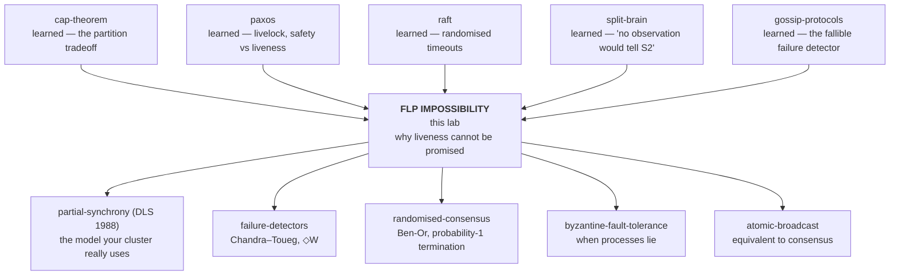

# FLP Impossibility — why no protocol can promise to finish

> **Tell a friend:** Three lighthouse keepers, Ada, Bo and Cy, must tonight
> either all light their beacons or all leave them dark, because a half-lit
> coast wrecks ships. They can only write letters, Omar the ferryman decides how
> long each crossing takes, nobody owns a clock, and any one keeper might quietly
> fall ill. In 1985 three researchers proved that no rulebook can survive a world
> like that. Nothing which always reacts the same way can promise everybody
> agrees, *and* that the answer is one somebody wanted, *and* that the thing ever
> finishes. Asha's payments cluster is those three islands with better lighting.
> That is why nobody can tell her an upper bound on how long her next leader
> election will take.

**Play it while you read.** *The Ferryman's Choice* is `visualization.html` in
this folder, also published at
<https://claude.ai/code/artifact/59306f2a-8884-4ffa-b06c-81faf73ad1d5>. What this
lab is made of, where every number came from, and where it sits among your other
labs, is **section 17, About this lab**.

---

# BEGINNER MODEL — stages 1 to 9

## 1. Why does this lab exist at all?

> **In one breath:** Asha's five machines have to agree on one thing and then
> actually get on with it. This lab is about the second half of that sentence,
> which nobody ever promises her.

Asha runs a payments service across five machines. They have to agree on one
thing: *is this transfer committed, or not?* One answer, the same on every
machine. And the machines have to actually reach it. Not sit there thinking
about it while the customer refreshes the page.

Asha has already built systems that do this. She has a Raft cluster. It works.
So here is the question nobody asked in those labs, the one her colleague Meera
asks over coffee:

> **Is there a protocol that always finishes?**

Not "usually finishes". Not "finishes when the network is fine". *Always*, the
way a sorting algorithm always terminates.

In 1985 three researchers proved the answer is **no**. The proof is so robust
that thirty-odd years of hardware improvement has not dented it. It is not about
slow networks. It is not about bad code. It holds on a perfect network that
loses nothing, with fast machines, and with as many spare replicas as you like.

**What goes wrong if Asha does not know this.** She spends a career hunting a
bug that is a theorem. Her cluster stalls for forty seconds during a leader
election. She writes a postmortem calling it a defect. She tunes a timeout down.
Next month it stalls again for a different reason, and she tunes another one.

Knowing this result tells her which knobs exist, which knobs are lies, and how
to describe the risk honestly to people who need to plan around it.

## 2. Three lighthouses and a ferryman — what must they agree on?

> **In one breath:** Three keepers on three islands must all light their beacons
> or all leave them dark. They can only write letters, and a ferryman who takes
> as long as he likes carries every one.

Three keepers live on three islands. **Ada** on North Rock. **Bo** on Middle
Sands. **Cy** on South Cape. Tonight they must agree on one thing.

> **Light the beacons, or leave them dark.**

Either is a defensible choice. What is *not* defensible is a half-lit coast. A
ship that sees one beacon and not the others reads the gap as clear water, and
puts itself on the rocks. So whatever they do, **all three must do the same
thing**. And they must actually get around to doing it before dawn.

Here are the rules of their world. Every one of them matters later.

1. **They can only write letters.** No island can see another. There is no
   shouting, no flag signal, no shared view of anything.
2. **A ferryman carries every letter, and never loses one.** His name is Omar.
   Not one letter is ever destroyed, misdelivered, or forged. Every letter
   written is eventually handed over.
3. **The sea decides how long he takes.** A crossing might be an hour. It might
   be three weeks. There is no upper limit, and nobody is told which it will be.
   Letters can also overtake each other, because Omar is not obliged to deliver
   in the order they were written.
4. **Nobody owns a working clock.** No keeper can measure elapsed time in any
   way another keeper would agree with.
5. **Any one keeper might fall ill** and simply stop. Mid-sentence, without
   warning, without a farewell note. At most one, though. The other two will
   definitely stay healthy.

Rule 5 is not pessimism. It is the whole reason a *protocol* is needed at all.
If nobody could ever stop, "wait until everyone has spoken" would work fine.

> **🔮 Predict:** *One of those five rules is the one that makes this problem
> unsolvable. If you could repeal exactly one, which would you repeal?*
> <details><summary>Reveal</summary>
> Most people pick <b>rule 5</b> — "a keeper might fall ill" — because failure
> feels like the enemy. It is the wrong answer. Repeal rule 5 and the problem is
> still hard, but repeal <b>rule 3</b> — "the sea decides how long he takes" —
> and it becomes <i>easy</i>: with a known upper bound on crossing time, silence
> past that bound is <b>proof</b> of illness rather than a guess, and majority
> voting works exactly as stage 3 hopes. (Repealing rule 5 alone also works, for
> a duller reason: if nobody can ever stop, you simply wait for everyone.)
> <br><br>
> Hold on to this: <b>the enemy is not failure. The enemy is the missing
> deadline.</b> Everything real systems do about this — election timeouts,
> leases, heartbeat intervals — is an attempt to put rule 3 back, and stage 13
> is about the bill.
> </details>

**Where this lab takes you.** Stop at any checkpoint and you still have
something whole.

| Layer | Stages | After it you can… |
|---|---|---|
| Beginner | 1–9 | tell the story, and say why both answers to "is he dead?" are wrong |
| Intermediate | 10 | rebuild the whole proof from three facts, on paper |
| Engineering | 11–12 | name the sighting, and say which word of the theorem a fix attacks |
| Production | 13 | read a cluster's configuration and say what is buying its liveness |

## 3. What does any sensible person try first?

> **In one breath:** Everyone tells everyone what they want, everyone counts,
> and the majority wins. It is obviously right, and it works perfectly, as long
> as everybody answers.

Ada writes to Bo and Cy: *"I say dark. What do you say?"* She waits for both
replies, counts, and takes the majority. Bo and Cy do the same. Three keepers,
three views, everyone counts the same votes, everyone lands on the same answer.

This is obviously right, and it obviously works. As long as everybody answers.

## 4. Why can Ada never tell "slow" from "dead"?

> **In one breath:** An empty mailbox looks exactly the same whether Bo is dead
> or whether Bo's letter is still at sea. The only difference between those two
> worlds is how long the future takes, and the future has not happened yet.

Ada waits. Nothing comes from Bo.

She has exactly two explanations, and **she cannot tell them apart**.

- **Bo is alive.** He wrote his reply immediately, and Omar's boat is stuck in
  a storm.
- **Bo is dead.** No reply will ever exist.

Ada's evidence in both cases is *identical*: an empty mailbox. There is no
letter she can write. There is no question she can ask. There is no instrument
she can build that separates the two. The only difference between the two worlds
is how long the future is going to take, and the future has not happened yet.

> **Open tab 1 of the visualization, "Slow, or dead?"** Drag Ada's patience. The
> page shows both worlds and what Ada sees in each. You are looking for a slider
> setting that is right in both worlds. There isn't one.

So Ada must pick a deadline. And every deadline is a guess. Read the middle
column as "what Ada does", and the right column as "what it costs her".

| Ada's deadline | What she does | What it costs |
|---|---|---|
| Too short | writes off a living keeper and carries on without him | Bo, alive and well, is also carrying on. Two keepers now run the coast, and their letters cross in the post. This is precisely the `split-brain` lab, and it is where wrong answers come from. |
| Too long | waits, and waits | if Bo really is dead, Ada waits past dawn and the coast stays unlit. Nothing wrong happened, and nothing happened at all. |
| Infinite | waits forever | correct in the storm case, catastrophic in the dead case |

> **🔮 Predict:** *Ada has more paper, more ink, five spare islands, and an
> unlimited budget. Can she buy her way out of this?*
> <details><summary>Reveal</summary>
> No. More islands mean more mailboxes that might be empty for either reason.
> The ambiguity is not caused by a shortage of anything — it is caused by the
> absence of an upper bound on delivery time. You cannot buy an upper bound
> with equipment; you can only <i>assume</i> one, and then live with being
> wrong when the assumption fails. That is exactly what real systems do, and
> stage 13 is about paying for it.
> </details>

**The naive solution didn't merely fail. It revealed that the thing it needed,
"know who is dead", is not obtainable.**

## 5. What exactly are we asking for?

> **In one breath:** Everybody writes the same answer. The answer is one
> somebody actually wanted. And everybody healthy writes *something*. Those
> three together are called consensus.

Strip the story away for one moment. Each keeper starts with a preference,
light or dark. Each must eventually write one final, unchangeable answer on a
slate. Three properties, in plain words.

| Property | Plain words | Why you'd want it |
|---|---|---|
| **Agreement** | No two keepers write different answers. | A half-lit coast wrecks ships. |
| **Validity** | The answer is one somebody actually wanted, not invented. | A protocol that always answers "dark" satisfies agreement and is useless. |
| **Termination** | Every healthy keeper eventually writes *something*. | An answer after dawn is not an answer. |

Together these three are called **consensus**.

Agreement and Validity are *safety* properties. They are promises that nothing
bad ever happens. Termination is a *liveness* property. It is a promise that
something good eventually happens. You met that distinction in the `paxos` lab.
It is about to become the most important distinction in this one.

And the failure model, stated precisely: **at most one keeper may crash**. Stop
working permanently, at any moment, with no announcement. Not lie. Not forge
letters. Not come back. Just stop.

> **This is the target.** All three properties. Always. With one possible crash.
> With no clock.

**And it is unachievable.** That is the theorem.

> **🔮 Predict:** *Every real consensus system you have ever used ships without
> one of these three. Which one did they give up, and did they tell you?*
> <details><summary>Reveal</summary>
> They gave up <b>Termination</b> — and mostly they did tell you, in a sentence
> you skipped. etcd, ZooKeeper and Spanner all keep Agreement and Validity
> unconditionally, and offer finishing only <i>while the network behaves</i>.
> If you said Validity, you were thinking of systems that invent a default
> answer on timeout; those exist, but they are not consensus, they are giving
> up. If you said Agreement, you were thinking of eventual consistency, which
> is a different product with a different promise (your <code>cap-theorem</code>
> and <code>pacelc</code> labs). Stage 12.5 states the trade in one line.
> </details>

---

## 6. Why is breaking one protocol worth nothing?

> **In one breath:** Show that a protocol fails and somebody says "then use a
> better one". So the proof stops talking about protocols altogether and talks
> about *situations* instead.

Here is the trap a smart person falls into first. It is worth naming, because it
is where most people's understanding stops.

Asha's colleague Ben tries it. **The wrong move: find a protocol and break it.**
Show that majority voting fails. Show that Paxos can livelock. Show that Raft
can split-vote. All three are true, and all three are worthless as an argument.
For every broken protocol somebody will say *"then use a better one"*, and they
might be right. Breaking a thousand protocols says nothing about the
thousand-and-first.

**The right move: stop talking about protocols, and start talking about
situations.** Fischer, Lynch and Paterson's insight is to reason about the
*state of the whole world*. Everything every keeper knows, plus every letter
currently at sea. And then to ask one question of it:

> *From here, which final answers are still possible?*

Some situations have both answers still live. Others have already been forced
one way, even if nobody on the islands knows it yet. The entire proof is one
observation about how these two kinds of situation relate:

> **From any situation where both answers are still possible, there is always a
> next event that leaves both answers still possible.**

If that is true, Omar never has to let anyone finish. He steps from undecided
situation to undecided situation forever. And he does it **without losing a
single letter and without ignoring a single keeper.**

This works against *any* protocol, because the argument never mentions what the
protocol does. That is what makes it a theorem rather than a bug report. Ben's
objection is answered before he makes it.

## 7. Which words do you need, now that you have earned them?

> **In one breath:** Nine words carry this lab. You have already felt all nine
> of them happen to Ada, Bo and Cy. Now they get their real names.

Each word below is a thing that has already happened in the story. Read the
paragraph, then the tables at the end of the section, which map every word back
to the moment you met it.

### What does "asynchronous" actually rule out?

An **asynchronous system** is a world with no upper limit on how long anything
takes. That is Omar exactly. A crossing may take an hour or three weeks, and no
keeper is told which.

Said precisely: there is no bound on message delivery delay, no bound on the
relative speed of processes, and no synchronised clocks.

The word exists to separate this world from a **synchronous** one, where known
bounds exist. In a synchronous world, a timeout that expires is *proof* of a
crash. In an asynchronous world, a timeout that expires is proof of nothing at
all. That is the whole of stage 4 in one sentence.

Be careful about what this claims. It is *not* a claim that real networks are
this bad. It is a claim about what you may safely *assume*. Asha's production
network becomes asynchronous every time a garbage-collection pause, a saturated
link, or a busy disk makes a bound she believed in stop holding.

### Why does FLP assume the gentlest failure it can?

A **crash failure** is a machine stopping, forever, without warning. Bo dies in
the night. Half a letter on his desk, and nothing more.

Said precisely: a process takes only finitely many steps in an infinite run.

The word exists to fence off much nastier failure models. A crashed process does
not send wrong data. It does not forge messages. It does not come back with
corrupted state. FLP assumes the *mildest possible* failure, and that is exactly
what makes the impossibility so striking.

You have seen this in the wild. The `gossip-protocols` lab called the failure
detector *a fallible component*, and ran a 100-node cluster where every node
wrote off every other node with zero actual crashes. That was this problem,
happening to real machines.

### What is the smallest thing that can happen, and where does a timeout hide?

A **step** is the smallest thing that can happen: one keeper reads her mailbox
once and reacts.

Said precisely, a step of process *p* is three things in a row. First, `receive`
returns either a message *m* addressed to *p* or **nothing**. Second, *p* updates
its state as a function of its old state and what it received. Third, *p* sends
a finite set of messages. In symbols the first part is written `receive(p)`. The
pair *(p, m)*, meaning this process receiving this message, is called an
**event**.

Now the part that matters most. The "or nothing" branch is called a **null
step**, and it is how a *timeout* lives inside the model. There is no clock in
this world, so a timeout cannot be "when 5 seconds pass". It can only be "a step
in which I looked, there was nothing there, and I decided to act anyway".

**Timeouts are not outside the theorem. They are a case of it.**

In the visualization, the button *"Let Ada give up waiting"* is a null step.
Notice who decides when it happens: **you**, playing Omar. In a world with no
clock, nothing else can. The `raft` lab's election timeout is exactly this, a
null step that promotes a follower to candidate.

> **🔮 Predict:** *Asha argues that her election timeout is a real clock, so it
> sits outside this clockless model. Is she right?*
> <details><summary>Reveal</summary>
> No, and the reason is worth holding on to. Her timeout <i>is</i> a real clock
> reading, but the model does not care what triggered the step — it only cares
> that a process acted on <b>having received nothing</b>. Any rule of the form
> "if I have heard nothing, do X" is a null step, however you implement the
> waiting. If you said "yes, a clock puts her outside FLP", you have found the
> right idea in the wrong place: a clock helps only when it comes with a
> <i>bound she can trust</i>, and that is escape 1 in stage 12.4, not an
> exemption from the theorem.
> </details>

### What is the whole world called, and who is allowed to see it?

A **configuration** is a complete snapshot of the world. Every keeper's internal
state, plus the multiset of every letter that has been sent and not yet
delivered. The visualization calls it a *situation*.

Here is one, written out in full: *Ada has promised attempt 4 and accepted
(1, dark); Bo has promised 7 and accepted nothing; Cy is idle; four letters are
at sea.* That whole sentence is one configuration.

The word exists because the proof needs an object it can label. You cannot say
"this protocol is undecided". You can say "*this configuration* is undecided".

And notice the cruelty in it. A configuration is a global object that no
participant can ever see. Ada sees a projection of it. The theorem reasons about
the whole thing.

### When is Omar playing fair?

A **schedule** is the order Omar chooses: a sequence of events applicable one
after another from a configuration. A **run** is that sequence actually executed.

A run is **admissible** when two things hold. At most one process is faulty. And
every message sent to a non-faulty process is *eventually* delivered.

The word *admissible* exists to close the cheap objection. An adversary who
destroys mail or ignores a keeper proves nothing, because of course that breaks
things. Admissibility is the fairness contract. **The FLP adversary honours it
completely.**

Here is Omar's own scorecard from the long stall you will trace in stage 10.4.
The right-hand column says what each number is evidence of.

| What the 5000-step stall did | Count | What it proves |
|---|---|---|
| letters delivered | 4545 | he was not withholding anything |
| letters lost or destroyed | 0 | rule 2 of the islands was never broken |
| longest a letter waited | 7 steps | "eventually delivered" was honoured, and quickly |
| longest a keeper sat idle | 4 steps | nobody was starved of attention |

This is the sharpest line between FLP and `cap-theorem`. CAP's adversary *takes
the messages away*. FLP's adversary delivers every one of them, and only chooses
the order.

### What would it take for Ada to be unpredictable?

**Deterministic** means the same machine in the same state, given the same
input, always does the same thing. Ada, holding two agreements and a preference
for dark, always proposes dark. She never sometimes proposes light.

Said precisely: each process's transition function is a function. No coin flips.
No randomness. No reading the wall clock.

This word is load-bearing, and it is one of the four you are allowed to attack.
A protocol that flips a coin is outside FLP's scope entirely.

Keep one warning in your pocket. The `raft` lab's randomised election timeouts
*look* like an attack on this word. Stage 12.4 shows they are mostly not, and
puts a number on it.

### Which endings are still on the table? (bivalent and univalent)

This is the word the proof is built out of, so it gets the most room. The plain
question it answers is: *"which endings are still possible from here?"*

A configuration is **0-valent** if every reachable decision from it is 0. It is
**1-valent** if every reachable decision is 1. It is **bivalent** if both are
still reachable. 0-valent and 1-valent together are called **univalent**, which
means the ending is settled even if nobody knows it yet.

The word exists to separate two things that sound the same and are not:

- *"Nobody has decided yet."*
- *"The outcome is not yet determined."*

A configuration can have zero decisions written down and still be univalent. The
outcome is already sealed, and the keepers simply have not caught up. **Bivalent
is the strictly stronger statement: the future is genuinely open.**

Two starting situations, and what the page finds when you ask it to search the
delivery orders:

| Starting wishes | What the orders end in | What that makes the start |
|---|---|---|
| Ada dark, Bo light, Cy light | one order ends in **dark**, another ends in **light** | bivalent, because same keepers, same protocol, same wishes, only Omar's order differs |
| all three want dark | every order ends in **dark** | univalent, because Validity forbids inventing an answer nobody wanted |

The visualization draws a not-yet-decided lamp as **half dark, half lit**. That
split lamp is bivalence, on screen.

### Which promise can only ever be broken by a run that never ends?

You have **safety** and **liveness** from `paxos`. Safety means nothing bad ever
happens, which here is Agreement and Validity. Liveness means something good
eventually happens, which here is Termination.

The thing worth re-noticing is how you catch each one breaking. Safety can be
checked by looking at any finite prefix of a run. Liveness can only ever be
violated by an *infinite* run.

That is why the theorem's counterexample is an infinite run. And it is why "it
hasn't finished yet" is never proof that it never will.

### What world does Asha's cluster actually live in?

**Partial synchrony** is the honest middle: the network behaves *most* of the
time, and you don't know when.

Said precisely, and this is Dwork, Lynch and Stockmeyer, 1988: bounds on delay
and process speed exist, but are unknown. Or they are known, and only start
holding after some unknown moment. That moment is called the **Global
Stabilization Time**, usually written GST.

The word exists because "synchronous" is a lie about real networks, and
"asynchronous" is too pessimistic to build on. Partial synchrony is what every
production consensus system actually assumes, Asha's included.

Give Omar a deadline and he loses. Here is what tab 4 shows, and the right-hand
column is the point.

| Omar's delivery deadline | The keepers settle | What it cost |
|---|---|---|
| Δ = 4 steps per letter | on step 23, on their **first** attempt | almost nothing |
| Δ = 25 steps per letter | on step 63, still the first attempt | a looser bound is pure latency |
| no deadline at all | never: 5000 steps and counting | this is the world the theorem lives in |

Asha's `raft` cluster is a partially synchronous system, and its Δ is a hope she
maintains with monitoring. Stage 13 is about the bill.

### Where did each of the nine words come from?

Three small maps back to the story. The third column names the moment you felt
the thing, before it had a name.

**The world the keepers live in.**

| Word | In plain words | Where you felt it |
|---|---|---|
| **Asynchronous** | no upper limit on how long anything takes | rule 3 of the islands, stage 2 |
| **Crash failure** | a keeper stops for good, mid-sentence | rule 5 of the islands, stage 2 |
| **Deterministic** | same state, same input, same behaviour, always | Ada never changing her mind on a whim, this stage |
| **Partial synchrony** | the sea behaves most of the time, and you don't know when | the Δ = 4 row above, and every real cluster in stage 13 |

**The moving parts the proof handles.**

| Word | In plain words | Where you felt it |
|---|---|---|
| **Step** | one keeper reads her mailbox once and reacts | every numbered line of the traces in stage 10 |
| **Null step** | she looked, found nothing, and acted anyway | *"Let Ada give up waiting"* in tab 2 |
| **Configuration** | the whole world right now, including letters at sea | the four-letters-at-sea sentence above |
| **Schedule** | the order Omar picks | his stalling rule in stage 10.3 |
| **Admissible** | he lost nothing and ignored nobody | the scorecard above, 4545 letters delivered |

**The words for what is still possible.**

| Word | In plain words | Where you felt it |
|---|---|---|
| **Bivalent** | both endings are still reachable | the half-lit lamp in tab 2 |
| **Univalent** | the ending is sealed, and nobody knows yet | the all-three-want-dark row above |
| **Safety** | nothing bad ever happens | Agreement and Validity, stage 5 |
| **Liveness** | something good eventually happens | Termination, stage 5, and everything after |

---

## 8. Which two pictures should you carry, and where does the friendly one lie?

> **In one breath:** Picture one is a patient ferryman who never cheats. Picture
> two is a walker on a graph of situations, who always has a bivalent step
> available. They are the same picture, and one of them is easier to remember.

### What does the friendly picture get right?

Three keepers, letters, and a ferryman who is not malicious but is *unlucky in
exactly the worst way*. Omar never destroys mail. He never refuses a crossing.
He only ever chooses **which letter to hand over next**. That alone is enough to
keep Ada, Bo and Cy talking forever.

### What does the engineer draw instead?

The world is a directed graph. Nodes are configurations. Edges are events. Each
node carries a hidden label: 0-valent, 1-valent, or bivalent.

The adversary is a walker. He starts on a bivalent node. At every move he has
*some* edge leading to another bivalent node. A decided configuration is never
bivalent. So the walker never steps onto one.

### How do the two pictures line up?

Three short maps. Read them left to right: the thing in the story, then the
thing in the model.

**The keepers themselves.**

| In the story | In the engineering model |
|---|---|
| a keeper | a process |
| what a keeper wants (light / dark) | the process's input value, 0 or 1 |
| what's on a keeper's slate | the process's decision, or ⊥ if none |
| a keeper falling ill | a **crash failure** |

**The world and the post.**

| In the story | In the engineering model |
|---|---|
| the whole world right now | a **configuration** |
| a letter at sea | a message in the buffer |
| the ferryman handing over one letter | an **event** *(p, m)* |
| a keeper giving up waiting | a **null step**, where `receive` returns nothing |
| the ferryman's chosen order | a **schedule** |

**Fairness, and what is still possible.**

| In the story | In the engineering model |
|---|---|
| never losing mail, never ignoring an island | an **admissible** run |
| both endings still possible | **bivalent** |
| the ending already sealed | **univalent** |
| the sea's unbounded whim | **asynchrony** |

### Where does the story lie to you?

Read these five before you repeat the lighthouse story to anyone.

**Lie 1. Omar is not real, and your network is not malicious.** He is a proof
device. His job is to demonstrate that a bad run *exists*, not to predict what
Asha's Tuesday looks like. In practice the "adversary" is a garbage collector, a
saturated network card, or a noisy neighbour on a shared host. Indifferent, not
hostile. Indifferent is enough, because the theorem only needs the run to be
possible.

**Lie 2. The story makes crashing feel central. It isn't.** In the run the proof
builds, **nobody actually crashes.** Ada, Bo and Cy all work the whole time. What
matters is that the protocol must be *willing* to carry on without any one of
them, and that willingness is the door Omar walks through. This is the point most
summaries of FLP get wrong.

**Lie 3. "Three keepers" suggests small numbers matter.** They don't. The result
holds for any number of processes, and only needs *one* possible crash. Adding
replicas does not help even slightly. Dev suggests it in stage 11, and it does
not work.

**Lie 4. The story has a dawn deadline. The model has no time at all.** "Before
dawn" is a synchrony assumption smuggled in by the narrative. In the real model
there is no dawn, no clock, and no meaning to "too late". There is only
"eventually" and "never".

**Lie 5. A ferryman "choosing" implies he sees the future.** The FLP adversary is
adaptive, in that it decides each next event knowing the current configuration.
But it does not need to read the protocol's source code at runtime. The proof
shows a suitable choice always *exists*. It does not require anyone to compute
it.

---

## 9. What should you open, and in what order?

> **In one breath:** Four tabs. The first shows you the ambiguity, the second
> lets you be the adversary, the third proves he always wins, and the fourth
> shows you how to beat him and what it costs.

*The Ferryman's Choice* lives at
<https://claude.ai/code/artifact/59306f2a-8884-4ffa-b06c-81faf73ad1d5>, and also
as `visualization.html` in this directory, which works offline.

Four tabs, in the order the story needs them.

1. **Slow, or dead?** is the foundation from stage 4. Move Ada's patience slider
   and hunt for a value that is right in both worlds. Two minutes.
2. **Play the ferryman** is the main event. Click letters to deliver them. Click
   *"Let X give up waiting"* to make a keeper time out. Then press **"Ferryman
   plays to stall ×40"** a few times, and *watch the fairness audit on the right
   while you do it*. That panel is the whole lesson: letters lost 0, longest a
   letter waited 7 steps, longest any keeper sat idle 4 steps, and nothing
   decided, on attempt 682.
3. **Why the ferryman always wins** is the proof, computed live on the real
   keepers. Three facts, each checkable on screen.
4. **The four escapes** lets you turn on a delivery deadline, random waiting
   times, or a leadership oracle, and watch Omar lose. Press **"Run all nine
   combinations"** for the summary table.

**A signpost for tab 2, because it is easy to look at the wrong thing.** Don't
watch the lamps. They never change. Watch the **attempt number** climbing in the
verdict box, and the **fairness audit numbers staying small**. The story is that
those two things are true *at the same time*.

> **✅ CHECKPOINT — end of the beginner model.**
> You can now explain why "wait for a reply" and "give up after a timeout" are
> the only two options, why both are wrong, and what it means for a situation to
> have both endings still open. That is enough to read a postmortem and know
> what kind of thing you are looking at.
> **Next:** the actual mechanism, meaning how Omar decides what to hand over,
> and why the argument covers protocols nobody has written yet.

> **Say it back.** Without using the words *asynchronous*, *timeout* or
> *bivalent*, explain to Meera why Ada cannot find a waiting time that is right
> in both worlds.
> <details><summary>A good answer sounds like</summary>
> "An empty mailbox means one of two things, and they look identical. Either
> Bo's letter is still on the boat, or Bo is dead and there is no letter. The
> only thing that would tell them apart is how long the boat is going to take,
> and nobody, including the sea, has decided that yet. So any waiting time Ada
> picks is a bet. If she waits too little, she starts a second, conflicting
> effort with a keeper who is perfectly alive. If she waits too long and he
> really is dead, dawn comes and the coast is dark."
> </details>

---

# INTERMEDIATE MODEL — stage 10

## 10. How does Omar stall a real protocol, and why can nobody stop him?

> **In one breath:** First watch him beat one specific protocol by never letting
> two islands accept the same attempt. Then watch the 1985 proof do the same
> thing to every protocol at once, without ever naming one.

### 10.1 What protocol are the keepers running?

To watch a stall you need something to stall. Ada, Bo and Cy run
**single-decree Paxos with attempt numbers handed out in rotation**. That is the
`paxos` lab's protocol with one change: attempt numbers are assigned round-robin
instead of being picked freely. Ada owns 1, 4, 7 and so on. Bo owns 2, 5, 8. Cy
owns 3, 6, 9.

Here it is as five things a keeper does. You know it already, so this is a
refresher.

1. A keeper who has been waiting decides to try. She picks her next **attempt
   number** and writes a request for a turn to all three islands, including
   herself.
2. A keeper receiving that request checks the number. If it is higher than any
   attempt she has promised, she promises it, and replies with an agreement that
   reports the last value she accepted, if any. **If it is not higher, she says
   nothing at all.**
3. With agreements from a majority, which here means 2 of 3, the proposer picks
   the value. If any agreement reported an earlier acceptance, she is **forced**
   to re-propose that value. Otherwise she proposes her own preference. She
   writes a proposal to all.
4. A keeper receiving a proposal accepts it if its attempt number is at least
   her promised attempt, and replies with an acknowledgement. Otherwise,
   **silence**.
5. With acknowledgements from a majority, the proposer **decides** the value and
   writes the verdict to the others.

Five kinds of letter go in Omar's satchel. Read the middle column as what the
letter actually says out loud, and the right column as the shorthand you will
see in the traces.

| The letter | What it says in words | Written as |
|---|---|---|
| a request for a turn | "I am starting attempt *n*. Promise me you will honour nothing lower, and tell me what you have already written down." | `PREPARE(n)` |
| an agreement | "Attempt *n* is yours. Here is the last thing I accepted, if there was one." | `PROMISE(n, …)` |
| a proposal | "Under attempt *n*, write down this value." | `ACCEPT(n, v)` |
| an acknowledgement | "Done. I have written it down under attempt *n*." | `ACCEPTED(n)` |
| the verdict | "It is settled. The answer is this value." | `DECIDE(v)` |

Two things are worth noticing, because both matter later.

**Refusal and death look the same.** In steps 2 and 4 a keeper who refuses just
doesn't reply. That is a simplification in this lab, because real Paxos usually
sends a negative acknowledgement. It happens to make the lesson louder. From the
proposer's side, *"she refused me"* and *"she is dead"* produce the identical
observation. An empty mailbox, again.

**Safety here is already proved, and does not depend on timing.** The `paxos`
lab established the quorum-overlap argument: any two majorities share a member,
and that member's memory forces every later attempt to re-propose an
already-chosen value. Nothing in that argument mentions delays. This lab ran the
check again anyway, and the right-hand column is why it is worth reporting.

| The safety soak | Count | What it means |
|---|---|---|
| random delivery orders driven through the protocol | 500 | enough shuffling to find an ordering bug if one existed |
| of those, orders run with a keeper crashed | 1 in 3 | crash and delay together, not one at a time |
| Agreement violations found | 0 | safety is not what breaks here |

So for the rest of this lab, *safety is not in question*. Only finishing is.

### 10.2 What does a fair crossing look like, step by step?

Ada wants **dark**. Bo and Cy want **light**. Omar behaves himself and simply
delivers the oldest letter first. Read the trace as one line per step, with the
letters he creates shown after the arrow.

```
 1  Ada gives up waiting → PREPARE(1) to Ada, Bo, Cy
 2  Ada reaches her own request, promises 1     → PROMISE(1, accepted:none) → Ada
 3  Bo  promises 1                              → PROMISE(1, accepted:none) → Ada
 4  Cy  promises 1                              → PROMISE(1, accepted:none) → Ada
 5  Ada has 1 of the 2 agreements she needs
 6  Ada has 2 → names her own preference DARK   → ACCEPT(1, DARK) to all three
 7  Cy's agreement arrives late; Ada has moved on; ignored
 8  Ada accepts (1, DARK)                       → ACCEPTED(1) → Ada
 9  Bo  accepts (1, DARK)                       → ACCEPTED(1) → Ada
10  Cy  accepts (1, DARK)                       → ACCEPTED(1) → Ada
11  Ada has 1 of the 2 acceptances she needs
12  Ada has 2 → DECIDES DARK                    → DECIDE(DARK) to Bo, Cy
13  a third acceptance arrives; already settled; changes nothing
14  Bo learns DARK and writes it on his slate
15  Cy learns DARK and writes it on his slate
```

**Settled at step 15. The longest any letter waited was 4 steps.**

Notice that the answer is *dark* even though two of the three keepers wanted
light. Validity only requires the answer to be *somebody's* preference, and Ada
got there first. That is correct behaviour, not a bug.

### 10.3 Why doesn't Omar simply hide the dangerous letter?

Look at step 11 above. Ada has one acknowledgement and needs two. **One letter
stands between this world and a settled answer.**

> **🔮 Predict:** *Omar wants to stop this. His first idea is simply not to
> deliver that letter. Does it work?*
> <details><summary>Reveal</summary>
> No — it only postpones. The fairness contract says every letter must be
> delivered <i>eventually</i>. He can hold it for a thousand steps, but the
> moment he hands it over the matter is settled, and he must hand it over. He
> has bought time, not a result. To win he needs the letter to be
> <b>harmless</b> when it arrives, not merely late.
> </details>

**That is the whole refinement**, and it is the sentence to carry into the proof.
Omar does not need to withhold the dangerous letter. He needs to arrange, *before*
delivering it, that the keeper receiving it will **refuse** it. Then he can hand
it over with a clear conscience, fairness intact, and nothing happens.

He has exactly one tool for that. Attempt numbers. A keeper who has promised a
higher attempt refuses a lower one. So:

> **Omar's rule.** *Never let two islands accept the same attempt.* Whenever a
> proposal is about to reach a second island, first deliver that island a request
> for a turn at a higher attempt. If no such letter exists, let some other keeper
> give up waiting, which manufactures one.

Every attempt therefore collects at most one acknowledgement, never a majority,
and nobody ever decides.

### 10.4 What does the stall look like, step by step?

Same starting preferences. Now Omar plays the rule above. Here are the first 22
steps, with his two decision points marked by the dividing lines.

```
 1  Ada gives up waiting → PREPARE(1) to all
 2  Ada promises 1                        → PROMISE(1, none) → Ada
 3  Bo  promises 1                        → PROMISE(1, none) → Ada
 4  Cy  promises 1                        → PROMISE(1, none) → Ada
 5  Ada has 1 of 2 agreements
 6  Ada has 2 → ACCEPT(1, DARK) to all three
 7  a late agreement, ignored
 8  Ada accepts (1, DARK)                 ← attempt 1 now has ONE acceptance
 ─────  the ferryman sees the danger: two more ACCEPT(1) letters are at sea  ─────
 9  the ferryman lets BO give up waiting  → PREPARE(2) to all
10  Bo  promises 2
11  Cy  promises 2                        ← Bo and Cy are now above attempt 1
12  ACCEPT(1, DARK) reaches Bo → REFUSED (Bo promised 2). Silence.
13  ACCEPT(1, DARK) reaches Cy → REFUSED (Cy promised 2). Silence.
14  Ada's own ACCEPTED(1) arrives: she has 1 of 2, and will never get a second
15  Ada promises 2, reporting she accepted (1, DARK)
16  Bo has 1 of 2 agreements for attempt 2
17  Bo has 2 → ACCEPT(2, LIGHT) to all three
18  a late agreement, ignored
19  Ada accepts (2, LIGHT)                ← attempt 2 now has ONE acceptance
 ─────  same danger, same answer  ─────
20  the ferryman lets ADA give up waiting → PREPARE(4) to all
21  Bo  promises 4
22  Cy  promises 4                        ← attempt 2 is now dead too
```

Steps 8 to 13 and steps 19 to 22 are the same move, and it repeats forever.
**This is precisely the duelling-proposers livelock from your `paxos` lab.**
There it looked like bad luck. Here you can see it is a *strategy*, one that a
scheduler with no special powers can execute deliberately, on demand, forever.

Now run it long. Press "Ferryman plays to stall" in tab 2 until the step counter
reaches five thousand, and read the fairness audit next to the verdict box.

| After 5000 steps of Omar stalling | Count | What the number means |
|---|---|---|
| keepers who decided anything | **0** | Termination is dead |
| attempt number reached | **682** | enormous activity, zero progress |
| letters delivered | **4545** | he delivered constantly |
| letters lost or destroyed | **0** | he never broke rule 2 of the islands |
| longest any letter waited | **7 steps** | "eventually" was honoured, and generously |
| longest any keeper sat idle | **4 steps** | nobody was ignored |
| keepers who fell ill | **0** | no crash was needed to do this |
| Agreement violations | **0** | safety never wobbled |

Read that table twice. Nothing was lost. Nobody was ignored. Nobody died.
Nothing went wrong. And nothing happened.

### 10.5 That beat one protocol. How do you beat every protocol at once?

Everything above beats *this* protocol. Ben's answer is the reasonable one:
*"then fix the protocol."* The 1985 proof closes that door for good. It rests on
three facts, and it mentions no protocol at all.

Read the three facts as three questions Omar might ask on the quayside.

- *Is there any morning where the ending is genuinely still open?* Fact A.
- *Does it matter which island I visit first?* Fact B.
- *Can I always make a dangerous letter boring before I deliver it?* Fact C.

Yes, no, and yes. Those three answers are the whole theorem.

#### Fact A — is any starting morning genuinely undecided?

Suppose Meera claims the opposite: that every morning is already settled before
a single letter is written. Try to build her world and watch it break.

Line up the possible mornings so that each one differs from the next in
**exactly one keeper's wish**. Start with all three wanting dark. End with all
three wanting light. Change one mind at a time.

```
 D D D        L D D        L L D        L L L
 only DARK      ?            ?         only LIGHT
```

Validity nails down the two ends. If everyone wants dark, dark is the only
answer allowed. If everyone wants light, light is. So walking from the left end
to the right end, you begin at a dark-only morning and finish at a light-only
one. **Somewhere along that line, two neighbours must have different endings.**
Call them C₀ (dark-only) and C₁ (light-only). They differ only in what one
keeper *p* wants.

Now use the one thing every protocol here must survive: a keeper falling ill.

Take the morning C₀, and consider the run in which *p* never gets out of bed.
Not one step. That run is legal, because the protocol must cope with one crash.
The other two keepers must still finish. By assumption they finish dark.

Now run *the exact same story* from C₁. In C₁, *p* takes no steps either. And
*p*'s wish is the only difference between the two mornings. The other two never
heard it. **They cannot tell which morning they are in.** So they behave
identically, letter for letter, and they finish dark in C₁ too.

But C₁ was supposed to be a morning that can only end light. Contradiction. So
Meera's world does not exist. **Some starting point is bivalent.** ∎

That is the proof. Written the way papers write it, it goes in four moves. Line
up the initial configurations in a chain, each differing from the next in one
input. Use Validity to fix the valency of the two endpoints. Take adjacent C₀
and C₁ of opposite valency, differing at process *p*. Apply a *p*-free run to
both: indistinguishability at the surviving processes forces the same decision,
which contradicts opposite valency.

Tab 3, Fact 2 runs this on the real keepers. Press it and compare the two rows.

| The world you ask for | What Bo and Cy do | Why it matters |
|---|---|---|
| Ada silent from step 0, Ada wanted **dark** | settle on **light**, at step 10 | her wish never reached anyone |
| Ada silent from step 0, Ada wanted **light** | settle on **light**, at step 10, after the same letters | the two worlds are indistinguishable to the survivors |

> **🔮 Predict:** *That argument used a crash. In the infinite run the theorem
> eventually builds, how many keepers actually fall ill?*
> <details><summary>Reveal</summary>
> <b>None.</b> The crash appears only inside the <i>argument</i>, as a
> hypothetical run used to prove two starting points are indistinguishable. The
> run the theorem constructs has every keeper healthy and working the whole
> time. What the theorem needs is not a crash — it is that the protocol must be
> <b>willing to proceed without any one keeper</b>. That willingness is the
> vulnerability. A protocol that refused to tolerate any crash could wait for
> everyone and would be immune to FLP — and would also stop dead the first time
> a machine rebooted.
> </details>

#### Fact B — does it matter which island Omar visits first?

Omar has two letters in his satchel. One is for Ada. One is for Bo. He can
deliver either first. Does the choice change anything?

No, and the reason is almost embarrassingly simple. Ada opening her post cannot
change one word in Bo's cottage. **Nothing in this world touches a keeper except
a letter placed in that keeper's own hand.** Ada's step changes Ada's notebook
and drops new letters into the sea. Bo's step changes Bo's notebook and drops
new letters into the sea. Neither reaches across.

So the two visits never interfere. Deliver Ada's letter then Bo's, or Bo's then
Ada's, and both cottages end up identical, with the same letters still at sea.
Order is invisible.

That paragraph is the proof. Written the way papers write it: let event *e*
happen at keeper *p*, and event *e′* at a different keeper *q*. Then applying
*e* then *e′* yields exactly the configuration you get by applying *e′* then
*e*. The two events **commute**.

Tab 3, Fact 3 has a button labelled "Check every such pair across 30 situations".
Press it and read the three rows.

| What the checker tried | Result | What it tells you |
|---|---|---|
| swaps of two events at **different** islands | 133 of 133 came out byte-for-byte identical | Fact B holds, with zero exceptions |
| swaps of two events at the **same** island | 5 pairs came out different | order genuinely matters there, and only there |
| a worked instance, at step 6 | `PROMISE(1) Bo→Ada` and `ACCEPT(1,DARK) Ada→Bo` | deliver in either order, and every keeper's state and every letter at sea come out identical |

**A note on how this was checked, because it is a nice trap.** An earlier version
of this lab's simulator got Fact B **wrong**: 38 of 142 different-island swaps
came out different. The cause was one line. A keeper computing her next attempt
number read a *global* variable holding the highest attempt anyone had ever
started. A real island cannot read a global variable. Once each keeper computed
her next attempt from **what she herself had seen**, the exceptions vanished
completely.

So the lemma is not just true. It is *diagnostic*. A violation means you have
accidentally let a process see something nobody sent it.

#### Fact C — can a dangerous letter always be made harmless first?

This is the heart of it, and it is the one worth reading slowly.

In plain words: **you can always let the annoying event happen. Just not yet,
and not before you have arranged for it to be harmless.** That is exactly Omar's
refinement from stage 10.3, promoted from a trick against one protocol to a fact
about all of them.

Stated properly: let C be a situation where both endings are still open, and let
*e* be any single pending event in it. Then there is a schedule from C, ending
with *e*, whose final situation still has both endings open.

Try to imagine it failing, and watch it break. Suppose Omar is stuck. There is
some pending letter *e* such that no matter what he arranges first, the moment
*e* lands the ending is sealed.

Give the two piles names. Let 𝒞 be every situation Omar can reach from C
*without* delivering *e*. Let 𝒟 be what you get by delivering *e* to each of
them. Omar being stuck means **every situation in 𝒟 is univalent**.

*Step 1: 𝒟 contains both a dark-only and a light-only situation.* C is bivalent,
so some run from C ends in dark. Either that run never used *e*, in which case
delivering *e* at the end gives a dark-only member of 𝒟. Or it used *e*
somewhere, and the situation right after *e* is itself a dark-only member of 𝒟.
Either way, 𝒟 has a dark-only member. The same argument gives a light-only one.

*Step 2: two of them are only one step apart.* Everything in 𝒞 is reachable from
C, so you can walk from one witness to the other. Somewhere on that walk the
label flips across a single edge. That gives you C₀ and C₁ in 𝒞 with
**C₁ = e′(C₀)** for one event *e′*, where delivering *e* to C₀ gives a dark-only
D₀, and delivering *e* to C₁ gives a light-only D₁.

Now there are exactly two cases, and Omar's two facts handle one each.

> **🔮 Predict:** *Case one is when e′ lands on a different keeper than e, and
> Fact B settles it in a line. Case two is when both land on the same keeper, so
> swapping is not available. Which tool is left?*
> <details><summary>Reveal</summary>
> <b>Crash tolerance</b> — the same tool Fact A used, and the only other thing
> the proof is allowed to assume. If both events land on keeper <i>p</i>, you
> silence <i>p</i> entirely and let the other two finish, which they must. If
> you said "a third fact" or "something about attempt numbers", notice that the
> proof has never mentioned attempt numbers and never will: it does not know
> what protocol it is arguing about.
> </details>

*Case one: e′ happens at a different keeper than e.* Then by **Fact B** they
commute, so

```
D₁ = e(e′(C₀)) = e′(e(C₀)) = e′(D₀)
```

D₁ is reachable from D₀ in a single step. But D₀ is dark-only, so everything
reachable from it is dark-only. And D₁ is light-only. Contradiction.

*Case two: e′ happens at the same keeper p as e.* Now use **crash tolerance**,
exactly as in Fact A. From C₀, let *p* go completely silent. The other keepers
must still finish, so there is a finite run σ from C₀ containing **no steps by
p**, which reaches a situation A where somebody has decided. Because σ contains
no steps by *p*, it commutes with both *e* and *e′*. So:

```
e(A)        = e(σ(C₀))        = σ(e(C₀))        = σ(D₀)   → dark-only
e(e′(A))    = e(e′(σ(C₀)))    = σ(e(e′(C₀)))    = σ(D₁)   → light-only
```

From A you can reach a dark-only situation and a light-only situation. So **A is
bivalent**. But A is a situation in which somebody has already decided, which
makes it univalent. Contradiction.

Both cases are impossible, so the assumption was wrong. **A bivalent next move
always exists.** ∎

#### The theorem — what do the three facts add up to?

Start at a bivalent initial situation, which Fact A says exists. Then repeat
forever:

> Take the keeper who has gone longest without a step, and the oldest letter
> addressed to them. If their mailbox is empty, take a null step instead. Call
> that event *e*. By **Fact C**, there is a schedule ending in *e* that leaves
> the world still bivalent. Run it.

Two things are now true at the same time, and their coexistence is the whole
result.

- **The run is admissible.** Every letter eventually becomes the oldest one
  addressed to the longest-idle keeper, so every letter is delivered. Every
  keeper takes infinitely many steps. Nobody is starved. No letter is lost. No
  keeper crashes.
- **Every situation in the run is bivalent**, and a situation in which somebody
  has decided is never bivalent. So **nobody ever decides.**

Termination is violated, in an admissible run, by a protocol that was assumed to
guarantee it. Therefore no such protocol exists. ∎

*Fischer, Lynch & Paterson, "Impossibility of Distributed Consensus with One
Faulty Process", Journal of the ACM 32(2), 1985. It won the Dijkstra Prize in
2001.*

> **✅ CHECKPOINT — end of the intermediate model.**
> You can now reconstruct the proof from three facts: some start is genuinely
> open; steps at different machines commute; and a bivalent situation always has
> a bivalent next move. You can also explain why the argument covers protocols
> nobody has written yet.
> **Next:** what this looks like on a Tuesday afternoon in production, and
> exactly which guarantee bends in each case.

> **Say it back.** Without using the words *bivalent*, *commute* or
> *configuration*, tell Ben why "then fix the protocol" is not an answer.
> <details><summary>A good answer sounds like</summary>
> "The argument never looks at the protocol. It only looks at the state of the
> whole world, and asks whether both endings are still possible from here. Start
> somewhere both endings are still possible — one such morning always exists,
> because otherwise silencing one keeper would make two different mornings
> behave identically and end differently. From any such moment, the ferryman can
> always pick a next delivery that keeps both endings possible. So he walks from
> open world to open world forever, delivering everything and ignoring nobody.
> Whatever rules you write, they are being walked past, not attacked."
> </details>

---

# ENGINEERING MODEL — stages 11 and 12

## 11. Where does the theorem show up on a Tuesday?

> **In one breath:** The theorem has no failure modes of its own. It has
> *sightings*: moments when a real cluster briefly re-enters tab 2 and stops
> finishing things while every dashboard stays green.

A protocol has bugs. A theorem does not. What this theorem has are **sightings**,
which are situations where a real system briefly re-enters the world of tab 2 and
stops finishing things. Here are the eight worth recognising on sight. Asha and
her team have hit every one.

**Sighting 1 · Duelling proposers, also called election livelock.** Two of Asha's
nodes have retry timers that keep firing just before the other one completes.
Every attempt reaches one acceptance and then dies to a higher attempt. The
attempt counter climbs without limit. This is exactly the trace in stage 10.4,
and there is no response available from inside the protocol, because this *is*
the FLP run. Raft's randomised election timeouts and Paxos's stable-leader
optimisation exist to make it self-correcting, not to prevent it.

**Sighting 2 · The garbage collector as the adversary.** Arjun's leader node
takes a stop-the-world pause longer than the failure-detection timeout. The
leader is frozen. Followers see silence and start an election. Then the old
leader wakes up believing it is still leader. A frozen process and a dead process
emit identical evidence, which is stage 4 happening in a machine room. The old
leader discovers a higher term and steps down, so Agreement survives. This is why
`broadcastTime ≪ electionTimeout ≪ MTBF` is a rule and not a suggestion.

**Sighting 3 · The failure detector that is confidently wrong.** Meera's cluster
hits packet loss that outlasts her timeout. Healthy nodes are evicted. Quorum is
lost. The cluster stops. Her failure detector is a timeout, and a timeout is a
guess. The cure is a suspicion mechanism with refutation, like the incarnation
numbers in `gossip-protocols`. The design rule underneath it: separate
**suspicion** from **eviction**, make suspicion appealable, and never let a
failure detector remove a majority.

**Sighting 4 · The grey failure, a leader that is alive but useless.** Asha's
leader sits on a host with a dying disk and a noisy neighbour. It is fast enough
to heartbeat and too slow to commit. Every health check is green. Every dashboard
is green. Priya's write latency is infinite. The failure detector answers *"is it
responding?"*, but liveness needs *"is it making progress?"*, and those are
different questions. There is usually no automatic response. This is the classic
pager-at-3am shape, and the single most common way the theorem bites people who
have never heard of it.

**Sighting 5 · Symmetric timeouts and split votes forever.** Ben gives every node
the same election timeout, because it is tidier. Identical timers make everyone a
candidate simultaneously, every time, forever. The `raft` lab has this on record.
Randomisation does not *prevent* split votes. It makes each one
**self-correcting**, which is a much cheaper thing to buy.

**Sighting 6 · Adding replicas, and it not helping.** The cluster is stalling, so
Dev suggests scaling from 3 nodes to 5, and then to 7. It does not help at all.
The theorem needs **one** possible crash and holds for any number of processes.
More replicas raise the crash count you can survive, and enlarge the quorum you
must assemble. They do nothing whatsoever about the ambiguity between slow and
dead. The fix is always to attack the timing assumption, never to add votes.

**Sighting 7 · The partition that heals, and the cluster that doesn't.** The
network splits, and then it is repaired. `gossip-protocols` recorded a healed
partition where beliefs had already converged on "everyone is dead", so nobody
would talk to anybody. Liveness is not automatically restored by removing the
fault, because the fault left durable state behind. Every recovery path needs an
explicit way back, whether that is refutation, re-seeding, or an
operator-triggered reset. And it must be tested, because it runs approximately
never.

**Sighting 8 · Nobody is even trying to be adversarial.** Deliver letters in a
**uniformly random** order. No malice, no strategy, no crash required. A healthy
fraction of all schedules stall anyway. This is why "we've never seen it" is not
evidence. You have seen it. You called it a slow period.

Now the comparison. Read the last column as the thing you would actually put an
alarm on.

| Sighting | Intact | Lost | Your signal |
|---|---|---|---|
| 1 · duelling proposers | Agreement, Validity, durability | Termination, entirely | leader-election rate, or term/epoch climbing when nothing is wrong |
| 2 · GC as adversary | Agreement, because epoch checks make the zombie harmless | Termination for the pause, plus whatever the zombie had in flight | GC pause p99, treated as a correctness signal |
| 3 · confident failure detector | Agreement | Termination, and possibly availability for a long time | nodes evicted per hour, and suspicion-to-eviction ratio |
| 4 · grey failure | everything safety-related | Termination, silently | time-since-last-commit and commit-index advance rate |
| 5 · symmetric timeouts | Agreement | Termination | election attempts per successful election |
| 6 · adding replicas | Agreement, and your bill | Termination, still | nothing; this one is a meeting, not a metric |
| 7 · healed partition, stuck cluster | Agreement | Termination, even after the cause is gone | time without a leader, cumulative |
| 8 · random schedules | Agreement, in every single run | Termination, some of the time | the same signals as 1 and 4; there is nothing special to see |

Four of those eight carry a number from this lab or from a lab you have already
done. The right-hand column says what the number counts.

| Sighting | The figure | What it counts |
|---|---|---|
| 1 · duelling proposers | attempt **682** after 5000 steps | attempts started, with zero decisions |
| 2 · GC as adversary | connection p99 from **1,011 µs to 191,661 µs**, a **190×** collapse | tail latency on a healthy server doing nothing wrong (`split-brain`) |
| 3 · confident failure detector | **100** nodes, zero actual crashes, **100%** of beliefs saying DEAD | how wrong a timeout-based detector can get (`gossip-protocols`) |
| 5 · symmetric timeouts | term **40** after **6000 ticks**, leader never elected, 0 safety violations | a stall with identical timers (`raft`) |
| 5 · with randomisation | **200/200** cold starts elected a leader, at **155/174/332** ticks | min, median and max ticks to a leader (`raft`) |
| 8 · random schedules | **54 of 400** runs with no crash, and **18 of 200** runs with one crashed keeper, still unsettled at a 500-step cap | roughly **13%** of ordinary schedules stall |

> **The pattern across all eight.** Agreement never broke. Not once, in any run
> in this lab or in the four labs it cites. What broke, every time, was
> *finishing*. **Safety is a property of the protocol. Liveness is a property of
> the world your protocol is running in**, and the world is not under your
> control.

## 12. What exactly is claimed, and what is not?

> **In one breath:** Six words in the theorem are load-bearing. Weaken the right
> one and consensus becomes solvable. Weaken the wrong one and you get a
> different impossible problem.

### 12.1 Which words in the theorem are load-bearing?

> In an **asynchronous** system with **reliable** message delivery, where at
> most **one process may crash**, there is no **deterministic** protocol that
> guarantees **Agreement**, **Validity**, and **Termination**.

Every bold word carries weight, and knowing which is which is the practical
payoff of this whole lab. Read the right-hand column as what happens to the
theorem when you pull that word out.

| Word | If you weaken it | Result |
|---|---|---|
| **asynchronous** | assume a delay bound Δ, even an unknown one | consensus becomes solvable — this is what your cluster does |
| **reliable** | allow message loss | you get a *different*, also-impossible problem (Two Generals) — weakening this makes things worse, not better |
| **one crash** | tolerate zero crashes | trivially solvable: wait for everyone |
| **deterministic** | let processes flip coins | solvable with probability 1 (Ben-Or) |
| **Agreement** | allow disagreement | you have eventual consistency, not consensus |
| **Termination** | only promise it when the network behaves | this is what every real system actually ships |

### 12.2 What are the seven things FLP does not say?

Arjun has heard all seven of these said out loud in design reviews. Each one is
wrong, and each one is wrong in an instructive way.

1. **It does not say consensus is impossible.** etcd, ZooKeeper, Spanner and
   Kafka do it continuously. It says you cannot put a *guarantee* on finishing.
2. **It is not about slow networks.** The messages are reliable and the machines
   are fast. It is about the *absence of a known bound*, not the size of the
   delay.
3. **It is not about crashes.** In the run it constructs, nobody crashes. Only
   the obligation to *tolerate* a crash is used.
4. **It is not fixed by more replicas.** One possible crash suffices, at any
   cluster size. This is Dev's suggestion from sighting 6.
5. **It does not say your system will hang.** It says a hanging run exists. In
   practice you get liveness with overwhelming probability, and you pay for that
   probability with timing assumptions you must maintain.
6. **It is not CAP.** See the next subsection, because this is the most common
   confusion of all.
7. **It does not apply to synchronous systems.** With known bounds on delay and
   processing speed, a timeout that expires is *proof*, and consensus is
   straightforwardly solvable.

### 12.3 Which three results do people mix up?

Three impossibility results, three different adversaries. The difference is
entirely in what the adversary is allowed to do to a letter.

| | What the adversary does | What is impossible | Fix in practice |
|---|---|---|---|
| **FLP** (1985) | delays and reorders messages; **loses nothing** | guaranteeing *termination* | assume partial synchrony, or randomise |
| **CAP** (2000/2002) | **cuts the network in two**; messages don't arrive at all | staying *available* **and** *consistent* during that cut | choose per-operation; see your `pacelc` lab |
| **Two Generals** | **destroys** messages | *ever* achieving certainty of agreement over a lossy channel | acknowledge + retry + idempotence; see your `idempotency` lab |

The one-line separators, worth memorising:

- **CAP takes the messages away. FLP leaves every message intact and only takes
  away the clock, and that alone is enough.**
- **Two Generals loses letters. FLP loses the clock.**
- CAP is a statement about **safety versus availability** during a partition.
  FLP is a statement about **liveness** in the complete absence of a partition.
  FLP is the older, deeper, and quieter result.

One more distinction. FLP assumes **non-Byzantine** failures, meaning processes
stop and never lie. Byzantine agreement is a strictly harder problem, and has
its own impossibility results, such as needing *n* > 3*f*. FLP's power comes from
assuming the *gentlest* possible failure and still finding the wall.

### 12.4 What does each of the four escapes actually buy?

Four doors out. All four were run in this lab's simulator against the same
protocol, with Omar stalling as hard as he can. Press "Run all nine combinations"
in tab 4 to reproduce the table. **Agreement was never broken in any row.**

| World | Outcome | Steps | Attempts used |
|---|---|---|---|
| pure asynchrony (nothing on) | **Omar held it open** | >5000 | 682 and climbing |
| randomised waiting times only | **Omar held it open, 60 runs out of 60** | >400 | climbing |
| delivery deadline Δ = 2 | settled, DARK | 19 | 1 |
| delivery deadline Δ = 4 | settled, DARK | 23 | 1 |
| delivery deadline Δ = 10 | settled, DARK | 33 | 1 |
| delivery deadline Δ = 25 | settled, DARK | 63 | 1 |
| Δ = 4 **and** randomised waits | settled, 60 runs out of 60 | 23.0 avg | 1 |
| leadership oracle, no timing bound | settled | 13 | 1–3 |

> **🔮 Predict:** *Ben says randomised election timeouts are how Raft escapes
> FLP. Look at row two of that table before you answer. With no delivery bound
> and randomised waiting times, how many of the 60 runs did the keepers win?*
> <details><summary>Reveal</summary>
> <b>None. Omar won all 60.</b> Randomising <i>when</i> a keeper retries does
> nothing against an adversary who is allowed to wait as long as he likes — he
> simply delivers other letters until the random pause expires, and then plays
> his usual move. If you said "most of them", you were thinking of the
> <code>raft</code> lab's 200/200 cold starts, and that number is real. But that
> lab already assumes a delivery bound. Randomisation cures <b>collisions</b>,
> not <b>delay</b>. Row seven is the honest picture: Δ and randomisation
> together.
> </details>

**Escape 1 — partial synchrony, which breaks "asynchronous".** Assume a bound Δ
on delivery, even an unknown one, or one that only starts holding after some
unknown moment. Timeouts stop being guesses and start being evidence. Omar loses
at every Δ in the table, and the cost of a loose bound is pure latency: Δ = 25
takes 63 steps where Δ = 2 takes 19. This is what Raft, Paxos, etcd, ZooKeeper
and Spanner all assume. **Dwork, Lynch & Stockmeyer, 1988.**

**Escape 2 — randomised waiting times, which breaks "deterministic", but
barely.** This is Raft's randomised election timeout. With **no** delivery bound,
Omar won **60 runs out of 60**. What randomisation does cure is **collisions**
between retrying nodes, which is why it works so well in `raft`, where a delivery
bound is already assumed. **If you believe randomised timeouts solve FLP, row two
of that table is the correction.**

**Escape 3 — randomised *decisions*, which breaks "deterministic" properly.**
Ben-Or (1983) and Rabin (1983): processes flip coins over the **value**, not the
timing. This terminates with **probability 1** and needs no timing assumption at
all. The FLP run still exists. It just has probability zero. This one is not
simulated in this lab, because it needs a different protocol. And note what
"probability 1" does and does not mean. It is not "guaranteed". It is "the
exceptions have measure zero". That is a genuinely weaker promise, even though it
is the one you would happily ship.

**Escape 4 — failure detectors, which break "no information about failures".**
Give processes an oracle that offers hints, possibly wrong ones, about who has
crashed. Chandra & Toueg (1996) showed consensus becomes solvable with
surprisingly weak oracles. Chandra, Hadzilacos & Toueg showed **◇W** is the
**weakest** oracle that can do it, given a majority of correct processes. ◇W
eventually stops suspecting some correct process, and eventually suspects every
crashed one. In this lab's simulator, an oracle naming one keeper who is never
wrongly doubted beats Omar in **13 steps**, on attempt 1, with **no timing
assumption at all**. And here is the sting. You cannot build that oracle in a
truly asynchronous world. If you could, you would have refuted FLP. In practice
you build it out of timeouts, which is escape 1 wearing a hat.

### 12.5 What was traded away?

Every real system makes the same trade, and it is worth being able to state it in
one breath:

> **Keep safety unconditionally. Buy liveness with a timing assumption you are
> responsible for maintaining.**

Concretely, in Asha's Raft or Paxos cluster: Agreement and Validity hold under
*any* pattern of delay, reordering, duplication and crash. No assumption
required. Termination holds only while the network and the machines behave
roughly as she assumed. **Her election timeout is the price tag on that
assumption, and her monitoring is how she finds out she was wrong.**

> **✅ CHECKPOINT — end of the engineering model.**
> You can now look at a stalling cluster and say which of the eight sightings it
> is, which guarantee is bending, which word of the theorem your system's fix
> attacks, and why adding nodes will not help.
> **Next:** the named systems, what each one assumes, what to put on a
> dashboard, and what this lab deliberately left out.

> **Say it back.** Dev asks why going from 3 nodes to 7 will not fix the
> stalling cluster. Answer him without using the words *quorum*, *bivalent* or
> *asynchronous*.
> <details><summary>A good answer sounds like</summary>
> "More machines change how many can die before we are stuck. They do not change
> the one thing that is actually hurting us, which is that a silent machine and
> a slow machine look exactly the same. Every new machine is one more mailbox
> that can be empty for either reason. The stall does not need anything to be
> dead — nothing was dead in the 5000-step run. What would actually help is
> making the slow case rarer: quieter hosts, faster disks, tighter tail latency,
> and a timeout chosen from what we measured rather than what we hoped."
> </details>

---

# PRODUCTION MODEL — stage 13

## 13. What happens when three islands become a real cluster?

> **In one breath:** Every real consensus system buys its liveness with a timing
> assumption. Stage 13 is where you learn the price, the receipt, and what to
> watch so you find out before your customers do.

### 13.1 What sits between this lab's model and Asha's pager?

Four layers, each one further from the tidy world of the islands. Read the
right-hand column as what that layer actually contains.

| Layer | What it actually is |
|---|---|
| This lab's model | three processes, abstract "steps", one value to agree on, and a scheduler you control by hand |
| A real implementation | etcd or ZooKeeper: 3 or 5 processes, real sockets, an *unbounded log* of values rather than one, values persisted to disk before being acknowledged, membership that changes over time |
| Production architecture | that cluster sitting behind a client library that retries, in a network shared with other tenants, on hosts with garbage collectors and page caches and neighbours, across availability zones with real latency |
| Operational reality | every one of those layers can turn Asha's assumed Δ into a lie for a few seconds, and every time it does, she is briefly in tab 2 |

### 13.2 What does each real system assume?

Every row buys liveness the same way. Only the knob names differ.

| System | Consensus | The assumption it buys liveness with |
|---|---|---|
| **etcd** | Raft | partial synchrony: election timeout (default ~1000 ms) ≫ heartbeat (~100 ms) |
| **ZooKeeper** | Zab | partial synchrony: `tickTime` × `syncLimit`/`initLimit` |
| **Kafka (KRaft)** | Raft | partial synchrony, plus ISR semantics for the data plane |
| **Consul** | Raft | partial synchrony, plus serf/gossip as a second-opinion failure detector |
| **Spanner** | Paxos per shard | partial synchrony for liveness; **TrueTime is for external consistency, not for finishing** |
| **CockroachDB** | Raft per range | partial synchrony; HLC uncertainty for reads |

> **🔮 Predict:** *Arjun points at the Spanner row and says atomic clocks solve
> this: with TrueTime, Google knows how long things take, so FLP does not apply
> to Spanner. Is he right?*
> <details><summary>Reveal</summary>
> No. Your <code>google-spanner</code> lab established what TrueTime's ε
> actually buys: <b>external consistency</b>, by making a writer wait out its
> own uncertainty before committing. It does not buy liveness and it does not
> touch FLP. Spanner still runs Paxos, and a Spanner Paxos group can still fail
> to elect a leader. If you said "yes, because bounded clock error means bounded
> delay", notice that those are different quantities: knowing <i>what time it
> is</i> to within ε tells you nothing about <i>when a packet will arrive</i>.
> <b>Atomic clocks do not repeal the theorem. They buy a tighter bound on one
> specific thing, and the bill is paid in commit wait, not in termination
> guarantees.</b>
> </details>

### 13.3 What belongs on Asha's dashboard?

Split the metrics by what they actually tell her. The first group says the
system is failing right now. The second group says her assumption is eroding,
which is the one that gives her time to act.

**Liveness is failing right now.**

| Metric | What it tells Asha |
|---|---|
| **time since last commit**, per Raft or Paxos group | the single best grey-failure detector, and the one most clusters don't have |
| **commit index advance rate** | it should never flatline while writes are arriving |
| **time without a leader**, cumulative per hour | how much of the hour the cluster spent unable to finish anything |
| **leader elections per hour** | steady state should be about 0; anything else is sighting 1 |

**Her Δ assumption is eroding, so alarm before it bites.**

| Metric | What it tells Asha |
|---|---|
| **GC pause p99 / p999** | a correctness signal, not a performance one; the 190× collapse in `split-brain` is the shape to look for |
| **fsync / disk write p99** on the consensus data directory | Raft cannot acknowledge until the write is durable, so disk tail latency *is* consensus latency |
| **peer-to-peer RTT p99** between members | the raw material her Δ is made of |
| **election timeout ÷ observed broadcast time** | if this ratio is not comfortably above 10, she is running close to the edge |

The rule of thumb from `raft` is `broadcastTime ≪ electionTimeout ≪ MTBF`. Alarm
on the *ratio*, not on the absolute numbers, because the absolute numbers change
the day she moves hosts.

### 13.4 Which knob attacks which word?

Six knobs. The middle column names the word of the theorem each one is aimed at,
which is the fastest way to tell a real fix from theatre.

| Knob | Attacks | What it really does |
|---|---|---|
| election timeout / heartbeat interval | **asynchronous** | sets your assumed Δ. Lower means faster failover and more false positives. |
| randomised timeout range | **deterministic** (weakly) | makes collisions self-correcting; does nothing about delay (stage 12.4) |
| Raft **pre-vote** | nothing in the theorem | stops a partitioned node disrupting a healthy cluster with a bumped term when it returns |
| **check-quorum** / leader leases | **asynchronous** | a leader that cannot reach a majority steps down instead of pretending |
| CPU pinning, dedicated disks, no co-tenancy | **asynchronous** | the honest way to tighten Δ: make the tail latency actually smaller |
| adding replicas | nothing at all | raises crash tolerance, does not help liveness in the slightest (stage 11, sighting 6) |

The last row is the one to remember in a meeting with Dev.

### 13.5 What did this lab deliberately leave out?

Named, so you know what you have *not* yet learned.

- **Persistence.** The keepers never forget. Real acceptors must flush their
  promise and acceptance to disk before replying. The `paxos` lab shows what
  amnesia does: two different values chosen, with every node obeying the
  protocol.
- **Replicated logs.** This is single-decree, meaning one value, once. Real
  systems agree on an unbounded sequence, which brings log matching, compaction
  and snapshots (`raft`).
- **Membership changes.** Adding and removing nodes safely is its own hard
  problem.
- **Message loss and duplication.** Omar is *reliable* on purpose, and that is
  what makes the result strong. Real networks lose and duplicate, which is
  strictly worse, and is why `idempotency` exists.
- **Network partitions.** Also on purpose, and also strictly worse. That is
  `cap-theorem` and `split-brain`.
- **Byzantine failures.** Processes here stop; they never lie. PBFT and friends
  are a different and harder world.
- **Ben-Or's randomised protocol.** Described in stage 12.4 and not simulated,
  because it needs a different protocol from the one in the visualization. The
  lab says so rather than pretending.
- **More than three processes**, batching, pipelining, flow control, and real
  wall-clock time. Steps here are abstract. A "step" is not a millisecond.

### 13.6 How do you say this to another human?

Three scripts. The words matter, because the failure mode here is being heard as
making excuses.

**Asha, writing the postmortem.** *"The cluster went 40 seconds without a
leader. That is not a bug we can close. No consensus protocol can guarantee an
upper bound on that, and ours doesn't claim to. What we can do is make it rarer
and shorter. The trigger was a 400 ms GC pause exceeding our 300 ms election
timeout. So we are raising the timeout to 1 s and alarming on GC p99."*

**Asha, in a design review with Priya.** *"Agreement is unconditional; it holds
no matter what the network does. Termination is conditional on our timing
assumptions. If we need a hard latency bound on writes, consensus cannot give us
one, and we should be designing a fallback rather than tuning."*

**You, in an interview, compressed.** *"FLP says no deterministic protocol in an
asynchronous system with one possible crash can guarantee safety and termination
together, because you cannot distinguish a slow process from a dead one. Real
systems keep safety unconditionally and buy liveness with partial synchrony,
which is what an election timeout is."*

> **✅ CHECKPOINT — end of the production model.**
> You can now read a consensus system's configuration and say which assumption
> is buying its liveness, what would have to happen for that assumption to fail,
> what you would see on a dashboard when it does, and which of the proposed
> fixes are real and which are theatre.

> **Say it back.** Priya asks for a guaranteed 500 ms upper bound on transfer
> confirmation. Answer her in your own words, without the word *consensus*.
> <details><summary>A good answer sounds like</summary>
> "I can promise you that we will never confirm a transfer twice and never
> confirm one that did not happen. That promise holds no matter how badly the
> network behaves. What I cannot promise is a hard ceiling on how long
> confirmation takes, because the machines have to agree with each other first,
> and there is no way to tell a machine that is slow from one that is dead
> without waiting — and waiting is the thing you want me to bound. What I can
> give you is a number we hit almost all the time, an alarm when we stop hitting
> it, and a defined behaviour for the rare case: we hold the transfer and tell
> the customer it is pending, rather than guessing."
> </details>

---

## 14. Where are the exercises?

> **In one breath:** Eight rungs, from "explain it in your own words" to a
> production design prompt. No code, only pencil, paper and the visualization.

`EXERCISES.md` has eight rungs, from "explain it in your own words" up to a
production design prompt. All of it is pencil-and-paper or visualization work,
and there is no code to write. Answers are in `SOLUTIONS.md`.

Short on time? Start with rung 3, the Predict rung. It is the one that reveals
whether the model actually landed.

## 15. What connects to this, and what should you learn next?

> **In one breath:** Five labs led here. Five more lead out. And three famous
> results get confused with this one, so it is worth being able to separate them
> in one sentence each.



**Commonly confused with, one sentence each.**

- **CAP theorem** — CAP is about staying available when the network *cuts*; FLP
  is about finishing when the network is *whole but untimed*.
- **Two Generals** — Two Generals loses messages; FLP loses the clock.
- **Byzantine agreement** — FLP assumes processes stop honestly; Byzantine
  assumes they lie, which is strictly harder.
- **"Consensus is impossible"** — no; *guaranteed termination* is impossible.
- **CAP's "P"** — a partition is a fault you survive; asynchrony is a property of
  the model you live in permanently.

**Real technologies where this shows up.** etcd, ZooKeeper, Consul, Kafka's
KRaft controller, CockroachDB, Spanner, Cassandra's lightweight transactions,
and every leader-elected service you have ever paged for.

**Suggested next.**

```
/learn partial-synchrony        # the DLS 1988 model your cluster actually assumes
/learn failure-detectors        # Chandra–Toueg, and why ◇W is the weakest one that works
/learn byzantine-fault-tolerance # what changes when processes are allowed to lie
/learn atomic-broadcast         # the problem that is provably the same problem
/learn multipaxos               # still open from the paxos lab
```

`partial-synchrony` is the natural next one. This lab tells you the escape
exists. That lab is where the escape is built.

## 16. GLOSSARY — what does each word mean, precisely?

> **In one breath:** Seven small tables instead of one long one, grouped by the
> question each set of words answers.

#### What are we asking the keepers for?

| Term | One line |
|---|---|
| **Agreement** | No two processes decide different values. A safety property. |
| **Validity** | The decided value is one some process actually proposed — not invented. A safety property. |
| **Termination** | Every non-crashed process eventually decides. A liveness property. |
| **Consensus** | Agreement + Validity + Termination together. |
| **Safety** | A promise that nothing bad ever happens; violated by a finite prefix of a run. |
| **Liveness** | A promise that something good eventually happens; only ever violated by an infinite run. |

#### What kind of world are they living in?

| Term | One line |
|---|---|
| **Asynchronous system** | No bound on message delay, no bound on relative process speed, no synchronised clocks. |
| **Synchronous system** | Known bounds exist, so an expired timeout is proof of a crash. |
| **Partial synchrony** | Bounds on delay and speed exist but are unknown, or only begin to hold after some unknown moment. (Dwork, Lynch & Stockmeyer, 1988.) |
| **GST (Global Stabilization Time)** | The unknown moment after which the timing bounds start holding. |

#### How is a keeper allowed to fail, and who notices?

| Term | One line |
|---|---|
| **Crash failure** | A process stops permanently, without warning, and never lies or comes back. |
| **Non-Byzantine** | The failure model in which processes may stop but never behave maliciously. |
| **Failure detector** | A component that offers hints — possibly wrong — about which processes have crashed. |
| **◇W** | "Eventually weak": eventually stops suspecting some correct process and eventually suspects every crashed one. The weakest failure detector that solves consensus with a correct majority. (Chandra, Hadzilacos & Toueg, 1996.) |
| **Grey failure** | A component alive enough to pass health checks but too degraded to make progress. |

#### What are the proof's moving parts?

| Term | One line |
|---|---|
| **Step** | One process reading its mailbox once and reacting; the atom of execution. |
| **Event** | A step described as the pair *(process, message received)*. |
| **Null step** | A step in which `receive` returns nothing — the only thing a timeout can be in a clockless model. |
| **Configuration** | A complete snapshot: every process's state plus every message in flight. |

#### What does the adversary control?

| Term | One line |
|---|---|
| **Schedule** | A sequence of events applied one after another from a configuration. |
| **Run** | A schedule actually executed. |
| **Admissible run** | A run in which at most one process is faulty and every message to a correct process is eventually delivered — the adversary's fairness contract. |
| **Deterministic** | Same state plus same input always produces the same behaviour; no coin flips, no clock reads. |

#### Which endings can still happen?

| Term | One line |
|---|---|
| **Valency** | Which decisions are still reachable from a configuration. |
| **Bivalent** | Both 0 and 1 are still reachable — the future is genuinely open. |
| **Univalent** | Only one value is still reachable; the outcome is sealed even if nobody knows it. **0-valent** / **1-valent** name which. |

#### What does the protocol, and the production system, use?

| Term | One line |
|---|---|
| **Attempt number** | This lab's word for a Paxos proposal number / Raft term; a totally ordered ballot identifier. |
| **Quorum** | A majority; any two quorums share at least one member. (From `quorums-and-replication`.) |
| **Livelock** | Continuous activity that never makes progress — the everyday face of an FLP run. |
| **Pre-vote** | A Raft extension in which a candidate checks it could win before raising the term, preventing a returning partitioned node from disrupting a healthy cluster. |
| **Check-quorum** | A leader that cannot reach a majority steps down instead of continuing to act as leader. |

---

## 17. About this lab

**What it is made of.** Four files, and nothing to install.

| File | What it is |
|---|---|
| `README.md` | this document — 16 stages plus this appendix, four depth layers |
| `visualization.html` | **The Ferryman's Choice** — you play the adversary against a real protocol · <https://claude.ai/code/artifact/59306f2a-8884-4ffa-b06c-81faf73ad1d5> |
| `EXERCISES.md` | eight rungs, pencil-and-paper plus the visualization |
| `SOLUTIONS.md` | worked answers |

**How the numbers in this document were produced.** Every measured figure above
comes from the simulation engine inside `visualization.html`. That engine runs a
real single-decree Paxos with attempt numbers handed out in rotation, which is
the `paxos` lab's protocol with rotating proposers. It is exercised by a
**71-check headless harness** covering every scenario's stated outcome, both
schedulers, the escapes, the commutation audit, and the crash argument. Where a
claim is a *proof* rather than a measurement, the text says so. Where something
is asserted but not run, such as Ben-Or's protocol in stage 12.4, the text says
that too.

**What the measurements are and are not.** A run of the simulator is evidence
that this lab's model behaves the way the proof says it must. It is not a proof,
and it is not a statement about any production implementation. The proof in
stage 10.5 is the reason to believe the result. The runs are the reason to
believe this lab is not lying to you about the proof. The Fact B commutation
audit is the clearest case: an earlier version of the engine was verified
against it and *failed*, which is how the global-variable bug in stage 10.5 was
found.

**Where this sits among your other labs.** You have already met this result
twice without being told what it was.

- In **`paxos`**, two proposers gazumped each other forever. Round 1, round 2,
  round 3, nothing chosen. That lab said *"it is not a bug in Paxos; it is a
  consequence of the FLP result."* This lab is that consequence.
- In **`split-brain`**, at t=70, S2 declared S1 dead. The lab wrote: *"This
  verdict is WRONG, and there is no observation available to S2 that would tell
  it so."* That sentence is FLP's engine room. You found it empirically; here you
  find out it is a theorem.
- In **`raft`**, randomised election timeouts were the scar of a real stall.
  This lab explains exactly which word of the theorem they attack. And,
  uncomfortably, it shows they attack a *different* word than most people think.

**The sentence people get wrong.** FLP does **not** say that agreeing is
impossible. Your Raft cluster elects leaders every day. FLP says nobody can put
a *guarantee* on the finishing part. Every system which appears to have one has
quietly changed the world it lives in, and you are responsible for maintaining
that change in production. Stage 5 names the three properties. Stage 7 explains
why "always behaves the same way", whose technical word is *deterministic*, is
one of the four words in the theorem you are allowed to attack.

**The cast, and where else you meet them.** Ada, Bo and Cy keep the three
lighthouses. Omar rows the boat and plays the adversary. The rest are the
workspace's recurring engineers, and you will meet them in the neighbouring
labs.

| Who | What they do here | Where they turn up |
|---|---|---|
| **Asha** | runs the five-machine payments cluster | stages 1, 4, 7, 11, 12, 13 |
| **Meera** | on call with Asha; asks the question the lab exists to answer | stages 1, 9, 11 |
| **Ben** | says "then use a better protocol", and later "randomised timeouts fix it" | stages 6, 10.5, 11, 12.4 |
| **Dev** | wants to add replicas | stages 8, 11, 12.2, 13.4 |
| **Arjun**, **Priya** | Arjun tunes the timeouts and defends TrueTime; Priya asks for the guarantee nobody can give her | stages 11, 12.2, 13 |

---

*Fischer, Lynch & Paterson, "Impossibility of Distributed Consensus with One
Faulty Process", JACM 32(2), 1985 · Dwork, Lynch & Stockmeyer, "Consensus in the
Presence of Partial Synchrony", JACM 35(2), 1988 · Ben-Or, "Another Advantage of
Free Choice", PODC 1983 · Chandra & Toueg, "Unreliable Failure Detectors for
Reliable Distributed Systems", JACM 43(2), 1996 · Chandra, Hadzilacos & Toueg,
"The Weakest Failure Detector for Solving Consensus", JACM 43(4), 1996.*
