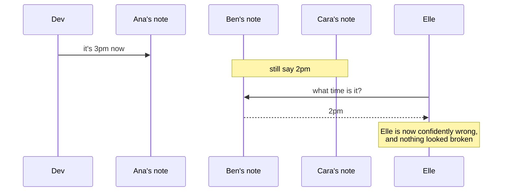
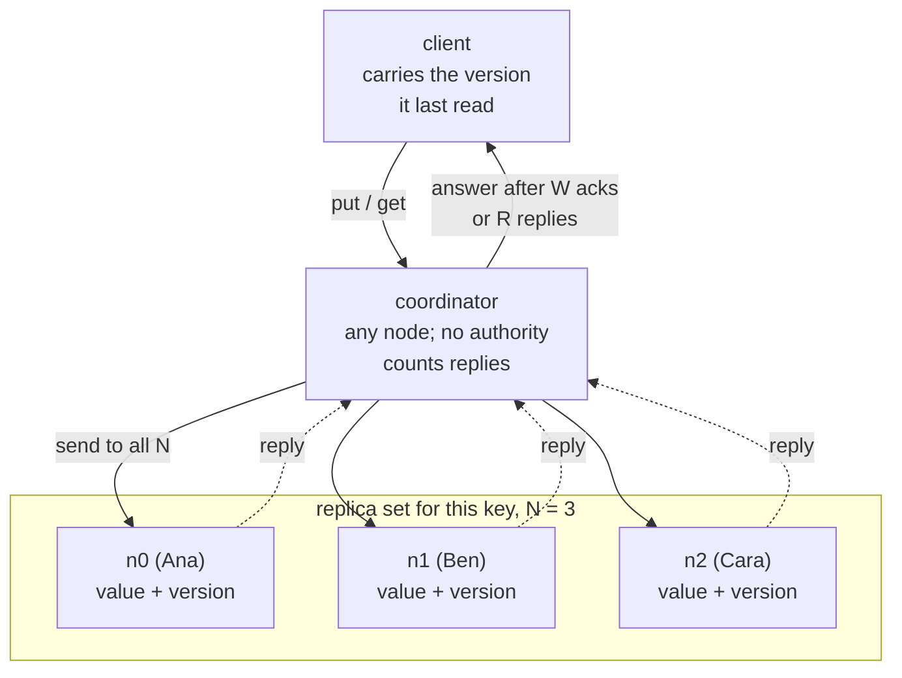
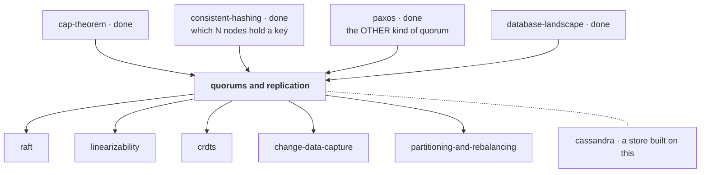

# Quorums and replication

> **Tell a friend:** Ana, Ben and Cara each keep a note of when the trip
> leaves. Dev changes the time, but he can only reach some of them, and Elle,
> who asks later, can only reach some of them too. If the group Dev tells and
> the group Elle asks are each big enough, they are forced to share one person,
> and that person has the new time. That counting trick is the whole rule. The
> rest of this lab is the five ways the counting still looks right while the
> answer is wrong.

The simulator for this lab is [`visualization.html`](visualization.html), also
published at <https://claude.ai/code/artifact/d1e569b2-2338-4c35-9ad0-81417b750086>.
Run commands, the folder contents and how the numbers were made are in
[section 19](#19-about-this-lab) at the end.

---

# BEGINNER MODEL

## 1. Why does keeping copies create a problem that nothing reports?

> **In one breath:** One copy of your data can be destroyed. Several copies
> can disagree with each other. The second problem is worse, because no error
> ever tells you it happened.

A machine holding your data will fail. Not "might". A disk dies, a rack loses
power, a kernel panics, someone reboots the wrong host. If there is one copy,
that is the end of the data.

So you keep several copies on several machines. That solves losing the data.
It also lets you serve more readers, and it lets you put a copy near your
users. But it creates a new problem that is much harder to see. **The copies
can disagree**, and nothing anywhere raises an error when they do.

What does that look like? A user updates their address, reloads the page, and
sees the old one. A balance check returns a number that was true four seconds
ago. No exception is thrown. No alert fires. The logs look perfect.

One warning before the story starts, about a word you already know.

> **⚠️ A word you already know, used for something else.**
> In the [paxos](../39-paxos/) lab, *quorum* meant a **majority**, and it was
> used to make a group of machines **agree** on one value. This lab is about a
> different thing that shares the name: a read/write quorum. It makes two
> groups **overlap**, so that a reader cannot miss a writer. It looks like the
> same idea. It guarantees dramatically less. Keeping them apart is the single
> most valuable thing you can take from this lesson. So the lab avoids the
> word entirely until section 7, where both meanings are put side by side.

## 2. How many friends must Dev tell, and how many must Elle ask?

> **In one breath:** Three friends each hold a note of the departure time.
> Dev wants to change it and Elle wants to read it. Neither can reach
> everyone, and a friend with an old note sounds exactly like a friend with
> the new one.

Ana, Ben and Cara are organising a trip. The departure time is written down
in three places: each of them keeps a note of it. Right now all three notes
say **2pm**.

Dev needs to move it to **3pm**. Elle, later, needs to know what time it is.

Here is the awkward question. The whole lab is the answer to it.

**How many of the three does Dev have to tell, and how many does Elle have to
ask, for Elle to be certain she gets 3pm?**

Notice what makes this hard. Dev cannot always reach all three; Cara's phone
is off. Elle cannot always reach all three either. And there is a crueller
part. **If Elle asks Ben and Ben says "2pm", Ben is not lying, and Elle has
no way to tell she has an old answer.** A wrong answer here is
indistinguishable from a right one.

Here is how far the lab follows Dev and Elle, and what you can do after each
layer:

| Layer | Sections | After it you can… |
|---|---|---|
| **Beginner** | 1–9 | say why copies disagree, and derive the overlap rule yourself |
| **Intermediate** | 10 | walk a write and a read replica by replica, and name what each knob buys |
| **Engineering** | 11–14 | reason about the five ways the rule stops holding, and measure them |
| **Production** | 15 | set Cassandra, Kafka, Postgres and MongoDB knobs on purpose, and monitor the right things |

## 3. Why not just tell everybody?

> **In one breath:** If Dev tells all three, anyone Elle asks has the new
> time. That is correct. It also means one friend with a dead phone stops
> every change.

The obvious rule: Dev tells all three. Then Elle can ask any one of them, and
whoever she asks will say 3pm.

This is genuinely correct. It is also what most people sketch first. It is
what "just replicate it everywhere" means in practice.

> **🔮 Predict:** Cara's phone is off for an hour. Under "tell everybody",
> what happens when Dev tries to change the time?
>
> <details><summary>Reveal</summary>
>
> **Nothing can be changed at all.** Dev cannot complete the rule, so the
> update is refused. One person being unreachable has stopped the entire
> system from accepting any change.
>
> If you said "Dev tells Ana and Ben now and catches Cara later", you have
> just invented the second attempt. Section 4 is what happens to it.
>
> And this gets worse, not better, as you add copies for safety. With five
> copies, the chance that at least one is unreachable at any moment is higher
> than with three. **Under "tell everybody", every copy you add to improve
> durability makes writes less available.** That is the trade this whole lab
> is about, and it appears at the very first step.
> </details>

## 4. Why does "tell one, pass it on" fail in the opposite direction?

> **In one breath:** If Dev tells only Ana, the change always goes through.
> But Elle may ask Ben, who still says 2pm and has no idea he is wrong. And if
> Ana loses her note, the change never happened.

So "tell everybody" is too fragile. The obvious repair: **Dev tells just one
person, and they pass it on when they can.**

Now writes always work, because someone is always reachable. But watch Elle.
Read the diagram top to bottom; it is the order things happen.



Two separate things went wrong. They are worth naming apart.

**Elle got an old answer and could not tell.** Ben answered instantly. He
correctly reported what he knew. There is no error to catch, no timeout, no
warning.

**And the change is one accident from never having happened.** Only Ana has
3pm. If Ana loses her note before passing it on, the update Dev believed had
succeeded simply ceases to exist.

So the two extremes both fail, in opposite directions. Read the table across:
each rule is good at one thing and bad at the other.

| Rule | Writes | Reads |
|---|---|---|
| tell all three | fragile: one absent person blocks everything | always correct |
| tell one | always works | can silently be wrong, and the write can vanish |

The interesting design is not at either end. It is somewhere in the middle.
The question is exactly *where*, and *why that point and not another*.

## 5. What do we actually need?

> **In one breath:** Elle must always see Dev's latest change. Neither of
> them may need every friend to be reachable. And when the answer cannot be
> guaranteed, the system should say so instead of guessing.

We want, in this order:

1. **A later reader must see the last change that was accepted.** Not
   "usually". Always, or the guarantee is worthless, because you cannot tell
   the good answers from the bad ones.
2. **Neither writing nor reading may require every copy to be reachable.**
   Otherwise one sleeping machine stops the system.
3. **When something genuinely cannot be guaranteed, say so**, rather than
   returning a confident wrong answer.

Requirement 1 and requirement 2 sound like they are in direct conflict. The
next section is why they are not.

## 6. What is the key idea?

> **In one breath:** Dev's group and Elle's group only have to be big enough
> that they cannot avoid sharing a person. With three friends, two and two is
> enough, because four different people do not exist.

Dev does not have to tell everybody, and Elle does not have to ask everybody.
They only have to be sure of one thing: **the group Dev tells and the group
Elle asks share at least one person.**

Count it. There are 3 friends. If Dev tells 2 of them and Elle asks 2 of
them, can those groups be completely different? That would need 2 + 2 = 4
different people, and there are only 3. So no. They *must* share someone, and
that someone has the new time.

That is the entire idea. It is nothing more than the pigeonhole principle:
four things cannot go into three boxes without two of them sharing a box.

Now the letters, because the rest of the lab uses them constantly. There are
three counts in the story, and each gets a letter. Read the middle column
first; the letter is only a shorthand for it.

| The thing in the story | In words | Letter |
|---|---|---|
| how many friends keep a note | the number of copies | `N` |
| how many friends Dev tells | the number of copies a write must reach before it counts | `W` (for *write*) |
| how many friends Elle asks | the number of copies a read must hear from before it answers | `R` (for *read*) |
| Dev's group and Elle's group cannot miss each other | tell enough and ask enough that the two groups add up to more than the total | `R + W > N` |

So the rule, in words first: tell W of them, ask R of them, out of N total.
If R plus W is more than N, the two groups cannot miss each other. As a
symbol, that is the last row of the table: `R + W > N`.

Everything else in this lab is either a consequence of that inequality or one
of the situations where it stops applying.

> **🔮 Predict:** Dev is in a hurry and tells only Ana, so W (the number of
> friends told) is 1. How many friends must Elle ask to be certain?
>
> <details><summary>Reveal</summary>
>
> **All three.** If you said two, count again. Elle could ask Ben and Cara,
> and neither of them heard from Dev. One told plus two asked is 3, which is
> not more than 3. Only 1 + 3 clears the bar. Telling fewer people means
> asking more, and only the sum matters.
> </details>

Here it is with real people. Dev tells Ana and Ben, so W (the number told) is
2. Elle can ask any two. Read the right-hand column: it never says no.

| Elle asks | Does she reach someone Dev told? |
|---|---|
| Ana, Ben | yes: both |
| Ana, Cara | yes: Ana |
| Ben, Cara | yes: Ben |

There is no fourth option. That exhaustive little table *is* the proof.

## 7. What are these things called, now that the idea is yours?

> **In one breath:** Every piece of the story has an engineer's name. The
> names arrive here one at a time, each right after the thing it names has
> happened to Ana, Ben, Cara, Dev or Elle.

### What is one of the copies called?

Ana's note is one copy of the departure time. Engineers call one copy a
**replica**: a machine holding a full copy of a given piece of data.

Notice the phrase "a given piece of data". A replica is per-key, not
per-cluster. In a 100-machine cluster, each key typically lives on 3 of them.
The word exists to separate "a machine" from "a copy of this particular
thing". The same machine is a replica for some keys and irrelevant for others.

In this lab's code, the replicas of key `k` are called `n0`, `n1` and `n2`.
Read them as Ana, Ben and Cara.

Which machines hold which keys is the placement problem you solved in
[consistent-hashing](../35-consistent-hashing/). "The next N nodes clockwise"
*is* the replica set.

### How many copies are there, and who decides?

Three friends keep a note. That count is the **replication factor**, written
`N`: the number of replicas per key.

It is chosen once per keyspace, not per request. That makes it different from
the other two numbers. N is a property of the *data*. R and W, which come
next, are properties of each individual *request*.

In this lab, `N = 3`. Cassandra writes it as `replication_factor: 3`.

### How many must Dev tell, and how many must Elle ask?

How many friends Dev insists on telling is `W`. How many friends Elle insists
on hearing from is `R`.

Precisely: W is the number of replica acknowledgements the system needs
before it reports a write successful. R is the number of replica responses
it needs before it answers a read. Both are chosen **per request**. That is
the point. The same data can be read cheaply in one code path and carefully
in another.

Why two separate words? Because they buy different things. W buys durability
and costs write availability. R buys freshness and costs read availability.
Only their *sum*, compared with N, decides the overlap.

The lab's default is `W=2, R=2, N=3`. Cassandra spells this `QUORUM`.

### Who does Dev actually phone?

In the real system Dev does not dial Ana, Ben and Cara himself. He rings one
machine, whichever one happens to answer. That machine forwards the change to
the replicas, counts who says "got it", and reports back to Dev. Engineers
call it the **coordinator**.

In a leaderless system the coordinator is *any* node, and it is a different
one on every request. The word exists to distinguish it from a **leader**. A
leader is elected and has authority. A coordinator is just whoever picked up
the phone, and it has none.

Compare the coordinator in [two-phase-commit](../45-two-phase-commit/). That one
had authority, and its death blocked everyone. This one has none, so its
death costs one retry.

### Why does "quorum" mean two different things?

This is the important entry. In [paxos](../39-paxos/), a quorum was a
**majority**, used so that a group of machines could **agree**. Here, a
quorum is any R or W with `R + W > N`, used so that a reader and a writer
**overlap**. Read the table down each column, then compare across.

| | **Consensus quorum** (what you learned in [paxos](../39-paxos/)) | **Read/write quorum** (this lab) |
|---|---|---|
| What it is | a **majority** of the nodes | any R or W nodes with `R + W > N` |
| What it is for | making nodes **agree** on one value and one order | making a reader and a writer **overlap** |
| Guarantees | one decision, globally ordered, never contradicted | your read sees the last successful write's value |
| Does NOT guarantee | — | any ordering between concurrent writes, or that two clients agree on what happened |
| Costs | a round of messages per decision, a leader in practice | one round, no leader, no agreement at all |
| Where you meet it | etcd, ZooKeeper, Raft, Kafka's controller | Cassandra, DynamoDB, Riak, Kafka's `acks` |

The sentence to remember: *a consensus quorum decides; a read/write quorum
merely intersects.* Overlap tells you a reader will *see* a value. It says
nothing about two writers agreeing which of them won. Section 10 shows that
gap opening up.

Why do people confuse them? Because `R=2, W=2, N=3` and "a majority of 3"
are both "2 of 3". At `R=3, W=1, N=3` they are obviously not the same thing,
and the overlap rule still holds.

### What happens when Elle notices Ben is wrong?

Elle asks Ana and Ben. Ana says 3pm, Ben says 2pm. Elle now knows Ben is
behind, so she tells him on the spot. Engineers call this **read repair**:
when a read finds replicas holding different versions, the coordinator pushes
the winning version back to the ones that were behind.

The name says *when* the fix happens. During a read, paid for by a client
request, and therefore only for data somebody reads. Section 10.5 puts a
number on it: after a replica misses 200 keys, reading half of them repairs
exactly 100.

### Who fixes the notes nobody asks about?

Some trips are never asked about. Ben's note about one of them stays wrong
for months. The only cure is for the friends to sit down over coffee and
compare all their notes. Engineers call that background job **anti-entropy**.

Replicas periodically exchange compact summaries (Merkle trees in Cassandra
and Riak) and stream across only what differs. Why does it exist as well as
read repair? Because read repair cannot fix what nobody reads. And the keys
nobody reads are exactly the ones whose staleness you find out about at the
worst moment.

### What if Dev leaves a message with a neighbour?

Dev cannot reach Ben or Cara, so he leaves the new time with Ben's neighbour
and asks her to pass it on. Two engineer's words describe this.

A **sloppy quorum** counts acknowledgements from nodes outside the key's
replica set, so the write can succeed during a partition. **Hinted handoff**
is the neighbour's job: those nodes hold the value as a "hint" and deliver it
to the real replica when it returns.

"Sloppy" is a warning label. It is not a quorum. The write set is no longer a
subset of the replicas a read will ask. So `R + W > N` becomes arithmetic
about a set the write never touched. Section 10.4 shows the result: 300 of
300 writes accepted during a partition, and only 200 of 300 visible to a
strict read afterwards.

### How do you tell "newer" from "at the same time"?

Suppose Dev and a second organiser both change the time within the same
minute, and neither heard the other. Neither change is "newer". They are
simultaneous, and a single timestamp cannot say that.

A **version vector** keeps one counter per writer. If one vector contains the
other, there is a real ordering. If neither contains the other, the writes
are **concurrent**, and both values are kept as **siblings** for the
application to merge. **Last-write-wins** skips all this and keeps whichever
value carries the higher timestamp.

Why do these words exist? Because a single counter or a timestamp cannot
express "no ordering exists". Last-write-wins does not detect conflicts. It
*conceals* them by always producing an answer.

Concretely, using the names the lab's simulator gives its two writers: Ana
writes with the vector `{ana:1}` and Ben writes with `{ben:1}`. Neither
contains the other, so both survive. Section 10.2 counts it over 1000
concurrent pairs: last-write-wins silently discarded 1000 writes, and version
vectors discarded 0.

The expected-version check in [event-sourcing](../50-event-sourcing/) solved the
same problem by *refusing* the second write. Here nobody is in a position to
refuse, so the conflict is preserved instead.

### What if one friend is in charge?

There is another way to run the trip. Ana takes every change, and Ben and
Cara copy from her. Engineers call Ana the **leader** and the others
**followers**. How far behind Ana they run is the **replication lag**.

In single-leader replication all writes go to the leader, and followers
apply its change stream. Lag is the backlog of not-yet-applied changes,
measured in entries, bytes or seconds.

These words separate this whole family from the leaderless one above. Both
families answer the same question, "how many copies must have it before I
say yes?", with completely different machinery. Section 10.7 shows the shape:
when the leader accepts 2 writes for every 1 the follower applies, the
backlog after 300 rounds is 300 and growing.

## 8. What two pictures should you carry?

> **In one breath:** Keep the three friends for intuition and the coordinator
> diagram for precision. Then learn the five places where the friends picture
> lies to you.

### The simple picture: the three friends

Ana, Ben and Cara each keep a note. You tell some of them and ask some of
them. If the two groups are big enough to be forced to share a person, the
answer you get is current.

### The engineer's picture: a coordinator and a replica set

Read the diagram top to bottom. Dev's request comes in at the top, fans out
to all three replicas, and the answer goes back once enough replies have
arrived.



The two things this picture is trying to make obvious:

1. **The coordinator sends to all N and waits for only W (or R).** The gap
   between "sent to" and "waited for" is where most of this lab's surprises
   live.
2. **Nothing in the middle decides anything.** There is no agreement step,
   no commit point, no leader. The correctness comes entirely from set
   arithmetic.

### How do the two pictures line up?

The three numbers first, then the mechanisms.

| Three friends | Engineering |
|---|---|
| a friend with a note | a replica |
| how many friends have notes | replication factor N |
| how many Dev tells | W |
| how many Elle asks | R |
| the friend in both groups | the intersection that carries the newest value |

| Three friends | Engineering |
|---|---|
| "I heard it from Ana" | version vector: where a value came from |
| Dev and a second organiser both changing the time | concurrent writes |
| leaving word with a neighbour | hinted handoff |
| the friends comparing notes over coffee | anti-entropy |

### Where does the story lie to you?

Five places, and each one matters.

1. **Friends do not half-hear you.** A write that the coordinator reports as
   *failed* may still have reached some replicas, and there is no rollback.
   Section 10.1 puts the figure at 100%.
2. **Two people cannot change the time at the exact same instant, but two
   clients can.** When they do, no "later" exists. The overlap rule is silent
   about who wins; it only guarantees you will *see* something.
3. **A friend cannot be replaced by a new friend with an empty notebook, and
   a replica can.** A rebuilt or restored replica answers confidently with
   nothing, and it can make up a perfectly valid R.
4. **Friends who agree to compare notes actually do it.** Replicas only
   converge if something makes them: a read that touches them, or a scheduled
   background comparison that somebody remembered to run.
5. **Most importantly: the friends are not voting.** No decision is being
   made and no majority is being formed. This is the difference from
   [paxos](../39-paxos/), and it is why this design cannot give you the ordering
   guarantees consensus does.

## 9. Where can you move the sliders yourself?

> **In one breath:** Open the simulator, set the three numbers, and watch a
> write land on some columns and a read touch others. The column that turns
> violet is the whole guarantee.

Open **<https://claude.ai/code/artifact/d1e569b2-2338-4c35-9ad0-81417b750086>**,
or [`visualization.html`](visualization.html) in this folder, which works
offline.

The layout is the diagram from section 8 turned into an instrument. There is
a **write-set band** across the top, the replicas as columns, and a
**read-set band** across the bottom. Replicas in the write set turn blue.
Replicas in the read set turn magenta. Replicas in **both** turn violet. The
colour is literally the blend, because that overlap is the whole guarantee.

One naming note before you press anything. The page's two write buttons are
labelled **Ana writes** and **Ben writes**. On the page, Ana and Ben are the
two people pressing the button, not two of the note-holders. Section 10.2
uses the same two names for the same reason.

**Four things to do, in order.** Each is a part of the mechanism in section
10:

1. Leave it at N=3, W=2, R=2. Press **Ana writes**, then **Step** repeatedly.
   Watch the acknowledgement count climb and note the exact step where the
   client is told "success". Then notice the remaining replicas still get
   written to afterwards. Press **Read** and find the violet column.
2. Drag **W** and **R** to 1. The banner at the top flips from green to red
   and tells you why. Kill a replica (double-click it), write, revive it, and
   read. Use **asks first** to point the read at the replica that missed the
   write.
3. Press **Ben writes** straight after **Ana writes**, then read. Two values
   come back. Switch **Conflicts** to *newest timestamp wins* and repeat: one
   value comes back and the other is gone with no record.
4. Turn **Sloppy quorum** on, **Cut the network**, write, heal, read. The
   arithmetic at the top still says `R + W > N`, and the read is stale
   anyway. That is section 10.4, and it is the most important thing on the
   page.

Each of the four cards at the bottom asks you to **commit to a prediction**
before it runs. Answer first.

---

> ### ✅ Checkpoint: you now have the beginner model
>
> You can explain why copies disagree, derive `R + W > N` from counting
> alone, and say what each of the three numbers costs you.
>
> **Say it back.** Without using the words *quorum*, *replica* or *overlap*,
> explain to a friend why Dev telling two people and Elle asking two people is
> enough, when there are only three friends.
> <details><summary>A good answer sounds like</summary>
> "There are only three people. Dev's two and Elle's two would need four
> different people to avoid each other, and there aren't four. So at least
> one person is in both groups, and that person heard the new time from Dev."
> </details>
>
> Next: the same idea operation by operation, and the five situations where
> the inequality still holds and the guarantee does not.

---

# INTERMEDIATE MODEL

## 10. What does the rule look like when you run it, and when does it stop applying?

> **In one breath:** First the counting argument is run four thousand times
> to check that it holds. Then, one at a time, five things happen to Ana, Ben
> and Cara that the counting never mentioned: a half-delivered change, two
> changes at once, a friend who forgot everything, a message left with a
> neighbour, and notes that never get compared.

### 10.0 Does the counting argument survive a real run?

Section 6 argued the overlap rule by counting. Here it is run. Each round of
the experiment fails each replica independently with 20% probability,
attempts one write, then does one read from a rotating coordinator. A **stale
read** is a read that succeeded and returned something older than the newest
write the client had been *told* succeeded. Read repair is off, so the raw
property is what the experiment sees.

In the story: every round, each of Ana, Ben and Cara has a one-in-five chance
of not answering. Dev tries to change the time. Then Elle asks. A stale read
is Elle hearing an old time after Dev was told his change went through.

```bash
java src/Experiments.java overlap
```
```
N = 3
   R    W   R+W>N   writes ok   reads ok   STALE READS
   1    1   false       99.2%      99.2%     784  <-- lost the guarantee
   2    1   false       99.2%      89.4%     119  <-- lost the guarantee
   3    1   true        99.2%      50.3%       0
   1    2   false       89.6%      99.2%     558  <-- lost the guarantee
   2    2   true        89.6%      89.4%       0
   3    2   true        89.6%      50.3%       0
   1    3   true        51.2%      99.2%       0
   2    3   true        51.2%      89.4%       0
   3    3   true        51.2%      50.3%       0
```

Three things to read out of that table, in order.

**The boundary is exact.** Every row where `R + W > N` has *zero* stale reads
in 4,000 rounds. Every row where it does not has some. There is no gradient
at the boundary. The guarantee is on or off.

**"Nearly enough" is a trap, not a compromise.** Look at `R=2, W=1`: 119
stale reads out of 4,000, about 3%. That configuration is fast, highly
available, and correct 97% of the time. That is exactly why it ships. The 3%
is not a performance problem. It is a correctness problem that will be
reported as "the site sometimes shows old data", and it will never appear on
a developer's laptop.

**The availability columns are the price list.** Read down them. Every step
toward the guarantee is paid for in availability. The table lets you pick the
cheapest configuration that still crosses the line. That is why `R=W=2` at
`N=3` is the near-universal default rather than `R=W=3`.

| Setting | Success rate | What it means |
|---|---|---|
| `W=1` | writes succeed 99.2% of the time | Dev only needs one friend to answer |
| `W=3` | writes succeed 51.2% of the time | Dev needs all three, and each is away one time in five |
| `R=1` | reads succeed 99.2% of the time | Elle only needs one friend to answer |
| `R=3` | reads succeed 50.3% of the time | Elle needs all three |

The `N=5` half of the same output shows the boundary again with more room to
manoeuvre. It also shows why bigger N is usually the better answer than
bigger R and W:

```
   R    W   R+W>N   writes ok   reads ok   STALE READS
   2    2   false       99.5%      99.4%     126  <-- lost the guarantee
   3    3   true        94.4%      94.0%       0
   1    5   true        33.9%     100.0%       0
   5    1   true       100.0%      32.3%       0
```

`R=3, W=3` at `N=5` gives the same guarantee as `R=2, W=2` at `N=3`, while
tolerating two dead replicas instead of one.

> **🔮 Predict:** at `N=3, W=2, R=2` a write succeeds. Immediately
> afterwards, a *different* replica dies: one that had acknowledged the write.
> Is the next read still guaranteed to see it?
>
> <details><summary>Reveal</summary>
>
> **Yes, but only just, and only because of what R does when it cannot be
> met.** Two replicas had it. One is now dead. So one live replica has it and
> one live replica does not. A read of R=2 must ask both survivors, so it
> reaches the one that has it.
>
> If you said no, because "one of the two copies is gone", you counted copies
> instead of counting who Elle must ask. She must ask both survivors, and one
> of them still has the new time.
>
> Now kill a second replica. Only one is alive, so an R=2 read **cannot be
> answered at all**. This is the good outcome. The system refuses rather than
> answering from the single reachable replica, which might be the one that
> missed the write. Refusing is how it keeps the promise. Availability is what
> you gave up in exchange. It is the same [cap-theorem](../24-cap-theorem/) trade
> you have seen before, here with a dial rather than a switch.
> </details>

### 10.1 Can a write fail and still happen?

The rule is about *successful* writes. What about the others?

Dev's change needs all three friends to say "got it", so W is 3. Cara is
slow. She writes 3pm on her note, but her "got it" arrives after the
coordinator has given up waiting. Dev is told the write **failed**.

> **🔮 Predict:** the client got an error. Is the value in the database?
>
> <details><summary>Reveal</summary>
>
> Yes. `java src/Experiments.java partial`:
> ```
> failed writes that are readable afterwards: 500 / 500  (100%)
> ```
> Every single one. If you said no, because the system said "failed", you are
> trusting that word to mean "undone". It only means "not enough
> confirmations arrived".
>
> There is no rollback in this design, and there cannot be. The coordinator
> does not know which replicas eventually applied the write, and there is no
> transaction to undo. **"Write failed" means "not enough replicas confirmed",
> never "nothing happened".**
>
> The consequences are practical and constant:
> - A client that retries after an error may be retrying something that
>   already succeeded, so **every write must be idempotent**. It is the same
>   discipline as the idempotent consumer in
>   [transactional-outbox](../48-transactional-outbox/).
> - A failed write may become visible later, so "I got an error, therefore
>   the old value is still there" is false.
> - A read-modify-write built on a failed write is building on sand.
> </details>

### 10.2 What happens when two people write at the same instant?

The overlap rule guarantees a reader *sees* the latest successful write. Now
have two clients write at the same time, both having read the same earlier
state.

In the story, Dev and a second organiser both change the shopping list within
the same second, and neither heard the other. The simulator and the
experiment name the two writers Ana and Ben (the two buttons from section 9),
so those are the names below.

> **🔮 Predict:** `R + W > N` holds. Ana writes "book", Ben writes "milk",
> both without seeing the other. What should a read return?
>
> <details><summary>Reveal</summary>
>
> The overlap rule has nothing to say here, and that is the point. It
> guarantees the read set touches the write set. But *both* writes reached
> overlapping sets, and neither is "the latest" in any meaningful sense.
>
> If you said "whichever came second", ask: second by whose clock? There is
> no clock either of them shares, and no ordering exists to discover.
>
> There are only two honest options, and `java src/Experiments.java
> concurrent` counts both over 1,000 pairs:
> ```
> last-write-wins   conflicts surfaced to the app:    0   updates silently discarded: 1000
> version vectors   conflicts surfaced to the app: 1000   updates silently discarded:    0
> ```
> </details>

**Last-write-wins** compares timestamps and keeps the higher one. It requires
no application code and always converges. It also destroys one of every pair
of concurrent writes, with no record that they existed. For a "last seen at"
field that is perfectly fine. For a shopping cart it means a customer's item
silently vanishes.

**Version vectors** keep one counter per writer, so "newer" and "concurrent"
are different answers. Concurrent values are returned together as
**siblings**, and the application merges them. A cart merges by union, a
counter by addition, a document by whatever its own rules are. Nothing is
lost. The price is that the application must be written to expect it.

The version-vector rule is the load-bearing code in `Node.write`. Read the
three cases as three answers to "is this newer than what I already hold?":

```java
switch (v.vv().compare(incoming.vv())) {
    case AFTER, EQUAL -> { next.add(v); dominated = true; }  // we already have this or better
    case BEFORE       -> { }                                 // superseded: drop it
    case CONCURRENT   -> next.add(v);                        // a real conflict: keep both
}
```

#### Why is your clock your conflict resolver?

If you chose last-write-wins, the timestamp is not an implementation detail.
**It is the algorithm.** `java src/Experiments.java clockskew` puts one
node's clock 60 seconds fast:

```
genuinely-newer writes thrown away: 1000 / 1000
```

In the story: Cara's watch runs a minute fast. Every change that passes
through Cara gets a later stamp than it deserves, so it beats a genuinely
newer change stamped by Ana. Every race that node enters, it wins, for as
long as its clock is ahead. The database reports success throughout. A single
host with broken NTP becomes a silent data-destruction machine.

This is why Cassandra lets the *client* supply the write timestamp when it
has a better source of ordering. It is the strongest single argument for
version vectors.

> ### 🐛 A bug this lab actually hit, and what it teaches
> The first version of the `overlap` experiment reported stale reads for
> *every* configuration, including the ones that cannot have them. The cause:
> it passed an **empty version context** to every write. So every write was
> `{cli:1}`: identical, and therefore `EQUAL` to the previous one.
> `Node.write` correctly treated each new write as one it already had and
> **ignored it**.
>
> The count was wrong, but the bug is the real lesson. In a version-vector
> store, **a client that writes without carrying forward the version it read
> is not writing "the newest value". It is writing something the database
> cannot distinguish from a stale retry.** Read-before-write is not a
> performance quirk of Dynamo-style stores. It is how a write acquires its
> place in the order.

### 10.3 What if a friend forgot everything?

`R + W > N` assumes something the arithmetic never states: that the N
replicas are **the same N replicas**, and that a replica that once had the
value still has it.

In the story: Ben loses his notebook and buys a blank one. Cara does the same.
Elle asks Ben and Cara, R=2 is satisfied, and both say "no idea". Ana still
has 3pm, but nobody asked her.

> **🔮 Predict:** two of the three replicas have been rebuilt from empty
> disks. Elle's read, with R=2, reaches exactly those two. Does the read fail,
> or does it succeed?
>
> <details><summary>Reveal</summary>
>
> **It succeeds, and it returns nothing.** If you said it fails, you are
> assuming an empty replica refuses to answer. It does not. "I have nothing"
> is an answer, and R counts answers.
>
> ```
> PASS  empty replicas: the read succeeds -- R responses arrived
> PASS  empty replicas: and returns NOTHING, though R + W > N
> ```
> </details>

Restore a replica from a two-day-old backup, or rebuild it from an empty disk
after a hardware swap, and it answers confidently with old data or none at
all. Two such replicas can satisfy an R=2 read between them.

The write is not gone. The third replica still has it. But the read never
asked it, because R was already satisfied. **The overlap argument counts
replicas, not copies of the data.** A replica that has been reset is a
replica that lies by omission.

In production this is why replacing a node is a *streaming* operation with
its own state machine. Cassandra calls it **bootstrapping**: a joining
replica copies its share of the data in before it is allowed to answer reads.
It is also why "just restore the box from backup and put it back in the ring"
is a genuinely dangerous instruction.

### 10.4 What is a sloppy quorum, and why is it not a quorum?

Now the failure that matters most, because it is a *feature* people enable on
purpose without reading the small print.

A partition cuts the coordinator off from two of the three replicas that own
the key. In the story, Dev can reach Ana but not Ben or Cara. Under the
strict rule, W=2 cannot be met and the write is refused. That is correct, and
it is also an outage.

So Dynamo-style systems offer an escape: accept acknowledgements from **any**
reachable node, not just the ones that own the key. Dev leaves the new time
with Ben's neighbour. The write succeeds. The extra nodes hold the value as a
*hint* and pass it on later.

> **🔮 Predict:** `N=3, R=2, W=2`, so `R + W > N` still holds, and the write
> was acknowledged by two nodes. Is it guaranteed visible to the next strict
> read?
>
> <details><summary>Reveal</summary>
>
> **No, and the arithmetic was never the guarantee.** If you said yes because
> the numbers still add up, that is precisely the trap. `R + W > N` is a
> statement about two sets being forced to intersect. A sloppy quorum collects
> its acknowledgements from *outside* the set a read will ask, so there is
> nothing for the read set to intersect with. Elle asks Ben and Cara; the
> neighbour is not on her list. `java src/Experiments.java sloppy`:
> ```
> hinted handoff OFF :  writes accepted 300/300   visible to a strict read afterwards 200/300
> hinted handoff ON  :  writes accepted 300/300   visible to a strict read afterwards 300/300
> ```
> A third of the writes are invisible until the hints are delivered. **A
> sloppy quorum is not a quorum.** It is an eventually-consistent write
> wearing a quorum's clothes. During that window you have a different
> database than the one you configured.
> </details>

Hinted handoff repairs it, and it is worth being precise about. The hint sits
on a node that does not own the key, and that node **may itself die while
holding the only recent copy**. Hinted handoff is a best-effort mechanism,
not a durability one. That is why it is paired with anti-entropy rather than
trusted alone.

### 10.5 Why does nothing converge on its own?

A replica that was down during a write comes back holding stale data.
Nothing in the protocol has told it so, and nothing will, unless one of two
mechanisms runs.

In the story: Cara was away for two hundred changes. She comes back with two
hundred old notes and nobody says a word.

> **🔮 Predict:** Cara missed 200 keys. Elle then reads 100 of them, the
> popular half. How many of the 200 does Cara end up holding?
>
> <details><summary>Reveal</summary>
>
> **100, and exactly those 100.** If you said 200, you assumed a read repairs
> the replica. It repairs the key that was read, and nothing else.
>
> ```bash
> java src/Experiments.java repair
> ```
> ```
> straight after it returns, n2 holds 0 of 200 keys
> after reading the hot half, n2 holds 100 of 200  (read repair fixed 100)
> after a background comparison sweep, n2 holds 200 of 200
> ```
> </details>

**Read repair** fixes exactly what somebody reads: a hundred of two hundred
keys, because a hundred were read. It is free, because it rides on requests
you were already serving. It is also proportional to traffic. That means the
keys most likely to be stale are the ones nobody looks at.

**Anti-entropy** is the background comparison that fixes the rest. Real
systems do it with Merkle trees so replicas can find their differences
without shipping everything. It is the process people forget to schedule
until an incident teaches them. In Cassandra it has a name and a deadline:
repair must complete within `gc_grace_seconds`, or deleted data can come back
to life.

### 10.6 What does the family with a leader do differently?

Everything so far has been **leaderless**: any node coordinates, no node has
authority. The other family puts one node in charge and has the rest copy it.
In the story, Ana takes every change and Ben and Cara copy from her.

The interesting question is identical. *How many copies must have it before I
say yes?* Here it has a name: the **replication mode**.

> **🔮 Predict:** in fully synchronous mode ("wait for all live followers"),
> both followers are unreachable. How many of 100 writes are refused?
>
> <details><summary>Reveal</summary>
>
> **None.** If you said all 100, you read "synchronous" as "safe". It is only
> as safe as the number of followers it happens to have. `java
> src/Experiments.java leader`:
> ```
>   mode         acked   lost on failover   refused 1 down   refused 2 down   refused 2 down + floor
>   ASYNC         100                100                0                0                    100
>   SEMI_SYNC     100                  0                0              100                    100
>   SYNC          100                  0                0                0                    100
> ```
> "Wait for all *live* followers" quietly becomes "wait for nobody" at
> precisely the moment there is nobody left to wait for. Ana, alone, waits
> for no one and says "done". The setting chosen for safety degrades into the
> least safe one exactly when safety matters, and reports success throughout.
>
> The last column is the fix: a **floor** on how many replicas must be in
> sync before a write is permitted at all. Kafka spells it
> `min.insync.replicas`. This is the reason `acks=all` on its own is not a
> durability setting. It is only a durability setting *with* the floor.
> </details>

Read the three rows as three products:

- **Async** never refuses a write and loses whatever had not been copied when
  the leader died: 100 acknowledged writes, gone. That column is not a
  failover bug. It is the bill for saying "done" early.
- **Sync** loses nothing and stalls behind the slowest follower. It also
  carries the degradation trap above.
- **Semi-sync with a floor**, meaning wait for one follower and refuse if
  fewer than two replicas are in sync, is what most people should actually
  run. It is roughly what `W=2, N=3` gives you in the leaderless world.

**The equivalence worth carrying:** `W` in a leaderless store and the
acknowledgement count in a leader-based one are the same knob. `acks=all`
with `min.insync.replicas=2` on a 3-replica Kafka topic *is* `W=2, N=3`.

### 10.7 Why is replication lag a queue, not a number?

The last piece of the leader-based family. Ana takes changes at one rate; Ben
copies them at another. `java src/Experiments.java lag`:

```
  writes in   applied out   final backlog   user cannot see own change
          1             3               0            0 / 300
          1             1               0            0 / 300
          2             1             300          300 / 300
          5             1            1200          300 / 300
```

| Leader writes : follower applies | Backlog after 300 rounds | What it means |
|---|---|---|
| 1 : 3 | 0 | Ben copies faster than Ana writes; lag hovers near zero |
| 1 : 1 | 0 | just keeping up, and nobody notices anything |
| 2 : 1 | 300, and growing | every one of 300 users cannot see their own change |
| 5 : 1 | 1200, and growing | the backlog grows without bound |

Lag is not a property you tune. It is the backlog of a queue. While the
follower's apply rate is at or above the leader's write rate, lag hovers near
zero and nobody notices. The moment it drops below, because of a big batch
job, a slow disk, or a schema change holding a lock, **the backlog grows
without bound**. Every read from that follower is arbitrarily far in the
past.

The user-visible symptom is the classic bug report: *"I saved my profile and
it still shows the old name."* Nothing is broken. Every one of those reads is
a correct read of a correct replica. The fixes are all **routing** rules, not
storage changes:

- **Read-your-own-writes:** route a user's reads to the leader for a few
  seconds after they write, or to a replica known to be caught up.
- **Monotonic reads:** pin a user to one replica so they never move
  *backwards* in time by hopping to a laggier one.
- **Consistent prefix:** make sure causally-related writes are not seen out
  of order, which matters most in partitioned or multi-leader setups.

Those three names describe the three ways a user notices lag. They are worth
memorising, because they are what a design review will ask you about.

### 10.8 What does none of this give you?

Worth stating plainly, because it is the most common overclaim about quorums.

**`R + W > N` does not give you linearizability.** It guarantees a read sees
the last *successful* write's value. It does not give a single global order.
It does not make concurrent writes resolvable. It does not stop a
failed-but-applied write from appearing later. And it does not stop two
concurrent reads from seeing different values while a write is in flight:
one may catch it, one may not, and read repair makes which one wins depend
on timing.

If you need "everyone agrees on one order", you need consensus: the
[paxos](../39-paxos/) machinery, or Raft, or a single leader with a commit
quorum. That is a different, more expensive tool. Dynamo-style quorums are
what you use when you have decided you do not need it.

---

> ### ✅ Checkpoint: you now have the intermediate model
>
> You can walk a write and a read replica by replica, derive and defend
> `R + W > N`, and name the five situations that suspend it: an unrolled-back
> failed write, concurrent writers, a replica that lost its data, a sloppy
> quorum, and the absence of repair.
>
> **Say it back.** Without using the words *sloppy*, *hint* or *partition*,
> explain why Dev leaving the new time with Ben's neighbour can leave Elle
> wrong, even though "two told plus two asked" still adds up to more than
> three.
> <details><summary>A good answer sounds like</summary>
> "The counting only works if Dev's two and Elle's two are drawn from the
> same three friends. The neighbour is not one of the three. Elle will never
> ask her, so Dev's two and Elle's two can miss each other completely."
> </details>
>
> Next: each of those as a failure you create and watch, and exactly which
> guarantee each one bends.

---

# ENGINEERING MODEL

## 11. What are the ten ways it fails, and what survives each one?

> **In one breath:** Ten failures, each a short story about Ana, Ben and Cara.
> Each one says how to cause it, what breaks, what still holds, and what a
> real system does about it. One table at the end lines them all up.

### F1: What if Cara's phone is off when Dev calls?

Dev tells Ana and Ben. Cara is unreachable. At `W=2, N=3` the write still
succeeds; the dead replica simply misses it. When Cara comes back she holds
2pm, and nobody tells her.

To cause it, run `java src/Experiments.java overlap`, or in the simulator
double-click a replica and then write.

The read guarantee survives, because two replicas have the value and any R=2
read must touch one of them. Nothing is lost yet. But the cluster is now one
failure away from losing it.

In production this is the normal state of a large cluster, not an incident.
Something is always down. It is why anti-entropy is a scheduled job rather
than an emergency procedure.

### F2: What if so many friends are away that Dev or Elle cannot reach enough?

Kill two replicas at `N=3, R=2, W=2`. Only Ana is reachable. Dev needs two
and Elle needs two, so both reads and writes are **refused**.

This is the system working correctly. Refusing is how it keeps its promise,
because answering from the single reachable replica might return a value
that missed the last write. Correctness survives. Availability is lost,
completely, for those keys.

In production this is the [cap-theorem](../24-cap-theorem/) choice made per
request. It is precisely why Cassandra exposes the consistency level per
query. The same cluster serves `ONE` for a metrics dashboard and `QUORUM`
for a balance, and the dashboard stays up during an outage that stops the
balance.

### F3: What if a write fails and applies anyway?

Cara stores Dev's change but confirms too late. The coordinator gives up
counting before the slow replica replies, and the replica had already stored
the value. There is no rollback and no transaction.

To cause it, run `java src/Experiments.java partial`: 500 of 500 such writes
are readable afterwards.

Nothing is corrupted. What is lost is the meaning of the error. "Failed"
tells you only that confirmation did not arrive.

In production this is why every write must be idempotent, why retry-on-error
is safe only for idempotent writes, and why read-modify-write against a
Dynamo-style store needs a compare-and-set rather than a bare retry.
Cassandra's lightweight transactions and DynamoDB's conditional writes are
that compare-and-set.

### F4: What if two people change the plan at the same moment?

Dev and a second organiser both write, neither having seen the other. Run
`java src/Experiments.java concurrent`, or in the simulator press **Ana
writes**, then **Ben writes**, then **Read**.

With version vectors, no write is lost and the conflict is surfaced. With
last-write-wins, one of every pair is lost, silently: 1000 of 1000 in the
experiment.

In production the systems disagree on purpose. Riak returns siblings and
expects the application to merge. Cassandra is last-write-wins by design and
pushes you toward data types that cannot conflict (its counters and
collections, or CRDTs generally). DynamoDB gives you conditional writes so
you can refuse instead of merging.

### F5: What if Cara's watch is wrong?

Under last-write-wins the timestamp *is* the resolution rule, so a fast clock
wins every race. Run `java src/Experiments.java clockskew`: 1000 of 1000
newer writes are discarded.

Convergence survives. Every replica agrees on the wrong value. What is lost
is the newer write, with no error and no record.

In production, monitor clock skew as a first-class metric. Prefer
client-supplied timestamps where the client has a better order. And treat
"replicas disagree about time" as the reason last-write-wins is a data-model
decision rather than a configuration one.

### F6: What if Ben is handed a blank notebook?

A replica is rebuilt or restored from backup. `R + W > N` counts replicas,
not copies of the data, so two reset replicas can satisfy an R=2 read between
them and return nothing. The test that causes it is
`rebuiltEmptyReplicas_canSatisfyAQuorumWithNothing`.

The data still exists on the third replica; Ana still has 3pm. What is lost
is the read guarantee, for as long as the reset replicas are in the ring.

In production a replacement node must **bootstrap**: stream its data in
before it is allowed to serve reads. Cassandra does this explicitly, and
`auto_bootstrap: false` on a replacement node is a well-known way to cause
exactly this incident.

### F7: What if the network splits while sloppy quorums are on?

Dev leaves the new time with a neighbour because Ben and Cara are cut off.
Run `java src/Experiments.java sloppy`, or in the simulator turn sloppy on,
cut the network, write, heal, and read.

Availability survives: 300 of 300 writes accepted. The read guarantee is
lost for 100 of 300 keys, until hints are delivered.

In production this is Dynamo's deliberate AP choice. The operational
consequences are a **hinted handoff queue** you must monitor, and a repair
job that must complete afterwards. The queue can grow without bound during a
long partition, and it is *not* durable: the holder may die.

### F8: What if Ana, the leader, dies before Ben has copied her?

Run `java src/Experiments.java leader`. In async mode, 100 acknowledged
writes are lost on failover.

Availability survives throughout. What is lost is acknowledged writes, the
worst category of loss, because the client was told it succeeded.

In production this is what `synchronous_commit` in Postgres, semi-synchronous
replication in MySQL, and `acks` in Kafka are all about. The question to ask
about any system is not "does it replicate?" but **"at what point does it
say yes?"**

### F9: What if "wait for everyone who is here" means waiting for nobody?

Take the SYNC row of `leader` with two followers down: 0 writes refused.
"Wait for all live followers" is vacuous when none are live. Ana is alone and
waits for no one.

Availability survives. All redundancy is lost, invisibly. The system reports
healthy while running on one copy.

In production the fix is a floor: `min.insync.replicas` in Kafka,
`synchronous_standby_names` with a count in Postgres. Monitor the **size of
the in-sync set**, not just whether writes succeed. A green write-success
graph is compatible with having exactly one copy of your data.

### F10: What if Ben falls further and further behind Ana?

Run `java src/Experiments.java lag`: at 2 writes per 1 applied, the backlog
is 300 and growing.

Correctness survives, because every stale read is a correct read of a correct
replica. What is lost is the user's model of a single database.

In production, alert on lag *in seconds* and on its **derivative**. A backlog
that is growing is a different incident from one that is merely large. Route
read-your-writes traffic to the leader. And remember that a lagging follower
is also a failover risk: promoting it makes its lag into permanent data loss.

### The ten failures side by side

The same facts in one place, so you can compare down the columns.

| # | Failure | How to cause it | What survives | What is lost |
|---|---|---|---|---|
| F1 | one replica down during a write | `overlap`; double-click a replica, then write | the read guarantee | nothing yet; one failure from losing it |
| F2 | too few replicas for R or W | kill two replicas at `N=3, R=2, W=2` | correctness | availability, completely, for those keys |
| F3 | write fails, applies anyway | `partial` (500/500 readable) | nothing is corrupted | the meaning of the error |
| F4 | two clients write concurrently | `concurrent`; Ana writes, Ben writes, Read | with version vectors: every write | with last-write-wins: one of every pair (1000/1000) |
| F5 | one clock is wrong | `clockskew` (1000/1000 discarded) | convergence, on the wrong value | the newer write, with no record |
| F6 | replica rebuilt or restored | the `rebuiltEmptyReplicas_canSatisfyAQuorumWithNothing` test | the data, on the third replica | the read guarantee while reset replicas are in the ring |
| F7 | partition with sloppy quorums | `sloppy`; sloppy on, cut, write, heal, read | availability (300/300 accepted) | the read guarantee for 100/300 keys until hints land |
| F8 | leader dies before catch-up | `leader` (async: 100 lost) | availability | acknowledged writes |
| F9 | sync replication degrades | SYNC row of `leader`, two down: 0 refused | availability | all redundancy, invisibly |
| F10 | lag outgrows the follower | `lag` (backlog 300 at 2:1) | correctness of each read | the user's model of one database |

## 12. What exactly is promised, and what is not?

> **In one breath:** Five rules the design never breaks, four things it
> therefore guarantees, seven things it deliberately does not, and the price
> paid for each guarantee.

### Which five rules does the design never break?

Each rule is written twice: once for Dev, Elle and the three friends, and
once the way an engineer would state it.

1. **A write is reported successful only when W replicas that own the key
   have acknowledged it.** Dev is told "done" only when enough of Ana, Ben
   and Cara said "got it". An acknowledgement from anything else, such as a
   neighbour, is not a W.
2. **A read is answered only when R replicas that own the key have replied**,
   or it is refused. Elle hears an answer only after enough of the three
   friends spoke.
3. **A value is never discarded because it looks older unless it is provably
   older.** Under version vectors, `BEFORE` is a proof, and `CONCURRENT` is
   not.
4. **Concurrent values are preserved, not resolved**, unless you explicitly
   chose last-write-wins. Two changes at the same instant are both kept.
5. **A write is applied to every replica the coordinator can reach**,
   regardless of whether W was met. Cara writes it down even if her "got it"
   arrives too late. This is why "failed" never means "did not happen".

### What is guaranteed?

- If `R + W > N`, and the replica set is intact, and the quorum is strict,
  **a read returns the value of the most recent successful write** (or a
  value that supersedes it). Elle hears Dev's latest change.
- **Convergence**: given repair and enough time without new writes, all
  replicas end up holding the same thing. The three notes eventually agree.
- **No lost updates under version vectors**: every write is either superseded
  by one that saw it, or preserved as a sibling.
- **Tunability per request**: the same data can be read cheaply or carefully.

### What is explicitly NOT guaranteed?

- **Linearizability.** No single global order. Two concurrent reads can
  disagree.
- **Any resolution of concurrent writes.** The overlap rule is silent; you
  get a conflict, a guess, or a merge, depending on what you configured.
- **That a failed write did not happen.**
- **Freshness under a sloppy quorum**, for the duration of the partition plus
  the handoff.
- **Anything at all if replicas lose data.** The argument assumes the replica
  set is intact.
- **Read-your-own-writes** in the leader-based family without extra routing.
- **Bounded staleness** without anti-entropy actually running.

### What was traded away, and for what?

Read each row as a bargain: the left column is the price, the right column
is what it bought.

| Given up | Bought |
|---|---|
| Linearizability | No coordination on the write path: no leader, no consensus round, no commit point |
| Automatic conflict resolution | Either honesty (siblings) or simplicity (LWW); you pick which |
| Rollback of failed writes | A design with no distributed transaction in it at all |
| Full availability (at strict R/W) | The read guarantee, refused rather than faked |
| The read guarantee (at sloppy) | Availability during a partition |
| A single fixed consistency level | Per-request tuning, so one cluster serves both a dashboard and a balance |

**The through-line:** this design buys enormous availability and operational
simplicity by refusing to make any decision. Its entire correctness is one
counting argument. Every failure in section 11 is a situation where the thing
being counted is not what you thought.

## 13. Where is the code that carries the design?

> **In one breath:** Eight Java files, no build tool. Five lines in them carry
> the whole design, and each one maps to a failure in section 11.

No build tool, no dependencies. `java src/Tests.java` compiles the directory
in place (JDK 25).

| File | What it is |
|---|---|
| [`src/VersionVector.java`](src/VersionVector.java) | one counter per writer, and the `BEFORE / AFTER / CONCURRENT / EQUAL` comparison the whole conflict story rests on |
| [`src/Val.java`](src/Val.java) | a stored value: content, version vector, and the timestamp last-write-wins uses |
| [`src/Node.java`](src/Node.java) | one replica (Ana, Ben or Cara). Deliberately dumb: it merges what it is given and never talks to another replica |
| [`src/Cluster.java`](src/Cluster.java) | the leaderless store: placement, `put`, `get`, read repair, anti-entropy, hinted handoff, and every fault knob |
| [`src/LeaderCluster.java`](src/LeaderCluster.java) | the other family: async / semi-sync / sync, `minInSync`, replication lag, failover |
| [`src/Tests.java`](src/Tests.java) | 42 scenario checks, readable as documentation |
| [`src/Experiments.java`](src/Experiments.java) | the ten experiments |
| [`src/Broken.java`](src/Broken.java) | three planted bugs for exercise rung 6 |

**The five load-bearing places**, each commented in the source with the rule
it enforces:

1. **`Cluster.put`, the two loops.** Every reachable replica is written; only
   the timely ones are counted. The gap between those two facts is failure
   F3: Cara writes it down, but is not counted.
2. **`Node.write`'s `CONCURRENT -> next.add(v)`.** Three words that are the
   difference between preserving a conflict and silently destroying a write.
3. **`Cluster.get`'s `if (responders.size() >= R) break;`** The read stops at
   R and does not wait for the rest. This is where the freshness/availability
   trade physically lives, and it is why Elle never asks Ana in section 10.3.
4. **`Cluster.put`'s sloppy branch.** Acknowledgements from nodes that do not
   own the key, with a comment saying exactly why a strict reader will never
   look there.
5. **`LeaderCluster.write`'s `live < minInSync`.** The floor that stops "wait
   for all live followers" from degrading to "wait for nobody".

## 14. What do the ten experiments show?

> **In one breath:** Ten experiments, one question each. Commit to an answer
> before you run the command.

```bash
java src/Experiments.java        # lists all ten
```

| # | Command | Predict before running |
|---|---|---|
| 1 | `overlap` | At which (R,W) pairs does the stale-read count become exactly zero? |
| 2 | `availability` | At `R=W=2, N=3`, how many replicas may be down before reads stop? |
| 3 | `partial` | The client got an error. What fraction of those values are readable afterwards? |
| 4 | `concurrent` | 1,000 concurrent write pairs. How many updates does each mode lose? |
| 5 | `clockskew` | One node's clock is 60 s fast. How many newer writes survive? |
| 6 | `sloppy` | `R+W>N` holds throughout. What fraction of writes is a strict read able to see? |
| 7 | `repair` | A replica missed 200 keys and half are then read. How many does it end up with? |
| 8 | `leader` | In fully-synchronous mode with both followers down, how many writes are refused? |
| 9 | `lag` | The leader takes 2 writes for every 1 the follower applies. Where does the backlog settle? |
| 10 | `latency` | Waiting for all 3 replicas instead of 2: what fraction of requests gets slow? |

Experiment 10 is the one people do not expect, so here it is in full. Each
replica answers in 5 ms normally, but one request in ten hits a 200 ms
stall. In the story, each of Ana, Ben and Cara is quick nine times out of
ten, and on the tenth she is on another call.

> **🔮 Predict:** Dev waits for all three instead of any two. Each friend
> stalls one time in ten. What fraction of Dev's requests hit a stall?
>
> <details><summary>Reveal</summary>
>
> **About 27%.** If you said 10%, you counted one friend's bad moments. Dev
> now inherits all three friends' bad moments, and they rarely coincide.
>
> ```
> wait for 1 of 3:  p50 = 5 ms   p99 =   5 ms   requests that hit a stall:  0.09%
> wait for 2 of 3:  p50 = 5 ms   p99 = 200 ms   requests that hit a stall:  2.85%
> wait for 3 of 3:  p50 = 5 ms   p99 = 200 ms   requests that hit a stall: 27.31%
> ```
> </details>

| Wait for | p50 | p99 | Requests that hit a stall | What it means |
|---|---|---|---|---|
| 1 of 3 | 5 ms | 5 ms | 0.09% | all three friends must stall at once |
| 2 of 3 | 5 ms | 200 ms | 2.85% | two must stall at once; you ignore the slowest |
| 3 of 3 | 5 ms | 200 ms | 27.31% | any one stalling stalls you |

Waiting for all three means every replica's bad moment becomes *your* bad
moment. 27% of requests are slow, from replicas that are individually
healthy 90% of the time. Waiting for two lets you ignore whichever replica is
garbage-collecting right now. **A quorum is a tail-latency device as much as
a durability one**, and it is the same trick as hedged requests.

---

> ### ✅ Checkpoint: you now have the engineering model
>
> You can state the invariants, name what each failure bends, and run the
> experiment that shows it.
>
> **Say it back.** Elle's read came back with two different times. Without
> using the words *sibling* or *version vector*, explain why the system
> handed her both instead of picking one.
> <details><summary>A good answer sounds like</summary>
> "Two people changed the plan at the same moment and neither heard the
> other. There is no honest way to say which was later. So the system keeps
> both and lets the app decide, rather than throwing one away and pretending
> it never existed."
> </details>
>
> Next: the knobs these ideas are actually called in Cassandra, Kafka,
> Postgres and MongoDB, and what to put on a dashboard.

---

# PRODUCTION MODEL

## 15. What are these knobs called in real systems?

> **In one breath:** Everything Dev and Elle did exists in the databases you
> run; only the spelling changes. Two settings deserve their own paragraph,
> and one dashboard line matters more than the rest.

### 15.1 How does each knob translate?

Everything in this lab exists in the systems you actually run; only the
spelling changes. Defaults move between versions, so check the docs for
yours. The mapping is what matters. The table is split in two so it fits on
a screen: the same rows, different systems.

| This lab | Cassandra | Kafka | Postgres |
|---|---|---|---|
| **N** | `replication_factor` | `replication.factor` | number of standbys |
| **W** | consistency level on the write (`ONE`, `QUORUM`, `ALL`) | `acks=0 / 1 / all` | `synchronous_commit` + `synchronous_standby_names` |
| **R** | consistency level on the read | consumers read the leader | route to primary or standby |
| **the floor** | — (implied by CL) | **`min.insync.replicas`** | `ANY 2 (s1,s2,s3)` |
| **conflict rule** | last-write-wins on cell timestamps | single leader, no conflicts | single leader, no conflicts |
| **hinted handoff** | yes, `max_hint_window_in_ms` | — | — |
| **anti-entropy** | `nodetool repair` (Merkle trees) | — | — |

| This lab | MongoDB | DynamoDB / Riak |
|---|---|---|
| **N** | replica set size | `n_val` (Riak); fixed at 3 (DynamoDB) |
| **W** | `writeConcern: {w: 1 \| "majority"}` | `w`, `pw` (Riak) |
| **R** | `readConcern` + `readPreference` | consistent-read flag (DynamoDB); `r` (Riak) |
| **the floor** | `w: "majority"` | — |
| **conflict rule** | single leader, no conflicts | LWW (DynamoDB global tables); siblings with `allow_mult` (Riak) |
| **hinted handoff** | — | yes (Riak) |
| **anti-entropy** | — | active anti-entropy (Riak) |

Two entries deserve their own paragraph.

**`min.insync.replicas` is the single most under-set option in the table.**
As section 10.6 showed, `acks=all` alone degrades to `acks=1` when the
in-sync set shrinks to the leader, silently. `acks=all` **plus**
`min.insync.replicas=2` on a 3-replica topic is `W=2, N=3`, and it refuses
rather than degrading. Configuring the first without the second is the most
common way to believe you have durability you do not have.

**`LOCAL_QUORUM` is what makes multi-datacentre Cassandra usable.** A plain
`QUORUM` across two datacentres 80 ms apart means every write waits for a
cross-ocean round trip, and a datacentre outage stops writes. `LOCAL_QUORUM`
requires a quorum *within the local datacentre*. It is fast, it survives
losing the remote one, and it consciously gives up the cross-datacentre read
guarantee. `EACH_QUORUM` is the strict version, and its latency is why almost
nobody uses it for reads.

### 15.2 What does the toy leave out?

Ana, Ben and Cara are `HashMap`s in this lab. Read the right-hand column for
what a real replica adds.

| Omitted here | What production does |
|---|---|
| **Real storage** | replicas are `HashMap`s; real ones are LSM trees with a commit log ([btree-and-lsm](../05-btree-and-lsm/)), and durability includes whether the write was fsynced (`j: true`, `synchronous_commit = remote_apply`) |
| **Real placement** | this lab uses "the first N nodes"; production hashes keys onto a ring ([consistent-hashing](../35-consistent-hashing/)) and adds rack/datacentre awareness so the N replicas are not in one failure domain |
| **Deletes** | a delete is a **tombstone**, a write like any other. It must outlive any replica that could resurrect the value, which is what `gc_grace_seconds` is: purge too early and a replica that was down comes back and un-deletes the row |
| **Merkle trees** | anti-entropy here compares full values; real repair compares hash trees so only differences are streamed |
| **Coordinator-side latency** | real reads send a full data request to one replica and cheap digest requests to the others, so R replies do not mean R full copies on the wire |
| **Compare-and-set** | this lab cannot express "write only if unchanged". Cassandra's lightweight transactions do it with Paxos, *per operation*, and roughly an order of magnitude slower, which is the price of borrowing the other kind of quorum |
| **Bootstrap** | a joining or replacement node must stream its data before serving reads (failure F6) |
| **Backpressure and hint limits** | hint queues are bounded; past the window, hints are dropped and repair is the only path |

### 15.3 What does an on-call engineer watch?

Not "is the database up". These:

- **Replication lag in seconds, and its derivative.** A backlog that is
  *growing* is a different incident from one that is merely large (section
  10.7).
- **In-sync replica count / size of the healthy replica set**, per partition.
  This is the metric that catches the silent degradation in F9, and a green
  write-success graph will not.
- **Hinted handoff queue depth and age.** Growing means a node has been away
  too long. Past the hint window, hints are dropped and you now *need* repair.
- **Repair completion time against `gc_grace_seconds`.** If repair takes
  longer than the grace period, deleted data can come back. This is a
  correctness deadline hiding in an operations schedule.
- **Read/write timeouts and unavailable-exception rates split by consistency
  level.** A rise in `QUORUM` failures while `ONE` is fine tells you exactly
  how many replicas you have lost.
- **Clock skew across nodes**, if anything in your stack is last-write-wins
  (F5).
- **Sibling counts**, if you use version vectors. A key whose sibling count
  grows without bound means the application is reading and writing without
  merging.

**The pager you least want:** *"writes succeeding, `min.insync.replicas` not
set, in-sync set size = 1"*. Everything is green and you have one copy. Ana
is alone, and she is saying "done" to everyone.

### 15.4 How do you choose the numbers?

A short decision guide, in the order the questions actually arise:

1. **Do you need a single agreed order** (leader election, locking, unique
   constraints, "exactly one of these may succeed")? Then you do not want
   this chapter's tool at all. You want consensus: etcd, ZooKeeper, a Raft
   group, or a single-leader database. See [paxos](../39-paxos/).
2. **Otherwise start at `N=3, R=2, W=2`** (or `acks=all` + `min.insync=2`).
   It crosses the overlap line at the lowest availability cost, and it is
   the default for a reason.
3. **Write-heavy and can tolerate stale reads?** `W=1, R=1` is legitimate for
   metrics, logs, caches and last-seen timestamps. But somebody must have
   written down that staleness is accepted, because the 3–20% seen in section
   10.0 will otherwise arrive as a bug report.
4. **Need more failure tolerance rather than more consistency?** Raise N, not
   R and W. `N=5, R=3, W=3` tolerates two dead replicas with the same
   guarantee.
5. **Multi-datacentre?** Use the local-quorum variant unless you can
   articulate why a cross-region round trip on every write is acceptable.
6. **Concurrent writes to the same key are expected?** Decide the conflict
   rule *as a data-modelling decision*: conflict-free types where possible,
   siblings where the application can merge, last-write-wins only where
   losing one of two simultaneous writes is genuinely harmless.

### 15.5 What do you say if this comes up in an interview?

The four sentences that show you actually understand it:

1. *"`R + W > N` guarantees the read set and the write set intersect, so a
   read sees the last successful write. It is a pigeonhole argument, not a
   protocol."*
2. *"It is not linearizability. Concurrent writes are unordered, and a failed
   write is never rolled back, so I need idempotent writes and a conflict
   rule."*
3. *"`acks=all` without `min.insync.replicas` degrades silently to
   `acks=1`."*
4. *"Read repair only fixes what is read; anti-entropy is what bounds
   staleness, and it has a deadline set by the tombstone grace period."*

And the question that most often separates candidates: *"you have `R+W>N`.
Name three situations where you can still read stale data."* The answers are
in section 10: a sloppy quorum, a replica that lost its data, and a write
that failed but applied (plus concurrent writes, where "stale" is not even
the right word).

---

> ### ✅ Checkpoint: you now have the production model
>
> You can translate the three numbers into the knobs of four real systems,
> say which dashboard line catches each silent failure, and choose N, R and
> W on purpose.
>
> **Say it back.** Your write-success graph is 100% green. Without using the
> word *floor* or the name `min.insync.replicas`, say why that could be the
> worst news on the dashboard.
> <details><summary>A good answer sounds like</summary>
> "Ana might be the only friend still around. The rule 'wait for everyone
> who is here' happily waits for nobody, so she says 'done' to every change.
> The graph says every write was confirmed, and every one of them is held by
> exactly one copy."
> </details>

---

## 16. Exercises

[EXERCISES.md](EXERCISES.md) has eight rungs, from explaining the overlap
rule in your own words to designing a three-datacentre configuration and
deciding what a payment ledger may and may not use quorums for. Attempt each
one before opening [SOLUTIONS.md](SOLUTIONS.md).

---

## 17. Where does this sit, and what comes next?

> **In one breath:** This lab sits on four you already have, is constantly
> confused with one of them, and opens the door to the ones that give Dev and
> Elle a real ordering.



**Builds directly on.**

- [paxos](../39-paxos/): the consensus quorum this one is constantly confused
  with, and the tool you reach for when overlap is not enough.
- [cap-theorem](../24-cap-theorem/): R and W turn the CP/AP switch into a dial
  you set per request.
- [consistent-hashing](../35-consistent-hashing/): which N machines are the
  replicas in the first place, and why its 1/n disagreement window matters
  here. Two clients briefly disagreeing about the replica set are two clients
  whose quorums may not intersect.
- [database-landscape](../04-database-landscape/): masterless stores and the
  consistency window, now with the mechanism underneath.
- [event-sourcing](../50-event-sourcing/): expected-version conflict detection,
  the same problem solved by *refusing* rather than preserving.
- [btree-and-lsm](../05-btree-and-lsm/): what a replica actually is underneath,
  tombstones included.
- [transactional-outbox](../48-transactional-outbox/): idempotent writes, which
  failure F3 makes mandatory.
- [two-phase-commit](../45-two-phase-commit/): a coordinator with authority
  whose death blocks everyone. Contrast with the coordinator here, whose
  death costs a retry.
- [caching](../11-caching/): a stale replica and a stale cache entry are the
  same object with different names.

**Closest neighbour:** [gossip-protocols](../37-gossip-protocols/). This lab
assumes every node already knows which replicas own a key and which of them
are alive. Gossip is how that knowledge spreads, and it is also the transport
anti-entropy rides on. Read it right after this one.

**Sibling system-design labs that use this:**
[whatsapp-system-design](../69-whatsapp-system-design/), whose mailbox store is
exactly this kind of replicated store, and whose "store before you
acknowledge" rule is `W ≥ 1` stated in words;
[uber-system-design](../70-uber-system-design/), whose geo index is AP and
whose driver claim is CP: the two halves of this lab in one product.

**Commonly confused with.**

- **Consensus quorum (Paxos/Raft)** decides an order; this one only
  intersects. Same word, different guarantee. If you need "exactly one
  winner", you need that one.
- **Two-phase commit** makes several systems commit atomically. It has a
  coordinator with authority and blocks when it dies. Nothing here is atomic
  across keys.
- **Sharding / partitioning** is *which* machines hold a key, not *how many
  copies*. Orthogonal: you shard and then replicate each shard.
- **Read replicas for scale** are the same machinery aimed at throughput
  rather than durability. That is why lag surprises people who set them up
  for performance reasons.
- **Backups.** A replica is not a backup. Replication faithfully copies your
  `DELETE FROM` to every replica in milliseconds.

**Suggested next lessons, in the order I would take them:**
```
/learn raft                        # the consensus quorum done properly, and the contrast that makes this lab click
/learn linearizability             # what "strong consistency" actually means, and why R+W>N is not it
/learn crdts                       # conflict resolution that needs no siblings and no guessing
/learn partitioning-and-rebalancing # the other half of scaling data: which node, not how many copies
/learn change-data-capture         # how replication becomes an integration tool
```

---

## 18. Glossary

In order of appearance.

| Term | One line |
|---|---|
| **Replica** | one machine's copy of a given key's data |
| **Replication factor (N)** | how many replicas each key has |
| **W** | replica acknowledgements required before a write is called a success |
| **R** | replica responses required before a read is answered |
| **Coordinator** | whichever node received the request and counts the replies; no authority |
| **Consensus quorum** | a majority, used to make nodes *agree*; the [paxos](../39-paxos/) sense |
| **Read/write quorum** | any R and W with `R + W > N`, used to make two sets *overlap* |
| **Overlap rule** | `R + W > N` ⇒ every read set shares a replica with every write set |
| **Stale read** | a successful read that returned data older than the last successful write |
| **Partial write** | a write reported failed that nevertheless applied to some replicas; never rolled back |
| **Concurrent writes** | two writes neither of which saw the other; no ordering exists between them |
| **Version vector** | one counter per writer, so "newer" and "concurrent" are distinguishable |
| **Sibling** | one of several concurrent values kept side by side for the application to merge |
| **Last-write-wins (LWW)** | resolve conflicts by highest timestamp; always converges, always loses one write |
| **Read repair** | pushing the winning value back to replicas found behind during a read |
| **Anti-entropy** | background comparison of replicas that fixes differences nobody read |
| **Merkle tree** | the hash tree that lets anti-entropy find differences without shipping everything |
| **Sloppy quorum** | counting acknowledgements from nodes outside the key's replica set; not a quorum |
| **Hinted handoff** | those nodes holding the value and delivering it home later; best-effort, not durable |
| **Leader / follower** | one node takes all writes; the others copy its change stream |
| **Synchronous replication** | the leader waits for followers before saying "done" |
| **Asynchronous replication** | the leader says "done" immediately and copies later; loses writes on failover |
| **Semi-synchronous** | wait for *k* followers; the practical middle, and W's leader-based twin |
| **In-sync replicas (ISR)** | the followers currently keeping up; `acks=all` means all of *these* |
| **min.insync.replicas** | the floor that stops `acks=all` degrading to `acks=1` |
| **Replication lag** | the follower's backlog; a queue, so it grows without bound if apply < write rate |
| **Read-your-own-writes** | a user always sees their own change; a routing property, not a storage one |
| **Monotonic reads** | a user never moves backwards in time by hopping to a laggier replica |
| **Consistent prefix** | causally-related writes are never seen out of order |
| **Bootstrap** | streaming data into a joining replica before it is allowed to serve reads |
| **Tombstone** | a delete recorded as a write, which must outlive any replica that could resurrect the row |
| **`gc_grace_seconds`** | how long tombstones are kept; repair must finish inside it or deletes come back |
| **LOCAL_QUORUM** | a quorum within one datacentre; fast, survives losing the remote one |
| **Linearizability** | a single global order every reader agrees on; what `R + W > N` does *not* give you |

---

## 19. About this lab

### What is in the folder?

| File | What it is |
|---|---|
| `README.md` | this document: 18 sections plus this appendix |
| `visualization.html` | the interactive simulator, also published at <https://claude.ai/code/artifact/d1e569b2-2338-4c35-9ad0-81417b750086> |
| `src/*.java` | the store, the leader-based store, 42 scenario checks, ten experiments and three planted bugs (section 13 lists each file) |
| `EXERCISES.md`, `SOLUTIONS.md` | eight rungs and their answers |

### How do you run it?

```bash
java src/Tests.java                  # 42 scenario checks
java src/Experiments.java            # list the ten measured experiments
java src/Experiments.java overlap    # the headline measurement
open visualization.html              # or the published link above
```

No build tool and no dependencies; `java src/Tests.java` compiles the
directory in place on JDK 25.

### Where does it sit among your other labs?

You have already done [paxos](../39-paxos/), [cap-theorem](../24-cap-theorem/),
[consistent-hashing](../35-consistent-hashing/) and
[database-landscape](../04-database-landscape/). This lab sits on all four, and
section 17 says exactly how. The one thing to carry in from paxos is the
warning in section 1: the word *quorum* means something weaker here than it
did there, and section 7 puts the two meanings side by side.

The depth map in section 2 is the reading plan: sections 1–9 are the
beginner model, section 10 the intermediate model, sections 11–14 the
engineering model, and section 15 the production model. Each transition has
a checkpoint with a Say-it-back box.

### How were the numbers made?

Every number in this document was measured by running the lab's own Java
code on the machine the lab was written on. The ten experiments in
`src/Experiments.java` use fixed random seeds. The `overlap` experiment, for
instance, runs 4,000 rounds per configuration with a 20% independent failure
chance per replica and a fixed seed. So a re-run reproduces the same figures
exactly; they are not one representative sample of a noisy process.

The two `PASS` lines in section 10.3 are the output of the
`rebuiltEmptyReplicas_canSatisfyAQuorumWithNothing` check in
`src/Tests.java`. The figures quoted in sections 10 to 14 are all from the
Java experiments and tests, not from the simulator page, which is a separate
model of the same rules.

The knob defaults in section 15.1 move between versions of Cassandra, Kafka,
Postgres and MongoDB, and were not verified against a specific release.
Check the docs for yours; the mapping is what matters.
