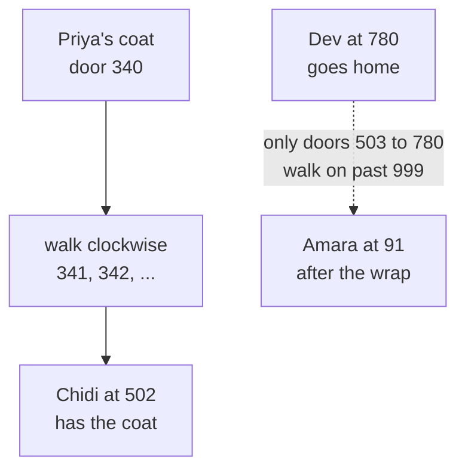
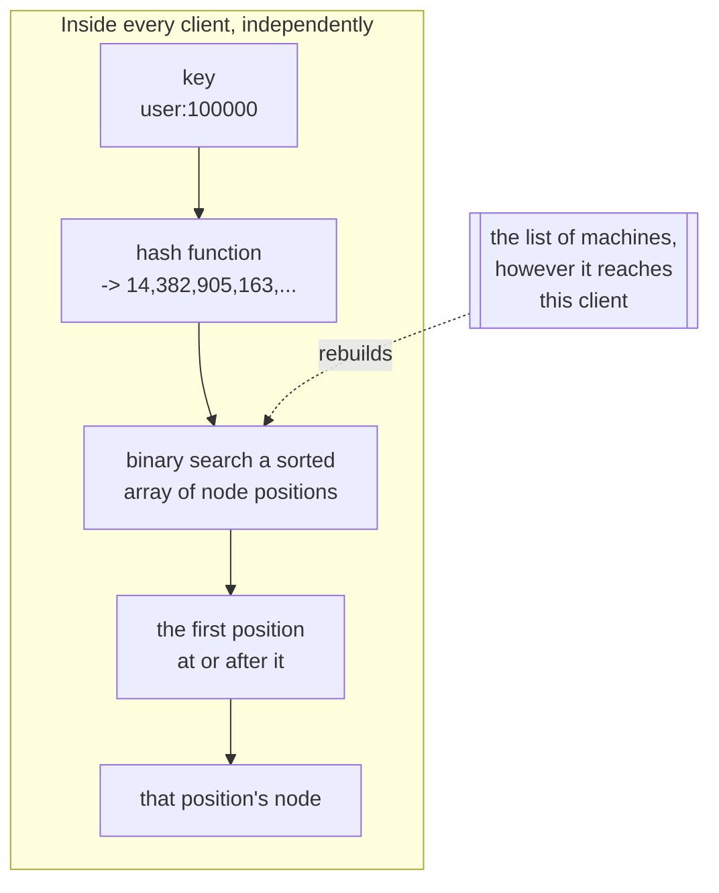
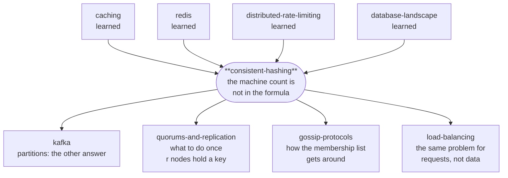

# Consistent hashing — how to spread data over machines without moving it all every time

> **Tell a friend:** Priya's coat is in a school cloakroom with four attendants,
> Amara, Bao, Chidi and Dev, and there is no list and nobody to ask. Every child
> finds their attendant by a rule, and the first rule anyone thinks of, "divide
> by how many attendants there are", sends three-quarters of the children to
> the wrong desk the moment Dev goes home sick. The fix is to take the number
> of attendants *out* of the rule: stand each attendant at a fixed door on a
> circular corridor, and let every child walk clockwise from their own door
> until they meet one. Now Dev leaving moves only Dev's coats, and Amara, Bao
> and Chidi keep every coat they had. That one missing number is the whole of
> consistent hashing; the rest of this lab is what you must add so the shares
> stay even, a dead attendant's coats spread out instead of landing on one
> neighbour, and copies end up on different machines.

Watch it before you read it: [The Clockwise Rule](https://claude.ai/code/artifact/4169af96-aa2e-4918-9d19-a10c74336747),
also saved as [`visualization.html`](visualization.html). Section 9 says what to click; section 19 says how the lab was built.

---

## 1. Why does this problem exist at all?

> **In one breath:** When your data no longer fits on one machine, every part
> of your system has to know which machine holds each item, without asking
> anyone. The obvious rule for that works perfectly until the number of
> machines changes. Then it sends almost everything to the wrong place at once.

You have more data than fits on one machine, or more traffic than one machine
can serve. So you buy several and split the work between them.

That creates a question straight away. It has to be answered millions of times
a second, by every part of your system, without anybody asking anybody: **given
this item, which machine has it?** Every one of your twenty application servers
must reach the same answer, alone, instantly, from nothing but the item's name.

There is an obvious rule that does exactly this. It costs nothing, and it
spreads the work perfectly evenly. It is what everybody writes. And it is right
up until the moment the number of machines changes. That means your first
deploy, your first autoscale, or your first hardware failure.

When that happens, the obvious rule sends **almost every item to a different
machine at once**. If those machines were a cache, your cache is now empty.
Your database is receiving your full unfiltered traffic with nothing in front
of it. That is not a slowdown. It is an outage, and it happens at the exact
moment you were trying to add capacity.

This lab is about why that happens and what to do instead.

## 2. The cloakroom: how does every child find their coat with nobody to ask?

> **In one breath:** Five hundred coats, four attendants, no list. Every child
> must work out which attendant has their coat, alone, from something they
> already know.

A school has a cloakroom holding 500 coats and four attendants: **Amara, Bao,
Chidi and Dev**.

The cloakroom cannot have a queue at a desk. 500 children arrive in four
minutes. So there is no list and nobody to ask. Every child has to work out for
themselves which attendant has their coat, from something they already know.

That constraint is the whole problem. Remember it: **no lookup, no asking,
everyone computes the same answer alone.**

Priya is one of the 500. Follow her coat. It is the one thing that something
happens to in every section from here on.

**Where this lab takes you.** Stop at any checkpoint and you still have
something whole.

| Layer | Sections | After it you can… |
|---|---|---|
| Beginner | 1–9 | tell the cloakroom story, and say why "divide by the number of attendants" fails |
| Intermediate | 10 | build the ring from scratch, and name the five places it breaks on the way |
| Engineering | 11–14 | reason about nine failures, say what is guaranteed, and read the code and experiments |
| Production | 15 | choose between the ring, its rivals, and the design Redis and Kafka picked instead |

## 3. What does a reasonable person try first?

> **In one breath:** Count the letters in your name, divide by four, and the
> remainder is your attendant. It is fast, it needs no list, and it spreads the
> coats evenly. There is nothing wrong with it. Yet.

The school's rule:

> Count the letters in your name. Divide by the number of attendants. The
> remainder is your attendant.

Priya has 5 letters. 5 divided by 4 leaves 1, so Priya's coat is with attendant
number 1, Bao. Every child can do this in their head. It needs no list, and the
coats spread evenly across all four.

This is a genuinely good rule. It is fast, it needs no memory, and it is
perfectly balanced. Every property you would ask for, it has.

> **🔮 Predict:** *Is there any property this rule lacks? Think about what the
> cloakroom will look like at lunchtime, not just at nine o'clock.*
> <details><summary>Reveal</summary>
> At nine o'clock it lacks nothing. If you said "it is unbalanced" or "it is
> slow", both are false, and experiment 6 in section 10 shows it: the remainder
> rule is the fastest scheme in this lab and among the best balanced. The
> missing property only shows itself when the *number of attendants changes*.
> That is the next section.
> </details>

## 4. Why does the remainder rule break when Dev goes home?

> **In one breath:** Dev goes home sick, so everyone divides by three instead
> of four. Now three-quarters of the children walk to the wrong attendant, even
> though only a quarter of the coats were ever Dev's.

Dev goes home sick at lunchtime. Now there are three attendants, so everyone
divides by 3 instead of 4.

Priya: 5 divided by 3 leaves 2. That is attendant number 2, Chidi. But Priya's
coat is with Bao, because Bao is who the *old* rule chose this morning.

> **🔮 Predict:** 500 children, one attendant of four goes home. How many
> children find their coat with the attendant their new calculation points at?
>
> <details><summary>Reveal</summary>
>
> **About one in four.** The lab's Java, run over 200,000 items, prints:
>
> ```
> 4 machines -> 3 :  the remainder rule moved 75.0% of items
> ```
>
> | What changed | Coats sent to a new attendant | What it means |
> |---|---|---|
> | 4 attendants → 3 | 75.0% | three-quarters of the cloakroom is now unfindable |
> | 100 attendants → 99 | 99.0% | nearly everything moves, to redistribute the 1% that had to |
>
> If you said "three in four find it", you were counting the coats Dev never
> held and assuming they stayed findable. They did not. Notice what makes this
> so much worse than it first sounds: **Dev only ever held a quarter of the
> coats.** Losing Dev should have disturbed a quarter of the children. Instead
> it disturbed three-quarters. The extra half is children whose coats never
> moved at all, and who are now looking in the wrong place.
>
> It gets worse as the school grows, not better. At 100 attendants, losing one
> moves **99.0%** of the coats, to redistribute the 1% that genuinely had to
> move.
> </details>

**Sit with what just went wrong, because it is not "the rule is inaccurate".**
The rule is perfectly accurate. The problem is what it depends on.

"The remainder after dividing by the number of attendants" makes every child's
answer depend on a **fact about the whole cloakroom**: how many attendants are
on duty. Change that one number and every answer changes at once. That includes
the overwhelming majority of children whose own situation did not change in any
way.

Engineers have a name for this rule. You will meet it everywhere, including in
this lab's code and experiment output: **modulo hashing**, after the remainder
operation at its heart. In words: turn the item's name into a number, divide by
the number of machines, keep the remainder. Written as code it is
`hash(key) % numberOfMachines`, the key's number divided by the machine count,
keep the remainder. The `%` sign means "the remainder of".

That is the actual disease. It is worth stating in a form you can carry to
other problems: **a rule whose output depends on a global count will produce a
global change whenever the count changes.** Any rule with the total in it has
this, no matter how clever the rest of it is.

## 5. What do we actually need?

> **In one breath:** Keep the part that works: every child decides alone. Fix
> the part that does not: when one attendant leaves, only that attendant's
> coats may be affected.

Stated plainly, before any solution:

> Every child must work out their attendant **alone**, from their own name and
> the list of who is on duty. No queue, no lookup, no asking.
>
> And when one attendant joins or leaves, **only that attendant's share of the
> coats may be affected**, roughly one in four of them. No other child's answer
> may change.

The first clause is what the remainder rule already gives us, and we must not
lose it. The second is the one it fails. Everything that follows is the pursuit
of both at once.

## 6. What idea fixes it?

> **In one breath:** Rebuild the cloakroom as a circular corridor of numbered
> doors. Each attendant stands at a fixed door. Each coat has a door number.
> Walk clockwise until you meet an attendant. The number of attendants is
> nowhere in that rule.

Rebuild the cloakroom as a **circular corridor with a thousand numbered
doors**, 0 to 999, running all the way round.

- Every coat gets a door number from the child's name. Some fixed calculation
  that always gives the same number for the same name.
- Every attendant stands at some door, at a spot decided the same way from
  their own name. Amara at 91, Bao at 305, Chidi at 502, Dev at 780.
- **The rule: walk clockwise from your coat's door number until you meet an
  attendant. That attendant has your coat.**

Priya's name gives door 340. She walks 341, 342, ... and meets Chidi at 502.
Chidi has her coat.



> **🔮 Predict:** *Dev goes home again. He stood at door 780. Which children
> have to walk somewhere new, and where do they end up?*
> <details><summary>Reveal</summary>
> Only the children whose door numbers fall between Chidi at 502 and Dev at
> 780. They keep walking past 780, run off the end at 999, come back in at 0,
> and reach Amara at 91. Priya at 340 is not one of them; she still meets
> Chidi. If you said "everyone past 780 as well", look again: a coat at 900
> walked to Amara *before* Dev left too, because Dev at 780 was already behind
> it.
> </details>

Now Dev goes home. Dev stood at 780, so the coats affected are exactly those
whose numbers fall between Chidi at 502 and Dev at 780. They now keep walking
past 780 and reach Amara at 91, wrapping round the end. **Every other child's
walk is unchanged**, because nothing between the other attendants moved.

Look at the rule again and notice what is missing from it: *how many attendants
there are*. It does not appear. There is nothing global left to change.

That is the whole invention. Everything else in this document is consequences.

## 7. What do engineers call all these things?

> **In one breath:** The door-number calculation is a hash function. The
> corridor is the hash space, and bent into a circle it is the ring. Attendants
> are nodes, coats are keys, and "the first attendant clockwise" is the
> successor. You have already felt every one of them.

You have earned all of these. Each names something you have already felt in
the corridor. Walk it once more, naming things as we pass them.

### The calculation that turns a name into a door number

The thing that turned "Priya" into door 340 is a **hash function**. In words: a
calculation that takes any input and gives back a fixed-size number. For our
purposes it must have two properties. It must be **deterministic**: same input,
same output, on every machine, forever. And it must be **uniform**: outputs
spread evenly over the whole range, with no clumping.

Why does the term exist separately from, say, encryption? To separate the two
jobs a hash can do. Cryptographic hashes promise you cannot work backwards or
find collisions. We need neither of those. We need only spread and determinism.
That is why this world uses fast non-cryptographic hashes like MurmurHash
rather than SHA-256.

In this lab's code, `src/Hashing.java` has `hash64("user:100000")`, which
always produces the same 64-bit number, on every machine, in every process.

One trap, and the lab shows it happening: uniformity is a property of the hash
*and* of the range you use it in. Section 11 F6 shows a perfectly good hash
destroying a cluster because its output was 32 bits wide and the space it was
being placed into was 64.

### The corridor, and why it is a circle

All the door numbers, laid out in a circle, are the **hash space**, treated as
a **ring**. In words: the full range of numbers the hash function can produce,
with the largest value declared to wrap round to the smallest. For a 64-bit
hash that range is 0 to 2⁶⁴−1, two to the power sixty-four, minus one.

Why name it? Because it is the thing that stays *fixed*. The number of machines
changes constantly; the hash space never does. Putting both the items and the
machines into that one unchanging space is the substitution that solves the
problem, and the ring is that space.

In the code, `Ring.successorIndex` binary-searches a sorted array of positions.
When it runs off the end, it returns index 0. That single line is where the
corridor becomes a circle.

### Attendants and coats

An attendant is a **node**: a machine that can hold data. A coat is a **key**:
the identifier of one item. Both are hashed into the same space, which is the
point. They are the same kind of thing as far as the ring is concerned.

The words are deliberately generic. The same mechanism places cache entries on
cache servers, database rows on database nodes, and live HTTP requests on
backend servers. Naming them "key" and "node" keeps the mechanism separate from
any one use.

### The first attendant you meet

The attendant Priya meets walking clockwise is the key's **successor**, its
clockwise owner. In words: the node whose position is the smallest one greater
than or equal to the key's position, wrapping to the first node if there is
none.

"Successor" is the word the original paper and every implementation uses. It
names a *relative* relationship rather than an absolute slot. That is precisely
the difference from the remainder rule. A key does not have a slot number that
must be recomputed. It has a neighbour.

Concretely: key at 340, nodes at 91/305/502/780, so the owner is the node at
502. That is Priya and Chidi again.

### The share of coats that have to move

When Dev went home, some share of the coats had to find a new attendant. That
share is the **remapping fraction**. In words: the proportion of keys whose
owner changes when the membership changes.

It is the number the whole field is optimising, and it has a floor that people
forget. Suppose there are some number of machines, call that number n, and one
more joins. For all n+1 machines to share the keys evenly, at least one share in
n+1 of the keys *must* end up somewhere new. That movement is not waste. It is
the job. Everything **above** the floor is waste, and that gap is what to
measure.

| Symbol | In words | Example |
|---|---|---|
| `n` | how many machines there are right now | 10 |
| `1/(n+1)` | the floor: one share in n+1 must move so the newcomer gets a fair share | 1/11, which is 9.1% |
| `hash(key) % n` | the remainder rule: the key's hash, divided by the machine count, keep the remainder | 5 % 4 = 1, so Bao |

Experiment 1 counts it on 200,000 keys:

| change | remainder rule | ring | unavoidable | what it means |
|---|---|---|---|---|
| 10 → 11 machines | 90.8% | 9.5% | 9.1% | the ring is within half a point of the floor |
| 100 → 101 machines | 99.0% | 0.9% | 1.0% | the remainder rule does a hundred times the necessary work |

### The map back to the story

| In the story | Engineers say | Where you met it |
|---|---|---|
| the calculation that gives Priya door 340 | hash function | section 6, the door number from a name |
| the corridor of 1,000 doors, bent into a circle | hash space, the ring | section 6, the corridor |
| an attendant, a coat | node, key | section 2, the cloakroom |
| the first attendant clockwise (Chidi, for Priya) | successor, the clockwise owner | section 6, Priya's walk |
| the share of coats that walk somewhere new when Dev leaves | remapping fraction | section 4, three-quarters against one-quarter |
| divide by the number on duty, keep the remainder | modulo hashing | section 3, the school's first rule |

## 8. What two pictures should you carry in your head?

> **In one breath:** The simple picture is the corridor. The engineering
> picture is a sorted array of numbers inside every client, searched with
> binary search. They are the same thing, and there are four places the
> corridor picture lies to you.

### The simple model (carry this around)

A circular corridor of numbered doors. Attendants stand at fixed spots decided
by their names. Every coat has a door number decided by its owner's name. Walk
clockwise until you meet an attendant.

### The engineering model (this is what actually runs)

Read it top to bottom. It is Priya's walk, done by a client program.



- **State:** a sorted array of positions, and a parallel array naming which
  node each position belongs to. That is all. There is no server, no table, and
  no lookup service.
- **Lookup:** hash the key, binary search, take the successor. No network
  involved. The cost is a binary search over all the positions, written
  `O(log(nodes × positions))`. In words: the time grows only with the logarithm
  of how many positions there are.
- **On a membership change:** rebuild the array. Nothing else in the system is
  told anything.
- **The invariant everything rests on:** a node's positions depend only on that
  node's own name, never on how many other nodes exist.

### The map between them

| cloakroom | consistent hashing | where it is in the code |
|---|---|---|
| the circular corridor of doors | the hash space, treated as a ring | `Ring.positions` |
| a child's name → a door number | the hash function applied to a key | `Hashing.hash64` |
| an attendant standing at a door | a node's position on the ring | `Ring.rebuild` |
| walking clockwise to the next attendant | finding the successor | `Ring.successorIndex` |
| wrapping past door 999 back to door 0 | the wrap that closes the ring | `lo == positions.length ? 0 : lo` |
| an attendant going home | a node leaving | `Ring.removeNode` |

### Where the story lies to you

Four places, and each one matters later:

1. **The corridor has 1,000 doors; a real ring has 2⁶⁴ positions.** With a
   thousand doors, two children would constantly share one and you would wonder
   what happens. In a 64-bit space, positions are so astronomically sparse that
   collisions never come up. The sparseness is not a detail. It is why the
   hash's *width* is load-bearing (section 11 F6).
2. **An attendant stands in one place; a machine occupies hundreds of positions
   at once.** The single most important refinement in section 10 has no
   counterpart in the story, because a person cannot be in two places.
   Machines can, and must.
3. **The children can see who is on duty.** Real machines find out late.
   Whatever mechanism tells them takes time to reach everyone, and during that
   window different clients hold different lists and compute different owners.
   That is a real failure mode with real consequences (section 11 F4), and the
   story simply does not contain it.
4. **Coats do not walk to their new attendant by themselves.** This is the big
   one. Consistent hashing decides **where an item belongs**. It does not move
   anything. For a cache you do not need it to: the item is simply absent and
   gets fetched again. For stored data, something else entirely must notice the
   change and copy the data. That machinery is a separate system with its own
   failure modes (section 11 F8).

## 9. Can you watch it move?

> **In one breath:** Open the visualization, press "Add a machine", and watch
> one strip of coloured dots barely flicker while the other repaints itself.
> That is section 4 and section 6 side by side.

Spend five minutes here before the mechanism. The rest of the document is much
easier once you have seen keys change colour.

**→ [The Clockwise Rule](https://claude.ai/code/artifact/4169af96-aa2e-4918-9d19-a10c74336747)**
*(also saved locally as `visualization.html`)*

The page is the corridor, drawn as a circle. Machines are the thick coloured
bands. Items are the small dots just inside, and a dot takes the colour of the
band ahead of it clockwise. Click any dot to watch its walk, which is Priya's
walk from section 6.

The thing to actually do: press **Add a machine**, then look at the two strips
lower down. Both show the same 180 items coloured by owner, one under the ring,
one under the remainder rule. The ring's strip barely flickers. The other one
turns into a different picture entirely. That is section 4 and section 6, side
by side, on identical data.

Five predict-then-watch scenarios cover the surprises: how little moves, why
one position per machine is not enough, where a dead machine's items land, why
nothing ever moves sideways, and what a too-narrow hash does to the whole
cluster.

> **CHECKPOINT — end of the beginner model, start of the intermediate.** You
> can now explain why the obvious rule fails, what the ring replaces it with,
> and why "the number of machines is not in the formula" is the entire trick.
> That is enough to follow a design discussion and to spot the bug in
> someone's sharding scheme. What the next layer adds: the version of this you
> would build from section 6 alone is badly broken in two specific ways. Next
> we build it, break it, and fix it.
>
> **Say it back.** Without using the words *hash*, *ring* or *modulo*, explain
> to a friend why Dev going home sent three-quarters of the children to the
> wrong desk under the first rule, and only a quarter under the second.
> <details><summary>A good answer sounds like</summary>
> "The first rule had 'how many attendants' inside it, so when that number
> changed every child's answer changed, even for children whose coats never
> moved. The second rule only says 'walk to the next attendant', and Dev
> leaving only changes the walk for children who used to stop at Dev."
> </details>

## 10. How do you build it, and where does it break on the way?

> **In one breath:** Build exactly what section 6 describes, with real numbers,
> and watch it fail five times. Each fix is a scar: many positions per machine,
> distinct machines for copies, more positions for bigger machines, an optional
> hard cap. Then meet two rivals that skip the ring entirely.

Let us build exactly what section 6 describes, and watch it fail. The four
attendants become four machines, named by their initials. Amara is machine A,
Bao is B, Chidi is C, Dev is D.

### v1: what does the rule look like with real numbers?

Four machines. Hash each machine's name to get its position:

```
hash("A") = 91      hash("B") = 305     hash("C") = 502     hash("D") = 780
```

Sorted, that is the ring: `[91:A, 305:B, 502:C, 780:D]`. In words: Amara at 91,
Bao at 305, Chidi at 502, Dev at 780, exactly where they stood in the corridor.
Now place some keys. Each key is a shopping cart, and `cart:17`, at 340, is
Priya's.

| key | its position | first position at or after it | owner |
|---|---|---|---|
| `cart:17` | 340 | 502 | **C** |
| `cart:22` | 88 | 91 | **A** |
| `cart:31` | 954 | *(none, so wrap to the first)* | **A** |
| `cart:45` | 610 | 780 | **D** |

`cart:31` is the interesting one. Its position, 954, is past every machine, so
the walk runs off the end of the array and comes back to the start. That wrap
is one line of code. It is what makes this a circle rather than a line. Without
it, every key above 780 would have no owner at all. The test
`ring_wraps_around_past_the_top_of_the_number_space` pins it.

> **🔮 Predict:** *A fifth attendant, Esha (machine E), arrives and stands at
> door 400. Which of the four keys above change owner, and where do they go?*
> <details><summary>Reveal</summary>
> Only `cart:17`, Priya's, and it goes to E. It sat at 340, and 400 is now the
> first position after it. If you said `cart:45` moves too, check: 610 walks to
> 780 both before and after, because Esha stood *behind* it, not in front of
> it. Nothing can move between A, B, C and D, and the paragraph after the table
> says why that is not luck.
> </details>

**Now add machine E at position 400.** The ring becomes
`[91:A, 305:B, 400:E, 502:C, 780:D]`. Recompute:

| key | position | owner before | owner now |
|---|---|---|---|
| `cart:17` | 340 | C | **E** ← moved |
| `cart:22` | 88 | A | A |
| `cart:31` | 954 | A | A |
| `cart:45` | 610 | D | D |

One key moved, and it moved **onto the new machine**. Look at why that is not
luck. Inserting a position into the ring can only put a new candidate *in front
of* some keys. It cannot reorder any of the machines that were already there.
So no key can be pushed from one existing machine to another.

That property has a name, **monotonicity**, and it is the formal statement of
what consistent hashing guarantees: *adding a node only ever moves keys onto
the newcomer, never sideways between existing nodes.* Experiment 4 counts it on
200,000 keys. In its output, `vnodes=200` means 200 positions per machine, and
break 1 below explains why there are 200 of them.

```
strategy               moved to newcomer  moved elsewhere    total moved
modulo                           17,989          163,679        181,668
ring(vnodes=200)                 18,603                0         18,603
```

| strategy | moved to newcomer | moved elsewhere | total moved | what it means |
|---|---|---|---|---|
| modulo | 17,989 | 163,679 | 181,668 | nine in ten of its moves were sideways, for nothing |
| ring, 200 positions per machine | 18,603 | 0 | 18,603 | every move was onto the newcomer; not one was sideways |

The middle column is the whole lab in one number. Modulo's 163,679 sideways
moves achieved nothing whatsoever. Those keys were fine where they were.

### Break 1: why is the load so uneven?

> **🔮 Predict:** eight machines, one position each. Eight random points on a
> circle. Do they cut it into eight roughly equal slices?
>
> <details><summary>Reveal</summary>
>
> No, and it is much worse than "roughly". Experiment 2, 200,000 keys over 8
> machines, where a fair share is 25,000:
>
> ```
> positions       busiest     quietest      imbalance
> 1               118,515        1,657          4.74x
> ```
>
> The busiest machine holds **4.74 times its fair share** and the quietest
> holds under 7% of one. If you said "roughly equal, give or take", you were
> picturing evenly spaced points. Random points are not evenly spaced. And no
> hash function can fix this, because nothing is wrong with the hash. Random
> points on a circle simply leave gaps of wildly differing size, and **the gap
> is the machine's share**.
> </details>

Back in the corridor: Amara at 91, Bao at 305, Chidi at 502, Dev at 780. Bao's
stretch runs from door 92 to door 305, which is 214 doors. Chidi's runs from
306 to 502, which is 197. Dev's runs from 503 to 780, which is 278. Amara's,
with the wrap, runs from 781 round to 91, which is 311. Nobody chose those
shares. The names did.

**The fix: put each machine at many positions instead of one.** In the story,
Bao no longer stands at one door. Bao stands at two hundred doors at once,
scattered round the corridor, and a coat is Bao's if the first door it reaches
is any of them. Machine A appears at `hash("A#0")`, `hash("A#1")`, ...
`hash("A#199")`: two hundred unrelated points scattered right round the circle.
Its share is now the sum of two hundred independent gaps. The relative
variation of a sum of many independent values shrinks as the square root of
how many there are. Written `1/√n`, one over root n: with 100 positions the
wobble is about a tenth of what it was with one.

These extra positions are called **virtual nodes** (or *vnodes*, or *tokens*,
depending whose documentation you are reading). In words: extra positions for
one machine, so its share is an average rather than a lottery. Experiment 2
sweeps the count:

```
positions       busiest     quietest      imbalance
1               118,515        1,657          4.74x
5                47,097       18,895          1.88x
20               33,252       19,306          1.33x
100              26,435       23,332          1.06x   <- typical production setting
500              25,592       24,299          1.02x
```

| positions per machine | busiest | quietest | imbalance | what it means |
|---|---|---|---|---|
| 1 | 118,515 | 1,657 | 4.74× | a lottery; the biggest slice is nearly five fair shares |
| 5 | 47,097 | 18,895 | 1.88× | better, and still nearly double on one machine |
| 20 | 33,252 | 19,306 | 1.33× | a third over on the busiest |
| 100 | 26,435 | 23,332 | 1.06× | the typical production setting: 6% over |
| 500 | 25,592 | 24,299 | 1.02× | five times the memory for four more points |

That curve is why production values sit in the low hundreds. Going from 1 to
100 removes almost all of the imbalance. Going from 100 to 500 buys another
four percentage points for five times the memory.

### Break 2: a machine dies. Who inherits its keys?

Virtual nodes were introduced above to fix *steady-state balance*. They turn
out to fix something more dangerous, and this is the reason that actually
matters.

> **🔮 Predict:** eight machines, one position each, and one of them fails. Its
> keys have to go somewhere. Do they spread over the seven survivors, or land
> on one of them?
>
> <details><summary>Reveal</summary>
>
> **All on one**, and it is chosen by an accident of the circle rather than by
> who has room. Experiment 3:
>
> ```
> --- 1 position per machine ---
> n3 held 7,996 keys. After it died they went to:
>   n7   +  7,996   (1,657 -> 9,653, +483%)
> ```
>
> n7 was the *quietest* machine in the cluster and is now by far the busiest,
> in one step, with no warning. If you said "they spread out", you were
> thinking of the many-positions ring. With one position each, a dead machine
> has exactly one clockwise neighbour, and that neighbour gets everything.
>
> Now think about what happens if the cluster was near capacity. The inheritor
> is not chosen by who can cope, so it may well be a machine that cannot. When
> it falls over, **its** entire share lands on **its** single neighbour, which
> is now taking three machines' worth. That is a cascading failure with a
> concrete mechanism, and it is a real way clusters die.
> </details>

In the corridor this is Dev going home with one door each: every one of Dev's
coats walks on to Amara, and only Amara. With two hundred doors each, the dead
machine's share is cut into two hundred small gaps whose neighbours are all
different machines, so it spreads over everybody:

```
--- 200 positions per machine ---
n3 held 24,550 keys. After it died they went to:
  n0 +2,705 (+10%)   n1 +4,253 (+19%)   n2 +2,794 (+12%)   n4 +2,613 (+10%)
  n5 +4,368 (+18%)   n6 +3,113 (+12%)   n7 +4,704 (+18%)
```

| positions per machine | who inherits n3's keys | biggest single rise | what it means |
|---|---|---|---|
| 1 | n7 alone: +7,996, from 1,657 to 9,653 | +483% | the quietest machine becomes the busiest in one step |
| 200 | all seven: n0 +2,705, n1 +4,253, n2 +2,794, n4 +2,613, n5 +4,368, n6 +3,113, n7 +4,704 | +19% | a 10–19% bump on everyone; nobody falls over |

A uniform 10–19% bump on everyone, instead of +483% on one victim. **This, not
the balance, is the argument for virtual nodes that would survive a design
review.**

### Break 3: where do the copies go?

One machine holding the only copy of a key is not a design anyone ships. In the
corridor: if Chidi loses Priya's coat, Priya has no coat. So you want each coat
with several attendants. Engineers call the number of copies the **replication
factor**. In words: how many distinct machines hold a copy of each key. It is
written `r`, so `r` = 3 means three machines each hold the key. The obvious
extension: take the next `r` positions clockwise.

> **🔮 Predict:** the ring has 200 positions per machine. You take the next 3
> positions clockwise and call them your three replicas. What is wrong with
> that?
>
> <details><summary>Reveal</summary>
>
> With 200 positions each, adjacent positions are frequently the **same
> physical machine**. So all three "copies" can land on one box. Your data
> reads as replicated, is not, and you find out the day that machine dies. If
> you said "nothing, three positions are three places", remember that Bao now
> stands at two hundred doors, and two of the next three doors may both be Bao.
>
> The fix is one line: walk clockwise collecting **distinct** nodes, skipping
> further positions belonging to a machine already chosen. It is the
> `!out.contains(n)` check in `Ring.owners`, and `BrokenRing` bug 2 removes it
> so you can watch the failure.
> </details>

Real systems go one step further than distinctness, and it is worth knowing
why. Three distinct machines in the same rack share a power supply and a
top-of-rack switch. They fail together, and your replication factor of 3 is
really 1. Cassandra and DynamoDB therefore make the walk **rack- and
datacentre-aware**: keep walking until you have three machines in three
different failure domains. Consistent hashing gives you the ordering. What
counts as "different enough" is yours to define.

### Break 4: what if the machines are not the same size?

You bought five machines two years ago and three more last month with four
times the memory. Equal shares would waste most of the new hardware. In the
corridor: Dev is a much faster attendant than Bao, and should hold more coats.

> **🔮 Predict:** *How do you tell the ring that one machine should hold four
> times as much? Does it need a new setting?*
> <details><summary>Reveal</summary>
> No new setting. A machine's share **is** the total width of its gaps, so give
> it four times as many positions. If you guessed "a weight field that the
> lookup consults", you were adding a step the lookup never needs. The weight
> is already baked into where the positions are.
> </details>

There is no separate weighting mechanism, because there does not need to be
one. Experiment 8 gives the large machines four times the positions:

```
machine              keys   fair share      ratio
small-1            18,128       18,181      1.00x
small-3            17,325       18,181      0.95x
large-1            73,178       72,724      1.01x
large-2            70,999       72,724      0.98x
```

| machine | keys | fair share | ratio | what it means |
|---|---|---|---|---|
| small-1 | 18,128 | 18,181 | 1.00× | exactly its share |
| small-3 | 17,325 | 18,181 | 0.95× | 5% under, within the usual wobble |
| large-1 | 73,178 | 72,724 | 1.01× | four times a small machine's share, as asked |
| large-2 | 70,999 | 72,724 | 0.98× | the same, 2% under |

The catch: weight is expressed in whole positions, so fine ratios need enough
positions to exist at all. Another reason the number is in the hundreds.

### Break 5: the average is fixed. What about the worst case?

Two hundred positions brings the busiest machine to about 1.06× its fair
share. For *stored data* that is fine. For *live requests* it may not be. 6%
over on a machine sized at 95% utilisation is the machine falling over.

The fix, if you need it, is **consistent hashing with bounded loads**. In the
corridor: every attendant has a hard limit on coats. When Priya reaches Chidi
and Chidi is full, she keeps walking to the next attendant who is not. In
words: give every machine a hard cap, a little above its fair share, and when a
key's rightful owner is full, keep walking to the first machine that is not.

| Symbol | In words | Example |
|---|---|---|
| `c` | the slack factor: how far above a fair share a machine may go | 1.05 means 5% over |
| `ceil(c × total / n)` | the cap: the slack factor times the fair share, rounded up | 1.05 × 200,000 / 10, which is 21,000 |

Experiment 7:

```
setting                         busiest      imbalance   sent elsewhere
ring, no cap                     21,636         1.082x                -
bounded load (c=1.05)            20,980         1.049x              914
bounded load (c=1.01)            20,192         1.010x            4,356
```

| setting | busiest | imbalance | sent elsewhere | what it means |
|---|---|---|---|---|
| ring, no cap | 21,636 | 1.082× | none | 8% over on the busiest |
| bounded load, c = 1.05 | 20,980 | 1.049× | 914 | the cap holds at 5%; 914 keys walked on |
| bounded load, c = 1.01 | 20,192 | 1.010× | 4,356 | nearly perfect, and 4,356 keys are not where the ring says |

The last column is the price. There is a much bigger one hiding behind it:
**this is stateful**. A key's answer now depends on how many other items have
already been placed. So two clients with different traffic reach different
answers, and you cannot recompute an item's location later from the key alone.
It is a load balancer's tool, HAProxy ships it, and not a database's.

### One more thing: do you need the ring at all?

Everything above builds the ring, because the ring is what the libraries
implement and what people mean by "consistent hashing". But two other
algorithms give you the same core guarantee, and one of them is simpler than
anything on this page.

**Rendezvous hashing**, also called *highest random weight*, is from Thaler &
Ravishankar. It was published in **1996, a year before** the consistent hashing
paper, and is far less famous. In the corridor: instead of standing at doors,
every attendant rolls a die for every coat, and the coat goes to whoever rolled
highest for it. The whole algorithm is: for a given key, score every machine by
`hash(key + machine)`, the hash of the key and the machine's name joined
together, and give the key to the highest scorer.

That is it. No circle, no sorted array, no virtual positions, no tuning knob.
And it inherits the properties you spent this section earning. A machine
leaving only affects the keys it was winning. Because every survivor is
re-scored independently, those keys spread perfectly across all of them rather
than piling onto one successor. Replication is free too: take the top `r`
scorers instead of the top 1.

**Jump consistent hash** (Lamping & Veach, Google, 2014). About twenty lines,
literally zero memory, and the best balance of anything here. It has one hard
limitation: it maps a key to a bucket *number*, so buckets are positions in an
ordered list and you can only add or remove at the **end**. There is no way to
express "machine 3 died". In the corridor: attendants are numbered in a line,
a new one may join at the end and the last one may leave, but Chidi, in the
middle, is never allowed to go home.

> **🔮 Predict:** *Five rows, 100 machines, 200,000 keys. Which column will the
> remainder rule lose on, and how many will it win or tie?*
> <details><summary>Reveal</summary>
> It loses exactly one column, "moved on remove", and it is competitive or
> winning on every other. If you said "it will be the worst balanced",
> experiment 6 says otherwise: 1.07×, as good as jump hash. Balance was never
> the hard part.
> </details>

Experiment 6 runs all of them over 100 machines and 200,000 keys:

```
strategy                   imbalance  moved on remove         lookup       memory
ring(vnodes=200)               1.16x             1.1%       0.138 us 100 x 200 entries
ring(vnodes=20)                1.66x             1.0%       0.091 us 100 x 20 entries
rendezvous                     1.06x             1.0%       4.013 us the node list
jump hash                      1.07x             1.0%       0.152 us nothing at all
modulo                         1.07x            99.0%       0.051 us the node list
```

Read it as two tables. First, balance and movement:

| strategy | imbalance | moved on remove | what it means |
|---|---|---|---|
| ring, 200 positions | 1.16× | 1.1% | near the floor on movement; balance a little rough at 100 machines |
| ring, 20 positions | 1.66× | 1.0% | movement fine, balance poor: too few positions |
| rendezvous | 1.06× | 1.0% | the best balance here, with no tuning at all |
| jump hash | 1.07× | 1.0% | as good, but only when the change is at the end of the list |
| modulo | 1.07× | 99.0% | balance is fine; nearly every key moves on any change |

Then cost:

| strategy | lookup | memory | what it means |
|---|---|---|---|
| ring, 200 positions | 0.138 µs | 100 × 200 entries | a binary search over 20,000 entries |
| ring, 20 positions | 0.091 µs | 100 × 20 entries | a smaller search over 2,000 |
| rendezvous | 4.013 µs | the node list | scores all 100 machines every lookup: 29× the ring |
| jump hash | 0.152 µs | nothing at all | a short loop and no state |
| modulo | 0.051 µs | the node list | one division; the fastest thing in the lab |

Read the balance column first and notice that **almost everything wins it,
including modulo**. Balance was never the hard part. The column that
disqualifies modulo is "moved on remove". The columns that separate the other
three are lookup cost and what kind of membership change they can express.

Rendezvous is **29× slower per lookup** than the ring at 100 machines, because
it scans every machine while the ring binary-searches. At ten machines that
difference is irrelevant and rendezvous is the better engineering choice. At a
thousand it is disqualifying. That single trade is why the ring won the
mindshare. It is worth knowing that the simpler algorithm exists and is often
the right answer.

> **CHECKPOINT — end of the intermediate model, start of the engineering.**
> You can now derive the real algorithm from scratch: hash both keys and
> machines into one fixed space, take the successor, scatter each machine over
> many positions, walk to distinct nodes for replicas, weight by position
> count. Every one of those is a scar from a failure you just watched. What
> the next layer adds: what this looks like when it goes wrong in production.
> Which failures it prevents, which it merely reshapes, and which it does
> nothing about at all.
>
> **Say it back.** A colleague says "virtual nodes are for balance". In two
> sentences, give them the better reason, using Dev and Amara.
> <details><summary>A good answer sounds like</summary>
> "With one door each, every coat Dev held walks to Amara alone, so Amara gets
> a whole attendant's worth at once and may fall over too. With two hundred
> doors each, Dev's coats are spread among all the others, a little each, and
> nobody falls over."
> </details>

## 11. What goes wrong in production, and what survives each time?

> **In one breath:** Nine things go wrong. The ring prevents some, shrinks
> some, and does nothing about others. In every one of them the placement
> stays correct. What breaks is balance, capacity, agreement, or data that
> never moved.

Each failure below is told first as something that happens in the cloakroom,
then as what you would see on a real cluster. The comparison table at the end
of the section lines them all up.

### F1: what if there are too few positions?

Run `java src/Experiments.java 2`, or drag the positions slider to 1 in the
visualization.

In the corridor with one door per attendant, Amara owns 311 doors and Chidi
197. Nobody chose that. The names did. On the cluster it is section 10 break
1: few random points cut a circle into wildly unequal gaps, and the gap is the
share. The busiest machine sits at **4.74×** its fair share.

Correctness is untouched. Every key still has exactly one well-defined owner
and every client agrees on it. What you lose is your ability to size the
cluster, because you must provision for the worst machine, not the average
one.

On call, watch per-node key count or request rate as a ratio to the mean, not
in absolute terms. An alert on `max/mean > 1.3`, the busiest node at more than
1.3 times the average, catches both a bad position count and the hot key in
F5.

### F2: a machine dies and one neighbour inherits all of it. Why?

Run `java src/Experiments.java 3`, or the third scenario in the visualization.

Dev goes home with one door each, and every one of his coats walks to Amara.
On the cluster it is section 10 break 2. With one position each, the whole
share lands on a single successor chosen by geometry rather than by capacity.
The run shows **+483%** on a machine that was the quietest in the cluster.

Correctness again survives. What is lost is the assumption that failures are
independent. One machine's death is now a targeted load spike on one specific
other machine, and if that one falls over the pattern repeats.

This is why nobody runs one position per node. It is also why you should test
a node failure under load rather than at rest. The failure mode is a
*capacity* event, not an availability one, and it is invisible on an idle
cluster.

### F3: what is the miss storm when you add capacity?

> **🔮 Predict:** a 10-machine cache is running at 92% hit ratio. You add an
> 11th machine mid-traffic. What does your database experience in the next few
> seconds?
>
> <details><summary>Reveal</summary>
>
> Under the ring, almost nothing. Under the remainder rule, close to your full
> unfiltered request rate. If you said "a small dip either way", the remainder
> rule's dip is not small: it is the cache going cold. Experiment 5 tracks hit
> ratio in windows of 25,000 requests:
>
> ```
> modulo             55%  85%  88%  90%  91%  92% |ADD| 59%  85%  89%  90%  91%  92%
>                    database hit 10,313 times in the 25,000 requests right after
> ring(vnodes=200)   55%  85%  88%  90%  91%  92% |ADD| 90%  93%  94%  95%  95%  96%
>                    database hit  2,622 times in the 25,000 requests right after
> ```
>
> | rule | hit ratio just before | hit ratio just after | database hits in the next 25,000 requests | what it means |
> |---|---|---|---|---|
> | modulo | 92% | 59% | 10,313 | a cold cache, in one instant, for the whole fleet |
> | ring, 200 positions | 92% | 90% | 2,622 | a two-point dip; the database barely notices |
>
> Modulo's hit ratio collapses from 92% back to 59%. The ring dips two points.
> Both then climb: modulo 59, 85, 89, 90, 91, 92; the ring 90, 93, 94, 95, 95,
> 96. The warm-up before the add is the same for both: 55, 85, 88, 90, 91, 92.
> </details>

In the corridor: a new attendant, Esha, arrives with an empty rail. Every child
whose walk now ends at Esha's desk finds no coat there, and every one of them
goes to the office for a replacement at the same moment. On the cluster: every
key that moves is a cache entry now sitting on a machine that does not have
it, so the next request for it misses. They all move at the same instant, so
they all miss at the same instant.

Nothing is incorrect. A cache miss returns the right answer. What is lost is
the protection your cache was providing, at the exact moment you were adding
capacity, which is a particularly cruel piece of timing.

Note that both rows recover within a minute. **The storm is a transient**,
which is what makes it dangerous. It is over before you finish reading the
alert, it vanishes into a five-minute average, and the thing it took down was
your database rather than your cache. This is [caching](../11-caching/)'s
cold-cache problem with a specific trigger: your own deploy.

### F4: what if two clients disagree about who is alive?

Run `java src/Experiments.java 9`.

In the corridor: Esha has just arrived, but only half the children have been
told. Those who know walk to Esha. Those who do not walk past her to Chidi. Two
children with the same door number now go to two different desks. On the
cluster: a machine is added; client A has heard, client B has not yet.

> **🔮 Predict:** *Half your clients know about the new machine and half do
> not. What fraction of keys do the two halves disagree about, under each
> rule?*
> <details><summary>Reveal</summary>
> Exactly the remapping fraction from section 7: about nine keys in ten under
> modulo, about one in ten under the ring. If you said "all of them, under
> both", remember that a client who has not heard still agrees with one who
> has about every key that did not move.
> </details>

```
strategy                   keys disagreed         of 200,000
modulo                            181,699              90.8%
ring(vnodes=200)                   19,015               9.5%
```

| strategy | keys disagreed | share of 200,000 | what it means |
|---|---|---|---|
| modulo | 181,699 | 90.8% | a write and a read for the same key go to different machines nine times in ten |
| ring, 200 positions | 19,015 | 9.5% | the disagreement is exactly the keys that moved, and no more |

Membership never changes everywhere at the same instant. It propagates, by
gossip, by a config push, by a watch firing. During that window your clients
hold different lists and therefore compute different owners.

Every individual client remains self-consistent. What is lost is agreement
*between* clients, so a write may land on one machine while a read looks on
another.

This is the failure that makes consistent hashing an *operational* win rather
than merely an efficient one, and it is the one people miss. You do not
control the length of the propagation window. You do control the **blast
radius**, and it is exactly the remapping fraction. For a cache the cost is
extra misses. For stored data a write to the wrong owner is invisible until
the reader who needed it comes looking. Section 15 covers the alternative
design that removes this window entirely by accepting a coordinator.

### F5: what if one key gets all the traffic?

In the corridor: one coat, and five hundred children asking for it. It hangs
on one hook, with one attendant, and hiring more attendants does not help. On
the cluster: consistent hashing distributes *keys*. A single key lives on one
machine. If one key is 30% of your traffic, 30% of your traffic is on one
machine, and adding machines does nothing at all.

Correctness is fine. Horizontal scalability for that workload is gone.

You met this in [distributed-rate-limiting](../60-distributed-rate-limiting/) as
the hot-key problem and again in [redis](../13-redis/) as F8, and the remedies
are the same. Split the key into `key:0..key:9` and combine. Put a short-TTL
local cache in front of it. Or route by a different dimension. **Worth saying
plainly: no placement algorithm on this page helps with a hot key.** They all
agree that one key has one owner, which is the thing hurting you.

### F6: what if the hash is narrower than the space you put it in?

> **🔮 Predict:** the ring is fine, the machine positions are spread perfectly
> across the whole 64-bit circle. The only change: keys are hashed with a
> 32-bit function instead of a 64-bit one. What happens?
>
> <details><summary>Reveal</summary>
>
> **One machine gets everything.** 8 machines and 20,000 keys:
>
> ```
> 64-bit key hash: {n0=2636, n1=2385, n2=2539, n3=2378, n4=2546, n5=2509, n6=2349, n7=2658}
> 32-bit key hash: {n0=0, n1=0, n2=0, n3=0, n4=0, n5=20000, n6=0, n7=0}
> ```
>
> | key hash | keys per machine | what it means |
> |---|---|---|
> | 64-bit | n0 2,636 · n1 2,385 · n2 2,539 · n3 2,378 · n4 2,546 · n5 2,509 · n6 2,349 · n7 2,658 | every machine near the 2,500 fair share |
> | 32-bit | n5 20,000; every other machine 0 | one machine holds the entire dataset |
>
> If you said "somewhat lumpy", the thing to update is that this is a range
> mismatch, not a quality problem. Nothing collided and nothing is broken. A
> 32-bit value spans about 4×10⁹, four thousand million. The ring spans about
> 1.8×10¹⁹. So every key in the system lands inside roughly one
> hundred-millionth of the circle, and whichever machine owns that sliver owns
> the entire dataset. The other seven are idle.
> </details>

In the corridor: the children's door numbers only ever come out between 0 and
9, while the attendants stand at 91, 305, 502 and 780. Every child walks to
Amara. On the cluster, the realistic version is somebody using
`key.hashCode()`, a language's built-in string hash, or a truncated digest as
the ring position. The rule to remember: **whatever hashes your keys must
produce values spanning the same range the node positions occupy.** Test it by
counting keys per node on a sample. This failure is loud in that one metric and
completely silent everywhere else.

### F7: what if two client libraries build different rings?

In the corridor: the Java children and the Python children were given
different instructions for turning a name into a door number. Each group is
internally consistent, and each group looks for coats where the other group
never hung them. On the cluster: a client's ring is built from three things.
The hash function, the string format used to name virtual positions, and the
number of positions. Ours uses `hash64(node + "#" + i)`: the machine's name, a
hash sign and the position's index, all hashed together. memcached's *ketama*
uses MD5 over `node + "-" + i` and takes four positions from each digest.
Neither is more correct. They are simply different, and **two clients that
disagree on any of the three compute different owners for the same key**.

Each client is internally consistent and confidently wrong about the other.
This is F4 made permanent instead of transient.

This genuinely happens when a polyglot fleet uses one memcached cluster from a
Java service and a Python service with libraries that are not
ketama-compatible. The symptom is a persistently poor hit ratio with no other
explanation, because each language's clients keep re-populating keys the other
language's clients cannot find. Pin the library and the settings, and check by
hashing a known key list in both and diffing.

### F8: the ring says where data belongs. Who moves it?

In the corridor: Esha arrives and stands at door 400. Priya's coat now
*belongs* with Esha. It is still hanging on Chidi's rail, because coats do not
walk. On the cluster: the ring is a pure function. When a machine joins, keys
instantly *belong* somewhere new, and not one byte has been copied. For a
cache that is fine. The data is simply absent and gets fetched again, which is
F3. For stored data, a separate process must detect the change and stream the
affected ranges.

Placement is correct immediately. Durability and completeness are not. During
the transfer the new owner is missing data it is responsible for, so reads
must either be served from the old owner or accept a gap.

This is what Cassandra's bootstrap/decommission and DynamoDB's partition splits
actually spend their time doing. It is throttled precisely because it competes
with live traffic, and it is where "we added a node and latency got worse for
two hours" comes from. Consistent hashing shrank the volume from ~100% to
~1/n, about one share in n. It did not make it free.

### F9: what happens when the ring itself gets big?

In the corridor: every child carries a list of every door every attendant
stands at. With two hundred doors per attendant and a thousand attendants,
that list is long, and every child rewrites it whenever anyone joins or
leaves. On the cluster: every client holds `nodes × positions` entries, the
machine count times the positions per machine, and re-sorts them on every
membership change.

```
   10 machines x 200 positions =      2,000 entries
  100 machines x 200 positions =     20,000 entries
1,000 machines x 200 positions =    200,000 entries
```

| machines | positions each | entries per client | what it means |
|---|---|---|---|
| 10 | 200 | 2,000 | trivial |
| 100 | 200 | 20,000 | still cheap, sorted again on every change |
| 1,000 | 200 | 200,000 | a real cost, in every client, on every change |

This is exactly why Cassandra lowered its default `num_tokens` from 256 to 16.
It added an allocation algorithm that places the fewer positions deliberately
rather than randomly, getting the balance of many positions with the footprint
of few. It is a good reminder that "just raise the vnode count" has a real cost
at scale.

### The nine failures, side by side

| # | what breaks | what survives | what is lost | what to watch |
|---|---|---|---|---|
| F1 | one position each, uneven gaps | every key has one agreed owner | the ability to size the cluster | busiest ÷ mean, alert above 1.3 |
| F2 | one neighbour inherits a dead node | correctness | independence of failures | a node failure under load, not at rest |
| F3 | keys move, so they all miss at once | right answers, via the database | the cache's protection, briefly | hit ratio around deploys, per second |
| F4 | clients hold different lists | each client agrees with itself | agreement between clients | the ring version each client is on |
| F5 | one key, one machine | correctness | horizontal scaling for that key | busiest ÷ mean again |
| F6 | key hash narrower than the ring | nothing collides | seven idle machines | nodes receiving zero traffic |
| F7 | two libraries, two rings | each library agrees with itself | the other library's keys | zero-traffic nodes, poor hit ratio |
| F8 | belonging is not moving | placement | completeness during transfer | streaming backlog |
| F9 | nodes × positions per client | everything | memory and rebuild time | rebuild time as the fleet grows |

## 12. What is guaranteed, what is not, and what did it cost?

> **In one breath:** The ring promises five things, and the important one is
> that adding a machine never moves a key sideways. It does not promise exact
> balance, help with a hot key, agreement during a change, or that data has
> moved. Against the remainder rule it loses four rows out of five, and wins
> the only one that matters.

### What is guaranteed?

Every one of these is something you watched happen to Priya's coat.

1. **Monotonicity.** Adding a node moves keys only onto that node, never
   between two existing nodes. Esha arriving took Priya's coat from Chidi, and
   nothing else changed. Experiment 4 counted exactly zero sideways moves. This
   is the formal property, and it is the one the remainder rule lacks.
2. **Bounded remapping.** A membership change disturbs about 1/n of the
   keyspace, one share in n, close to the theoretical floor. Dev leaving
   disturbed Dev's quarter.
3. **No coordination.** Every client computes ownership alone, from the
   membership list, with no lookup and no network call. Every child works it
   out in their head. Pinned by
   `two_clients_building_the_ring_separately_agree_on_every_key`, which builds
   two rings by adding the same machines in opposite orders and checks all
   20,000 keys.
4. **Determinism.** Same key, same membership, same answer. In every process,
   every language, forever, *provided* the hash and the position-naming match
   (F7).
5. **Spread and death-spread.** With enough positions, both the steady-state
   load and a dead node's inherited load are shared across all survivors.

### What is NOT guaranteed?

- **Exact balance.** The guarantee is statistical. With 100 positions per node
  you get about 1.06× on the busiest. You never get 1.00×, and no setting
  gives you a hard ceiling. Bounded loads gives you one, at the cost of
  becoming stateful.
- **That a hot key is helped.** It is not, at all (F5).
- **That clients agree during a membership change.** They do not. The ring
  only bounds how much they disagree about (F4).
- **That data has actually moved.** Placement is not migration (F8). Priya's
  coat is still on Chidi's rail.
- **Compatibility between implementations** (F7).

### What did it cost, against the rule it replaced?

> **🔮 Predict:** *Five rows: memory, lookup, tuning, balance, movement on
> change. How many does the plain remainder rule win?*
> <details><summary>Reveal</summary>
> Four. If you said "none, that is why we replaced it", look at the table: the
> remainder rule is simpler, smaller, faster and better balanced. It loses
> only on movement, and that is the only row that turns a deploy into an
> outage.
> </details>

| | remainder rule | ring | what it means |
|---|---|---|---|
| memory | none | nodes × positions entries, per client | the ring costs memory in every client |
| lookup | one modulo | binary search, ~0.14 µs at 100 nodes | both are cheap; modulo is cheaper |
| tuning | nothing to get wrong | a position count you must choose | the ring adds a knob |
| balance | exact | ~1.06× at 100 positions | the ring is a little rougher |
| **movement on change** | **99.0%** | **0.9%** | the only row anyone cares about |

Read that table top to bottom and notice that the remainder rule **wins four
rows out of five**. It is simpler, smaller, faster and better balanced. It
loses one row, and that row is the only one anybody cares about, because it is
the difference between a routine deploy and an outage.

That is worth internalising as a general shape. The naive solution is usually
not naive about the things people check. It is naive about the thing nobody
checked until it happened.

### Where does this sit formally?

The ring is from Karger et al., *Consistent Hashing and Random Trees* (1997),
written to distribute web pages across caches. That work became Akamai.
Rendezvous hashing (Thaler & Ravishankar) predates it by a year and is less
famous despite being simpler. The classical result is that with Θ(log n)
virtual positions per node, in words "a number of positions that grows like
the logarithm of the machine count", the load is within a constant factor of
the mean with high probability. That is the theory behind the curve you saw in
experiment 2.

## 13. What does the code look like, and where is the line that matters?

> **In one breath:** Six small Java files, no build tool, nothing to install.
> Priya's walk is three lines called `Ring.owner`, and what makes those three
> lines work is what is missing from them.

Everything in this lab runs. The corridor is a sorted array, Priya's walk is a
binary search, and every number you have read came out of these files.

Every strategy implements one interface with a single question on it: given a
key, which machine? That is what lets the experiments run the remainder rule,
the ring, rendezvous and jump hash over the same workload and compare answers
fairly.

**The four files that decide where a coat goes:**

| file | what it is |
|---|---|
| `src/Hashing.java` | the hash, and a deliberately narrow one for F6 |
| `src/Placement.java` | the one question: given a key, which machine? |
| `src/Ring.java` | consistent hashing — the star |
| `src/Placements.java` | modulo, rendezvous, jump hash, bounded loads |

**The three files that check them:**

| file | what it is |
|---|---|
| `src/Tests.java` | 22 scenario-named tests |
| `src/Experiments.java` | the nine experiments in section 14 |
| `src/BrokenRing.java` | three planted bugs, for the debug exercise |

### Which lines should you actually read?

> **🔮 Predict:** *`Ring.owner` is three lines long. Which of those lines is
> consistent hashing?*
> <details><summary>Reveal</summary>
> None of them. The trick is a line that is not there. There is no division, no
> remainder, and no mention of how many machines exist. If you went looking for
> a clever line, the point of this lab is that the cleverness is a deletion.
> </details>

Read them in this order. Each one is a thing you already watched happen in the
corridor.

1. **`Ring.owner`** — hash the key, take the successor. Three lines. Note what
   is absent: no division, no modulo, no reference to how many machines exist.
   That absence *is* consistent hashing.
2. **`Ring.successorIndex`** — a binary search whose only unusual feature is
   `lo == positions.length ? 0 : lo`. That ternary is where the line becomes a
   circle. It is Priya walking past door 999 and arriving at door 0.
3. **`Ring.rebuild`** — each machine is placed at `hash(name + "#" + i)`. The
   position depends only on the machine's own name, never on the cluster. That
   is the invariant monotonicity rests on, and it is why Bao's doors do not
   move when Dev goes home.
4. **`Ring.owners`** — the `!out.contains(n)` distinctness check, without which
   three replicas can turn out to be one machine. Break 3 in section 10.
5. **`Placements.Modulo.owner`** — one line, with `nodes.size()` inside it.
   That is the entire bug this lab exists to explain.
6. **`Placements.Jump.removeNode`** — throws, on purpose. An algorithm that
   cannot express "machine 3 died" should say so loudly rather than quietly do
   something else.

### One deliberate flaw, disclosed

`Ring` ships with a real latent bug that all 22 tests pass over. A machine
registered with a weight silently drops back to weight 1 if it re-registers
through the single-argument `addNode`. In the corridor: Dev is given four times
the doors, signs in again at the end of his break, and quietly goes back to a
normal share.

It is left in for two reasons. Finding it is exercise 6.6. And it is a good
example of where bugs actually survive: not in clever code, but in **sequences
of operations nobody wrote a test for**. This suite covers add, remove and
rebuild thoroughly, and re-add not at all.

### How do you run it?

```bash
cd ~/Documents/Learning/35-consistent-hashing

java src/Tests.java              # 22 scenario tests, ~10s
java src/Experiments.java        # all nine experiments, ~3 min
java src/Experiments.java 1 5    # just 1 and 5
java src/BrokenRing.java         # three planted bugs
```

## 14. What should you guess before you press run?

> **In one breath:** Nine experiments, each one a question. Write your answer
> down first, then run it, then work out where your intuition was wrong. The
> gap is the lesson.

Every figure in this lab came from these nine runs. You have already read most
of the output. Going back and predicting each one cold, before running it, is
worth more than reading the tables again.

| # | question to answer before running | command |
|---|---|---|
| 1 | 10 machines become 11. What fraction of keys move, under each rule? | `java src/Experiments.java 1` |
| 2 | 8 machines, one ring position each. Is the load even? | `... 2` |
| 3 | A machine dies. Where do its keys go? | `... 3` |
| 4 | When you *add* a machine, can a key move between two existing ones? | `... 4` |
| 5 | You add a cache node mid-traffic. What does the database feel? | `... 5` |
| 6 | Four strategies, same workload. Which is best? | `... 6` |
| 7 | Virtual nodes leave ~6% imbalance. Can you cap it, and what does that cost? | `... 7` |
| 8 | One machine has 4× the RAM. How do you tell the ring? | `... 8` |
| 9 | Half your clients have not heard about the new machine yet. How bad is that? | `... 9` |

Two of those numbers behave differently from the rest, and section 19 says
which and why.

> **✅ CHECKPOINT — end of the engineering model, start of the production
> model.** You can now reason about this the way an on-call engineer has to:
> which failures the ring prevents, which it only shrinks, and which it does
> not touch at all. Hot keys, moving the data, and client incompatibility are
> all in that last group. What the last layer adds: the bridge to real systems,
> including the fact that two of the systems you would most expect to use
> consistent hashing deliberately do not.
>
> **Say it back.** A teammate asks why the on-call dashboard tracks "busiest
> node divided by the average" instead of the busiest node's key count. Answer
> in two sentences, without using the word *imbalance*.
> <details><summary>A good answer sounds like</summary>
> "A raw count tells you nothing, because a big cluster and a small one have
> completely different normal counts. The ratio tells you whether one machine
> is doing more than its share, and that one signal catches too few positions,
> a single overloaded key, and a hash that is too narrow."
> </details>

## 15. What do real systems do, and which of them chose something else?

> **In one breath:** There are two ways to keep the machine count out of the
> formula, and the ring is only one of them. The other is to fix the number of
> slots forever and let a coordinator publish who owns each slot. Redis and
> Kafka picked the second one.

### The design space, honestly

Both designs solve section 4's disease. They pay for it differently.

| | **consistent hashing** | **fixed partitions + an assignment table** |
|---|---|---|
| the idea | keys map to a position; the position maps to whoever is next clockwise | keys map to one of a large, **never-changing** number of slots; a table says which machine owns each slot |
| why modulo's bug is absent | the machine count is not in the formula | the *slot* count is in the formula and it never changes |
| who decides | every client, alone | a coordinator, which publishes the table |
| rebalancing | implicit; the ring shifts | explicit; move slot 4,102 from A to B |
| clients disagreeing mid-change | yes, bounded by 1/n (F4) | no — there is one authoritative table version |
| operator control | statistical | exact, and you can move one slot by hand |
| used by | Cassandra, DynamoDB, Riak, memcached clients, Envoy, HAProxy, Akamai | **Redis Cluster** (16,384 slots), **Kafka** (partitions), Elasticsearch (shards) |

> **🔮 Predict:** *Redis Cluster spreads keys over many nodes and survives nodes
> joining. Is it using consistent hashing?*
> <details><summary>Reveal</summary>
> No. It computes `CRC16(key) mod 16384`, which is the remainder rule from
> section 3, unchanged. If you said yes, the thing to notice is what number the
> remainder is taken over: 16,384 slots, not the machine count. The slot count
> never changes, so section 4 never fires.
> </details>

**This is the correction to make now, while [redis](../13-redis/) is fresh.** Redis
Cluster does *not* use consistent hashing. `CRC16(key) mod 16384` is a plain
modulo. It is safe only because 16,384 never changes, and a separate table maps
slots to nodes.

Kafka is the same shape: `hash(key) % numPartitions`. That is why **adding
partitions to a Kafka topic breaks key-to-partition affinity**, and why it is
treated as a significant operation rather than a routine one.

The trade is coordination for control. Consistent hashing removes the
coordinator, and accepts statistical balance and a disagreement window. Fixed
slots accept a coordinator, and get exact placement, hand-tunable rebalancing
and no ambiguity. Neither is more advanced. **Pick by whether you already have
a reliable coordinator.** If you are running one anyway, fixed slots are
usually the easier system to operate.

### What does this lab leave out?

The ring decides placement. Everything in this table is what a real system
wraps around that decision.

| omitted | what real systems do |
|---|---|
| moving the data | bootstrap/decommission streaming, throttled against live traffic (F8) |
| failure-domain awareness | walk to r distinct **racks** or datacentres, not just distinct nodes |
| membership propagation | gossip (Cassandra, Riak) or a coordinator (Redis Cluster, Kafka) |
| Maglev hashing | Google's load-balancer scheme: builds a lookup table for O(1) lookups with minimal disruption; in Envoy alongside ring hash |
| deliberate token allocation | Cassandra's algorithm places few positions well instead of many at random |
| read repair, hinted handoff, anti-entropy | what keeps replicas equal once placement has decided where they are |

### What does an operator actually watch?

Five signals. The first one catches three separate failures on its own.

- **Keys or requests per node as a ratio to the mean.** Absolute counts hide
  everything. Alert above ~1.3×. It catches a bad position count (F1), a hot
  key (F5) and a narrow hash (F6) with one signal.
- **Nodes receiving zero traffic.** The single loudest symptom of F6 and F7,
  and silent in every other metric.
- **Rebalance and streaming throughput and backlog** during a membership
  change (F8).
- **Cache hit ratio around deploys.** The transient in F3 disappears from any
  average wide enough to be convenient.
- **The ring version or membership epoch each client is on**, so you can see
  the F4 window rather than infer it.

### Which one should you pick?

Read the left column until you find yourself, then read across.

| your situation | pick | why | what to check |
|---|---|---|---|
| small cluster, under about 30 nodes, and you control every client | rendezvous hashing | no tuning, no memory, better balance, perfect death-spread (section 10) | its 4.0 µs lookup at 100 nodes against your latency budget |
| large cluster, or you must interoperate with existing clients | the ring | it is what the libraries implement and what everyone expects | that every client agrees on hash, naming format and position count (F7) |
| you already run a coordinator: ZooKeeper, etcd, a control plane | fixed slots plus an assignment table | easier to operate and to reason about during an incident | that the coordinator is genuinely reliable |
| splitting a static dataset into n parts, where n only ever grows at the end | jump hash | best balance, zero memory | never use it where any node can fail |
| balancing live requests where the tail is what hurts | bounded loads | a hard cap instead of a statistical one | it is stateful, and unusable for stored data |

### When does none of this help?

Four situations. In each one the ring is not the wrong choice; it is simply not
the thing that is hurting you.

- One key is your bottleneck (F5). Priya's coat is one coat, on one hook.
- You need range queries. Hashing destroys ordering by design. That is exactly
  why Cassandra's default partitioner cannot do range scans on partition keys,
  and why HBase and CockroachDB use **range partitioning** instead.
- The item's location must be chosen by something other than its identity: by
  geography, by tenant, by regulation.
- You have three machines and no growth plans, and modulo's failure would cost
  you a brief cache miss.

> **✅ CHECKPOINT — end of the production model.** You can now pick between the
> ring, its two rivals and the fixed-slot design, say what each one costs, and
> name the five things an operator should have on a dashboard. You also know
> the two places the ring is silent: a hot key, and data that has not moved
> yet.
>
> **Say it back.** Without using the words *slot*, *ring* or *hash*, explain to
> a friend why Redis Cluster and Cassandra both survive a machine joining,
> while doing something completely different.
> <details><summary>A good answer sounds like</summary>
> "Cassandra lets every client work the answer out alone, from a rule that does
> not mention how many machines there are. Redis Cluster keeps a fixed list of
> sixteen thousand pigeonholes that never grows or shrinks, and one boss
> publishes which machine is looking after which pigeonholes."
> </details>

## 16. What should you try yourself?

> **In one breath:** Eight rungs, easiest first, from saying it back in your own
> words to designing placement for a 200-node store across three datacentres.
> Two of them are worth doing even if you skip everything else.

**[EXERCISES.md](EXERCISES.md)** — eight rungs from "explain it back" to
"design the placement layer for a 200-node store across three datacentres".
Answers in **[SOLUTIONS.md](SOLUTIONS.md)**; try first.

Two worth doing even if you skip the rest:

- **6.4** — turn on planted bug 1 and run the suite. The test named after this
  lab's headline guarantee **passes**, while the bug destroys exactly that
  guarantee. Work out why before reading on. The answer changes how you write
  tests for invariants.
- **8.4** — migrate a live 20-server memcached fleet from modulo to the ring
  without a miss storm. The naive cutover remaps **94.9%** of keys. That is
  precisely the disaster you are adopting the ring to avoid, suffered once on
  the way in.

## 17. Where does this sit, and what should you learn next?

> **In one breath:** This lab sits downstream of caching and Redis, and
> upstream of Kafka, quorums, gossip and load balancing. Four ideas get
> confused with it constantly, and one sentence separates each.



**Commonly confused — the one sentence that separates each:**

- **Consistent hashing vs sharding.** Sharding is the goal, which is splitting
  data across machines. Consistent hashing is one way to decide the split.
- **Consistent hashing vs Redis Cluster's hash slots.** Slots are plain modulo
  over a count that never changes, plus a coordinator-published table. It is a
  different solution to the same problem, with opposite trade-offs.
- **Consistent hashing vs a hash table's buckets.** A hash table rehashes
  everything when it grows, which is exactly the behaviour this exists to
  avoid.
- **Virtual nodes vs replicas.** Virtual nodes are extra *positions* for one
  machine, to even out the load. Replicas are extra *copies* of data, for
  durability. They are unrelated, and confusingly some documentation calls
  virtual nodes "replicas".
- **Consistent hashing vs rendezvous hashing.** Same guarantees. Rendezvous
  scores every node per lookup instead of keeping a ring, so it is simpler and
  O(n).
- **Hash partitioning vs range partitioning.** Hashing spreads evenly and
  destroys ordering. Ranges preserve ordering and invite hot spots.

**Next:**

```
/learn kafka                    # partitions are the fixed-slot answer, and the
                                # consumer-group rebalance is this lab's F4 with teeth
/learn gossip-protocols         # how the membership list every client depends on
                                # actually propagates -- the input this lab assumed
/learn quorums-and-replication  # once r nodes hold a key, who must answer a read
/learn load-balancing           # the same placement question for live requests
```

## 18. Glossary

> **In one breath:** Every term in the lab, in the order you met it, with the
> one line that pins it down.

In order of first appearance.

| term | in one line |
|---|---|
| **remainder rule / modulo hashing** | `hash(key) % numberOfMachines` — correct, balanced, and it moves ~everything when the count changes |
| **hash function** | turns a name into a number; must be deterministic everywhere and spread uniformly |
| **hash space / the ring** | the hash function's full output range, treated as a circle by wrapping the top round to the bottom |
| **node** | a machine that can hold data |
| **key** | the identifier of one item |
| **clockwise owner / successor** | the node whose position is the first at or after the key's, wrapping if there is none |
| **wrap** | the one line that turns a sorted array into a circle |
| **remapping fraction** | the share of keys whose owner changes when membership changes |
| **monotonicity** | adding a node moves keys only onto that node, never between two existing nodes |
| **virtual node / vnode / token** | one of the many positions a single machine occupies, so its share is an average rather than a lottery |
| **imbalance** | busiest node's load divided by the fair share; 1.00 is perfect |
| **weight** | a machine's share, expressed as its number of positions |
| **replication factor (r)** | how many distinct machines hold a copy of each key |
| **failure domain** | rack or datacentre — what "distinct" must really mean for replicas |
| **bounded loads** | a hard cap per node, with overflow walking clockwise; even, but stateful |
| **rendezvous hashing (HRW)** | score every node by `hash(key + node)`, take the highest; no ring, O(n) |
| **jump consistent hash** | Google's zero-memory scheme; near-perfect balance, cannot remove a middle bucket |
| **hot key** | one key taking a large share of traffic; no placement algorithm helps |
| **miss storm** | the cold-cache transient after keys move en masse |
| **membership propagation window** | the interval during which clients hold different node lists and disagree about owners |
| **ketama** | the memcached-world consistent hashing implementation; MD5-based, and a compatibility contract between client libraries |
| **hash slot** | a fixed, never-changing partition number (Redis Cluster's 16,384) assigned to nodes by a table — the alternative design |
| **range partitioning** | splitting by key order rather than by hash; preserves range queries, invites hot spots |
| **Maglev hashing** | Google's load-balancer table-based scheme, O(1) lookup with minimal disruption |

## 19. About this lab

> **In one breath:** Where the numbers came from, which of them will change on
> your machine and which cannot, what the symbols mean, and how the pieces of
> this folder fit together.

### What this is

A lab that teaches consistent hashing by building it, alongside the four things
people build instead. Everything above is demonstrated by runnable Java in
`src/`, and every number quoted was measured by running it on this machine.

### What is in the folder

| file | what it is |
|---|---|
| `README.md` | this document |
| `visualization.html` | the interactive ring, also published as [The Clockwise Rule](https://claude.ai/code/artifact/4169af96-aa2e-4918-9d19-a10c74336747) |
| `EXERCISES.md` | eight rungs, easiest first |
| `SOLUTIONS.md` | worked answers; try the exercises first |
| `src/` | seven Java files, listed in section 13 |

### The depth layers

Each layer ends with a checkpoint that tells you what stopping there leaves you
with.

| layer | sections | in the original numbering |
|---|---|---|
| beginner model | 1–9 | BEGINNER MODEL §1–9 |
| intermediate model | 10 | INTERMEDIATE MODEL §10 |
| engineering model | 11–14 | ENGINEERING MODEL §11–14 |
| production model | 15 | PRODUCTION MODEL §15 |

### Where the numbers came from

Every measured figure in this document came from the nine experiment runs in
section 14, on this machine. Nothing was estimated, and nothing was copied from
a paper.

That matters for how you read them, because the figures split into two kinds.

| kind of number | example | will it change on your machine? |
|---|---|---|
| how *much* | 75.0%, 4.74×, 0.138 µs, +483% | yes, a little; the shape will not |
| whether at all | the 0 in experiment 4's middle column, the seven idle machines in F6 | no; these are consequences of the design |

The percentages, imbalance ratios and timings will vary a little on different
hardware and with different random keys. The zeros will not. They are not
measurements of this machine; they are properties of the algorithm.

### The notation, in one place

Every symbol used above, with the words it stands for.

| symbol | in words | where you met it |
|---|---|---|
| `n` | how many machines there are right now | section 7 |
| `hash(key) % n` | the key's hash divided by the machine count, keep the remainder | section 4 |
| `1/(n+1)` | the floor: one share in n+1 must move when a machine joins | section 7 |
| `r` | the replication factor: how many distinct machines hold a copy | section 10, break 3 |
| `c` | the slack factor: how far above a fair share a machine may go | section 10, break 5 |

And three more that describe how a quantity grows rather than what it is.

| symbol | in words | where you met it |
|---|---|---|
| `1/√n` | one over root n: how the wobble shrinks as you add positions | section 10, break 1 |
| `O(log(nodes × positions))` | lookup time grows only with the logarithm of the number of positions | section 8 |
| `Θ(log n)` | a position count that grows like the logarithm of the machine count | section 12 |

### Honest limits

- The ring here is a teaching implementation. It is correct and tested, and it
  is not tuned for production throughput.
- `Ring` contains one disclosed latent bug, described in section 13, left in
  deliberately for exercise 6.6.
- The lab does not move data, does not propagate membership, and does not model
  racks or datacentres. Section 15 lists what real systems add.
- The visualization uses a small ring and a few hundred items so the movement
  is visible. Real rings are 64 bits wide and astronomically sparser, which is
  the first lie section 8 warns about.
