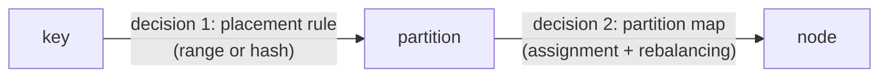
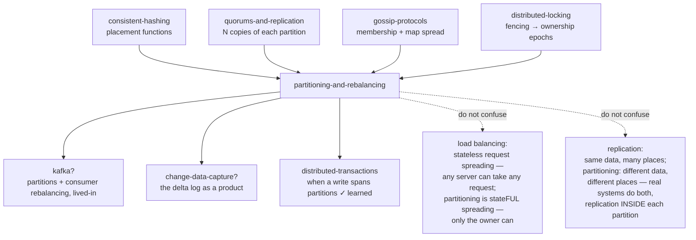

# Partitioning & Rebalancing

*One dataset, many machines — and the day the set of machines changes.*

> **Lab format** (no-code): this document + [`visualization.html`](visualization.html)
> (interactive simulator, also published as an artifact) + [`EXERCISES.md`](EXERCISES.md)
> / [`SOLUTIONS.md`](SOLUTIONS.md). Everything here is demonstrated by hand-worked
> traces, by the simulator, or by a measured result cited from a prior lab —
> never by code you have to run.

> **Where you are:** you already know *how to hash a key onto a machine* from the
> [consistent-hashing lab](../35-consistent-hashing/) — the ring, virtual nodes,
> fixed slots, and the measured disaster of `hash(key) % n`. That lab ended with
> an honest confession: *"the ring is a pure placement function; it says where
> things belong and moves nothing — joining a node is a separate throttled
> streaming operation with its own state machine."* **This lab is that state
> machine**, plus everything the placement function alone can't answer: how to
> draw the boundaries in the first place (by key order, not just by hash), what
> happens when the data or the traffic is lopsided, how queries *find* their
> partition, and how a piece of a live database physically moves from one
> machine to another without dropping a single write.

---

## Layer guide

| Layer | Stages | What you can do afterwards |
|---|---|---|
| **BEGINNER MODEL** | 1–9 | Explain why data gets split, why splitting evenly is hard, and what "rebalancing" means |
| **INTERMEDIATE MODEL** | 10 | Choose a partitioning scheme and a rebalancing strategy for a given workload, describe the migration protocol step by step, price a change to the partition count, and say where a partition is allowed to live |
| **ENGINEERING MODEL** | 11–12 | Predict the nine failure modes — including the three that present as silence — name the invariants, and say what each design trades away |
| **PRODUCTION MODEL** | 13 | Map all of it onto Kafka, Cassandra, HBase, CockroachDB, DynamoDB, Elasticsearch — and know what to monitor |

---

## 1. WHY — the problem nobody can dodge

Every system you've studied so far in these labs quietly assumed the data fits
on the machines you have. Eventually it doesn't: the dataset grows past one
machine's disk, or — usually first — the *traffic* grows past one machine's
CPU and network. Replication (the [quorums-and-replication lab](../34-quorums-and-replication/))
doesn't rescue you: replication makes **more copies of everything**, which
helps reads and survives crashes but does nothing when *everything* is too big,
and nothing at all for write traffic — every replica still receives every write.

So you must **split** the data: each machine holds only a piece. The moment you
split, three questions appear that never existed before, and each one has a
famous way of going wrong:

1. **Where does each record live?** Draw the boundaries badly and one machine
   does all the work while the others idle.
2. **How does a query find its record?** Route badly and every query interrogates
   every machine.
3. **What happens when the set of machines changes?** Handle growth badly and
   adding capacity — the thing you did to make the system healthier — triggers
   a self-inflicted outage while terabytes shuffle between nodes.

Question 3 is the one that separates toy designs from real ones. In the
consistent-hashing lab the cost of getting it wrong was a cache miss storm that
healed in a minute. Here the data is the **source of truth**: what moves is not
re-fetchable cache entries but the only authoritative copy, the move takes hours
at disk-and-network speed, and writes keep arriving *while* it moves.

---

## 2. THE PROBLEM — Meera's library outgrows its building

Meera runs the public library in the town of Deodar (the same town whose
noticeboards taught you eventual consistency). The collection has grown to
60,000 books and the building holds 20,000. The town council gives her two more
buildings across town.

Now every book needs a home in exactly one building, and two kinds of people
need to find it fast:

- A **reader** who wants one specific book ("*The Cedar Gate* by R. Sharma")
  should walk to one building — not wander all three.
- A **browser** who wants *everything by one author* should ideally find those
  books shelved together, not scattered.

And Meera knows the town keeps growing. A fourth building is a matter of time.
Whatever scheme she picks today, she will one day have to **re-home books while
the library stays open** — readers borrowing and returning the whole time.

No jargon yet. Just: 60,000 books, 3 buildings, and a future fourth.

---

## 3. THE NAIVE SOLUTION — split by the alphabet

Meera does the obvious thing: split by author surname.

- Building 1: authors **A–H**
- Building 2: authors **I–Q**
- Building 3: authors **R–Z**

It has real virtues. Any clerk can compute a book's home in their head — no
lookup table needed. The specific-book reader walks to one building. The
browser is delighted: all of R. Sharma's novels stand on one shelf, in order.
Splitting by key order keeps *neighbouring keys together*, and "everything by
one author" is exactly a neighbourhood.

---

## 4. THE FAILURE — even thirds of the alphabet are not even thirds of anything

Three months in, the scheme is failing in two different ways — and telling
them apart is the first real lesson of this lab.

**Failure A — the counts are uneven.** Surnames are not spread evenly across
the alphabet. Building 3 (R–Z) holds 31,000 books — S alone is enormous
(Sharma, Singh, Shah, Sen...) — while Building 2 (I–Q) holds 9,000. Building 3's
shelves overflow while Building 2 echoes. Call this what it is: the *amount of
data* per building is lopsided. This failure is annoying but **fixable by
redrawing the lines**: nothing forced Meera to cut the alphabet into equal
*letter spans*; she could cut it into equal *book counts* (A–G / H–R / S–Z, say).
The boundaries should follow the data, not the alphabet.

**Failure B — the queues are uneven, and no boundary fixes it.** R. Sharma
publishes a new novel and it becomes a phenomenon. Every day, hundreds of
people come to borrow, return, or reserve *that one book*. They all queue at
Building 3. Buildings 1 and 2 sit idle while Building 3's line goes around the
block. Now watch carefully: **redrawing boundaries cannot help**, because all
the demand is for a *single title* — however you cut the collection, that title
lands somewhere, and wherever it lands drowns. Uneven *demand* is a different
disease from uneven *data*, and it needs different medicine.

**🔮 Predict:** *Meera gives up on the alphabet and instead assigns each book to
a building by rolling a die (uniformly at random, recorded in the catalog).
Which of the two failures does this fix — A, B, or both?*

<details><summary>Reveal</summary>

It fixes **A completely and B not at all** — and it *creates a third problem*.
Random assignment spreads the 60,000 books almost perfectly evenly (that's what
randomness is good at). But the Sharma novel still lives in exactly one
building, and the whole town still queues there: one popular *record* beats any
*placement* scheme, because every scheme agrees each record has one home — you
met this as the hot-key result in the consistent-hashing lab, and the fix
(splitting the record itself) comes in stage 11.

The new problem: the browser is ruined. Sharma's twelve novels are now
scattered across all three buildings at random. "Everything by one author" went
from a one-shelf visit to a three-building tour. Random placement (and hashing,
its deterministic cousin) destroys neighbourhoods.

</details>

And looming behind both failures is the fourth building. Recall the measured
result from the consistent-hashing lab rather than re-deriving it: assign books
by `hash(book) % number_of_buildings` and going from 10 buildings to 11 moved
**99.0% of all keys** when only 1/11 ≈ 9% had anything to gain by moving —
163,679 of 181,668 moved keys went *sideways between old buildings*, achieving
nothing. For a cache that was a miss storm; for a library it is re-shelving
essentially the entire collection to add one building.

---

## 5. THE REAL REQUIREMENT

Strip away the story and four requirements remain. Every real partitioned
system is a set of compromises between exactly these:

1. **One computable home.** Every record has exactly one authoritative location,
   and finding it must be cheap (a formula, or one lookup in a small table).
2. **Balanced *load*, not just balanced *data*.** Even byte-counts per machine
   is necessary but not sufficient; the requests per second must spread too.
3. **Queries touch few pieces.** The common query shapes — point lookup,
   "everything in this key range" — should hit one piece, or few.
4. **Cheap, safe change.** Adding or removing a machine must move roughly
   `1/n`-th of the data (the minimum that accomplishes anything), only *to or
   from the changed machine*, throttled, and **without ever losing a write or
   serving from a half-copied piece** while the library stays open.

Requirement 4 is where this lab earns its second noun. Requirements 1–3 are
about *partitioning*; requirement 4 is *rebalancing*.

---

## 6. THE KEY IDEA

Two sentences generate everything that follows:

> **Cut the data into many more pieces than you have machines — choosing the
> cut to match your queries (by key order, or by hash) — and make the *piece*,
> never the record, the unit of ownership and movement.**
>
> **Then "rebalancing" stops being a re-shuffle of records and becomes two
> smaller, tractable problems: *reassigning whole pieces* to machines, and a
> careful *handover protocol* that moves one piece while it keeps serving.**

Meera's version: put every book on a **wheeled shelf** of manageable size, keep
a **card catalog** saying which building each shelf currently lives in, and
when Building 4 opens, roll a few entire shelves across town — never re-sort
individual books, and update the catalog card as each shelf lands.

---

## 7. TERMINOLOGY — naming what you've already felt

You have now personally felt every problem these words exist to name. The
load-bearing terms, full treatment:

**Partition** (also called a **shard**; Kafka says *partition*, MongoDB says
*shard*+*chunk*, HBase says *region*, Cassandra says *token range*).
*Plain:* one of the pieces the data is cut into — a wheeled shelf.
*Precise:* a contiguous subset of the keyspace that is owned, served, and
**moved as a unit**. *Why the term exists:* to give the unit of ownership a name
that is deliberately NOT "machine" — the whole trick of stage 6 is that
partitions and machines are different things, with a many-to-one mapping
between them. *Example:* "partition 7 of 16 holds all keys whose hash lands in
slot 7; today node B serves it." *Connects to:* the consistent-hashing lab's
vnodes and hash slots were both partitions in this sense — you've met the
mechanism, and now the concept gets its proper name.

**Partition key.**
*Plain:* the part of the record that decides which shelf it goes on.
*Precise:* the attribute (or attribute tuple) fed to the placement rule; records
sharing a partition key are guaranteed co-located. *Why:* because *you* choose
it, and the choice decides which queries are cheap (one partition) and which
are scatter-everything — the single highest-leverage schema decision in a
partitioned store. *Example:* keying orders by `order_id` makes "fetch order"
cheap and "all orders for customer 42" expensive; keying by `customer_id` flips
both. *Connects to:* the database-landscape lab's "partition key / hot
partition" bullets, now with the mechanism attached.

**Range partitioning.**
*Plain:* cut by key order — the alphabet scheme.
*Precise:* each partition owns a contiguous key interval `[lo, hi)`; boundaries
are chosen (and re-chosen) to follow the data. *Why:* it is the only scheme
where a **range scan** ("all Sharma", "all events between 09:00 and 10:00")
touches one or few partitions. *Example:* HBase and Bigtable partition rows
this way; so do CockroachDB and TiDB. *Connects to:* btree-and-lsm — inside
each partition the keys are typically stored sorted anyway, so range
partitioning extends the B-tree's sortedness across machines.

**Hash partitioning.**
*Plain:* cut by dice-roll — but a deterministic dice-roll, so the home is
computable.
*Precise:* partition = `hash(partition key) mod P` (fixed `P`), or a position
on a hash ring. *Why:* hashing destroys the correlation between "similar keys"
and "same partition", which is exactly what kills skew from clustered keys —
and exactly what kills range scans. Same coin, both faces. *Connects to:* the
entire consistent-hashing lab lives inside this bullet.

**Skew**, and its two species you met as Failures A and B:
**data skew** (uneven *bytes* per partition — fixable by moving boundaries) and
**load skew** (uneven *requests* per partition — boundary moves don't help when
the heat is a single key). A partition drowning in either is a **hot
partition** (the consistent-hashing lab's *hot key* is the extreme case: one
key hotter than everything else combined).

**Rebalancing.**
*Plain:* moving shelves when buildings change — or when a shelf gets too fat.
*Precise:* changing the partition→node assignment (and sometimes the partition
boundaries themselves) and physically migrating the data, while serving.
*Why the term:* the "re" matters — it names an *ongoing operational activity*,
not a one-time setup. A partitioned system that cannot rebalance is a system
you must size perfectly on day one, forever.

**Partition map** (routing table).
*Plain:* the card catalog: shelf → building.
*Precise:* the authoritative table `partition → owning node` (plus, per entry,
an ownership generation number — the *epoch*, properly earned in stage 10.5),
and cached copies of it in clients and nodes — cached copies that **go stale**
whenever rebalancing moves something. *Connects to:* the consistent-hashing
lab's "membership propagation window" — the ring made the map implicit;
fixed-partition systems make it an explicit table someone must store and serve.

**Scatter/gather.**
*Plain:* asking every building and merging the answers.
*Precise:* a query that cannot be routed by partition key is broadcast to all
partitions and the results merged. Legal, sometimes necessary, and quietly
expensive in a way stage 10.7 will make exact.

Minor terms get one-liners at first use, and everything lands in the glossary
(stage 16).

---

## 8. TWO MENTAL MODELS

**The simple model — the library on wheels.** Books on wheeled shelves; shelves
assigned to buildings; a card catalog in every clerk's pocket saying which
building each shelf is in today. Growth = roll whole shelves to the new
building, one at a time, catalog card updated as each lands. A fat shelf gets
*split* into two shelves. A scorching-hot book gets special handling.

**The engineering model.** Three pieces of state and one protocol:

| | State | Owned by |
|---|---|---|
| 1 | **Placement rule** — `key → partition` (a hash formula, or a sorted boundary list for ranges) | agreed by everyone, changes rarely (range splits) |
| 2 | **Partition map** — `partition → node` (+ the epoch, stage 10.5) | one authoritative copy (a coordinator or consensus group), many stale caches |
| 3 | **The data** — each partition's records, living on its owner | the owning node |

…plus the **migration protocol** (stage 10.5): the choreography that moves one
partition's data to a new owner and flips its map entry, under live writes,
without violating "exactly one authoritative owner".

**The mapping between the models:**

| Library | Engineering |
|---|---|
| Book | Record |
| Author surname on the spine | Partition key |
| Wheeled shelf | Partition |
| Building | Node |
| Card catalog | Partition map |
| Clerk's memorized rule "A–H → Building 1" | Placement rule |
| Rolling a shelf across town | Partition migration |
| Splitting a fat shelf into two | Partition split |
| The queue at the borrow desk | Per-partition request load |

**Where the analogy breaks** (read this — an unbroken analogy is a lie):

1. **A book exists once; a partition exists N times.** Real systems replicate
   every partition (the quorums lab's N copies — often each partition is a
   whole Raft group). This lab's toy tracks one copy per partition to keep the
   movement visible; stage 13 says what replication adds back.
2. **Rolling a shelf is atomic; copying 10 GB is not.** The shelf is
   unavailable for an hour, then wholly present. A partition must keep serving
   *during* its own move, which is why the handover protocol exists at all —
   the hard part has no library equivalent.
3. **One catalog; many stale caches.** Meera has one catalog and updates it
   with a pen. A real partition map is cached by every client and node, and
   the caches learn of a move *after* it happened. The redirect machinery of
   stage 10.4 exists purely because of this gap.
4. **Books don't arrive mid-roll.** Writes do. The entire drama of stage 10.5
   is the writes that arrive while the shelf is on the truck.

---

## 9. VISUALIZATION — *The Moving Shelves*

Open [`visualization.html`](visualization.html) (or the published artifact
link). It is a deterministic simulator with four tabs. The first two match the two
halves of the key idea; the last two are the decisions that arrive later in a
cluster's life:

- **Tab 1 — The Map.** A cluster of nodes drawn as buildings, partitions as
  shelf-blocks inside them, each showing key count (width) and recent request
  heat (color). You choose the placement scheme (`hash mod N` / fixed
  partitions / range / range with auto-split), feed it workloads (uniform
  keys, timestamp keys, one celebrity key), and add or remove nodes — the page
  reports exactly how many keys moved, and how many *needed* to.
- **Tab 2 — The Move.** One partition migrating from node A to node B in slow
  motion: snapshot copy, catch-up, cutover — with a write button you can press
  *mid-copy*, a protocol switch (naive → catch-up → catch-up + epoch fencing),
  a stale client that still routes by the old map, and a tick-box deciding
  whether the deposed owner keeps answering reads after the flip.
- **Tab 3 — The Recount.** What it costs to change the *number* of partitions.
  Two counters run side by side and they are deliberately not the same number:
  keys whose **address** changed, and keys whose **bytes** had to cross the
  network. Double the partition count, set it to a non-multiple, or switch to
  a rule where each partition owns a *slice* of the hash space — and then cut
  one partition in half without touching any other.
- **Tab 4 — The Rules.** Placement when evenness is not the goal: machines
  carry a zone and a rack, each partition wants three copies, and you switch on
  rules (copies in different racks; EU data in EU machines) and watch which
  partitions become impossible to place.

Twelve **predict-then-run scenarios** (buttons on the page) mirror this doc's
prediction checkpoints. Do scenarios 1–3 after stage 10.3, scenarios 4–6 after
stage 10.5, scenario 7 after stage 10.6, scenarios 8–11 after stage 10.8, and
scenario 12 after stage 10.9.
Every event is narrated in a full sentence in the log, and the verdict bar
always states the current outcome in plain English.

---

> **CHECKPOINT — you now hold the beginner model.** You can explain why data is
> split, why "even pieces" is two different requirements wearing one word
> (bytes vs load), and what the unit-of-movement idea buys. Next: the actual
> machinery — how boundaries are drawn, how pieces are assigned and moved, and
> how requests find them.

---

## 10. THE ACTUAL MECHANISM

The key idea said there are two decisions. Take them in order, letting each
version break before refining it.



Keep this two-hop picture: **key → partition → node**. Decision 1 (key →
partition) is about your *queries and skew*. Decision 2 (partition → node) is
about *balance and movement*. Almost every confusion in this subject comes from
mashing the two hops into one.

### 10.1 Drawing boundaries by key order — range partitioning done right

Fix Failure A properly. The alphabet cut failed because the boundaries were
chosen by *letter arithmetic*; choose them by *data* instead. Concretely, with
60,000 books and a target of ~7,500 books per partition, walk the sorted
author list and cut every 7,500 books:

```
p1: [A          … Chatterjee)   7,500 books
p2: [Chatterjee … Gupta)        7,500
p3: [Gupta      … Khan)         7,500
p4: [Khan       … Mehta)        7,500
p5: [Mehta      … Rao)          7,500
p6: [Rao        … Sharma)       7,500
p7: [Sharma     … Singh)        7,500   ← two boundary names this close is normal:
p8: [Singh      … Z]            7,500     the data is dense there, so the cuts are too
```

The boundary list IS the placement rule: to place or find a key, binary-search
the sorted boundaries — 3–4 comparisons for thousands of partitions. Range
scans still work: "everything by Sharma" is one partition (p7); "authors Rao
through Singh" is three adjacent ones.

But data *changes*. p7 fattens as Sharma-adjacent authors keep publishing.
The fix that makes range partitioning viable long-term is **dynamic
splitting**: when a partition exceeds a size threshold, split it at its
*median key* into two partitions; when two adjacent partitions shrink, merge
them. The partition count now tracks the data automatically. This is exactly
how HBase regions and CockroachDB/TiDB ranges work (typical thresholds:
HBase ~10 GB regions, CockroachDB ~512 MB ranges).

One caveat that bites new deployments: a brand-new table is **one partition**
until enough data arrives to trigger splits — so a bulk import hammers a
single node while the system slowly splits behind it. The production fix is
**pre-splitting**: declare expected boundaries at creation time (HBase lets
you; so does CockroachDB's `SPLIT AT`).

**🔮 Predict:** *Meera also archives the daily newspaper, keyed by date
(`2026-08-29`, `2026-08-30`, ...), range-partitioned. Where do today's writes
land? And tomorrow's?*

<details><summary>Reveal</summary>

**Always the last partition.** Date keys are ever-increasing, so every new key
is greater than every existing key and lands in the final range — today, and
tomorrow, and forever. Dynamic splitting does not save you: the moment the last
partition splits, all new writes fall into the *new* last partition. One node
takes 100% of the write load while the rest of the cluster stores cold history.
This is the **sequential-key hotspot**, and it is not a rare trap — timestamps,
auto-increment IDs, and Kafka-style offsets are the most natural keys in the
world, and all three are sequential.

</details>

The cure is not a different rebalancer — no assignment of partitions to nodes
helps when *one partition* gets all the writes. The cure is **key design**:

- **Compound key.** Key sensor readings by `(sensor_id, timestamp)` instead of
  `timestamp`. The first component spreads writes across partitions (thousands
  of sensors → thousands of insertion points); the second keeps each sensor's
  readings sorted *within* its partition, so "sensor 17, 09:00–10:00" is still
  one cheap range scan. Cassandra formalizes this: the **partition key** (first
  part) is *hashed* for placement, the **clustering key** (second part) is
  *range-ordered* within the partition — hash's balance and range's scans,
  by putting each where it helps.
- **Bucketing/salting.** No natural first component? Manufacture one:
  prefix the key with `hash(key) mod 20` (a **salt**), turning one insertion
  point into 20. The tax: a range scan must now query all 20 buckets and merge
  — the scatter cost comes right back, scaled by the salt count. (You met the
  same remedy as "sub-key splitting" in the distributed-rate-limiting lab.)

### 10.2 Drawing boundaries by hash — and the mod that is safe

For workloads that never range-scan (session stores, user profiles, caches),
hash partitioning is simpler: no boundary list to maintain, balance for free.
But **do not** hash onto *nodes* — that's the `mod n` corpse from the
consistent-hashing lab. Hash onto **partitions**:

```
partition = hash(key) mod P        where P = fixed partition count, P ≫ nodes
```

The insight that makes this modulo safe where the other one was fatal: **P
never changes.** The thing that made `mod n` catastrophic was `n` changing;
here the node count can change all it likes — it appears nowhere in the
formula. `key → partition` is frozen forever; only the second hop,
`partition → node` (a small table with P rows), ever changes. This is
precisely the Redis Cluster design you met as a *contrast* in the
consistent-hashing lab — `CRC16(key) mod 16384` slots — now recognized as one
of the two standard answers rather than an oddity.

The price is a judgement call you must make on day one: **choose P**. Too low,
and partitions grow monstrous (a 10-node cluster with P=16 can never spread
load more finely than 16 ways, and each partition's eventual size makes every
future move slow). Too high, and per-partition overhead (files, metadata,
connections, recovery bookkeeping) multiplies. Elasticsearch is the cautionary
tale: an index's primary shard count is fixed at creation. That is the
standard telling, and it is not quite the whole truth — there is one shape of
P-change that costs almost nothing, and one partitioning rule that removes the
decision altogether. Stage 10.8 does that arithmetic; for now, treat P as a
number to think hard about on day one. Kafka allows
*increasing* a topic's partition count but never decreasing — and increasing
it silently breaks the promise that all messages for one key sit in one
partition's history (old messages for key k stay in `hash(k) mod P_old`; new
ones go to `hash(k) mod P_new`).

### 10.3 Assigning partitions to nodes — the rebalancing strategies

Decision 2. You hold P partitions (16, say) and n nodes (3). Assign each
partition a home; when n changes, reassign as little as possible.

**v1 — no partitions, hash keys straight onto nodes (`mod n`).** Dead on
arrival; the consistent-hashing lab measured the corpse (99.0% of keys moved
for a 1-machine addition, 163,679 of 181,668 moves pure waste). Cited, not
re-run. Its failure is what makes v2's guarantee visible.

**v2 — fixed partitions, moved whole.** With P=16 over nodes {A, B, C}:

```
A: p1 p2 p3 p4 p5 p6         (6 partitions)
B: p7 p8 p9 p10 p11          (5)
C: p12 p13 p14 p15 p16       (5)
```

Node D joins. Fair share is 16/4 = 4 partitions. D **steals whole partitions
from the most-loaded nodes** until even:

```
A: p1 p2 p3 p4               (gave p5, p6)
B: p7 p8 p9 p10              (gave p11)
C: p12 p13 p14 p15           (gave p16)
D: p5 p6 p11 p16             (4 stolen partitions)
```

Count what moved: 4 of 16 partitions = **exactly 1/4 of the data, all of it
onto the newcomer, none of it sideways**. That is the same *monotonicity*
guarantee the hash ring bought with geometry — achieved here with a lookup
table and grade-school arithmetic. Node removal is the mirror: the dead node's
partitions are dealt out to the survivors, ~1/n each, nobody else disturbed.
(Scenario 1 in the visualization runs this exact comparison against `mod n`;
predict the two moved-fractions before pressing run.)

**v3 — dynamic partitions** (the range-splitting scheme of 10.1): partition
count proportional to *data*, so the unit of movement stays a sane size
forever, at the cost of running split/merge machinery. **v4 — many small
partitions per node** (the ring + virtual nodes from the consistent-hashing
lab): partition count proportional to *nodes*. All four in one table:

| Strategy | Partition count | Move on node change | Range scans | Used by |
|---|---|---|---|---|
| `mod n` on nodes | — (none) | ~everything ☠️ | no | nobody, on purpose |
| Fixed P, whole-partition moves | fixed at creation | 1/n, minimal | only if ranges, not hash | Riak, Elasticsearch, Couchbase, Redis Cluster, Kafka |
| Dynamic split/merge | ∝ data size | 1/n, minimal | **yes** | HBase, Bigtable, CockroachDB, TiDB, MongoDB |
| Ring + vnodes | ∝ node count | 1/n, statistical | no | Cassandra, ScyllaDB, Riak |

The consistent-hashing lab's closing judgement holds and extends: fixed slots
trade **coordination for control** (someone must store and serve the map —
but placement is exact and hand-movable); the ring needs no coordinator but
gives only statistical balance. Dynamic splitting sits with the
coordinator camp and adds the split machinery in exchange for range scans and
right-sized partitions forever.

### 10.4 Routing — who knows where partition 7 lives today?

A client holds `GET user:4711`. It can compute the partition (hash or boundary
search — the placement rule is public and stable). But *which node serves
partition 7 today* is exactly the thing rebalancing keeps changing. Three
standard answers, in increasing client sophistication:

1. **Ask any node.** Every node keeps a (possibly stale) copy of the map,
   learned via gossip; if the wrong node is asked, it forwards or redirects.
   No extra infrastructure; one extra hop sometimes. (Cassandra: any node acts
   as coordinator — the quorums lab's coordinator-with-no-authority.)
2. **A routing tier.** A dedicated proxy layer holds the map and forwards all
   requests; clients stay dumb. (MongoDB's `mongos`; HBase clients consult
   ZooKeeper + a META table.)
3. **A partition-aware client.** The client library caches the map and talks
   straight to the owner — zero extra hops, and now *client caches* are the
   stale copies to manage. (Kafka clients, Redis Cluster clients, most
   Cassandra drivers do a hybrid.)

Whatever the answer, two hard sub-problems remain:

**Stale maps are normal, so wrongness must be cheap.** During any rebalance
there is a window where caches disagree with reality — the consistent-hashing
lab measured that window at 9.5% of the keyspace for a gossiped ring, 90.8%
for `mod n`. The standard machinery makes the stale request *self-correcting*:
the old owner answers with a redirect. Redis Cluster's two redirects make the
distinction precise: **MOVED** = "permanently elsewhere — go there AND update
your cached map", **ASK** = "for this one request go there, but do NOT update
your map — the partition is mid-migration and I still own it". A stale client
pays one extra round trip, never a wrong answer. (Scenario 6 in the
visualization lets you route with a deliberately stale client.)

**The authoritative map is itself data that must survive and be agreed on.**
Cached copies may be sloppy, but *somebody* must hold the truth, or two nodes
can both believe they own p7. Real systems put the map in a consensus store —
ZooKeeper (HBase, Kafka's controller before KRaft), etcd (Kubernetes-hosted
systems), or a built-in Raft group (CockroachDB's meta ranges, TiDB's
Placement Driver). This is where the raft lab plugs in: consensus is not
needed for the *data* path, but the *map* is exactly the small,
rarely-changing, must-agree state consensus was built for. Cassandra is the
one big exception — no consensus, the map is gossiped and eventually
consistent, which it gets away with because vnode ownership changes are
operator-paced and the quorum overlap absorbs small disagreements.

### 10.5 The move itself — a partition migrates while it serves

Everything so far decided *what* should move *where*. Now the part the
consistent-hashing lab refused to cover: partition p11 (2 GB, ~9,000 writes/hour
arriving) must move from node B to new node D. The library stays open.

**Migration v1 — copy, then flip.** Obvious plan: D copies p11's data from B
(takes, say, 10 minutes at throttled speed); when the copy finishes, the map
flips `p11 → D`; B deletes its copy.

**🔮 Predict:** *During the 10-minute copy, a user updates their address —
a write to a key in p11, sent (per the current map) to B. The copy had already
passed that key's position when the write landed. After the flip, the user
reads their address from D. What do they see?*

<details><summary>Reveal</summary>

**The old address.** The write landed on B *behind* the copy cursor, so it
exists only in B's copy — which B deletes after the flip. The write is
acknowledged, durable, and **gone**. Not lost in a crash — lost by protocol
design, on a healthy cluster. Any write landing in the already-copied region
during those 10 minutes suffers the same fate; at 9,000 writes/hour that's up
to ~1,500 candidates. A 10-minute migration silently shredding a fistful of
acknowledged writes is how this bug actually presents in the wild: rare,
unreproducible, discovered weeks later. (Scenario 4 in the visualization plays
this exact trace.)

</details>

**Migration v2 — copy + catch-up + cutover.** The fix mirrors how replicas
bootstrap everywhere (you saw the shape in quorums' anti-entropy): the copy
alone can never be current, so pair it with a live feed.

```mermaid
stateDiagram-v2
    [*] --> SNAPSHOT: D asks B for p11
    SNAPSHOT: SNAPSHOT COPY — D streams a point-in-time copy;<br/>B serves normally AND logs every new p11 write to a delta log
    SNAPSHOT --> CATCHUP: snapshot done
    CATCHUP: CATCH-UP — D drains the delta log;<br/>new writes still land on B, still appended to the log
    CATCHUP --> CUTOVER: delta log nearly empty
    CUTOVER: CUTOVER — B briefly pauses p11 writes,<br/>D drains the last entries, map flips p11 → D (epoch++)
    CUTOVER --> SERVING: flip done
    SERVING: D serves; B forwards stragglers (ASK/MOVED), then deletes
    SERVING --> [*]
```



Walk it with concrete values. Snapshot: 10 minutes, during which 240 writes
arrive at B — all served normally, all appended to the delta log. Catch-up: D
drains those 240 while 12 more arrive; drains the 12 while 1 arrives. The log
is now nearly empty and *shrinking* — the drain rate outruns the write rate,
so the gap converges (if it doesn't — writes faster than the throttled drain —
the migration can never finish; the throttle, not the protocol, is what you
tune). Cutover: B pauses p11 writes for the final handful (milliseconds of
write-pause for one partition, not an outage), D drains to zero, the map flips.
**Nothing was lost: every write either made the snapshot, or the delta log, or
arrived after the flip at D.** That sentence is the invariant the whole
choreography exists to guarantee.

**Migration v3 — v2 + an epoch on the ownership.** One failure survives v2.

**🔮 Predict:** *Right at cutover, B stalls — a long GC pause (the
distributed-locking lab's "a process cannot observe its own delays"). The
migration machinery times B out, completes the flip, D starts serving. B wakes,
unaware, still believing it owns p11 — and a client with a stale map sends it
a write. What happens?*

<details><summary>Reveal</summary>

**B accepts it.** B's local state says "I own p11" — the wake-up looks like any
other moment of normal service. Now B and D are *both* accepting writes for
p11: split-brain on a partition, and the write B accepted will be silently
lost when B's copy is deleted (or worse, resurrected if B's copy is ever used
for recovery). This is the distributed-locking lab's stale-holder disaster
with "lock" replaced by "partition ownership" — and the fix is the same fix:
**fencing**. Give every map entry an **epoch** (a monotonically increasing
ownership generation: p11@e5 means "5th owner"). The flip writes `p11 → D,
epoch 6` to the authoritative map. Every write request carries the epoch its
sender believes; every owner checks it against the authoritative epoch it
holds a lease on. B, at epoch 5, either refuses the write outright ("I can no
longer prove I'm the owner — my lease expired during the pause") or accepts
and is refused downstream. Either way the stale write dies with an error the
client retries against the true owner — loud and safe instead of silent and
lost. Scenario 5 in the visualization runs both variants.

</details>

That's the complete mechanism: epoch-fenced ownership, snapshot + delta
handover, redirect-corrected routing. Real systems dress it differently
(Cassandra "streaming", HBase region transitions, CockroachDB replica
rebalancing via Raft snapshots + config change) but every one of them is
recognizably this state machine.

### 10.6 Two things the migration protocol still gets wrong

Stage 10.5 built the handover up to v3 and stopped at a strong claim: every
acknowledged **write** is at the new owner or still legitimately at the old
one. That claim is true and it is narrower than it sounds, because a store
does two things. Here are the two holes it leaves, both of which produce
*plausible wrong answers* rather than errors.

**Hole 1 — nobody said anything about reads.**

While p11 is copying from B to D, D holds a growing but incomplete pile of
records. Ask D for a key it has not reached yet and it truthfully answers "I
don't have that" — which a client cannot distinguish from "that key does not
exist". So during the copy, **reads must follow ownership, not copy
progress**: B answers everything until the map flips, even for keys D already
has. Copy progress is D's private business.

Now the flip happens, and the hazard reverses. B still has a complete copy of
p11 on disk — it is *deleted afterwards*, not at the instant of cutover, and
usually not for a while (you keep it as insurance until the new owner is
verified). A client with a stale map sends a read to B. If B answers from that
copy, the client gets a well-formed, plausible, entirely stale record, with no
error, no timeout, and no way to tell. And it gets *worse over time*: B's copy
froze at cutover, so the staleness grows without bound.

Note what the v3 epoch fence did and did not do. It checks the epoch on
**writes** — that is why the woken owner's write bounced in stage 10.5. A
system that fences writes but serves reads unconditionally has closed the loud
failure and left the silent one open. So the rule is symmetric:

> **The epoch check belongs on every request that touches a partition, not
> just on the ones that change it.** Fencing writes protects the future.
> Fencing reads protects the truth of the present.

The cheapest correct implementation is to make the demoted owner **seal** the
partition at cutover — refuse everything for p11 and answer `MOVED` — which is
the same machinery as F3's redirect, now understood as a *safety* mechanism
rather than a convenience. Redis Cluster nodes reply `MOVED` for any slot they
do not currently own; Kafka fetch requests carry a leader epoch and a replica
rejects a fetch that names a stale one; HBase closes a region on the old
RegionServer before the master reassigns it. In each case the deposed owner is
made structurally incapable of answering, rather than trusted to be polite.

*Watch it happen:* viz Tab 2, scenario 7 — untick "old owner seals the shelf
at cutover", finish a move, send one write (it routes to D), then press
**Stale client READS from the old owner**. The verdict bar reports a wrong
answer with zero writes lost. Tick the box and press the same button: the
identical request comes back as a `MOVED` redirect — the seal doing its job.

**Hole 2 — the delete that came back from the dead.**

**🔮 Predict:** *The snapshot copies key `asha` (version 3) to D at 10:00. At
10:04, still mid-copy, the user deletes `asha`; B removes it and records the
change in the delta log. At 10:10 the delta drains and the map flips. Does
`asha` exist on D?*

<details><summary>Reveal</summary>

It depends on something the protocol never specified: **what a delta log entry
is.** There are two obvious implementations and only one of them is correct.

*Implementation A — "the delta log is a list of keys that changed."* At drain
time, D asks B for the current value of each listed key and stores it. Trace
it:

```
10:00  snapshot: D receives asha = v3
10:04  delete asha   → B removes asha; delta log records the KEY "asha"
10:10  drain: D asks B "what is asha now?" → B: (nothing)
       D reads "nothing" as "no update to apply" → keeps asha = v3
10:11  cutover. D now serves asha = v3.
```

**`asha` is back.** She deleted her account, the deletion was acknowledged,
and a routine rebalancing operation resurrected it. No node crashed, no
message was lost, nothing timed out.

*Implementation B — "the delta log is a list of operations."* The entry is
`DELETE asha @ 10:04`, D applies a deletion, and `asha` stays gone.

The general shape of the bug is one you have already met twice: **absence
cannot be shipped.** The eventual-consistency and CRDT labs both hit it — a
replica cannot distinguish "this key was deleted" from "I never heard about
this key", so deletion must travel as an explicit record (a **tombstone**),
never as a gap. Migration is replication with a shorter lifespan, so it
inherits the same requirement. The same reasoning forces a second one: the
delta must preserve **per-key order** (delete-then-recreate must not land as
recreate-then-delete), which is why real delta streams are ordered logs with
per-key versions rather than sets of dirty keys.

And this is exactly why the "next lab" suggestion at the end of this doc is
change-data-capture: a stream of ordered operations including explicit deletes
is not a migration detail, it is a product.
</details>

Both holes share a diagnosis worth stating on its own, because it generalizes
past this lab: **a protocol is only correct with respect to the operations it
was checked against.** v3 was verified against writes and was silent about
reads; the delta was specified as "changes" and was silent about the shape of
a change. Neither silence produced an error message. When you review a
handover design — anyone's — the useful question is not "does it lose writes"
but "what is the complete list of things a client can ask, and which of them
did we check?"

### 10.7 Secondary indexes — the query that has no partition key

One mechanism left, because real queries aren't all by primary key: *"all
books tagged 'poetry'"* — and `tag` is not the partition key, so no placement
rule routes it. Two designs, trading read cost against write cost:

- **Local index** (document-partitioned): each partition indexes *its own*
  records. Writes stay single-partition (record + its index entries co-live —
  cheap, atomic). Reads by tag must **scatter/gather all P partitions**,
  because matching records could be anywhere.
- **Global index** (term-partitioned): the index is itself a partitioned
  structure, partitioned *by the indexed term* — all of `tag=poetry` lives in
  one index partition. Reads route to one partition. But now a single record
  write touches its data partition *plus* one index partition per indexed
  term — a multi-partition write, which (per the distributed-transactions
  lab's price list) is either slow or asynchronous. DynamoDB chose async: its
  Global Secondary Indexes lag the base table by an eventually-consistent
  window (the eventual-consistency lab's exact subject matter).

The scatter cost deserves its number, because it compounds in a way averages
hide. Suppose each partition answers fast except for its slowest 1% of
requests (a p99 tail — GC, compaction, a queue blip; the quorums lab measured
this shape). A scatter query across 100 partitions must wait for **all 100**
answers, so it hits the tail if *any* partition does:

```
P(all 100 fast) = 0.99^100 ≈ 36.6%  →  ~63% of scatter queries eat tail latency
```

One machine's 1% problem becomes the fleet's 63% problem. This **tail latency
amplification** is why partition-count decisions and scatter-query budgets are
made together, and why global indexes exist despite their write cost.

### 10.8 The number you got wrong three years ago — changing P

Stage 10.2 sold fixed partitions on one promise: **P never changes, so the
`mod` is safe**. Then it charged you for that promise — "P is a forever
decision". Sooner or later everyone tests whether "forever" is literally true.
It usually happens like this: you chose P = 16 when the table was 40 GB across
three machines. Three years later it is 2 TB across twenty machines, each
partition is 125 GB, and every rebalancing move now takes hours because *the
unit of movement is enormous*. You do not have a balance problem. You have a
granularity problem, and the only cure is more pieces.

So: can you change P after all? The answer is the most useful piece of
arithmetic in this lab, and it is not "no". It is **"only if you double"**.

**🔮 Predict:** *P goes from 16 to 32. Every key's shelf is computed as
`hash(key) mod P`, so changing P re-addresses a large share of the data. Of
420 keys, how many bytes actually have to travel across the network to another
machine?*

<details><summary>Reveal</summary>

**None.** Measured in the visualization's Tab 3 on its 420-key sample: 48.8%
of keys land on a different partition — and 0% change machine.

The reason is one line of modular arithmetic. If `hash(k) mod 16 = 3`, then
`hash(k) mod 32` can only be **3 or 19** — because `h mod 32` is either `h mod
16` or `h mod 16 + 16`, and nothing else is possible. So partition 3 does not
*scatter* when P doubles; it **cleanly cuts in two**, into new partitions 3 and
19, and no key from any other partition can arrive in either. Every byte of
the new partition 19 is already sitting on the machine that held partition 3.
The split is a local file operation plus a one-row map edit — the newborn
partition is created where its data already lives.

Elasticsearch's `_split` API is exactly this, which is why it *refuses* any
target shard count that is not a multiple of the current one, and why it can
implement a split by hard-linking the existing segment files and then dropping
the documents that no longer belong, rather than copying anything. (It still
makes a new index and requires writes to be blocked while it runs — the
mechanism is cheap, the operation is not free.)

One condition is hiding in that "0%", and it is not arithmetic. The split is
*local* only if the placer creates the child **on the machine that holds the
parent**. A placer that re-derives placement from a formula on the partition
id instead — a perfectly reasonable-looking `partition mod nodes` — sends the
children elsewhere and turns the free split back into a full redistribution.
(Exercise 5.3 works this out on eight keys by hand: 0 crossings when children
stay home, 4 of 8 when they are re-dealt.) This is why real systems ship
splitting and rebalancing as two separate commands: split in place now,
rebalance later if you want to. The two hops again.
</details>

**Now the other direction — the number in between.** You do not want 32
partitions, you want 24. Same 420 keys, P from 16 to 24: **68.8% of keys
change partition, and 68.8% must cross the network** (measured, Tab 3,
scenario 9). Nothing cleanly cuts in half. `h mod 16` tells you nothing useful
about `h mod 24`: keys sharing an old partition are spread over several new
ones — the pattern only repeats every `lcm(16, 24) = 48` — so the new
partitions cannot be carved out of the old ones locally, and the data has to
be shipped.

That is the honest content of "P is a forever decision": **P is doublable,
and otherwise frozen.** Halving is the mirror image (Elasticsearch's `_shrink`
requires the target to be a *factor* of the source, for the same reason read
backwards). Any other target is a full redistribution wearing the costume of a
config change.

**The escape hatch: partition by hash RANGE, not by hash remainder.** Here is
the move that dissolves the problem instead of managing it. Keep hashing the
key — you still want hash's balance — but instead of taking a remainder, give
each partition a **slice of the hash space**:

```
    hash space: 0 ────────────────────────────────────── 2³²
                [   h0   ][   h1   ][   h2   ][   h3   ]  ← 4 partitions
    key k  →  hash(k) = 0x6A2F…  →  falls inside h1 → partition h1
```

Look at what vanished from the rule: **P**. The lookup is "which slice
contains this hash", and no partition's boundaries are computed from the total
count. So partition h1 can be cut at its own midpoint any afternoon, into
h1-left and h1-right, and **no other partition is affected at all** — measured
in Tab 3 (scenario 10): splitting the fattest partition re-addressed 6% of keys (the ones
inside the partition being cut) and moved 0% across the network, with P going
from 16 to 17. Not a multiple. Not a redistribution. Just a boundary list
getting one entry longer.

You have seen both halves of this before and can now see they were the same
idea twice: this is stage 10.1's range partitioning with auto-split, applied
to the *hash* of the key rather than the key itself. It buys splittability
forever and hash's balance, and it forfeits exactly one thing — range scans on
the original key, which the hash destroyed anyway.

That completes the table from 10.3 with the column nobody puts in it:

| Rule | key → partition | Can P change later? | Range scans |
|---|---|---|---|
| `hash mod n` on **nodes** | changes whenever a node joins ☠️ | n/a — it is the bug | no |
| `hash mod P` on partitions | frozen | **doubling only** (cheap: local split); any other target = full redistribution | no |
| **hash range** partitions | frozen | **any partition, any time** (cheap: local split) | no |
| key range partitions | frozen | any partition, any time | **yes** |

**So why does anyone still use `mod P`?** Because a remainder needs no state.
A hash-range scheme has a boundary list that must be stored, agreed on, and
kept current at every client — the map is bigger and it changes shape, not
just contents. `mod P` needs no boundary list at all: a client with only the
number P can compute hop 1 offline forever. Kafka and Redis Cluster take that
deal deliberately, and Redis takes it to its conclusion — **16,384 slots,
frozen for all time**. Read in the light of this section, that number stops
being an oddity and becomes the actual solution to resharding: pick P so
absurdly large that no cluster will ever outgrow the granularity, and you
never need to change it. The cost is paid up front and forever (a 16,384-row
map, always), instead of unpredictably later.

**How to choose P, if you must choose one.** Work backwards from the unit of
movement, not from today's node count:

1. Pick a **target partition size** — the size at which moving one is
   comfortable. Real systems land between 512 MB and 10 GB (CockroachDB
   ~512 MB, HBase ~10 GB); call it 5 GB.
2. Estimate the data volume at the **furthest horizon you would bet on** — not
   today's, and not infinity. Say 2 TB.
3. `P ≈ 2 TB / 5 GB ≈ 400`. Round to a power of two — **512** — because
   powers of two are the only numbers you can later double *and* halve
   cheaply.
4. Sanity-check the floor: P must be at least a small multiple of the largest
   node count you will run (you cannot balance 20 nodes with 16 partitions),
   and the ceiling: P files, P memtables, P recovery jobs, P entries of fan-out
   on every scatter query.

If that sizing exercise makes you uncomfortable — you genuinely do not know
the horizon — that discomfort *is* the argument for hash-range partitions or
for Redis's absurd constant. Both remove the guess.

**One correction to a promise made earlier.** Stage 10.2 said Kafka lets you
increase a topic's partition count but never decrease it, and that increasing
breaks the "all messages for key k live in one partition" property. Both true
— and note where Kafka sits in this section's arithmetic: increasing partitions
in Kafka moves **no bytes at all** (existing messages stay exactly where they
are; only future producer routing changes). Kafka's resharding is free in
bandwidth and expensive in *semantics*. Elasticsearch's `_split` is the
opposite trade — semantics preserved exactly, at the cost of a new index and a
write freeze. There is no scheme where changing P is free in both.

### 10.9 Where a partition is *allowed* to live — placement constraints

Every rebalancing rule so far has had one goal: **evenness**. Give each node
about the same number of partitions, about the same number of bytes, about the
same heat. That is the only goal a toy needs. It is never the first goal of a
real cluster, and the reason is a sentence you can feel without any
distributed-systems vocabulary at all:

> Three copies of your data in three machines *on the same rack* is not three
> copies. It is one copy, plus two spares that share a power supply, a
> top-of-rack switch, and a maintenance window.

Replication buys you survival of *independent* failures. Two machines in one
rack do not fail independently — that is what the consistent-hashing lab named
a **failure domain**, and it has been sitting in your vocabulary without a job
since. Here is its job: the placer must not merely spread partitions, it must
spread each partition's **copies** across failure domains. And once the placer
takes orders about *where copies may go*, other people join the queue with
orders of their own:

- **Rack / zone / region diversity** — no two copies of a partition in one
  rack; ideally one copy per availability zone.
- **Data residency** — an EU customer's rows must be stored on machines in the
  EU. Not a preference; a legal constraint, and it depends on the *content* of
  the partition, not on load at all.
- **Latency locality** — put the partitions serving Tokyo users on the Tokyo
  nodes, so the common read is 5 ms and not 150 ms.
- **Heterogeneous hardware** — the new machines have 4× the disk; they should
  hold 4× the partitions (the consistent-hashing lab's *weight*, which was a
  count of ring positions there and is a capacity number here).

Balance has quietly changed from *the objective* into *the tie-breaker*. The
placer is now a constraint solver: first the set of legal homes, then the
evenest choice within it.

**🔮 Predict:** *Three machines, all in rack r1. Six partitions, three copies
each. You switch on the rule "no two copies of a partition in the same rack".
What does the rebalancer do?*

<details><summary>Reveal</summary>

**It places nothing, and says nothing loudly.** All six partitions become
unplaceable at the third copy — there is no second rack to put it in, let
alone a third. (Tab 4, scenario 12: 6 of 6 unplaceable with one rack; still
6 of 6 with two racks, though now each partition gets 2 of its 3 copies —
under-replicated, which *looks* half-fine on a dashboard; 0 of 6 unplaceable
once a third rack exists.)

The thing worth carrying away is the shape of the failure, not the arithmetic.
A constrained placer that cannot satisfy its rules does not compromise, does
not pick the least-bad option, and does not page anyone. **It stops moving.**
And a rebalancer that is not moving looks exactly like a rebalancer that has
nothing to do — a calm cluster, flat graphs, no errors. The only difference is
a status field somebody has to go and read.

This is precisely what an Elasticsearch **YELLOW** cluster with UNASSIGNED
shards is: not a bug, not a slow copy, but a constraint solver reporting *no
legal solution* — usually for `cluster.routing.allocation.awareness` (rack
rules) or a disk watermark. The cluster is telling you it refuses to lie about
your redundancy. `_cluster/allocation/explain` exists solely because "why is
nothing happening?" is the standard question this failure produces.
</details>

The rule interacts with the *content* of a partition, too. Turn on data
residency with no European machines running and exactly the European
partitions freeze while the rest of the cluster rebalances happily around them
(Tab 4: toggle "EU shelves may only live in EU buildings" with no EU node —
half the library stalls). A partial outage on a legal boundary, invisible in
any cluster-wide average.

Real names for all of this, so the docs are readable: Cassandra's
**NetworkTopologyStrategy** (replicas per datacenter, rack-aware within one),
Elasticsearch's **shard allocation awareness** plus forced awareness,
CockroachDB's **zone configurations** and partition-level replica constraints
(the mechanism behind its data-domiciling feature), MongoDB's **zone
sharding** (tag a shard-key range to a zone), Kafka's **rack-aware replica
assignment**, and Kubernetes' **pod topology spread constraints** — the same
idea for stateless pods, which is a good hint that this is a general
scheduling problem that partition placement happens to be an instance of.

**The tradeoff, stated plainly.** Every constraint you add removes degrees of
freedom from the placer. With enough constraints there is no legal placement
at all, and the system's correct response — refusing to place — is
indistinguishable from idleness. So constraints are worth exactly what they
protect: rack diversity earns its cost the first time a rack dies; a residency
rule earns it the first time a regulator asks. A locality preference that is
enforced as a *hard* rule and only worth 20 ms of latency does not — and that
distinction, hard constraint versus soft preference, is one real systems make
explicit (Elasticsearch's `include`/`require`/`exclude`, Cassandra's
strategy-per-keyspace, Kubernetes' `requiredDuringScheduling` versus
`preferredDuringScheduling`). Get it wrong in the "hard" direction and your
cluster stops rebalancing at 3 a.m. for a reason that is entirely your own.


---

> **CHECKPOINT — intermediate model complete.** You can now pick boundaries
> (range vs hash vs compound), pick a rebalancing strategy (fixed / dynamic /
> vnodes), route with stale maps, narrate the three-phase migration with its
> invariant — and, from the three sections just added, say what a handover
> owes *reads* and *deletes*, price a change to the partition count before
> anyone runs it, and state where a partition is allowed to live and what
> happens when nowhere is. Next: the ways all of this fails in production,
> and what is actually guaranteed.

---

## 11. FAILURE SCENARIOS

Each one: how it arises → where to watch it → what happens and why → what
survives, what's lost → how production handles it. Read F7–F9 with one
question in mind: **how would you find out this was happening?** Those three
produce no error, no latency spike and no failed request.

**F1 — The celebrity key (load skew that no scheme fixes).** One key (viral
post, flash-sale SKU, the Sharma novel) out-heats the rest of the keyspace
combined. *Watch:* viz Tab 1, workload "celebrity", any scheme — the owning
partition glows red; add nodes and press rebalance: the hot partition just
moves house, still glowing (Scenario 3). *Why:* every scheme agrees one key
has one home; that agreement is load-bearing (it's what makes reads findable),
so no placement change helps. *Response:* split the **key itself** — append a
salt to writes (`sharma-novel#0..19`), scatter the 20 sub-keys, merge on read;
or absorb reads in a cache layer (the caching lab). *Guarantee kept:* every
sub-key still findable. *Lost:* single-key atomicity across the sub-keys, read
simplicity. *Production:* DynamoDB's throttling made "hot partition" a
household word (its adaptive capacity now auto-shifts throughput toward hot
partitions, and it can split a partition *by load*); Twitter/X famously
special-cases celebrity accounts.

**F2 — Sequential keys (the write hotspot you designed in).** Timestamp or
auto-increment partition key + range partitioning → all writes land on the
last partition forever (stage 10.1's checkpoint). *Watch:* viz Tab 1, range
scheme + "timestamps" workload (Scenario 2) — one partition's write heat pins
while the cluster idles. *Why:* ever-increasing keys have a single insertion
frontier. *Response:* compound key or bucketing (10.1); or accept it
deliberately for append-mostly history where the frontier node is sized for
the whole write load and old partitions serve reads (this is roughly Kafka's
life: the head of each partition takes all appends — Kafka spreads load by
having *many* partitions via key hashing, not by range). *Production:* HBase's
docs warn about "monotonically increasing row keys" on page one;
Bigtable's schema guide leads with "field promotion" (their name for the
compound-key fix).

**F3 — The stale map that never learns.** A client caches `p7 → B`, p7 moves
to D. *Watch:* viz Tab 2's stale client (Scenario 6). *Why it's benign when
done right:* B answers MOVED → client retries at D *and repairs its cache* —
one wasted round trip. *How it goes wrong:* B is dead (can't redirect —
client must refetch the whole map from the authority: the map service just
became a dependency of the data path), or the redirect chain itself is stale
(bounded redirect-hops + full-map refresh is the standard escape). *Guarantee
kept:* no wrong answers, ever — redirects or errors, never silently stale
routing to a node that answers with old data it shouldn't own (that
protection is F6's epoch). *Production:* Redis Cluster MOVED/ASK; Kafka
clients refetch metadata on `NotLeaderForPartition`; MongoDB's mongos
versioned chunk maps.

**F4 — The naive handover (acknowledged writes shredded).** Copy-then-flip
migration loses every write that lands behind the copy cursor (10.5 v1).
*Watch:* viz Tab 2, protocol "naive", press *write* mid-snapshot (Scenario 4)
— the verdict bar turns red naming the lost key. *Why:* the snapshot is a
past; only a delta feed makes the destination current. *Response:* v2's
catch-up log. *Guarantee lost in v1:* durability of acknowledged writes — the
worst guarantee to lose, because nothing errors. *Production:* every serious
system ships the v2 shape (Cassandra streaming + hints, CockroachDB Raft
snapshot + log catch-up, MongoDB chunk migration's "catch up on mods" phase —
its docs narrate literally this state machine).

**F5 — The rebalance storm (the cure at scale becomes the disease).** Wire an
automatic rebalancer to a failure detector and let both react fast. Node C
pauses (GC, 90 seconds — the gossip lab's slow-vs-dead undecidability). The
detector declares C dead; the rebalancer starts re-replicating/moving C's 40
partitions; the copy traffic loads B and D, whose heartbeats now lag; the
detector suspects *them*... *Watch:* this one is a hand-trace (stage 11's
box), not a viz scenario — the mechanism is the gossip lab's detector
meltdown (100% false-DEAD at 90% packet loss) with a **payload attached**:
every false verdict now triggers terabytes of movement, and the movement
manufactures the next false verdict. *Why:* the feedback loop — movement
causes load causes silence causes verdicts causes movement. *Response:*
rate-limit the rebalancer (max concurrent moves, bandwidth caps), require
sustained evidence before moving data (minutes, not seconds — moving data is
expensive; a dead node's partitions served by replicas can wait), and keep a
human approval gate for large-scale movement. This is why DDIA flatly
recommends rebalancing *not* be fully automatic. *Production:* Cassandra
separates "down" (route around, cheap, fast) from "removed" (stream data,
operator-invoked `removenode`); Elasticsearch has `cluster.routing.allocation`
throttles and a `delayed_timeout` precisely so a rebooting node doesn't
trigger shard shuffling; Kafka's Cruise Control caps concurrent moves.

**F6 — Two owners (split-brain on a partition).** The cutover races a paused
old owner (10.5 v3's checkpoint). *Watch:* viz Tab 2, fencing OFF, "pause old
owner at cutover" (Scenario 5) — both nodes accept writes for p11; flip
fencing ON and rerun: the stale write bounces with an epoch error. *Why:* a
node's belief about its own ownership is a cached fact like any other, and it
goes stale like any other; only an epoch check at write time makes staleness
detectable. *Guarantee:* with epochs, at most one *effect lineage* per
partition per epoch — the distributed-locking lab's exact formulation,
because it is the exact mechanism (ownership = a lease; epoch = the fencing
token; the partition = the resource). *Production:* HBase fences via
ZooKeeper region ownership + WAL fencing; Kafka partitions have **leader
epochs** checked on every fetch/produce; CockroachDB replica ownership rides
Raft terms, which are epochs by construction.


**F7 — The rule with no solution (the rebalancer that goes quiet).** Placement
constraints that cannot all be satisfied: three copies required, two racks
available, rack-diversity enforced; or EU-residency enforced with every EU
machine down for maintenance. *Watch:* viz Tab 4, scenario 12 — switch on the
rack rule with all buildings in one rack and read the status column. *Why:* a
constrained placer treats rules as a hard filter and balance only as a
tie-break, so with an empty legal set it does the correct thing and places
nothing. *How it presents:* as **nothing happening**. No error rate, no
latency spike, no moves — a cluster that looks calm and is quietly running
below its promised redundancy. *Guarantee kept:* the constraint itself (the
system never lies about your rack diversity or your residency). *Lost:*
durability margin, silently — you believe you have three copies and you have
two. *Production:* Elasticsearch UNASSIGNED shards and a YELLOW cluster, with
`_cluster/allocation/explain` existing purely to answer "why is nothing
happening?"; Cassandra refusing to satisfy a NetworkTopologyStrategy that
names a datacenter with too few racks; Kubernetes pods stuck `Pending` on
unsatisfiable topology spread constraints. The monitoring lesson is specific:
**alarm on under-replicated partitions, not on rebalancing activity** — the
dangerous state is the one with no activity at all.

**F8 — The stale read from the deposed owner.** After cutover, the old owner
still holds a full, frozen copy of the partition on disk; a client with a
stale map reads from it. *Watch:* viz Tab 2, scenario 7 — with fencing ON
and sealing OFF, the stale write bounces loudly while the stale read is
answered with old data and no complaint. *Why:* v3's epoch check was specified for writes, and reads were never
mentioned. *What the client sees:* a well-formed, plausible record with no
error and no timeout, growing staler every minute, because the old copy stopped
advancing at the flip. *Guarantee kept:* nothing is corrupted — the true state
is intact at the new owner. *Lost:* the read's freshness guarantee entirely,
and worse, its *detectability*. *Response:* seal the partition at cutover —
the demoted owner refuses every request for it and answers `MOVED`, so
staleness becomes a redirect rather than an answer. *Production:* Redis
Cluster answers `MOVED` for any slot it does not own; Kafka fetches carry a
leader epoch and a replica rejects a stale one; HBase closes the region before
reassignment. Note the pattern: the deposed owner is made structurally unable
to answer rather than trusted to behave.

**F9 — The resurrected delete.** A key deleted during the snapshot phase comes
back alive at the new owner. *Watch:* stage 10.6's hole 2 — the hand trace
with `asha` at 10:00/10:04/10:10. *Why:* the delta log recorded *which keys
changed* rather than *what happened to them*, and reading a deleted key back
yields nothing, which is indistinguishable from "no update". *Guarantee lost:*
durability of an acknowledged **delete** — the one write whose loss is a
compliance incident rather than an inconvenience (the user asked to be
forgotten and was not). *Response:* deltas are ordered logs of *operations*
with explicit tombstones and per-key versions, never sets of dirty keys. *Why
it is familiar:* the eventual-consistency and CRDT labs established that
absence cannot be shipped; migration is short-lived replication and inherits
the rule. *Production:* every replication and CDC stream carries explicit
delete events for exactly this reason — and tombstone lifetime becomes its own
operational concern (Cassandra's `gc_grace_seconds` exists so a tombstone
outlives the repair window that could otherwise resurrect the row).

---

## 12. CORRECTNESS — what is actually guaranteed

**The invariants** a correct partitioned store maintains:

1. **Complete coverage, no overlap.** Every possible key maps to exactly one
   partition (the boundary list has no gaps; the hash's range is fully
   covered). Trivial-sounding; real bugs live here (the consistent-hashing
   lab's 32-bit-hash-on-64-bit-ring bug put 100% of keys on one node
   *silently*).
2. **One authoritative owner per partition per epoch.** Enforced by the
   epoch/fencing machinery, not by hope (F6).
3. **Handover completeness.** A new owner serves only after snapshot + delta
   drain — every acknowledged **operation**, deletes included, is at the new
   owner or still legitimately at the old one, never in neither (10.5's
   invariant, corrected by 10.6: a delete shipped as an absence is a delete
   lost, F9).
4. **Routing safety.** A stale map costs extra hops, never wrong answers —
   *provided the epoch check guards reads as well as writes*. Fence only
   writes and this invariant fails silently at the deposed owner (10.6's hole
   1, F8): the standard implementation is that a demoted owner **seals** the
   partition and answers `MOVED` to everything.
5. **Rules before balance.** A copy is placed only where the placement
   constraints allow; balance decides among the legal options and never
   overrules them. When the legal set is empty the placer stops rather than
   compromising — correct, and indistinguishable from idle (10.9, F7).

**What is explicitly NOT guaranteed:**

- **Perfect balance.** Fixed partitions balance to the granularity of one
  partition; vnodes balance statistically (the consistent-hashing lab measured
  1.06× at 100 vnodes, never 1.00×); load balance is chased, not proven —
  a hot key defeats all of it (F1).
- **Cross-partition atomicity.** Partitioning is precisely the thing that
  makes a multi-key write span machines; nothing in THIS lab restores
  all-or-nothing across partitions — that bill is the distributed-transactions
  lab's whole subject (2PC/Percolator), and its cost is why partition-key
  design tries so hard to keep transactional neighbours co-located.
- **Global index freshness** when indexes are async (10.7) — an
  eventually-consistent window, with everything the eventual-consistency lab
  says about un-promised behavior.
- **Continuous perfect availability during rebalancing.** The cutover pause is
  real (milliseconds per partition, done right); done wrong it's the outage.
- **That a legal placement exists at all.** Constraints are hard filters, and
  a set of them can be jointly unsatisfiable (three copies, two racks). The
  system's response is silence, not an error (F7) — which is why the alarm
  belongs on *under-replicated partitions*, never on rebalancing activity.
- **That the partition count you chose is revisable.** Under `hash mod P`,
  only doubling and halving are cheap; every other target is a full
  redistribution (10.8). Hash-range partitions give the revisability back, at
  the cost of carrying a boundary list.

**What was traded, per choice** — the compact ledger:

| Choice | You gain | You pay |
|---|---|---|
| Range boundaries | cheap range scans, natural splits | sequential-key hotspots, boundary management |
| Hash boundaries | balance for free, no boundary state | range scans become scatter/gather |
| Fixed P (`hash mod P`) | dead-simple placement, no boundary state, clients compute hop 1 offline | P is doublable and otherwise frozen; any other target redistributes everything (10.8) |
| Hash-**range** partitions | split any partition, any time, locally — P is never a decision | a boundary list to store, agree on and propagate; a bigger, shape-changing map |
| Dynamic split/merge | right-sized partitions forever | split machinery + coordinator to run it |
| More partitions | finer balance, smaller moves | per-partition overhead ×P, more scatter fan-out |
| Automatic rebalancing | no 3 a.m. operator | F5's storm risk — automation + failure detection is a loaded gun |
| Placement constraints (rack, zone, residency) | survive a rack loss; satisfy the law; keep reads local | degrees of freedom the placer no longer has — and an unsatisfiable set stalls it silently (F7) |
| Fencing reads as well as writes | a stale map can never yield a stale answer | one more check on the hottest path, and a redirect where a read used to be served |
| Global secondary index | one-hop term reads | multi-partition (or async) writes |

---

> **CHECKPOINT — engineering model complete.** You can state the five
> invariants, name which one each of the nine failure scenarios attacks, and
> price every design choice. You can also name the three failures that arrive
> as *silence* rather than as errors — the stalled placer (F7), the stale read
> (F8), the resurrected delete (F9) — which is the difference between a design
> review and a checklist. Last layer: the real systems and the operator's view.

---

## 13. PRODUCTION — the same machine in every costume

**The toy → real chain.** This lab's model (one copy per partition, one map,
explicit migrations) maps onto real systems with one big addition: **every
partition is itself replicated** — usually each partition is a replication
group (leader + followers, or a Raft group). That composition resolves cleanly:
*rebalancing moves replicas, not the partition-in-the-abstract* — adding a
node means some partitions add a replica there and drop one elsewhere (the
snapshot+catch-up protocol IS how a new replica bootstraps), and "moving" a
leader is often just a leadership transfer with zero data motion, the cheapest
rebalancing there is. The quorums lab's machinery lives *inside* each
partition; this lab's machinery decides *where* each partition's replicas
live. And once there are several replicas to place, stage 10.9's constraints
stop being optional: "three copies" only means something if the three cannot
die together, so every production placer is rack- and zone-aware before it is
balance-aware.

**The bestiary**, one line each, all recognizable now:

| System | key→partition | partition→node & rebalancing | Map lives in |
|---|---|---|---|
| **Kafka** | `hash(key) mod P` per topic, P increase-only | operator/Cruise Control moves replicas; leader epochs fence | controller (ZooKeeper → KRaft, i.e. Raft) |
| **Cassandra / ScyllaDB** | hash onto ring | vnodes (256→16-token history you know); operator-paced streaming | gossip, no consensus |
| **HBase / Bigtable** | range | auto split/merge of regions; master assigns; pre-split + salting guidance | ZooKeeper + META / Chubby |
| **CockroachDB / TiDB** | range (~512 MB / ~96 MB) | auto split/merge **including load-based splits**; rebalancer moves Raft replicas | meta ranges / Placement Driver (both Raft) |
| **Redis Cluster** | `CRC16 mod 16384` slots | operator moves slots; MOVED/ASK | gossiped slot table |
| **Elasticsearch** | `hash(routing) mod primaries`, fixed | auto shard allocation with throttles + delay timers | cluster state (master-elected) |
| **MongoDB** | range or hashed, chunks | background balancer migrates chunks (max ~2 concurrent); mongos routes | config servers (replica set) |
| **DynamoDB** | hash on partition key | fully managed: auto-splits by size AND by heat (adaptive capacity) | internal |

**How each of them lets you change P**, since that is the decision you cannot
undo: Kafka increases only, moving no bytes but breaking per-key history;
Elasticsearch `_split`s to a multiple and `_shrink`s to a factor (cheap, via
hard-linked segments, on a write-blocked index) and otherwise wants a reindex;
Redis Cluster never changes its 16,384 and moves slots instead; HBase,
Bigtable, CockroachDB, TiDB, MongoDB and DynamoDB split partitions
individually and continuously, so "choosing P" is not a decision anyone makes
there. Stage 10.8 is the arithmetic behind that table.

Two of these deserve a paragraph because they extend the concept:

- **Kafka's consumer groups rebalance *consumption*, not data.** The
  partitions don't move; the *assignment of partitions to consumers* does, on
  every membership change — and the original ("eager") protocol was
  stop-the-world: all consumers drop all partitions, wait, get reassigned.
  A deploy of 50 consumers = 50 rebalances = minutes of paused consumption.
  Cooperative sticky rebalancing (KIP-429) made it incremental — only the
  partitions actually changing hands stop. Same lab, different resource:
  assignment churn is a cost even when zero bytes move.
- **DynamoDB's adaptive capacity is F1 institutionalized:** it splits
  partitions by observed *heat*, not just size — load-based splitting as a
  managed service, with the hot-key ceiling still yours to design around
  (their docs still open with "distribute your partition keys").

**What the educational version omitted**, honestly listed: replication inside
each partition (quorums/raft labs — the biggest omission, addressed above);
cross-partition transactions (distributed-transactions lab); how the map's
consensus store itself scales; multi-tenant fairness and per-partition quotas
(one customer's partition starving its neighbours is F1 with a billing
relationship attached); backpressure during migrations; and split
*hysteresis* (real systems split at 10 GB but merge at 2 GB, not 5 — a gap
that prevents flapping at the threshold). Geo-placement and rack awareness
*were* on this list and are now stage 10.9; the toy still models them as a
single from-scratch solve, where a real placer computes the minimal set of
moves from the current placement to a legal one — the difference between
knowing the answer and getting there without a storm (F5).

**The operator's dashboard** — what on-call actually watches, each metric
traceable to a stage of this lab:

- **Per-partition size histogram** (data skew, F2 creep, jumbo partitions —
  "jumbo" being MongoDB's official word for a chunk too fat to migrate).
- **Per-partition request rate / heat map** (load skew, F1 — the ratio
  busiest:median is the number to alarm on, not any absolute).
- **Rebalance in flight**: moves running, bytes queued, ETA, and the
  **throttle utilization** — a migration that can't outrun the write rate
  never converges (10.5's drain race).
- **Stale-routing rate** (MOVED/redirect counts — a spike means the map churned
  faster than caches heal; F3).
- **Epoch-rejection count** (should be ~0; a burst = something stale is
  writing — F6 caught in the act, which is the fence *working*).
- **Under-replicated / unplaceable partition count** (F7) — the one metric
  whose healthy value is a hard zero, and the only warning you get that the
  placer has quietly given up. Alarm on this, never on "rebalancing is idle",
  because idle is exactly what the failure looks like.
- **Requests refused for un-owned partitions** (F8) — the seal working. Like
  the epoch-rejection count, a burst is informative rather than alarming; a
  permanent zero on a cluster that rebalances is suspicious, because it may
  mean nothing is checking.
- **The F5 tripwire**: movement triggered per hour + detector verdict rate on
  one graph — the storm announces itself as both climbing together.

---

## 14. EXERCISES

The eight-rung ladder lives in [`EXERCISES.md`](EXERCISES.md) — explain,
identify (in the viz), predict, modify, trace the migration by hand, spot the
planted flaw in a described design, extend a design to survive a failure it
currently doesn't, and a full production design (rung 8: partition a payments
ledger — your system-design curriculum's home turf). Attempt before opening
[`SOLUTIONS.md`](SOLUTIONS.md).

---

## 15. KNOWLEDGE MAP & NEXT STEPS



Commonly confused, one sentence each: **partitioning vs replication** — split
vs copy; orthogonal, composed in every real system. **Partitioning vs load
balancing** — a load balancer may send a request anywhere because servers are
interchangeable; a partition router has no choice, because state lives
somewhere specific. **Rebalancing vs failover** — failover changes which
*replica* leads (fast, no data motion); rebalancing changes where replicas
*live* (slow, moves data) — F5 is what happens when a system confuses them.

Ready to type: **`/learn kafka`** (now unlocked properly: partitions, leader
epochs, consumer-group rebalancing, Cruise Control — every prerequisite is in
place, and it's been the most-suggested next step across nine labs) ·
**`/learn change-data-capture`** (10.5's delta log, promoted to a first-class
product) · **`/learn geospatial-indexing`** (partitioning where the keyspace
is the planet).

---

## 16. GLOSSARY

In order of first appearance:

- **Partition (shard / region / chunk / token range)** — a contiguous piece of the keyspace, owned and moved as a unit.
- **Data skew** — uneven bytes per partition; fixed by moving boundaries.
- **Load skew** — uneven requests per partition; boundary moves don't fix the single-hot-key case.
- **Hot partition** — the partition currently drowning (in either skew).
- **Partition key** — the record attribute that determines placement; the highest-leverage schema choice.
- **Range partitioning** — boundaries by key order; buys range scans, risks sequential hotspots.
- **Hash partitioning** — boundaries by hash; buys balance, forfeits range scans.
- **Rebalancing** — changing partition→node assignment (and sometimes boundaries) with data migration, live.
- **Partition map / routing table** — authoritative `partition → node (+epoch)` table, plus its many stale caches.
- **Scatter/gather** — broadcasting a query to all partitions and merging results.
- **Dynamic splitting** — auto-split a partition at a size/load threshold at its median key; auto-merge shrunken neighbours.
- **Pre-splitting** — declaring partition boundaries at table creation so bulk loads don't hammer one node.
- **Sequential-key hotspot** — ever-increasing keys (timestamps, auto-increment) pinning all writes to the last range partition.
- **Compound key** — (partition component, ordering component); hash-spread across partitions, range-ordered within. Cassandra: partition key + **clustering key**.
- **Salting / bucketing** — manufacturing a spreading prefix (`hash mod B`) for a hot or sequential key; costs B-way scatter on reads.
- **Fixed partitions** — `hash(key) mod P` with P frozen forever; only the small partition→node table ever changes.
- **Monotonicity** (recalled from consistent-hashing) — node changes move keys only to/from the changed node, never sideways.
- **Routing tier** — a proxy layer that owns map lookups so clients stay dumb (mongos).
- **Partition-aware client** — a client library caching the map and talking straight to owners.
- **MOVED / ASK** — Redis Cluster's redirects: permanently-moved-update-your-map vs mid-migration-one-request-only.
- **Migration** — the snapshot → catch-up → cutover protocol moving one partition between nodes under live writes.
- **Delta log (catch-up log)** — writes accepted by the old owner during the snapshot, replayed to the new owner; the thing whose absence loses acknowledged writes.
- **Cutover** — the brief write-pause + final drain + map flip ending a migration.
- **Ownership epoch** — monotonically increasing generation number per partition; the fencing token (distributed-locking lab) worn by rebalancing.
- **Split-brain (partition ownership)** — two nodes concurrently believing they own one partition; prevented by epoch checks, not by timeouts.
- **Tombstone** — an explicit "this was deleted" record; deletion must travel as a record because absence cannot be shipped (a gap is indistinguishable from never-heard-of-it).
- **Sealing a partition** — the demoted owner refuses every request for a partition at cutover and answers `MOVED`, making stale reads structurally impossible rather than merely impolite.
- **Read fencing** — applying the ownership-epoch check to reads, not only writes; without it a stale map yields a plausible stale answer instead of a redirect.
- **Rebalance storm** — the movement→load→false-verdict→more-movement feedback loop; why rebalancers are throttled and gated.
- **Local (document-partitioned) secondary index** — each partition indexes its own records; cheap writes, scatter reads.
- **Global (term-partitioned) secondary index** — index partitioned by indexed value; one-hop reads, multi-partition (often async) writes.
- **Tail latency amplification** — a scatter query is as slow as its slowest partition: per-partition 1% tails become fleet-level 63% at 100-way fan-out.
- **Hash-range partitioning** — each partition owns a slice of the hash space rather than a remainder class; keeps hash's balance and restores the ability to split one partition at a time.
- **Partition doubling** — the one cheap change to a fixed P: `h mod 2P` is either `h mod P` or `h mod P + P`, so every partition cuts locally in two and no bytes cross the network.
- **`_split` / `_shrink`** — Elasticsearch's names for doubling-style and halving-style resharding; the multiple/factor requirement in their APIs is this arithmetic showing through.
- **Failure domain** (recalled from consistent-hashing) — a set of machines that can fail together (rack, zone, power feed); replicas of a partition must be spread across them or "three copies" is a fiction.
- **Placement constraint** — a hard rule about where a partition's copies may live (rack diversity, zone, residency); filters the legal set before balance chooses within it.
- **Hard constraint vs soft preference** — whether an unsatisfiable rule blocks placement or merely loses a tie; the distinction real systems make explicit (Elasticsearch `require`/`prefer`, Kubernetes `required`/`preferred`).
- **Data residency** — a legal requirement that certain records be stored in a certain jurisdiction; placement driven by the content of a partition rather than by load.
- **Shard allocation awareness** — Elasticsearch's name for rack/zone-aware placement; Cassandra's equivalent is NetworkTopologyStrategy, CockroachDB's is zone configurations, MongoDB's is zone sharding.
- **Under-replicated / UNASSIGNED** — a partition with fewer legal copies than required, or none; the state a constrained placer enters instead of breaking a rule, and the only thing worth alarming on when a rebalancer goes quiet.
- **Jumbo partition** — one too fat to migrate (MongoDB's term); the failure mode of unsplittable growth.
- **Leader epoch (Kafka) / Raft term** — production names for the ownership epoch.
- **Consumer group rebalance** — Kafka reassigning partition *consumption* (not data) across consumers; eager (stop-the-world) vs cooperative (incremental).
- **Adaptive capacity** — DynamoDB's load-based splitting and throughput shifting; F1 management as a service.
