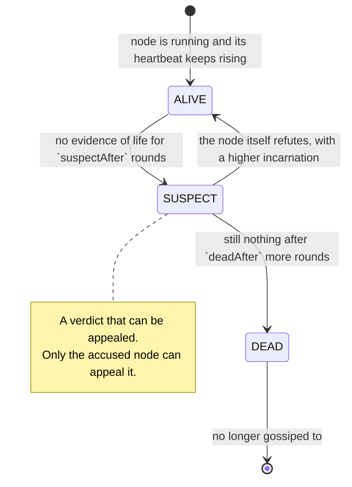
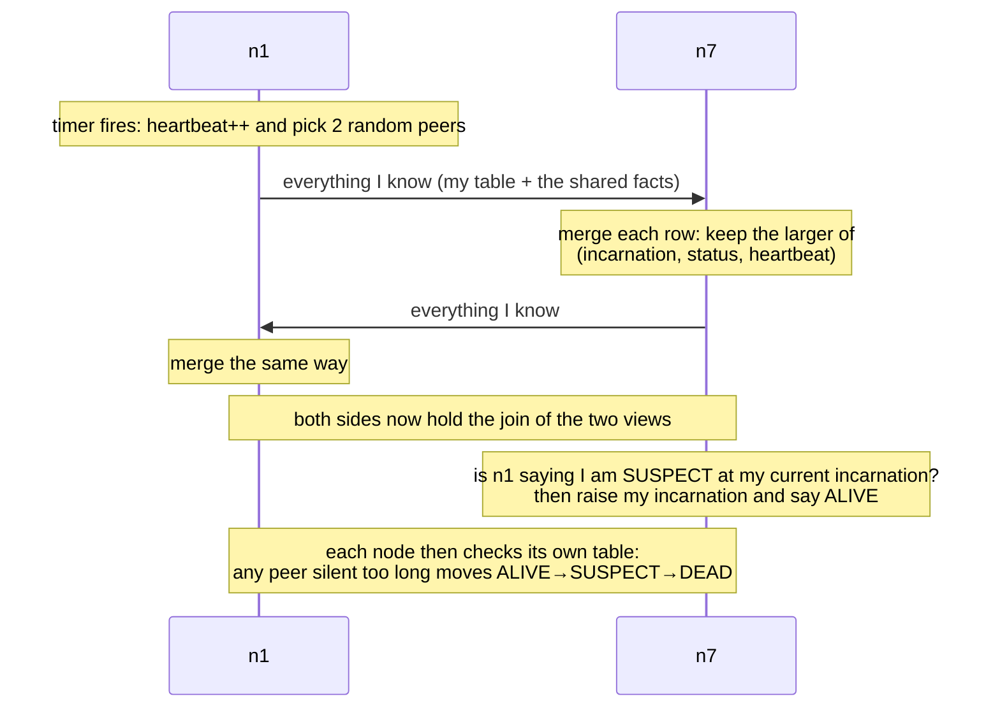
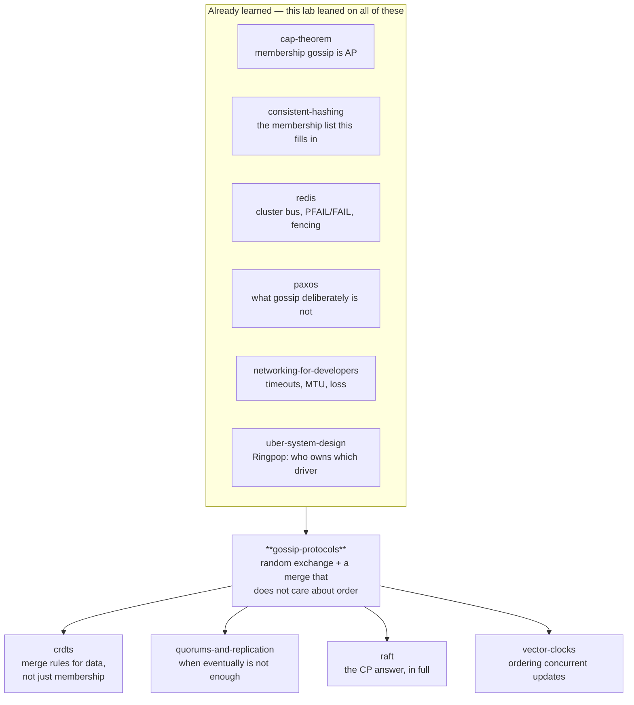

# Gossip protocols

> **Tell a friend:** Five hundred people are at the school fête, and the buses
> have just been moved to a different gate. Nobody is in charge of telling
> anybody. So Asha turns to the two people nearest her and says it. Each of them
> turns to two more, and a minute later the whole field knows. Arjun was on the
> phone under the mango tree, Dev had gone home early, and half the shouts were
> lost in the noise, and it still got everywhere. That is the whole protocol:
> once a second, tell two random peers everything you know. The number of people
> who know then multiplies instead of creeping up by one.

The cluster you can drive yourself is [`visualization.html`](visualization.html)
— the Rumour Mill, also published at
<https://claude.ai/code/artifact/25ee9543-4e48-4ea0-8bcd-4f79c1160fdb>. What the
lab is made of, how to run it, and where every number below came from are in
[section 19](#19-about-this-lab).

---

# BEGINNER MODEL

## 1. Why does a machine need to know who else is alive?

> **In one breath:** A machine that has not heard its neighbour died keeps
> posting work into a hole. Two machines that disagree about the settings send
> the same request to two different places. And there is nobody to ring five
> hundred machines and tell them.

You have five hundred machines. Every one of them has to keep two kinds of fact
straight.

The first kind is **who else is currently working**. Send a request to a machine
that is gone, and the request simply vanishes.

The second kind is **the current shared settings**. Which machine owns which
data. Which version is live. Who the write leader is.

Nobody can be told these things by a person. Machines join. Machines crash.
Machines freeze for eight seconds in the middle of garbage collection and then
come back as if nothing happened.

If a machine never finds out that another one has died, it keeps sending it work
that disappears. If two machines disagree about the settings, they send the same
request to different places, and your data ends up in two homes.

So here is the problem in one line. Five hundred machines, all of which must
keep agreeing about a changing set of facts, with no one in charge, on a network
that loses messages.

By the end of this lab you will know how a thousand machines agree on who is
alive and what the current config is — with no coordinator, no broadcast, no
acknowledgements and no retries.

### What did your last lab leave in a black box?

The [`consistent-hashing`](../35-consistent-hashing/) lab ended with an
admission. Every client depends on a membership list. While that list is still
spreading, two clients route the same key to two different machines. That lab
put a number on the damage and then changed the subject.

Read the middle column first. It says what the figure is counting.

| What the consistent-hashing lab reported | Figure | What that figure counts |
|---|---|---|
| Keyspace in disagreement while a change spreads | 9.5% | share of keys that two clients would send to different machines |

It left the spreading itself as a black box. **This lab is that box.**

## 2. What goes wrong when one person has to ring five hundred families?

> **In one breath:** The school office can telephone every family, and it works
> right up to the evening the office phone is out. Then nobody hears anything at
> all, and nobody finds out that nobody heard.

Meet a school with 500 families. Ben runs the office. Something changes. Tomorrow's
trip is cancelled, and every family has to hear about it tonight.

**The obvious plan is Ben's office.** He telephones all 500 families. It works,
right up until the evening it doesn't.

- One person makes 500 calls. If each takes a minute, the last family hears
  eight hours later.
- If the office line is out, **nobody hears anything**. Not "some people hear
  late" — nobody, ever, because Ben was the only one making calls.
- Every family also has to ring Ben when they move house. So his line is busy
  all evening with 500 families calling in.

**The other obvious plan is that everybody rings everybody.** No single point of
failure, and it is fast. It also means each family makes 499 calls, and the town
makes 249,500 calls. Every evening. Whether or not anything has changed.

> **🔮 Predict:** *A third plan. Five families volunteer as relays. Ben rings
> the five, and each relay rings a hundred families. What breaks?*
>
> <details><summary>Reveal</summary>
>
> You have not removed the single point of failure. You have made five of them,
> and now the failure is *partial and silent*.
>
> If relay number three is out, a hundred families never hear, and nobody
> notices. From Ben's point of view the call to relay three went through fine.
>
> If you guessed "nothing much, it is five times faster", you are right about
> the speed and wrong about the risk. Speed was never the thing that hurt.
>
> This is the shape of every hierarchical scheme. It converts a total, obvious
> failure into a partial, invisible one. That is usually worse, because you find
> out from the families who missed the trip.
> </details>

### Who is on the field on Saturday?

Now walk across to the school field. It is Saturday, the fête is on, and the
same 500 people are standing about in the sun. Nobody has a microphone. Nobody
has a list. This crowd is the machine you are going to build, so meet the people
you will be following all the way to the glossary.

| At the fête | What they do | Where they matter most |
|---|---|---|
| **Asha** | sells tickets at the tea stall, and hears the news first | the key idea, section 6 |
| **Meera** | standing next to Asha, so she hears it second — and then keeps hearing it | when to stop repeating, section 10 |
| **Priya** | right at the far end, by the tug-of-war rope | the last mile, section 10 |

| At the fête | What goes wrong for them | Where it matters most |
|---|---|---|
| **Arjun** | takes a long phone call under the mango tree, out of sight | suspicion and refutation, sections 10 and 11 |
| **Dev** | goes home early without telling anybody | a genuine crash, section 11 |
| **Omar** | stands behind the marquee, beside the amplifiers | one cut cable, sections 10 and 11 |

**Where this lab takes you.** Stop at any checkpoint and you still have
something whole.

| Layer | Stages | You will be able to |
|---|---|---|
| **Beginner model** | 1–9 | explain why a coordinator is not the answer, and what "tell two random friends" buys |
| **Intermediate model** | 10 | walk the protocol step by step and justify every strange-looking detail |
| **Engineering model** | 11–14 | reason about its failures, and state exactly what it does and does not guarantee |
| **Production model** | 15 | read Cassandra's, Consul's and Redis Cluster's docs and know what you are looking at |

## 3. Is "one machine in charge" really such a naive answer?

> **In one breath:** Ben's office, translated to servers, is a coordinator. It is
> not a strawman. Several systems you use every day are built exactly that way.

Translated to servers, Ben's office is a **coordinator**: one process that holds
the real membership list and the real settings. Everyone reports to it, everyone
reads from it, and it tells everyone about changes.

This is a completely reasonable design. Kubernetes has etcd. Kafka had ZooKeeper
and now has a controller quorum. Redis Cluster has a slot table that a
coordinator publishes.

The [`consistent-hashing`](../35-consistent-hashing/) lab called this the "fixed
slots plus a coordinator" answer, and it found real advantages: exact control,
no disagreement window, placement you can move by hand.

So the question is not "is a coordinator bad?". The question is: **what does it
cost, and what happens when you cannot afford it?**

## 4. What are the three costs, and which one is fatal?

> **In one breath:** A coordinator has to be kept alive, has to be talked to by
> everybody, and has to be reachable. The third one is the killer, because the
> network splits exactly when you most need an answer.

### The first one: who keeps Ben's office alive?

A coordinator that matters cannot be one process. It becomes three or five,
running a consensus protocol ([`paxos`](../39-paxos/), Raft) to agree on every
change. You now operate a distributed database in order to answer "who is
alive?".

### The second one: what happens when everybody rings Ben?

Every machine reports in. Every machine reads the list. The load grows with the
cluster, and it lands on the one component whose failure is total.

### The third one: what if you cannot reach Ben at all?

This is the fatal one. When the network splits, the machines on the wrong side
have no membership list at all. They are up. Their peers are up. And they cannot
see each other's health, because the thing that told them is on the other side.

Asha, Meera and Priya are all standing on the same field, perfectly able to talk
to each other. The one thing that could tell them who is present is on the far
side of the marquee.

That is [`cap-theorem`](../24-cap-theorem/) arriving exactly where you least want
it. A consistent coordinator must refuse to answer during a partition, and "who
is alive?" is a question you need answered *especially* during a partition.

### And what does "everybody rings everybody" cost?

Ben's other plan has arithmetic you can do on paper. Experiment 1 prints it, and
the third column says what each row is counting.

| Machines in the cluster | Messages each machine sends each second | Messages in the cluster each second |
|---|---|---|
| 10 | 9 | 90 |
| 100 | 99 | 9,900 |
| 500 | 499 | 249,500 |
| 1000 | 999 | 999,000 |

> **🔮 Predict:** *At 1,000 machines the all-to-all column says 999 messages per
> machine per second. What does the design in this lab send per machine per
> second at that size — 999, about 100, about 30, or fewer than 10?*
>
> <details><summary>Reveal</summary>
>
> **Six.** Not six hundred. Six, at every cluster size in that table.
>
> If you guessed "about a hundred", you are still imagining a cost that grows
> with the cluster. It does not grow at all. That is the single most surprising
> fact in this lab, and section 6 is where it starts to make sense.
>
> Experiment 1 prints a second half of that table showing the same comparison in
> full. It is written in words you have not been given yet, so it is held back
> until section 14.
> </details>

At 1,000 machines, all-to-all means every machine sends 999 messages **every
second, for ever**, whether or not anything has changed.

## 5. What would a good answer actually have to do?

> **In one breath:** Everybody learns everything, nobody is special, each
> machine's bill stays the same as the cluster grows, and none of it depends on
> the network behaving.

Five requirements. Each one is a person on the field. The fifth is the one people
forget.

1. **Every machine eventually learns every fact** — memberships and settings.
   Priya, at the far end by the tug-of-war rope, must end up knowing everything
   Asha knows.
2. **No machine is special.** Any machine may die at any moment without stopping
   the flow of information. When Dev goes home, or Ben's office closes, the news
   has to keep moving anyway.
3. **Each machine's cost is fixed.** It must not grow as the cluster grows. Meera
   cannot be asked to make more calls just because more families turned up.
4. **It survives a lossy network** with no acknowledgements and no retry
   bookkeeping. Half of what Asha says is lost in the noise, and nobody is
   keeping a list of what to repeat to whom.
5. **Machines discover failures themselves.** The thing that would otherwise have
   told them is exactly the thing that might be unreachable. Nobody is going to
   announce that Arjun has stepped away, or that Omar cannot be heard.

Look at who requirement 5 is really about. Arjun is not gone. Dev is. Omar is
right there and inaudible. From the outside, all three look identical, and no
machine on the field can tell them apart.

Now look hard at the word **eventually** in the first requirement. It is doing
enormous work, and giving it up is the price of everything else on the list.

Asha's crowd is not going to know things at the same instant. It is going to know
them shortly.

## 6. What if everybody just told two people?

> **In one breath:** Once a second, every machine picks two others at random and
> tells them everything it knows. Anyone who hears something new starts telling
> it too. So the number who know multiplies instead of creeping up by one.

Here is the key idea, and it is small enough to say out loud.

> **Every machine, once a second, picks two other machines at random and tells
> them everything it knows. That is the entire protocol.**

Asha, at the tea stall, hears that the buses have moved to Gate 7. She does not
look for a microphone. She does not fetch a list. She turns to the two people
nearest her, one of whom is Meera, and says it.

A minute later Meera turns to two more. So does the other one. So does Asha.
Nobody keeps a record of who has been told. Some people are told six times.

### Why does multiplying beat adding?

Because a person who has just heard the news starts telling it too. So the group
that knows does not grow by two each minute. It **multiplies**.

| Minute | People on the field who know | Why the number is that |
|---|---|---|
| 0 | 1 | only Asha |
| 1 | 3 | Asha plus the two she turned to |
| 2 | 9 | each of the three turned to two more |
| 3 | 27 | and again |
| 4 | 81 | and again |
| 6 | 500 | tripling runs out of strangers before it runs out of minutes |

> **🔮 Predict:** *Five hundred people. If Asha's crowd told one new person each
> minute in an orderly chain, it would take 500 minutes. If everyone tells two
> people, how many minutes until the whole field knows — 250, 50, or under 10?*
>
> <details><summary>Reveal</summary>
>
> **Six.** Doubling would take 9. Tripling takes 6.
>
> If you said 250, you halved a queue instead of multiplying a group. That is
> the whole difference between a design that scales and one that does not, and
> it comes from a rule you could explain to a child.
> </details>

### What are the two numbers that decide everything?

Two quantities run the rest of this lab. Both are things Asha does, before they
are words, and words before they are symbols.

The first is how many people she turns to each minute. The second is how many
minutes pass before the last person on the field has heard.

Read this table left to right. The story is in column one, the plain sentence in
column two, and only then the symbol you will see in the code.

| The thing at the fête | The same thing in words | Written as |
|---|---|---|
| how many people Asha turns to each minute | the number of randomly chosen peers a node contacts in one round | `fanout` |
| one minute of the fête | one firing of a node's gossip timer | a **round** |
| minutes until the last person hears | rounds until every node has the fact — it grows with the *logarithm* of the crowd, not with the crowd | `O(log n)` |
| the field of a thousand people, at fanout 3, taking five minutes | with a two-way exchange the informed group multiplies by about four each round, so the count is the logarithm of 1,000 to base 4 | `log₄(1000)` |
| every shout, by everyone, until the news has landed | total messages spent on one fact across the whole cluster | `O(n log n)` |

That third row is the reason any of this works. **Doubling the crowd adds one
round, not double the rounds.** A cluster ten times larger needs roughly two
more minutes, not ten times as many.

The story uses two people because two is easy to picture. The runs later in this
lab use three, and because each exchange goes both ways, three peers means six
messages per machine per second. That is the **6** from the prediction in
section 4.

### What is the second half of the idea?

There is one more piece, and it arrives properly in section 10 once you have
felt the need for it.

**When two machines exchange what they know, the way they combine their two
versions must not depend on who spoke first.**

Hold on to that sentence. It is the difference between a protocol and a game of
telephone.

## 7. What do engineers call the things you have just watched?

> **In one breath:** Ten words, and you have already felt the distinction behind
> every one of them. Here is the terminology, each word attached to the moment
> at the fête where you met the thing it names.

The full one-line definitions live in the glossary at the end. What follows is
the map back to the story.

### What is this family of protocols called, and what are its two dials?

What Asha's crowd is doing has a name. A **gossip protocol**, also called an
*epidemic protocol*, is a family of protocols in which each node periodically
exchanges state with randomly chosen peers. Information therefore spreads
probabilistically, rather than along a planned route.

The word exists to separate this from two neighbours. **Broadcast** is a planned
delivery to everyone. **Consensus** is an agreement reached before anyone
proceeds. Gossip promises neither delivery nor agreement. It promises that if you
wait, everyone ends up knowing. Cassandra nodes gossip once per second with up to
three peers, which is this exact idea in production.

You already met one line about "periodic sync/gossip" in a table in
[`distributed-rate-limiting`](../60-distributed-rate-limiting/). This lab is that
line, opened up.

Two dials control the spread, and section 6 introduced both.

| At the fête | The word | Where you met it |
|---|---|---|
| one minute, when everyone makes their calls | **round**, also called the *gossip interval* | section 6, "each second" |
| how many people you turn to | **fanout** | section 6, the two people nearest Asha |
| the moment everybody on the field has the same answer | **convergence** | section 6, minute 6 |

A round is the period between one node's gossip exchanges. In this lab every node
ticks together, which makes the traces legible. In production each node has its
own timer and nothing is synchronised. The word matters because it is the unit in
which the time to reach everybody is stated. "Five rounds" is a portable answer.
"Five seconds" depends entirely on how you set the timer.

Fanout is the one dial that trades bandwidth for speed, and its effect is
lopsided: cost is linear in fanout, benefit is only logarithmic. Fanout 3 in a
500-node cluster reaches everyone in about 5 rounds. Fanout 1 takes about 8.3
rounds (experiment 3).

Convergence is the state in which every node's copy of the shared state is
identical. Gossip guarantees it *eventually and with high probability*, never at
any fixed time. The word exists to name the goal precisely enough to put a number
on it, and to force the honest qualifier. Convergence is a destination, not a
promise about when you arrive. It is the eventual consistency of
[`cap-theorem`](../24-cap-theorem/) and the consistency window of
[`cqrs`](../51-cqrs/), applied to the membership list rather than to your data.

### Which two numbers does every machine carry about itself?

Arjun goes under the mango tree to take a call. He is not gone. He is just not
saying anything. Two small numbers exist entirely because of people like Arjun.

| At the fête | The word | Where you meet it |
|---|---|---|
| tapping the table every minute so the people near you know you are still there | **heartbeat counter** | section 10, version 3 |
| coming back and saying "I am here, and that was *before* — ignore it" | **incarnation number** | section 10, version 5 |

A heartbeat counter is a per-node number that only ever increases. It is gossiped
with the node's entry. Peers keep the highest value they have seen, and time how
long since it last moved.

Why a counter and not a clock? Because a counter answers "is this fresher than
what I have?" **without comparing clocks**. Two machines' clocks may differ by
seconds. A number that only goes up needs no agreement about time at all. So
`n5: heartbeat 412` merged with `n5: heartbeat 419` keeps 419, on every machine,
in any order.

An incarnation number is a per-node counter that **only that node may increase**.
It exists because bad news spreads and cannot be un-spread. Once the crowd
believes Arjun has gone home, no third party can talk it out of that belief. You
need one authority whose word outranks the rumour, and the only sensible
authority about Arjun is Arjun.

So Arjun is suspected at incarnation 1. He comes back, sets incarnation 2, and
says he is fine. Everyone prefers the higher incarnation, so his correction
overtakes the rumour wherever it goes. That is the same shape as the **fencing
token** in [`redis`](../13-redis/) and the expected-version check in
[`event-sourcing`](../50-event-sourcing/): a number that decides whose claim is
current.

### How does a crowd decide that somebody has gone home?

Dev leaves the fête without telling anybody. Nobody announces it. All anyone has
is an absence.

| At the fête | The word | Where you meet it |
|---|---|---|
| the rule you use to decide Dev has gone | **failure detector** | section 10, versions 3 and 4 |
| saying "I think Dev has gone" out loud, so he can contradict you | **suspicion** | section 10, version 5 |

A failure detector is the component that turns silence into a verdict. Typically:
no evidence of life for some time, then suspect, then dead. The word exists to
insist that this is a *separate, fallible component*, not a property of the
network. It can be wrong in two directions, and the two errors trade against each
other.

That is the timeout-versus-retry judgement from
[`networking-for-developers`](../01-networking-for-developers/), arriving again.
You cannot tell a dropped packet from a slow server. You pick a number and you
accept both kinds of error.

Suspicion is an intermediate state between alive and dead, gossiped like any
other fact, which gives the accused a chance to answer before being written off.
It exists because going straight from alive to dead on a timeout makes a garbage
collection pause indistinguishable from a crash, and evicts healthy machines.
Suspicion turns an instant verdict into an appealable one.

### What are the two ways to talk, and the two layers of the system?

Priya is at the far end of the field. Nobody has walked over. She could wait, or
she could ask.

| At the fête | The word | Where you meet it |
|---|---|---|
| I tell you; I ask you; we swap | **push**, **pull**, **push-pull** | section 10, version 6 |
| walking the whole field at the end, comparing notes properly | **anti-entropy** | section 10, version 7 |

Push sends your state to a peer. Pull requests a peer's state. Push-pull does both
in one exchange. The words exist because the three styles have opposite
weaknesses, and the difference only shows up at the *end* of a spread. Push is
quick to start and slow to finish. Pull is the reverse. Experiment 4 puts numbers
on both.

Anti-entropy is a background reconciliation: two machines compare everything they
hold, in full or as a digest, and fix whatever differs. Its opposite number is
**rumour mongering**, which spreads individual new facts eagerly and then stops.

The pair of names exists to label a safety net. Rumour spreading is fast and can
miss nodes. Anti-entropy is slow and misses nobody. Experiment 5 shows what
happens without the net: an eager stop rule left 9 nodes in 1,000 without the
news, for ever. Real systems run both layers, and the names tell you which one you
are talking about.

## 8. Where does the crowd picture stop being true?

> **In one breath:** The crowd is a good picture of how news spreads and a bad
> picture of what machines are like. Real people garble rumours, remember who
> they told, and never declare each other dead. Machines do the opposite of all
> three.

### The simple model: a rumour in a crowded room

Two hundred people at a party. One of them learns that the band has cancelled.
Every minute, each person who knows tells whoever is nearest. Nobody organises it.
Nobody keeps a list of who has been told. Some people are told six times.

Within a few minutes the whole room knows. And if a few people had left the party
halfway through, everyone else would still have found out.

### The engineering model: one row per machine, and one rule

Each node holds one row per node, and a rule for combining rows.



The whole engineering model is four short facts. The middle column is the machine
version; the right-hand column says the same thing in plain words.

| Part | The machine version | In plain words |
|---|---|---|
| State a node keeps | its own `heartbeat` and `incarnation`, plus a table `peer → (incarnation, status, heartbeat, last-changed)` | one row about itself, and one row about every peer |
| What a message is | that whole table, sent to a random peer | "here is everything I believe about everybody" |
| The merge rule | keep whichever version is larger, comparing `(incarnation, status, heartbeat)` in that order | when two rows disagree, the larger wins, and "larger" is decided one field at a time |
| The invariants | merging is order-independent; a node's own entry is only ever raised by that node; merging the same message twice changes nothing | order, duplicates and timing cannot change where you end up |

### Which parts of the crowd map onto which parts of the machine?

| At the party | In the cluster | Why it matters |
|---|---|---|
| Telling whoever is nearest | pick `fanout` peers uniformly at random | Uniform choice is what makes the spread exponential |
| Being told six times | redundant delivery | The redundancy replaces acknowledgements and retries |
| "The band cancelled at 9:15" | version / heartbeat number | Lets a listener tell new news from old |
| Somebody insisting they are fine | incarnation number | The only claim that outranks a rumour |
| Not hearing from a friend all evening | failure detector timeout | Silence is the only symptom available |
| Comparing notes properly at the end | anti-entropy | Catches whoever the rumour missed |

### Where the story lies to you — read this before you trust it

Four lies. Each is a place where a real cluster is not like a party.

**Rumours mutate; gossip state must not.** The party version gets garbled. Ours is
defined by a merge rule that is deterministic, commutative and idempotent. Without
those three properties, two nodes given the same facts in different orders end up
in *different* states permanently. That is the difference between a protocol and a
game of telephone, and it is why section 10 spends so long on one comparison.

**People know who they told; nodes do not.** A node keeps no record of who it has
informed. That record is exactly the bookkeeping that grows with the cluster, and
avoiding it is the whole point. The node just keeps saying it.

**A person can ask "are you okay?" and get an answer.** A node cannot. Silence is
all it ever observes, and silence has three causes it cannot tell apart: crashed,
busy, unreachable.

**Party guests do not declare each other dead.** Ours do, and it is the most
dangerous thing they do. Experiment 10 shows a cluster of 100 perfectly healthy
machines declaring every one of its members dead.

## 9. Can you watch twenty machines do it?

> **In one breath:** Open the page, tell one machine something, and step the
> rounds. The grid underneath is the interesting part: it shows what each machine
> believes about every other machine.

Go and run the cluster yourself. Open
[`visualization.html`](visualization.html)
(<https://claude.ai/code/artifact/25ee9543-4e48-4ea0-8bcd-4f79c1160fdb>).

Twenty machines in a ring. Below them, a grid with one row per machine, showing
what *that* machine believes about every other.

The grid is the thing to watch. A column in one colour means the cluster agrees.
A mottled column is the cluster in two minds — the disagreement window from the
consistent-hashing lab, made visible.

In this order:

1. **Tell n1 something new**, then press **Run one round** five times. Watch the
   violet ring spread: 1, 3, 9, 20. That is Asha's field, in miniature.
2. Set message loss to **60%** and do it again. It still gets everywhere.
3. Click a machine, press **Crash selected**, and step. That machine is Dev. Watch
   its grid column turn amber a few cells at a time — every machine works it out
   separately.
4. Click another, press **Pause selected 5 rounds**, and keep stepping past its
   return. That machine is Arjun under the mango tree. Read the log line where it
   *refutes* its own death.
5. Run situation **7**. Twenty healthy machines, 90% packet loss, and the grid goes
   entirely red. Nothing crashed.

**Step back** undoes one round at a time, so any moment can be replayed.

> **CHECKPOINT — end of the beginner model.**
> You can now say why a coordinator is not always the answer, what "tell two
> random peers" buys, and why the number that matters is a multiplication rather
> than an addition. What is missing is the mechanism: the exact rule two machines
> use when they compare notes, and why several parts of it look strange until you
> watch the simpler version break.

> **Say it back.** Without using the words *fanout*, *round* or *convergence*,
> explain to a friend why a field of a thousand people takes about five minutes to
> hear something, while a field of a hundred takes about three and a half.
>
> <details><summary>A good answer sounds like</summary>
>
> "Everyone who hears it starts telling it too. So the group that knows does not
> grow by a fixed number each minute — it multiplies. Multiplying gets through a
> crowd ten times bigger in about two more minutes, because the question is how
> many times you have to multiply, not how many people are left."
> </details>

---

# INTERMEDIATE MODEL

## 10. How would you actually build this, and where would you go wrong?

> **In one breath:** Eight versions. Each one is what a careful engineer writes
> next, and each breaks in a way that forces the following one. Every
> odd-looking detail in the finished protocol is the scar of one of these
> breaks.

This is the actual mechanism, built the way it actually gets built.

Throughout, keep five machines in your head, `n1` to `n5`, and one shared fact.
The fact is the identity of the current write leader — the machine that accepts
writes right now.

At the fête, the same fact is which gate the buses leave from. Asha (machine
`n1`) is at the tea stall. Meera, Priya, Arjun (machine `n4`) and Omar (machine
`n5`) are spread across the field. When you read "the leader is `n7`", hear
"the buses go from Gate 7".

### v1 — what if you just say what you know?

Each node picks a random peer each second and sends its copy of the settings.
The receiver overwrites its copy with whatever arrived.

> **🔮 Predict:** *Asha learns `leader=n7` at 09:00:01 — the buses go from Gate
> 7. Priya learns `leader=n9` at 09:00:04, a genuinely newer decision. Both
> start telling people. Where does the field end up?*
>
> <details><summary>Reveal</summary>
>
> **Nowhere in particular, and different people end up in different places
> permanently.**
>
> Someone who hears Asha last believes Gate 7. Someone who hears Priya last
> believes Gate 9. There is no "last" in a network, only "last as observed by
> me". So the crowd settles into two camps and stays there.
>
> If you guessed "the newer one wins because it is newer", ask who is holding
> the clock. Nobody is. Nothing in v1 carries the information that Gate 9 came
> later.
>
> Nothing detects this. Every node is behaving correctly by its own rule.
> </details>

### v2 — what if every fact carries a version?

Every fact carries a version number, and on receipt you keep the higher version.
Asha's announcement is the fourth of the day. Priya's is the fifth.

| The two versions | Written as | What the merge keeps |
|---|---|---|
| the fourth announcement, Gate 7 | `leader=n7 (v4)` | — |
| the fifth announcement, Gate 9 | `leader=n9 (v5)` | `leader=n9 (v5)` |

That result holds on every node, in any order, however many times each message
arrives. Three properties now hold, and they are the ones that matter for the
rest of this lab.

| Property | In words | Why gossip needs it |
|---|---|---|
| commutative | combining a and b gives the same answer as combining b and a | order does not exist in a network, so it must not matter |
| idempotent | the same message twice is the same as once | duplicates are free, so nothing has to be de-duplicated |
| monotonic | the result is never older than either input | information never goes backwards |

Together they make "highest version wins" a **join**: the merge always moves the
node's state upward in an ordering both sides agree on.

That is the whole correctness argument for the dissemination half of this
protocol. It is why gossip needs no ordering, no delivery guarantees and no
de-duplication.

### v3 — how do you find out who is alive?

The settings were the easy half. Now: who is alive?

Each node increases its own **heartbeat counter** every round and gossips it.
Everyone keeps the highest value they have seen for each peer, plus the local
time at which it last increased.

Why a counter rather than a timestamp? A timestamp requires two machines to agree
about the time, and they do not. A counter compared with `max` needs no agreement
at all. It is the same trick as v2's version numbers, applied to liveness.

Detection is then local arithmetic. If a peer's heartbeat has not moved for
`suspectAfter` rounds, something is wrong with that peer. At the fête,
`suspectAfter` is how many minutes of silence you give somebody before you start
telling people they have gone home.

### v4 — how long should you wait before you say somebody has gone?

Arjun is under the mango tree on a call. He is fine. He is just not saying
anything, and his peers use a three-round timeout.

> **🔮 Predict:** *Arjun is healthy but silent for four rounds. His peers give up
> after three. What fraction of the cluster declares him dead — almost none,
> about a tenth, or nearly all of it?*
>
> <details><summary>Reveal</summary>
>
> **About a tenth: 12% of a 50-node cluster.** At 50 nodes,
> `java src/Experiments.java 7` prints the whole dial, and the last column is
> the one that hurts.
>
> | `suspectAfter` (rounds of silence allowed) | Rounds to spot a real crash | Nodes wrongly suspecting a 4-round pause |
> |---|---|---|
> | 1 | 3.6 | 98% |
> | 2 | 3.8 | 81% |
> | 3 | 6.0 | 12% |
> | 5 | 7.9 | 0% |
> | 8 | 11.0 | 0% |
>
> If you guessed "almost none", look at the top two rows. At a one-round
> timeout, 98% of the cluster writes Arjun off for stepping away.
>
> **There is no good row.** Fast detection and no false alarms are the same dial
> pulled in opposite directions, because **a crashed node and a busy node produce
> exactly the same observation: nothing.** No cleverness removes this. It is the
> [`cap-theorem`](../24-cap-theorem/) lab's "you cannot tell slow from dead",
> arriving as a number you have to choose.
> </details>

So we do not go straight from alive to dead. We add **SUSPECT**: a public
statement that a node looks gone, gossiped like any other fact, which the accused
gets a chance to answer.

### v5 — why can the accused not simply say "I am here"?

Arjun comes back. Every other node is saying SUSPECT about him. He says "I am
alive" — and his message is just one more opinion about Arjun, merged against
nineteen opinions saying otherwise.

It is worse than a stalemate. With a naive "worse status wins" rule, the SUSPECT
rumour keeps circulating and re-infecting every node Arjun corrects. **Arjun is
dead for ever, while standing right there.**

The fix is to give exactly one node the last word about each node. That is the
**incarnation number**, which only that node may raise. Arjun sets incarnation 2
and says ALIVE. The merge rule prefers the higher incarnation over any status, so
the refutation beats the rumour everywhere it goes, including at nodes the rumour
reaches first.

The complete rule is a comparison of three fields in a fixed order.

```java
// PeerState.mergeFrom -- keep whichever state is LARGER, comparing
// (incarnation, then status, then heartbeat), exactly like version 2.7.1.
int cmp = Long.compare(in.incarnation, this.incarnation);
if (cmp == 0) cmp = Integer.compare(in.status.ordinal(), this.status.ordinal());  // ALIVE<SUSPECT<DEAD
if (cmp == 0) cmp = Long.compare(in.heartbeat, this.heartbeat);
if (cmp <= 0) return false;      // mine is already at least as new
```

Two things about that snippet are worth more than they look.

#### Why does bad news win at the same incarnation?

Within one incarnation, SUSPECT beats ALIVE. Otherwise a suspicion would be
cancelled by any node that had not heard it yet, and a real failure would never
be agreed on. Dev really has gone home, and that news has to travel.

So bad news must travel. Only the accused, carrying a fresh incarnation, may stop
it.

#### Why are the fields compared in a fixed order, and never mixed?

Writing this lab I first implemented "take the higher heartbeat, and separately
take the worse status". It reads perfectly sensibly out loud. It is wrong.

The test `merging_in_either_order_gives_the_same_answer` caught it immediately.
Forty orderings of the same five facts produced **two different final states**.

Mixing the fields destroys commutativity, and a cluster whose merge is not
commutative never converges. Nodes that saw the same news in different orders
stay different for ever. That test is in `Tests.java` because of this bug, and
exercise 6 plants it back for you to find.

### v6 — who tells Priya, at the far end of the field?

With push only, the spread is fast at the start and slow at the finish. Priya is
the problem. Late in a spread, walking up to a random person is useful only if
that person is one of the few still in the dark, and by then those are rare.

Run `java src/Experiments.java 4` — 500 nodes at fanout 1. The right-hand column
is the price.

| Exchange style | Rounds to reach every node | Rounds to reach 90% of nodes | Messages spent |
|---|---|---|---|
| `PUSH` — I tell you | 16.5 | 11.9 | 8,250 |
| `PULL` — I ask you | 12.0 | 10.4 | 12,000 |
| `PUSH_PULL` — we swap | 8.3 | 7.0 | 8,300 |

Look at the two round columns for push. Reaching 90% takes 11.9 rounds, and the
last 10% takes almost as long again.

Pull has the mirror-image problem: early on, the person you ask probably knows
nothing. It also has the mirror-image strength. An uninformed node *asks*, so the
tail finishes fast. Priya walking over and asking is worth more than twenty
people walking past her.

Doing both costs about the same as push and finishes twice as quickly.

> **🔮 Predict:** *Push spends 8,250 messages and pull spends 12,000. Push-pull
> does both jobs in one exchange. Does it cost about 8,250, about 12,000, or
> about 20,000?*
>
> <details><summary>Reveal</summary>
>
> **8,300 — essentially the same as push alone.**
>
> If you guessed 20,000, you counted the two directions as two exchanges. They
> are one exchange with a reply, and the exchange stops happening once everybody
> already knows. Finishing sooner is what pays for the reply.
> </details>

### v7 — when do you stop repeating yourself?

Meera has now heard about Gate 9 from four different people. A node cannot
repeat every fact for ever, so here is the obvious rule: stop telling a fact once
you have heard it back a few times. That is evidence it is already widespread.

This is called **rumour mongering**, and it is a real optimisation.

> **🔮 Predict:** *1,000 nodes, fanout 1, and each stops repeating a fact after
> hearing it back once. How many nodes never learn it — none, about nine, or
> about a hundred?*
>
> <details><summary>Reveal</summary>
>
> **Nine. And they never will.** `java src/Experiments.java 5`, over 40 rounds:
>
> | Stop rule | Nodes reached | Messages that carried the news | What the row costs you |
> |---|---|---|---|
> | stop after hearing it back once (1x) | 991.0/1000 | 4,696 | 9 nodes never hear it |
> | stop after hearing it back twice (2x) | 998.8/1000 | 6,300 | about 1 node never hears it |
> | stop after hearing it back three times (3x) | 999.8/1000 | 7,584 | a fifth of a node, on average |
> | stop after hearing it back five times (5x) | 1000.0/1000 | 9,917 | nothing, at twice the traffic |
> | never stop (anti-entropy) | 1000.0/1000 | 29,933 | nothing, at six times the traffic |
>
> If you guessed "none", you assumed somebody notices the gap. Nobody does. A
> stopped rumour cannot restart, because no node knows that any node is missing
> it.
>
> Meanwhile the saving is real: 4,696 messages against 29,933, and the gap grows
> with every round that passes.
>
> So neither layer is optional. Production systems run **rumour mongering** for
> speed. Underneath it they run **anti-entropy**, a slower, always-on exchange of
> full state, which repairs whatever the rumours missed. The
> [`anti-entropy`](../38-anti-entropy/) lab is that second layer in full.
> </details>

### v8 — is Omar quiet, or can you just not hear him?

One last break. Omar is standing behind the marquee, next to the amplifiers. He
can hear the rest of the field perfectly. The rest of the field cannot hear a
word he says to Asha.

In machine terms: the cable between `n1` and `n5` is cut, and every other link is
fine.

With heartbeat gossip, `n1` keeps seeing `n5`'s heartbeat rise via the other 18
nodes, so it never suspects `n5` — and keeps sending it work it cannot deliver.

If instead only *direct* contact counts as proof of life, `n1` correctly notices
the problem, and then does something much worse. It declares a healthy node dead,
and gossips that verdict to nodes for which it is false.

Run `java src/Experiments.java 8` — 20 nodes, one cut cable.

| How liveness is judged | Nodes that suspect or bury `n5` | What the number tells you |
|---|---|---|
| heartbeats via anyone (Cassandra-style) | 0.0 of 20 | nobody notices; `n1` keeps posting into a hole |
| only direct contact counts (SWIM-style) | 9.7 of 20 | half the cluster buries a healthy machine |
| direct contact plus 3 indirect probes (SWIM) | 0.0 of 20 | the right answer, at the cost of asking around |

The third row is the fix, and it is the idea at the heart of SWIM: **before
blaming a node, ask a few other nodes to try it for you.** If any of them can
reach it, the problem is the path, not the node.

That converts an unanswerable question, "is Omar there?", into an answerable one:
"can anybody hear Omar?"

### What does one finished exchange look like, end to end?

Two machines, one exchange. Read the notes down the middle: they are what each
side does with what it just received.



> **CHECKPOINT — end of the intermediate model.**
> You can now justify every field in the protocol: versions, heartbeats,
> incarnations, suspicion, push-pull, anti-entropy, indirect probes. Next: what
> happens when the network itself misbehaves — including the failure that takes
> down a cluster in which nothing has failed.

> **Say it back.** Without using the words *incarnation* or *commutative*,
> explain to a friend why Arjun cannot clear his name by simply saying "I am
> here", and what the protocol gives him instead.
>
> <details><summary>A good answer sounds like</summary>
>
> "His word counts the same as everyone else's, and there are nineteen of them
> saying he has gone. So he is outvoted for ever, and the old rumour keeps coming
> back round. The fix is to let him stamp his statement with a number that only
> he is allowed to raise. Everyone prefers the higher number, so his correction
> beats the rumour wherever the two meet — even at people who heard the rumour
> first."
> </details>

---

# ENGINEERING MODEL

## 11. What are the failure scenarios, and which of them survive?

> **In one breath:** Eight ways this goes wrong. Seven of them the protocol
> handles, and the eighth takes down a cluster in which not a single process has
> failed.

Eight short stories first, then two tables that compare all eight at once. The
first table is what you would see. The second is what it costs you.

### F1 — what happens when Dev simply goes home?

Dev leaves the fête without telling anybody. Nobody is notified, because there is
nobody to notify.

For `suspectAfter` rounds, nothing happens at all. Then peers begin suspecting
him, one at a time, as each one's own timer runs out. The suspicion is itself a
fact, so it spreads — which means the last few machines learn it from gossip
rather than from their own timers. In the 8-node simulation, everyone believes
the crashed node is dead within 13 rounds of the crash.

The protocol's answer is the three-state walk: ALIVE, then SUSPECT, then DEAD.
Dead nodes are dropped from the gossip partner list.

Convergence holds — every node reaches the same verdict. What bends is the gap
before it: for several rounds, some machines are still routing work to a machine
that is gone.

In a real cluster that gap is the *detection latency* you tune. It is why a
service that must fail over fast, such as a database primary, uses a shorter
timeout than one that merely needs an accurate roster.

### F2 — what happens when Arjun is only on the phone?

Arjun has not left. He is under the mango tree, or in a garbage collection pause,
or waiting on a slow disk, or in the middle of a long `fsync`.

His peers observe exactly what they observed for Dev: silence. So they suspect
him. With a three-round timeout and a four-round pause, 12% of the cluster
wrongly suspects him. With a one-round timeout, 98% do.

*No* failure detector can tell a paused process from a dead one. That is not a
gap in this implementation; it is the shape of the problem.

The protocol's answer is suspicion rather than death, plus refutation. Arjun
raises his incarnation on return and the correction overtakes the rumour. He
keeps his identity, his data and his place in the ring.

What bends is the middle: work routed to him stalls during the pause, and if the
pause runs long enough he is evicted and has to rejoin.

This is why Cassandra uses a **phi-accrual** detector. Instead of a fixed
threshold it learns each peer's normal reply distribution and emits a suspicion
*level*. A node on a jittery link is given more rope than one that is normally
instant.

### F3 — what happens when a machine that was declared dead comes back?

Arjun again, but this time the verdict has already landed. Without incarnation
numbers he is re-killed for ever: his "I'm alive" is one vote against many, and
the old rumour keeps re-infecting the nodes he corrects.

Bad news has to be monotonic, because F1 needs it to be. So only a distinguished
authority can reverse it, and the incarnation number is that authority.

Convergence holds, and so does the rule that no node ever believes itself dead.
Nothing bends at all — this one is free, once the merge rule is right.

The same mechanism appears under the same name in SWIM, Serf, memberlist and
Ringpop.

### F4 — what happens when most of the shouting is lost?

Set message loss to 60% on the page, or run `java src/Experiments.java 6`.
Convergence slows and nothing breaks.

The reason is that every node retries implicitly every round, with *different*
partners. There is no retry logic anywhere in this lab, because none is needed.

Here is the slowdown at 500 nodes and fanout 3. The right-hand column is the one
to read: it says how much worse than a perfect network each row is.

| Packet loss | Rounds to converge | How much slower than no loss |
|---|---|---|
| 0% | 5.0 | 1.00x |
| 40% | 7.8 | 1.56x |
| 80% | 21.7 | 4.34x |
| 95% | 91.4 | 18.28x |

Everything is intact. What bends is latency, and it bends gracefully. Losing four
messages in five costs you a factor of four, not a broken cluster.

This is why gossip runs over UDP, and why it is the layer that keeps working when
TCP-based control planes are timing out.

### F5 — can a network fault kill a cluster in which nothing has failed?

This is the honest limit of the design, and it deserves your full attention.

> **🔮 Predict:** *100 machines. Not one of them crashes. The network drops 90%
> of packets and the suspicion timeout is three rounds. After 40 rounds, what
> fraction of all the beliefs in the cluster say DEAD?*
>
> <details><summary>Reveal</summary>
>
> **All of them.** Every machine has written off every other machine.
>
> | Packet loss | Processes actually running | Beliefs saying DEAD | Nodes that got the news |
> |---|---|---|---|
> | 60% | 100 of 100 | 15% | 100 of 100 |
> | 80% | 100 of 100 | 64% | 93 of 100 |
> | 90% | 100 of 100 | 100% | 10 of 100 |
>
> If you guessed "it degrades like F4 did", you were reasoning about the
> spreading half, which really is that robust. This is the *judging* half, and it
> has no such property.
>
> At 90% loss every node has written off every other node, stopped gossiping to
> all of them, and the cluster has gone silent. It cannot recover on its own,
> because recovery would mean talking to nodes it has already buried.
> </details>

Silence is the detector's only symptom, and a bad network manufactures unlimited
silence. Every process is running the whole time.

There is no response to this in the lab, and that is the point. Nothing useful
survives, and everything bends, from a network problem that broke no process.

Real mitigations exist, and every one of them is partial. All four are about the
same thing: refusing to be certain.

- Adaptive timeouts, such as phi-accrual.
- Lifeguard's trick of extending your own timeouts when *you* look unhealthy to
  others.
- Never garbage-collecting a "dead" node without an explicit administrative
  removal.
- Alerting on the rate of state changes, rather than on any single node's state.

### F6 — what happens when the field splits in two?

The marquee comes down across the middle of the field. Asha's half cannot hear
Priya's half at all.

Each half converges internally and is unreachable from the other. Each half sees
the other half's nodes fall silent and starts suspecting them. From inside, a
partition looks exactly like "half the cluster died". That is
[`cap-theorem`](../24-cap-theorem/), unchanged.

Healing needs no repair step. The first ordinary message across the mended link
carries higher versions, and the merge rule does the rest — 1.8 rounds to full
reconvergence in a 100-node cluster.

Convergence holds once connectivity returns, and there is no split-brain in the
*data* sense, because there is no election and nothing to win. What bends is
serious. During the split each side has a wrong membership list. Anything built
on top of it, such as a hash ring or a router, is making decisions from it.

This is why membership gossip is **AP**. Any decision that must not be made
twice, such as a leader, a lock or an owner, needs a **CP** mechanism on top.
Gossip tells you who is probably there. It never tells you who is in charge.

### F7 — what happens to the person the rumour never reached?

Run experiment 5 with an eager stop rule. Nine nodes in 1,000 never learn the
fact, permanently, and nothing in the system notices.

The stop rule is local. "I have heard this back twice" cannot know about a node
that nobody happened to pick.

The answer is the anti-entropy layer underneath: a full-state exchange that
eventually compares everything with somebody. Eventual convergence holds
*because of* that second layer. With rumour mongering alone the fact would be
lost entirely.

Cassandra's gossip carries full digests for exactly this reason, and the
read-repair and hinted-handoff machinery is the same anti-entropy idea applied to
data rather than to membership.

### F8 — what happens when the message itself grows with the cluster?

This one is not run in the lab. It is stated, because the arithmetic is plain.

Each message carries one row per known node. So a 10,000-node cluster is carrying
a 10,000-row table in every message, several times a second. The payload is the
whole membership table.

Real systems answer it three ways. They send a **digest**, which is ids and
versions only, and let the peer ask for just the rows it lacks. They cap the
number of updates piggybacked per message, preferring the freshest and
least-disseminated ones. And they keep packets under the network's MTU: see
[`networking-for-developers`](../01-networking-for-developers/), where a message
above the path MTU is a black hole waiting to happen.

`Cluster.java` has a `maxEntriesPerMessage` knob that implements the cap, so
exercise 5 can put a number on what bounding it costs. What bends is convergence
speed, because each message now carries less news.

### All eight at once — what would you see?

| Failure | How to create it | What you would see | Why it happens |
|---|---|---|---|
| F1 crash | `java src/Sim.java` scene 3, or **Crash selected** | silence, then suspicion spreading node by node; dead in 13 rounds in the 8-node sim | nobody is notified; each node notices an absence on its own |
| F2 pause | **Pause selected 5 rounds**; experiment 7 | the same silence as F1; 12% wrongly suspect at a 3-round timeout, 98% at 1 | a paused process and a dead one produce identical observations |
| F3 return | `java src/Sim.java` scene 4; test `a_node_that_was_only_slow_refutes_its_own_death_and_stays_alive` | without incarnations, the node is re-killed for ever | bad news is monotonic by design, so only its subject can reverse it |
| F4 loss | page loss 60%; `java src/Experiments.java 6` | convergence slows and nothing else changes | every round is an implicit retry, with different partners |
| F5 meltdown | `java src/Experiments.java 10`, or page situation 7 | 100 healthy machines, 100% of beliefs saying DEAD, cluster silent | silence is the only symptom, and a bad network makes unlimited silence |
| F6 partition | **Split the cluster**; `Sim.java` scene 5; experiment 9 | two halves, each converged internally, each suspecting the other | from inside, a partition looks exactly like half the cluster dying |
| F7 missed | experiment 5 with an eager stop rule | 9 nodes in 1,000 never hear it, permanently | the stop rule is local and cannot know who was skipped |
| F8 payload | not run here — stated | a 10,000-row table in every message, several times a second | the payload is the whole membership table |

### All eight at once — what does it cost you?

| Failure | What the protocol does about it | What stays intact | What bends |
|---|---|---|---|
| F1 crash | ALIVE → SUSPECT → DEAD, and dead peers leave the partner list | convergence: every node reaches the same verdict | several rounds of work routed to a machine that is gone |
| F2 pause | suspicion rather than death, then refutation on return | the node's identity, its data, its place in the ring | work stalls during the pause; a long enough pause evicts it |
| F3 return | the incarnation number, raised only by the node itself | convergence, and "no node believes itself dead" | nothing — this one is free once the merge rule is right |
| F4 loss | nothing; there is no retry logic in the lab at all | everything | latency only, and gracefully |
| F5 meltdown | nothing in this lab — it is the honest limit | nothing useful | everything, from a fault that broke no process |
| F6 partition | nothing on healing; ordinary messages carry higher versions | convergence once connectivity returns; no data split-brain | each side runs on a wrong membership list while split |
| F7 missed | the anti-entropy layer underneath the rumours | eventual convergence, because of that second layer | it would be lost outright with rumour mongering alone |
| F8 payload | digests, a per-message cap, and packets kept under the MTU | constant per-node message count | convergence slows, because each message carries less news |

## 12. What is actually guaranteed, and what did the guarantee cost?

> **In one breath:** Gossip guarantees that everyone ends up agreeing, and
> guarantees nothing whatsoever about when. Almost every hard question in this
> lab is a question about *when*.

### Which invariants hold, and what enforces each one?

Seven promises, each with a named piece of code behind it and a test that fails
if the code stops keeping it.

| # | Invariant | Enforced by | Test |
|---|---|---|---|
| I1 | Merging is order-independent | the fixed-order comparison in `PeerState.mergeFrom` | `merging_in_either_order_gives_the_same_answer` |
| I2 | Merging the same message twice changes nothing | the same comparison returning `false` on a tie | `merging_the_same_news_twice_changes_nothing` |
| I3 | Information never moves backwards | the merge only ever replaces a smaller tuple with a larger one | `a_higher_incarnation_always_wins` |
| I4 | A suspicion may only be overturned by its subject | incarnation is raised only in the "somebody is talking about me" branch of `Node.merge` | `a_refuted_node_is_not_re_suspected_by_stale_gossip` |
| I5 | Within one incarnation, bad news wins | `status.ordinal()` comparison, `ALIVE < SUSPECT < DEAD` | `bad_news_beats_good_news_at_the_same_incarnation` |
| I6 | No running node believes itself dead | a node always rewrites its own row each round | `no_node_ever_believes_itself_dead` |
| I7 | Dead nodes stop receiving traffic | `Node.randomTargets` skips `DEAD` peers | `nobody_keeps_gossiping_to_a_node_declared_dead` |

Invariant I4 is Arjun's protection. Invariant I5 is what makes Dev's departure
stick. Invariant I7 is why nobody keeps walking over to where Dev was standing.

### What is guaranteed?

**Eventual convergence, with high probability.** If the network delivers *some*
messages, and the membership stops changing, every node reaches the same state.
This is a probabilistic statement, not a deadline. The probability that a given
node has not heard after `r` rounds falls exponentially in `r`, and it is never
exactly zero.

**Order independence.** Nodes may receive the same facts in any order, twice, or
not at all, and still agree.

**Constant cost per node.** The bill is `fanout × message size`, and it does not
depend on how big the cluster is.

**Self-healing.** No repair step exists because none is needed. After a
partition, a crash or a storm of loss, the ordinary mechanism *is* the recovery
mechanism.

### What is explicitly not guaranteed?

**No agreement at any instant.** There is no moment at which the cluster "has" a
membership list. Experiment 9 shows a single crash leaving the cluster with a
peak of **45% of nodes disagreeing**, for about 10 rounds.

**No delivery guarantee** for any individual message, and no way to know whether
one arrived.

**No total order.** Two facts published concurrently at different nodes have no
defined relative order. The version numbers only order *updates to the same
fact*. Genuinely concurrent updates need version vectors or a CRDT, which is
beyond this lab.

**No accuracy from the failure detector.** It is wrong in both directions, by
design, and F5 shows it can be catastrophically wrong.

**Nothing about leadership.** Gossip cannot elect anything. It reports beliefs; it
does not create facts.

**No security.** Any node that can talk to the cluster can inject any belief,
including "everyone is dead".

### Why is the safety argument so short, and the liveness argument so long?

The unusual thing about gossip is that its **safety property is trivial**.
Nothing bad can happen from merging states, because the merge is a join over a
partial order, and every node only ever moves upward in it. There is no
equivalent of two Raft leaders or a lost committed write.

So almost everything interesting is a **liveness** question: *when* does everyone
know?

And the one true safety-flavoured failure is F5, the cluster declaring itself
dead. That one does not come from the gossip at all. It comes from the
**judgement** layered on top of it.

That division is worth carrying away. Spreading is robust. Deciding is fragile.

### What does it all cost, in one table?

| Quantity | Cost | What the figure means |
|---|---|---|
| messages per node per round | `fanout` (×2 for push-pull) | independent of cluster size — this is requirement 3 from section 5 |
| rounds to converge | `O(log n)` | 2 rounds at 10 nodes, 6 at 5,000, both at fanout 3 |
| total messages per fact | `O(n log n)` | 15,000 for 500 nodes at fanout 3 |
| message size | `O(n)` naive, `O(1)` with a cap | F8; real systems cap it |
| detection latency | `suspectAfter + deadAfter` rounds, plus spread | tuned against false positives, and there is no good setting |

## 13. Which lines of code carry the meaning?

> **In one breath:** Eight small files, no build tool, no dependencies. Four
> short passages do nearly all the work, and each one is a thing you have
> already watched happen on the field.

### The four lines that decide every disagreement

**[`src/PeerState.java`](src/PeerState.java) — the merge rule.** The whole
protocol's correctness lives here.

```java
int cmp = Long.compare(in.incarnation, this.incarnation);
if (cmp == 0) cmp = Integer.compare(in.status.ordinal(), this.status.ordinal());
if (cmp == 0) cmp = Long.compare(in.heartbeat, this.heartbeat);
if (cmp <= 0) return false;
```

Fixed order, no mixing. Commutative, idempotent and monotonic — the three
properties that make ordering, de-duplication and acknowledgement unnecessary.

### The one place a node writes a number about itself

**[`src/Node.java`](src/Node.java) — refutation.** This is Arjun coming back from
the mango tree, in code. It is the only number a node writes about itself that
every other node must accept.

```java
if (in.status != Status.ALIVE && in.incarnation >= incarnation) {
    incarnation = in.incarnation + 1;     // only I may raise my own incarnation
    ...
}
```

### The arithmetic that turns silence into a verdict

**[`src/Node.java`](src/Node.java) — detection, and its honest comment.** Local
arithmetic over one number, with a note about what it fundamentally cannot see.
This is the rule that writes Dev off, and the rule that nearly writes Arjun off.

```java
long silence = round - p.lastChangedRound;
if (p.status == Status.ALIVE && silence > suspectAfter) p.status = Status.SUSPECT;
```

### The line that makes a "round" mean anything

**[`src/Cluster.java`](src/Cluster.java) — the frozen snapshot.**

```java
Map<String, Snap> frozen = new LinkedHashMap<>();
for (Node n : nodes) if (n.running) frozen.put(n.id, snap(n));
```

Without it, a fact relays through the entire cluster inside one tick, and every
convergence number in this lab would be a fiction of the simulator. I know,
because the first version did exactly that. It reported 1,000 nodes converging in
2.3 rounds, which is faster than theory allows. The fix moved it to 5.0 — bang on
`log₄(1000)`.

The rest of the files: `Status`, `Cluster` (the breakable network), `Sim` (the
narrated afternoon), `Experiments`, `Tests`, and `BrokenMerge` for exercise 6.

## 14. What will you predict before you run it?

> **In one breath:** Ten runs. Write your answer down first — the right-hand
> column is deliberately the last thing you should read.

Each row is a question, the command that answers it, and what the number turns
out to be. Rows 7 and 8 are Arjun and Omar, in numbers. Row 5 is the nine people
nobody ever walked over to.

| # | The question | Command | What the run says |
|---|---|---|---|
| 1 | What does a coordinator-free design cost per node? | `java src/Experiments.java 1` | 6 messages per node per second, at every size; all-to-all is 999 |
| 2 | How does convergence grow with the cluster? | `...2` | if 10 nodes take 2 rounds, 5,000 take 6 — that is `log₄ n` at fanout 3 |
| 3 | Is a bigger fanout worth it? | `...3` | going from 6 to 10 buys almost nothing, for 67% more traffic for ever |
| 4 | Who finishes the last mile? | `...4` | push is slower at the *end*, by nearly 2× |
| 5 | What does an eager stop rule lose? | `...5` | nine of 1,000 nodes never hear it, permanently |
| 6 | Does 80% packet loss break it? | `...6` | a 4.3× slowdown, with no retry logic anywhere |
| 7 | How fast should a failure detector be? | `...7` | there is no setting that is good in both columns |
| 8 | Who gets blamed for one broken cable? | `...8` | the strict model buries a healthy node; indirect probes fix it |
| 9 | How long is the cluster of two minds? | `...9` | 45% of nodes disagree at the peak, for about 10 rounds |
| 10 | Can a network fault kill a cluster with no failed process? | `...10` | at 90% loss, all 100 healthy machines declare all the others dead |

And end to end, one narrated afternoon in an 8-node cluster: `java src/Sim.java`.

> **CHECKPOINT — end of the engineering model.**
> You can now defend the protocol under loss, partition, pauses and false
> verdicts, and you know its one catastrophic mode. What remains is the distance
> between this lab and the systems on your cluster.

> **Say it back.** Without using the words *detector*, *timeout* or *partition*,
> explain to a friend how a hundred perfectly healthy machines can end up
> convinced that every one of them is dead.
>
> <details><summary>A good answer sounds like</summary>
>
> "The only evidence any machine has that another one is alive is hearing from
> it. A bad enough network means almost nothing gets through. So every machine
> waits, hears nothing, and concludes the others have gone — and once it has
> concluded that, it stops trying to talk to them. Now there is no way back,
> because getting back would mean talking to the machines it has already written
> off."
> </details>

---

# PRODUCTION MODEL

## 15. What does a real system add that this lab leaves out?

> **In one breath:** The shape is the same. What changes is that nothing ticks
> together, the message is a summary rather than the whole table, and the
> timeout learns instead of sitting still.

Everything below is the same field, at production scale. Asha is still telling
two people. Arjun is still under the mango tree. What a real system adds is
mostly better judgement about Arjun, and a smaller thing to say to Meera.

### From this toy to the real thing — what changes, and why?

Read the right-hand column first. It says why the toy is not enough.

| In this lab | In real systems | Why the toy is not enough |
|---|---|---|
| lock-step rounds | each node's own timer; nothing synchronised | Real gossip has no rounds; the spread shape is the same, and the reasoning about "rounds" becomes "gossip intervals" |
| whole table in every message | digests (id + version), then a targeted exchange of differences; Merkle trees for data anti-entropy | F8: the payload cannot be allowed to grow with the cluster |
| fixed `suspectAfter` | **phi-accrual** (Cassandra): learns each peer's reply distribution and outputs a suspicion level | Experiment 7 has no good row; an adaptive detector picks the row per peer, continuously |
| SUSPECT plus incarnation | **SWIM** (Consul/Serf, memberlist, Ringpop): direct ping, then indirect ping via k peers, then suspicion with a timeout, plus **Lifeguard** refinements | Experiment 8: reachability is per-observer, so a second opinion is mandatory |
| everyone knows everyone at boot | **seed nodes**: a handful of well-known addresses, and the rest is learned by gossiping | Bootstrapping is a real problem this lab skips entirely |
| one config value | membership plus schema versions plus token ranges plus load plus datacentre and rack topology, all gossiped together | The payload is where the design effort actually goes |
| in-memory, one process | UDP for probes, TCP for state sync, both encrypted and authenticated | Anyone who can send a packet can currently inject "everyone is dead" |

### Which real systems should you go and read?

**Cassandra** gossips once per second with up to three peers. Its per-node state
is `(generation, version)`, where generation is the boot count and therefore
plays the role of the incarnation number. Failure detection is phi-accrual. Every
idea in this lab appears there, under these names.

**Consul, Serf and HashiCorp memberlist** are a direct SWIM implementation, plus
**Lifeguard**. Lifeguard's core insight is that a node that is *itself*
overloaded should be more forgiving of others, because its own observations are
suspect. That is the honest answer to F5 that this lab does not implement.

**Redis Cluster** runs its cluster bus as gossip. A node's private suspicion is
called PFAIL; it is promoted to a cluster-wide FAIL verdict only once a majority
of primaries agree. Note the difference from this lab: Redis requires a
**quorum** before a verdict becomes binding, precisely to avoid one node burying
a healthy peer. Worth pairing with [`redis`](../13-redis/).

**Ringpop**, from Uber, is SWIM plus consistent hashing — exactly the pairing the
[`uber-system-design`](../70-uber-system-design/) lab needed to answer "which node
owns which driver".

**Amazon Dynamo**, the 2007 paper, is the origin of gossiped membership plus
consistent hashing in one design, and still the clearest short read.

*(These descriptions come from published papers and documentation. Treat the
details as "how these systems have been described", not as a guarantee about the
version you are running.)*

### What has this lab intentionally left out?

Ten things, each of which a real deployment has to answer.

- Bootstrapping from seed nodes.
- Digests and delta exchange.
- Merkle-tree anti-entropy over data.
- Phi-accrual detection.
- Lifeguard.
- Encryption and authentication.
- NAT and multi-datacentre topology, where real systems gossip *less* across
  datacentre links.
- Version vectors for genuinely concurrent updates.
- Persistent membership across restarts, and explicit leave and join
  announcements.
- Quorum-gated verdicts.

### What does an on-call engineer actually watch?

| Signal | Why it is the one that matters |
|---|---|
| **Convergence time** — fact published until all nodes have it | The number everything else is a proxy for |
| **Membership flap rate** — state changes per node per hour | A rising flap rate is the early warning for F2 and F5, long before an outage |
| **Nodes in SUSPECT**, as a rate rather than a state | A steady trickle is normal; a spike is a network event, not a node event |
| **Disagreement** — distinct membership views across the cluster | The window from experiment 9 — directly, the thing that misroutes requests |
| **Gossip message rate and size** | Where F8 shows up, before it becomes a packet-size cliff |
| **Phi values and suspicion levels per peer** | Which links are marginal, before they are broken |

The alerting rule worth stealing: **alert on the rate of membership change, not
on any node's membership state.**

A single node marked dead is routine. Fifty marked dead in a minute is a network
event, and F5 says your cluster may be about to write itself off.

### Which trade-offs will you actually be asked about?

1. **Fanout** — cost is linear, benefit is logarithmic. Real systems sit near 3.
2. **Gossip interval** — detection latency against constant background traffic.
3. **Suspicion timeout** — false positives against slow failover. There is no good
   setting; adaptive detectors choose per peer, continuously.
4. **Rumour mongering against anti-entropy** — speed and cheapness against
   completeness. Run both.
5. **Hearsay against direct evidence** — a cheap, forgiving view of liveness
   against an accurate view of *reachability* that needs second opinions to be
   safe.
6. **Gossip against a coordinator** — no single point of failure and constant
   per-node cost, bought with permanent uncertainty about the present moment.
   That is the [`consistent-hashing`](../35-consistent-hashing/) lab's
   "coordination for control" trade, seen from the other side.

> **CHECKPOINT — production model.** You can now read the Cassandra gossip docs,
> the SWIM paper and Redis Cluster's PFAIL/FAIL rules and recognise every moving
> part, including the ones this lab deliberately left out.

> **Say it back.** Without using the words *gossip*, *quorum* or *consensus*,
> explain to a friend why the crowd on the field can tell you who is probably
> there, but can never tell you who is in charge.
>
> <details><summary>A good answer sounds like</summary>
>
> "Everyone is passing on what they last heard, and nobody is counting votes. So
> the crowd is very good at spreading a fact that somebody else already decided,
> and completely unable to decide one. Two halves of a split field would each
> happily crown their own captain, and nothing in the passing-it-on would ever
> notice."
> </details>

## 16. Can you do it yourself?

> **In one breath:** Eight rungs of exercises, from saying it in your own words to
> designing membership for three datacentres. Three of them need nothing but the
> page and your head.

[`EXERCISES.md`](EXERCISES.md) has eight rungs, from explaining it in your own
words to designing membership for three datacentres. Answers are in
[`SOLUTIONS.md`](SOLUTIONS.md) — try first, especially the predictions.

## 17. What did this lean on, and what comes next?

> **In one breath:** This lab is the knowledge map's missing box between
> consistent hashing and everything that needs a membership list. What you learn
> next depends on whether "eventually" was good enough for you.



### What is this commonly confused with?

Six pairs, and the one sentence that separates each.

**Gossip against broadcast.** Broadcast plans a delivery to everyone; gossip
makes no plan and relies on repetition. That is why broadcast fails completely
when a link fails, and gossip merely slows down.

**Gossip against consensus (Raft, Paxos).** Consensus decides *one* value and can
tell you it is decided. Gossip spreads values somebody else decided, and can
never tell you it is finished. Use consensus to pick a leader; use gossip to tell
everyone who it is.

**Gossip against a heartbeat to a monitor.** A monitor is one observer with one
opinion; gossip has many observers whose opinions merge. That is why gossip
degrades into "half the cluster disagrees" rather than "the monitor is down and
nobody knows anything".

**Anti-entropy against rumour mongering.** Same protocol family, opposite jobs.
Rumours are fast and can miss. Anti-entropy is slow and misses nobody.

**Failure detector against failure.** The detector is a component with its own
error modes. Experiment 10 is entirely a detector failure with zero process
failures — a distinction that matters enormously at 3am.

**Eventually consistent against eventually convergent.** Convergence is about
*replicas of the same state agreeing*. Consistency is about what a *reader* is
promised. Gossip gives you the first; what a client sees is a separate design
question.

### What should you type next?

```bash
/learn crdts                    # the merge rule of §10 v2, generalised to real data
/learn quorums-and-replication  # R + W > N: what to do when eventual is not enough
/learn raft                     # the CP answer in full; the tool gossip cannot replace
/learn vector-clocks            # ordering updates that gossip's version numbers cannot
/learn kafka                    # the last unopened box in the consistent-hashing map
```

## 18. Glossary — what does each word mean, exactly?

> **In one breath:** Twenty words, one line each. Every one of them is something
> you watched happen on the field before it was given a name.

In order of first appearance, split into four groups so that each one fits on a
screen.

**The two designs.**

| Term | In one line |
|---|---|
| **coordinator** | A designated node that holds the authoritative state; simple, and a single point of failure and unavailability. |
| **gossip protocol (epidemic protocol)** | Each node periodically exchanges state with a few random peers, so facts spread by repetition rather than by plan. |

**The dials and the goal.**

| Term | In one line |
|---|---|
| **round (gossip interval)** | One firing of a node's gossip timer; the unit convergence is measured in. |
| **fanout** | How many random peers a node contacts per round; cost is linear in it, speed logarithmic. |
| **convergence** | The state in which every node holds identical state — guaranteed eventually and probabilistically, never at a fixed time. |
| **push / pull / push-pull** | I tell you / I ask you / we swap; push starts fast and finishes slowly, pull the reverse. |
| **merge rule (join)** | The order-independent function combining two views; commutative, idempotent and monotonic, which is why gossip needs no ordering or acknowledgements. |

**The numbers a node carries, and the verdicts it reaches.**

| Term | In one line |
|---|---|
| **heartbeat counter** | A per-node number that only increases, so freshness can be compared without any agreement about clocks. |
| **incarnation number** | A per-node counter only that node may raise, letting it overrule the cluster's belief about itself. |
| **failure detector** | The rule that turns silence into a verdict; a fallible component, wrong in both directions. |
| **suspicion** | A public, appealable "this node looks gone", sitting between alive and dead. |
| **detector meltdown** | A cluster in which no process has failed writing every member off, because the network manufactured enough silence. |

**The two layers, and what production adds.**

| Term | In one line |
|---|---|
| **anti-entropy** | A slow, always-on exchange of full state that repairs whatever the fast rumours missed. |
| **rumour mongering** | Spreading a new fact eagerly and stopping once it has been heard back a few times. |
| **piggybacking** | Carrying updates on messages that were being sent anyway. |
| **digest** | Ids and versions only, so a peer can ask for just what it lacks instead of receiving everything. |
| **seed node** | A well-known address a joining node contacts to discover the rest of the cluster. |
| **phi-accrual detector** | A detector that learns each peer's normal timing and outputs a suspicion level instead of a yes/no. |
| **SWIM** | The membership protocol built on direct probe → indirect probe → suspicion → refutation. |
| **Lifeguard** | SWIM refinements in which an overloaded node distrusts its own observations and becomes more forgiving. |

## 19. About this lab

### How do you run it?

```bash
java src/Sim.java           # one narrated afternoon in an 8-node cluster
java src/Experiments.java   # ten measurements (or pass 1-10 for one)
java src/Tests.java         # 12 guarantees, asserted
java src/Tests.java broken  # the planted-bug merge rule, for exercise 6
```

The page is [`visualization.html`](visualization.html) — the Rumour Mill, also
published at
<https://claude.ai/code/artifact/25ee9543-4e48-4ea0-8bcd-4f79c1160fdb>. Twenty
machines, every rule exposed as a switch, and seven predict-then-run situations.

### Where did the numbers come from?

Every figure in this document was measured by running the Java simulator in this
folder, on one machine, with no network involved. Runs that involve randomness
are averaged over repeated trials, which is why several results are printed with
a decimal point — 8.3 rounds, 9.7 nodes, 998.8 nodes reached.

The one number that is not measured is F8's 10,000-row message. That is stated
arithmetic, not a run.

The simulator's convergence figures are only meaningful because of the frozen
snapshot in `Cluster.java` described in section 13. The first version of the
engine let a fact relay across the whole cluster inside one tick and reported
1,000 nodes converging in 2.3 rounds. That was verified against theory, found to
be impossible, and fixed; the corrected figure is 5.0 rounds.

The twelve assertions in `Tests.java` are run headlessly and all pass. The
`broken` variant deliberately fails several of them, which is the point of
exercise 6.

### What is in this folder?

```
README.md              this document
EXERCISES.md           eight rungs, from "explain it" to "design it for three datacentres"
SOLUTIONS.md           worked answers — try first
visualization.html     the Rumour Mill (also published as an artifact)
src/Status.java        ALIVE / SUSPECT / DEAD, and why the order matters
src/PeerState.java     one row of the membership list, and THE merge rule
src/Node.java          a member: its view, its merge, its refutation, its detection
src/Cluster.java       the breakable network and the round loop
src/Sim.java           one narrated afternoon in an 8-node cluster
src/Experiments.java   ten measurements
src/Tests.java         twelve guarantees (`java src/Tests.java broken` for exercise 6)
src/BrokenMerge.java   the planted bug
```

### Where does this sit among your other labs?

It is the box that [`consistent-hashing`](../35-consistent-hashing/) left closed:
how the membership list every client depends on actually gets everywhere. Its
sequel is [`anti-entropy`](../38-anti-entropy/), which takes the merge rule you
built here and asks what goes and looks for the copies the rumours missed.

The cast is Asha, Meera, Priya, Arjun, Ben, Dev and Omar. They are the same
people you will meet in the other labs in this folder.
