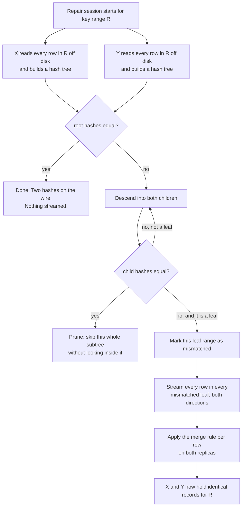
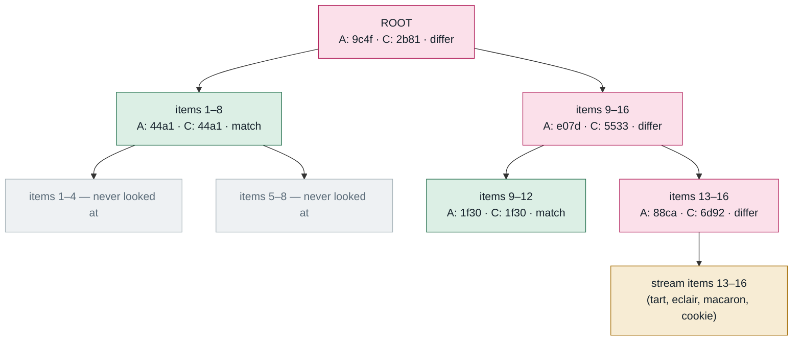
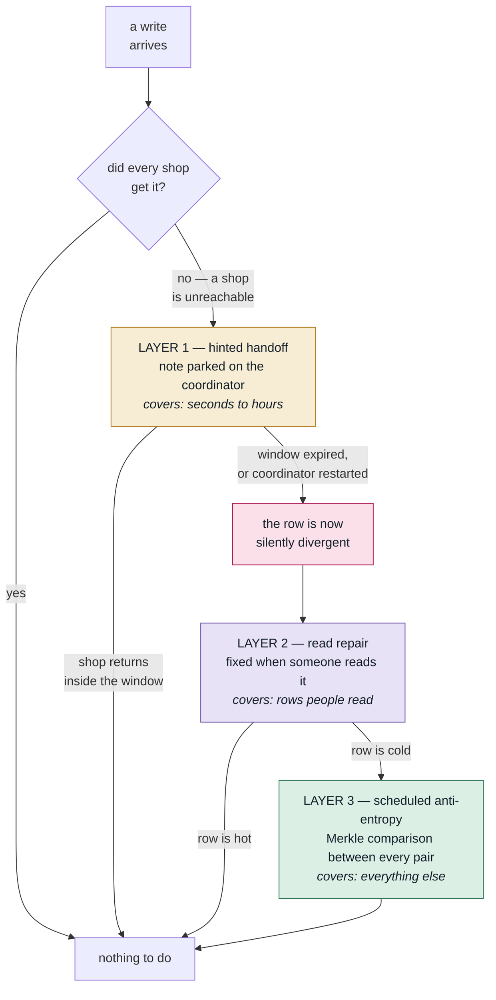
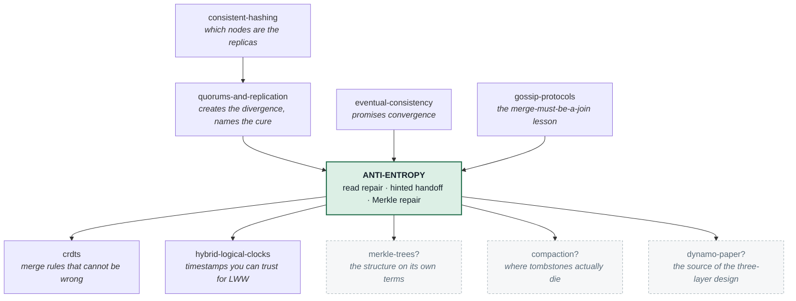

# Anti-Entropy

> **Tell a friend:** Asha at head office puts the croissant price up and rings
> her three shops. Meera and Arjun answer, so the change is live. Omar's line is
> busy, and no part of the process is supposed to go back for him, so his shop
> sells at last week's price for a year. Anti-entropy is the background job that
> does go back: it compares a summary of each shop's whole price list, splits
> wherever two summaries disagree, and repairs what it finds. The rest of this
> lab is the eleven ways that repair still leaves a customer paying the wrong
> price.

The simulator is [`visualization.html`](visualization.html), also published at
<https://claude.ai/code/artifact/f8ee9833-c3e8-4c29-9796-c2c68b8954b2>. The lab
contents, the engine runs, and how every number in this document was made are
in [section 17](#17-about-this-lab) at the end.

---

# BEGINNER MODEL

## 1. What part of the system goes back and fixes the third copy?

> **In one breath:** You keep three copies of every row so that one dead machine
> cannot lose your data. The moment you do, the three copies can stop being the
> same. Nothing in the ordinary business of reading and writing is responsible
> for noticing.

Asha runs pricing at head office. She keeps three copies of every price,
because a machine holding the only copy will one day die.

The instant she does that, she creates a new thing that can go wrong. **The
three copies can stop being the same.**

Here is the part that surprises people. This is not caused by a bug. It is
caused by the system working exactly as designed.

A write that reached two of the three copies is a *successful* write. Asha
configured it that way on purpose, so that one sick machine cannot stop her
shops selling. The write returns success. And the third copy is now holding
last week's value.

So ask the obvious question. **What part of the system goes back and fixes that
third copy?**

In the write path, nothing. The write is finished, and it was a success.

In the read path, almost nothing. A read that happens to touch the stale copy
might notice. But only if it touches it, and only for the one row it asked
about.

There is no other code running. The third copy holds a wrong value for as long
as nobody happens to look. For most rows in most databases, that means
*forever*.

So divergence is not a rare accident to be handled. It is the continuous,
normal residue of a system that keeps serving while machines come and go. And
it accumulates.

**Anti-entropy** is the name for the background work that goes looking for
those differences and removes them. Without it, "eventually consistent" is a
promise with no machinery behind it.

### Why did your last three labs walk past this?

Three labs you have already done all pointed here and then changed the subject.

[quorums-and-replication](../34-quorums-and-replication/) ended by listing
*"read repair, anti-entropy, Merkle tree"* among its key terms. Three names, no
mechanism. It is also the lab where you learned the counting rule that this one
leans on: tell enough replicas and ask enough replicas, and the two groups are
forced to share one. In symbols, `R + W > N`.

[eventual-consistency](../28-eventual-consistency/) told you the replicas
converge. It did not tell you what does the converging.

[gossip-protocols](../37-gossip-protocols/) taught you, the hard way, that a
merge rule must be a **join**. You built one that was not, and forty orderings
of the same five facts produced two permanently different states.

Put those together. You have a system that creates divergence on purpose, then
promises it will go away, and holds one rule for combining two versions.
**Nothing in any of them ever goes and looks.** That missing piece is this lab.

## 2. Why does Omar's shop sell croissants at last week's price for a year?

> **In one breath:** Head office changes a price and rings three shops. Two
> answer and one does not, and the rule says two is enough. Nobody's job
> includes going back for the third.

A chain of three bakeries: **shop A**, **shop B**, **shop C**. Meera runs A.
Arjun runs B. Omar runs C.

Asha at head office sets the prices. Each shop also keeps its own printed price
list, the whole list, all sixteen items. A shop has to be able to sell when the
office phone is engaged.

Monday morning, Asha puts the price of a croissant up to £4.00 and rings round.
Meera answers and writes it down. Arjun answers and writes it down. Omar's line
is busy, because he is out at the back signing for a flour delivery.

Asha's rule is simple. **Two shops confirmed means the change is live.** Two
shops confirmed. She ticks the job off her list and moves on to the scones.

Nobody is coming back for Omar.

Omar sells croissants at £2.40 on Tuesday. And next month. And next year. Not
because anything broke. The phone worked, the rule was followed, the change was
recorded as a success. The only thing that happened is that no part of the
process was responsible for going back to check.

Here is that morning as numbers. The middle column is the one to read: it says
what each figure is counting.

| After Asha's one price change | Figure | What that figure counts | Where to see it |
|---|---|---|---|
| Rows the three shops disagree about | 1 of 16 | items with different records on different shops | Scenario 1 |
| What Priya is told at Omar's shop | 2.40 | the price a customer is actually charged there | Scenario 1 |
| What Meera and Arjun charge | 4.00 | the price everyone else believes | Scenario 1 |

One row. Now leave the chain running for a week, with the usual mix of a
machine rebooting for a kernel patch, a switch dropping packets for ninety
seconds, and a maintenance window.

> **🔮 Predict:** Three hundred price changes over that week, on a longer
> catalogue of sixty-four items, with Omar's shop away for a few short blips and
> one five-hour outage. How many of the sixty-four items end up different
> between the shops? And of those, how many are items customers ask about often?
>
> <details><summary>Reveal</summary>
>
> **16 of the 64 rows differ, and only 3 of them are items anyone reads.**
> Thirteen are rows nobody has looked at in weeks.
>
> If you guessed a handful, you have the right instinct for how often things go
> wrong and the wrong instinct for how long each one lasts. Nothing removes a
> difference once it exists. They pile up.
>
> If you guessed that most of the damage would be on popular items, you have it
> backwards, and that backwardness is the whole point of the next three
> sections. Popular items get looked at, and looking is what fixes things.
>
> | The week-long run | Figure | What that figure counts |
> |---|---|---|
> | Writes issued | 300 | price changes over seven days |
> | Catalogue size | 64 | items in the price list |
> | Divergent at the end | 16 | items the shops hold different records for |
> | Of those, hot | 3 | divergent items customers read often |
> | Of those, cold | 13 | divergent items nobody has read in weeks |
> </details>

That ratio, 3 rows where somebody is watching against 13 where nobody is, is
the shape of the whole problem. Hold on to it for the next two sections.

Here is how far this lab follows Asha, Omar and Dev, and what you can do after
each layer.

| Layer | Sections | After it you can… |
|---|---|---|
| **Beginner** | 1–9 | say why the copies drift, and why fixing-on-read cannot save you |
| **Intermediate** | 10 | build the mechanism yourself, one failure at a time |
| **Engineering** | 11–12 | reason about all eleven failures and state what repair guarantees |
| **Production** | 13 | run repair on a real cluster and know what the alert means |

## 3. Why not just fix it when a customer asks?

> **In one breath:** When Priya asks the price, ring two shops instead of one,
> believe the newer answer, and correct the shop that was behind. It is cheap,
> it is real, and on its own it is close to useless.

The trouble is that one shop is out of date. So check when it matters.

When Priya actually asks the price of a croissant, ring two shops instead of
one. Take the newer of the two answers. And while you have them on the phone,
correct the one that was behind.

This is genuinely a good idea, and every real system does it.

It costs almost nothing, because you were making the phone call anyway. It
fixes the row Priya cares about at the exact moment she cares about it. It
needs no new background process, no schedule, and no extra machine.

It is also, on its own, close to useless. There are three separate reasons.
Each one teaches a different thing about what a repair mechanism has to do, so
it is worth seeing all three.

> **🔮 Predict:** Five price changes have missed Omar's shop. Priya now asks
> about one of the five. After that phone call, how many of the five rows are
> still wrong at Omar's?
>
> <details><summary>Reveal</summary>
>
> **Four.** The call fixed exactly the one row it was about. There is no
> mechanism by which asking about croissants tells you anything about scones.
>
> If you said "all five, because the shops synced", you are imagining a
> mechanism that does not exist. Nothing compared the two price lists. Two
> people compared one line of them.
>
> | Before Priya's call | After it | What changed | Where to see it |
> |---|---|---|---|
> | 5 divergent rows | 4 divergent rows | one row, the one she named | Scenario 2 |
>
> This sounds obvious once it is said this baldly, and it is. But notice what it
> ties the fix rate to. It is tied to the *read* rate. And in every real
> catalogue, the vast majority of rows are read approximately never.
> </details>

## 4. Where does fixing-on-read break?

> **In one breath:** It only fixes rows somebody reads, it only reaches the
> shops you happened to ring, and every repair it does is work done while a
> customer waits.

### Limit one — what happens to the four rows nobody asked about?

Covered just above. Five rows wrong, one read, four still wrong.

In the week-long run this is the difference between the 3 divergent hot rows
and the 13 divergent cold rows. Fixing-on-read attacks exactly the 3. It cannot
touch the 13.

### Limit two — which shop does the call actually reach?

This is the one people do not expect.

You keep three copies but you only ring two, because ringing two is what makes
the system fast and available. Which two? Whichever two answer first. In
practice that means the two that are healthy and nearby.

Now think about which shop is stale. It is usually the one that has just come
back from being sick. Which is to say, it is *the one least likely to be in the
group you rang*.

| Priya's read at shop A | What the mechanism did | Divergence afterwards | Where to see it |
|---|---|---|---|
| Asks Meera (A) and Arjun (B) | compared two correct answers | **unchanged** | Scenario 2 |

Read that middle cell again. Both shops it rang were correct, so the answer was
correct, and Priya went home happy. The mechanism designed to notice the
problem never looked at the shop that had it.

> **🔮 Predict:** So lower the number of shops you ring to one. Faster, cheaper,
> fewer calls. What does fixing-on-read do now?
>
> <details><summary>Reveal</summary>
>
> **Nothing at all, ever.** The read went to Omar's shop, was answered **2.40**
> when the true price was 9.00, and repaired nobody. That is Scenario 2 with the
> number of shops asked, `R`, set to 1.
>
> If you said "it still fixes the row it read", you are assuming the answer can
> be checked. It cannot. There is nothing to check it against.
>
> The reason is worth saying precisely, because it is the seed of the whole lab.
> **You cannot detect a disagreement with one copy.** Repair is not something a
> shop can do by looking at its own list. It requires *comparison*, and
> comparison requires at least two. A single copy has no way to know it is
> wrong. From the inside, being stale looks exactly like being right.
> </details>

### Limit three — who pays for the repair?

Every repair on the read path is work done while somebody is waiting.

Do it before answering and Priya's read gets slower. Do it after answering and
the read that triggered the repair may still hand her the stale price.

Neither is a disaster. But it means you cannot solve the problem by turning
this dial up. Repairing hard on the read path degrades the very thing you built
the copies for.

### What do the three limits add up to?

Put them together and you get the deeper problem, the one this lab is actually
about.

> **The rows most likely to be silently wrong are exactly the rows nobody is
> looking at. And any repair mechanism that lives on the read path is, by
> construction, blind to them.**

That is a nasty shape. Your monitoring will look fine.

The problem stays invisible until one of three days arrives. The day somebody
runs a report. The day a row that was cold for a year suddenly becomes hot. Or
the day you fail over to the copy that was wrong.

## 5. What would a real repair process have to do?

> **In one breath:** Five requirements. It runs on a clock, it compares whole
> lists, and it visits the sick shop on purpose. It costs what the differences
> cost rather than what the data costs. And it ends in an answer that does not
> depend on the order things were repaired in.

Say it in plain words first. Then we will go and build it.

Asha needs a process that does five things.

1. **Runs whether or not anyone reads the data.** Its trigger is a schedule,
   not a customer.
2. **Compares whole price lists, not single lines.** It must be able to find a
   difference in a row nobody has named.
3. **Reaches every shop, not a fast subset.** It must go and look at the sick
   one specifically.
4. **Costs in proportion to the differences, not to the data.** If two copies
   holding 500 GB differ in three rows, finding those three rows must not cost
   500 GB of network. This requirement is the one that generates all the
   interesting engineering. Without it the whole lab would be one paragraph
   long.
5. **Ends in a defined answer that does not depend on the order.** When it finds
   Meera saying 4.00 and Omar saying 2.40, it needs a rule that both sides can
   apply and get the same result. And the result must not depend on which pair
   repaired first.

Requirement 5 should look familiar. It is the **join** property from the
[gossip-protocols](../37-gossip-protocols/) lab. A combining rule that gives the
same answer no matter what order you apply it in. Here it arrives as a hard
prerequisite rather than a nicety. Section 10 measures what happens when you
break it.

## 6. What is the one idea that makes this affordable?

> **In one breath:** Do not compare the lists. Compare one number that stands
> for each whole list. If the two numbers match you are finished. If they do
> not, cut each list in half and ask the same question about each half.

Two sentences hold the whole invention. Here is the first, which is about
*how*.

> **Compare summaries instead of data, one summary for the whole range. If the
> summaries match, you are done, and you have sent one number. If they do not,
> split the range in half and ask the same question about each half. Keep
> splitting until you have cornered the differences.**

And here is the second, which is about *when* rather than how.

> **Run this on a schedule, in the background, between every pair of shops,
> independently of what anyone is reading.**

That is it. That is the whole thing.

The first sentence buys requirement 4, cost proportional to the differences.
Matching halves are eliminated wholesale, without anybody looking inside them.
The second sentence buys requirements 1, 2 and 3.

> **🔮 Predict:** Meera's list and Omar's list are in perfect agreement. Nothing
> has gone wrong at all. Under the idea above, what does one comparison between
> them cost?
>
> <details><summary>Reveal</summary>
>
> **Two numbers on the wire, and a full read of both price lists off the shelf.**
>
> If you said "nothing, because nothing was wrong", you have the network half
> right and the disk half badly wrong. Somebody had to read every line of both
> lists to work out the summary in the first place.
>
> | Repairing two shops that already agree | Figure | What that figure counts |
> |---|---|---|
> | Summaries compared | 2 | one per shop, the top of each pyramid |
> | Bytes on the wire | 64 | the two summaries and nothing else |
> | Rows read off the shelf | 32 | every line of both lists, to build the summaries |
>
> This gap between the network cost and the disk cost never closes, and section
> 13 is where it starts costing money. Press *Compare and repair* on a freshly
> reset bench to watch it.
> </details>

Everything in the rest of this lab is either a detail of making that idea work,
or a failure caused by getting one of those details wrong. There are more of
those than you would expect. One of them quietly brings deleted data back to
life.

## 7. What are all of these things called, now that you have met them?

> **In one breath:** Every word below names something you have already watched
> happen. The name comes after the experience, not before it, so each one is
> tied to the section where you met it.

### Why "entropy", and not "repair" or "sync"?

Entropy is the tendency of things left alone to become disordered.
Anti-entropy is the work you do to push them back.

In a replicated store, **entropy** is the accumulating difference between
copies that should be identical. **Anti-entropy** is the family of background
mechanisms that detect and remove that difference.

The word was chosen deliberately. It comes from Demers and colleagues at Xerox
PARC in 1987, the same paper that gave us gossip. The point they were making is
that divergence is not an *event* that happens and is then over. It is a
continuous pressure, like heat leaking out of a house.

There is no state called "repaired" that you arrive at and stay in. There is
only a pump you keep running. That is why the mechanism is a scheduled sweep
and not an error handler. In the week-long run, entropy reached 16 divergent
rows out of 64. One anti-entropy pass took it to 0. Next week it will be
non-zero again.

"Eventual" in [eventual-consistency](../28-eventual-consistency/) is exactly
"as soon as the anti-entropy pass gets to it".

The disagreement itself has a name too, and it splits in two.

| Word | What it means, in one line | Where you met it |
|---|---|---|
| **Entropy** | the accumulating difference between copies that should match | section 1 |
| **Anti-entropy** | the background work that finds and removes it | section 1 |
| **Divergence** (or drift) | at least two copies hold different records for one row | Omar's croissant, section 2 |
| **Stored divergence** | the copies hold different bytes | the simulator's second counter |
| **Visible divergence** | a customer would be told different things | the meter at the top of the page |

Those last two are not the same, and the gap between them matters. Two shops
can hold a deletion marker and an absence. Those are different bytes and the
same answer to a customer. Section 11.6 lives in exactly that gap.

And here is what `R + W > N` from
[quorums-and-replication](../34-quorums-and-replication/) does *not* do for
you. Quorum overlap makes a single read return a fresh value. It never removes
the stale copy underneath.

### What are the three cures called?

**Read repair** is what Asha invented in section 3. While answering a question,
fix what you notice. Precisely: during a read, the shop handling the call
compares the answers it got back, and if they differ it writes the winning
version back to the ones that were behind. Before answering, which is blocking,
or after, which is asynchronous.

The word "read" in the name is load-bearing. It distinguishes repair that is
*triggered by* and *scoped to* a read from repair that runs on its own
schedule. That distinction is exactly the three limits of section 4.

**Hinted handoff** is what Asha does when the phone is engaged. She writes the
change on a sticky note addressed to Omar, and reads it out when he rings back.

"Hint" rather than "queued write" is deliberate and load-bearing too. It is
*advisory*. It may be dropped. It is not part of the write's durability
guarantee. Systems that treat it as a guarantee have a bug, and section 10
measures two distinct ways it silently fails.

The note has a shelf life, called the **hint window**. Past it, the note is
binned unread, on the grounds that a shop gone that long has too much to catch
up on to do it one change at a time. Cassandra's default is 3 hours, set by
`max_hint_window_in_ms`, and the simulator uses the same figure. Getting the
window wrong does not lose data. It just shifts work from the cheap mechanism
to the expensive one.

| Word | What it means, in one line | Where you met it |
|---|---|---|
| **Read repair** | fix the copies a read touched, using what that read returned | section 3 |
| **Hinted handoff** | park an undeliverable write and replay it when the target returns | Asha's sticky note, section 10 |
| **Hint** | the parked write itself, advisory and droppable | section 10 |
| **Hint window** | the maximum age of a hint before it is binned unread | section 10, and Cassandra's 3 hours |
| **Coordinator** | the shop handling a customer's call, which also holds the hints | section 11.3 |

### What is the machinery called?

**Full sync** is the honest first answer: ship every row and let both sides
merge. Correct, and proportional to the data rather than to the differences.

A **Merkle tree** is the pyramid of checksums from section 6. Each leaf is a
hash of a contiguous slice of the price list. Each node above is a hash of its
two children. Two shops compare **root hashes**. Equal roots mean the whole
dataset matches. Unequal roots mean descend into the children and repeat,
following only the branches that differ.

It is named for Ralph Merkle, in 1979. The reason it needs its own name rather
than being called "checksums" is the *tree* part. A flat checksum tells you
whether you differ. Only the tree tells you **where**, and it does so at
logarithmic cost. It is a binary search for disagreement.

Dismissing a whole subtree because its two hashes matched is called **pruning**,
and it is the entire saving.

Now the part that costs you. A leaf does not cover one row. It covers a
*bundle* of rows, a **leaf range**. So a single differing row makes its whole
leaf mismatch, and repair transfers every row in that leaf. The wasted transfer
is **over-streaming**.

That word earns its place because in production it is the dominant cost of
repair, and it has nothing to do with how much data is actually wrong. It is
the reason repair can move a hundred gigabytes to fix a hundred rows.

Finally, the job itself. A **repair session** is one pairwise
comparison-and-reconcile over one key range: build the trees on each side,
exchange and compare them, **stream** the mismatched ranges, apply the merge
rule on both sides. In Cassandra you start it with `nodetool repair`. The
tree-building half has its own name, **validation compaction**, because it
reads every row in the range off disk.

| Word | What it means, in one line | Where you met it |
|---|---|---|
| **Full sync** | repair by shipping every row; correct, and proportional to the data | section 10, v3 |
| **Merkle tree** | a tree of hashes over ranges, letting two copies binary-search for their differences | section 6 |
| **Root hash** | the top of that tree; equal roots mean the whole range matches | section 6 |
| **Leaf range** | the contiguous slice of the price list one leaf hash covers | section 10, v6 |
| **Pruning** | dismissing a whole subtree because its two hashes matched | the green boxes on the page |
| **Over-streaming** | moving a whole leaf range because one row in it differed | section 10, v6 |

And three more for the job that carries it out.

| Word | What it means, in one line | Where you met it |
|---|---|---|
| **Repair session** | one pairwise comparison and reconcile over one key range | section 10 |
| **Validation compaction** | Cassandra's name for the full disk scan that builds the tree | the 32 rows in section 6 |
| **Streaming** | moving the rows of mismatched ranges between copies | section 10, v5 |

### What are the words for a deletion?

A **tombstone** is a headstone. Deleting an item leaves a marker saying "this
was deleted, at this time", rather than leaving nothing at all. The marker
carries the deletion's timestamp, which makes the deletion *a fact that can be
replicated* instead of an absence.

That distinction closes a hole you cannot otherwise close. If deletion means
absence, then repair seeing "Meera has no row, Omar has a row" cannot tell
apart two completely different situations. Meera deleted it. Or Omar received a
write Meera never got. The two demand opposite responses. The tombstone is what
makes them distinguishable.

Headstones are eventually cleared away. `gc_grace_seconds` is how long a
tombstone is kept before compaction discards it. **Resurrection**, also called
a **zombie**, is a deleted row that comes back because a copy that never saw
the tombstone was repaired after the tombstone was purged.

That setting converts a storage-reclamation knob into a hard operational
deadline. *Every copy must be repaired at least once within
`gc_grace_seconds`, or deleted data returns.* That single sentence is the most
consequential thing anti-entropy imposes on the people who operate the cluster.
Cassandra's default is 10 days, and it is 10 days because it is a repair
deadline, not because tombstones are expensive to keep for 10 days.

| Word | What it means, in one line | Where you met it |
|---|---|---|
| **Tombstone** | a deletion marker with a timestamp, making a delete a replicable fact | section 11.6 |
| **gc_grace_seconds** | how long a tombstone survives before compaction discards it | section 11.6, and Cassandra's 10 days |
| **Resurrection** (zombie) | a deleted row that returns after its tombstone was purged | section 11.6 |

### What is the word for deciding who wins?

When two copies disagree, something has to pick the answer. That something is
the **merge rule**: a function combining two records into one.

For the result to be independent of the order repairs happened in, the merge
rule must be a **join**. Commutative, associative and idempotent.
**Last-write-wins**, often shortened to **LWW**, means highest timestamp wins.
That is a join. "Take whatever arrived most recently" is not.

The reason this gets its own name here is to separate two things people
confuse. Anti-entropy is *transport*. It finds differences and moves rows. The
merge rule is *semantics*. It decides what the answer is. A perfect transport
with a broken merge rule converges to nonsense, reliably and quickly.

This is precisely the bug you shipped and caught in
[gossip-protocols](../37-gossip-protocols/), and precisely what
[crdts](../32-crdts/) exists to guarantee by construction.

| Word | What it means, in one line | Where you met it |
|---|---|---|
| **Merge rule** | the function deciding which of two conflicting records wins | section 10, v8 |
| **Join** | a merge rule that is commutative, associative and idempotent | section 5, requirement 5 |
| **Last-write-wins (LWW)** | the rule "highest timestamp wins"; a join, and often the wrong one | section 11.10 |

### What did each of those cost, in numbers?

Every word above was paid for by a run of the simulator. Here are those runs
collected in one place, so the numbers sit next to what they mean rather than
inside a sentence. The third column is the one that matters.

| The cure | Figure | What that figure counts | Where to see it |
|---|---|---|---|
| Read repair over a week | 3 of 3 hot rows fixed | divergent rows customers read often | engine run 11 |
| Read repair over a week | 0 of 13 cold rows fixed | divergent rows nobody reads | engine run 11 |
| Hints over a week | 24 delivered | notes that reached Omar in time | engine run 11 |
| Hints over a week | 35 expired | notes binned unread past the window | engine run 11 |
| Hints over a week | 10 lost | notes destroyed when their shop restarted | engine run 11 |

Fewer than a third of the notes ever did their job. Now the machinery.

| The machinery | Figure | What that figure counts | Where to see it |
|---|---|---|---|
| Merkle comparison, 1 row of 16 differing | 18 hashes, 1 row streamed | comparisons made, and rows actually moved | Scenario 5 |
| The same repair, as a full sync | 16 rows each way | rows moved when you ship everything | Scenario 5 |
| The two in bytes | 976 against 6,400 | bytes on the wire, tree against full sync | Scenario 5 |
| Over-streaming, 1 row per leaf | 1 row streamed | rows moved to fix one wrong row | Scenario 6 |
| Over-streaming, 8 rows per leaf | 8 rows streamed | the same one wrong row, eightfold waste | Scenario 6 |

And the three that decide what the answer *means*.

| The decision | What happened | What it tells you | Where to see it |
|---|---|---|---|
| Delete with no tombstone | the item is back on sale | absence cannot be replicated | Scenario 7 |
| Delete with a 6-hour grace | repaired at 2 hours it stays gone; at 8 hours it is back | the grace period is a deadline | Scenario 8 |
| A merge rule that is not a join | one order gives 4.40 everywhere, another gives 8.50 | convergence is not correctness | Scenario 9 |

Both of those last two states are stable. Both are final. Only one of them is
the price the customer was charged.

## 8. What does the stocktake picture get right, and where does it lie?

> **In one breath:** Anti-entropy is a stocktake. Dev and Ben walk the shelves
> with the stock book, comparing section totals rather than lines, and splitting
> only the sections that do not add up. Three things about that picture are
> lies, and each one is load-bearing.

### What does the stocktake get right?

Once a month Dev and Ben close the shop early and walk the shelves with the
stock book.

They do not read every line of the book against every shelf. That would take
all night. They work in sections. Count the total for the bread section.
Compare it against the book's total for the bread section.

If the totals match, the whole section is fine, and they move on without
looking at a single individual line. If the totals disagree, they split the
section and count the halves. Then they keep splitting until they find the line
that is wrong.

Everything important about anti-entropy is in that paragraph. It is scheduled.
It is comparison-based. It summarises before it inspects. And its cost is
driven by how many disagreements there are, rather than by how big the shop is.

### What does an engineer see instead?

Two copies, X and Y, each holding a set of records over the same key range. A
record is a key pointing at three things: a timestamp, a value, and whether it
is deleted. Written compactly, that is
`(key → {timestamp, value, deleted})`.

Read the diagram top to bottom. It is one repair session from start to finish.



Two boxes in that diagram are the entire engineering content, and they pull in
opposite directions.

The **prune** box is why this is cheap. A matching subtree is dismissed
wholesale, at the cost of one comparison, no matter how many rows are
underneath it.

The **stream every row in every mismatched leaf** box is why it is not as cheap
as you think. The unit of transfer is the leaf, not the row.

### Which part of the shop is which part of the store?

Read this table as a dictionary between Dev's stocktake and the machine.

| Dev and Ben's stocktake | The replicated store |
|---|---|
| The stock book and the shelves | Two copies, X and Y |
| One line in the book | One row: `key → {timestamp, value, deleted}` |
| "The bread section" | A leaf range: a contiguous slice of the key space |
| The section total | A leaf hash |
| The grand total on the front page | The root hash |
| Splitting a section that does not add up | Descending into the children of a mismatched node |
| Closing early once a month | The repair schedule |
| Deciding which record to believe | The merge rule |
| A line crossed out in the book | A tombstone |

### Where does the story lie to you?

Three places, and each one is load-bearing.

**The first lie: a stocktake has an authority, and replication does not.** The
stock book is *right*. The shelf is *checked against it*.

Between Meera's list and Omar's list there is no book. Neither copy is the
master. Neither is more trustworthy. "Repair" does not mean "restore the
correct value". It means "make both sides equal by applying an agreed rule".

If that rule picks wrong, repair spreads the wrong value to the healthy shop
with exactly the same enthusiasm it would have spread the right one. Section 11
measures this happening.

**The second lie: a stocktake happens when the shop is shut, and repair happens
while you are trading.** Rows are being written throughout. So the two trees are
built from two slightly different moments in time, and differences appear that
were never faults.

| Two identical copies, one write landing mid-repair | Figure | What that figure counts |
|---|---|---|
| With fine leaves, one row each | 1 row streamed to fix 0 | rows moved for a difference that was never a fault |
| With coarse leaves, eight rows each | 8 rows streamed to fix 0 | the same non-fault, eight times the traffic |

That is engine run 12, and section 17 says what an engine run is.

**The third lie: in a stocktake a missing item means it is gone, and in a store
a missing row is ambiguous.** The shelf being empty and the book having no line
for the item look identical. They mean opposite things: "we deleted it" against
"you never heard about it".

This is the ambiguity the tombstone exists to remove. It is also the subject of
the worst failure in this lab.

## 9. Can you make the divergence meter move yourself?

> **In one breath:** Open the page, close Omar's shop, change a price, and watch
> a successful write leave a wrong number behind. Everything after this section
> makes more sense once you have seen the meter move.

Open [`visualization.html`](visualization.html), or the published version at
**<https://claude.ai/code/artifact/f8ee9833-c3e8-4c29-9796-c2c68b8954b2>**. It
runs the same engine that produced every number in this document.

Four things are on the screen.

The three shops A, B and C, each holding the sixteen-item price list. A
**divergence meter** counting rows the shops disagree about. The controls to
write, delete, read, close a shop, advance the clock and run a repair. And a
Merkle panel showing both trees.

That last panel lets you walk the comparison down one level at a time. It keeps
a running count of hashes compared and rows streamed.

If you press nothing else, press these three, in order.

1. **Close C**, then **Set this price** (croissant, 4.00). Watch the log report
   the change as *done* while the number at the top of the page goes to 1. That
   single screen is section 1 of this document.
2. **Reopen C**, then **Compare and repair** with A ↔ C selected. Watch fifteen
   of the sixteen ranges get pruned in green and one turn red, and read the five
   cost tiles.
3. Scenario **7 · The delete that came back**, in the right-hand column. Predict
   first. The page makes you.

## ▸ Checkpoint — can you say why fixing-on-read is not enough?

You can now say what anti-entropy is for. The rows most likely to be wrong are
the rows nobody reads, and repair that lives on the read path is blind to
exactly those.

You know the key idea. Compare summaries, split where they differ. And you have
a vocabulary for the pieces, earned one at a time.

> **Say it back.** Without using the words *replica*, *divergence* or *repair*,
> explain to a friend why Omar's shop can sell croissants at the wrong price for
> a year without anybody noticing.
>
> <details><summary>A good answer sounds like</summary>
>
> "Head office only needs two of the three shops to confirm a price change
> before it calls the job done. So one shop can miss it. After that nobody rings
> that shop to check, because checking is not anybody's job. The only time
> anyone would notice is if a customer happened to ask that particular shop
> about that particular bun, and most buns nobody ever asks about."
> </details>

What comes next is the mechanism itself, built the way it was actually
invented. Start with the version a sensible engineer builds first, break it,
and let each refinement be the scar of a specific failure.

---

# INTERMEDIATE MODEL

## 10. How would you build it, one failure at a time?

> **In one breath:** Eight attempts. Asha starts with a sticky note, and each
> version after that is the scar of one specific thing that went wrong with the
> version before it.

Nobody designed this mechanism in one sitting. Each piece is a repair to the
previous piece. So build it the way it was actually built.

### v1 — Why not just leave Omar a note?

When Asha rings shop C and gets no answer, she writes the change on a sticky
note addressed to Omar. When he rings back to say he is free, she reads the
notes out.

This is genuinely excellent, and it should be the first line of defence in any
real system. It is nearly free, and it covers the overwhelmingly common case: a
shop that was away for ninety seconds.

Engineers call it **hinted handoff**, and the note is a **hint**.

| Three price changes while Omar is away | Figure | What that figure counts | Where to see it |
|---|---|---|---|
| He comes back one hour later | 0 divergent | rows still wrong after the notes are read out | Scenario 3 |

No repair job needed. No comparison done. No disk read.

Now break it. There are two ways, and they fail differently.

> **🔮 Predict:** Same three price changes, but Omar is away for four hours
> instead of one, and the notes are binned after three. What is the divergence
> when he comes back?
>
> <details><summary>Reveal</summary>
>
> **3 rows divergent.** Every one of the three changes is lost. The notes were
> binned at the three-hour mark, unread. That is the second half of Scenario 3.
>
> If you said "one or two, because some notes survive", you are imagining that
> the window applies per note in a staggered way. It does not. All three notes
> were written at roughly the same moment, so all three expire together.
>
> The important part is not that the number is 3. It is that *nothing reported
> an error*. The writes succeeded. Omar reopened and started serving customers
> immediately, with three wrong prices, and no indication anywhere that he was
> carrying them.
> </details>

The second way is nastier, because it does not even need an unusual duration.

| Three changes taken by Meera's shop while Omar is away | Figure | What that figure counts | Where to see it |
|---|---|---|---|
| Meera's shop restarts before Omar returns | 3 divergent | rows lost with the notes that were sitting on it | Scenario 4 |

That is an ordinary deploy, not an outage. And it is the structural problem
with hints: they are held on one machine, and that machine is itself a machine
that can fail.

Over the week-long run, the notes did this.

| Notes written over the week | Figure | What that figure counts |
|---|---|---|
| Delivered | 24 | notes that reached Omar in time |
| Expired | 35 | notes binned unread past the window |
| Lost | 10 | notes destroyed when their shop restarted |

Fewer than a third of the notes ever did their job.

**What v1 teaches.** Hinted handoff is an optimisation, not a guarantee. It
reduces how much work the real repair mechanism has to do. It never removes the
need for one.

### v2 — Why not fix it when somebody notices?

This is read repair, from sections 3 and 4, in one line: real, cheap, and
structurally blind to cold data.

| Over the same week | Figure | What that figure counts | Where to see it |
|---|---|---|---|
| Read repair alone, asking the 2 shops the read used | 16 of 64 divergent | exactly the same as doing nothing at all | engine run 11 |
| Read repair asking all 3 shops | 13 of 64 divergent | 3 hot rows fixed, 0 of the 13 cold ones | engine run 11 |

The first row deserves a second look. Read repair alone changed nothing,
because the reads went to the two healthy shops and never asked the sick one.

The second row is what Cassandra's old `read_repair_chance` setting did. It
digests all three copies rather than just the ones the read used.

Layer the two cheap mechanisms together and the week goes from 16 divergent
rows to **8**. Half the problem, for almost no cost.

And then they stop, permanently. The remaining 8 are rows in a cold part of the
catalogue that a shop missed while it was away for longer than the hint window.

### v3 — Why not just send everything?

The honest first answer to the remaining 8. On a schedule, each shop posts its
entire price list to its neighbours, and each side merges.

It is *correct*. It has none of the blind spots. It is also the reason the rest
of this section exists.

| One of sixteen rows differing | Figure | What that figure counts | Where to see it |
|---|---|---|---|
| Rows moved | 32 | 16 in each direction, the whole list twice | Scenario 5 |
| Bytes on the wire | 6,400 | the cost of moving them | Scenario 5 |

Scale that honestly. A 500 GB set of copies, differing in three rows, moves a
terabyte over the network to fix 600 bytes of data. Do that nightly and you
have built a system whose repair traffic dwarfs its real traffic.

### v4 — Why doesn't one checksum for the whole list help?

The obvious improvement: hash the entire range on both sides and compare the
two numbers. That is 64 bytes on the wire.

This fails in an interesting way. It answers the wrong question.

It tells you **whether** you differ, with no information about **where**. So
the only thing you can do with a mismatch is fall back to v3 and send
everything anyway. And in a busy system the answer is essentially always "yes,
you differ". So v4 costs you one extra round trip and then does v3.

That failure generates the real design. You do not need one summary. You need a
*hierarchy* of summaries, so that a mismatch at the top can be localised by
descending.

### v5 — What if you build a pyramid of checksums?

Hash each small slice of the price list. Then hash pairs of those hashes. Then
pairs of those. You get a tree whose root covers everything, and that tree is
the **Merkle tree**.

Here are the sixteen items with one row, `macaron`, differing between Meera and
Omar. It is drawn as a four-leaf tree so it fits on the page.

Read it as a search, top to bottom. Green means the two hashes matched and the
branch was pruned. Red means they differed and the comparison descended.



Eight of the sixteen items were eliminated by a single comparison at the second
level. Neither shop read them, and neither shop sent them. That elimination is
the whole trick.

Here is what the trick is worth, with one row of sixteen differing. The last
column says what you are buying.

| Method | Hashes compared | Rows streamed | Bytes on the wire |
|---|---|---|---|
| Full sync (v3) | 0 | 32 | 6,400 |
| Merkle, 2 leaves (8 rows each) | 6 | 16 | 3,392 |
| Merkle, 4 leaves (4 rows each) | 10 | 8 | 1,920 |
| Merkle, 8 leaves (2 rows each) | 14 | 4 | 1,248 |
| Merkle, 16 leaves (1 row each) | 18 | 2 | 976 |

Now look at the hash column on its own: 6, 10, 14, 18. Those are depths 1, 2, 3
and 4. In words, the cost of finding one difference is two comparisons at the
top plus four for every level you descend. As a formula that is `2 + 4·depth`.

And depth is `log₂(leaves)`. So the search cost grows with the *depth* of the
tree, while the saving grows with the *size* of the data. That is the good
news, and it is why every system in this space uses this structure.

> **🔮 Predict:** So is the Merkle tree always the cheaper choice? Same sixteen
> rows, but now suppose *all sixteen* differ, because Omar's shop was restored
> from a week-old backup. Merkle or full sync?
>
> <details><summary>Reveal</summary>
>
> **Full sync wins.** Here is Scenario 5 repeated with more rows made to differ:
> close C, change *n* prices, reopen C, repair, using 16-leaf trees.
>
> | Rows differing | Hashes | Leaves mismatched | Rows streamed | Bytes |
> |---|---|---|---|---|
> | 0 | 2 | 0/16 | 0 | 64 |
> | 1 | 18 | 1/16 | 2 | 976 |
> | 2 | 18 | 2/16 | 4 | 1,376 |
> | 4 | 22 | 4/16 | 8 | 2,304 |
> | 8 | 34 | 8/16 | 16 | 4,288 |
> | 16 | 62 | 16/16 | 32 | **8,384** |
>
> That last figure is against full sync's 6,400. The tree is *worse*.
>
> If you said "the tree, because it is always cheaper", you have absorbed the
> pruning story and missed its condition. When everything differs, the tree
> comparison finds nothing to prune. You pay for the entire tree *and then*
> stream everything anyway.
>
> The tree is a bet that copies are mostly similar. It is a very good bet almost
> all of the time. It is a losing bet in exactly the situation where you need
> repair most urgently: a copy rebuilt from a backup, or a shop that has been
> shut for a week.
>
> This is why real operators do not repair a long-dead node. They wipe it and
> **bootstrap** it, streaming the whole range from scratch. That is a deliberate
> choice of v3 over v5.
> </details>

### v6 — Why does fixing one row move eight?

In the table above, the 16-leaf tree had one row per leaf. Real trees never do.

A Cassandra Merkle tree has a bounded depth, 15 by default, so 32,768 leaves,
covering a token range that may hold *millions* of rows. A leaf is not a row.
It is a bucket of thousands of rows, and the unit of repair is the bucket.

Watch what that does with one single differing row.

| Rows per leaf | Rows streamed | To fix | Waste |
|---|---|---|---|
| 1 | 1 | 1 | 1× |
| 2 | 2 | 1 | 2× |
| 4 | 4 | 1 | 4× |
| 8 | 8 | 1 | 8× |

That is Scenario 6, and the waste factor is just "rows per leaf".

At production scale the arithmetic is ugly. With 32,768 leaves over a range
holding 30 million rows, that is roughly 900 rows moved to fix one. And a leaf
is contiguous in the key space, so they are 900 *large* rows if you happen to
keep large rows together.

**This is over-streaming, and it is the single biggest operational cost of
anti-entropy in a real cluster.**

The obvious response is to make the tree deeper. That runs into memory: the
tree must be held in RAM while it is compared, and it doubles in size per
level.

The real fix arrived later and is a different mechanism entirely. ScyllaDB's
row-level repair exchanges per-row checksums *within* a mismatched range,
instead of streaming the range. It trades more small messages for far less
data. Section 13 comes back to this.

### v7 — What if the two lists are counted at different moments?

The trees are built by reading rows off disk, which takes time, and the two
shops do not finish at the same instant. Any write landing in between shows up
as a difference that was never a fault.

| Identical copies, one write between the two tree builds | Figure | What that figure counts |
|---|---|---|
| Fine leaves, one row each | 1 row streamed to fix 0 | traffic caused by the clock, not by a fault |
| Coarse leaves, eight rows each | 8 rows streamed to fix 0 | the same non-fault, eight times over |

That is engine run 12. On a busy cluster this is not a rounding error. It is a
constant background tax. It is why Cassandra can take a snapshot before
validating, and why repairing during peak write load is a bad idea.

### v8 — Who decides which price wins?

Everything so far is *transport*: finding differences and moving rows. It says
nothing about what the answer should be.

That is the merge rule, and it is a separate decision with separate
consequences.

The requirement, from section 5, is that repairing in a different order must
not give a different answer. Here is what that looks like when it holds and
when it does not.

The starting state is the same every time. Meera and Arjun hold `tart = 8.50`.
Omar holds the old `4.40`, because his shop was closed for the change. Now
repair twice, in four different orders.

| Repair order | Merge rule = last-write-wins | Merge rule = "whoever received it, wins" |
|---|---|---|
| A→C then B→C | 8.50 everywhere | 4.40 everywhere |
| B→C then A→C | 8.50 everywhere | 4.40 everywhere |
| C→A then C→B | 8.50 everywhere | **8.50 everywhere** |
| C→B then C→A | 8.50 everywhere | **8.50 everywhere** |

That is Scenario 9. The right-hand column converges. Quickly, stably, and to a
value determined entirely by which machine happened to be on the receiving end
of the last repair. Two of those four runs permanently charge customers a price
nobody set.

Note carefully what did **not** happen. It did not oscillate. It did not error.
It did not fail to converge.

**Convergence is not correctness.** A broken merge rule gives you a system that
agrees with itself perfectly and is wrong. That is far harder to notice than
one that disagrees.

This is the same failure you already made once, in
[gossip-protocols](../37-gossip-protocols/). Taking the max heartbeat and
separately the worse status gave two permanently different states from forty
orderings of five facts. Same bug, different mechanism: **the merge rule must
be a join.**

### So why is the finished shape three layers rather than one?

Because each layer is cheap where it applies and blind where it is not, and
each one hands its blind spot to the next.

Read the diagram top to bottom. It follows one write from the moment it arrives
to the moment every copy holds it.



The week-long run is that same picture in numbers. Each row adds one defence to
the row above it.

| Defence in place | Divergent rows, of 64 | of the 8 rows people read | of the 56 rows nobody reads |
|---|---|---|---|
| Nothing | 16 | 3 | 13 |
| Read repair, asking only the 2 shops the read used | 16 | 3 | 13 |
| Read repair, digesting all 3 shops | 13 | 0 | 13 |
| Hinted handoff only | 10 | 2 | 8 |
| Hinted handoff + read repair | 8 | 0 | 8 |
| …plus one scheduled Merkle repair pass | **0** | 0 | 0 |

That last row is the point of the lab.

The two cheap layers halve the problem and then stop dead. The third layer is
the only one that reaches zero. And it got there by streaming **8 rows where a
full sync would have moved 192**, using 118 hashes.

## ▸ Checkpoint — can you build the mechanism from memory?

You can now describe the whole thing. Three layers with complementary blind
spots. A hash tree that turns "find the differences" into a logarithmic search.
A leaf size that decides how much you over-send. And a merge rule that decides
what the answer means.

You have seen each refinement arrive as the fix to one specific measured
failure.

> **Say it back.** Without using the words *Merkle*, *hash* or *tree*, explain
> to Dev two things. Why comparing Meera's list against Omar's list costs almost
> nothing when they agree. And why it stops being cheap when they disagree
> everywhere.
>
> <details><summary>A good answer sounds like</summary>
>
> "You start by comparing one number that stands for the whole list. If those
> match, you are finished, and you never looked at a single line. If they do not
> match, you split the list in two and compare a number for each half, and keep
> splitting only where the numbers disagree. So the work you do is the work of
> chasing the disagreements down. If every line disagrees, nothing can be
> skipped, and you end up doing all the splitting *and* sending the whole list
> anyway. That is worse than just posting the list in the first place."
> </details>

Next: the failure modes in full, including the one where repair deletes nothing
and still ruins your day.

---

# ENGINEERING MODEL

## 11. What are the eleven ways it still goes wrong?

> **In one breath:** Eleven short stories about Asha, Omar and Dev. Three of
> them end with every copy in perfect agreement about a price nobody set, which
> is the worst outcome in the lab.

Each failure below is one story: what somebody did, what came out, and why.
After the eleven stories, three tables compare them. What survives, what is
lost, and what you would actually see on a cluster.

First, the menu. Every one of these is something you can go and do on the page.

| # | How to make it happen | Where to watch it |
|---|---|---|
| 11.1 | Close C. Write `croissant = 4.00` with W=2 | Scenario 1, or *Kill C* then *Write* |
| 11.2 | Close C, write three rows, push the clock past the hint window, reopen C | Scenario 3 |
| 11.3 | Close C, write three rows via A, restart A, then reopen C | Scenario 4 |
| 11.4 | Any of 11.1 to 11.3, on a row that gets no read traffic | the week table at the end of section 10 |
| 11.5 | Set R=1 and read the stale row from the stale shop | Scenario 2, third case |
| 11.6 | Close C, delete `eclair`, reopen C, repair A ↔ C | Scenario 7, then Scenario 8 |
| 11.7 | One differing row, coarse leaves, then change the checksum-range setting | Scenario 6 |
| 11.8 | Repair while writes are flowing | engine run 12; the page does not script it |
| 11.9 | Switch the merge rule to "whoever received it wins", repair in two orders | Scenario 9 |
| 11.10 | Give C a clock 2 hours fast, then have C and A both write | Scenario 10 |
| 11.11 | Restore C from a week-old snapshot, then repair | section 10, v5 |

### 11.1 What did Asha's successful write leave behind?

Omar's shop is closed. Asha writes `croissant = 4.00`, and her rule says two
confirmations are enough.

The write reports success, with two of the three shops storing it. The
divergence meter goes to 1.

Why: two copies is enough to call this durable, and that is a deliberate
availability choice, not a fault. Hinted handoff parks a note, and if Omar
comes back inside the window it is fixed for free.

A read asking two shops still returns 4.00, so quorum overlap holds. A read
asking only Omar's shop returns **2.40**.

This is the base-rate event that everything else in the lab responds to.

### 11.2 What happens when the note is binned?

Same setup, but the clock is pushed past the hint window, which is 3 hours by
default. Then Omar reopens.

**3 rows divergent**, where a one-hour outage left 0.

Why: notes older than the window are binned, on the grounds that a long-absent
shop has too much backlog to replay change by change. Nothing happens
automatically after that. This drift now waits for a scheduled repair.

Omar's shop is a perfectly valid copy holding perfectly valid old data. What
was lost is the cheap repair path, not any promise the quorum made.

### 11.3 What happens when the shop holding the notes restarts?

Close Omar's shop. Write three rows through Meera's shop, so Meera is holding
the notes. Now restart Meera's shop, which is an ordinary deploy. Then reopen
Omar's.

**3 rows divergent**, with no outage longer than a few minutes anywhere.

Why: notes are stored on whichever shop took the write. That shop is not
special and not protected. A rolling deploy takes it out, and nothing replaces
what it was holding.

This is why hinted handoff is *never* counted as part of a durability or
consistency guarantee. Over the week: 24 notes delivered, 35 expired, and 10
lost with a restart.

### 11.4 What happens to the row nobody reads?

Take any of the three failures above, and apply it to a row that gets no read
traffic at all.

With hinted handoff and read repair both switched on, the hot rows reach 0
divergence and **8 cold rows stay wrong indefinitely**.

Why: both cheap layers are triggered by activity. A write for one, a read for
the other. A cold row has neither, so only a scheduled repair will ever touch
it.

Every guarantee that is stated per-operation still holds. What you have lost is
any belief that "the copies agree" without a repair having run.

This is the reason `nodetool repair` is on a cron. It is also why the damage
surfaces at the worst possible moment: an analytics scan, a restore, a
failover, or the day a dormant customer logs back in.

### 11.5 What can a read from one shop possibly detect?

Set the number of shops asked to one. Read the stale row from the stale shop.

The read answers **2.40** against a true price of 9.00, and repairs nobody.

Why: repair requires comparison, and one response is not a comparison. There is
nothing the system can do here.

What you gained is real. This is the fastest read the system offers. What you
lost is detection, entirely.

Reading from one copy, which Cassandra calls `ONE`, is extremely common on
latency-sensitive paths, and it is fine. Provided you understand that on those
paths *all* of your convergence comes from layer 3, and none from layer 2.

### 11.6 How does a deleted item come back on sale?

The most consequential failure in this lab, so it gets the most room.

**First version: no headstones.** Close Omar's shop. Discontinue `eclair`,
implemented as simply removing the line. Reopen Omar's shop. Repair Meera
against Omar.

Repair sees Meera with no row and Omar with a row. It cannot tell "Meera
deleted it" from "Omar got a write Meera missed". The only sensible default for
"one side has data the other lacks" is to copy the data over.

So `eclair` is back on sale at **4.60**, on every copy, permanently. The
deletion is gone, and **no error occurred at any point**.

**Second version: headstones, repaired promptly.** Same thing, but a delete now
writes a marker carrying its timestamp. Repair compares a tombstone at t=101
against a live row at t=0, applies last-write-wins, and the tombstone wins.
`eclair` stays gone.

This is why tombstones exist. Not for bookkeeping, but because **a deletion has
to be a fact that can be replicated, and an absence cannot be replicated.**

> **🔮 Predict:** Headstones are on. `eclair` was discontinued while Omar's shop
> was closed. It stays closed for longer than `gc_grace_seconds`, and during
> that time compaction runs on Meera's and Arjun's shops. Then Omar reopens and
> you repair. What does the customer see?
>
> <details><summary>Reveal</summary>
>
> **`eclair` is back on sale at 4.60, on all three copies.**
>
> If you said "it stays deleted, because tombstones fix this", you have the
> mechanism right and the clock wrong. The tombstone fixes it only while the
> tombstone still exists.
>
> | With a 6-hour grace | Outcome | What it tells you |
> |---|---|---|
> | Repair 2 hours after the delete | stays deleted | the marker was still there to win the comparison |
> | Repair 8 hours after the delete | back on sale | the marker was swept before it was ever used |
>
> That is Scenario 8. Here is the mechanism step by step, with real values.
>
> 1. `t=1` — Meera and Arjun write a tombstone for `eclair` with timestamp 1.
>    Omar is closed and knows nothing.
> 2. `t=1..360` — the tombstone sits on both shops. Any repair in this window
>    would carry it to Omar, and his live row at timestamp 0 would lose to it.
> 3. `t=480` — compaction runs. The tombstone is older than the 6-hour grace, so
>    it is **discarded**. Meera and Arjun now have *no row at all* for `eclair`,
>    byte for byte the same state as the first version above.
> 4. `t=481` — Omar reopens, still holding `eclair = 4.60 @ t=0`.
> 5. Repair compares "Meera: nothing" against "Omar: a live row". The tombstone
>    that would have settled it no longer exists. The row is copied back.
>
> Nothing malfunctioned. Compaction did its job. Repair did its job. The merge
> rule did its job. The failure is entirely in the *scheduling*. The grace
> period ran out before the repair ran.
> </details>

Why this one is special: deletion is the single operation where "I have less
data than you" is the correct end state, and the marker proving it is
deliberately temporary.

Nothing automatic can save you. The system cannot detect a resurrection,
because once the tombstone is purged there is no evidence the row was ever
deleted.

All three copies agree perfectly. What has been lost is correctness. This is
the sharpest illustration in the lab that convergence and correctness are
different properties, and that anti-entropy only delivers the first.

In production this converts a storage setting into an operational deadline.

> **Every copy must be repaired at least once every `gc_grace_seconds`, or
> deleted data comes back.**

Cassandra's default is 10 days for exactly this reason. The standard practice
is to complete a full repair cycle well inside it, and a week is typical.

Two mistakes are common. The first is lowering `gc_grace_seconds` to reduce
tombstone-scan latency, without shortening the repair cycle to match. The
second is letting repair fail silently for a fortnight on a cluster nobody is
watching. The second one is more common.

### 11.7 Why does repair move so much more than it fixes?

One differing row, coarse leaves. Then run the same repair again with the
checksum-range setting changed.

Eight rows moved to fix one, an eightfold waste. At production tree sizes, that
is hundreds of rows moved per real difference.

Why: the leaf is the unit of transfer, and a leaf covers a range rather than a
row. Your options are deeper trees, which are bounded by memory, sub-range
repair, or a different mechanism entirely such as row-level repair.

Correctness is untouched. Over-streaming sends redundant *correct* data. What
you lose is network, disk and time.

This is what makes repair the most disruptive routine job in a Cassandra
cluster, and why teams throttle streaming and repair one sub-range at a time.

### 11.8 Why does repair stream data when nothing is wrong?

Run a repair while writes are flowing.

**1 row streamed to fix 0 real differences** with fine leaves, and **8 rows to
fix 0** with coarse ones.

Why: the two trees are snapshots of two different instants. An in-flight write
is a difference by construction. You can fix it with snapshot-based repair,
validating against a frozen snapshot on both sides, or you can accept the tax.

Nothing is harmed. The extra streaming is harmless data movement. What you lose
is the assumption that "repair streamed data" means "something was broken".

On a busy cluster, repair metrics therefore always show non-zero streaming,
which trains people to ignore them.

### 11.9 What happens when the merge rule is not a join?

Switch the merge rule to "whoever received the row wins", and repair in two
different orders.

Two of the four orders leave every copy on **4.40**. The other two leave every
copy on **8.50**. All four converge.

Why: the rule is not commutative, so the result depends on repair order, and
repair order is scheduling noise. The system cannot tell it has done this, so
no response is possible.

Convergence survives. Availability survives. Everything a dashboard measures
survives. What is lost is the meaning of the data.

This is the class of bug that [crdts](../32-crdts/) exists to make impossible.
It is also the exact bug you hit and caught in
[gossip-protocols](../37-gossip-protocols/). Recognise the shape rather than the
instance: *if two different orderings of the same facts can give two different
answers, you do not have a merge rule, you have a race.*

### 11.10 What happens when last-write-wins meets a clock that is wrong?

Give Omar's shop a clock two hours fast. Have Omar write `scone = 3.00`. Then
have Meera write `scone = 3.50`, two minutes later.

> **🔮 Predict:** Which price is on the shelves after repair, and at what moment
> was that decided?
>
> <details><summary>Reveal</summary>
>
> **Every copy keeps 3.00, and it was decided at write time.**
>
> If you said "3.50, because it was written later", you are reading the
> timestamps as measurements. They are claims. Omar's clock said his write
> happened two hours in the future, so Meera's genuinely newer write looked
> two hours stale on arrival.
>
> If you said "repair will sort it out", notice what repair actually does here.
> It takes the wrong value and propagates it *authoritatively* to every copy,
> cementing it.
>
> | The run | What every copy ends up holding | What it tells you |
> |---|---|---|
> | Omar writes 3.00 on a fast clock, Meera writes 3.50 two minutes later | 3.00 | the newer write was discarded on arrival, before any repair |
> | Meera writes 3.50 while Omar is closed, Omar reopens and writes 3.10 | 3.10 | repair spread the fast clock's answer to everybody |
> </details>

That is Scenario 10. Why: last-write-wins means *highest timestamp wins*, and a
timestamp is a claim, not a measurement. This is the merge rule working exactly
as specified, so there is no response to make.

Convergence survives. What is lost is the intuitive meaning of the word "last".

In production, clock skew of even a few hundred milliseconds silently loses
writes under last-write-wins. This is the entire motivation for
[hybrid-logical-clocks](../31-hybrid-logical-clocks/), and for Cassandra's
advice to supply client-side timestamps from a single source when ordering
matters.

### 11.11 What about the shop restored from a backup?

A bonus failure, and the one that inverts the whole design.

Restore Omar's shop from a week-old snapshot, then repair.

Essentially every leaf mismatches. The Merkle comparison finds nothing to
prune, pays for the whole tree, and then streams everything anyway. At 16 of 16
rows differing that is **8,384 bytes against a full sync's 6,400**. The tree is
*worse*.

So do not repair a badly-behind copy. Wipe it and bootstrap it, which is a
deliberate choice of v3 over v5.

In production the rule is a threshold, usually stated as a time. A node down
longer than the hint window gets repaired. A node down longer than a few hours
to a day gets replaced and re-streamed.

### What survives each of those, and what does not?

Read this table as two columns of consequences. The middle column is what you
can still promise a customer. The right column is what you can no longer
promise.

| # | Still true afterwards | No longer true |
|---|---|---|
| 11.1 | durability at the level configured: two copies exist, and a two-shop read returns 4.00 | that all copies hold the same thing |
| 11.2 | everything the quorum promised; Omar's shop is valid and holds valid old data | the cheap repair path |
| 11.3 | durability: the writes are on Meera's and Arjun's shops | hinted handoff's coverage, silently |
| 11.4 | every guarantee that is stated per operation | any belief that the copies agree without a repair |
| 11.5 | availability and latency: the fastest read the system offers | detection, entirely |
| 11.6 | convergence: all three copies agree perfectly | correctness: the deleted item is on sale |
| 11.7 | correctness: over-streaming sends redundant *correct* data | network, disk and time; nothing else |
| 11.8 | everything: the extra streaming is harmless data movement | that streamed data means something was broken |
| 11.9 | convergence, availability, everything a dashboard measures | the meaning of the data |
| 11.10 | convergence | the intuitive meaning of "last" |
| 11.11 | correctness: the copy does get fixed | the cost model; the tree is now the expensive option |

### What does each one look like on a real cluster?

| # | What you would actually see |
|---|---|
| 11.1 | Nothing. There is no metric that fires. |
| 11.2 | `HintsNotStored` and dropped-hint counters climbing, and a repair that suddenly has real work to do. The window is not a safety setting; moving it only shifts work between layer 1 and layer 3. |
| 11.3 | The reason hinted handoff never appears in a durability or consistency guarantee. |
| 11.4 | `nodetool repair` on a cron, and damage that surfaces during an analytics scan, a restore or a failover. |
| 11.5 | Latency-tuned paths reading at `ONE`, getting all their convergence from layer 3. |
| 11.6 | A repair deadline wearing a garbage-collection name, and the two common mistakes above. |
| 11.7 | The most disruptive routine job in the cluster; throttled streaming and sub-range repair. |
| 11.8 | Repair metrics that always show non-zero streaming, which trains people to ignore them. |
| 11.9 | A perfectly healthy dashboard over data that means nothing. |
| 11.10 | Clock skew of a few hundred milliseconds silently losing writes. |
| 11.11 | A threshold in the runbook: repair a short outage, replace a long one. |

## 12. What has a finished repair actually promised you?

> **In one breath:** One narrow sentence, resting on four things that must be
> true. Everything you might *hope* it promised is on the list of things it does
> not.

### What is the guarantee, exactly?

> **Suppose a repair session between copies X and Y completes over key range R.
> Suppose also that the merge rule is a join. Then at the moment that session
> completes, X and Y hold identical records for every key in R.**

Extend that pairwise across all the copies and you have convergence for the
whole set. That is the entire safety claim. It is worth noticing how narrow it
is.

### What must be true underneath it?

Four invariants. The first is the one everything else in the lab descends from.

1. **Comparison requires two.** No copy can detect its own staleness. Omar
   cannot look at his own price list and tell that it is wrong.
2. **A deletion must be representable.** Absence is ambiguous. A tombstone makes
   deletion a positive fact with a timestamp. Any system where "gone" means "no
   bytes" will resurrect data under repair.
3. **The merge rule must be a join.** Commutative, associative, idempotent.
   Otherwise the final state depends on repair order, and repair order is
   scheduling noise.
4. **The tombstone must outlive the slowest copy's repair interval.** This is
   the `gc_grace` deadline. It is the only invariant in the list enforced by an
   operator rather than by code.

### What is explicitly not guaranteed?

> **🔮 Predict:** Dev has just finished a clean repair pass over every range.
> Two customers read the same row, one after the other. Can the second read see
> an older value than the first?
>
> <details><summary>Reveal</summary>
>
> **Yes.** Repair makes the copies equal at the moment it completes. It says
> nothing about what happens after that moment, and it never claimed the copies
> would stay equal.
>
> If you said no, you have quietly upgraded "the copies match right now" into
> "every reader sees one consistent story". That upgrade is the subject of
> [linearizability](../26-linearizability/), and anti-entropy does not help with
> it at all.
> </details>

Six things repair does not do.

- **No ordering.** Anti-entropy makes copies *equal*. It says nothing about the
  order writes were applied in, and it never will. Ordering is a different
  problem with different machinery. See [raft](../40-raft/) and
  [paxos](../39-paxos/).
- **No linearizability, and no help toward it.** A read can still see a value
  that a later read does not. See [linearizability](../26-linearizability/).
- **No recovery of lost updates.** Under last-write-wins, the losing concurrent
  write is *gone*, and repair propagates the loss rather than repairing it.
  Recovering both needs version vectors and siblings, or a CRDT. See
  [quorums-and-replication](../34-quorums-and-replication/) and
  [crdts](../32-crdts/).
- **No time bound.** Repair is a *liveness* property. It happens eventually,
  where "eventually" is whatever your cron says. There is no bound on how stale
  a copy can be between passes, and the system will not tell you it is stale.
- **No protection against a write that reached zero copies.** Anti-entropy
  reconciles what exists. It cannot invent a write nobody stored.
- **No correctness of the converged value.** Sections 11.6, 11.9 and 11.10 each
  produce a cluster in perfect agreement about the wrong thing.

### What did it cost?

Read this as a receipt. Every line on the left was paid for by the line on the
right.

| You bought | You paid |
|---|---|
| Convergence for cold data | A full disk scan of every range on every copy, every pass, called validation compaction |
| Network cost proportional to differences | Over-streaming: whole leaf ranges moved for single-row differences |
| Deletions that survive replication | Tombstones on disk, tombstone scans on reads, and a hard repair deadline |
| Order-independent results | The obligation to design the merge rule as a join, which for real business data usually means version vectors or CRDTs rather than last-write-wins |
| A repair you can schedule | A repair that competes for the same disk and network as your traffic |

The honest summary of the trade: **anti-entropy converts an unbounded,
invisible correctness problem into a bounded, visible operational cost.**

That is a very good trade. It is not a free one. And the bill arrives as disk
input and output and on-call pages, rather than as wrong answers.

## ▸ Checkpoint — can you state what repair guarantees, and what it does not?

You can now state exactly what a completed repair promises, name the four
invariants it rests on, and list the things it explicitly does not do. In
particular, the three distinct ways it can leave you with copies in perfect
agreement about a value that is wrong.

> **Say it back.** Without using the words *convergence*, *join* or *invariant*,
> explain to Priya why every shop showing the same price is not the same thing
> as every shop showing the right price.
>
> <details><summary>A good answer sounds like</summary>
>
> "The repair job's only job is to make the shops match each other. It has no
> way of knowing which price was the one head office actually set. It follows a
> rule for picking a winner, and if that rule picks the wrong line, it copies
> the wrong line to everybody, very efficiently. So all three shops now show one
> price, and it is a price nobody ever asked for. Nothing anywhere reports a
> problem, because from the machine's point of view the job succeeded."
> </details>

Next: what any of this looks like on a real cluster at three in the morning.

---

# PRODUCTION MODEL

## 13. What does this look like on a real cluster at three in the morning?

> **In one breath:** Dev's bakery becomes a Cassandra cluster, the sixteen items
> become a token range with millions of rows, and the stocktake becomes a cron
> job that competes with your traffic and can page you for a data-correctness
> problem you cannot see.

### How does a bakery become a cluster?

Take this lab's model one step at a time.

Replace "16 rows" with a token range owned by a node. Replace "shop A" with a
node holding several such ranges. Cassandra defaults to 16 virtual nodes per
machine, so a single machine takes part in dozens of independent repair
sessions.

Replace "repair Meera against Omar" with `nodetool repair`, which runs a
session per range per replica pair.

The Merkle tree becomes a bounded-depth tree, 15 levels and 32,768 leaves, over
a range that may hold tens of millions of rows. That is where over-streaming
stops being a curiosity and becomes the dominant cost.

### Who does this in the real world, and how?

The three-layer structure is Dynamo's, from the 2007 paper, and it is the shape
almost everyone adopted.

| Layer | Cassandra | Riak | DynamoDB |
|---|---|---|---|
| 1 — during the write | Hinted handoff, 3h window (`max_hint_window_in_ms`) | Hinted handoff | Internal, not exposed |
| 2 — during the read | Blocking read repair on the replicas the read touched (the probabilistic `read_repair_chance` that also digested the others was **removed in 4.0**) | Read repair | Internal |
| 3 — on a schedule | `nodetool repair` — full, incremental, or sub-range; commonly driven by Cassandra Reaper | Active anti-entropy (AAE) with **persistent** hash trees updated as writes land | Continuous background anti-entropy |

Riak's choice is worth pausing on, because it attacks the cost this lab
measured back in section 6: the 32 rows read off the shelf even when nothing
was wrong.

Riak keeps its hash trees incrementally on write, and stores them on disk. So a
repair does not need a full scan to build them. The trade is complexity, and
the risk of the persisted tree itself drifting from the data. Riak ships an
expiry that periodically rebuilds the trees from scratch for that reason.

ScyllaDB went at the *other* cost, over-streaming, with **row-level repair**.
Instead of streaming a whole mismatched range, the two replicas exchange
per-row checksums within it, and transfer only genuinely differing rows. That
is v6's problem solved by giving up the "one hash per bucket" simplification.

### Which systems need none of this?

Kafka partitions and PostgreSQL streaming replicas do not run anti-entropy, and
the reason is instructive.

They have a single leader and an ordered log. So a follower's state is defined
as "the log up to offset N". A lagging follower is not *divergent*, it is
*behind*, and catching up means replaying the log from its offset.

Anti-entropy is the price of **leaderless writes**. Once any copy may accept a
write, there is no log that defines the truth, and comparison is the only tool
left.

### What does the on-call engineer actually see?

Four pages, in rough order of how badly you want to be woken for them.

- **"Repair has not completed on this keyspace for 9 days."** Against a 10-day
  `gc_grace_seconds`, this is a data-correctness page, not a housekeeping
  ticket. The clock in section 11.6 is running.
- **"Read 2,000 live rows and 91,000 tombstone cells."** That is Cassandra's
  tombstone warning, and then its abort threshold. It usually means a workload
  that deletes heavily. The temptation is to cut `gc_grace_seconds`, and doing
  that without shortening the repair cycle to match is exactly how you buy
  section 11.6.
- **Latency spikes on a schedule.** Validation compaction reads everything, and
  streaming writes everything. Repair competing with peak traffic looks like a
  mysterious recurring p99 cliff.
- **Repair that never finishes.** A session stalls on one unreachable replica,
  and because repair is pairwise, the range stays unrepaired. Reaper exists
  largely to make this visible and resumable.

### What do you tune, and what does each knob do?

The third column is the one to read twice. Every one of these knobs has a trap.

| Knob | Effect | The trap |
|---|---|---|
| `max_hint_window_in_ms` | How much layer 1 covers | Raising it does not improve safety; it just moves work off layer 3 for longer outages |
| Merkle tree depth | Over-streaming against memory | Deeper trees cost RAM per session, and sessions run concurrently |
| Repair cadence | The staleness window, and the `gc_grace` deadline | Must be strictly shorter than `gc_grace_seconds`, with slack for failed runs |
| `gc_grace_seconds` | How long tombstones live | It is a repair deadline wearing a garbage-collection name |
| Sub-range / incremental repair | Smaller, resumable sessions | Incremental repair keeps per-SSTable repaired state; its early implementations had well-documented problems, which is why many teams ran full sub-range repair for years |
| Streaming throughput limits | Repair's impact on live traffic | Throttle too hard and repair no longer finishes inside `gc_grace` |

### What has this lab deliberately left out?

Six things, each of which is a lab of its own.

- **Token ranges and virtual nodes.** Here every shop holds every row. Really,
  each node holds many ranges with different replica sets. See
  [consistent-hashing](../35-consistent-hashing/) and
  [partitioning-and-rebalancing](../36-partitioning-and-rebalancing/).
- **Multi-datacentre repair**, where the expensive question is which pairs you
  repair across a wide-area network, and how often.
- **Incremental repair state.** Real clusters track which data has already been
  repaired, so passes get cheaper. This lab repairs everything every time.
- **Digest reads and speculative retry**, the machinery that decides which
  copies a read actually contacts. Per section 11.5, that is what determines
  whether read repair sees anything at all.
- **Real hashing and real streaming costs.** The simulator counts hashes and
  rows, not CPU cycles and bytes on a socket.
- **Sibling values and version vectors.** The simulator's merge rule is
  last-write-wins, so that section 11.10 can be shown cleanly. A production
  store that cares about concurrent writes keeps both versions instead. That is
  [quorums-and-replication](../34-quorums-and-replication/) and
  [crdts](../32-crdts/).

## ▸ Checkpoint — could you run this on a cluster you own?

You can now map every piece of Asha's bakery onto a real cluster. You can name
the three vendors' versions of each layer, and say which systems need none of
it and why. And you can read the four pages an on-call engineer gets.

> **Say it back.** Without using the words *anti-entropy*, *tombstone* or
> *repair*, explain to a product manager why "the background job has not
> finished for nine days" is a data-correctness problem and not a housekeeping
> chore.
>
> <details><summary>A good answer sounds like</summary>
>
> "When we delete something, we do not erase it straight away. We leave a note
> saying it was deleted, so that any machine that was switched off at the time
> can be told about it later. Those notes are thrown away after ten days,
> because keeping them forever costs us. The background job is the thing that
> carries the notes to the machines that missed them. If it has not run for nine
> days, we are one day away from throwing away notes that were never delivered.
> When that happens, the deleted items come back, and nothing anywhere will tell
> us it happened."
> </details>

---

## 14. Where are the exercises?

> **In one breath:** Eight rungs, in [`EXERCISES.md`](EXERCISES.md), with worked
> answers in [`SOLUTIONS.md`](SOLUTIONS.md). Do the middle three on the page
> rather than in your head.

The rungs climb. Explain it back. Identify pieces on the simulator. Predict
outcomes. Change a setting and say what breaks. Trace a repair by hand. Find a
planted flaw in a described design. Extend a design to survive a failure it
currently does not. And finally a production design prompt.

Rungs 3 to 5 are all checkable on the visualization page, which is the point of
having one. Do them there rather than in your head. The failures in this topic
are the kind where your intuition is confidently wrong.

## 15. Where does this sit, and what should you learn next?

> **In one breath:** Three labs feed into this one and three lead out of it.
> Then there are four things that look like anti-entropy and are not, and
> telling them apart is most of the interview value.

Read the map top to bottom. Everything above the highlighted box is a
prerequisite you have already done.



### What is this commonly confused with?

Five pairs, each separated by one sentence.

- **Anti-entropy against gossip.** Gossip spreads *new* information to everyone
  quickly. Anti-entropy finds *old* information that failed to arrive. Same
  paper, same authors, opposite direction of travel: gossip is push,
  anti-entropy is compare.
- **Anti-entropy against quorum reads.** A quorum read makes *this* answer fresh
  by overlapping sets. Anti-entropy makes *the copies* equal. `R + W > N` does
  not remove a stale copy; it just avoids being fooled by one.
- **Anti-entropy against consensus.** Consensus, in [raft](../40-raft/) and
  [paxos](../39-paxos/), makes replicas agree on an *order* before anything is
  applied. Anti-entropy makes them agree on a *set* after the fact. Consensus
  prevents divergence; anti-entropy cleans it up.
- **Anti-entropy against replication lag catch-up.** A Kafka or PostgreSQL
  follower catches up by replaying a log from an offset. That is not
  anti-entropy, because there is a leader and an authoritative order.
  Anti-entropy is what you need precisely when there is no such log.
- **Repair against bootstrap.** Repair compares and fixes differences.
  Bootstrap streams a whole range from scratch. Past a certain amount of drift,
  bootstrap is cheaper, as section 11.11 shows.

### What should you learn next?

In the order I would do it.

```
/learn merkle-trees        # the structure by itself: proofs, blockchains, git, IPFS
/learn compaction          # LSM compaction, where tombstones are actually purged
/learn dynamo-paper        # the 2007 paper this three-layer design comes from
/learn vector-clocks       # the alternative to LWW that keeps concurrent writes
```

Of those, `compaction` is the one that most directly closes a gap this lab left
open. Section 11.6 depends entirely on when compaction discards a tombstone,
and this lab treats that as a button you press.

## 16. Glossary: what does each word mean, in one line?

In order of first appearance, grouped by what the word is for.

**The problem.**

| Term | In one line |
|---|---|
| **Replica** | One of the N machines holding a copy of a row. |
| **Divergence (drift)** | Two replicas holding different records for the same key. |
| **Stored divergence** | The replicas hold different bytes. |
| **Visible divergence** | The replicas would give a customer different answers. |
| **Entropy** | The accumulating difference between replicas that should be identical. |
| **Anti-entropy** | The background work that finds and removes that difference. |

**The three cures.**

| Term | In one line |
|---|---|
| **Read repair** | Fixing the replicas a read touched, using the versions that read returned. |
| **Hinted handoff** | Parking an undeliverable write on the coordinator and replaying it when the target returns. |
| **Hint** | The parked write. Advisory: it may be dropped without notice. |
| **Hint window** | The maximum age of a hint before it is discarded unread (Cassandra: 3 hours). |
| **Coordinator** | The node handling a client request; here, also the node that holds hints. |

**Comparing without sending.**

| Term | In one line |
|---|---|
| **Full sync** | Repairing by shipping every row. Correct, and proportional to the data. |
| **Merkle tree** | A tree of hashes over ranges, letting two replicas binary-search for their differences. |
| **Root hash** | The top of that tree; equal roots mean the whole range matches. |
| **Leaf range** | The contiguous slice of key space one leaf hash covers. |
| **Pruning** | Dismissing a whole subtree because its two hashes matched. |
| **Over-streaming** | Transferring a whole leaf range because one row in it differed. |

**Doing the work.**

| Term | In one line |
|---|---|
| **Validation compaction** | Cassandra's name for the full disk scan that builds a Merkle tree. |
| **Streaming** | Moving the rows of mismatched ranges between replicas. |
| **Repair session** | One pairwise comparison-and-reconcile over one key range. |
| **Bootstrap** | Streaming an entire range to a node from scratch, instead of repairing it. |

**Deciding the answer.**

| Term | In one line |
|---|---|
| **Merge rule** | The function deciding which of two conflicting records wins. |
| **Join** | A merge rule that is commutative, associative and idempotent — so order does not matter. |
| **Last-write-wins (LWW)** | The merge rule "highest timestamp wins". A join, and frequently the wrong one. |

**Deletion.**

| Term | In one line |
|---|---|
| **Tombstone** | A deletion marker with a timestamp, making a delete a replicable fact rather than an absence. |
| **gc_grace_seconds** | How long a tombstone survives before compaction discards it — in practice, a repair deadline. |
| **Resurrection (zombie)** | A deleted row that returns because a replica was repaired after its tombstone was purged. |

**The variants you will meet.**

| Term | In one line |
|---|---|
| **Sub-range repair** | Repairing one slice of a node's range at a time, to keep sessions small. |
| **Incremental repair** | Repairing only data not marked as already repaired. |
| **Row-level repair** | ScyllaDB's alternative: exchange per-row checksums inside a mismatched range instead of streaming it. |
| **Active anti-entropy (AAE)** | Riak's version, with hash trees kept up to date on write rather than rebuilt per repair. |

## 17. About this lab

Everything in this section is about the lab itself rather than about
anti-entropy. It is here so that it is not in your way earlier.

### What is in the folder?

| File | What it is |
|---|---|
| `README.md` | this document: 16 sections plus this appendix |
| `visualization.html` | the interactive repair simulator, also published at <https://claude.ai/code/artifact/f8ee9833-c3e8-4c29-9796-c2c68b8954b2> |
| `EXERCISES.md`, `SOLUTIONS.md` | eight rungs and their worked answers |

There is no code to run and nothing to install. The simulator engine, this
teaching document and the exercises are the whole lab.

### What is the table of contents?

Each section is a question. This is the reading plan, and the depth layer says
how far in you are.

| | The question it answers | Depth layer |
|---|---|---|
| 1 | [What part of the system goes back and fixes the third copy?](#1-what-part-of-the-system-goes-back-and-fixes-the-third-copy) | Beginner |
| 2 | [Why does Omar's shop sell croissants at last week's price for a year?](#2-why-does-omars-shop-sell-croissants-at-last-weeks-price-for-a-year) | Beginner |
| 3 | [Why not just fix it when a customer asks?](#3-why-not-just-fix-it-when-a-customer-asks) | Beginner |
| 4 | [Where does fixing-on-read break?](#4-where-does-fixing-on-read-break) | Beginner |
| 5 | [What would a real repair process have to do?](#5-what-would-a-real-repair-process-have-to-do) | Beginner |
| 6 | [What is the one idea that makes this affordable?](#6-what-is-the-one-idea-that-makes-this-affordable) | Beginner |
| 7 | [What are all of these things called, now that you have met them?](#7-what-are-all-of-these-things-called-now-that-you-have-met-them) | Beginner |
| 8 | [What does the stocktake picture get right, and where does it lie?](#8-what-does-the-stocktake-picture-get-right-and-where-does-it-lie) | Beginner |
| 9 | [Can you make the divergence meter move yourself?](#9-can-you-make-the-divergence-meter-move-yourself) | Beginner |
| 10 | [How would you build it, one failure at a time?](#10-how-would-you-build-it-one-failure-at-a-time) | Intermediate |
| 11 | [What are the eleven ways it still goes wrong?](#11-what-are-the-eleven-ways-it-still-goes-wrong) | Engineering |
| 12 | [What has a finished repair actually promised you?](#12-what-has-a-finished-repair-actually-promised-you) | Engineering |
| 13 | [What does this look like on a real cluster at three in the morning?](#13-what-does-this-look-like-on-a-real-cluster-at-three-in-the-morning) | Production |
| 14 | [Where are the exercises?](#14-where-are-the-exercises) | — |
| 15 | [Where does this sit, and what should you learn next?](#15-where-does-this-sit-and-what-should-you-learn-next) | — |
| 16 | [Glossary: what does each word mean, in one line?](#16-glossary-what-does-each-word-mean-in-one-line) | — |

The depth map in section 2 is the same plan in four rows, and each transition
between layers has a checkpoint with a Say-it-back box.

### How were the numbers made?

Every number quoted in this document was produced by the simulator's engine,
which is the same engine the visualization page runs. Nothing here was
estimated.

Scenarios 1 to 10 are buttons on that page, so you can reproduce those
directly. Press the button and read the tiles.

Engine runs 11 and 12 are longer runs of the same engine that the page does not
script. They are labelled as such wherever they appear.

| Label | What it is | Why the page cannot script it |
|---|---|---|
| Scenarios 1–10 | the ten buttons in the right-hand column | it can; press them |
| Engine run 11 | a 300-write week over a 64-row catalogue, with short blips and one five-hour outage | too long to run in the browser |
| Engine run 12 | a repair with one write landing between the two tree builds | the controls do not expose mid-repair timing |

Two figures in section 6 come from pressing *Compare and repair* on a freshly
reset bench, with the two shops already in agreement.

### Where does this sit among your other labs?

Section 1 names the three labs that lead here and says what each one left out:
[quorums-and-replication](../34-quorums-and-replication/),
[eventual-consistency](../28-eventual-consistency/) and
[gossip-protocols](../37-gossip-protocols/). Section 15 has the full map,
including what to read next.

*Lab built 2026-08-30.*
