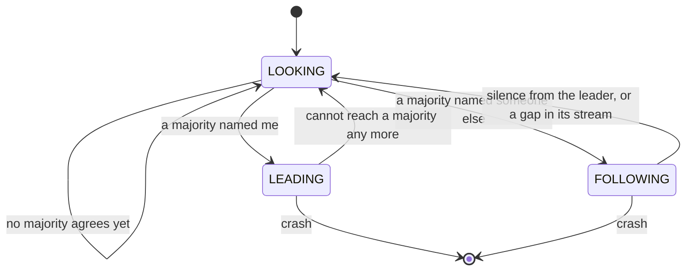
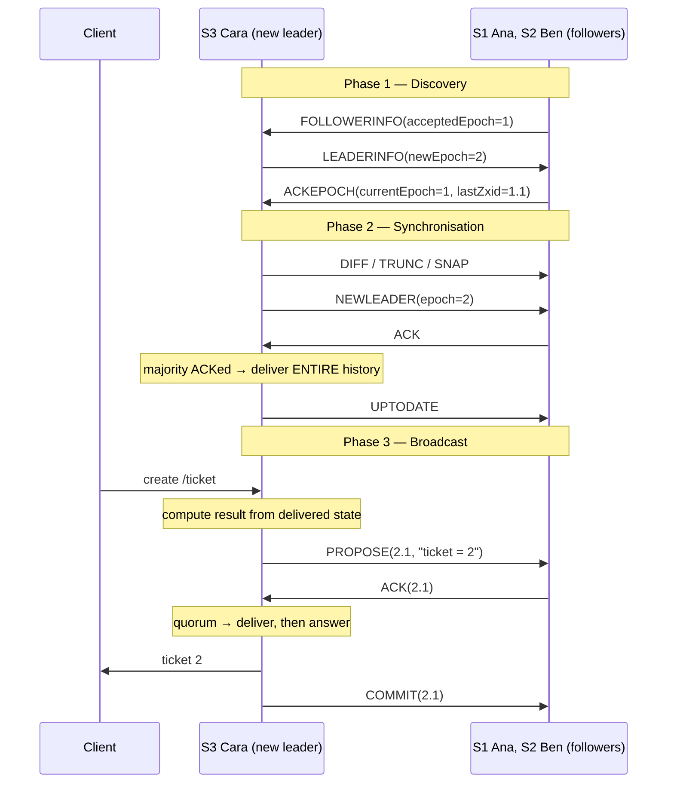
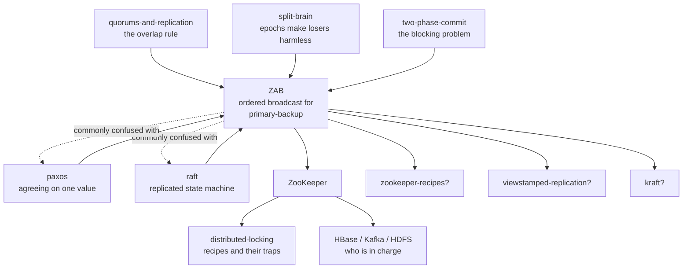

# ZAB — how five coffee shops keep one ticket queue

> **Tell a friend:** Ana, Ben, Cara, Dev and Eve each run one shop of the same
> coffee chain, and all five keep a copy of one master ticket list. Only one of
> them at a time is the manager, and only the manager may add a line. She sends
> out the finished answer, *"ticket = 44"*, never the instruction *"add one"*,
> so a shop can copy the same line twice and still be right. When she dies
> mid-sentence, the next manager must be someone whose copy already holds
> everything most shops hold, and her first act is to finish her predecessor's
> business before starting her own. That last rule is the one thing ZAB has that
> plain consensus does not.

The interactive version is [The Epoch Ledger](https://claude.ai/code/artifact/06a418b4-e42b-4491-9fb6-ef72c3e0d4c3),
also saved beside this file as `visualization.html`. What this lab is made of,
what you already knew before opening it, and how its numbers were made are all
in [section 17](#17-about-this-lab) at the end.

---

# BEGINNER MODEL

## 1. Why does this thing need to exist?

> **In one breath:** Every big system has a handful of tiny facts that
> absolutely everyone must agree on. The facts are small. The damage from
> disagreeing about them is not.

Every large system ends up with a short list of facts that everyone must agree
on. Which server is currently in charge of customer shard 7. Which machines are
alive right now. What today's configuration is. Who holds the lock on the
nightly billing job.

Add all of those up and you have a few kilobytes. Now look at what one
disagreement costs.

| The fact everyone must share | What one extra answer does |
|---|---|
| who owns customer shard 7 | two servers both write to it, and neither notices |
| which machines are alive | work is handed to a machine that is already gone |
| what today's configuration is | half the fleet quietly runs yesterday's rules |
| who holds the nightly billing lock | two schedulers charge every customer |

Read the last row again. The cost of disagreement here is not a slow page. It
is money moving twice.

So people build a small, separate, extremely careful service. Its only job is
to hold those facts and never give two different answers. Apache ZooKeeper is
the best-known one. HBase uses it to decide which server owns which region.
Kafka used it for years to decide which broker is the controller. Thousands of
in-house systems use it as the place where "who is the leader" lives.

**ZAB is the engine inside ZooKeeper.** It takes a change, gets it onto enough
machines, and makes sure the replacement carries on from exactly the right
place when the machine handling changes dies. Which it will. In the middle of
something.

That last clause is the whole lab. Here is what it looks like when it happens
to people rather than to servers.

---

## 2. What is the problem? Five shops and one ticket queue

> **In one breath:** Five coffee shops share one ticket queue, so only one
> person at a time is allowed to add to it. She writes down the *answer*, not
> the sum. Then she dies halfway through, and somebody has to take over.

Forget servers for a moment.

A coffee chain has five shops, and one person behind each counter: **Ana**,
**Ben**, **Cara**, **Dev** and **Eve**. A customer can order at one shop and
collect at another, so all five shops must show the **same** ticket queue.

There is one **master list** of everything that has happened. Every shop keeps
its own copy of it.

One of the five is the **manager**. Today that is Eve. She is the only one
allowed to add a line to the master list. The other four just copy what she
sends. That is deliberate. If five people could write, you would need a way to
reconcile five versions, and there is no version of that story that ends well.

**Meera** walks in and wants a coffee. Here is exactly what Eve does.

1. She looks at her own copy of the list. The last ticket issued was **43**.
2. She adds one, getting **44**.
3. She writes down the line *"ticket = 44"*, and sends that line to all five
   shops.
4. When enough shops have written it down, she hands Meera ticket 44.

### Why does step 3 send the answer instead of the sum?

Stop and look at step 3, because everything in this lab hangs on it.

Eve sends *"ticket = 44"*. She does **not** send *"add one to the ticket
number"*.

> **🔮 Predict:** *Ana, Ben, Cara and Dev all have to copy that line down. What
> goes wrong if the line says "add one" instead of "ticket = 44"?*
>
> <details><summary>Reveal</summary>
>
> **A shop that copies "add one" twice ends up somewhere different from a shop
> that copies it once.** And shops will copy things twice. They write a batch
> down after a power cut. They replay yesterday's whole list from the beginning
> after a crash. They receive the same shout twice from a flaky phone line.
>
> A line that says *"add one"* gives a different answer depending on how many
> times it was applied, and on what the state was when it was applied. A line
> that says *"ticket = 44"* gives the same answer every time, forever.
>
> If you guessed "nothing, as long as every shop applies it exactly once", you
> are assuming exactly-once delivery over a network. That assumption is the one
> thing you never get. The design here is cheaper: make the line safe to apply
> twice, and stop worrying about how many times it arrives.
> </details>

Eve does the thinking once. The shops do no thinking at all. That is the whole
design in one sentence: **one brain, many notebooks.**

### What happens the moment the manager dies?

Now Eve has a heart attack.

She had just written *"ticket = 44"* and sent it out. Two shops had written it
down. She had not yet said "go", and she had not yet handed Meera anything.
Then she was gone.

Someone has to take over. And the moment they do, the trouble starts. The
person who takes over is the rest of this lab.

Here is how far the lab goes, and what you can do after each layer.

| Layer | Sections | After it you can… |
|---|---|---|
| **Beginner** | 1–9 | tell the shop story, and say why the wrong stand-in hands out a duplicate ticket |
| **Intermediate** | 10 | walk one handover message by message, and name the disaster behind each odd rule |
| **Engineering** | 11–12 | say which promise bends under each failure, and which one Paxos does not give you |
| **Production** | 13 | say what real ZooKeeper adds, and what the on-call engineer watches |

---

## 3. Why not just let the most senior person take over?

> **In one breath:** The obvious fix is what any sensible shop would do — if the
> manager goes quiet, whoever notices first takes charge. Write that rule down,
> because we are about to break it three ways.

The obvious fix is what any sensible person would do.

> **"If the manager goes quiet, the most senior person present takes over and
> carries on."**

It is not a stupid idea. It is roughly what a real coffee chain would do. Let
us write it down as a rule and then break it.

**Rule v1.** When the manager has been silent for a while, whoever notices
first announces that they are the manager now. They look at their own copy of
the list, and carry on issuing tickets.

Ana notices Eve's silence. Ana announces. Ana starts issuing tickets. What
could possibly go wrong?

---

## 4. Where does the obvious fix break?

> **In one breath:** Three different ways, and each teaches something different.
> Two people take over at once. The person who takes over is missing a line.
> The person who takes over holds a line nobody else has.

It breaks in three completely different ways. Each one teaches you a different
thing. Take them one at a time.

### 4a. What if two people take over at once?

Ana and Ben both notice the silence at the same second. Both announce they are
the manager. Both start issuing tickets.

Now there are two master lists and no way to merge them. The lists are not sets
of independent facts. They are ordered instructions, and each one was computed
from the one before it.

You have met this one before. Your **[split-brain](../42-split-brain/)** lab was
entirely about it, and its conclusion was blunt: *you cannot stop two machines
believing they are in charge; you can only stop the loser's actions counting.*
Your **[raft](../40-raft/)** lab measured two leaders coexisting routinely, and
showed that the fix is not prevention but harmlessness.

So we already know the shape of the answer. Require a **majority** to agree
before anyone may act. And **stamp everything with a number** that lets the old
manager's work be recognised and ignored.

Good. That is one of three problems solved, and it is the one you already knew.
Keep going. The other two are the ones this lab is actually about.

### 4b. What if the stand-in never saw the last few lines?

Cara takes over. But Cara's shop is at the far end of the country on a bad
connection, and she never received *"ticket = 44"*. Ana and Ben did.

Cara looks at her own copy. The last ticket was 43. So she issues **44** to the
next customer, **Omar**.

Meanwhile Meera is standing at Ana's counter holding ticket 44.

Two customers, one ticket. Notice that nothing "went wrong" mechanically. Every
shop followed its rules faithfully. The problem is that **we let the wrong
person take over.**

> **🔮 Predict:** *What is the minimum thing we must require of whoever takes
> over, so this cannot happen?*
>
> <details><summary>Reveal</summary>
>
> That they hold **everything that any majority already holds**. Not
> "everything" — nobody can know what everything is. Just this: whatever a
> majority of shops already wrote down must be in the new manager's copy.
>
> And the way to get that for free is the counting argument you already know
> from **[quorums-and-replication](../34-quorums-and-replication/)**. If the new
> manager is chosen by a majority, and any two majorities share at least one
> member, then the group that elects her contains at least one shop that has
> *"ticket = 44"*. So if you additionally insist that the winner is the **most
> complete** copy in that group, the winner cannot possibly be missing it.
>
> If you guessed "require the new manager to ask the others what she is
> missing", hold that thought. It is a real design, and section 10 shows why
> ZAB deliberately refuses it.
>
> That is not luck. It is arithmetic. It is the same arithmetic that made Raft's
> up-to-date check work. ZAB just pushes it one step further, and section 12
> shows exactly how far.
> </details>

### 4c. What if the stand-in holds a line nobody else has?

Now the mirror image. Cara takes over, and Cara is the *only* shop that received
*"ticket = 44"* before Eve died. Nobody else has it. No customer was ever handed
anything.

Does Cara keep the line or throw it away?

> **🔮 Predict:** *Keeping it seems obviously right — it is real data, honestly
> written down. What could keeping it possibly cost?*
>
> <details><summary>Reveal</summary>
>
> **It costs you the ability to ever agree again**, in one specific run.
>
> Suppose Cara also dies before she publishes it. Dev takes over without the
> line, issues ticket 44 to Omar, and then Cara comes back holding her own
> different version of what happened at that position in the list. Now two shops
> have two different lists that both look legitimate. There is no rule that can
> ever reconcile them, because both of them are somebody's genuine record.
>
> If you guessed "keep it, because deleting written data is never acceptable",
> you are applying a rule that is correct for money and wrong for this. Nobody
> was ever promised anything about that line.
> </details>

If Cara keeps it and publishes it, fine — no harm done. The problem is only the
run above, where she keeps it and then vanishes.

The only safe answer is uncomfortable at first. **A line that no majority ever
confirmed may be deleted.** And if the new manager does not have it, it *must*
be deleted from anyone who does.

That feels like destroying data. It is not, and here is the exact reason.
Nobody was ever promised anything about that line. Meera never walked away
holding ticket 44. Deleting it costs precisely zero promises. Keeping it costs
you the ability to ever agree again.

This asymmetry is what makes the whole thing affordable.

| The line's situation | Promise made? | What must happen |
|---|---|---|
| a majority wrote it down and Meera was told | yes | it can **never** be removed |
| fewer than a majority wrote it down, nobody was told | no | it may be **freely deleted** |

---

## 5. What do we actually need to guarantee?

> **In one breath:** Four promises, in plain English. Three of them you would
> have guessed. The third one is the reason ZAB exists at all.

Four promises. No jargon. The rest of this lab is the pursuit of these four.

**P1 — One list, everywhere.**
Every shop's copy is the same list, in the same order, with no gaps. Not
"eventually similar" — the same. If Ana's list says the third thing that
happened was *"ticket = 44"*, then every shop's third entry is *"ticket = 44"*,
or that shop has not got to the third entry yet.

**P2 — Once you are told it happened, it happened.**
If Meera walks away holding ticket 44, no sequence of crashes, network failures
or handovers may ever produce a world in which ticket 44 was not issued.

**P3 — A new manager finishes the old manager's business before starting her
own.**
This is the one that is easy to skip and impossible to recover from. A new
manager must publish everything she inherited *and act on it herself* **before**
she computes anything new. Otherwise she computes ticket 44 from a picture of
the world that is missing ticket 44.

**P4 — Anything nobody was promised may be deleted**, and must be, if it stands
in the way of P1.

Read P3 again. **It is the promise that is unique to this lab.** P1 and P2 are
what Raft and Paxos give you as well. P3 is the one that comes from *"one brain,
many notebooks"* — from the fact that what gets broadcast is an answer somebody
computed, not an instruction anybody can compute.

Section 12 shows precisely where Paxos fails P3, and why the ZooKeeper authors
decided that was a reason to design something new.

---

## 6. What is the key idea?

> **In one breath:** Number every line with a chapter and a line number. Only
> let the holder of the newest line take charge. Make her republish everything
> she inherited before she writes a word of her own.

Three sentences.

1. **Give every change a two-part serial number: which manager wrote it, and
   which change of theirs it was.** The pair only ever increases. So any two
   changes anywhere in the world can be put in order by comparing two integers,
   and any change can be recognised as belonging to an older management.

2. **Only the holder of the highest serial number may take over**, and they must
   be chosen by a majority. Because any two majorities share a member, this
   makes it arithmetically impossible for the new manager to be missing anything
   a majority already had.

3. **The new manager's first act is to make her entire inherited list final** —
   and only then may she write anything of her own. Everyone else is forced to
   match her list exactly, deleting anything she does not have.

Picture the two-part serial number as it would look on paper. Each line of the
master list carries a **chapter number** and a **line number**. Cara opens a new
chapter when she takes over from Eve. Her first line is chapter 2, line 1 — not
chapter 1, line 4.

Everything else in ZAB is the detail of making those three sentences true when
machines die halfway through.

---

## 7. Which words do you need now?

> **In one breath:** Every word below names something that has already happened
> to Ana, Cara, Eve or Meera. You have felt each one. Now each gets its real
> name, and the symbol arrives last.

Nothing here is new. Each heading is a question about the shop, and the answer
ends with the word engineers use.

### 7.1 What is one line on the master list?

One line on the master list is *"ticket = 44"*. That is the whole thing.

Say what it is in plain words first: **a record of a change that has already
been worked out, not an order to work something out.** Eve did the arithmetic.
The line carries the result of the arithmetic. Ana, Ben, Cara and Dev copy the
result and run nothing.

Engineers call that line a **transaction**, abbreviated `txn` in ZooKeeper's
source. It is a confusing name if you come from databases, because it has
nothing to do with wrapping several statements in one commit. Here it means one
recorded state change.

In real ZooKeeper, a client sends `create("/queue/ticket-", ephemeral+sequential)`.
The leader turns that into a transaction reading
`create /queue/ticket-0000000044 with czxid=0x100000005, ephemeralOwner=0x...`.
The sequence number, the timestamps, the generated node name: all computed
once, by the leader, and shipped as facts.

Why does the word exist at all? To draw a line between *what the client asked
for* and *what actually gets replicated*. They are not the same thing.
Conflating them is the single most common mistake people make when reasoning
about ZooKeeper.

Here is that line drawn concretely. Two clients concurrently call
`create("/lock-", sequential)`. The leader turns them into two different
transactions, `create /lock-0000000007` and `create /lock-0000000008`. Every
follower stores those two literal names. No follower ever runs the
sequence-number generator.

This is the exact opposite of a Raft log entry, which holds the *command* and
lets every server compute the result. It is much closer to what
**[change-data-capture](../52-change-data-capture/)** ships, and to the "store the
effect, not the intent" idea in **[event-sourcing](../50-event-sourcing/)**.
Because transactions are results, **replaying them twice changes nothing** —
the same idempotence property you studied in
**[idempotency](../49-idempotency/)**. Section 13 shows ZooKeeper leaning on it
hard when it restores from a snapshot.

### 7.2 What is the serial number on a line?

Back to the piece of paper. Each line of the master list carries two numbers:
the chapter it was written in, and its position within that chapter. Cara's
first line after taking over from Eve is chapter 2, line 1.

In plain words: **one number that answers two questions at once — whose change
is this, and where in the sequence does it sit?**

Now the names. The chapter number is the **epoch**. The position within the
chapter is the **counter**. The two of them welded together are the **zxid**,
the ZooKeeper transaction id.

| The thing on the page | In words | The name and the notation |
|---|---|---|
| the chapter number at the top of the line | which management wrote this line | **epoch** — the top 32 bits |
| the line number inside that chapter | which of that manager's lines this is | **counter** — the bottom 32 bits |
| the two together, one number | orders every line ever written, anywhere | **zxid**, written `1.4` here, `0x100000004` in real logs |

A zxid is a single 64-bit integer. Because it is one integer, comparing two
zxids is a single comparison. "Which of these two changes came first" never
needs any other information.

Why pack two things into one number? Because both questions have to be
answerable at the same time, in the same breath, on every message. Welding them
makes every comparison in the protocol trivial.

Watch the counter restart. `1.1, 1.2, 1.3` are the first three changes of the
first manager. Her successor's first change is `2.1` — **not** `1.4`. The
counter goes back to the beginning; the epoch is what moves forward. A shop
holding `1.3` and a shop holding `2.1` can tell instantly who is behind.

The epoch on its own is worth naming separately, because it does work without
the counter. It is a monotonically increasing integer identifying one period of
one manager's authority. Every change that manager creates carries it. Every
shop refuses messages stamped with an epoch lower than the highest one it has
accepted. Cara has accepted epoch 2. A proposal arrives stamped epoch 1. Cara
refuses it in one integer comparison, without knowing or caring what the
proposal says.

You have met the epoch under other names. It is your fencing token from
**[distributed-locking](../43-distributed-locking/)**. It is your epoch from
**[split-brain](../42-split-brain/)**, which already listed them as one idea
with many names: *"epoch = term = generation = zxid = mod_revision = sequencer
= incarnation"*. It is Raft's **term** and Paxos's **proposal number**.

The one genuinely new thing here is the welding. In Raft, authority and position
are two separate fields, `term` and `index`. ZAB makes them one number, so the
epoch does double duty: it is both the authority stamp *and* the position in the
log. Section 12 works through what that buys and what it costs.

### 7.3 Why does each shop need two chapter numbers, not one?

Every shop writes two numbers on the inside cover of its ledger. *"The newest
chapter I have agreed to join"*, and *"the chapter my writing is actually in"*.

Those are two different facts, and this is the detail everyone skips and then
gets confused by. **Agreeing to join a new chapter and having actually joined
it are different states, and a crash can happen between them.**

The names are `acceptedEpoch` and `currentEpoch`. In real ZooKeeper they are
literally two files with those names, sitting in the data directory. Both are
written to disk **before** being used.

Suppose Ben has agreed to chapter 5, but the chapter-5 manager died before
finishing the handover. Ben must still refuse chapter-4 messages, so his
`acceptedEpoch` must be 5. But he must still honestly report that his data
belongs to chapter 3, so his `currentEpoch` must be 3. Collapse them into one
number and you either accept messages you should refuse, or misreport how
current your data is.

Concretely: Ben has `acceptedEpoch=5, currentEpoch=3`, and his newest change is
`3.9`. During the next election he says two things, and they come from two
different numbers.

| What Ben says in the election | Which number it comes from |
|---|---|
| "my data is from chapter 3, at position 9" | `currentEpoch`, plus his `lastZxid` |
| "I will refuse anything stamped 4 or lower" | `acceptedEpoch` |

Your `split-brain` lab gave the rule that *"the epoch number is persisted to
disk before use, so a restart cannot reissue it"*. ZAB needs two of them, for
exactly the reason that lab gave for needing one.

### 7.4 What are the three things the manager says?

Three sentences, in order: *"write this down"*, then *"written"* coming back,
then *"it counts now"* going out.

| What is said | Who says it | The message name |
|---|---|---|
| write this down | manager → shops | `PROPOSE(zxid, txn)` |
| written, and on my disk | a shop → manager | `ACK(zxid)` |
| it counts now, act on it | manager → shops | `COMMIT(zxid)` |

Those three are the broadcast phase, the ordinary steady state of the system.
Each shop that receives a proposal appends the transaction to its own history,
**puts it on disk**, and replies. When the manager holds replies from a majority
*including herself*, she acts on the transaction locally, answers the customer,
and sends the commit to everyone.

The reason there are three words and not two is that *stored* and *final* are
different states. Confusing them is a correctness bug, not a wording problem. A
stored-but-uncommitted transaction may still be deleted. A committed one may
not.

Watch the counting. Eve proposes `1.2 = "ticket 2"`. Ana, Ben and Cara store it
and acknowledge. That is three of five; Eve included makes four, past the
majority of three. Eve acts on it, tells Meera "ticket 2 is yours", and
broadcasts the commit.

This is **two-phase commit with the abort branch deleted**. Compare it directly
with your **[two-phase-commit](../45-two-phase-commit/)** lab.

There, a participant's "yes" is a promise it cannot take back, and the
coordinator's death leaves everyone holding locks forever. Here, "yes" costs the
shop nothing it cannot undo. There is no abort message at all.

And the manager's death is survivable, because a majority of yes-votes *is* the
decision. No single machine holds it. That is the precise sense in which
quorum-based replication answers 2PC's blocking problem, which is what your 2PC
lab said to come here for.

### 7.5 How many shops count as "enough"?

You know this one. One-line refresher: a **majority** of the servers,
`⌊N/2⌋ + 1`. Engineers call it a **quorum**.

Its whole job is that **any two of them must share at least one member**. That
is why a decision made by one majority can never be contradicted by another. In
a 5-server ZooKeeper ensemble the quorum is 3.

One thing worth re-noticing, from
**[quorums-and-replication](../34-quorums-and-replication/)**: this is a
**consensus quorum**, one that *decides*. It is not an R+W>N read/write quorum,
which merely *intersects*. ZAB uses it to decide, exactly like Paxos and Raft.

### 7.6 Who is who, and what are they doing right now?

The manager, the shops, and shops that get all the news but do not get a vote.

The manager is the **leader**, also called the **primary**. A shop is a
**follower**. A shop that receives everything and serves customers, but is never
counted in a majority, is an **observer**.

Every ZooKeeper server is in exactly one of four states.

| State | What the server is doing | The shop version |
|---|---|---|
| `LOOKING` | no leader; running an election | shouting "who is in charge?" |
| `FOLLOWING` | has a leader; applying what it sends | copying lines down |
| `LEADING` | it is the leader | holding the marker pen |
| `OBSERVING` | receives everything, votes on nothing | reading the noticeboard only |

Why do observers exist at all? Because every extra voting member makes writes
slower, since there are more machines to wait for, while still adding read
capacity. Observers let you add read capacity and geographic reach without
making the write path wider. Section 13 comes back to this.

These are the same three roles as Raft's follower, candidate and leader, with
one real difference. **ZAB has no separate candidate state.** In ZAB you do not
*ask* for votes. You *broadcast* your opinion, and everybody converges on the
best one. Section 10 shows how.

### 7.7 What does one shop actually hold?

The shop's copy of the list, and the serial number of the last line on it.

The list is the **history** — the ordered sequence of transactions the server
holds. The serial number of the newest one is `lastZxid`.

`lastZxid` is the single number a server reports during an election, and it is
enough. Because zxids are totally ordered and gap-free within an epoch, one
number describes the whole history.

Dev reports `lastZxid = 1.3`. That tells everyone he has exactly `1.1, 1.2,
1.3`. There is no way for him to have `1.1` and `1.3` but not `1.2` — section 10
explains what enforces that.

### 7.8 What is the difference between writing it down and acting on it?

Writing it down is *"the line is on my page"*. Acting on it is *"I will show
this to customers now"*.

Engineers call the first one **accept** and the second one **deliver**. A server
accepts a transaction when it stores and acknowledges it. It delivers the
transaction when it is told to commit. Delivery is always in zxid order and
never skips.

Delivering means applying the transaction to the in-memory data tree, so that
clients reading from this server can see it.

The word exists because **the whole protocol is about the gap between these two,
and where crashes fall inside that gap.** This is exactly Raft's *stored* versus
*committed and applied* distinction. It is also the dashed-versus-solid cells in
this lab's simulator.

### 7.9 What is "atomic broadcast", and why is that not just consensus?

Plain words first: *"everybody gets every message, and everybody gets them in
the same order — or the system stops rather than break that."*

Precisely, it is a communication primitive with three classical properties.
*Integrity*: nothing is delivered that was not broadcast. *Total order*: any two
servers that deliver two messages deliver them in the same order. *Agreement*:
if one correct server delivers a message, all correct servers eventually do.

The term exists because it names a **primitive**, not a system. "Consensus" is
agreeing on one value. "Atomic broadcast" is agreeing on an unbounded ordered
stream of them. They are known to be equivalent problems, in the sense that you
can build either from the other. But they are different shapes, and ZAB is
deliberately shaped as the second.

### 7.10 Does one shop do the thinking, or do all five?

*One brain, many notebooks* versus *many brains all doing the same arithmetic.*
That is the whole distinction, and it is the point of this lab.

In **primary-backup** replication, one server executes the request and ships the
resulting state change. Backups apply it without executing anything. In
**replicated state machine** replication, the log holds the *command*. Every
replica executes it deterministically, so all replicas independently arrive at
the same state.

Why does the distinction matter? Because it decides what your protocol has to
guarantee.

A state machine only needs the log to be the same everywhere. Each replica can
compute its own state from it whenever it likes. A primary-backup system
additionally needs **the primaries themselves to be ordered**, because each
primary computes its changes on top of the previous primary's changes. Order the
log but not the primaries, and you get two managers computing ticket 44 from the
same stale picture — which is exactly section 4b.

The one-line contrast: Raft replicates `INCREMENT ticket`, and every server runs
it and gets 44. ZAB replicates `ticket = 44`, and only the leader ran anything.

ZooKeeper needs primary-backup because its transactions carry generated values.
Sequential node names, `czxid`s, session owners, timestamps: every one of those
must be *identical* on every server, and none of them can be recomputed.
Section 12 shows what that forces the protocol to add.

### 7.11 What are the three ways a shop is brought back into step?

The new manager can say three different things to a shop that is out of step.
*"Here are the lines you are missing."* *"Cross out everything after line N."*
*"Tear it up, here is a fresh copy."*

Their names are `DIFF`, `TRUNC` and `SNAP`. The leader picks one per follower,
by comparing that follower's `lastZxid` with its own.

| The instruction | In words | When the leader picks it |
|---|---|---|
| `DIFF` | here are the transactions you are missing | the follower is simply behind |
| `TRUNC` | discard everything after this zxid | the follower holds something the leader does not |
| `SNAP` | here is the whole data tree, start again | the follower is so far behind that patching costs more than replacing |

`TRUNC` is P4 from section 5 being enforced, in one message.

Watch all three chosen at once. The leader's newest change is `2.7`.

| The follower reports | What it gets | Why |
|---|---|---|
| `2.4` | a DIFF of `2.5, 2.6, 2.7` | simply three lines behind |
| `1.9` | a TRUNC back to the last change they share, then a DIFF forward | `1.9` is a change from the previous chapter that the leader never had |
| `1.2`, with the leader's log trimmed past that point | a SNAP | there is nothing left to patch from |

This is the same repair job as Raft's `nextIndex` back-off, done in one round
instead of by walking backwards. A zxid comparison answers in one step what
Raft's back-off discovers by probing.

---

## 8. Which two pictures should you carry, and where does the nice one lie?

> **In one breath:** Carry two mental models. One is the coffee chain, and it is
> right about almost everything. The other is five servers and their disks. Then
> learn the four places where the coffee chain quietly lies to you.

### What is happening in the shop?

One manager. Five shops. A master list.

Eve reads her own copy, computes the answer, writes the answer down, sends it
out, waits until a majority have written it down, and only then tells Meera her
ticket number.

When Eve dies, the shop with the longest list takes over — chosen by a majority.
Its first act is to make every other shop's list identical to its own, adding
what they lack and crossing out what they have that it does not.

That is the entire protocol at story level. Everything below is the same thing
with real names.

### What does one server actually hold?

Five servers. Each holds five things on disk, and none of them may be lost in a
restart.

| What it holds | In words | Example |
|---|---|---|
| `history` | the ordered list of transactions | `1.1="ticket 1", 1.2="ticket 2"` |
| `lastZxid` | the newest transaction it has | `1.2` |
| `acceptedEpoch` | the newest chapter it has agreed to join | `2` |
| `currentEpoch` | the chapter its data belongs to | `1` |
| `deliveredUpTo` | how much of the history is final | `1` |

And here is why each one has to survive a power cut.

| The value | Why a restart must not forget it |
|---|---|
| `history` | it *is* the data |
| `lastZxid` | it is the server's whole claim in an election |
| `acceptedEpoch` | so a restart cannot un-refuse an old leader |
| `currentEpoch` | so it reports its position honestly |
| `deliveredUpTo` | so it never shows a client something reversible |

Plus a role, which is `LOOKING`, `FOLLOWING` or `LEADING`. And, if it is the
leader, a set of pending acknowledgement counts.

Four kinds of message move between them, in four phases. Every one of them
carries an epoch that the receiver checks before doing anything else.

### How does the shop map onto the protocol?

Read these three tables as one. They are split by theme so that no single table
has to be scanned sideways.

First, the people.

| In the shop | In the protocol | Where you met it |
|---|---|---|
| the manager | the **leader**, also called the **primary** | section 2 |
| a shop | a **follower** | section 2 |
| a shop that gets the news but has no vote | an **observer** | section 7.6 |

Then, the paper.

| In the shop | In the protocol | Where you met it |
|---|---|---|
| the master list | the **history**, a sequence of **transactions** | section 7.7 |
| a line on the list | one **transaction** | section 7.1 |
| *"ticket = 44"* | a transaction holding a **result**, which is why replaying is safe | section 2 |
| the serial number on a line | the **zxid** | section 7.2 |
| the chapter number | the **epoch** — the top half of the zxid | section 7.2 |

Then, the moves.

| In the shop | In the protocol | Where you met it |
|---|---|---|
| "enough shops have it" | a **quorum** — a majority | section 7.5 |
| "write this down" / "written" / "it counts" | `PROPOSE` / `ACK` / `COMMIT` | section 7.4 |
| the shop with the longest list takes over | the **highest-zxid** candidate wins the election | section 6 |
| "cross out everything after line N" | **TRUNC** | section 7.11 |

### Where does the story lie to you?

Four places. Each one matters. Each one is a rule you would get wrong if the
shop were all you had.

**Lie one: shops can tell "the manager is dead" from "the phone line is down".
Servers cannot.**

This is the whole reason the protocol is hard. A server that stops hearing from
the leader has exactly one piece of information: silence. Silence is produced
identically by a dead leader, a slow leader, and a cut cable.

Every timeout in ZAB is a guess. The protocol is built so that a *wrong* guess
costs availability but never correctness. Your `split-brain` lab made this its
central point. It is just as true here.

**Lie two: in the story the new manager "takes over". In the protocol, nobody
hands anything over.**

There is no moment of transfer. Eve may still be alive, still believe she is the
manager, and still be sending proposals. She is not stopped. She is *outvoted
and then ignored.*

Her messages arrive stamped with an old epoch and are refused, one integer
comparison at a time. Nothing ever tells her she has been replaced. She works it
out on her own, when she notices she cannot reach a majority any more.

**Lie three: shops would never delete a line they had written. Servers must.**

TRUNC feels wrong the first time you meet it. In the human version, tearing a
page out of the ledger is what fraud looks like.

In the protocol it is the opposite. It is the only mechanism that gets a
divergent server back into agreement. And it is only ever applied to changes
that no majority confirmed and no customer was ever told about. Scenario 8 in
the simulator lets you switch it off and watch a server disagree with everyone
else forever.

**Lie four: the manager waits for shops to confirm before telling Meera. A real
ZooKeeper *read* skips all of that.**

In the story, every question and every answer goes through the manager. In
ZooKeeper, **writes** go through the leader and are strongly ordered. But
**reads are answered by whichever server the client happens to be connected to,
straight out of its memory, with no round trip to anybody.**

That is how one ensemble serves enormous read volumes, and the price is that a
read can be stale. It is not a bug and it is not a corner case. It is the single
most surprising thing about ZooKeeper in production, and section 11.7 and
simulator scenario 7 are entirely about it.

---

## 9. Can you watch it move before you read the rules?

> **In one breath:** Yes, and you should. Open the simulator, learn three
> colours, run three scenarios. Then come back and read the mechanism.

**[Open the simulator: The Epoch Ledger →](https://claude.ai/code/artifact/06a418b4-e42b-4491-9fb6-ef72c3e0d4c3)**

The picture on screen is laid out the same way as the tables in this document.
**Each server is a row.** **Each column is one position in the shared list**,
labelled with its zxid. So a disagreement between servers is literally two
different things in one column, and a change of management is a change of
colour.

Before you press anything, learn the three visual rules. They are the whole
language of the page.

| What you see | What it means | What the server may do with it |
|---|---|---|
| dashed outline | written down, not yet told it counts | must not show it to a client; may still be deleted |
| solid fill | delivered | visible to clients; can never be removed |
| hatched red | deleted by TRUNC | gone, and nobody was ever promised it |

> **🔮 Predict:** *In scenario 1, five servers are running and one write is
> made. How many acknowledgements will the primary wait for before it answers
> the customer?*
>
> <details><summary>Reveal</summary>
>
> **Three of five**, counting itself. Never five of five.
>
> If you guessed five, you have designed a system where one shop on a bad line
> stops every write in the chain. If you guessed two, count again: two
> majorities of five must share a member, and two groups of two need not.
>
> Watch the counter on screen. The customer is told at three. The remaining
> acknowledgements arrive afterwards and change nothing.
> </details>

Run these three first, in this order.

| Scenario | What to watch for |
|---|---|
| **1 · One write, from start to finish** | One column fills left to right: dashed on the followers, then solid everywhere. Count the acknowledgements before the customer is told anything — it is 3 of 5, never 5 of 5. |
| **2 · The primary dies one breath too early** | Answer the prediction first. Eve dies between telling Meera her ticket and telling the other shops. Watch Cara's **NEWLEADER** step commit the inherited change *before* she accepts anything new. |
| **3 · The primary dies with one witness** | The mirror image. Ana holds a change nobody else has, nobody was promised anything, and the change is deleted. Watch the hatched cell appear, and note that no guarantee chip turns red. |

Then come back for scenarios **4, 5, 8 and 9** once you have read section 10.
Those four switch off one real ZAB rule each. Each one lets you watch the
specific disaster that its rule prevents.

---

**CHECKPOINT — end of the beginner model.**

You can now explain *why* ZAB exists. A system where one machine computes
answers and the others copy them needs its **managers** ordered, not just its
**messages**. You know the four promises, the two-part serial number, and the
majority argument that makes a safe handover arithmetic rather than luck.

> **Say it back.** Without using the words *epoch*, *zxid* or *quorum*, explain
> to a friend why Cara must not start issuing tickets the moment she takes over
> from Eve.
> <details><summary>A good answer sounds like</summary>
> "Eve was halfway through a ticket when she died. Some shops wrote it down and
> some did not. Cara can only work out the next number from what she is sure
> about — and until she has told everybody that the half-finished ticket is
> real, she is not sure about it. So she finishes Eve's sentence first, tells
> all the shops it counts, and only then works out her own number. Otherwise she
> counts from a picture that is missing a ticket somebody is already holding."
> </details>

*Next: a handover message by message, and the four refinements that each exist
because a simpler version broke.*

---

# INTERMEDIATE MODEL

## 10. How is the mechanism built, one failure at a time?

> **In one breath:** Start with the version a competent engineer would write
> first. Break it. Fix it. Repeat five times. Every strange detail in the
> finished protocol is the scar of one of those breaks.

We are going to build the real protocol by starting with the naive version,
breaking it, and repairing it. Every "weird" detail in finished ZAB is a scar.

Throughout, the five shops are the five servers, and the engineers' names for
them ride alongside: **Ana (S1)**, **Ben (S2)**, **Cara (S3)**, **Dev (S4)** and
**Eve (S5)**. Five servers, so a majority is **3**.

### v1 — what if whoever notices the silence takes over?

Ana stops hearing from Eve, so Ana announces herself as manager and carries on.
That is the rule, and it is section 3's rule v1 written for servers.

It breaks in the way section 4a described. Ana and Ben both notice at the same
moment. Both start writing. Two lists now exist, and neither is wrong.

The repair is the one you already know. A would-be manager must be chosen by a
**majority**. Two majorities always share a member, and a server votes once per
election round, so two servers cannot both collect one.

### v2 — what if a majority elects, but it elects anybody?

A majority of servers agree on one of them, and that one leads. Better. Not
enough.

It breaks in the way section 4b described. The majority might pick a server that
is missing a change the rest of them have. Say Dev wins while Ana, Ben and Cara
all hold `1.2` and Dev does not.

Dev's list is now the official list. And because **a ZAB leader only ever
pushes, never pulls**, everyone else is forced *down* to it. A committed change
is deleted from the entire cluster.

> **🔮 Predict:** *The repair is obviously "elect the most up-to-date server".
> But how up to date does the winner have to be, and how does anybody know?*
>
> <details><summary>Reveal</summary>
>
> **The winner has to be the most up-to-date server in the electing majority —
> and that is automatically enough.**
>
> Any change that was committed was written down by some majority *M*. The
> electing group is also a majority *E*. `M` and `E` share at least one server,
> so `E` contains someone holding that change. If the winner is the most
> complete member of `E`, the winner holds it too.
>
> Nobody needs global knowledge. Three servers comparing one number each is
> sufficient, and that is the whole argument.
>
> If you guessed "the winner must hold everything that exists anywhere", that is
> unachievable: nobody can survey a cluster that is currently broken. If you
> guessed "any server that a majority is willing to accept", that is Raft's
> weaker rule, and it is safe — but it costs Raft a two-directional repair that
> ZAB avoids.
>
> **You can watch this fail.** Simulator scenario **5 · Electing a server that
> is behind** switches the rule to "lowest-numbered server wins", and lets you
> watch two committed tickets get hatched out of every ledger in the cluster.
> </details>

The repair, then. Each server's vote is a triple: its `currentEpoch`, its
`lastZxid`, and its own server id. Written together that is
`(currentEpoch, lastZxid, serverId)`, compared in that order, and the **largest
wins**. The server id is only a tie-break, so that two equally up-to-date
servers cannot deadlock.

This is a genuinely different election from Raft's, and the difference is worth
holding on to.

| | How the election runs | Who ends up winning |
|---|---|---|
| **Raft** | a candidate sends `RequestVote`; each voter answers yes or no, using the rule *"is this candidate's log at least as up to date as mine?"* | someone *sufficiently* up to date, not necessarily the most |
| **ZAB** | every server broadcasts its opinion of who should win; on hearing a better one it adopts it and re-broadcasts | the **maximum** within the electing group |

Both are safe. ZAB's version buys one specific thing. Because the winner is the
maximum, **the leader can never need data from a follower**. Synchronisation is
therefore strictly one-directional, which is what makes ZAB's recovery a single
push per follower instead of a negotiation.

### v3 — what if the most up-to-date server starts writing straight away?

The winner takes over and issues the next ticket. This is the version that
breaks in the way that ZAB exists for. It is P3 from section 5.

Work it through with real numbers.

- Eve (S5) is the leader in epoch 1. She has committed `1.1 = "ticket 1"`.
- Meera arrives. Eve computes ticket 2, writes `1.2 = "ticket 2"` into her own
  history, and proposes it.
- Only Ana (S1) receives it before Eve dies. **No customer was told anything.**
- Ana now has the longest history, `1.1, 1.2`, so Ana wins the election.
- Under v3, Ana immediately serves the next customer, Omar. She looks at **what
  she has delivered** — which is only `1.1`, because `1.2` was never committed.
  She computes ticket 2, and writes `2.1 = "ticket 2"`.

There are now two transactions in the cluster's history claiming ticket 2. If
both survive, Meera and Omar are holding the same number.

> **🔮 Predict:** *Why did Ana not simply look at her whole list, see `1.2`, and
> issue ticket 3?*
>
> <details><summary>Reveal</summary>
>
> Because `1.2` was never committed, and **an uncommitted transaction is not a
> fact yet.**
>
> Ana has no right to build on it. At the moment she looks, `1.2` might still be
> deleted — it would be, if some other server without it had won. A primary may
> only compute on top of things that are settled.
>
> So the answer cannot be "peek at your own uncommitted entries". The answer has
> to be **"settle them first"**: decide, definitively, that they are part of
> history, and only then compute.
>
> If you guessed "she should ask the others whether they have it", notice what
> that costs. It turns recovery into a negotiation, and it makes correctness
> depend on reaching servers that may be down.
>
> **You can watch this fail.** Simulator scenario **4 · The new primary jumps
> the gun** switches this rule off. Every run ends with two ledger entries
> claiming the same ticket, and the invariant chip *"each answer built on the
> last"* turns red.
> </details>

Here is the repair, and it is the heart of ZAB. Before a new leader may accept a
single client request, it must do five things in order.

1. Establish a new epoch that a majority have agreed to.
2. Force every follower's history to be **identical to its own**.
3. Get a majority to confirm they have done so.
4. **Deliver its entire history** — declaring every inherited transaction final,
   including the ones its predecessor left hanging.
5. Only now, start numbering its own transactions, at `newEpoch.1`.

Step 4 is the one people miss. It is not bookkeeping. It is what makes P3 true:
the new primary acts on everything it inherited *before* it computes anything of
its own.

There is a lovely equivalence here, if you have Raft fresh in your mind.

Raft has a famously counter-intuitive rule, the "Figure 8" rule. A leader may
**not** commit an entry from a previous term just because a majority store it.
It must first commit an entry of its own term, which in practice means appending
a **no-op** and committing that. The no-op exists to drag the previous term's
entries over the commit line safely.

**ZAB's NEWLEADER round is that no-op, made explicit, mandatory, and moved to
the front.** Same job: make the inherited tail safe under the new authority
before anything depends on it. Raft does it lazily and implicitly. ZAB does it
eagerly and by name. ZAB *has* to do it eagerly, because in a primary-backup
system the very next transaction is computed from that state.

### v4 — what if everyone matches the leader, but nobody deletes anything?

The leader sends each follower whatever it is missing, and nothing is ever
removed. That sounds humane. It is section 4c's trap.

A follower holding a transaction the leader does not have keeps it. Its history
is now permanently different from everyone else's. Every later change sits at a
different position on that server than on the others.

The repair is `TRUNC`. The leader compares each follower's `lastZxid` to its
own. When the follower holds something the leader does not, the leader orders
the follower to discard everything past the last zxid they share.

Why is that safe? Because the leader is guaranteed to hold everything committed.
So anything being discarded was never committed, and was therefore never
promised to anyone.

You can watch this fail in simulator scenario **8 · The change nobody deleted**.

### v5 — what about messages from the old manager that arrive late?

Followers apply what the leader sends. Simple, and not safe.

Eve is not dead, just slow, or partitioned, or her messages were sitting in a
network buffer. They arrive after a new epoch has started, and nothing in the
*content* of a transaction says "I am stale".

The repair: every message carries its epoch, and **a server refuses anything
stamped below its `acceptedEpoch`**. One integer comparison, before looking at
anything else.

This is why `acceptedEpoch` must reach disk before it is used. A server that
restarted and forgot could be talked into accepting an old primary all over
again.

Two honest notes about how this plays out in the real implementation.

The first is that a stale *proposal* usually cannot even be delivered. A
ZooKeeper follower and its leader talk over **one TCP connection**, and moving
to a new leader means that connection is closed. So the epoch check's day job is
guarding the **recovery handshake**, by refusing a would-be leader whose
proposed epoch is not actually newer.

The second is that the same TCP connection does more work than it looks.
Because it is FIFO, a follower can assume that proposals arrive **in order and
without gaps**. If it ever sees a gap, that does not mean "a message was lost".
It means the connection broke. The correct response is to go back to `LOOKING`
and re-synchronise from scratch.

This is why ZAB needs no per-message repair machinery at all. It is also a real
assumption you would break if you re-implemented ZAB over UDP. The simulator
enforces it: turn the message-loss dial up and watch followers drop their
connection and re-sync, rather than quietly accept a gap.

You can watch this fail in simulator scenario **9 · A message from a dead
primary arrives late**.

### What did the five versions cost, side by side?

One table, so you can see the five scars in one glance.

| Version | The rule it tried | What broke | The scar it left |
|---|---|---|---|
| v1 | whoever notices first takes over | two managers, two lists | a majority must elect |
| v2 | a majority elects anybody | a committed ticket deleted everywhere | the winner is the most complete of the electing majority |
| v3 | the winner writes immediately | Meera and Omar hold the same ticket | the NEWLEADER round, before any client write |
| v4 | nobody ever deletes a line | one server diverges forever | `TRUNC` |
| v5 | followers apply what arrives | a stale line lands under a final one | refuse anything below `acceptedEpoch` |

### What does the finished protocol look like?

Each server is in one of three states, and moves between them like this.



There are four phases, and they always run in this order.

**Phase 0 — leader election.** Every `LOOKING` server broadcasts its vote
`(currentEpoch, lastZxid, serverId)`. On hearing a better one it adopts that
vote and re-broadcasts. When a majority hold the same vote, and that has stayed
true for a short settling period, the winner moves to `LEADING` and everyone
else to `FOLLOWING`. ZooKeeper's implementation of this is called **Fast Leader
Election**. The settling period is `finalizeWait`, and it exists precisely so
that a better vote still in flight is not missed.

**Phase 1 — discovery.** Each follower tells the prospective leader its
`acceptedEpoch`. Once a majority have reported, the leader picks
`newEpoch = max(reported) + 1` and announces it. Each follower that accepts it
writes `acceptedEpoch = newEpoch` **to disk**, then replies with its
`currentEpoch` and `lastZxid`.

*(In the ZAB paper, Phase 1 also lets the leader adopt a better history if one of
the responses turns out to be more complete than its own. In ZooKeeper's
implementation this can never happen, because Fast Leader Election already picked
the maximum, so the implementation skips it. Worth knowing when you read the
paper and find a step the code does not have.)*

**Phase 2 — synchronisation.** For each follower, the leader compares `lastZxid`
against its own and sends **DIFF**, **TRUNC** or **SNAP**. Then it sends
**NEWLEADER**, stamped with the new epoch. A follower that applies the sync and
accepts NEWLEADER writes `currentEpoch = newEpoch` to disk and acknowledges.
When a **majority** have acknowledged NEWLEADER, the leader **delivers its
entire history** and sends **UPTODATE**, which releases every follower to start
serving clients again.

**Phase 3 — broadcast.** Now, and only now, client writes are accepted. For each
one, the leader computes the transaction from its delivered state, stamps it
`newEpoch.(++counter)`, appends it, and proposes. Followers append and
acknowledge. On a majority of acknowledgements the leader delivers it, answers
the client, and broadcasts COMMIT.

Here are phases 1 to 3 as messages. Cara has just won the election, so she is
the new leader; Ana and Ben are the followers in view.



### Can you follow one handover by hand?

Concrete numbers, one line at a time. Every step follows from a rule stated
above.

The starting state: Eve (S5) is leader in epoch 1, and everyone has delivered
`1.1 = "ticket 1"`.

| Server | history | delivered | acceptedEpoch | currentEpoch |
|---|---|---|---|---|
| Ana (S1) | `1.1` | `1.1` | 1 | 1 |
| Ben (S2) | `1.1` | `1.1` | 1 | 1 |
| Cara (S3) | `1.1` | `1.1` | 1 | 1 |
| Dev (S4) | `1.1` | `1.1` | 1 | 1 |
| Eve (S5) *(leader)* | `1.1` | `1.1` | 1 | 1 |

**t=0.** Meera arrives. Eve reads her delivered state, which says ticket 1. She
computes 2, appends `1.2 = "ticket 2"` to her own history, and proposes it to
all four followers.

**t=2.** Ana, Ben and Cara store `1.2` and acknowledge. Dev's copy is lost in
the network.

**t=4.** Eve has acknowledgements from Ana, Ben and Cara, plus herself. That is
four, past the majority of three. She delivers `1.2` and **tells Meera ticket 2
is hers.** She broadcasts COMMIT.

**t=4, one microsecond later.** Eve dies. Nobody received the COMMIT.

This is the interesting moment. Look at what the cluster holds.

| Server | history | delivered | note |
|---|---|---|---|
| Ana (S1) | `1.1, 1.2` | `1.1` | has it, does not count it yet |
| Ben (S2) | `1.1, 1.2` | `1.1` | same |
| Cara (S3) | `1.1, 1.2` | `1.1` | same |
| Dev (S4) | `1.1` | `1.1` | never got it |
| Eve (S5) | *dead* | | the only one who knew it was final |

**Meera is holding ticket 2, and not one live server considers it final.** P2
says it must survive anyway. Watch how.

**t=17.** The followers time out and go `LOOKING`. Four votes go out.

| Server | currentEpoch | lastZxid | serverId |
|---|---|---|---|
| Ana | 1 | `1.2` | 1 |
| Ben | 1 | `1.2` | 2 |
| Cara | 1 | `1.2` | 3 |
| Dev | 1 | `1.1` | 4 |

**t=21.** Compare `(currentEpoch, lastZxid, serverId)`, largest wins. Dev has
the highest id but the *lowest* zxid, and zxid is compared first, so **Dev
loses**. Among Ana, Ben and Cara, all at `1.2`, the id breaks the tie, so
**Cara wins**. A majority converge on Cara.

*This is the arithmetic from v2 doing its work.* The electing majority had to
contain one of the three servers holding `1.2`, and the winner is the most
complete of them. So the winner holds `1.2`. Not luck.

**t=23.** Phase 1. Ana, Ben and Dev report `acceptedEpoch = 1`. Cara sets
`newEpoch = 2` and announces it. All three write `acceptedEpoch = 2` to disk and
reply with their `lastZxid`.

**t=27.** Phase 2. Cara compares each report against her own history.

| Follower | reports | Cara sends | Why |
|---|---|---|---|
| Ana | `1.2` | DIFF, empty | already identical to Cara |
| Ben | `1.2` | DIFF, empty | already identical to Cara |
| Dev | `1.1` | DIFF containing `1.2` | one line behind |

Cara then sends NEWLEADER for epoch 2. Ana, Ben and Dev write
`currentEpoch = 2` and acknowledge.

**t=31.** Cara has a majority of NEWLEADER acknowledgements. **She delivers her
entire history, including `1.2`.** Ticket 2 is final again, on the new
management's authority. UPTODATE goes out, and every follower delivers up to
`1.2`.

**Meera's ticket survived a crash that happened between "yours" and anyone else
knowing.**

**t=35.** Phase 3. Omar arrives. Cara reads her delivered state, which now says
**ticket 2** because of what happened at t=31. She computes 3, and writes
`2.1 = "ticket 3"`.

Note the zxid: **`2.1`, not `1.3`.** New chapter, counter restarts.

The final state:

| Server | history | delivered |
|---|---|---|
| Ana (S1) | `1.1, 1.2, 2.1` | all |
| Ben (S2) | `1.1, 1.2, 2.1` | all |
| Cara (S3) *(leader)* | `1.1, 1.2, 2.1` | all |
| Dev (S4) | `1.1, 1.2, 2.1` | all |
| Eve (S5) | *dead, holding `1.1, 1.2`* | will be TRUNC'd or DIFF'd when she returns |

Now change one thing. Suppose Eve dies at t=3 instead of t=4, before she had a
majority of acknowledgements and before Meera was told anything.

Everything else plays out identically, with one difference. No promise was ever
made. So if the election had gone to Dev instead, `1.2` would have been deleted
from Ana, Ben and Cara by TRUNC, and nobody would have been wronged.

**The same protocol produces both outcomes, and it never needs to know which
case it is in.** It does not ask "was this promised?". It only ever asks "does
the new leader have it?" — and the election rule makes those two questions have
the same answer. That equivalence is the elegant part of ZAB.

---

**CHECKPOINT — end of the intermediate model.**

You can now trace a handover message by message. You can say why the counter
restarts at each epoch, and explain why the NEWLEADER round is not bookkeeping.
You can name the four rules whose removal you just watched break the system.

> **Say it back.** Dev was the only server that missed `1.2`, and Dev has the
> highest server id. In two sentences, say why Dev still lost the election, and
> what would have happened to Meera if he had won under rule v2.
> <details><summary>A good answer sounds like</summary>
> "The vote compares how complete your list is before it compares who you are.
> Dev's list was one line short, so his id never got looked at. Under a rule
> that ignores completeness he would have won, and his shorter list would have
> become the official one. Everybody else would have been forced down to it, and
> the ticket Meera was holding would have been erased from the whole chain."
> </details>

*Next: every meaningful way this can fail, what each one costs, and the exact
guarantees that survive.*

---

# ENGINEERING MODEL

## 11. What are all the ways it can fail?

> **In one breath:** Eleven failures, each one a short story about Ana, Cara,
> Dev, Eve or Meera. Nine of them you can stage yourself in the simulator. In
> every one, the answer to "what broke?" is availability, never the data.

Each failure below gets a paragraph or two: what you do to cause it, what you
see, why it happens, and which promise bends.

Before the stories, here is the whole set on one page. Read the last two columns
together — they are the only two things that ever change.

| # | How you stage it | What survives | What you lose |
|---|---|---|---|
| 11.1 | scenario 2 | P1, P2, P3, P4 | write availability until UPTODATE |
| 11.2 | scenario 3 | everything | nothing — the client got no success |
| 11.3 | scenario 6, or *Split 2 \| 3* | P1 and P2 absolutely | all availability on the minority side |
| 11.4 | partition while a leader exists | everything | nothing |
| 11.5 | kill a follower, write, revive it | everything | time and bandwidth for a SNAP |
| 11.6 | turn the message-loss dial up | P1 | liveness; the follower is out of service |
| 11.7 | scenario 7 | P1 | linearizable reads |
| 11.8 | scenario 9 | everything, with the rule on | P1 and P2 together, with it off |
| 11.9 | cannot be staged; prevented by construction | everything | nothing, because the disk write happens first |
| 11.10 | kill three of five servers | P1 and P2 perfectly | everything else |
| 11.11 | split, write on the big side, then heal | everything | nothing |

### 11.1 What if the leader dies after a majority stored the write, but before COMMIT?

Stage it with simulator scenario **2**. It is exactly the worked trace in
section 10: Eve tells Meera her ticket, then dies before anyone else knows it
was final.

The write survives. The electing majority must overlap the storing majority, and
the winner is the most complete member of the electing majority, so the winner
has it. Its NEWLEADER round makes it final.

All four promises hold. What you lose is time. The cluster is unavailable for
writes from the crash until UPTODATE.

This is the ordinary case, and it is why "leader elections per minute" is the
ZooKeeper metric that matters. A cluster doing this every few minutes is not
broken. It is *thrashing*, and the cause is nearly always `tickTime` and
`syncLimit` tuned tighter than your actual network or your JVM's GC pauses.

### 11.2 What if the leader dies with the write on only a minority?

Stage it with simulator scenario **3**. Only Ana received `1.2`, and Eve died.

The new leader may or may not have it. If it does, the change becomes final. If
it does not, TRUNC deletes it from whoever had it. With fewer than a majority
holding it, the electing majority need not contain a holder.

Everything is kept, and nothing is lost, because the client never received a
success.

There is an important subtlety hiding in that sentence. The client got *no
answer*, which is not the same as *"it did not happen"*. Its request may still
have been committed by a leader that died a microsecond later.

This is the **uncertain write**, and it is universal. Your
`quorums-and-replication` lab measured 500 out of 500 "failed" writes being
readable afterwards. The only defence is the one from
**[idempotency](../49-idempotency/)**: make the retry safe, and do not try to
find out what happened.

### 11.3 What if the leader is stranded on the small side of a partition?

Stage it with simulator scenario **6**, or the *Split 2 | 3* button.

The isolated leader can append to its own history, but it never collects a
majority of acknowledgements. So it never commits anything and never answers a
client. After `syncLimit` ticks of being unable to reach a majority, it **shuts
itself down** and returns to `LOOKING`. The majority side elects a new leader at
a higher epoch and carries on. When the network heals, the old leader's
uncommitted tail is TRUNC'd.

P1 and P2 hold absolutely. What is lost is availability on the minority side —
completely, deliberately, by design. Clients there get timeouts and eventually
session expiry.

This is the "CP" in ZooKeeper's CP. It is also the reason a 2-node ZooKeeper
ensemble is *worse* than a 1-node one: the majority is 2, so a single failure
stops everything. Ensembles are 3, 5 or 7.

Your **[pacelc](../25-pacelc/)** lab's framing applies exactly. ZooKeeper is
PC/EC: consistent when partitioned, latency-optimised when not. That second half
is why reads are local, which is 11.7.

### 11.4 What if two servers both believe they are leader?

Stage it by partitioning the cluster while a leader exists, and watch the *"two
primaries live"* chip appear.

Nothing bad happens. The stale leader cannot commit, because it has no majority.
Its proposals are refused by anyone who has accepted a higher epoch. It resigns
on its own. Everything is kept and nothing is lost.

This one matters enough to say out loud. The sentence *"ZAB guarantees there is
only one leader"* is **false**, in exactly the way your `raft` lab established
that *"Raft guarantees one leader"* is false.

The true sentence is: **at most one leader per epoch, and only a leader that a
majority has joined can commit anything.** Two leaders coexisting is normal. It
is harmless because the loser's writes cannot count. That is the same conclusion
your `split-brain` lab reached: *you cannot stop a machine believing; you can
stop its writes counting.*

### 11.5 What if a follower falls a long way behind?

Stage it by killing a follower, issuing several writes, and reviving it.

On rejoining, Dev reports an old `lastZxid`. The leader sends a **DIFF** if the
gap is small. Otherwise it sends a **SNAP**, which is a complete copy of the
data tree. That happens when the gap is large, or when the leader has already
trimmed its transaction log past that point.

Everything is kept and nothing is lost, but a SNAP is expensive. It serialises
the entire tree and ships it.

This is what `initLimit` is for: the number of ticks a follower is allowed for
connecting and synchronising. A big data tree and a tight `initLimit` produces
the classic ZooKeeper failure, where a restarted node can never rejoin, times
out, restarts, and loops forever.

### 11.6 What if a follower sees a gap in the leader's stream?

Stage it by turning the message-loss dial up in the simulator.

The follower drops the connection and returns to `LOOKING`, then
re-synchronises from the leader. Proposals travel over one FIFO connection, so a
gap cannot mean "a message was lost". It can only mean the connection is broken.
Accepting a proposal with a gap would put two servers' histories out of
alignment permanently.

P1 is kept. What is lost is liveness. The follower is out of service while it
re-syncs, and under heavy loss the cluster can churn.

The pattern is worth carrying. It is the same shape your `raft` lab measured:
*safety never degrades at any loss rate; liveness degrades smoothly and then
collapses.* Election churn is always a **timing** problem, never a correctness
one.

### 11.7 What if a read returns an old value?

Stage it with simulator scenario **7**.

> **🔮 Predict:** *A write has just been committed by the leader. Omar's client
> is connected to Dev, who has not yet received the COMMIT. What does Omar's
> read return, and what does his client see in the way of a warning?*
>
> <details><summary>Reveal</summary>
>
> **He gets the previous value, and there is no warning at all.** No error, no
> flag, no staleness header.
>
> ZooKeeper reads are served straight from the local server's memory, with no
> coordination with anybody. Dev is not making anything up. He is simply behind,
> and he has no way to know it.
>
> If you guessed "the read blocks until the server catches up", that is what
> `sync()` buys, and it is opt-in precisely because it costs a round trip to the
> leader. If you guessed "the client gets an error", note that a server which
> knew it was stale would already have the fix — the whole problem is that it
> does not know.
> </details>

P1 is kept, because the server is not inventing anything. What is lost is
linearizability of reads. ZooKeeper does not promise it and never did.

What ZooKeeper *does* promise is narrower and still useful. Writes are
linearizable. Each *client* sees its own operations in order and never goes
backwards in time: a client that has seen zxid `2.7` will never be served by a
server behind `2.7`, because the session tracks it. Across *different* clients,
one may see a write the other does not, briefly.

The fix, when you need it, is to call `sync()` on the path first, then read.
`sync()` is queued to the leader and returns down the same ordered connection.
So by the time it returns, the follower has everything the leader had committed
when it was issued.

In production this is the single most common source of ZooKeeper surprise. It is
where your `distributed-locking` lab's warning lands: a lock built on ZooKeeper
is only as good as the freshness of the read that checked it. Use the `zxid` or
`czxid` as a fencing token at the resource, exactly as that lab concluded,
rather than trusting a read.

### 11.8 What if an old proposal arrives after a new epoch has begun?

Stage it with simulator scenario **9**.

With the rule on, the follower refuses the proposal in one comparison and logs a
single line. Nothing else in the cluster notices.

With the rule off, the stale transaction is inserted into the ledger
*underneath* a change that was already final. A delivered change becomes
un-delivered, and two entries end up claiming the same ticket. P1 and P2 break
simultaneously.

Why does it matter so much? Because nothing in a transaction's *contents* marks
it as stale. The epoch in the zxid is the only marker, and one integer
comparison is the entire defence.

### 11.9 What if a server restarts and has forgotten which epoch it accepted?

You cannot stage this one in the simulator. It is prevented by construction,
which is the point.

Here is what would happen. A server that agreed to epoch 5, and then restarted
believing it is at epoch 3, could be persuaded to follow an epoch-4 leader that
a majority had already moved past. It would accept that leader's proposals.

The fix is "write it to disk first". `acceptedEpoch` must be durable **before**
the server acts on it. That is the same rule as Paxos's promise, and the same
rule your `split-brain` lab gave for epochs generally.

This is also why ZooKeeper calls `fsync`. An acknowledgement that is not durable
is a lie, and a majority of lies is not a majority.

### 11.10 What if the whole ensemble loses its majority?

Stage it by killing three of five servers.

No leader can be elected. The cluster refuses all writes and existing sessions
expire. Reads may still be served briefly by servers that have not yet noticed,
and then they stop too.

P1 and P2 hold perfectly. Everything else is lost.

This is the correct behaviour, and it is the reason ZooKeeper is deployed as an
odd number across failure domains. It will not guess, and there is no
configuration flag that makes it guess. Recovery is simple: bring servers back.
Their on-disk state is intact. They elect and re-synchronise.

### 11.11 What happens when a partition heals?

Stage it with *Split 2 | 3*, write on the majority side, then press *Heal the
network*.

The returning servers find a leader at a higher epoch, join it, and are brought
into step. They get a DIFF for what they lack, and a TRUNC for anything they
wrote alone. Everything is kept and nothing is lost, because the minority side
never committed anything to lose.

One thing is worth noticing here above all. **There is no merge step anywhere in
ZAB.** There is one ledger, and reconciliation means "become identical to the
leader".

That is the deep difference from the AP world of **[crdts](../32-crdts/)** and
**[anti-entropy](../38-anti-entropy/)**, where both sides' writes are real and
merging is the entire problem. ZAB's minority side has nothing to merge, because
it was never allowed to write.

---

## 12. What is guaranteed, what is not, and what did it cost?

> **In one breath:** Six properties, three of them ordinary and three of them
> about ordering the managers themselves. The last three are what Paxos does not
> give you, and they are the reason ZAB was designed at all.

### Which six promises does ZAB actually make?

These are ZAB's properties as the paper states them. Every one is now something
you have watched happen to Ana, Cara, Dev, Eve or Meera.

The first three are what make it an atomic broadcast at all.

1. **Integrity.** A server delivers a transaction only if some primary broadcast
   it. Nothing is invented.
2. **Total order.** If a server delivers `a` before `b`, then every server that
   delivers `b` has already delivered `a`. One list, one order.
3. **Agreement.** If one server delivers `a` and another delivers `b`, then one
   of them eventually delivers both. No permanent forks.

The next three are what make it ZAB rather than generic atomic broadcast. These
are the primary-order properties.

4. **Local primary order.** If a primary broadcasts `a` and then `b`, every
   server that delivers `b` has already delivered `a`. One manager's own changes
   never reorder.
5. **Global primary order.** If primary `P1` in epoch 1 broadcasts `a`, and a
   later primary `P2` in epoch 2 broadcasts `b`, then every server that delivers
   both delivers `a` first. Chapters do not interleave.
6. **Primary integrity.** If `P2` broadcasts `b`, and some server delivers a
   transaction `a` broadcast by an earlier primary `P1`, then **`P2` must have
   delivered `a` before broadcasting `b`.**

Property 6 is the one you built in v3. It is the reason the NEWLEADER round
exists, and it is the property that a plain consensus protocol does not give
you. In shop terms: Cara must publish Eve's last sentence before she speaks her
own.

### Why not just use Paxos?

This is the question the ZAB paper opens with. The answer is more specific than
"ZAB is faster".

> **🔮 Predict:** *Multi-Paxos gives you an agreed, ordered log. Cara could run
> it. What could a primary-backup system possibly still be missing?*
>
> <details><summary>Reveal</summary>
>
> **An order on the managers, not just on the lines.**
>
> Multi-Paxos treats each log position as an *independent* instance of
> agreement. So a new leader is free to fill an earlier gap with a value of its
> own choosing, and free to start proposing before it has delivered what it
> inherited.
>
> If you guessed "Paxos is slower" or "Paxos needs more messages", those are
> true of naive Paxos and largely fixed by Multi-Paxos. Speed was not the
> argument. Shape was.
> </details>

Multi-Paxos treats each log position as an **independent instance of
agreement**. That has two consequences a primary-backup system cannot live with.

**The first is that a new leader may fill an earlier gap with a different
value.** Suppose the previous leader's proposal for position 26 reached no
majority. A new leader is free to choose *any* value for 26, including its own
new one — while position 27 already holds something the old leader computed
assuming its own value at 26. The resulting state is one that no primary ever
computed, and no client ever asked for.

ZAB forbids that shape entirely. A new primary either keeps the whole prefix or
truncates the tail. It never *substitutes*.

**The second is that nothing orders the primaries themselves.** Paxos gives you
an ordered log. It does not give you property 6. A new leader may start
proposing before it has delivered what it inherited, which is exactly the
ticket-44 duplication of v3.

So the ZooKeeper authors' position was not "Paxos is wrong". It was this. *We
would have to bolt so much on top of Paxos to get primary order, gap-free
delivery and the throughput we need. We may as well design the primitive we
actually want.*

If that sounds familiar, it is the same reasoning that produced Raft. Your
`paxos` lab's closing line was that Raft *is* "bolt a leader on top", designed on
purpose. ZAB is the other answer to the same closing line, arrived at three
years earlier and aimed at a different requirement.

### How do ZAB and Raft differ, line by line?

This is the table to keep. You know Raft cold, so this is the cheapest possible
route into ZAB.

| | **Raft** | **ZAB** |
|---|---|---|
| What is replicated | the **command** | the **result** (a transaction) |
| Replication model | replicated state machine | primary-backup |
| Authority number | `term` | `epoch` (top 32 bits of the zxid) |
| Position number | `index` | `counter` (bottom 32 bits) |
| Are they one field? | no — two fields | **yes — one 64-bit `zxid`** |
| Counter across a handover | index keeps increasing | **counter restarts at 1** in the new epoch |
| Election style | candidates **ask** for votes | everyone **broadcasts** an opinion and converges |
| Who wins | any candidate at least as up to date as a majority | the **maximum** in the electing majority |
| Can the leader lack data? | no | no — and it is *guaranteed to be the maximum*, so sync is one-directional |
| Committing the inherited tail | implicit: commit a **no-op** of your own term first (Figure 8) | explicit: the **NEWLEADER round**, before any client write |
| Repairing a follower | walk `nextIndex` backwards until logs match | one zxid comparison → **DIFF / TRUNC / SNAP** |
| Deleting a follower's extra entries | yes, on `AppendEntries` mismatch | yes, `TRUNC` |
| Gaps in the log | never | never |
| Reads | not free — needs ReadIndex or a lease | **local and possibly stale by default**; `sync()` to pay for freshness |
| Channel assumption | none — messages may be lost, reordered, duplicated | **FIFO per connection** (TCP), and it leans on it hard |
| Membership change | joint consensus | dynamic reconfiguration (ZooKeeper 3.5+) |
| Papers | *In Search of an Understandable Consensus Algorithm* (2014) | *Zab: High-performance broadcast for primary-backup systems* (2011) |

If you only keep one line from that table, keep this one. *Raft makes every
server compute the same answer. ZAB makes one server compute the answer and
everybody else copy it, which is why ZAB has to order primaries, not just
messages.*

### What is explicitly not guaranteed?

Six things. Each is a promise people assume ZooKeeper makes, and it does not.

- **Linearizable reads.** By default a read may be stale. Writes are
  linearizable; reads are not.
- **Cross-client freshness without `sync()`.** Client A's completed write may
  not be visible to client B immediately.
- **Any progress below a majority.** Deliberate.
- **Byzantine tolerance.** A lying or corrupted server is out of scope entirely.
- **Write scale-out.** More servers means more fault tolerance and **slower
  writes**, never more write throughput. ZooKeeper is a coordination service,
  not a datastore. The whole tree lives in memory on every server, and every
  write goes through one leader. If you need more write throughput, you need a
  different tool, not a bigger ensemble.
- **That a request with no answer did not happen.** See 11.2.

### What did it cost?

Five things, and every one of them is a deliberate trade.

| The cost | What it means in practice |
|---|---|
| every write costs a majority | latency is bounded below by the slowest member of the fastest majority, plus an `fsync` on each of them |
| the minority side of any partition is dead | no writes there, by design |
| recovery is a full stop | no client writes are served between a leader's death and UPTODATE |
| the data must be small | the whole tree is in memory, and the default per-node limit is about 1 MB |
| freshness is opt-in | you accept stale reads, or you pay for `sync()` |

### Why can bad luck never break safety?

This is worth stating plainly, because it is the property that makes ZAB
operable.

**No amount of message loss, delay, reordering or crashing can break P1 or P2.**
Those failures cost you *progress*. Elections churn, writes block, sessions
expire. They never cost you *correctness*.

Every safety failure you can produce in this lab's simulator requires you to
switch off one of the four rules. None of them can be produced by the network
alone.

That asymmetry is what lets you tune ZooKeeper aggressively for latency without
ever risking the data.

---

**CHECKPOINT — end of the engineering model.**

You can now state ZAB's six properties. You can explain precisely which one
Paxos does not provide, and why that mattered enough to design a new protocol.
You can map every part of ZAB onto the Raft you already knew.

> **Say it back.** A colleague says "we should just have used Paxos, it is the
> same thing with different message names". Answer in three sentences, without
> using the word *primary-order*.
> <details><summary>A good answer sounds like</summary>
> "Paxos agrees on what goes in each slot, but it treats each slot on its own.
> So a new leader can put its own value into a gap that an older leader had
> already built the next slot on top of. ZooKeeper's leader computes each answer
> from the previous answers, so it needs the leaders themselves put in order,
> not just the slots, and that is the part Paxos does not hand you."
> </details>

*Next: what the real thing looks like, what this lab left out, and what you
actually watch in production.*

---

# PRODUCTION MODEL

## 13. What does the real thing look like in production?

> **In one breath:** The shop story is a faithful model of the protocol, and a
> tiny model of the product. Real ZooKeeper adds disks, snapshots, sessions,
> watches and a fistful of timeouts — and **Arjun**, who is on call, watches one
> inequality more than anything else.

### What is different between this lab's model and real ZooKeeper?

Nine rows. The left column is Eve's shop as you have been reading it. The right
column is what is actually running when Meera's ticket is issued.

| In this lab | In real ZooKeeper |
|---|---|
| a transaction is `ticket = 44` | a serialised record — `create`, `setData`, `delete`, `createSession`, `closeSession`, `multi` — each carrying the *computed* result |
| the history is an array in memory | an append-only **transaction log** on disk, `fsync`ed before any acknowledgement, plus periodic **snapshots** of the data tree |
| "the master list" | an in-memory tree of **znodes**, every one of which lives on every server |
| ticks | `tickTime`, default 2000 ms; every other timing is a multiple of it |
| "the shop timed out" | `syncLimit × tickTime` with no response |
| the election | **Fast Leader Election** over dedicated TCP ports (the third port in `server.N=host:2888:3888`) |
| `PROPOSE` / `ACK` / `COMMIT` | the same three, over the leader-to-follower TCP connection (port 2888) |
| DIFF / TRUNC / SNAP | the same three, by name, in `Learner.syncWithLeader()` |
| a customer | a **session**, with a negotiated timeout, ephemeral nodes and watches attached to it |

### What did this lab leave out, and how does ZooKeeper handle each?

Eight pieces. Each one is a real production concern that the shop story has no
room for.

#### What makes an acknowledgement honest?

A follower does not acknowledge a proposal until the transaction is in its log
**and `fsync`ed**. This matters more than it sounds. An acknowledgement that
could vanish in a power cut turns a majority into a rumour.

`forceSync=yes` is the default. Turning it off is a way to make ZooKeeper much
faster and no longer correct.

#### Why is a fuzzy snapshot safe?

The transaction log cannot grow forever. So ZooKeeper writes a snapshot of the
data tree every `snapCount` transactions. That default is 100,000, with jitter
added so that servers do not all snapshot at once.

These snapshots are **fuzzy**. They are taken while the tree is still being
modified, so they are not a consistent point-in-time image of anything.

That is fine, and the reason it is fine is the thing you learned in section 7.1.
**Transactions are results, so applying them twice is harmless.** Recovery is
"load the fuzzy snapshot, then replay the transaction log over it", and the
idempotence makes the overlap safe. A design decision and its correctness
argument, in one line.

#### What holds a client's identity?

A client holds a **session** with a negotiated timeout, bounded by
`minSessionTimeout` and `maxSessionTimeout`, which default to 2× and 20×
`tickTime`. Ephemeral znodes are owned by a session and deleted when it expires.

This is the machinery behind every ZooKeeper leader-election and lock recipe.
The caveat your `distributed-locking` lab already flagged applies in full: **the
ephemeral node disappearing is not instantaneous, and a client that is frozen
rather than dead still holds its lock until its session actually expires.** Use
the `czxid` as a fencing token at the resource. Do not trust the node's
existence.

#### How does a client hear about a change?

A **watch** is a one-shot trigger a client registers on a znode. It is ordered
with respect to the data, so a client is told "this changed" before it can read
the new value. Watches are re-registered on reconnect.

#### How do you add a region without slowing writes?

Use **observers**, configured with `peerType=observer`. They are non-voting
members. They receive INFORM messages rather than participating in the proposal
round.

So they add read capacity, and they let you place a ZooKeeper endpoint in a
remote datacentre **without** putting that datacentre's latency into your write
path. This is the right answer to "we need ZooKeeper in three regions": voting
members in one or two low-latency regions, observers everywhere else.

#### How do you change the membership safely?

Since 3.5, `reconfig` changes ensemble membership safely at runtime. Before
that, membership changes meant a rolling restart, with a real risk of an
accidental change to what counts as a majority.

#### What can a cut-off server still do?

With `readonlymode.enabled=true`, a server cut off from the majority can keep
serving **reads** instead of refusing everything. It is off by default, because
it is a deliberate weakening.

#### How does the leader keep the pipe full?

The leader does not wait for one write to finish before proposing the next. It
keeps many in flight and tracks acknowledgements per zxid.

Its own successive transactions still see each other's effects, through an
outstanding-changes list. That is why two rapid `create sequential` calls get
different names.

### What surprises people about the zxid rollover?

The counter is 32 bits. After roughly 4.3 billion transactions **within a single
epoch**, it would overflow.

> **🔮 Predict:** *What does ZooKeeper do when the counter is about to run out?*
>
> <details><summary>Reveal</summary>
>
> **The leader gives up leadership on purpose.** That forces an election, which
> forces a new epoch, and the counter restarts at 1.
>
> The cluster is briefly unavailable for writes for no visible reason. On a busy
> ensemble that has not had a leader change in a long time, this looks exactly
> like an unexplained blip.
>
> If you guessed "the counter wraps to zero", that would put a fresh
> transaction *behind* every existing one in zxid order, and P1 would break
> instantly. If you guessed "it widens the field", it cannot — the zxid is a
> fixed 64 bits, and the epoch owns the other half.
>
> *(Confirm the exact behaviour for your version. This is one of the details that
> has been tuned over releases.)*
> </details>

### What does Arjun watch when he is on call?

Reach these through the AdminServer at `http://host:8080/commands/...`, or
through the four-letter words, which since 3.5 must be enabled explicitly with
`4lw.commands.whitelist`.

| Signal | Where | Why it is the one that matters |
|---|---|---|
| **Leader elections per unit time** | `zk_server_state` changes, log lines | The single most important ZooKeeper signal. Elections are normal; *frequent* elections mean your timing is tuned tighter than your reality — usually GC pauses or disk latency, not the network. |
| `zk_outstanding_requests` | `mntr` | Requests accepted and not yet answered. Growing means the leader or the disks are the bottleneck. |
| `zk_avg_latency` / `zk_max_latency` | `mntr` | Max matters more than average; it is usually an `fsync` or a GC pause. |
| `zk_synced_followers` | `mntr` on the leader | How much of your majority you actually have. Exactly at the boundary means you are one failure from a full stop. |
| `zk_pending_syncs` | `mntr` | Followers still catching up. |
| `zk_znode_count`, `zk_watch_count`, `zk_approximate_data_size` | `mntr` | The tree is in memory. Growth here is growth in every server's heap. |
| fsync latency / disk queue on `dataLogDir` | the host | The transaction log `fsync` is on the critical path of every write. |
| JVM GC pause duration | the host | A pause longer than `syncLimit × tickTime` is indistinguishable from death, and triggers an election. |

### Which inequality decides whether the cluster is stable?

One line. Arjun has it written on a sticky note.

```
GC pause + fsync latency + network round trip   <   syncLimit × tickTime
```

Everything on the left is your reality. Everything on the right is your
patience. When the left exceeds the right, healthy servers are declared dead and
the cluster churns through elections.

Almost every "ZooKeeper is unstable" incident is this inequality being violated
by something on the left. The usual culprit is disk or GC, not the network.

The operational rules that follow from everything above:

- **Give `dataLogDir` its own physical disk.** Not a partition — a disk. It is
  the fsync path.
- **Use an odd number of voting members**, spread across failure domains. Three
  tolerates one failure, five tolerates two. Two tolerates *none*, and is worse
  than one.
- **Keep the heap comfortably inside RAM and disable swap.** A swapping
  ZooKeeper is a dead ZooKeeper with extra steps.
- **Do not use it as a datastore.** Small values, few nodes. The 1 MB default
  per-node limit, `jute.maxbuffer`, is a warning and not a target.
- **Configure `autopurge`**, through `autopurge.snapRetainCount` and
  `autopurge.purgeInterval`, or your disk fills with old snapshots and logs.
  Historically this is the most common ZooKeeper outage of all.

### Where does ZAB actually run?

| System | What it uses ZooKeeper, and therefore ZAB, for |
|---|---|
| **HBase** | master election, region-server liveness, the location of `hbase:meta` |
| **Kafka** (pre-KRaft) | controller election, broker registration, topic metadata. KRaft replaced this with **Raft**, not ZAB — a good example of the two protocols being genuinely interchangeable for that job |
| **Hadoop HDFS** | automatic NameNode failover, via the ZKFailoverController |
| **Solr Cloud** | collection state, shard leader election |
| **Apache Curator** | the recipe library — `InterProcessMutex`, `LeaderLatch`, `LeaderSelector` — that most people actually use rather than writing raw ZooKeeper code |
| **Flink, NiFi, Druid, Pulsar (metadata)** | high-availability coordination |

And the family resemblance is worth keeping in mind: **etcd** and **Consul** do
the same job with **Raft**.

If you are choosing today, the honest summary is that the protocol is rarely the
deciding factor. Three other things matter far more: the client library, the
operational maturity in your stack, and the data model. That last one is a
filesystem-shaped tree versus a flat keyspace with revisions.

---

**CHECKPOINT — end of the production model.**

You can now say what real ZooKeeper adds to the shop. You can say why a fuzzy
snapshot is safe, and why an ephemeral node is not a lock. And you can name the
single inequality that explains almost every "ZooKeeper is unstable" ticket you
will ever read.

> **Say it back.** Arjun's dashboard shows leader elections climbing from two a
> day to twenty an hour, while the network graphs look perfectly flat. In three
> sentences, tell him what to look at and why.
> <details><summary>A good answer sounds like</summary>
> "Elections start when a healthy server looks dead. Two things make a healthy
> server look dead without touching the network: a long garbage-collection pause
> and a slow disk flush. So check the GC pause histogram and the fsync latency
> on the transaction-log disk first, because either one can blow the patience
> window on its own while every network graph stays flat."
> </details>

---

## 14. Where do you practise this?

> **In one breath:** Eight rungs of exercises, from saying it back in your own
> words to designing the coordination layer for three datacentres.

Work through **[EXERCISES.md](EXERCISES.md)**. Answers and worked design
discussions are in **[SOLUTIONS.md](SOLUTIONS.md)**.

Eight rungs, from "say it back in your own words" to "design the coordination
layer for three datacentres". Rungs 3 to 6 are best done with the simulator open
beside you. Several of them tell you which scenario to check yourself against.

Rung 1 asks you to explain Eve's death and Cara's takeover using no protocol
words at all. Rung 5 hands you five ledgers and asks you to run the handover on
paper. Rung 7 puts Meera's unanswered write in front of you and asks what the
retry does.

---

## 15. Where does this lab sit, and what comes next?

> **In one breath:** ZAB sits downstream of quorums, Paxos, Raft, split-brain
> and two-phase commit. It sits upstream of ZooKeeper, and of everything that
> leans on ZooKeeper to decide who is in charge.

Five labs led here. Each one gave you a piece of the argument that let Cara take
over from Eve without ever handing Meera's ticket number to Omar.



### Which things is this commonly confused with?

Seven pairs, and the one sentence that separates each.

- **ZAB vs Raft.** Raft replicates the *command* and every server computes the
  answer; ZAB replicates the *answer* one server already computed — which is why
  ZAB has to order primaries, not just messages.
- **ZAB vs Paxos.** Paxos agrees on one value per independent instance and
  permits a new leader to fill an earlier gap with a different value; ZAB agrees
  on an unbroken, never-substituted sequence.
- **ZAB vs two-phase commit.** ZAB's broadcast round *is* 2PC with the abort
  branch deleted and the decision moved from one coordinator to any majority,
  which is exactly the cure for 2PC's blocking problem.
- **epoch vs zxid.** The epoch is the top half of the zxid. Every zxid contains
  an epoch; not every use of the epoch involves a zxid, since `acceptedEpoch` is
  a bare number.
- **acceptedEpoch vs currentEpoch.** "The newest chapter I have agreed to join"
  versus "the chapter my data belongs to". They differ exactly when a leader
  died mid-recovery.
- **accept vs deliver.** Written down versus acted on. Accepted things can still
  be deleted; delivered things never can.
- **ZooKeeper vs a database.** ZooKeeper holds small facts everyone must agree
  on, entirely in memory, with every write going through one server. It is not a
  datastore, and it does not become one with more machines.

### What should you learn next?

```
/learn zookeeper-recipes       # locks, leader election, barriers, queues — and where each recipe bites
/learn viewstamped-replication # the 1988 protocol that got there first; VR's "view" is ZAB's epoch
/learn kraft                   # Kafka's Raft-based replacement for ZooKeeper — the same job, decided differently
/learn flp-impossibility       # why no protocol here can promise to terminate, and what that really means
/learn wal-and-fsync           # the durability layer every one of these protocols assumes
```

---

## 16. Glossary: which word meant what?

Every term below happened to Ana, Ben, Cara, Dev, Eve, Meera or Omar before it
was named. The third column says where. They are listed in order of first
appearance.

| Term | One line | Where you met it |
|---|---|---|
| **primary-backup** | One server computes results; the others copy them without computing anything. | section 7.10 |
| **replicated state machine** | Every server runs the same commands in the same order and computes its own result. | section 7.10 |
| **transaction (txn)** | One entry in the shared list: a *result* to be recorded, not a command to be run. | section 7.1 |
| **zxid** | A 64-bit serial number on every transaction: epoch in the top 32 bits, counter in the bottom 32. | section 7.2 |
| **epoch** | The chapter number of one primary's period of authority; increases at every handover. | section 7.2 |
| **counter** | The position of a transaction within its epoch; restarts at 1 each new epoch. | section 7.2 |
| **acceptedEpoch** | On disk: the newest epoch this server has agreed to join. Used to refuse older messages. | section 7.3 |
| **currentEpoch** | On disk: the epoch this server's data actually belongs to. Reported during an election. | section 7.3 |
| **history** | The ordered sequence of transactions a server holds. | section 7.7 |
| **lastZxid** | The zxid of the newest transaction in a server's history — its entire claim in an election. | section 7.7 |
| **PROPOSE** | Leader → followers: "write this transaction down." | section 7.4 |
| **ACK** | Follower → leader: "written down and on disk." | section 7.4 |
| **COMMIT** | Leader → followers: "it counts now; deliver it." | section 7.4 |
| **quorum** | A majority, `⌊N/2⌋+1`. Any two quorums share a member; that is its whole job. | section 7.5 |
| **leader / primary** | The one server allowed to create transactions. | section 7.6 |
| **follower** | A voting server that stores and delivers what the leader sends. | section 7.6 |
| **observer** | A non-voting member: receives everything, serves reads, is never counted in a quorum. | sections 7.6 and 13 |
| **LOOKING / FOLLOWING / LEADING** | The three states a ZooKeeper server can be in (plus OBSERVING). | section 7.6 |
| **accept** | To store a transaction and acknowledge it. Reversible. | section 7.8 |
| **deliver** | To apply a transaction and show it to clients. Irreversible. | section 7.8 |
| **atomic broadcast** | Everyone receives every message in the same order, or the system stops instead. | section 7.9 |
| **DIFF** | Sync mode: "here are the transactions you are missing." | section 7.11 |
| **TRUNC** | Sync mode: "delete everything after this zxid." Only ever applied to uncommitted transactions. | sections 7.11 and 10, v4 |
| **SNAP** | Sync mode: "you are too far behind — here is the whole data tree." | sections 7.11 and 11.5 |
| **Fast Leader Election (FLE)** | ZooKeeper's election: broadcast your opinion, adopt better ones, converge on the maximum. | section 10, phase 0 |
| **finalizeWait** | The short settling period before a winning tally is acted on, so a better vote in flight is not missed. | section 10, phase 0 |
| **NEWLEADER round** | The step where a new primary makes its inherited history final before accepting any client write. | section 10, v3 |
| **UPTODATE** | The message that releases followers to start serving clients under the new leader. | section 10, phase 2 |
| **primary order** | The property that a later primary's transactions are always delivered after, and computed on top of, its predecessors'. | section 12 |
| **znode** | A node in ZooKeeper's in-memory tree; the unit of data, watches and ACLs. | section 13 |
| **ephemeral node** | A znode that is deleted when the session that created it expires. | section 13 |
| **session** | A client's connection-independent identity, with a negotiated timeout. | section 13 |
| **watch** | A one-shot notification a client registers on a znode. | section 13 |
| **tickTime** | ZooKeeper's base time unit (default 2000 ms). Every other timeout is a multiple of it. | section 13 |
| **initLimit / syncLimit** | Ticks allowed for a follower to synchronise / to respond before being declared dead. | sections 11.5 and 13 |
| **fuzzy snapshot** | A snapshot taken while the tree changes; safe only because transactions are idempotent. | section 13 |
| **sync()** | A client call that forces the connected server to catch up with the leader before the next read. | section 11.7 |

---

## 17. About this lab

> **In one breath:** What is this lab made of, and where did its numbers come
> from? Everything about the lab itself lives here: what it is made of, what is
> in it, what you already knew before you opened it, and what it deliberately
> does not cover.

### What is this lab made of?

Three things, and none of them require a toolchain.

| Part | What it is | What you do with it |
|---|---|---|
| This document | the teaching text, told through Ana, Cara, Eve and Meera | read it once, then use sections 11 and 13 as a reference |
| [`visualization.html`](visualization.html) | an interactive simulator, also published as [The Epoch Ledger](https://claude.ai/code/artifact/06a418b4-e42b-4491-9fb6-ef72c3e0d4c3) | nine predict-then-run scenarios; four of them switch off one real rule each |
| [EXERCISES.md](EXERCISES.md) and [SOLUTIONS.md](SOLUTIONS.md) | pencil-and-paper exercises with worked answers | eight rungs, half of them checkable in the simulator |

There is no code to run and nothing to install.

### What is in it, section by section?

| # | Section | Layer |
|---|---|---|
| 1 | [Why does this thing need to exist?](#1-why-does-this-thing-need-to-exist) | beginner |
| 2 | [What is the problem? Five shops and one ticket queue](#2-what-is-the-problem-five-shops-and-one-ticket-queue) | beginner |
| 3 | [Why not just let the most senior person take over?](#3-why-not-just-let-the-most-senior-person-take-over) | beginner |
| 4 | [Where does the obvious fix break?](#4-where-does-the-obvious-fix-break) | beginner |
| 5 | [What do we actually need to guarantee?](#5-what-do-we-actually-need-to-guarantee) | beginner |
| 6 | [What is the key idea?](#6-what-is-the-key-idea) | beginner |
| 7 | [Which words do you need now?](#7-which-words-do-you-need-now) | beginner |
| 8 | [Which two pictures should you carry, and where does the nice one lie?](#8-which-two-pictures-should-you-carry-and-where-does-the-nice-one-lie) | beginner |
| 9 | [Can you watch it move before you read the rules?](#9-can-you-watch-it-move-before-you-read-the-rules) | beginner |
| 10 | [How is the mechanism built, one failure at a time?](#10-how-is-the-mechanism-built-one-failure-at-a-time) | intermediate |
| 11 | [What are all the ways it can fail?](#11-what-are-all-the-ways-it-can-fail) | engineering |
| 12 | [What is guaranteed, what is not, and what did it cost?](#12-what-is-guaranteed-what-is-not-and-what-did-it-cost) | engineering |
| 13 | [What does the real thing look like in production?](#13-what-does-the-real-thing-look-like-in-production) | production |
| 14 | [Where do you practise this?](#14-where-do-you-practise-this) | — |
| 15 | [Where does this lab sit, and what comes next?](#15-where-does-this-lab-sit-and-what-comes-next) | — |
| 16 | [Glossary: which word meant what?](#16-glossary-which-word-meant-what) | — |
| 17 | About this lab | — |

The four depth layers are Beginner, Intermediate, Engineering and Production,
and there is a checkpoint with a Say-it-back box at each transition.

### What did you already know, and what does this lab add?

You have already done the **[raft](../40-raft/)** lab. So you know what a
replicated log is, what a term is, and why a majority is the magic number. You
know why a leader that is missing a committed entry must never be elected. You
have done **[paxos](../39-paxos/)**,
**[quorums-and-replication](../34-quorums-and-replication/)**,
**[split-brain](../42-split-brain/)** and
**[distributed-locking](../43-distributed-locking/)**.

Several of those labs mentioned ZAB and ZooKeeper's `zxid` in passing, and never
opened the box.

| The lab | What it said, and stopped |
|---|---|
| `cap-theorem` | listed ZooKeeper as a CP system running "Raft/ZAB consensus" |
| `split-brain` | said "**ZooKeeper** — ZAB, and `zxid` is the epoch", and left it there |
| `distributed-locking` | used `zxid` as an example of a fencing token you get for free |
| `paxos` | closed with a table saying ZooKeeper uses "ZAB, a Paxos-family protocol with a stronger leader and log-order guarantees" |

*(Those two words, `zxid` and `epoch`, are quoted here only to show what was
left unexplained. Both get proper definitions in
[section 7](#7-which-words-do-you-need-now). Nothing before that point depends
on knowing them.)*

This lab is that box, opened. And the single most useful thing in it is **not**
"ZAB is like Raft". It is the opposite:

> **ZAB is not a replicated state machine protocol. It is a primary-backup
> protocol.** Raft replicates *commands* and every server computes the answer
> itself. ZAB replicates *answers* that one server has already computed. That
> one difference is why ZAB exists, why its serial number has two halves, and
> why a new leader's very first act is to publish its predecessor's unfinished
> business before writing anything of its own.

If you finish this lab able to say that paragraph and explain each clause, you
have it.

### Where do the traces and figures come from?

| Figure | Where it comes from |
|---|---|
| the tick timings `t=0` to `t=35` in section 10 | one representative run of the simulator on this page, at its default speed; they are relative, not milliseconds |
| the zxids `1.1`, `1.2`, `2.1` and the five-server layout | the simulator's default ensemble of five servers, so the majority is always 3 |
| "500 out of 500 failed writes readable afterwards" (11.2) | measured by the [quorums-and-replication](../34-quorums-and-replication/) lab's own harness, not by this one |
| "two leaders coexisting routinely" (4a) and the loss-rate curve (11.6) | measured by the [raft](../40-raft/) lab's harness |
| every default value — `tickTime`, `snapCount`, `jute.maxbuffer`, session bounds | ZooKeeper's documented defaults; confirm against your own version before relying on one |

### What does this lab deliberately not check?

- **The zxid rollover behaviour** in section 13 is described from the
  documentation, not verified against a running ensemble. It is one of the
  details that has been tuned across releases.
- **The ZAB paper's Phase 1 history adoption** is described as skipped by
  ZooKeeper's implementation. That is true of the implementations current when
  this lab was written; read the code for your version if it matters.
- **Nothing here is Byzantine.** Every failure in section 11 is a crash, a
  delay, or a lost message. A server that lies is out of scope, and no amount of
  ZAB defends against one.
- **No real ensemble was run.** The simulator is a faithful model of the
  protocol's rules, not of ZooKeeper's code. Where the two differ, section 13
  says so.
