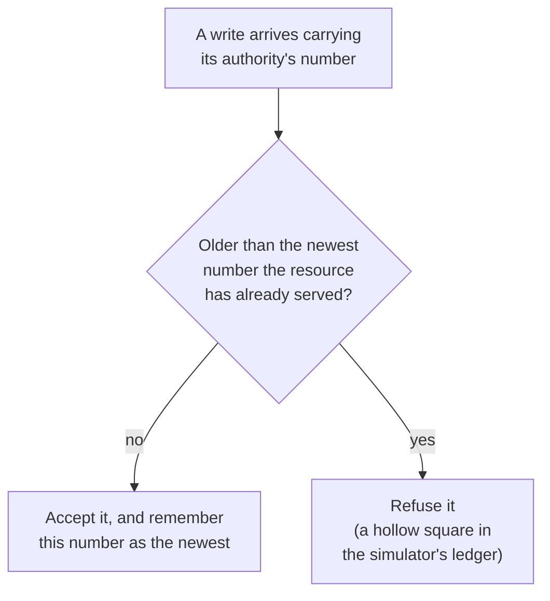
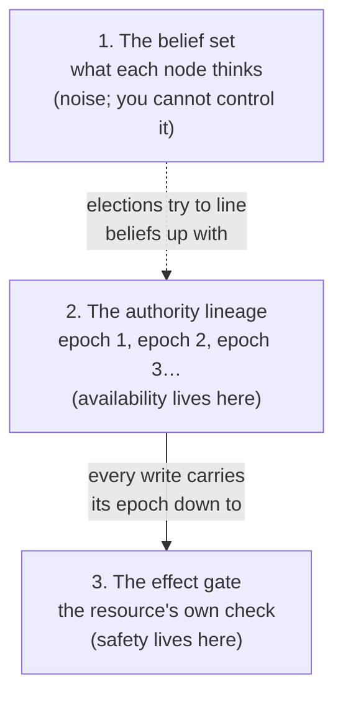
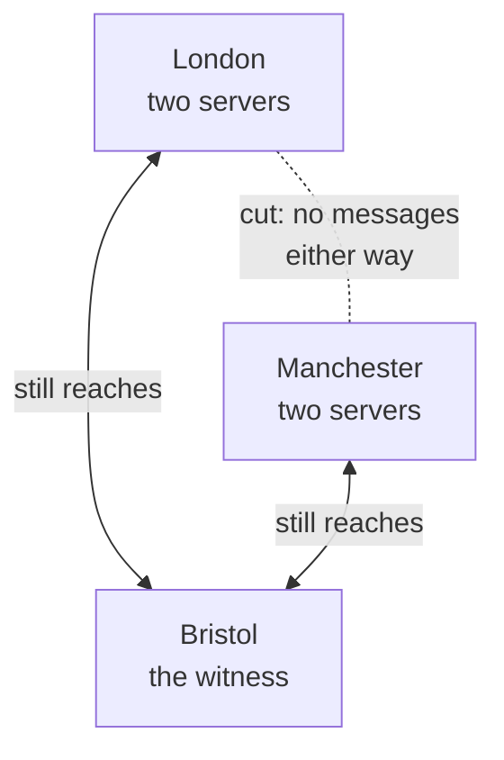
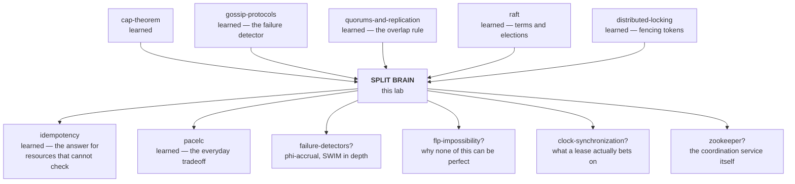

# Split Brain — when two machines both believe they are in charge

> **Tell a friend:** Asha and Omar run the two signal boxes at the ends of one
> railway track, and a single telephone line joins them. One afternoon the line
> goes dead, and each of them must guess whether the other box is empty or only
> unreachable. Wait, and no train runs all day; go, and two trains may meet
> head-on. Computers that share a job face the same silence, and "split brain"
> is what engineers call it when both sides decide "I am in charge". You cannot
> stop a machine believing that, so the railway's fix is the one that works:
> make the track itself check a token, and a wrong belief can never become a
> crash.

The simulator for this lab is [`visualization.html`](visualization.html), also published as
[Two Signal Boxes](https://claude.ai/code/artifact/0bb7695b-3ce1-4465-b700-56b9e26eec0a).
What the lab is made of, where it sits among your other labs, and how its numbers were produced is in [section 17](#17-about-this-lab).

---

## 1. Why does this problem exist at all?

> **In one breath:** You run a job on two machines so that one of them can die.
> But now the two must agree which of them is doing the job right now. If both
> think it is them, the result is not slow. It is wrong.

Meera runs a service on more than one machine so that it survives one machine
dying. For that to work, the machines must agree on which of them is currently
doing the job. Otherwise two of them do it at once.

Two machines doing the job at once is not merely wasteful. It is the specific
way distributed systems produce results that are *wrong* rather than merely
*late*. Two machines both convinced they are in charge of an account balance
will both debit it. Two machines both convinced they own a payment batch will
both submit it. Two database servers both accepting writes will build two
different versions of history. When they are reconnected, somebody has to
decide which version is real. That means somebody has to decide whose data to
throw away.

That last sentence is the whole cost. Almost every other distributed-systems
failure is recoverable by waiting: the slow node catches up, the queue drains,
the retry succeeds. This one is not. When two machines have both acted, no
amount of later agreement un-acts either of them.

Here is the whole lab in one comparison. Read the second row twice.

| Kind of failure | What fixes it | What it looks like |
|---|---|---|
| Late | waiting | the slow node catches up, the queue drains, the retry succeeds |
| Wrong | a human choosing whose data to throw away | two servers both debited the same balance, and both said "done" |

## 2. What happens when Asha's telephone goes dead?

> **In one breath:** One track, two signal boxes, one telephone. When the line
> goes silent, Asha cannot tell "Omar's box burned down" from "the wire is
> cut". Those two need opposite answers, and she has to pick one.

A single stretch of railway track runs between two towns. One track, both
directions. There is a signal box at each end. Asha keeps the London box. Omar
keeps the Manchester box. The two of them are connected by one telephone line.

The rule is simple and absolute: **only one train may be on the section at a
time.** So before letting a train in, Asha telephones Omar and asks. If Omar
says the section is clear, the train goes. That is the entire protocol, and
for decades it worked.

One afternoon Asha picks up the telephone and hears nothing.

She now has to answer a question she has no way of answering. Two things
produce exactly this silence:

1. The Manchester box has burned down. Nobody is there. If she waits for
   permission she will never get it, and she will stop every train on the line
   for no reason.
2. The telephone line is down. The Manchester box is fine, Omar is at his desk,
   and at this moment he is picking up his own dead telephone and having
   exactly this same thought.

From where Asha is standing, these are the same event. Silence is the only
evidence she has, and it has two meanings that demand opposite responses. The
table is her whole dilemma.

| Asha's choice | If the box burned down | If only the wire is cut |
|---|---|---|
| Wait for Omar | costs the whole day's service, for no reason | safe: Omar may have a train on the section |
| Let the train go | fine: the section really is empty | two trains on one track, travelling towards each other |

> **🔮 Predict:** *Asha waits five minutes and rings again. Still nothing.
> Does the second silence tell her anything the first one did not?*
> <details><summary>Reveal</summary>
> No. If you said "it is twice as much evidence", you have counted the same
> silence twice. A cut wire is silent for as long as you care to wait, and so
> is an empty box. Waiting changes only one thing: how much it costs to have
> waited. Engineers will meet this again in stage 3 as the *timeout*. It
> decides how long you wait. It never decides what the silence means.
> </details>

You have met this exact undecidability before. The
[gossip-protocols](../37-gossip-protocols/) lab put it in one line: *death and
slowness are indistinguishable from outside.* This is the same fact wearing a
different hat. This lab is about what it costs when the thing you get wrong is
**who is in charge**, rather than merely who is alive.

The railway industry learned this the expensive way, in Britain, in the
nineteenth century. The usual example is the Thorpe collision of 1874, on a
single-track line near Norwich. It was caused by a confusion at one end about
whether an order had actually been sent, and around two dozen people died.
Those details come from background reading, not from a source checked while
writing this lab. Treat the date and the details as approximate and look them
up before you repeat them anywhere that matters; section 17 lists every claim
of that kind. The part that *is* load-bearing here, and which is certain, is
the fix the industry adopted. We come back to it in stage 6, and it turns out
to be the same idea your distributed database uses.

**Where this lab takes you.** Stop at any checkpoint and you still have
something whole.

| Layer | Stages | After it you can… |
|---|---|---|
| Beginner | 1–9 | say what split brain is, why trying harder cannot prevent it, and why effects matter more than beliefs |
| Intermediate | 10 | name the four defences, and say what each one is for and what it is *not* for |
| Engineering | 11–12 | walk every failure shape, say which guarantee it bends, and say what the design cost |
| Production | 13 | read a real system's configuration and ask the three questions that matter |

## 3. Why not just take over when the other side goes quiet?

> **In one breath:** Turn Asha and Omar into servers that say "still here" on a
> timer. If the "still here" stops for too long, the other side takes over. It
> is the obvious rule, real systems ship it, and it is Asha's wrong guess from
> stage 2 made automatic.

Meera turns the signalmen into servers. Every server sends a short "still here"
message to the others on a timer. Engineers call that message a **heartbeat**,
and its *absence* is the only failure signal anyone gets. If a server has heard
nothing from the one in charge for longer than some limit, it concludes that
server is gone and takes over.

This is not a strawman. It is roughly what a great many production systems
actually do. It is the default behaviour you get from a naive
high-availability setup: a virtual IP address that moves to whichever machine
notices the other has stopped answering, a cron job that promotes a replica, a
lock in a cache with an expiry.

It is also completely reasonable on its face. The only way a server can learn
anything about another server is by receiving messages from it. Absence of
messages is the only failure signal available. Acting on that signal is the
only way to recover from a real failure at all.

> **🔮 Predict:** *Five servers, three in London and two in Manchester,
> running exactly this rule. The cable between the two cities is cut. Nothing
> else fails: every server is healthy, every disk is fine, both cities have
> power. What is the state of the system sixty seconds later?*
>
> <details><summary>Reveal</summary>
>
> Two servers are in charge, and both are accepting writes to the same
> database.
>
> Manchester's servers hear nothing from London. Their rule says: take over.
> So they take over. They are not malfunctioning. They are following the rule
> correctly, on the only evidence available to them. London, meanwhile, has
> noticed nothing at all, because its leader is still alive and still leading.
>
> If you said "Manchester waits, because it is the smaller side", you made the
> guess most people make, and it points at the critical detail. Manchester has
> no way to know it is the smaller side. It can count the servers it can
> reach. It cannot count the servers that exist.
>
> The simulator's result over 400 ticks, in the two counters you will watch
> all lab long:
>
> | Counter | Value | What it means |
> |---|---|---|
> | Servers in charge | 2 | both cities now have a leader |
> | Writes accepted by the database | 148 | the database noticed nothing wrong |
> | Writes from a server already superseded | 68 | sixty-eight overwrites of newer data, with no error message anywhere |
> </details>

## 4. Where exactly does the obvious rule break?

> **In one breath:** Walk the cut by hand, tick by tick. Every server follows
> its rule. The database follows its rule. Nobody misbehaves, and the data is
> still wrong. That condition has a name: split brain.

Let us do that failure slowly, by hand, because the shape of it is the whole
subject.

Meera's five servers have numbers. The three in London are `S1`, `S2` and
`S3`. The two in Manchester are `S4` and `S5`. `S1` is in charge. Every server
knows it. Dev's London app writes through `S1`. Priya's Manchester app writes
through `S5`, which forwards to `S1`.

The simulator counts time in **ticks**. In the traces below, "tick 40" is
written `t=40`.

```
t=0     S1 in charge.  Everyone agrees.  Database has served writes from S1.
t=40    The cable is cut.  Nothing else changes.
        London still sees: S1 leading, S2 and S3 following.  All fine.
        Manchester sees: silence.
t=80    S4 has now heard nothing for longer than its limit.
        S4 takes over.  It tells S5, which accepts.
        Manchester now has a leader.  London still has a leader.
t=85    The Manchester app writes.  S4 accepts it and sends it to the database.
        The London app writes.  S1 accepts it and sends it to the database.
        The database accepts both.  It has no idea anything is wrong.
t=90+   Both continue.  Every write from one erases the effect of the other.
```

Nothing in that trace is a bug. Every server applied its rules correctly to
the evidence in front of it. The database applied *its* rule correctly too:
somebody who was allowed to write, wrote.

Engineers call this condition **split brain**: two or more nodes
simultaneously believing they hold an exclusive role, and acting on that
belief. The name is unflattering and accurate. One system, one job, two
independent minds issuing orders, neither aware of the other.

> **🔮 Predict:** *Which of these is the true cause of what you just watched:
> the cut cable, the database that accepted both writes, or `S4`'s decision to
> take over?*
> <details><summary>Reveal</summary>
> `S4`'s decision, made under uncertainty. If you said the cable: stage 11
> shows the same split brain with every cable intact and a perfectly healthy
> network. If you said the database: it did exactly what it was told, and the
> *fix* in stage 6 does live there, but the cause does not. The cable supplied
> the uncertainty. The decision supplied the damage.
> </details>

Three things about split brain are worth fixing in your head straight away,
because each one is a place where intuition is wrong.

It is not caused by the network. It is caused by a decision made under
uncertainty. The network breaking into pieces that cannot reach each other is
called a **partition**, and a partition merely supplies the uncertainty. In
stage 11 you will watch split brain happen with a perfectly healthy network
and every cable intact.

It is not a bug you can fix by being more careful. No amount of care lets a
server distinguish a dead peer from an unreachable one, because there is no
observation that distinguishes them. This is a limit, not an oversight. It is
the same limit that produces the [cap-theorem](../24-cap-theorem/) lab's choice.
On a partition you either refuse to answer or you risk answering wrongly. Both
of those are decisions you make in advance, not discoveries you make at the
time.

The two leaders are not the damage. This is the one that matters most, and we
will spend the rest of the lab on it.

| The intuition | Why it is wrong | Where you will see it |
|---|---|---|
| "The network caused it" | a decision under uncertainty caused it; the partition only supplied the uncertainty | stage 11: split brain with every cable intact |
| "Be more careful and it goes away" | no observation tells a dead peer from an unreachable one; a limit, not an oversight | the cap-theorem lab's choice, made in advance |
| "The two leaders are the damage" | the leaders are beliefs; the damage is what lands on the data | stages 5 and 6, and every stage after |

## 5. What do we actually need to guarantee?

> **In one breath:** "Only one server believes it is in charge" is impossible,
> because beliefs live inside machines you cannot reach. The goal that works is
> about what *lands*: only the newest authority's writes may ever take effect.

Here is the trap. The obvious goal is:

> *At most one server believes it is in charge.*

This goal is **impossible**, and chasing it is why people build fragile
systems.

> **🔮 Predict:** *Meera pulls `S4`'s network cable out entirely. Is there
> anything she can do now, from her desk, that changes what `S4` believes?*
> <details><summary>Reveal</summary>
> No. If you said "send it a message telling it to stand down": along which
> wire? The machines you need to correct are exactly the ones you cannot
> reach. That is what made them a problem in the first place. The only thing
> Meera can change from her desk is what the *database* does with `S4`'s
> writes, and that is stage 6.
> </details>

You cannot control what a machine believes. A machine's belief is a variable
in its own memory, formed from messages it has received. A machine that has
been unplugged from the network still holds its old belief perfectly intact. A
machine frozen mid-execution wakes up with its old belief unchanged. No
message you send can reach a machine you cannot reach, and the machines you
need to correct are exactly the ones you cannot reach.

So drop it. Here is the goal that is actually achievable:

> **At most one authority's actions may ever take effect on the shared
> resource, and once a newer authority has acted, nothing from an older one may
> act again.**

Read that twice, because four things in it are load-bearing. The table
takes them one word at a time.

| Word in the goal | What it is about | What it is not about |
|---|---|---|
| **effects** | whether your write lands | beliefs; believe whatever you like |
| **shared resource** | the database, the disk, the payment gateway | the cluster's internal opinion of itself |
| **ordered** | authorities form a sequence that only goes forward, so it is checkable with arithmetic | real time |
| **at most one** | sometimes the honest answer is that nobody may act, and the service is down; that is a correct outcome, not a failure of the design | "exactly one" |

The [distributed-locking](../43-distributed-locking/) lab reached the same place
from a different direction and named it: *at-most-one-effect-lineage, not
at-most-one-holder.* If that phrase meant nothing at the time, it should mean
something now. It is the same requirement, stated for locks instead of
leaders.

## 6. What is the key idea?

> **In one breath:** You cannot stop a machine believing it is in charge. You
> can stop its writes from counting. Put the check at the thing being
> protected, the way the railway put a brass token in the driver's hand.

You cannot stop a machine from believing it is in charge.

You can stop its writes from counting.

So move the decision out of the machines' heads and put it at the thing being
protected. The shared resource keeps one number: the identity of the newest
authority whose work it has accepted. Every write arrives carrying the
identity of the authority that issued it. Anything older than the number is
refused.

That is it. That is the entire idea. Everything in the rest of this lab is
either a way to produce that number reliably, or a story about what happens to
systems that do not have one.

And this is where Asha and Omar's railway comes back. The answer the railways
settled on was not a better telephone and not a better rule. It was a
**physical brass token**. One token per section of track. No driver may enter
the section without holding it. It cannot be in two places, so two trains
cannot both be authorised, *no matter what Asha or Omar believes, and no matter
what the telephone is doing.* The signalmen's beliefs stopped being
safety-critical the moment the authority became an object that the track
itself could check.

Your distributed system cannot pass a brass object around. It passes a number
instead, and the resource checks it. Same idea, one abstraction thinner.

Here is the check, drawn. It is the only place in this whole lab where
correctness is actually decided.



## 7. What are the words for what you have just watched?

> **In one breath:** Every word below names something that already happened
> to Asha, Omar, or Meera's servers. Read each one as "the thing from stage N",
> not as a definition to memorise.

Each of these has been demonstrated above before being named. Minor terms are
defined where they first appear later in the document; these are the
load-bearing ones. They come in two families: the words for the *condition*
and its causes, and the words for the *tools* that tame it.

### The condition: how do split brain, partition, failure detector and divergence differ?

**Split brain** is Asha and Omar both letting a train through. In plain words,
two parts of one system both think they are the one in charge, and both act
on it. Technically, two or more nodes simultaneously hold a role the system's
design says is exclusive (leader, primary, lock holder, coordinator) and issue
side effects under it. The term exists to name the *state of belief*,
separately from its cause and separately from its damage. Those are three
different things, and people use one word for all three. That is why
conversations about it go badly. Concretely: at `t=85` in the stage 4 trace,
`S1` and `S4` are both leaders. That is split brain. Whether it has hurt
anything yet is a different question. The [raft](../40-raft/) lab's blunt
correction is the same point: *"Raft guarantees one leader" is false; "one
leader per term, and only the newest can commit" is true.*

A **partition** is the cut telephone wire. In plain words, the network has
broken into pieces that cannot talk to each other. Technically, a set of nodes
is partitioned when messages between two subsets are not delivered, while
nodes within each subset can still communicate. The word names a *cause*, and
this lab's whole discipline is keeping cause, belief, divergence and loss in
separate boxes. At `t=40` in stage 4, London's `{S1,S2,S3}` and Manchester's
`{S4,S5}` become two partitions. It is the P in
[cap-theorem](../24-cap-theorem/). Note that a partition is neither necessary nor
sufficient for split brain: stage 11 has split brain with no partition, and
stage 11 also has a partition with no split brain.

The **failure detector** is the part of Asha that decides "Omar's box is
gone". In plain words, it is the part of the system that decides whether
another machine is dead. Technically, it is a component that converts observed
silence into a verdict about liveness. It is *unreliable* by construction: it
can report a live node as dead (a false positive) and a dead node as live (a
slow detection). The term exists to make that fallibility explicit and give it
a name you can argue about, instead of burying a timeout in a config file and
calling the result truth. Concretely: "I have heard nothing from `S1` for 40
ticks, therefore `S1` is dead." A false positive of exactly this kind is the
trigger for most real split brains.

The [gossip-protocols](../37-gossip-protocols/) lab turned this component's one
dial all the way in both directions. There is no setting that is good at both
columns.

| Setting | Spots a real crash in | Falsely accuses, during a 4-round pause | What it means |
|---|---|---|---|
| `suspectAfter=1` | 3.6 rounds | 98% of the cluster | fast, and wrong under any pause |
| `suspectAfter=5` | 7.9 rounds | nobody | never wrong, and slow |

That lab's headline finding is worth re-reading here: at 90% packet loss with
*zero* crashed processes, a 100-node cluster wrote off 100% of its own
members. **The spreading is robust; the judging is fragile.**

**Divergence** is two versions of the day's train register, each written by a
signal box that thought it was the only one writing. In plain words, two
copies of the data that disagree, and neither is obviously wrong. Technically,
two histories that share a prefix and then differ, both containing writes that
were acknowledged to a client. The term exists because divergence is the
*damage*, as distinct from split brain, which is the *belief*. Split brain with
no divergence costs you nothing. Divergence is what somebody has to clean up,
by hand, choosing whose data to discard. The [pacelc](../25-pacelc/) lab's PA/EC
corner is exactly this: a database accepts writes on both sides of a partition
and then discards the losing branch at heal, MongoDB writing it to a rollback
file and moving on.

| Word | On the railway | In Meera's cluster | Where it happened |
|---|---|---|---|
| Split brain | Asha and Omar both let a train in | `S1` and `S4` both leading | stage 4, `t=85` |
| Partition | the cut telephone wire | London and Manchester cannot exchange messages | stage 4, `t=40` |
| Failure detector | Asha deciding "Omar's box is gone" | "nothing from `S1` for 40 ticks, so it is dead" | stage 3 |
| Divergence | two train registers that disagree | two histories, both acknowledged | stage 1 (the cost), stage 11.11 (the clean-up) |

### The tools: what does each of epoch, quorum, lease, fencing and witness buy?

The **epoch** is the brass token with a number stamped on it. In plain words,
a number that goes up by one every time leadership changes, so you can tell
whose orders are newer. Technically, a monotonically increasing integer
attached to a period of authority. It is a logical clock: it says nothing
about real time and everything about order. The term exists because "who is
the leader" is not answerable from inside a partition, but "is this order
newer than the last one I obeyed" is answerable by one integer comparison,
with no timing assumptions whatsoever. Concretely: `S1` leads in epoch 1. The
cut happens. `S4` wins an election and leads in epoch 2. A write arrives at
the database carrying epoch 1 after the database has already served epoch 2.
Refused, because 1 < 2.

You have now met this object under six names across five labs. It is Raft's
**term**, Paxos's **proposal number**, ZooKeeper's **zxid**, etcd's
**mod_revision**, Chubby's **sequencer**, gossip's **incarnation number**, and
the [distributed-locking](../43-distributed-locking/) lab's **fencing token**.
The [optimistic-vs-pessimistic-locking](../10-optimistic-vs-pessimistic-locking/)
lab's unification applies here too: a fencing check *is* a conditional write,
with the version column minted by whoever grants leadership. Other names you
will meet for the same thing: generation, revision, incarnation.

A **quorum** needs only a one-line refresher, since you have a whole lab on it.
It is a majority, and the only property that matters is that any two
majorities of the same set share at least one member. So two majorities cannot
both act without at least one node knowing about both. The new fact this lab
adds, and it is a big one: a quorum rule governs **winning an election**. It
says nothing whatsoever about **keeping the job**. A leader elected
legitimately last week, now stranded alone on the wrong side of a cut cable,
still believes it is the leader. Nothing in the quorum rule tells it
otherwise. You will watch this in stage 10, and it surprises most people.

A **lease** is authority with an expiry date on it. Technically, a grant of a
role valid until a wall-clock deadline, which must be renewed against a
majority to be extended. A holder that cannot renew must stand itself down
when the deadline passes. The term exists to convert "I have not heard that I
lost my job" into "my job has expired", which is a statement a stranded node
can evaluate alone. Concretely: `S4`'s lease runs to tick 180, written
`t=180`. At `t=140` the cable is cut. `S4` cannot renew. At `t=180` it stands
down without anyone telling it to. The catch is the same one as always: a
lease is a bet on clocks. It assumes the holder's clock advances at roughly
the same rate as everyone else's, and that the holder is actually *executing*
to notice the deadline. A process frozen for longer than its lease notices
nothing.

**Fencing** is two different things, both called fencing, and this causes real
confusion between communities, so learn both. A **fencing token**, in
distributed-systems usage, is the epoch check described above: the resource
refuses stale work, and nothing is killed. **Fencing / STONITH**, in
high-availability-cluster usage, comes from *Shoot The Other Node In The
Head*. It means physically powering off or isolating the suspected-dead
machine: cutting its power via a management controller, or telling the storage
array to stop accepting its writes. It converts "I believe you are dead" into
"you are dead". Both exist because they solve the same problem for different
resources. If the resource can check a number, use a token. If it cannot (a
raw shared disk, a virtual IP, an industrial controller) you have no option
but to make the other machine stop existing.

A **witness**, also called an arbiter or tiebreaker, is a small extra voter
that stores no data and can never be in charge. Its only job is to make the
total number of voters odd. It exists because two sites split evenly cannot
produce a majority on either side. A third voter, in a third place, guarantees
that at most one side can. The trap: the *placement* is the whole trick. A
witness in one of the two main sites is not a tiebreaker. It is a rule that
says that site always wins.

| Tool | What it buys | What it does not buy | Where it happens |
|---|---|---|---|
| Epoch | "is this order newer?" answered by one comparison | knowing who the leader is right now | stage 6; stage 10, v4 |
| Quorum | at most one winner per election | anything about keeping the job | stage 10, v2 |
| Lease | a stranded leader stops on its own | protection when the clock or the process is frozen | stage 10, v3 |
| Fencing token | stale writes bounce at the resource | anything, for a resource that cannot check | stage 10, v4 and v5 |
| STONITH | certainty that the other machine is off | safety from a fence race | stage 11.9 |
| Witness | a majority on one side of a two-site split | anything, if placed in a main site | stage 11.4 |

## 8. Which picture should you carry, and where does it lie to you?

> **In one breath:** The nice picture is the railway with its brass token. The
> engineer's picture is three separate objects: what nodes believe, the true
> sequence of authorities, and the gate at the resource. Safety lives only in
> the gate.

### The simple model: what makes Asha and Omar's railway safe?

One track. Two signal boxes. One telephone. One brass token, and no train may
enter the section without physically holding it.

The token, not the telephone, is what makes the system safe. The telephone is
how Asha and Omar *coordinate*; the token is what makes miscoordination
*harmless*. If the telephone fails, the worst outcome is that no train runs,
because the token is sitting in one box and the other box cannot conjure one
up.

### The engineering model: which three objects do people merge into one?

Three separate objects that people habitually merge into one:

1. **The belief set.** Which nodes currently think they hold the role. This is
   distributed, unsynchronised, and frequently wrong. You cannot control it.
2. **The authority lineage.** A totally ordered sequence of epochs, each with
   at most one holder. Produced by an election rule (usually a majority vote).
   It exists as a fact about the system even though no single node can observe
   it.
3. **The effect gate.** A check *at the resource* that admits work only from
   the newest authority it has seen. This is the only place where correctness
   is actually enforced.

Safety is a property of (3). Availability is a property of (2). (1) is noise.



### The mapping: which railway thing is which cluster thing?

| Railway | Distributed system |
|---|---|
| The single-track section | The shared resource (database, disk, account, gateway) |
| Signal box | Node / server |
| Asha's belief that she may let the train go | The node's `role = leader` variable |
| The telephone line | The network |
| Silence on the telephone | Failure detector input: dead or unreachable, indistinguishable |
| "I'll assume he's gone and let the train through" | Taking over on timeout |
| The brass token | The epoch / fencing token |
| The section physically requiring the token | The resource checking the token on every write |
| Only one token exists | Epochs are issued by a majority, so at most one per epoch |
| Two trains on the track | Two authorities' effects interleaved on one resource |

### Where the story lies to you

Three places, and each one is the reason a real system needs something the
railway does not.

**The token is physical there and a number here.** A brass token cannot be
forged, duplicated, or replayed; the laws of physics enforce the invariant for
free. A number enforces nothing by itself. It only works if the resource
*actively checks it on every operation*. Send a perfectly correct token to a
resource that does not check, and you have exactly as much protection as
sending nothing. This is not a quibble. It is the single most important
practical caveat in this lab, and stage 11 shows it in numbers.

**The railway has out-of-band evidence.** Asha can walk down the line, look
out of the window, send a runner, or telephone a third station. She has senses
beyond the one channel. A server has exactly one way to learn anything about
another server, and when that fails it is blind. This is why real systems add
*indirect probes*, meaning "can anyone else reach `S4`?". The
[gossip-protocols](../37-gossip-protocols/) lab put numbers on that trick.

| Way of judging a peer | What it got wrong | What it means |
|---|---|---|
| Heartbeat via anyone | never notices a single cut cable | too forgiving |
| Direct evidence only | buries 9.7 of 20 healthy peers | too harsh |
| Indirect probing | fixes both | ask "can *anyone* reach it?", never "is it up?" |

**The railway has two parties and one resource.** That means it has no notion
of a majority; with two parties there is no majority to be had. Real clusters
have *N* parties. That is what makes voting available as a tool at all. It is
also why the answer to "how do I make a two-node cluster safe?" is very often
"add a third machine". That sounds like a dodge and is in fact the entire
answer.

> **🔮 Predict:** *Meera has exactly two servers, one in London and one in
> Manchester. Which single change makes them safe against a cut cable: a
> faster heartbeat, a longer timeout, or a third machine in Bristol?*
> <details><summary>Reveal</summary>
> The third machine. A faster heartbeat only makes Asha's silence arrive
> sooner. A longer timeout only makes her wait longer before making the same
> unanswerable guess. Neither gives the two sides any way to know which of them
> is the larger half, because with two there is no larger half. A third voter
> creates one. If you said "longer timeout", you have chosen where on the
> availability curve to sit, which is a real choice (stage 13 makes it), but
> it is not safety.
> </details>

## 9. Can you break it yourself?

> **In one breath:** Open the simulator and watch two counters. One counts
> servers that *believe* they are in charge; let it climb. The other counts
> writes that landed from a stale server; that is the damage, and the whole
> lab is about holding it at zero.

Open **[`visualization.html`](visualization.html)**, or the published version,
**[Two Signal Boxes](https://claude.ai/code/artifact/0bb7695b-3ce1-4465-b700-56b9e26eec0a)**,
before reading further. Everything from here on is easier after you have
watched it once.

**The two numbers on the right are the point of the whole page.**

| Counter on the page | Is it allowed to go up? | Why |
|---|---|---|
| *Servers that believe they are in charge* | yes | it is cheap, and it happens constantly in correct systems |
| *Writes accepted from a stale authority* | no | this one is the damage; it is what you are actually defending against |

A good design lets the first number reach two and holds the second at zero. If
you take one thing from this lab, take that sentence.

Run these three, in this order, before anything else. They are the same
three cuts and freezes Asha and Omar have already lived through.

1. **Scenario 1**: the cable is cut with no defences on. Watch both numbers
   climb. This is the disaster in its natural state.
2. **Scenario 3**: the same cut, with majority quorum switched on, but with the
   server that was *already* in charge, the **incumbent**, on the *minority*
   side. Most people expect quorum to save them here. It does not, and
   understanding why is stage 10.
3. **Scenario 9**: a leader freezes on a perfectly healthy network with fencing
   switched on. Two servers end up believing they are in charge and **zero**
   writes are damaged. Look at the hollow squares in the ledger: each one is a
   disaster that did not happen.

The four defences on the page are independent switches, not a ladder. That is
deliberate, and it matters: you cannot see what any one of them is worth until
you can turn the others off. Real systems ship them in every combination.
etcd's `mod_revision` is a fencing token with no lease anywhere near it.

---

> ### ✅ Checkpoint: you now have the BEGINNER MODEL
>
> You can explain what split brain is, why it cannot be prevented by trying
> harder, and why the interesting question is about effects rather than
> beliefs. You could hold your end of a conversation about it.
>
> What the next layer adds: the actual mechanism, built one defence at a time,
> with each defence introduced *after* you have watched the previous one fail.
> This is where you find out that the defence most people reach for first,
> majority quorum, is not sufficient on its own, and exactly what it is
> missing.

> **Say it back.** Without using the words *partition*, *quorum* or *fencing*,
> explain to a friend why Asha cannot make herself safe by being more careful
> on the telephone, and what the railway did instead.
> <details><summary>A good answer sounds like</summary>
> "When the phone goes quiet, Asha has no way to tell an empty box from a cut
> wire, however long she waits or however carefully she listens. So the
> railway stopped trusting the phone. It made one brass token for the section
> and told the driver: no token, no train. Now it does not matter what Asha or
> Omar believes. The track only lets through the one who is holding the
> token."
> </details>

---


## 10. How is the defence built, one failure at a time?

> **In one breath:** Meera builds the design five times. Each version is what
> a good engineer would try next, and each one is broken by a number from the
> simulator before the next appears. A vote, then an expiry, then a token
> checked at the database, then the question of what to do when the database
> cannot check.

We will build the design in five versions. Each version is what a competent
engineer would try next. Each one is broken by a result from the simulator
before the next appears.

Every number in this section comes from one fixed setup, so that the versions
can be compared. Section 17 has the full recipe.

| The run | Setting | Why it matters |
|---|---|---|
| Length | 400 ticks | long enough for every lease and freeze to play out |
| Servers | five: three in London, two in Manchester | Asha's side is the bigger one |
| Write rate | one write every 5 ticks | so "writes served" is a fair yardstick across versions |
| "Damaged" | a write the database accepted from an authority older than one it had already served | a real overwrite of newer data, not a near miss |

### v1: what if you just take over when the other side goes quiet?

The rule from stage 3. No votes, no expiry, no tokens. Asha's guess, automated.

| Counter | v1, cable cut | What it means |
|---|---|---|
| Servers in charge after the cut | **2** | one leader per city |
| Writes accepted | 148 | both leaders' writes landed |
| Damaged | **68** | sixty-eight overwrites of newer data |

Broken, and we knew it would be. On to the fix everyone reaches for.

### v2: what if a server needs a majority before it may take charge?

A server may only become leader with votes from more than half of *all*
servers, not half of the ones it can reach. This is the
[quorums-and-replication](../34-quorums-and-replication/) lab's overlap rule
doing its job. Two majorities of five must share a member, so two servers
cannot both be elected in the same epoch.

Run it with the cable cut and the existing leader `S1` in London, the majority
side:

| Counter | v2, leader in London | What it means |
|---|---|---|
| Servers in charge | **1** | London's `S1` carries on alone |
| Writes accepted | 79 (down from 158 on a healthy cluster) | Priya's Manchester app is refused service |
| Damaged | **0** | nothing stale landed |

Excellent. Manchester's `S4` campaigns and campaigns. Its epoch climbs to 8
over the run. It never wins, because it can only ever reach two votes and
needs three. Priya's Manchester app is refused service. Dev's London app
carries on.

Note *what did the work* there, because it is the genuinely elegant part.
Nobody told `S4` it had lost. There is nobody who *could* tell it. It worked
out its own defeat, alone, from a vote count it could compute locally.
Majority quorum is the one rule a partitioned node can apply correctly using
only information it already has.

> **🔮 Predict, and this is the important one:** *Same five servers, same cut,
> majority quorum still switched on. The only change: the server that was
> *already* in charge before the cut, `S4`, sits in **Manchester**, the
> minority side. What happens?*
>
> <details><summary>Reveal</summary>
>
> | Counter | v2, incumbent in Manchester | What it means |
> |---|---|---|
> | Servers in charge | **2** | `S4` kept leading; London elected `S1` |
> | Writes accepted | 147 | both leaders' writes landed |
> | Damaged | **68** | identical damage to having no defence at all |
>
> If you said "`S4` loses its majority, so it stands down", you treated
> silence as a message. It is not one.
>
> `S4` was elected legitimately, long ago, with a proper majority. Now the
> cable is cut. Nothing happens to `S4`. It receives no messages, and *not
> receiving a message is not a resignation letter.* It carries on leading, and
> Priya's Manchester app carries on writing through it perfectly happily.
>
> Meanwhile London has three servers, correctly forms a majority, and elects
> its own leader in a higher epoch. Both write.
>
> **A quorum rule is a rule about winning an election. There is nothing in it
> about keeping the job.** Every server obeyed the rule. The rule was not
> enough.
> </details>

That is the crack in v2, and it points at exactly what is missing: nothing in
the system makes authority *stop by itself*.

### v3: what if authority expires on its own?

Give leadership a deadline. A leader must keep renewing its position against a
majority. If it cannot, it stands itself down when the deadline passes. And
symmetrically, a newly elected leader waits out the old lease before it
touches anything. So whatever the old leader still believes, its time has
provably run out.

Same setup as the prediction above: quorum on, lease on, incumbent `S4`
stranded in Manchester.

| Counter | v3, quorum + lease, incumbent in Manchester | What it means |
|---|---|---|
| Servers in charge | **1** | `S4` stood itself down |
| Writes accepted | 68 | fewer than v2's 79: the dead window has a price |
| Damaged | **0** | nothing stale landed |

`S4` stands itself down. Nobody tells it to; it simply cannot renew, so it
stops.

This is real, and it is what most production leader-election systems do. But
look at what it cost and what it assumes.

The cost first. There is a mandatory dead window on every failover: the new
leader is elected and then deliberately does nothing while the old lease
drains. You have bought safety with unavailability, and the bigger the lease,
the more you buy of each.

| Setup | Writes served in 400 ticks | What it means |
|---|---|---|
| Healthy cluster | 158 | the ceiling |
| v2, quorum only, leader in London | 79 | Manchester refused, London at full speed |
| v3, quorum + lease, incumbent in Manchester | 68 | plus a dead window while the old lease drains |

Now the assumption, which is the dangerous part. A lease is a bet that the
holder's clock advances at the same rate as everyone else's, *and that the
holder is actually executing to notice the deadline.* Both halves of that can
fail. A virtual machine suspended and resumed comes back with a clock that
jumped. A process in a long garbage-collection pause is not executing at all,
so it cannot notice anything. And here is the sharp bit: **it cannot heartbeat
either, which is precisely why its lease expired.** The mechanism that is
supposed to stop it is disabled by the same event that makes stopping it
necessary.

Let us do exactly that.

> **🔮 Predict:** *Nothing is cut. `S1`, the leader, freezes for 70 ticks (a
> long garbage-collection pause) with the silence limit at 40. Quorum is on,
> fencing is off. When `S1` wakes up, which does it do first: notice that it
> has lost its job, or serve Dev's next write?*
> <details><summary>Reveal</summary>
> It serves the write. If you said "notice", ask what would tell it. A process
> resuming from a pause gets no interrupt saying "you were gone for 70 ticks".
> Its memory is exactly as it left it, and its memory says *leader, epoch 1*.
> The trace below is that moment, tick by tick.
> </details>

#### The hand trace that breaks v3: what does S1 do when it wakes?

Five servers. Perfectly healthy network: nothing is cut, no cable is touched,
both cities have full connectivity throughout. Silence limit 40 ticks. `S1` is
in charge, and Dev's London app writes through it.

```
t=0..29   Normal.  S1 leads in epoch 1.  Writes flow.  All five agree.

t=30      S1 freezes.  A garbage collection pause, or the hypervisor suspending
          the VM.  S1 is NOT crashed and the network is NOT broken.  S1 has
          simply stopped executing.  It sends nothing, receives nothing,
          notices nothing.

t=70      S2 has heard nothing for 40 ticks.  Its failure detector says S1 is
          dead.  This verdict is WRONG, and there is no observation available
          to S2 that would tell it so.
          S2 becomes a candidate in epoch 2 and asks for votes.

t=73      S3, S4, S5 grant votes — epoch 2 is newer than the epoch 1 they hold.
          S2 has 4 of 5.  S2 is now the leader in epoch 2.  Legitimately.
          The cluster is, at this moment, entirely correct.

t=75..99  S2 serves writes.  The database's newest served authority is epoch 2.

t=100     S1 wakes up.
          Here is the crucial fact: NOTHING tells S1 that time has passed.
          A process resuming from a GC pause does not get an interrupt saying
          "you were gone for 70 ticks and lost your job".  Its `role` variable
          still says leader.  Its `epoch` variable still says 1.

t=100     The London app's write arrives at S1.  S1 is the leader, as far as
          S1 is concerned, so it accepts it and sends it to the database.
          The database accepts it.  It carries epoch 1.  The database had
          already served epoch 2.
          ---> DAMAGE.  A superseded leader has overwritten newer data.

t=105     Same again.

t=107     S2's next heartbeat reaches S1.  S1 sees epoch 2 > epoch 1 and
          stands down instantly.  The split brain is over.
```

| Counter | Freeze, quorum only, over the full run | What it means |
|---|---|---|
| Damaged | **2** | two writes from `S1` at epoch 1 landed on top of epoch 2 data |

Two things to take from that trace, and the second is more important than the
first.

There was no partition. Not a single cable was cut. Split brain is not a
network phenomenon. It is a *decision-under-uncertainty* phenomenon, and a
frozen process supplies exactly the same uncertainty as a broken cable.

And be honest about this: what happened between `t=100` and `t=107` was a
**race**. `S1`'s stale write and `S2`'s heartbeat were both in flight, and the
write won by seven ticks. Run it with different timing and sometimes the
heartbeat wins and nothing bad happens at all.

That is not reassuring. It is the problem. A defence that works most of the
time is a defence you cannot reason about. You cannot write down what your
system guarantees. You cannot test it, because the bad case does not show up
on demand. You find out which way the race went from a customer. In production
this race is decided in milliseconds you do not control, on a network you do
not own.

We need a rule with no timing in it at all.

### v4: what if the database checks the token?

Every write carries the epoch of the authority that issued it. The database
keeps one number: the highest epoch it has served. Anything lower is refused.
This is the brass token from stage 6, as a number, checked by the track.

> **🔮 Predict:** *Same 70-tick freeze, same 40-tick limit, but now the
> database checks tokens. What does the counter "servers believing they are in
> charge" reach: one, or two?*
> <details><summary>Reveal</summary>
> Two. If you said one, you expected fencing to *prevent* split brain. It does
> not, and it cannot, because nothing can change what a frozen `S1` believes
> when it wakes. What fencing changes is what happens to its write.
> </details>

Run the *identical* freeze: same 70-tick freeze, same 40-tick limit, same
healthy network.

| Counter | v3 (lease) | v4 (fencing) | What it means |
|---|---|---|---|
| Servers believing they are in charge | 1 | **2** | fencing did not stop the belief |
| Writes accepted | 118 | 133 | fencing served more, not fewer |
| Writes refused | 0 | **2** | two disasters that did not happen |
| Damaged | **0** | **0** | both are safe |

Look carefully at that table, because it is the thesis of the lab in four
rows.

Fencing did not prevent split brain. Two servers still believed they were in
charge. The left number went to two, and it always will. What fencing did was
make the belief **inert**. `S1`'s write arrived carrying epoch 1 at a database
that had already served epoch 2, and bounced. `S1` went on believing it was
the leader right up until its next heartbeat. It was simply no longer able to
do anything about it.

And now the part that surprises people: **fencing served more writes than the
lease did**, 133 against 118, while giving the same zero damage. The same
pattern holds on the partition test.

| Partition test, cable cut | Writes accepted | Writes refused | Damaged | What it means |
|---|---|---|---|---|
| quorum + lease | 68 | 0 | 0 | safety by making everybody wait |
| quorum + fencing | 79 | 68 | 0 | safety by letting everybody proceed and refusing the stale ones |

The lease buys safety by making everybody wait. Fencing buys safety by letting
everybody proceed and refusing the ones that turn out to be stale.

The reason is worth stating precisely, and it is the sentence the
[distributed-locking](../43-distributed-locking/) lab arrived at too:

> **Safety by arithmetic, liveness by timeout — never the reverse.**

The token check has *zero* timing assumptions. It does not care about clock
drift, GC pauses, VM suspension, network delay, or how long a packet sat in a
queue. It is one integer comparison, and it is correct under every possible
schedule. The timeout is still there. You still need one to decide *when to
try* a takeover, because slow-versus-dead is undecidable and something has to
break the tie. But the timeout is now only deciding how fast you recover, not
whether you are correct.

Both are still worth having together, for different reasons. Fencing is what
makes it *safe*. A lease is what stops a stranded leader from serving stale
*reads* and burning capacity forever.

### v5: what if the resource cannot check at all?

Now switch off the database's ability to check tokens, and change nothing
else. Think of Priya's app writing to a payment gateway that has never heard
of an epoch. The tokens are still generated, still correct, still attached to
every write. There is simply nobody comparing them.

> **🔮 Predict:** *Same freeze, fencing still on, but the receiver no longer
> compares. The tokens are still correct. How much protection is left: all of
> it, some of it, or none?*
> <details><summary>Reveal</summary>
> None. If you said "some, because the tokens are still right", you have
> placed fencing in the sender. It lives in the receiver. A correct token that
> nobody reads is a brass token left on the platform.
> </details>

| Counter | Fencing, checking resource | Fencing, non-checking resource | What it means |
|---|---|---|---|
| Writes refused | 2 | **0** | nobody compared anything |
| Damaged | **0** | **2** | all the protection is gone |

All the protection is gone. Every bit of it.

This is not a contrived setting. It is the everyday situation for an enormous
proportion of real side effects:

- a payment gateway that takes a charge request and charges the card,
- an SMTP server that takes an email and sends it,
- a third-party API with no conditional-update support,
- a raw block device shared between two machines,
- a physical actuator.

None of these vote. None of these have any idea a cluster exists. And that
leads to the sentence that generalises everything above:

> **A quorum protects the voters. Anything that is not a voter gets no
> protection from consensus at all, unless it independently refuses stale
> work.**

Your five servers can agree perfectly about who is in charge. The payment
gateway was not in the room, was not asked, and will cheerfully charge the
card twice.

For those resources you have exactly three options, and you will use all
three:

1. **Make the effect idempotent.** Attach a client-generated key to the
   *operation*, and have the receiver deduplicate on it. Then a duplicate from
   a superseded leader still acting, a **zombie**, costs nothing, because the
   second attempt is recognised as the first. This is the
   [idempotency](../49-idempotency/) lab's entire subject, and this is why it
   matters here.
2. **Make the machine stop existing.** STONITH: power it off through a
   management controller, or have the storage array refuse its writes. This is
   what high-availability clusters do when the resource is a raw disk, because
   there is nothing else available. It has its own failure mode, which is
   stage 11.
3. **Reconcile afterwards.** Accept that duplicates happen, detect them later,
   and correct. Slow, human, and often the only honest answer.

| Option | Works for | What it costs |
|---|---|---|
| Idempotency key | any receiver that can remember keys | the receiver must keep and check them |
| STONITH | a raw disk, a virtual IP, an actuator | a new failure mode, the fence race of stage 11.9 |
| Reconcile afterwards | anything at all | slow, human, and after the fact |

---

> ### ✅ Checkpoint: you now have the INTERMEDIATE MODEL
>
> You can name the four defences, say what each one is for, and, more
> importantly, say what each one is *not* for: quorum governs elections and
> not incumbency; a lease is a bet on clocks; fencing makes the loser harmless
> rather than absent; and none of it reaches a resource that does not check.
>
> What the next layer adds: the failure modes as a systematic catalogue,
> including the three that catch experienced engineers: the asymmetric
> partition, the fence race, and the operator override.

> **Say it back.** Without using the words *quorum*, *lease* or *fencing*,
> explain why Omar's server in Manchester kept leading after the cable was
> cut even though it needed three votes to win, and what finally made it stop.
> <details><summary>A good answer sounds like</summary>
> "Needing three votes only matters when you are *trying to become* the
> leader. Omar's server already was the leader, and a cut cable does not send
> it a message saying 'you lost'. Silence is not a resignation letter. What
> made it stop was giving its job an expiry date that it could only extend by
> talking to most of the others. When it could not reach them, its time ran
> out and it stood down on its own. And even that only works if the machine
> is awake to notice the clock, which is why the real safety check moved to
> the database."
> </details>

---

## 11. What are all the ways it fails?

> **In one breath:** Eleven shapes of trouble. Six are about wires: clean
> cuts on either side, an even split, a witness, a three-way cut, and a one-way
> cut. Five are not about wires at all: a frozen process, a write already in
> flight, two machines shooting each other, Ben pressing the override, and the
> cable coming back.

You can stage each of these in the simulator. For each one you get the same
things: how to create it, what happens to Meera's cluster, why, which
guarantee survives, which one does not, and how it shows up in production.
The shared facts are lined up in two comparison tables at the end of the
section.

### 11.1 What happens when the cable is cut and the leader is on the big side?

Stage it with 5 servers, 3|2, quorum on, the site link cut, and the leader in
London. That is scenario 2.

London continues. Manchester's `S4` campaigns, its epoch climbing to 8 over
400 ticks, and never wins. Priya's Manchester app gets errors.

| Counter | Value | What it means |
|---|---|---|
| Leaders | 1 | Asha's side keeps the only authority |
| Damaged | 0 | no divergence |
| Writes served | 79 | London at full speed, Manchester refused |

Correctness survives: there is one authority and no divergence. Availability
for the minority side is lost, completely.

In production this is the healthy, designed-for case, and it is what CP
systems look like when they work. The alarm you want is not "a partition
happened" but **"elections per minute"**. The [raft](../40-raft/) lab identified
that as the one Raft alarm, and this is why: a node campaigning in a loop is
invisible in a latency graph and obvious in an election counter.

### 11.2 What happens when the cable is cut and the leader is on the small side?

Stage it the same way, but start the leader in Manchester. That is scenario 3.

| Defence | Leaders | Damaged | What it means |
|---|---|---|---|
| quorum alone | 2 | **68** | Omar's `S4` never hears that it lost |
| quorum + lease | 1 | 0 | `S4`'s time runs out and it stands down |

Covered in stage 10. The failure is that quorum has nothing to say about an
existing leader, so authority must be given an independent way to expire.

With quorum only, nothing that matters survives. The cluster's internal
election history stays consistent, and the data does not.

In production this is why every real leader-election implementation has
*both* a quorum for elections and a lease or its equivalent. If you are ever
reviewing a colleague's home-grown leader election, this is the first thing
to look for, and it is the most commonly missing piece.

### 11.3 What happens with two servers in each city?

Stage it with 4 servers, 2|2, quorum and lease on, and cut the link. That is
scenario 4.

> **🔮 Predict:** *Four healthy servers, two per city, cable cut, quorum and
> lease on. Which side ends up in charge?*
> <details><summary>Reveal</summary>
> Neither. If you said "London, because the leader was there", remember that
> its lease drains with nobody to renew against. If you said "whichever side
> times out first", timing out is not winning. Winning takes three votes, and
> nobody can find three.
> </details>

| Counter | Value | What it means |
|---|---|---|
| Leaders | **0** | nobody can reach three votes |
| Writes served in 400 ticks | 9 | only the writes before the cut |
| Damaged | 0 | safety is perfect |

Three votes are needed. Neither side can find more than two. Both campaign
forever, and the old leader's lease drains with nobody to renew against. Four
healthy servers, total outage.

Safety survives, perfectly. Availability is lost everywhere, for everyone.

In production this is why an even node count is a trap. Four servers tolerate
exactly one failure, the same as three, while giving you one extra machine
that can fail. That is strictly worse. Six tolerate two, same as five. **The
rule is: always an odd number of voters.**

| Voters | Failures tolerated | What it means |
|---|---|---|
| 3 | 1 | the smallest useful cluster |
| 4 | 1 | same tolerance as 3, one more machine to fail |
| 5 | 2 | the common production choice |
| 6 | 2 | same tolerance as 5, one more machine to fail |

### 11.4 What does a witness in Bristol change?

Stage it with 2 London + 2 Manchester + 1 witness in Bristol, then take
Manchester fully offline. That is scenario 5.

| Counter | Value | What it means |
|---|---|---|
| Leaders | 1, in London | London's two plus Bristol's one is three of five |
| Damaged | 0 | no divergence |
| Writes served | 79 | the same as 11.1 |

London's two plus Bristol's one is three of five. Manchester's two is not.

In production, MongoDB calls it an arbiter, SQL Server calls it a file-share
witness, Galera calls it `garbd`, and Patroni relies on the DCS quorum itself.
All the same idea. The placement rule: **the witness must be able to fail
independently of both main sites**, which in practice means a third
availability zone or region. A witness in one of the two main sites is not a
tiebreaker. It is a declaration that that site always wins.

### 11.5 What happens when Bristol can reach both cities but they cannot reach each other?

Stage it with the same witness cluster, but cut *only* the London–Manchester
link, so Bristol can still reach both sides. That is scenario 6.



> **🔮 Predict:** *Bristol can still reach both sides. Does London plus
> Bristol win cleanly, exactly as in 11.4?*
> <details><summary>Reveal</summary>
> No. They take turns. If you said "same as before", notice what changed:
> Manchester is not offline this time. It can still ask Bristol for a vote,
> and Bristol votes for whoever asks with the higher number.
> </details>

| Counter | This cut | Healthy cluster | What it means |
|---|---|---|---|
| Epoch reached in 400 ticks | 6 | 1 | the cluster cannot settle |
| Writes served | 42 | 158 | capacity spent on elections instead of work |
| Damaged | **0** | 0 | safety is entirely intact |

This is not a clean break into two halves. It is the shape where A cannot
reach B while both can still reach C. It is common in real networks, produced
by a single failed link, an asymmetric routing change, or a firewall rule
applied to one direction.

Bristol will vote for whoever asks with a higher number. So London bids and
wins, then Manchester bids higher and unseats it, then London bids higher
again, forever. Nothing is broken and no rule is violated. The cluster simply
cannot settle, and it spends its capacity on elections instead of work.

Safety survives, entirely. Liveness is lost, badly, with no error anywhere
that says so.

In production this is precisely why Raft has **pre-vote**. A candidate first
asks "*would* you vote for me?" without raising anybody's epoch. A node that
cannot actually win therefore stops disrupting the ones that can. If you are
running a consensus system, check that pre-vote is enabled; etcd and modern
Raft implementations have it. The symptom to alarm on is, again, elections
per minute.

### 11.6 What happens when messages travel one way only?

Stage it by cutting the site link and ticking "cut only one direction". With
fencing on, the result is 0 damaged.

A node whose outbound messages are delivered but whose inbound are not is a
particularly nasty object. It looks alive to everyone else while believing
everyone else is dead. Omar can hear Asha; Asha cannot hear Omar.

In production this is the "gray failure" family: a partially failed link, an
overloaded NIC dropping in one direction, a security group edited on one side.
The defence is the same indirect-probing trick from the
[gossip-protocols](../37-gossip-protocols/) lab. Never ask "is `S4` up?", which
is unanswerable, but "can *anyone* reach `S4`?", which is not.

### 11.7 Can split brain happen with every cable intact?

Stage it by freezing the leader for 70 ticks with a 40-tick limit, nothing
cut. Those are scenarios 9–11.

| Defence | Damaged | What it means |
|---|---|---|
| quorum only | 2 | the race in stage 10, lost by seven ticks |
| quorum + lease | 0 | the new leader waited out the old lease |
| quorum + fencing | 0 (and 2 actively refused) | the stale writes bounced |
| fencing, but the resource cannot check | 2 | the token was sent and nobody read it |

Covered in stage 10. The important framing: **the cause was not the
network.** Real sources are stop-the-world garbage collection, a VM suspended
for live migration, `SIGSTOP`, a machine swapping, a disk stall making an
`fsync` take thirty seconds, or simple CPU starvation on a noisy host.

In production, the [redis](../13-redis/) lab saw the same class of event from
another angle. One `KEYS` command over 200k keys stalled innocent `GET`s on
other connections, with safety fully intact and liveness gone.

| What the redis lab recorded | Value | What it means |
|---|---|---|
| `GET` p99 before the stall | 1,011 µs | a healthy server |
| `GET` p99 during the `KEYS` scan | 191,661 µs | a 190× collapse |
| Stall length, in plain time | about 190 milliseconds | on a healthy server doing nothing wrong |

If your failure detector's limit is anywhere near that, you have a split brain
waiting for a busy afternoon.

### 11.8 What about the write that was already in flight?

This one is hard to stage deliberately; it is the general case of 11.7.

A leader validates that it is still the leader, and *then* sends a write.
Between those two instructions the world can move. The write can sit in a
queue, the leader can be paused, the lease can expire. The write lands after
the leader has lost authority, carrying credentials that were valid when it
left. It is Omar's train, already on the section, when the token changes
hands.

The [distributed-locking](../43-distributed-locking/) lab hit exactly this, and
it was the most invisible failure in that lab. A pause *shorter* than the TTL
still lost an update, because **the hold includes the write's travel time.**
Its fix generalises here: **fence reads too.** A read presents its token and
raises the resource's floor, so older in-flight writes bounce. Chubby checks
sequencers on every request, not just writes, for this reason.

The general principle: a defensive check before acting cannot protect you,
because the gap between the check and the act is unbounded. The check must be
*at the point of effect*, performed by the thing being affected, atomically
with the effect.

### 11.9 What happens when both machines shoot each other?

Stage it by turning on "shoot the loser" with no quorum requirement, then cut
the link.

> **🔮 Predict:** *STONITH is on, with no quorum gate. The cable is cut.
> Asha's box and Omar's box each have a button that cuts the other's power.
> What is the best case?*
> <details><summary>Reveal</summary>
> A total outage. If you said "one side wins", you assumed the buttons are
> pressed one at a time. In a genuine two-way race both are pressed. And if
> the wire that carries the power-off command is the same broken wire,
> neither press lands, and you get split brain *plus* two machines certain
> they have just killed each other.
> </details>

Both sides conclude the other is dead. Both issue a power-off. If both
succeed, the entire cluster is down: a total outage manufactured by the safety
mechanism. If the fencing path itself runs over the broken network, neither
succeeds and you have split brain *plus* two machines convinced they have just
killed each other.

There is a worse variant. Each machine reboots the other; the rebooted one
comes up, concludes the first is dead, and shoots back. A pair of servers can
ping-pong indefinitely.

In production this is a well-known problem in Pacemaker/Corosync clusters, and
the standard mitigations are exactly what you would now predict. **Gate
fencing behind quorum**, so only a majority side is permitted to shoot. And
add a **randomised or asymmetric delay** before firing, so that in a genuine
two-way race one side reliably wins. If that sounds familiar, it is the same
trick as Raft's randomised election timeouts, which the [raft](../40-raft/) lab
put numbers on.

| Election timeouts | What happened | What it means |
|---|---|---|
| identical on every node | term 40 in 6000 ticks and *never* a leader | every collision repeats |
| randomised | a leader in 155/174/332 ticks (min/p50/max) over 200 cold starts | collisions still happen, and then stop |

Randomisation does not prevent the collision. It makes it self-correcting.

### 11.10 What happens when Ben presses the override?

Stage it by cutting the link, then pressing "Force Manchester to act alone"
while London is still healthy. That is scenario 11.

| Counter | Value | What it means |
|---|---|---|
| Leaders | 2 | both clusters internally consistent and certain |
| Damaged | 20+ | the most expensive failure in the lab |

Ben is on call. Every runbook has this button. It exists for a real reason:
when a site genuinely burns down, the survivors cannot reach a majority and
someone must manually grant them the right to proceed. Without it, a real
disaster is unrecoverable.

The problem is that the button cannot tell whether the other site is dead or
merely unreachable. Neither can Ben, because he is looking at the same silence
Asha was. The button does not talk to London; it *cannot*, that is the whole
situation. It only changes what Manchester requires of itself. London carries
on with a perfectly valid majority, having noticed nothing.

**No consensus protocol defends against this**, because it is not a bug in
the protocol. It is a human removing the protocol.

In production, treat this as a physically dangerous operation.

- Require the operator to state, in the runbook and in writing, *how they
  know* the other site is down: a specific out-of-band observation, not an
  inference from the same silence the cluster is looking at.
- Prefer procedures that **fence the other side first** and only then grant
  quorum: revoke its storage access, drop its BGP session, shut its VMs down
  through the hypervisor API. Make the assumption true before you rely on it.
- Instrument it. An override should page somebody, not appear in a log.

### 11.11 What happens when the cable comes back?

Stage it by cutting the link with no defences, running, then setting the cut
back to "nothing cut". The simulator lets you do this mid-run.

> **🔮 Predict:** *The cable is restored. How long until only one server
> believes it is in charge: the rest of the lease, or a few ticks?*
> <details><summary>Reveal</summary>
> A few ticks. If you said "until the lease expires", you expected a timer.
> None is involved: one server simply answered another, and the lower epoch
> stood down. Then ask the harder question: what did *not* heal?
> </details>

Two leaders become one within a few ticks. The moment messages flow, the
leader with the lower epoch hears from a higher one and stands down at once.
Notice that no timer was involved. One server simply answered another. **Most
split brains end in milliseconds, not at the end of a lease.**

But healing the *belief* is trivial and healing the *data* is not. The writes
that both leaders accepted during the split are still there, interleaved, and
one branch has to be discarded. The cluster returns to health while the
damage remains. Asha and Omar are back on the telephone, and there are still
two trains on the section.

In production this is where MongoDB writes a **rollback file**: the losing
branch's documents, dumped to disk as BSON under the data directory, and then
the node moves on. Those writes were acknowledged to clients. Almost nobody
ever reads those files. The [pacelc](../25-pacelc/) lab put this system in the
PA/EC corner for exactly this reason. It pays the worst everyday latency bill
*and* discards acknowledged writes at heal.

### The eleven side by side: what do they share?

The first table is the failures with a cut wire somewhere. Read the third
column against the two counters from stage 9.

| Failure | Stage it (scenario) | Leaders / damaged / writes | Kept / lost | In production |
|---|---|---|---|---|
| 11.1 cut, leader on the big side | 3|2, quorum, cut (2) | 1 / 0 / 79 | correctness / minority availability | the designed-for CP case; alarm on elections per minute |
| 11.2 cut, leader on the small side | 3|2, quorum, cut, leader in Manchester (3) | 2 / 68 / 147 with quorum only; 1 / 0 / 68 with a lease | nothing that matters / the data (quorum only) | the most commonly missing piece in home-grown elections |
| 11.3 even split | 2|2, quorum + lease, cut (4) | 0 / 0 / 9 | safety / availability everywhere | always an odd number of voters |
| 11.4 witness in Bristol | 2+2+1, Manchester offline (5) | 1 / 0 / 79 | both / nothing | arbiter, file-share witness, `garbd`; place it in a third zone |
| 11.5 non-transitive cut | 2+2+1, only the site link cut (6) | epoch 6 vs 1; 0 damaged; 42 writes | safety / liveness | enable pre-vote |
| 11.6 one-way cut | site link, one direction only | 0 damaged with fencing | safety / a confused node | gray failure; indirect probing |

The second table is the failures with no cut wire at all, and the ones a
human causes.

| Failure | Stage it (scenario) | Leaders / damaged | Kept / lost | In production |
|---|---|---|---|---|
| 11.7 frozen process | 70-tick freeze, 40-tick limit (9–11) | 2 / 2 with quorum only; 2 / 0 with fencing | depends on the defence, see the table in 11.7 | GC, live migration, `SIGSTOP`, swap, `fsync` stalls, CPU starvation |
| 11.8 write in flight | the general case of 11.7 | one stale write lands | the check-before-act illusion | fence reads too; check at the point of effect |
| 11.9 fence race | shoot the loser, no quorum gate, cut | 0 leaders, or 2 plus two "kills" | safety, maybe / the whole cluster | quorum-gated fencing, randomised delay |
| 11.10 operator override | cut, then force Manchester (11) | 2 / 20+ | nothing / the data | a break-glass procedure with an out-of-band check |
| 11.11 healing | cut, run, then restore the link | 1 within a few ticks / the earlier damage stays | belief heals / data does not | MongoDB's rollback file |

---

> ### ✅ Checkpoint: you now have the ENGINEERING MODEL
>
> You can enumerate the failure modes, say which guarantee each one bends, and
> reason about a design you have never seen by asking: what is the failure
> detector, what produces the epoch, and does the resource check it?
>
> What the next layer adds: the named systems, what each one actually
> implements, what to monitor, and what this lab deliberately left out.

> **Say it back.** A colleague says "we cannot get split brain, the network in
> our data centre is rock solid". Using Meera's frozen `S1` and Ben's override
> button, explain why the network was never the point.
> <details><summary>A good answer sounds like</summary>
> "Split brain is a decision, not a cable. Meera's `S1` froze for a
> garbage-collection pause on a perfect network. The others could not tell a
> frozen server from a dead one, so they elected `S2`. When `S1` woke, nothing
> told it any time had passed, and it wrote as epoch 1 on top of epoch 2 data.
> No cable was involved. And Ben's override is a human making the same
> decision on purpose: he sees silence, decides the other side is dead, and
> removes the rule that was protecting him. In both cases the only thing that
> would have saved the data is the database refusing the stale write."
> </details>

---


## 12. What is guaranteed, what is not, and what did it cost?

> **In one breath:** Three promises hold. Only one server can win any one
> election. The database never goes backwards. And a healthy majority eventually
> gets work done. Everything else you might have hoped for is not promised.

Meera wants the guarantees written down. Not the version for the architecture
diagram. The version she could defend in a design review, or in an incident
report at two in the morning.

There are exactly three, and each is smaller than it sounds.

### Which three promises actually hold?

**The first promise is one winner per election.** Watch Omar's `S4` in
Manchester campaigning through stage 10. Its epoch climbs to 8 over the run,
and it never once wins. It cannot. Any two majorities of five share at least
one member, and a server votes at most once per epoch. So two winners in the
same epoch would need one server to have voted twice, and no server does.
Engineers call this **election safety**.

Now the part people skip. That promise says nothing about how many servers are
*acting* as leader right now. Leaders from different epochs coexist happily,
and in stage 11.2 two of them did exactly that. This gap is the reason
everything else in the lab exists.

**The second promise is that the database never goes backwards.** Once it has
served a write from epoch 2, no write from epoch 1 will ever land again. The
reason is dull and that is its virtue: the resource keeps one number and
compares. Pure arithmetic. No clocks, no timeouts, no assumption about how long
a packet sat in a queue.

It rests on one condition, and the condition is about the *resource*, not about
your cluster. The check must actually happen, atomically with the write. That
is Priya's payment gateway from v5, and it is the assumption most often false.

**The third promise is that a majority eventually gets work done.** If a
majority of servers can reach each other and the database, and the network holds
still for long enough, somebody is elected and progress happens.

"Long enough" is carrying real weight in that sentence. Under a continuous
partition, or the endless election churn of 11.5, nothing at all is promised.
That is not a defect in the design. FLP says no deterministic protocol can
guarantee both safety and liveness in an asynchronous system with faults. So you
keep safety unconditionally, and you buy liveness with timing assumptions.

Here are the three side by side. The last column is the one to read twice.

| The promise | Its real name | Why it holds | What it does **not** say |
|---|---|---|---|
| One winner per election | election safety | majorities intersect; one vote per server per epoch | anything about how many are acting as leader now |
| The database never goes backwards | effect ordering | a monotonic floor, compared with arithmetic | anything, if the resource does not perform the check |
| A majority eventually makes progress | liveness under a majority | enough servers can reach each other and the resource | anything under continuous partition or election churn |

### What is nobody promising you?

Five things, and each one is a promise somebody has assumed they had.

- **That only one server believes it is the leader.** Never. Not achievable. Stop
  designing as though it were. Asha cannot reach into Omar's head, and Meera
  cannot reach into `S4`'s memory.
- **That an acknowledged write survives.** A write acknowledged by a leader that
  is later superseded may be discarded. "The server said OK" and "this is
  durable" are different statements, separated by the replication policy. The
  [quorums-and-replication](../34-quorums-and-replication/) lab's `acks=all` plus
  `min.insync.replicas` finding is this same point, seen from the storage side.
- **That the minority side gets an error.** It may get a confident, cheerful,
  completely stale success. The [pacelc](../25-pacelc/) lab's whole else-clause is
  this: *someone waits — the writer, the reader, or nobody; and if nobody waits,
  somebody gets stale.*
- **Protection for a resource that does not check tokens.** Zero. Not reduced.
  Zero.
- **Anything at all under Byzantine faults.** Everything here assumes servers
  crash, freeze, or become unreachable. A server that *lies* about its epoch
  defeats all of it.

### What did the guarantees cost?

Nothing above was free. Each defence bought one property and charged for it in a
different currency.

| Bought | Paid with |
|---|---|
| No two leaders elected in one epoch | Progress requires a majority: below that, the service is down by design |
| A stranded leader stops on its own (lease) | A mandatory dead window on every failover; a bet on clocks; fewer writes served, 68 against 79 |
| Stale effects refused (fencing) | The resource must be able to check, and every operation costs one comparison |
| A tiebreaker for two sites (witness) | One more machine, and a placement constraint that is easy to get wrong |
| Certainty that a peer is dead (STONITH) | A new failure mode where both sides shoot, and a dependency on the fencing path |

### Which did you lose — safety or liveness?

These two are independent here, and keeping them apart is the single most useful
diagnostic habit in this lab.

The [raft](../40-raft/) lab pushed both directions with numbers. Safety never
degraded at any message-loss rate it tried, including 90%. Liveness degraded
smoothly and then fell off a cliff.

| Message loss | Commits, out of 30 attempts | What it means |
|---|---|---|
| 30% | 30/30 | liveness essentially intact |
| 50% | 7/30 | liveness degrading fast |
| 70% | 0/30 | liveness gone, and safety still perfect |

So when something goes wrong, ask *first* which of the two you lost. The answer
usually inverts your instinct.

A cluster that has stopped serving is usually working correctly. A cluster that
is serving happily may be the one destroying your data.

---

## 13. What does all this look like in a real system?

> **In one breath:** Every part of the toy has a grown-up version with a
> product name on it. The epoch is Raft's term or etcd's revision. The effect
> gate is a conditional write. And the thing to check first, in any system you
> are handed, is whether the resource checks anything at all.

Meera does not have to build this. She has to *choose* it, configure it, and
know what it does not cover. So here is the map from her simulator to the
software she will actually run.

### What is the grown-up version of each toy part?

| This lab | Real implementation | Production architecture |
|---|---|---|
| A leader variable per node | Raft or Paxos leader with a persisted term | etcd, ZooKeeper, Consul as a dedicated coordination cluster |
| The epoch number | Raft term / ZK zxid / etcd revision | Persisted to disk before use, so a restart cannot reissue it |
| The resource's floor check | A conditional write | `etcdctl txn` on `mod_revision`; a `WHERE version = ?` clause; an `If-Match` header |
| "The cable is cut" | A partition, a gray failure, a bad deploy | Multi-AZ with a witness in a third AZ |
| The freeze button | GC pause, VM migration, disk stall | JVM pause monitors, `jHiccup`, hypervisor migration alarms |
| The operator override | `--force-new-cluster`, `rs.reconfig({force:true})` | A break-glass procedure with an explicit out-of-band check |

### What do the named systems actually do?

Ten systems, in the order you are most likely to meet them. Read each one
looking for the same three things: what mints the epoch, whether the resource
checks it, and where the sharp edge is.

**etcd.** Raft underneath. The piece to know is that `mod_revision` is a fencing
token you already have and may not have noticed. A transaction of the form
"compare `mod_revision` of key K to R, and if equal, put" is a fenced write with
no extra machinery bolted on. Leader election runs through `Campaign` on a
lease. Turn pre-vote on, for the reason 11.5 gave you.

**ZooKeeper.** ZAB underneath, and `zxid` is the epoch. The classic recipe is an
ephemeral sequential node: the lowest sequence number is the leader, and the
session's ephemeral node disappears when the session expires. Now the critical
part. The znode version is what you present to the resource. **The ephemeral
node vanishing is not, on its own, fencing.** Your side effects still have to
carry the version and something still has to check it.

**Consul.** Raft plus sessions. A session invalidates when a health check fails,
and that releases the lock key. Same caveat as ZooKeeper: releasing the lock
does not stop work already in flight, which is exactly 11.8.

**Redis Sentinel and Redis Cluster.** Replication is asynchronous. Writes the old
master acknowledged, and had not yet replicated, are lost when it is demoted.
The [redis](../13-redis/) lab put a number on that: **500 acknowledged writes, 500
lost.** The settings `min-replicas-to-write` and `min-replicas-max-lag` narrow
the window and cannot close it. The [distributed-locking](../43-distributed-locking/)
lab supplies the other half of the warning. `SET k v NX PX` is an *efficiency*
lock, not a correctness one. A pause longer than the TTL puts two holders in the
critical section. Redlock's five servers do not help, because the client's pause
did not ask them anything. Redisson's `RLock` has a TTL and watchdog renewal and
**no fencing token**.

**MongoDB.** Replica sets with a majority-elected primary, plus arbiters as the
witnesses of 11.4. Writes not replicated before a failover are rolled back into
files under the data directory: Asha's discarded train register, from 11.11.
Since 5.0 the default write concern is `majority`, and that default is what makes
an acknowledged write actually survive a failover. If your deployment is older,
or somebody overrode it, go and look.

**Elasticsearch.** The canonical cautionary tale, and the one to tell in
interviews. Before 7.0 you had to set `discovery.zen.minimum_master_nodes` to
`(master_eligible / 2) + 1` **by hand**. Set it wrong and you got split brain and
real data loss. Forget to update it when you added nodes and you got the same.
Enough people got it wrong that 7.0 replaced the whole discovery layer with a
coordination subsystem that computes quorums itself, and **removed the setting**.
The lesson generalises well beyond search: *a safety parameter a human must
compute correctly is a safety parameter that will be wrong.*

**Kafka.** The controller has an epoch. Partition leaders have a **leader epoch**
too, added by KIP-101, specifically because followers could otherwise diverge
from a leader's log after an unclean failover. The setting
`unclean.leader.election.enable=false` is the default, and it means: do not
promote a replica that was out of the in-sync set, even if the alternative is
unavailability. That is the CP choice made explicit in a config flag. And the
transactional producer fences zombies with a **producer epoch**. That is the
brass token appearing three times inside one product.

**Kubernetes.** Controllers elect through a `Lease` object in
`coordination.k8s.io`, using optimistic concurrency on `resourceVersion`. Note
carefully what that gives you and what it does not. It gives you a lease. It does
not give you fencing on your controller's side effects. If your controller calls
an external API, a paused leader can still make that call after losing the lease.
That is Priya's payment gateway from v5 wearing a Kubernetes badge. Your side
effects need to be idempotent regardless.

**Patroni**, for PostgreSQL. The leader key lives in etcd, Consul or ZooKeeper
with a TTL, and this one gets the hard part right. It offers an optional
**hardware watchdog** on the leader machine, so a node that fails to renew is
rebooted by its own watchdog timer. That is self-fencing. It is the correct
answer for a resource — a Postgres data directory — that cannot check tokens
itself.

**Pacemaker and Corosync.** The high-availability-cluster world, where "fencing"
means STONITH. You will meet quorum-gated fencing, `no-quorum-policy`, `two_node`
with `wait_for_all`, and `pcmk_delay_max` to avoid the fence race of 11.9. If you
ever wondered why HA-cluster people are so insistent about configuring STONITH
before anything else, here is the answer. Their shared resource is usually a raw
disk, a raw disk cannot check a token, and shooting the other node is the only
mechanism they have.

Now the same ten, lined up. The third column is the question that decides how
much your data is protected.

| System | What mints the epoch | Does the resource check it? | The sharp edge |
|---|---|---|---|
| etcd | Raft term; `mod_revision` per key | yes, inside a compare-and-put transaction | turn pre-vote on |
| ZooKeeper | `zxid`, plus znode versions | only if you carry the version to it | a vanished ephemeral node is not fencing |
| Consul | Raft term plus a session | same as ZooKeeper | releasing a lock does not stop work in flight |
| Redis Sentinel / Cluster | none you can present | no | async replication drops acknowledged writes |
| MongoDB | election term | write concern, not a token | rollback files at heal |
| Elasticsearch | cluster-state term | internal only | the hand-set quorum, removed in 7.0 |
| Kafka | controller, leader and producer epochs | yes, at the follower and the broker | unclean election switches it off |
| Kubernetes | `resourceVersion` on a `Lease` | not for your side effects | make the side effects idempotent |
| Patroni | a TTL'd leader key in the DCS | no; a watchdog reboots instead | the watchdog is optional |
| Pacemaker / Corosync | quorum plus STONITH | no; a raw disk cannot | the fence race |

### What did forty-three seconds cost GitHub?

GitHub's outage of October 2018 is the canonical published example of the healing
problem from 11.11.

From their public post-mortem: roughly 43 seconds of lost connectivity between
the US East Coast network hub and the primary East Coast data centre. Their MySQL
orchestration failed the cluster over to the West Coast. Writes had been accepted
on the East Coast during those seconds and had not replicated west. Once the West
Coast cluster began taking writes, the two histories had diverged. Neither branch
could be discarded without losing real customer data, so they could not simply
fail back. The site ran degraded for over 24 hours while the two sets of writes
were reconciled.

Forty-three seconds of network trouble. More than a day of consequences. That
ratio is the thing to carry away.

> **The partition is brief and the divergence is permanent.**

It is Asha and Omar's afternoon at the scale of a company. The telephone line came
back quickly. The two train registers did not merge themselves.

### What belongs on the dashboard?

Ranked by how much each tells you per unit of noise. If you add only the first
one, you have added the best split-brain signal there is.

| Watch this | Healthy looks like | A bad reading means |
|---|---|---|
| Leader elections per minute | approximately never | the timing problem that precedes the correctness one |
| Epoch / term number over time | a flat line with occasional steps | a ramp is 11.5: somebody is campaigning and cannot win |
| Fenced-write rejections | zero, or a small spike at failover | good news about your fencing, bad news about your stability |
| Time since last successful leader renewal, per node | small and steady | a stranded leader, caught before its lease expires |
| GC pause and process-stall duration | far below the failure-detector limit | a p99 pause within 10× of your timeout is a scheduled split brain |
| Quorum size versus reachable voters, per node | every node agrees | nodes disagreeing is the earliest possible warning |
| The override being used at all | never | somebody has removed the protocol; page a human |

Two of those rows deserve a sentence more.

Election churn is always a *timing* problem and never a correctness one. That
sounds reassuring and is not, because it is the timing problem that arrives just
before the correctness one.

And a non-zero fenced-rejection count is genuinely two pieces of news at once.
Every rejection is a disaster that did not happen, which is good. Every rejection
also means a stale leader was live and writing, which is not. Both are worth
knowing, and a dashboard that hides the count tells you neither.

### How tight should the timeout be?

There is one inequality behind every design in this lab, and the [raft](../40-raft/)
lab put numbers on it.

```
broadcastTime  ≪  electionTimeout  ≪  MTBF
```

In words: a heartbeat must cross the cluster far faster than a leader is presumed
dead, and a leader must be presumed dead far faster than machines actually fail.
Squeeze the middle term towards the left and the cluster starts electing on
noise.

| What was tried | What happened | What it means |
|---|---|---|
| heartbeat every 140 ticks, election timeout 150–300 | stable | comfortably inside the inequality |
| heartbeat every 200 ticks, same timeout | 48 terms per 10,000 ticks | the middle term collapsed into the left one |
| etcd's shipped defaults | roughly a 10× ratio | the same inequality, chosen for you by people who tested it |

Too tight and you get false failovers on every garbage-collection pause. Too
loose and real failures take minutes to notice. The honest framing is that you
are choosing where on the availability curve to sit. You are not searching for a
correct value, because there is not one.

---

> ### ✅ Checkpoint: you now have the PRODUCTION MODEL
>
> You can look at a real system's configuration and ask the three questions that
> matter: *What is the failure detector and how wrong can it be? What produces
> the epoch and is it durable? Does the resource check it?* If the answer to the
> third is no, you know exactly how much protection the first two are giving your
> data, and it is none.

> **Say it back.** A vendor tells Meera their database "cannot get split brain,
> because leader election uses Raft". Without using the words *quorum*, *lease*
> or *fencing*, say what you would ask them next, and why their sentence does not
> answer it.
> <details><summary>A good answer sounds like</summary>
> "Raft only settles who won the vote. It does not stop yesterday's leader from
> still thinking it is in charge and sending work. So my question is about the
> thing being written to, not about the election: when an old leader's write
> turns up late, who compares its number against the newest one and throws it
> out? If the answer is 'nobody, but the old leader will notice soon', then the
> protection is a race, and I want to know how they tested which way it goes."
> </details>

---

## 14. Where do you practise this?

> **In one breath:** Eight rungs of exercises, from saying it back in your own
> words to designing a real system. Half of them are checkable against the
> simulator, which is the entire reason there is one.

Reading this lab is not the same as owning it. The ladder is in
**[EXERCISES.md](EXERCISES.md)**, with worked answers in
**[SOLUTIONS.md](SOLUTIONS.md)**.

Eight rungs, from "explain it in your own words" to "design the payments control
plane for three regions". Attempt each one before opening the solutions. Rungs 3
through 6 are all checkable against the simulator, and checking them there is the
point of having built it.

---

## 15. Where does this lab sit, and what comes next?

> **In one breath:** Five labs fed into this one. Two labs answer the questions it
> leaves open. Four more are worth opening next, and the map below says which
> question each of them answers.



### Which pairs get confused, and what separates them?

Six pairs of words get swapped in conversation, and each swap hides something
this lab spent a stage on. One sentence separates each pair.

| The pair people merge | The one sentence that separates them |
|---|---|
| Split brain vs. network partition | The partition is a *cause*; split brain is a *state of belief*. You can have either without the other. |
| Split brain vs. divergence | Split brain is two minds; divergence is two histories. Split brain with fencing produces no divergence, and that is the whole achievement. |
| Split brain vs. data loss | Divergence becomes loss only when somebody discards a branch. That is a separate, later, usually manual event. |
| Fencing token vs. STONITH | Both are called fencing. One refuses stale work at the resource; the other kills the machine. You need the second only when the first is impossible. |
| Quorum vs. consensus | The [quorums-and-replication](../34-quorums-and-replication/) lab's line still holds: *a consensus quorum decides; a read/write quorum merely intersects.* Split brain is a consensus problem. |
| Leader election vs. distributed locking | The same primitive at different time scales: a lock held for a long time with an identity attached. Everything in the [distributed-locking](../43-distributed-locking/) lab applies here directly. |

### What should you learn next?

```
/learn flp-impossibility      # why no protocol can guarantee both safety and liveness
/learn failure-detectors      # phi-accrual and SWIM in depth: the component this lab treated as a black box
/learn clock-synchronization  # NTP, PTP, TrueTime — what a lease is actually betting on
/learn zookeeper              # the coordination service, its recipes, and its sharp edges
/learn kafka                  # leader epochs, ISR, and unclean leader election in a real system
```

---

## 16. Glossary: which word meant what?

Every term below happened to Asha, Omar, Meera or their servers before it was
named. The third column says where. They are listed in order of first appearance.

| Term | Plain meaning | Where you met it |
|---|---|---|
| **Split brain** | Two or more nodes simultaneously believe they hold an exclusive role, and act on it. | stage 4 |
| **Failure detector** | The component that turns silence into a verdict about whether a node is dead. Unreliable by construction. | stage 3 |
| **Partition** | The network has broken so that two groups of nodes cannot reach each other. A *cause*, not the condition itself. | stage 4 |
| **Heartbeat** | A periodic "still here" message. Its absence is the only failure signal available. | stage 3 |
| **Takeover / failover** | A node assuming a role it believes has been vacated. | stage 3 |
| **Epoch** | A number incremented on each change of authority, used to order who is newer. Also called term, generation, revision, incarnation. | stage 6 |
| **Quorum** | A majority of all voters. Any two majorities share a member, which is why two cannot act independently. | stage 10, v2 |
| **Incumbent** | The node that already holds the role, as opposed to a candidate seeking it. | stage 9 |
| **Lease** | Authority with an expiry, which must be renewed against a majority to continue. | stage 10, v3 |
| **Fencing token** | An epoch presented with every operation, which the resource compares against the newest it has served. | stage 10, v4 |
| **Effect gate** | The check at the resource that admits only work from the newest authority. The only place safety is really enforced. | stage 8 |
| **STONITH** | *Shoot The Other Node In The Head* — physically powering off or isolating a suspected-dead machine. | stage 7 |
| **Divergence** | Two histories that shared a prefix and then differed, both containing acknowledged writes. The damage. | stage 7 |
| **Zombie / stale leader** | A node still acting as leader after being superseded. | stage 10, v5 |
| **Witness / arbiter** | A voter that holds no data and cannot lead, whose only job is to make the voter count odd. | stage 11.4 |
| **Non-transitive partition** | A cannot reach B, but both can reach C. The partition shape nobody draws, and a cause of endless elections. | stage 11.5 |
| **Pre-vote** | Asking "would you vote for me?" without raising anyone's epoch, so a node that cannot win stops disrupting those that can. | stage 11.5 |
| **Fence race / death match** | Both sides fence each other simultaneously, killing the whole cluster or ping-ponging reboots. | stage 11.9 |
| **Rollback file** | The losing branch's writes, dumped to disk at heal and then forgotten. MongoDB's name for it. | stage 11.11 |
| **Gray failure** | A partial failure — one-way link loss, extreme slowness — that looks healthy to some observers and dead to others. | stage 11.6 |
| **Idempotency key** | A client-supplied identifier on an operation that lets the receiver recognise and discard a duplicate. The defence for resources that cannot check tokens. | stage 10, v5 |
| **Safety** | Nothing bad ever happens. Here: no stale authority's effect ever lands. | stage 12 |
| **Liveness** | Something good eventually happens. Here: some leader is eventually elected and serves. | stage 12 |
| **Split vote** | An election in which no candidate reaches a majority, so the epoch is wasted and everyone tries again. | stage 11.3 |
| **Break-glass override** | A manual instruction to a minority to proceed without a majority. Necessary, and the most dangerous button you own. | stage 11.10 |

---

## 17. About this lab

> **In one breath:** Everything about the lab itself lives here: what it is made
> of, what is in it, where the numbers came from, which claims are not checked,
> and what it deliberately does not cover.

### What is this lab made of?

Three things, and none of them require a toolchain.

| Part | What it is | What you do with it |
|---|---|---|
| This document | the teaching text | read it once, then use stages 12 and 13 as a reference |
| [`visualization.html`](visualization.html) | an interactive simulator, also published as [Two Signal Boxes](https://claude.ai/code/artifact/0bb7695b-3ce1-4465-b700-56b9e26eec0a) | stage the eleven failures yourself and watch the two counters |
| [EXERCISES.md](EXERCISES.md) and [SOLUTIONS.md](SOLUTIONS.md) | pencil-and-paper exercises with worked answers | eight rungs, half of them checkable in the simulator |

There is no code to run and nothing to install.

### What is in it, section by section?

| | Stage | Depth layer |
|---|---|---|
| 1 | [Why does this problem exist at all?](#1-why-does-this-problem-exist-at-all) | Beginner |
| 2 | [What happens when Asha's telephone goes dead?](#2-what-happens-when-ashas-telephone-goes-dead) | Beginner |
| 3 | [Why not just take over when the other side goes quiet?](#3-why-not-just-take-over-when-the-other-side-goes-quiet) | Beginner |
| 4 | [Where exactly does the obvious rule break?](#4-where-exactly-does-the-obvious-rule-break) | Beginner |
| 5 | [What do we actually need to guarantee?](#5-what-do-we-actually-need-to-guarantee) | Beginner |
| 6 | [What is the key idea?](#6-what-is-the-key-idea) | Beginner |
| 7 | [What are the words for what you have just watched?](#7-what-are-the-words-for-what-you-have-just-watched) | Beginner |
| 8 | [Which picture should you carry, and where does it lie to you?](#8-which-picture-should-you-carry-and-where-does-it-lie-to-you) | Beginner |
| 9 | [Can you break it yourself?](#9-can-you-break-it-yourself) | Beginner |
| 10 | [How is the defence built, one failure at a time?](#10-how-is-the-defence-built-one-failure-at-a-time) | Intermediate |
| 11 | [What are all the ways it fails?](#11-what-are-all-the-ways-it-fails) | Engineering |
| 12 | [What is guaranteed, what is not, and what did it cost?](#12-what-is-guaranteed-what-is-not-and-what-did-it-cost) | Engineering |
| 13 | [What does all this look like in a real system?](#13-what-does-all-this-look-like-in-a-real-system) | Production |
| 14 | [Where do you practise this?](#14-where-do-you-practise-this) | — |
| 15 | [Where does this lab sit, and what comes next?](#15-where-does-this-lab-sit-and-what-comes-next) | — |
| 16 | [Glossary: which word meant what?](#16-glossary-which-word-meant-what) | — |
| 17 | About this lab | — |

### Where does it sit among your other labs?

This lab sits downstream of several you have already done. It is the one that
finally names, on its own terms, a thing that appeared as a footnote in four of
them.

- the [cap-theorem](../24-cap-theorem/) lab listed "split-brain" as a key term and
  never opened it,
- the [raft](../40-raft/) lab watched two leaders coexisting *routinely* and told
  you Raft does not prevent it,
- the [distributed-locking](../43-distributed-locking/) lab recorded
  `overlapTicks > 0` on every single run, even with every defence switched on,
- the [redis](../13-redis/) lab watched 500 acknowledged writes vanish at a
  failover.

Four labs, four sightings, no lesson. This is the lesson.

The forward links are in [stage 15](#15-where-does-this-lab-sit-and-what-comes-next).

### How were the numbers produced?

Every number quoted in this document comes from the simulator on this page. The
simulator's rules are printed at the bottom of it, so you can check that the
numbers mean what this document says they mean.

Unless a stage says otherwise, every figure comes from one fixed setup, so that
the five versions in stage 10 and the eleven failures in stage 11 can be compared
against each other.

| Setting | Value | Why it is set that way |
|---|---|---|
| Run length | 400 ticks | long enough for every lease and every freeze to play out |
| Servers | five: `S1 S2 S3` in London, `S4 S5` in Manchester | Asha's side is the bigger one, so the incumbent's location matters |
| Write rate | one write every 5 ticks | so "writes served" is a fair yardstick across versions |
| "Damaged" | a write the database accepted from an authority older than one it had already served | a real overwrite of newer data, not a near miss |
| Healthy ceiling | 158 writes served | the number every other run is measured against |

Figures quoted from other labs — the [raft](../40-raft/) lab's election timings, the
[redis](../13-redis/) lab's 500 lost writes, the [gossip-protocols](../37-gossip-protocols/)
lab's detection rates — were produced by those labs' own harnesses, and each one
is attributed where it is used.

### What do the symbols in the traces mean?

Five pieces of shorthand appear in the hand traces and the simulator's ledger.

| What you see | In words | Where |
|---|---|---|
| `t=40` | tick 40 of the simulator's clock | every hand trace |
| `S1 S2 S3` and `S4 S5` | the five servers, three on Asha's side and two on Omar's | stages 4, 10, 11 |
| `{S1,S2,S3}` | a group of servers that can still reach each other | stage 7 |
| epoch 1, epoch 2, … | the brass token's number, rising by one at each change of authority | stage 6 onwards |
| a hollow square in the ledger | a write the database refused because its epoch was too old | stages 9 and 10 |

### Which claims here are not verified?

Two, and both are flagged where they appear.

The **Thorpe collision** in stage 2 comes from background reading rather than a
source checked while writing this lab. The date of 1874, the location near
Norwich, and the death toll of around two dozen should be looked up before you
repeat them anywhere that matters. The load-bearing part of that story — the fix
the industry adopted, the brass token — is not in doubt.

The **GitHub outage** in stage 13 is recounted from the public write-up from
memory. The shape and the lesson are right. Check the specific figures before
quoting them.

Everything else in the document is either a simulator result, a figure carried
from a named sibling lab, or a configuration setting you can look up in the
vendor's documentation.

### What did this lab deliberately leave out?

Six things, each of which has a lab of its own or deserves one.

- **Log replication and repair.** The simulator's election has no log-completeness
  check, so it cannot show how a new leader recovers entries. That is the
  [raft](../40-raft/) lab, which has the numbers: a follower six entries behind costs
  six rejections, and a follower with five *wrong* entries costs zero.
- **Persistence of the epoch.** Ours lives in memory. In reality it must be on
  disk before use. The [distributed-locking](../43-distributed-locking/) lab planted
  exactly this bug on purpose: a restart reset the counter to zero, and legitimate
  writers were fenced off until it climbed back. Safety kept, availability lost.
- **Membership changes.** Adding or removing a voter changes what "majority"
  means. Doing it naively creates a window in which two different majorities
  exist. Real systems use joint consensus or single-server changes.
- **Byzantine faults.** A node that lies about its epoch defeats everything here.
- **Client-side behaviour in full.** Our apps do one redirect hop. Real clients
  cache the leader's identity, and a client holding a stale leader address is its
  own source of writes to a zombie.
- **Message loss and reordering.** The simulator delivers reliably, and only the
  faults you press exist. Real networks supply their own.
