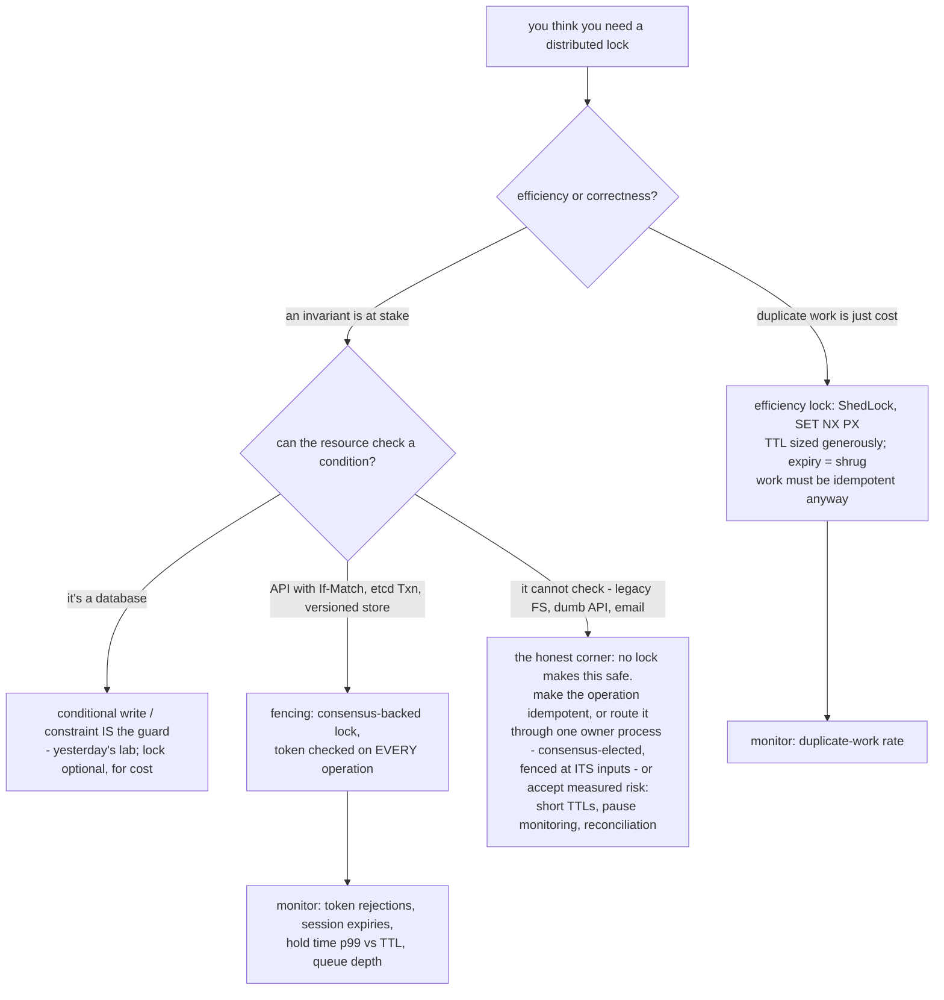
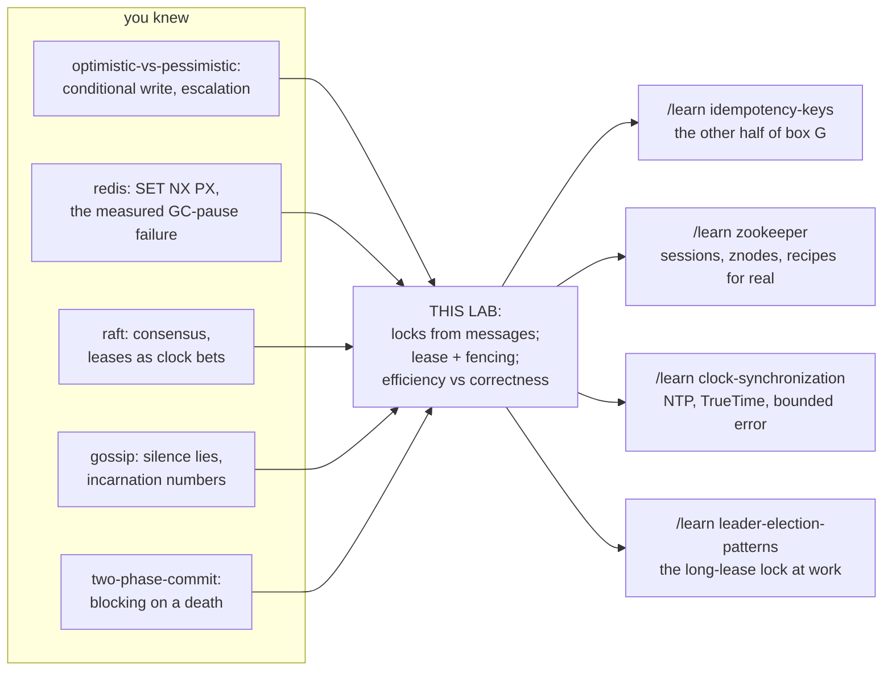

# Distributed Locking

*A learning lab. Every number in this document was produced by running the
code in `src/` (plain Java, no dependencies, fully deterministic — same
setup, same story, every run). Commands included.*

**You have met every ingredient of this lab before — but never the subject
itself.** The [redis lab](../13-redis/) *measured* the headline failure (a GC
pause outliving `SET NX PX`'s TTL put two holders in the critical section)
and named the fix "a fencing token checked by the resource" without opening
it. The [uber lab](../70-uber-system-design/) gave you leases with deadlines.
The [gossip lab](../37-gossip-protocols/) proved that judging aliveness from
silence is fragile, and gave you incarnation numbers. The
[optimistic-vs-pessimistic-locking lab](../10-optimistic-vs-pessimistic-locking/)
— this morning — gave you the conditional write. This lab assembles those
parts in the order reality forces them, and ends somewhere mildly scandalous:
**a correct "distributed lock" system turns out to be optimistic concurrency
at the resource, wearing a lock as a performance optimization.**

> Layer map: **BEGINNER** (§1–9) → **INTERMEDIATE** (§10) →
> **ENGINEERING** (§11–14) → **PRODUCTION** (§15). Checkpoints at borders.

---

## 1. WHY — one job, two machines, no shared anything

Your Spring Boot app runs the invoice job every night at 02:00. Then the
platform team scales the service to two instances. Both fire at 02:00. Every
customer gets two invoices, and some get charged twice.

Inside one JVM this is `synchronized`. Inside one database it is yesterday's
`SELECT … FOR UPDATE`. But this critical section calls a payment API, writes
files to S3, sends emails — it lives *outside* any database — and the two
competitors are separate processes on separate machines with **no shared
memory, no shared kernel, and a network between them**. Mutual exclusion has
to be manufactured out of messages. Every mechanism in this lab exists
because some part of that manufacturing failed in a way someone did not
foresee — and the failures are not exotic: crashed holders, garbage-collection
pauses, delayed packets, and clocks that jump.

## 2. PROBLEM — the darkroom key

A photography club has one darkroom with one enlarger. Two members can ruin
each other's prints by being inside at once, so the club has a rule: the
darkroom **key** hangs on a hook at the front desk. Take the key, work,
return the key. No key on the hook — you wait.

Pia takes the key at 14:00. Quinn arrives at 14:05 and waits. The system
works — *while everyone is healthy and honest about time*. This whole lab is
the story of what the front desk must invent as members start crashing,
napping, and mailing in their work.

In code, the front desk is one small server and the key is one variable:

```
acquire(client) -> yes (you hold it) | no (someone else does)
release(client) -> the key returns to the hook
```

## 3. NAIVE SOLUTION — the lock server

That two-operation server is the naive solution, and it is genuinely good:
one place decides, so there is never confusion about who holds the key.
Run the happy path — 2 clients, 3 critical sections each, interleaved:

```bash
cd 43-distributed-locking
java src/Tests.java     # first check: lock_admits_one_holder_at_a_time
```

6 sections completed, resource correct, **zero ticks with two holders**.
Mutual exclusion, manufactured. Ship it?

> **🔮 Predict:** Pia's process crashes — kernel panic, OOM-kill — while she
> holds the lock. What happens to Quinn: an error, a delay, or something
> worse?
> <details><summary>Reveal</summary>
> Something worse than either: **nothing, forever.** The key is in a dead
> process's pocket. The lock server is healthy, the network is healthy,
> Quinn retries politely — and is denied at tick 200, tick 2,000, tick
> 2,000,000. Measured (`java src/Experiments.java crash`): with no expiry,
> Quinn completes **NEVER**. Nothing is corrupted — this is a pure
> *liveness* failure, and it is the two-phase-commit blocking lesson
> wearing a padlock: any exclusive claim that only its holder can undo is
> a promise that the holder will live, and nobody can keep that promise.
> </details>

## 4. FAILURE — and the fix that creates the real problem

The front desk adopts the obvious rule: **if a keyholder is silent for 10
minutes, assume they're gone and hang up a spare key.** In code: every grant
gets a deadline; a grant past its deadline is treated as free. You already
know this object from the uber lab — a **lease**: permission with an expiry,
so that recovery needs no human. Measured recovery
(`Experiments.java crash`): the next client finishes about one TTL after the
crash, for every TTL — the TTL *is* the price of crash recovery:

```text
   TTL | other client finishes at
  none | NEVER (still stuck at t1000)
     5 | t13
    10 | t17
   100 | t107
```

> **🔮 Predict:** Pia didn't crash. She fell asleep in the darkroom armchair
> (in process terms: a 20-tick GC pause against a 10-tick TTL). The spare
> key is out; Quinn is inside working. Then Pia wakes. What does she do?
> <details><summary>Reveal</summary>
> She *continues developing her print*. She has no idea anything happened —
> **a paused process does not experience its pause**, it experiences an
> instantaneous world that changed nothing visible. Her lease expired, the
> lock server granted Quinn the lock, and there are now two people in the
> darkroom, each certain they are alone. Measured (`java src/World.java`,
> Act 3): 6 ticks with two believed holders, and the resource ends at value
> 1 after 2 completed sections — **a lost update**, the anomaly you've now
> met in four labs, manufactured this time by a lock working exactly as
> designed. This is what the redis lab measured with real Redis and a real
> GC pause; now you can watch the anatomy in slow motion.
> </details>

Three follow-up hopes die by measurement (`Experiments.java pause`, `dilemma`,
`check`):

- **"Tune the TTL."** Sweep it: short TTLs recover fast and corrupt under
  pauses; long TTLs are pause-safe and recover slowly. Every row of the
  `dilemma` table is a compromise, and the row you need — "longer than my
  longest pause" — requires a number nobody has. GC, swap, a stopped VM, a
  live-migration: unbounded. The gossip lab said it structurally: silence
  is the only evidence, and a bad day supplies unlimited silence.
- **"Heartbeat — renew the lease while working."** Renewal (measured) lets
  an *alive* holder work past the TTL safely: the TTL bounds silence, not
  total hold time. But a paused holder cannot heartbeat — **the heartbeat's
  absence is precisely why the lease expired** — so the corruption cliff
  does not move by one tick.
- **"Check before writing."** Ask the server "am I still the holder?" right
  before the write. Measured: saves the case where the pause ends *before*
  the check (0 lost, one honest redo) — and is worthless when the pause
  lands *between the check and the write* (1 lost). Check-then-act has a
  gap, and a pause can land in any gap. Any liveness answer is stale the
  moment it arrives.

## 5. THE REAL REQUIREMENT

> The safety of the system must not depend on any process being fast, any
> message being prompt, or any clock being right. Timing may decide *how
> quickly* things happen — it must never decide *whether the data is
> correct*. Which means: the last line of defense cannot live in the lock
> server or the client, because both judge by time. **The resource itself
> must be able to tell old authority from new.**

## 6. KEY IDEA — number the keys, and teach the enlarger to count

Every key the front desk hands out — original or spare — gets a **number,
one higher than the last**. And the enlarger gets a counter dial: every
request made of it carries the requester's key number; the enlarger refuses
any number *lower* than the highest it has ever seen, and remembers the
highest.

Now the sleeper's late work refuses itself: Pia holds key #33, Quinn's spare
is #34; the moment Quinn's first request touches the enlarger the dial reads
34, and Pia's request — whenever it straggles in, however long she slept,
however delayed the mail — presents #33 and bounces. No timing assumption
anywhere in that sentence. The lock still *schedules* (it keeps collisions
rare); the dial *guarantees* (it makes the surviving collisions harmless).
The whatsapp lab's phrasing transfers exactly: the queue was the guarantee
and the push a latency optimization — here **the token check is the
guarantee, and the lock is a duplicate-work optimization.**

## 7. TERMINOLOGY

**Distributed lock** — a mutual-exclusion claim between processes that share
no memory, built from messages to a lock service. *Why the term*: to
distinguish it from in-process locks, whose failure modes (a crashed holder
releases automatically — the OS cleans up) it conspicuously lacks.

**Lock service** — the process(es) holding the authoritative "who holds
what" state. The front desk. Sometimes a database table, sometimes Redis,
sometimes a consensus cluster (§10.6).

**Critical section** — the work done while believing you hold the lock. The
word "believing" is doing heavy lifting; most of this lab lives in it.

**Lease** *(refresher — uber lab)* — permission with an expiry. Every sane
distributed lock is a lease; an expiry-free lock is a suicide pact with
your least reliable process. **TTL** — the lease length: the maximum time
the system stays stuck after a crash, and simultaneously the minimum pause
that turns a live holder into a stale one. One number, two jobs, opposed.

**Renewal / heartbeat** — extending a live lease from within, conditionally
("compare-and-extend": only for the current holder). Lets honest long work
exceed the TTL, so the TTL can be short. Bounds silence, not hold time.

**Stale holder** — a client acting on a lease that has expired without its
knowledge. Not a rogue, not a bug — a *victim of timing* running correct
code. The pause, the swap-storm, the delayed packet all manufacture one.

**Fencing token** — the load-bearing term of this lab, finally getting its
full treatment after cameos in five labs. *Plain meaning*: the key's serial
number. *Technical meaning*: a **strictly monotonically increasing** number
issued with every grant of the lease, presented on every operation against
the protected resource, where any operation carrying a lower number than
the highest seen is rejected. *Why it exists*: it converts "who holds the
lock?" (a timing question, unanswerable safely) into "which authority is
newer?" (an arithmetic question, answerable atomically at the resource).
*Example*: Pia's #33 write bounces off a dial reading 34. *Connections*:
it is gossip's **incarnation number** (only newer speaks), event-sourcing's
**expected-version** (refuse the stale write), uber's **offer id**, and —
the unification §10.5 makes precise — the previous lab's **conditional
write**. Google's Chubby paper calls it a **sequencer**; that was its first
production name.

**Split-brain** *(refresher — raft)* — two parties simultaneously believing
they hold an exclusive role. The lab measures it directly as `overlapTicks`
(ticks with ≥2 believed holders). Fencing does not prevent it; fencing
makes it *harmless* — hold that thought for §12.

**Check-then-act gap** — the interval between learning a fact and acting on
it, in which the fact can die. §4's defensive check; also every "if lease
still valid then write" you will ever be tempted to write.

**Herd effect** — N waiters all waking (or all polling) for one freed lock.
**Watch** — the fix: the service notifies exactly the next waiter. Numbers
in §14.

**Efficiency lock vs correctness lock** *(Kleppmann's distinction)* — is the
lock there to *avoid wasted duplicate work* (efficiency: a TTL expiry costs
a shrug) or to *protect an invariant* (correctness: a TTL expiry costs
money)? The first question to ask of any lock in any design review, because
it decides whether the TTL cliff is acceptable or fatal. §14's `efficiency`
experiment runs the same faults under both readings.

Minor terms defined at first use; all terms land in the glossary (§18).

## 8. MENTAL MODELS

**Simple model — the darkroom.** The key on the hook (the lock), the
10-minutes-of-silence spare-key rule (the lease), the sleeping member (the
pause), the numbered keys and the enlarger's refuse-lower-numbers dial (the
fencing token). Carry this picture; it survives contact with the real
systems.

**Engineering model.** Three state machines and a wire. Lock server:
`{holder, token, expiresAt}` with grant-if-free-or-expired, token++ on
*every* grant. Client: acquire → read → work → write → release, pausable at
any point, always acting on possibly-stale beliefs. Resource:
`{value, maxToken}`, refusing any operation with `token < maxToken`.
Messages between them take time and can arrive after the world that sent
them has ended. Invariant that holds: writes accepted by the resource are
totally ordered by token, and no accepted write is based on authority older
than an already-exercised newer authority. Invariant that does NOT hold:
one believed holder at a time.

| darkroom | engineering |
|---|---|
| key on the hook | `holder == null` |
| taking the key | `acquire()` → grant, token++ |
| 10 minutes of silence → spare key | `now >= expiresAt` → re-grant |
| the sleeping member | a paused process (it never experiences the pause) |
| key serial number | fencing token |
| enlarger's counter dial | `resource.maxToken` |
| dial refuses lower numbers | reject `token < maxToken`, atomically |

**Where the analogy breaks.** (1) The enlarger check is atomic because it's
a machine; the *front desk's* spare-key decision is not knowledge but a
guess — silence from a sleeper and silence from a corpse are the same
silence, and no rule at the desk can tell them apart (the gossip lab
measured a whole cluster burying itself over exactly this). (2) A physical
key can't arrive twice — a *message* can: a write mailed before the sleep
can arrive after the spare key has been used, which is why the dial must be
consulted on **every** operation, not just guarded at the door. (3) Humans
would notice another person in the darkroom; processes have no peripheral
vision — mutual exclusion that depends on noticing is already dead.

## 9. VISUALIZATION — watch the spare key ruin a print

Open **[visualization.html](visualization.html)** (published copy:
<https://claude.ai/code/artifact/8e3561c0-8249-45dd-9b04-52ab6e0f5faa>). It
plays clients against one lock service and one resource, with every rule a
control: TTL length, fencing on/off (and the write-only variant), renewal,
watch-vs-poll, per-client work time — plus a **"pause this client"** button
(the star of the page) and a crash button. The lock's lease bar counts
down on screen; every client card shows what that client *believes*; the
resource shows its value, its token dial, and every accept/reject with the
reason in a full sentence. Six predict-then-run scenarios mirror this
document, including the in-flight-write race (§10.4) and the herd. Step
◀ ▶ replays any moment.

## 10. ACTUAL MECHANISM — five versions, four scars

> **CHECKPOINT — beginner → intermediate.** You can explain why a naked
> lock blocks forever, why a lease corrupts under pauses, and what the
> token is for. Next: the exact rules, traced tick by tick, and the two
> refinements people miss — one of which this lab itself missed at first.

Run the whole arc narrated: `java src/World.java` (four acts, every line a
full sentence with tick numbers).

### 10.1 v1 — grant and release ([World.java:69-85](src/World.java#L69-L85))

Grant if free. Release only by the holder. Act 1's trace shows the scar
being earned: `Pia CRASHES holding the lock` … 40 ticks of silence …
`Quinn completed 0 of 1`. Forever is spelled: nothing left to happen.

### 10.2 v2 — the lease ([World.java:62](src/World.java#L62): `free()`)

One added clause: a grant past `expiresAt` counts as free. Act 2:
`t011 S1: lease of C1 (token 1) has EXPIRED — granting to C2`. Recovery
without humans. Act 3 shows the price: the same line printed *while Pia is
alive and paused*, then `t027 RESOURCE: accepted write value=1 from Pia` —
value 1 after two completed sections. The server's grant was *correct by
its rules*; the rules judge by time, and time lied.

Two rules in v2 that look pedantic and are load-bearing:

- **`token++` on every grant, including expiry-takeovers** — planted bug
  `token-reused-on-expiry` grants the spare key with the *old* number
  ("same lease, new tenant"), and fencing silently dies: both holders carry
  the same token, the dial can't order them, corruption returns *with
  fencing on* (`Tests.java broken`: 1/2 survive).
- **Renewal is compare-and-extend, never a plain overwrite** — `renew()`
  checks holder *and* token *and* non-expiry. The Redis anti-pattern
  (renewing with a bare `SET k me PX ttl`) is a lock theft primitive.

### 10.3 v3 — fencing at the resource ([World.java:142-166](src/World.java#L142-L166))

The resource keeps `maxToken`; a write with `token < maxToken` is refused.
Act 4's trace, the moment the whole lab has been building to:

```text
t027  RESOURCE: REJECTED write value=1 from Pia (token 1 is older than 2 already seen)
t027  Pia learns its write was rejected — its lease was stale. It must re-acquire and redo the work.
t033  RESOURCE: accepted write value=2 from Pia (token 3)
```

Nothing lost; the late writer paid with a redo. Note what the rejection also
buys that *no* liveness check could: `delayed_write_from_a_dead_holder_is_fenced_off`
sends a write, kills the sender, and delivers the packet 40 ticks later into
the next holder's world — refused by arithmetic. Without fencing, the same
ghost packet lands *last* and quietly rolls the value backwards.

### 10.4 v3.5 — fence the reads too (the bug this lab found in itself)

> **🔮 Predict:** TTL 30. Pia's pause is only 25 ticks — *shorter than the
> TTL*. Fencing is on (writes checked). Safe?
> <details><summary>Reveal</summary>
> No — and this row of the `pause` sweep is the finest print in the lab.
> Pia's *hold* is not her pause: acquire + work + pause + remaining work +
> **the write's travel time** crossed the 30-tick expiry by one tick. Her
> write was already *in flight* when Quinn was granted the lock; Quinn
> **read** the value before the old write landed; then both writes arrived
> carrying valid, *increasing* tokens — and were both accepted, in perfect
> token order, having together lost an update. Write-only fencing ordered
> the writes; nothing ordered Quinn's read against Pia's write. The fix:
> **every operation carries the token, reads included** — a fenced read
> raises the dial, so the older in-flight write bounces. Chubby's
> sequencers work exactly this way (checked on every request), and this is
> planted bug #4 (`write-only fencing`): pause < TTL, fencing "on", 1/2
> survive, zero rejections — the most invisible failure in the lab.
> </details>

### 10.5 The unification — you built this yesterday

Look at the resource's rule with yesterday's eyes: *an operation carries
evidence of what authority it was issued under, and the resource applies it
only if no newer authority has been exercised* — *check and act in one
atomic step at the data*. That is a **conditional write**. The fencing
token is optimistic locking's version column, issued by a lock service
instead of read from a row; `WHERE token >= ?` instead of
`WHERE version = ?`. Same primitive, fifth costume (expected-version,
`WATCH`, `If-Match`, `@Version`, and now this). Which triggers the awkward
question: **if the resource can check conditions, why lock at all?** Run
`Experiments.java efficiency` for the honest answer: under identical
faults, the lock's overlaps are *corruption* if they touch an invariant and
a *shrug* if the work is idempotent — so the guarantee must live at the
resource either way, and what the lock buys is **not doing the work twice**.
A correctness lock is optimistic concurrency plus a pessimistic hint;
an efficiency lock is just the hint. (This is Kleppmann's conclusion in
*How to do distributed locking*, reached here by measurement.)

### 10.6 v4 — who locks the lock server?

One front desk is a single point of failure (its crash = everyone blocked
until restart; its *restart* is planted bug #2: an in-memory token counter
reborn at 0 fences off every legitimate new writer until it climbs back —
safety intact, availability gone, which is why **the token counter must be
durable and monotonic across restarts**). Two ways out:

- **N independent servers, majority acquisition** — the **Redlock** shape,
  measured in `Experiments.java redlock`. The availability works (2 of 5
  unreachable, still locks). But a client pause corrupts exactly as before
  — five servers agreed, the pause didn't ask them — and Redlock's leases
  carry no token the resource could check. Worse: one server's *clock jump*
  (NTP step, VM migration) expires a lease early, and two clients assemble
  overlapping majorities — `Pia holds {S1,S2,S3}, Quinn assembles
  {S1,S4,S5}`, 6 overlap ticks, 1 lost update. Safety was resting on a
  wall clock. This measured pair *is* the Kleppmann–antirez debate: the
  defense ("pauses are rare, bound your clocks") is an *engineering bet*;
  the critique ("safety must not rest on timing, and there's no fencing")
  is §5 verbatim. You now hold both positions with numbers.
- **One *logical* front desk, replicated by consensus** — a raft/paxos
  cluster (your raft lab: elections, majorities, terms) storing the lock
  state. The service survives minority failure, and — decisive — its log
  index / revision is a ready-made, durable, monotonic **fencing token**:
  ZooKeeper's zxid, etcd's revision, Chubby's sequencer. This is why the
  standard answer to "correctness lock" is ZooKeeper/etcd, never plain
  Redis: not because consensus makes clients pause-proof (nothing does),
  but because it makes the *service* honest and the *token* trustworthy.

## 11. FAILURE SCENARIOS

> **CHECKPOINT — intermediate → engineering.** You know the mechanism and
> its two non-obvious refinements. Now: every failure, created, watched,
> and tied to the guarantee it bends.

**a. Holder crash.** *Create*: `a.crashed = true`. *Watch*:
`Experiments.java crash`. No TTL: liveness lost permanently, safety
trivially intact. TTL: liveness restored in ~TTL; safety untouched *by the
crash* (a dead client sends no stale writes — except the ghost packet, see
d). *Production*: this is why every real lock is a lease; the TTL is your
declared crash-recovery SLO.

**b. GC pause / stall.** *Create*: `pauses.add(...)`. *Watch*: `pause`,
`World.java` Act 3. Pause > TTL: split-brain (overlapTicks > 0), lost
update without fencing, clean rejection + redo with it. *Guarantee lost
without fencing*: the invariant. *With fencing*: only the stale holder's
time. *Production*: this is the redis lab's measured Redis failure; JVM
users hit it with old collectors, hostile heaps, or swap; the modern
low-pause collectors shrink it and cannot bound it.

**c. The check-then-act gap.** *Create*: pause phase `after-check`.
*Watch*: `check`. A truthful server answer, dead on arrival. *Lesson*:
liveness checks are UX (fail fast, redo early — the mid-work variant saved
a redo), never safety.

**d. The ghost packet.** *Create*: `writeDelay = 40`, kill the sender.
*Watch*: test `delayed_write_from_a_dead_holder_is_fenced_off`. Without
fencing the last arrival wins and it is a message from the past. The
network is a time machine; only the resource's dial is not fooled.

**e. Lock-service restart with amnesia.** *Create*: `bugTokenRestart`.
*Watch*: `Tests.java broken`. Counter reborn at 0 → every legitimate new
writer rejected until it catches up. Safety kept, availability lost — the
mirror image of every other failure here, and the reason etcd/ZooKeeper
tokens are positions in a *durable replicated log*.

**f. Clock jump at the service.** *Create*: `clockOffset = 100` on one of
five Redlock servers. *Watch*: `redlock`. Overlapping majorities.
*Production*: NTP steps and VM migrations are routine; any lease math done
on wall clocks inherits them (raft's lease-read caveat, same root).

**g. The herd.** *Create*: 20 waiters polling every tick. *Watch*: `herd` —
2,740 messages where a watch queue spends 99, same completion time, plus
FIFO handover. *Production*: ZooKeeper's sequential-ephemeral recipe exists
precisely to wake only the next waiter; a naive poll loop is a self-inflicted
DDoS on your own lock service at the worst moment (right after something
broke).

**h. The read race.** §10.4. The one that gets code-reviewed in, because
"we fence our writes" sounds complete. Pause < TTL, zero rejections, data
gone.

## 12. CORRECTNESS — what is actually guaranteed

| design | after a crash | under any pause/delay | split-brain possible? | corruption possible? |
|---|---|---|---|---|
| lock, no TTL | blocked forever | safe (nothing expires) | no | no |
| lease (TTL) | recovers in ~TTL | **corrupts** past the cliff | yes | yes |
| + renewal | recovers in ~TTL | cliff unmoved (can't renew while paused) | yes | yes |
| + defensive check | recovers | gap remains | yes | yes |
| + fencing, writes only | recovers | read race remains (§10.4) | yes | yes (silently) |
| + fencing, all operations | recovers in ~TTL | **safe** — stale effects refused | **yes** | **no** |

Read the last row carefully, because it says the honest thing most
descriptions blur: **fencing does not restore mutual exclusion.** Two
believed holders still happen (split-brain, measured every time). What
fencing guarantees is *at-most-one-effect lineage*: the resource applies
operations in token order and refuses everything from superseded authority
— overlap becomes harmless instead of impossible. Safety now rests on one
atomic comparison at the data and on token monotonicity (durable counter,
bumped every grant) — **zero timing assumptions**. Liveness still rests
entirely on timing (the TTL) — and must, because distinguishing slow from
dead by silence is impossible in principle; you can only choose how long to
wait. Safety by arithmetic, liveness by timeout, never the reverse: that
division is the whole design.

Still not guaranteed, same as yesterday: nothing binds a writer that talks
to the resource *outside* the token protocol; fairness (a poller can starve
— the watch queue is FIFO, polling is not); and the lock protects only
resources that *can* check. §15 faces that last one squarely.

## 13. CODE — the toy, and what your stack calls each piece

[World.java](src/World.java) is ~330 lines; the load-bearing ones:
`token++` on every grant ([acquire](src/World.java#L69)), compare-and-extend
[renew](src/World.java#L87), the read fence [observeRead](src/World.java#L138),
and the one comparison that is the entire guarantee
([write](src/World.java#L142)). Everything else is plumbing for breaking them.

| this lab | production spelling |
|---|---|
| lock service, single server | Redis `SET key holder NX PX ttl` (release/renew via Lua compare — never plain SET/DEL) |
| lock service, consensus-backed | ZooKeeper ephemeral znode (Curator `InterProcessMutex`) · etcd lease + key · Chubby |
| lease + TTL | Redis PX · etcd `LeaseGrant(ttl)` · ZK session timeout · K8s `Lease` object |
| renewal heartbeat | etcd `KeepAlive` · Redisson watchdog · ZK session pings · K8s `renewTime` |
| fencing token | ZK zxid/czxid · etcd `mod_revision` · Chubby *sequencer* · DynamoDB lock-client RVN |
| resource checks the token | etcd `Txn(Compare(mod_revision), Then(put))` · your DB: `WHERE token >= ?` — yesterday's conditional write |
| watch queue (no herd) | ZK sequential ephemerals, watch the *previous* node · etcd watch on prev revision |
| leader election | the same lock held long: K8s `leaderelection` pkg, ZK recipe, etcd `Campaign` — plus fencing on every side-effect, because a deposed leader is just a stale holder with a bigger job |
| `Experiments.java efficiency` | **ShedLock** (`@SchedulerLock` on `@Scheduled`) — explicitly an efficiency lock: its own docs disclaim correctness. Perfect for "don't send the newsletter twice"; wrong, alone, for "don't pay the invoice twice" |
| Postgres as lock service | `pg_advisory_xact_lock` — and note the special case: if the protected work is *in the same transaction*, the lock's release and the work's commit are atomic, which quietly deletes the stale-holder problem. Work outside the DB reopens it |

Spring-shaped warnings, mirror-images of the planted bugs: Redisson's
`RLock` gives you TTL + watchdog renewal but **no fencing token** — using it
as a correctness lock is §4 with better marketing; ShedLock's `lockAtMostFor`
too short is the pause cliff configured on purpose; and any hand-rolled
"extend my Redis lock" that isn't a compare-and-extend Lua script is the
renewal theft from §10.2.

## 14. EXPERIMENTS

```bash
java src/World.java                # the four-act narrated story
java src/Tests.java                # 14 scenario checks
java src/Tests.java broken         # 4 planted bugs, each caught
java src/Experiments.java          # all 7 measurements (~1s)
java src/Experiments.java pause    # or any one by name
```

Predict before each; headline numbers from this machine: `crash` — no TTL
never recovers, TTL recovers in ~TTL, every value. `pause` — TTL 30: 0 lost
below the cliff, 1 at P=25 (**below** the TTL — the in-flight write), 8 at
P=90; renewal identical; fencing 0 everywhere with 1 rejection. `dilemma` —
every TTL row a compromise. `check` — saved / worthless, by pause phase.
`herd` — 20 waiters: 2,740 poll messages vs 99 watch messages. `redlock` —
availability yes; pause: 1 lost; clock jump: overlapping majorities, 1
lost. `efficiency` — 2 overlaps: corruption in job A, shrug in job B.

## 15. PRODUCTION

> **CHECKPOINT — engineering → production.** You can build, break, and fix
> the mechanism. Left: choosing, operating, and the uncomfortable cases.

**The decision procedure:**



The box people avoid is G. An email cannot be un-sent and cannot check a
token; no lock — Redis, ZooKeeper, or carved in stone — makes "send exactly
one email" true on an asynchronous network. Real systems shrink the blast
radius (idempotency keys at the provider, an outbox with a single fenced
drainer, reconciliation jobs) and then *measure* the residual. Saying "the
lock guarantees it" in that design review is how double payouts happen.

**Operations.** What the on-call sees, by failure: lock service down =
everything queues (availability, loud). Sessions expiring in bursts = GC or
network trouble at *clients* — and every expiry is a potential stale holder:
alert on `hold time p99` approaching TTL long before corruption. Token
rejections > 0 = fencing is *working*; investigate the pauses it caught.
Herd symptoms = connection spikes at the service on every release. ZK/etcd
specifics: watch `session_expired` vs `connection_loss` (Curator treats them
differently for good reason — a connection loss might still be the holder;
an expiry definitely is not), and never do lock bookkeeping on wall clocks.

**What this toy omits, and who handles it.** Real partitions (client↔lock
vs client↔resource can fail *independently* — the toy's wire only delays
writes; real systems face a client that can reach the resource but not
renew, exactly when fencing earns its keep). Consensus internals (raft lab
has them; etcd/ZK are that plus a lock API). Durable storage at the
resource. Sessions multiplexing many locks (ZK/Chubby: one heartbeat, many
claims — cheaper, and one session expiry drops them all, a coarser blast
radius chosen deliberately; Chubby further adds a *lock-delay* — a grace
period before a broken session's locks free — as a belt against
non-fencing-capable clients). Reentrancy, read-write locks, fairness
policies, security. And scale: a lock service is a *coarse-grained,
low-throughput* tool (Chubby's stated design point); locking per-row at
high rate is yesterday's lab's job, inside the database.

## 16. EXERCISES

[EXERCISES.md](EXERCISES.md) — eight rungs. Rung 5 is
[src/YourLock.java](src/YourLock.java) (implement the grant rule and the
fencing rule; starts 2/6, self-checking). Rung 6 debugs the four planted
bugs. Answers in [SOLUTIONS.md](SOLUTIONS.md) — attempt first.

## 17. KNOWLEDGE MAP & NEXT STEPS



**Commonly confused, one sentence each.** *A distributed lock vs a database
row lock*: the row lock's holder is a transaction the database itself kills
on disconnect — holder death is solved by construction, which is exactly
the property a network lock loses. *Fencing vs preventing split-brain*:
fencing permits two believers and disarms the stale one; consensus
leadership (raft) prevents two *commits*, not two believers either — the
same shape one level down. *Redlock vs consensus*: majority *acquisition*
is not majority *agreement* — Redlock's servers never talk to each other,
so nothing reconciles their divergent clocks; raft's do, about every entry.
*Lease vs lock*: every distributed "lock" you will ever use is a lease;
the word "lock" is nostalgia for the single-machine case.

## 18. GLOSSARY (in order of appearance)

| term | one line |
|---|---|
| distributed lock | mutual exclusion between processes that share nothing, built from messages |
| lock service | the authority that says who holds what |
| critical section | work done while *believing* you hold the lock |
| lease | permission with an expiry — the only sane form of a distributed lock |
| TTL | lease length: crash-recovery time and pause-tolerance limit, one number, opposed jobs |
| renewal / heartbeat | compare-and-extend by the live holder; bounds silence, not hold time |
| stale holder | a correct process acting on an expired lease it cannot know about |
| split-brain | ≥2 simultaneous believed holders (measured here as overlapTicks) |
| lost update | the corruption a stale holder's write inflicts (fourth lab running) |
| fencing token | monotonically increasing grant number, checked on EVERY resource operation, lower-than-seen refused |
| sequencer | Chubby's original name for the fencing token |
| check-then-act gap | the interval between learning a fact and acting, where the fact dies |
| ghost packet | a write in flight from an already-ended authority |
| read fence | a read that raises the resource's token floor — the fix for the in-flight-write race |
| herd effect | all waiters waking/polling for one freed lock |
| watch | the service notifies exactly the next waiter (FIFO, one message) |
| Redlock | majority acquisition over independent servers; no fencing, safety rests on timing |
| clock jump | wall-clock discontinuity (NTP step, VM migration) that ends leases early |
| efficiency lock | prevents duplicate *cost*; expiry is a shrug (ShedLock) |
| correctness lock | protects an invariant; needs fencing at the resource or it is a bet |
| ephemeral node / session | ZK's lease: one heartbeat carrying many claims, dying together |
| lock-delay | Chubby's grace period before a broken session's locks free |
| advisory lock | a lock only cooperating code observes (Postgres `pg_advisory_*`) |
| leader election | the same lock held long, plus fencing on every side-effect |
