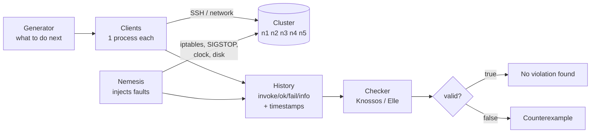
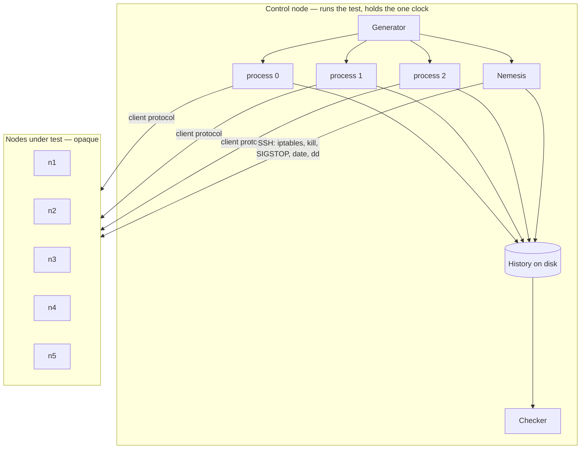
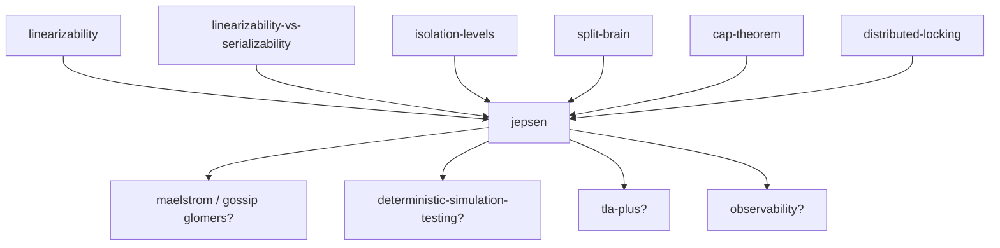

# Jepsen

> **What this lab is.** You have spent a dozen labs learning what the words on a
> database's marketing page are *supposed* to mean — linearizable, serializable,
> majority, no data loss. This lab is about the opposite direction: given a
> running system and a claim, **how do you catch it lying?** Jepsen is the answer
> the industry converged on, and it is stranger and more interesting than
> "a test suite for databases".
>
> **Open the simulator:**
> ```
> open visualization.html
> ```
>
> This is a **no-code lab**: a teaching document, an interactive checker, and
> exercises. There is nothing to compile.

> **⚠️ This lab exists because of the last line of your last one.**
> The [linearizability-vs-serializability](../27-linearizability-vs-serializability/)
> lab ended with `Next: [jepsen?] (Elle finds F1–F5 in the wild)`. You now own
> precise definitions of linearizability, serializability, strict
> serializability, and a ten-anomaly ladder. Every one of those is a claim
> *about a system you do not control*. This lab is the machine that turns those
> definitions into verdicts about real software — and, more importantly, teaches
> you why the obvious way to build such a machine produces a test that is
> confidently, quietly wrong.

---

## How deep this goes

| Layer | Sections | You will be able to… |
|---|---|---|
| **Beginner model** | 1–7 | say what Jepsen actually does, and why "assert the final answer is right" is not a safety test |
| **Intermediate model** | 8–13 | read a history in Jepsen's notation, run a linearizability check by hand, and explain the indeterminate operation |
| **Engineering model** | 14–18 | describe every component of a Jepsen test, choose faults on purpose, and explain Elle's cycle detection |
| **Production model** | 19–22 | read a real Jepsen report and know exactly what it does and does not claim; decide whether to run this against your own system |

---

# 1 · WHY — the sentence you cannot check

Open any distributed database's documentation and you will find a sentence like
one of these:

> "Transactions are fully ACID and serializable."
>
> "Reads with `readConcern: majority` never return data that could be rolled
> back."
>
> "Acknowledged writes are never lost."

Each of those is a **claim about behaviour under failure**. Not under normal
operation — under normal operation almost everything works. The claim is about
what happens when a switch reboots, a leader's process is stopped for nine
seconds by a garbage collection pause, a disk lies about `fsync`, or a clock
jumps backwards.

Here is the uncomfortable fact that motivates this entire field:

> **Those sentences are frequently false, and they are false in systems written
> by careful people, reviewed by good engineers, and used in production by
> companies you have heard of.**

Not because the authors are dishonest. Because the property is very hard to
implement, and — this is the part that matters — **very hard to test.** A bug
that only appears when a network partition heals during a leader election, on
the third of five nodes, while a client is retrying, is not going to be found by
a unit test.

So the question this lab answers is not "what is serializability". You know
that. The question is:

> **Given a running cluster and a claimed guarantee, what procedure produces
> evidence that the guarantee is broken?**

The answer, developed by Kyle Kingsbury from 2013 onward and now the de facto
standard, is called **Jepsen**.

---

# 2 · THE CONCRETE PROBLEM — you are about to bet a ledger on FerrousDB

Let us make this specific.

> *FerrousDB is fictional. It is a stand-in for a real product so that we can be
> rude about it. Every failure it exhibits in this lab is modelled on a
> documented, published finding in a real system; those are named in section 18.*

You work on payments. You need a store for the ledger. **FerrousDB** is fast,
has a good client library, and its documentation says:

> *FerrousDB provides linearizable reads and writes for single keys when
> `consistency=strong` is set. Acknowledged writes survive the failure of any
> minority of nodes.*

You have three nodes: `n1`, `n2`, `n3`. You have four client processes hammering
it. Before you commit the company to this, you want to check the claim.

**What do you do?**

Hold that question for a moment, because the first answer everybody gives is
wrong, and understanding *why* it is wrong is most of this lab.

---

# 3 · THE OBVIOUS SOLUTION — assert the final answer

Here is what a good engineer writes first. It is not a straw man; it is what I
would write, and probably what you would write.

```
# Pseudocode. Illustrative only — this lab has no runnable code.
set x = 0
run 8 threads for 60 seconds:
    each thread does 100 increments:  read x, then write x+1
assert x == 800
```

This is a **stateful assertion test**. It is a completely reasonable instinct:
do a lot of work, then check the arithmetic at the end.

Run it against FerrousDB. It passes. `x == 800`.

Run it a hundred times. It passes a hundred times.

You ship.

Six weeks later a customer's balance is wrong.

**🔮 Predict:** Before reading on — name at least two distinct reasons this test
could pass a hundred times against a database that violates its linearizability
claim. Not "it got lucky". Structural reasons.

---

# 4 · FAILURE — three separate reasons the final-state check is blind

<details>
<summary><b>Reveal</b></summary>

**Reason 1: nothing bad ever happened, because nothing bad was ever attempted.**

The test ran against a healthy cluster. No node died. No cable was cut. No
process was paused. The claim you wanted to check — *"acknowledged writes
survive the failure of any minority"* — was never put under any stress at all.
You tested the happy path and concluded something about the unhappy one.

**Reason 2: the final state is a terrible detector, because errors cancel.**

Suppose two increments were lost, and separately, one increment was applied
twice due to an internal retry. Final value: 799 + ... it depends. Errors in
opposite directions cancel. Worse, some anomalies *leave no trace in the final
state at all*: a **stale read** — a client seeing yesterday's value — corrupts a
decision that client made, then vanishes. The final number is perfect. The
customer's balance is not.

This is the single most important structural point:

> **Many correctness violations are events in the middle of the run that leave
> the final state completely normal.** If you only look at the end, you are
> looking at the one place the evidence isn't.

**Reason 3: `x == 800` is the wrong question.**

Think about what `assert x == 800` actually encodes. It encodes: *"I expected
this exact outcome."* But a correct concurrent system has **many** legal
outcomes. And an incorrect one can produce a legal-looking outcome. Equality
against a predicted value only works when the answer is deterministic — which is
precisely what a distributed system under load is not.

So you cannot assert on the *answer*. You have to judge the *behaviour*.

</details>

---

# 5 · ATTEMPT TWO — inject faults, and immediately drown

Reason 1 has an obvious fix. **Break things while the test runs.**

Add a background process that, every 15 seconds, cuts the network in half for a
while, then heals it. Now you are actually exercising the claim.

Run the test.

It fails instantly, and not in the way you hoped:

```
thread 3: java.net.SocketTimeoutException: Read timed out
thread 5: FerrousException: not the leader, try again
thread 1: java.io.IOException: Connection reset by peer
thread 7: FerrousException: no quorum available
```

And now you are stuck, because you have to answer a question that sounds
trivial and is not:

> **Which of these is a bug?**

Think it through. A `SocketTimeoutException` during a network partition is
*correct behaviour*. The database is supposed to become unavailable to a
minority — the [cap-theorem](../24-cap-theorem/) lab settled that. Refusing to
serve is the *good* outcome. If you treat errors as failures, your test reports
a catastrophe every single run, you stop believing it, and you delete it.

But you also cannot ignore errors, because some of them are hiding real damage.

The instinct now is to write a big list of "acceptable exceptions". That way
lies madness — it makes your test's verdict depend on your guesses about which
error strings are benign, and a database's error taxonomy is not a safety
specification.

The real lesson is that you have been asking the wrong kind of question all
along.

---

# 6 · THE THING NOBODY EXPECTS — the operation that neither succeeded nor failed

Stare at this line for a moment:

```
thread 3: java.net.SocketTimeoutException: Read timed out
```

Thread 3 sent a write. It waited. It got nothing back.

**Did the write happen?**

You do not know. And here is the crucial part — **you cannot ever find out**.
The request may have been dropped on the way out (no effect). It may have been
applied and the response lost on the way back (full effect). It may be sitting
in a queue on `n2` right now and will be applied in eight seconds (effect, but
later). Every one of those is consistent with everything you observed.

This is not a gap in your tooling. It is the fundamental condition of talking to
another machine over a network, and it is the same fact that forced
[idempotency](../49-idempotency/) keys to exist and made the
[two-phase-commit](../45-two-phase-commit/) coordinator's silence so expensive.

Jepsen's founding insight is to take this seriously and give it a name and a
place in the data model:

> Every operation has **three** possible outcomes, not two:
>
> - **`:ok`** — it definitely happened. It has a logical effect on the system.
> - **`:fail`** — it definitely did not happen. It has **no** logical effect.
> - **`:info`** — **indeterminate.** It may or may not have happened, now or at
>   any point in the future.

Those are the actual keywords in Jepsen. From the Jepsen documentation:

> *`:invoke` denotes the start of a logical operation; `:ok` denotes its
> successful completion. `:fail` denotes its definite failure… An operation
> which completes with `:fail` must have no logical effect on the system.
> `:info` denotes an indeterminate result: the operation either may or may not
> have completed.*

Almost every home-grown consistency test in the world gets this wrong, in one
of two directions, and the two directions fail differently:

| Mistake | What it does to the judgement | Consequence |
|---|---|---|
| **Over-claiming** — recording an indeterminate op as `:ok` or `:fail` | The checker is given a *fact* that isn't one | **False alarms.** You report bugs that aren't there, lose credibility, and stop trusting the test |
| **Under-claiming** — recording a *definite* failure as `:info` because it was easier | The checker loses a constraint it was entitled to | **Missed bugs.** The test goes green over a real violation |

The second one is the dangerous one, because it looks responsible. "I wasn't
sure, so I marked it unknown" feels like humility. It is actually **throwing
away evidence**, and a checker with less evidence finds fewer violations.

> **Section 12 makes this concrete, and the simulator lets you watch the same
> history get three different verdicts depending on how `:info` is read.** If
> you take one thing from this lab, take this one.

There is a second consequence of indeterminacy, and it is a rule people find
surprising the first time:

> **A process that gets an `:info` is retired forever.** Jepsen never issues
> another operation on that process ID.

Why? Because that operation *might still be in flight*. If the same process
issued a new write, and the old one landed afterwards, the history would contain
two overlapping operations from a "single-threaded" process — which breaks the
one modelling assumption the checker depends on. So Jepsen burns the process
number and starts a fresh one on the same thread. From the docs: *"Processes are
logically singlethreaded… If a process crashes it can never invoke an operation
again."*

That single rule tells you a lot about how seriously this framework takes
uncertainty.

---

# 7 · THE REAL REQUIREMENT

Let us now state plainly what we actually need, having watched two attempts
fail.

We cannot assert on final state (section 4). We cannot classify errors as
pass/fail (section 5). We cannot even say for sure whether individual operations
occurred (section 6).

What we *can* do is **write down exactly what we observed**, including our
uncertainty, and then ask a question with a yes/no answer:

> **Is there any way this system could have behaved like the thing it claims to
> be, and produced everything we saw?**
>
> If **yes** → we found no evidence of a bug. That is all it means.
> If **no** → the claim is false, and we hold the proof.

This is the whole idea. Three things follow from it, and they are the three
pillars of Jepsen:

1. **Record, do not assert.** The output of a run is a *history*, not a
   pass/fail.
2. **Judge afterwards, against a model.** Correctness is decided by searching
   for an explanation, not by comparing to an expected value.
3. **The evidence is a counterexample.** A failure is not "assertion failed on
   line 42"; it is a concrete list of operations that no correct system could
   have produced.

That third point is why Jepsen reports are so persuasive and why vendors
generally fix the bugs. You cannot argue with a history.

> **✅ Checkpoint.** You can now explain what Jepsen is *for* and why the two
> obvious designs fail. Next we make "history" and "explanation" precise enough
> to compute with — after which you will run a check by hand.

---

# 8 · TERMINOLOGY — the five words the rest of this lab uses

These are earned now; each solves a problem you just watched appear.

### Operation

A single request from a single client, recorded as **two entries** in the log:
an **invocation** and a **completion**. Not one entry — two. Because the thing
that matters is that an operation occupies an *interval of time*, and both ends
of that interval are constraints.

In Jepsen's notation:

```clojure
{:process 3, :type :invoke, :f :write, :value 1,   :time 1042}
{:process 3, :type :ok,     :f :write, :value 1,   :time 1187}
```

`:f` is which function (`:read`, `:write`, `:cas`, `:txn`), `:value` is the
argument or result, `:process` is the logical client, `:time` is nanoseconds
since the run started.

### History

The complete, time-ordered log of every invocation and completion from every
process in one run. **This is the artefact of a Jepsen run.** It is written to
disk. It is the thing that gets attached to the bug report.

### Process

A logical single-threaded client. Only one operation in flight at a time.
Retired permanently on `:info` (section 6).

### Consistency model

The thing the history is judged *against*: linearizability, serializable
snapshot isolation, "a set that never loses elements", and so on. You already
own these definitions. Jepsen adds no new ones — it consumes yours.

### Checker

A program that takes a history and a consistency model, and returns either
`valid? true` or a **counterexample**.

Note what the checker does **not** get: it does not get to see inside the
database. No internal logs, no replica state, no timestamps from the servers.
Only what a client could observe. This is deliberate, and it is where the phrase
in Jepsen's own repository comes from — Knossos verifies *"experimentally
accessible histories"*. If a violation is invisible from outside, it is by
definition not a violation of a client-facing guarantee.

---

# 9 · MENTAL MODELS

### The simple model: a courtroom

- The **history** is the transcript of testimony. Each witness (process) says
  "at 10:04 I asked for the balance, and at 10:05 I was told £70."
- The **consistency model** is the law: *"the account behaves as if there were
  one ledger, updated one entry at a time."*
- The **checker** is the judge, and the judge's job is narrow: **is there any
  single sequence of ledger entries consistent with all of this testimony?**
- A **witness with a timeout** is a witness who says "I filed a form; I never
  heard whether it was accepted." The judge must consider both worlds.
- A **verdict of guilty** requires a proof that *no* sequence works. A verdict
  of not-guilty means only that the prosecution failed to find a contradiction
  today.

### The engineering model



Read that diagram as: **everything flows into the history, and only the history
is judged.** The cluster is opaque. The nemesis writes to the history too — its
faults are recorded as operations, so a report can say "the anomaly began 0.4s
after the partition started."

### Mapping the two

| Courtroom | Engineering |
|---|---|
| Transcript | History (a vector of operation maps) |
| Witness | Process |
| "I never heard back" | `:info` |
| The law | Consistency model |
| Judge | Checker (Knossos, Elle) |
| Guilty verdict | `valid? false` + a minimal set of operations |
| Not guilty | `valid? true` — *this run found nothing* |

### Where the courtroom analogy breaks — and it breaks in three places

1. **There is no presumption of innocence over time.** In a real court, repeated
   acquittals mean something. Here, a thousand green Jepsen runs is not
   evidence of correctness in any strong sense — it is evidence that this
   particular workload, with these particular faults, on this hardware, for this
   duration, did not trigger the bug. Section 17 makes this precise.

2. **The judge can run out of patience, and that is not an acquittal.** Deciding
   linearizability is NP-complete. Real checkers time out. "Checker did not
   finish" is a third outcome that the courtroom has no analogue for, and it is
   *not* a pass.

3. **The witnesses are the ones who decide what is admissible.** The client
   library chooses whether to record `:ok`, `:fail`, or `:info` — so a sloppy
   client can hand the judge a transcript in which the crime is unprovable
   (section 12, scenario 6). The judge is only as good as the testimony.

---

# 10 · WHAT TO LOOK AT — the simulator

Open [`visualization.html`](visualization.html) now, before reading the
mechanism. It has two halves and you only need the first one for the next few
sections.

**The register half (`Knossos`)** shows a recorded history as horizontal bars —
one row per process, each bar spanning the operation's invocation to its
completion. Above them sit **three verdict chips**. All three judge the *same*
history; they differ only in how they read `:info`. Watch for the scenarios
where they disagree — that disagreement is section 12.

**What to look at first:** pick scenario **S2 — the stale read**, and before
pressing *Check*, try to find the contradiction yourself by eye. Then press
*Check* and watch the search backtrack.

---

# 11 · THE MECHANISM, PART ONE — running a checker by hand

Time to do the judge's job manually. This is the exercise that makes everything
else click, and it takes about four minutes.

**The system:** one register `x`, starting at `0`. The claim: linearizable.

**The history** (this is scenario **S2** in the simulator):

| # | process | operation | invoked | completed | result |
|---|---|---|---|---|---|
| 1 | p1 | `write(1)` | t=0 | t=9 | `:ok` |
| 2 | p2 | `read()` | t=1 | t=3 | `:ok` → **1** |
| 3 | p3 | `read()` | t=5 | t=7 | `:ok` → **0** |

Draw it:

```
p1  |=========== write(1) ===========|          t=0 .. t=9
p2      |== read → 1 ==|                        t=1 .. t=3
p3                  |== read → 0 ==|            t=5 .. t=7
        ^                        ^
        └── these two do NOT overlap ───────────┘
```

**The rule of the game.** Every operation must be assigned a single instant —
its **linearization point** — somewhere inside its own bar. Then, reading those
instants left to right must produce a sequence that a single-threaded register
would actually produce.

Work it:

- **p2 read → 1.** For a read to return 1, the most recent write before its
  point must be `write(1)`. So `write(1)`'s point is **before t=3**.
- **p3 read → 0.** For a read to return 0, the most recent write before its
  point must be… nothing, i.e. the initial value. So `write(1)`'s point is
  **after t=5**.
- **Contradiction.** We need `write(1)` to be linearized before t=3 *and* after
  t=5. There is no such instant.

**Verdict: not linearizable.** And notice the shape of the proof — it needed
exactly three operations. Jepsen reports quote exactly this: a minimal set of
operations and the constraint that has no solution.

> **What just happened, in one sentence:** two reads that did not overlap each
> other saw the value go *backwards*, and time is not allowed to run backwards.

That is the same violation the [linearizability](../26-linearizability/) lab taught
you to define. The difference is that here you derived it *from an observation
log of a black box*, which is the only access you have to somebody else's
database.

**🔮 Predict:** Now change one thing. Suppose p3's read had been invoked at t=2
instead of t=5, so that it overlaps p2's read. Is the history still a violation?

<details>
<summary><b>Reveal</b></summary>

**No — it becomes perfectly legal.** If p2's and p3's reads overlap in time,
then a valid order exists: linearize p3's read (returning 0) first, then
`write(1)`, then p2's read (returning 1). All three points sit inside their own
bars, and the sequence `read→0, write(1), read→1` is exactly what a single
register does.

This is the most important thing to internalise about linearizability checking,
and it is why the checker cannot be replaced by "did the values look weird":

> **Concurrent operations are unordered, and therefore almost anything is
> allowed between them. Constraints come only from operations that do *not*
> overlap.**

A history in which everything overlaps everything is nearly unfalsifiable. A
history of neatly separated operations is highly constrained. This has a direct
practical consequence in section 13: how you *generate* the workload determines
how much power your test has.

</details>

---

# 12 · THE MECHANISM, PART TWO — where `:info` changes the verdict

Now we do the same exercise on a history containing an indeterminate operation,
because this is where home-grown tests die.

### Scenario S3 — "the timeout that was not a bug"

| # | process | operation | invoked | completed | result |
|---|---|---|---|---|---|
| 1 | p1 | `write(1)` | t=0 | t=8 | **`:info`** (timed out) |
| 2 | p2 | `read()` | t=2 | t=4 | `:ok` → **1** |

Three ways to read that `:info`, three verdicts:

| Reading | Reasoning | Verdict |
|---|---|---|
| **`:info` = it failed** | Nothing ever wrote 1. p2 read a value that was never written. | ❌ **VIOLATION** |
| **`:info` = it succeeded** | `write(1)` happened somewhere in [0,8]; put it at t=3, read at t=3.5. | ✅ fine |
| **`:info` = may or may not** *(Jepsen)* | Try both branches; the "did happen" branch works. | ✅ fine |

The naive-but-tempting first reading **reports a bug in a database that did
nothing wrong.** Do this once a run and your test is noise.

### Scenario S4 — "the timeout that *was* a bug"

The reverse case, so you do not learn the wrong lesson (`:info` is not a
get-out-of-jail card):

| # | process | operation | invoked | completed | result |
|---|---|---|---|---|---|
| 1 | p1 | `write(1)` | t=0 | t=20 | **`:info`** |
| 2 | p2 | `read()` | t=2 | t=4 | `:ok` → **1** |
| 3 | p3 | `read()` | t=6 | t=8 | `:ok` → **0** |
| 4 | p4 | `read()` | t=10 | t=12 | `:ok` → **1** |

The only two values that can ever exist are the initial `0` and the single
`write(1)`. Three non-overlapping reads observed `1`, then `0`, then `1`. That
needs the value to change twice, and only one write exists. **No reading of the
`:info` saves this.** Violation, and a real one.

> **The generalisable rule:** `:info` grants the *write* freedom about **when**
> and **whether** it took effect. It never grants the *reads* freedom about what
> they saw. Reads that returned `:ok` are hard facts, and enough hard facts
> convict on their own.

### A detail that surprises people: an `:info` never ends

When Knossos considers whether an indeterminate operation took effect, it does
not confine it to the interval you recorded. The operation may still be sitting
in a queue somewhere and land in ten seconds' time — so **its interval is
extended to the end of the history.**

That is why, in the simulator, an `:info` bar is drawn as a dashed box with an
arrow running off the right-hand edge. It is not a stylistic choice; it is the
model. In scenario S6 this matters directly: the checker is free to say *"the
write may have landed after the read"*, which is one of the two ways that
history escapes conviction.

### Scenario S6 — the one that should worry you

Same shape as a genuine lost-write bug, but the client library was lazy:

| # | process | operation | invoked | completed | result |
|---|---|---|---|---|---|
| 1 | p1 | `write(1)` | t=0 | t=4 | **`:info`** ← the server actually replied "committed" |
| 2 | p2 | `read()` | t=8 | t=10 | `:ok` → **0** |

FerrousDB **acknowledged** that write and then lost it during a failover. That
is precisely the "acknowledged writes are never lost" claim, broken.

But the client recorded `:info` — perhaps it wrapped everything in a
`try/catch` that could not distinguish "server said no" from "no reply" — and
so the checker reasons: *the write may never have happened; a read of 0 is
therefore fine*. **Verdict: valid. Bug missed.**

This is under-claiming (section 6), and it is the reason serious Jepsen clients
put real effort into error classification: mapping each of the database's error
codes onto `:ok` / `:fail` / `:info` *correctly* is a substantial part of writing
a test, and getting it wrong in the "safe-looking" direction silently disables
your safety check.

> **Run S3, S4, S5 and S6 in the simulator and watch the three chips.** S3 is
> the false alarm, S4 is the true conviction, S6 is the missed bug. The
> simulator shows you all three readings at once precisely so you can see that
> the *history alone* does not determine the verdict — the history *plus your
> honesty about uncertainty* does.

---

# 13 · WHY THE CHECKER IS EXPENSIVE — and what that costs you in practice

You just checked a 3-operation history by inspection. Real histories have tens
of thousands of operations. How does the search scale?

Badly.

> **Deciding whether a history is linearizable is NP-complete in general.**

The intuition is immediate once you have done section 11 by hand: at each step
the checker must pick *which* of the currently-pending operations to linearize
next, and if that choice leads to a dead end it must back up and try another.
With `k` operations overlapping at once, there are up to `k!` orders to explore.

Jepsen's linearizability checker is called **Knossos** — named for the ruins
where the Linear B script was found, a pun on whether a history "be linear". It
implements the **WGL algorithm**: Wing & Gong's backtracking search with Gavin
Lowe's extension, whose key move is to **prune states equivalent to one already
seen**, so the search explores a graph of distinct register-states rather than a
tree of orderings. Knossos additionally pre-compiles the model's state space into
pointer arrays so the inner loop is pointer-chasing rather than interpreting model
code, and runs a graph search and a tree search in parallel, taking whichever
finishes first.

**The simulator measures this for you.** Scenario **S8** lets you slide the
number of *concurrent* operations and shows states explored, with pruning on and
off. Measured in this lab's own checker, on a history of `k` mutually-overlapping
writes plus one unsatisfiable read:

| k concurrent ops | states explored, no pruning | with pruning | ratio |
|---:|---:|---:|---:|
| 4 | 65 | 53 | 1.2× |
| 5 | 326 | 166 | 2.0× |
| 6 | 1,957 | 487 | 4.0× |
| 7 | 13,700 | 1,352 | 10.1× |
| 8 | 109,601 | 3,593 | 30.5× |

Two things to read off that table. The unpruned column is tracking `k!` (it is
almost exactly `e·k!`), so it is not going to survive `k=15`. And the **ratio
roughly doubles with every additional concurrent operation** — pruning is not a
constant-factor win, it changes the growth rate, which is why WGL made
linearizability checking practical at all. Below `k=4` pruning saves nothing,
because the search has not yet found two routes to the same state.

> ⚠️ **Honest framing:** the simulator implements the *idea* of WGL — search with
> a visited-set — in about sixty lines of JavaScript, on histories of a dozen
> operations. It is not Knossos and its numbers are the lab's model, not
> measurements of Knossos. The shape of the curve is the real lesson; the
> absolute numbers are not.

Three consequences that matter in practice, and they are why real Jepsen tests
look the way they do:

1. **Short tests, many of them.** You cannot check a one-hour history. Jepsen
   tests typically run for tens of seconds to a few minutes and are repeated.
2. **Few keys, low concurrency, small value spaces.** Five processes on one key
   produces a far more checkable — and far more constrained (section 11's
   reveal) — history than five hundred processes on ten thousand keys.
3. **Independent keys are checked independently.** Linearizability is *local* —
   your [linearizability-vs-serializability](../27-linearizability-vs-serializability/)
   lab measured this as the composition property: if every key is linearizable
   the whole store is. So the checker splits the history by key and checks each
   separately, which turns one enormous problem into many small ones. **This is
   not an optimisation trick; it is a theorem being cashed in.**

And note what point 3 implies: the same trick is *unavailable* for
serializability, which does not compose. That is the crack that Elle exists to
get through, and we reach it in section 16.

---

# 14 · ANATOMY OF A JEPSEN TEST

Now that you know what the machine has to produce, its parts are predictable.
Jepsen is a Clojure library; a test is a map of six things. You will not write
Clojure here — the point is to know what each part is *for*, because these are
the six decisions you make when you test anything.



| Part | Job | The decision you are really making |
|---|---|---|
| **`db`** | Install, configure, start, stop, tear down the database on each node. Also collects logs. | Are you testing the *product* or your *deployment*? Jepsen insists on installing from scratch every run so results are reproducible. |
| **`client`** | Turn an abstract operation (`{:f :write :value 3}`) into a real request, and turn the response into `:ok` / `:fail` / `:info`. | **The error-classification decision from section 12.** This is where tests are won and lost. |
| **`nemesis`** | Inject faults. It is *also* a client — it receives operations from the generator and writes to the history — so faults are timestamped alongside data operations. | Which failures do you believe your system survives? |
| **`generator`** | Decide what operation happens next, on which process, and when the nemesis fires. Composable: `(gen/nemesis ...)`, `(gen/time-limit 60 ...)`, staggered rates. | The concurrency/checkability trade-off from section 11. |
| **`checker`** | Judge the history. Composable — one run can be checked for linearizability *and* for "no acknowledged write was lost" *and* for latency graphs. | Which claim are you actually testing? |
| **`os` / `remote`** | Set up the operating system; run commands on nodes over SSH. | Infrastructure realism. |

Two structural details worth pausing on, because they are easy to miss and they
are load-bearing:

**All timestamps come from one machine.** Every client thread and the nemesis
run on the **control node**, not on the database nodes. So the real-time
ordering in the history is measured by a single clock. This is what makes the
"these two operations did not overlap" claim in section 11 trustworthy even when
the nemesis is *deliberately skewing the clocks on the database nodes*. Clock
chaos on the cluster cannot corrupt the transcript.

**The nemesis is in the history.** Because faults are recorded as operations,
every Jepsen report can say things like "the stale reads began 200ms after the
partition started and ended 1.8s after it healed" — and that timeline is
usually what tells the vendor where the bug is.

---

# 15 · THE NEMESIS — choosing faults on purpose

A "chaos monkey" that randomly breaks things is a weak test. Each fault type
exists to attack a specific mechanism you have already studied. Here is the
standard catalogue, with what each one is *for*:

| Fault | What it does | The mechanism it attacks | Your lab |
|---|---|---|---|
| **`partition-halves`** | Cuts the network into two fixed halves | Quorum arithmetic; minority must not serve | [quorums-and-replication](../34-quorums-and-replication/) |
| **`partition-random-halves`** | Same, but the split is re-randomised each time | Recovery paths, repeated failovers | [split-brain](../42-split-brain/) |
| **`partition-majorities-ring`** | Every node sees a majority, **but no two nodes see the same majority** | Systems that assume "I can see a majority" means "I am the only leader" | [split-brain](../42-split-brain/) |
| **`partition-random-node`** | Isolates one node completely | Failure detection, rejoin | [gossip-protocols](../37-gossip-protocols/) |
| **`bridge`** | Two components, plus one node that can talk to both | **Non-transitive** connectivity: A↮B but both↔C. The shape nobody draws | [split-brain](../42-split-brain/) |
| **`:kill`** | `SIGKILL` — process dies with no warning, no clean shutdown | Durability: was it actually `fsync`ed? Crash recovery | [acid](../07-acid/) |
| **`:pause`** / **`hammer-time`** | `SIGSTOP` then `SIGCONT` — the process freezes, then resumes believing no time passed | **Lease and lock expiry.** A frozen leader is the split-brain case that fencing exists for | [distributed-locking](../43-distributed-locking/) |
| **`:clock`** / `clock-scrambler` | Jumps node clocks forwards and backwards | Anything using wall-clock time for correctness: leases, TTLs, LWW conflict resolution, TrueTime imitations | [hybrid-logical-clocks](../31-hybrid-logical-clocks/) |
| **`:packet`** | Delay, loss, corruption, duplication of packets | Timeout tuning, retry logic, duplicate delivery | [idempotency](../49-idempotency/) |
| **`:file-corruption`** (`bitflip`, `truncate-file`) | Flips bits in data files; truncates them | Checksums; "durable" meaning what you think; recovery from a torn write | [btree-and-lsm](../05-btree-and-lsm/) |
| **`:membership`** | Adds and removes nodes during the run | Reconfiguration, the hardest part of every consensus protocol | [raft](../40-raft/) |

Two things to notice about this table.

**First, `:pause` deserves special attention.** It is the cheapest fault to run
and it finds an enormous number of bugs, because a `SIGSTOP`ped process is
*exactly* a long garbage-collection pause — which happens in production
constantly, without anyone injecting it. A node that freezes for 12 seconds and
then resumes still believing it holds the lock is the canonical distributed
systems bug, and your [distributed-locking](../43-distributed-locking/) and
[split-brain](../42-split-brain/) labs both measured it. If you only ever inject one
fault, inject this one.

**Second, faults compose.** Jepsen's `nemesis.combined` lets you throw
partitions *and* pauses *and* clock skew simultaneously — the documentation's
own phrasing is that it lets you throw "a broad array of simple failures" and
see "what sticks". Real bugs frequently need two faults at once: a partition
during a membership change, a pause during a leader election.

**🔮 Predict:** You are testing a system that uses **leases** — a leader holds
authority for 10 seconds and must renew it. Which single fault from that table
is most likely to break it, and what would you expect to see in the history?

<details>
<summary><b>Reveal</b></summary>

**`:pause` (`SIGSTOP`) is the killer, and `:clock` is the accomplice.**

A lease is a bet that *my clock and yours advance at roughly the same rate*. A
`SIGSTOP`ped leader does not notice that 12 seconds passed; it wakes up, sees a
lease it believes is still valid, and writes. Meanwhile the rest of the cluster
timed the lease out and elected someone else. That is two leaders, both
sincerely believing they are entitled to write.

In the history you would expect: a window where the old leader's writes are
`:ok` *after* the new leader's writes are `:ok`, followed by a read that shows
one set of them vanished — an acknowledged-write loss, or a value going
backwards as in section 11.

Clock skew attacks the same assumption from the other side: move a node's clock
forward and its lease expires early; move it back and the lease outlives its
grant.

The defence is the one your [split-brain](../42-split-brain/) lab landed on:
**fencing tokens** — the resource refuses work carrying an epoch older than one
it has already served. Note that fencing does not stop the old leader from
*believing*; it stops its writes from *counting*. Jepsen cannot detect belief.
It detects effects — which is the only thing that was ever the problem.

</details>

---

# 16 · TRANSACTIONS BREAK KNOSSOS — and Elle is the answer

Everything so far judged **single operations on single objects**. That is the
left half of your `linearizability-vs-serializability` 2×2 grid. Now take the
other axis: **transactions**.

Two things go wrong at once.

**Problem 1: the search explodes past all hope.** Section 13's NP-completeness
was survivable because linearizability is *local* — check each key separately.
Serializability does **not** compose (you measured this: two locally-serializable
banks plus a cross-bank transfer have no global serial order). So you cannot
split the history by key. You must search orderings of whole transactions across
all keys at once. That is hopeless at any useful scale.

**Problem 2: you cannot see what happened.** Consider a transaction that writes
`x = 5`. Later another transaction reads `x = 5`. Fine. But if a *third*
transaction also wrote `x = 5`, you now have no idea which one the reader saw.
Register writes **destroy** the information you need. The history is
under-determined not because of timing, but because of the datatype.

### Elle's move, and it is genuinely clever

**Elle** (Kingsbury & Alvaro, VLDB 2020) attacks both problems with two ideas.

**Idea one: change the datatype so writes stop destroying evidence.**

Instead of registers, use **lists, and the only write is "append a unique
value"**. Now a read of `x` does not return one value — it returns the entire
write history of `x`, in order:

```
read x → [1, 4, 9, 2]
```

That single observation tells you: the transaction that appended `1` came before
the one that appended `4`, which came before `9`, which came before `2`. **One
read recovers the complete write-write order for that key.** Elle's own
documentation calls list-append the workload with "the most powerful inference
rules"; the rw-register workload is offered too, with "weaker inference" but
"broader applicability".

> **This is the most reusable idea in the lab.** If you ever need to make a
> system's behaviour observable, do not ask "how do I get better logging".
> Ask **"can I choose a datatype whose reads reveal their own history?"**

**Idea two: stop searching for an order. Look for a cycle instead.**

You are not required to *find* a serial order to prove one does not exist. Build
a graph where the nodes are transactions and the edges are the orderings that
*must* hold, then look for a cycle. A cycle means the required orderings
contradict each other, so no serial order exists. **Cycle detection is cheap.**
Searching permutations is not.

Elle infers three kinds of edge (these are Adya's dependencies, and Elle
implements every non-predicate anomaly in that framework):

| Edge | Read as | Inferred when |
|---|---|---|
| **ww** | T1 wrote this key before T2 did | With list-append: directly, from a read showing `[…a…b…]` |
| **wr** | T2 read what T1 wrote | T2's read contains T1's appended value |
| **rw** | T1 read a version *older* than the one T2 wrote — so T1 must come **first** | T1 read `[1]`, T2 appended `2`. T1 did not see `2`, so T1 precedes T2 |

That third one — the **anti-dependency** — is the subtle one and the one that
catches the hard anomalies. It is a "must have happened before" that comes from
what a transaction **did not see**.

### The anomalies Elle names

These are exactly the ladder from your [isolation-levels](../08-isolation-levels/)
lab, now stated as graph shapes:

| Name | Graph shape | Plain meaning |
|---|---|---|
| **G0** | Cycle of `ww` edges only | Write cycle: two transactions wrote two keys in opposite orders |
| **G1a** | — | **Aborted read**: read a value from a transaction that failed |
| **G1b** | — | **Intermediate read**: read a value the writer later overwrote *within the same transaction* |
| **G1c** | Cycle of `ww`/`wr` edges | **Circular information flow**: T1 saw T2's write and T2 saw T1's |
| **G-single** | Cycle with **exactly one** `rw` edge | **Read skew**: saw some but not all of another transaction's effects |
| **G2-item / G2** | Cycle with **two or more** `rw` edges | Anti-dependency cycle — the write-skew family |

Elle also reports things that are not in Adya at all but indicate a broken
system: **duplicate writes** (a value appended twice when the client appended it
once — a retry bug), **garbage reads** (a value nobody wrote), **dirty updates**,
and **internal inconsistency** (a transaction contradicting itself).

**Open the simulator's `Elle` tab.** It shows small transactional histories, the
graph Elle would infer, the cycle highlighted, and the anomaly named. Then use
the **datatype toggle** to switch from list-append to registers, and watch edges
disappear — the anomaly is still in the system, but the evidence is gone. That
toggle is the whole argument for Elle in one control.

> **✅ Checkpoint.** You can now explain both checkers and why there are two of
> them: Knossos searches for an *order* over single-key operations; Elle searches
> for a *cycle* over transactions. The rest is production reality.

---

# 17 · WHAT A JEPSEN RESULT ACTUALLY MEANS

This section is short and it is the one people get wrong.

### A red result is very strong

`valid? false` means: **there exists a set of client-observable operations that
no correct implementation could have produced.** It does not depend on load, on
hardware, on the phase of the moon. The counterexample is self-contained, and it
is checkable by hand — as you did in section 11.

This is why Jepsen reports produce fixes rather than arguments. The vendor
cannot say "works on my machine" to a history.

Two caveats that keep a red result honest:

- **The claim must be the vendor's claim.** Finding that a system with
  `readConcern: local` returns stale data is not a bug; that is what `local`
  means. Every good report states the configured settings, and the interesting
  findings are the ones at the *strongest* settings.
- **The bug might be in the test.** A client that misclassifies an error
  (section 12) can manufacture a false violation. This is why reports publish
  the test code and why vendors reproduce before fixing.

### A green result is very weak

`valid? true` means: **this workload, with these faults, at this concurrency, on
this version, for this duration, did not produce a violation.**

It does **not** mean the system is correct. It does not mean it is likely
correct. Testing shows the presence of bugs, not their absence — and Jepsen is a
falsification instrument, nothing more. Concretely, a green run is compatible
with all of these:

- the bug needs a fault you did not inject;
- the bug needs two faults *simultaneously*;
- the bug needs a longer run, or a larger cluster, or slower disks;
- the bug is real but **your client under-claimed** and destroyed the evidence
  (section 12, S6);
- the checker **timed out** and someone recorded that as a pass;
- the workload never issued the operation that triggers it (no `cas`, no
  transactions spanning keys, no deletes).

> **The asymmetry is the whole point.** Jepsen is built to *falsify*. If you
> want a positive claim about correctness you need a different instrument
> entirely — a proof, a model check (TLA+), or a deterministic simulation that
> can exhaustively explore a defined fault space. Jepsen deliberately does not
> pretend to be those.

### Therefore: "Jepsen-tested" is not a certification

There is no pass mark. There is no badge. A Jepsen analysis is a **dated report
about a specific version** — "MongoDB 4.2.6", "PostgreSQL 12.3", "NATS 2.12.1"
— usually commissioned and paid for by the vendor, published in full including
the bugs, and immediately out of date the moment a new version ships.

When a vendor's homepage says "Jepsen tested", the correct response is:
**which version, and what did the report say?** Read it. The findings section is
the interesting part, and it is always published.

---

# 18 · WHAT THIS HAS ACTUALLY FOUND

Some real, published results, chosen because each one teaches a different
lesson. All are from jepsen.io analyses.

### PostgreSQL 12.3 — even the boring, trusted, single-node database

Jepsen found that **PostgreSQL's `SERIALIZABLE` isolation level allowed
G2-item** — an anti-dependency cycle — *during normal operation, without any
faults at all*. The report's sentence: *"PostgreSQL's 'serializable' isolation
level isn't serializable: it allows G2-item during normal operation."*

Every instance involved a read-write conflict on a **freshly inserted row**. The
cause was a conflict-detection flaw that had been present for over a decade: the
mechanism could attribute an updating transaction's own transaction ID to both
the original and the updated version of a tuple, rather than the ID that
originally created it. PostgreSQL developers wrote a patch and a regression test
for the next minor release.

**Lesson:** this is not an exotic new distributed database. It is the most
scrutinised open-source RDBMS in the world, its most conservative isolation
level, no network faults, a decade-old bug. **Nobody had checked** — because
until Elle there was no practical way to check.

### MongoDB 4.2.6 — the settings you thought protected you

At the strongest settings the report tested (read concern `snapshot`, write
concern `majority`), Jepsen observed **read skew (G-single), cyclic information
flow (G1c), duplicate writes, and transactions reading their own future writes**
— roughly 10% of transactions showed anomalies *without faults*. Two causes: the
transaction API silently ignored database- and collection-level read/write
concerns, defaulting to `local` and `w:1`; and a bug in the transaction retry
mechanism. MongoDB patched the retry bug for 4.2.8.

**Lesson:** a system can implement a strong guarantee correctly and then **fail
to apply it**, because the setting you configured was not the setting that took
effect. Always test the configuration you actually deploy.

### NATS 2.12.1 (December 2025) — crashes alone

Jepsen's NATS analysis reported that in JetStream **version 2.10.22, process
crashes alone could cause the total loss of a stream and all its data**, with
further data-loss and replica-divergence findings in 2.12.1 relating to file
corruption and power failure.

**Lesson:** the humblest fault in the catalogue — `:kill` — remains one of the
most productive. Durability claims are claims about `fsync`, and they are
routinely wrong.

### Others worth reading

Historically: Elasticsearch losing acknowledged writes under partition, Redis
Sentinel's failover behaviour (which your [redis](../13-redis/) lab measured),
Kafka's unclean leader election, Cassandra's lightweight transactions,
etcd/Consul, RethinkDB, and more recently Bufstream, Amazon RDS for PostgreSQL
17.4, and TigerBeetle 0.16.1. The archive is at **<https://jepsen.io/analyses>**
and reading two or three end-to-end is worth more than another lab.

---

# 19 · PRODUCTION — should *you* run this, and how

Being honest about cost first: **writing a good Jepsen test is a serious
project.** It is Clojure, it wants five machines (LXC, Docker, or VMs) plus a
control node, and the hard part is not the framework — it is the
error-classification work from section 12 and knowing which model to check
against. A rough, credible test is a week; a good one is longer.

So here is the ladder, cheapest first.

### Rung 1 — read reports (an afternoon, enormous return)

Pick the two databases you actually run. Read their Jepsen analyses. You will
learn more about your production risk in three hours than from any amount of
documentation, because the reports describe **what the system does when it
breaks**, which the documentation never does.

### Rung 2 — Maelstrom (a weekend, and genuinely fun)

**Maelstrom** is a workbench built on Jepsen for writing *toy* distributed
systems. You write a node as a program in **any language** that reads JSON
messages on stdin and writes them on stdout; Maelstrom simulates the network,
routes messages, injects faults, and runs the real Jepsen checkers against the
result.

This means you can experience the entire Jepsen machine — history, nemesis,
Elle, a counterexample — without a cluster, without Clojure, and in Java. The
**Gossip Glomers** challenge set (Fly.io, built with Kingsbury) is a guided
sequence through exactly this: broadcast, a grow-only counter, a replicated
key-value store, a transactional store.

> Given the [raft](../40-raft/), [crdts](../32-crdts/), and
> [causal-consistency](../29-causal-consistency/) labs you already have, this is
> the natural next thing to actually *do*. Note that it does involve writing
> code — which is why it is a recommendation here rather than part of this lab.

### Rung 3 — Elle standalone against your own system

You do not need all of Jepsen to use Elle. If you can make your application
issue list-append transactions against your database and record a history in the
right shape, Elle will check it. Several teams use exactly this to verify their
ORM/connection-pool/proxy stack does not weaken the isolation the database
provides — a real risk, since a pooler that reuses sessions or a read-replica
router can quietly downgrade your guarantees below what the database offers.

**This is often the highest-value thing to check, because the bug is usually
yours, not the vendor's.**

### Rung 4 — a full Jepsen test

Worth it if you build or operate infrastructure that other teams depend on for
correctness.

### The neighbouring technique you should know exists

Jepsen tests a **real system** with **real faults** and **non-deterministic**
results — so a bug found may be hard to reproduce. The complementary approach is
**deterministic simulation testing (DST)**: run the whole system on a simulated,
seeded scheduler and network so that any run can be replayed exactly. FoundationDB
pioneered it; TigerBeetle, Antithesis and others use it now.

| | Jepsen | Deterministic simulation |
|---|---|---|
| System under test | The real binary, real OS, real network | Usually needs the code written for it |
| Reproducibility | Hard — a rare bug may not recur | Perfect — replay by seed |
| Retrofitting to existing software | **Yes, from outside** | Usually no |
| Fault space | Whatever you inject | Can be explored systematically |

They answer different questions. Jepsen's superpower is that it needs **no
cooperation from the system under test** — which is exactly why it can be
pointed at someone else's database and produce a report they cannot dismiss.

---

# 20 · COMMON WRONG MODELS

### ❌ "Jepsen is a test suite you run to certify a database."

There is no suite and no certificate. Jepsen is a **library** for building a
test for one system against one claim, plus a body of published analyses. Each
analysis is a dated report on one version. Correct model: *Jepsen is a
falsification instrument and a report archive, not a benchmark or a badge.*

### ❌ "Passing Jepsen means the system is correct."

A green run means "we did not catch it this time" (section 17). Correct model:
*red is strong evidence; green is weak evidence.*

### ❌ "Jepsen tests network partitions."

Partitions are the famous fault and were the original one, but the catalogue in
section 15 is much broader, and **process pauses and crashes find more bugs than
partitions do** — because they are more common in production and attack timing
assumptions directly. Correct model: *the nemesis injects whatever you ask for,
and partitions are one entry in a long list.*

### ❌ "A timeout in the history is a bug."

No. A timeout under a partition is often *correct*. It is an `:info`, which is a
statement about your knowledge, not about the system's behaviour. Correct model:
*errors and timeouts are data, not verdicts. Only the checker issues verdicts.*

### ❌ "The checker compares results against expected values."

This is the deepest one, and the reason people build the wrong tool. There is no
expected value. The checker searches for **any** explanation consistent with the
model, and only reports a violation when **none exists**. Correct model:
*checking is a search for an explanation, not a comparison to an answer.*

### ❌ "If I'm unsure whether an operation happened, marking it `:info` is the safe choice."

It is the *sound* choice only when you genuinely do not know. If the server told
you it aborted, recording `:info` throws away a fact and makes the checker
weaker — it can then explain away real bugs (section 12, S6). Correct model:
*record exactly what you know, no more and no less. Both over-claiming and
under-claiming break the test, in opposite directions.*

### ❌ "Elle is a linearizability checker for transactions."

Elle checks **transactional isolation** — serializability and the anomaly ladder
below it — by cycle detection. Linearizability is a *recency* property about
single operations and is Knossos's job. They live on different axes of the grid
from your `linearizability-vs-serializability` lab, and Elle can also check the
real-time variants (strict serializability) when asked. Correct model: *two
axes, two checkers.*

### ❌ "A history where operations interleave weirdly is suspicious."

Concurrent operations are *unordered*; almost any result between overlapping
operations is legal (section 11's reveal). Constraints come from operations that
do **not** overlap. Correct model: *the violation is never "this looks odd"; it
is "no order exists".*

---

# 21 · KNOWLEDGE MAP AND NEXT STEPS

### Where this sits



**Builds on.** [linearizability](../26-linearizability/) (the model Knossos
checks — and its own hand-built checker is the thing Knossos does properly),
[linearizability-vs-serializability](../27-linearizability-vs-serializability/)
(the two axes; why there are two checkers),
[isolation-levels](../08-isolation-levels/) (Elle's anomaly names are that ladder),
[split-brain](../42-split-brain/) and [distributed-locking](../43-distributed-locking/)
(what `:pause` and the partition topologies are hunting),
[cap-theorem](../24-cap-theorem/) (why a timeout under partition is correct
behaviour), [idempotency](../49-idempotency/) (the same indeterminacy, from the
client's side), [acid](../07-acid/) (what `:kill` tests).

### Commonly confused with

- **Jepsen vs chaos engineering.** Chaos engineering asks *"does the service
  stay up?"* — an availability question, usually in production, judged by
  metrics. Jepsen asks *"is the data still correct?"* — a safety question, in a
  lab, judged by a checker. Netflix's Chaos Monkey and Jepsen look superficially
  similar and answer opposite questions.
- **Jepsen vs fuzzing.** Fuzzing hunts for crashes and memory errors from
  malformed *input*. Jepsen hunts for correctness violations from adverse
  *timing and failure*. Both generate randomly; only one has a formal model as
  its oracle.
- **Jepsen vs property-based testing.** Closely related — Jepsen *is* a
  property-based test whose property is a consistency model and whose generator
  includes failures of the environment. The difference is the fault injection
  and the real cluster.
- **Knossos vs Elle.** Order-search over single-object operations vs
  cycle-detection over transactions. Different axis, different algorithm,
  different cost.
- **Jepsen vs TLA+.** TLA+ checks your *design* exhaustively; Jepsen checks your
  *implementation* by sampling. A system can be verified in TLA+ and still fail
  Jepsen, because the bug was in the code, not the design. Several have.

### Suggested next commands

```
/learn deterministic-simulation-testing   # the complementary technique: FoundationDB, TigerBeetle, Antithesis
/learn tla-plus                           # verify the design instead of sampling the implementation
/learn kafka                              # unclean leader election and ISR — a Jepsen finding you can now read
/learn zookeeper                          # the coordination service whose guarantees straddle two grid cells
/learn failure-detectors                  # phi-accrual and SWIM: the component the nemesis is attacking
/learn mvcc-and-vacuum                    # the machinery underneath the G2-item bug in PostgreSQL
```

---

# 22 · GLOSSARY

In order of first appearance.

| Term | Plain meaning |
|---|---|
| **Jepsen** | An open-source Clojure library for testing distributed systems by generating a concurrent workload under injected faults, recording a history, and checking it against a consistency model. Also the name of the consultancy that publishes analyses using it. |
| **Safety property** | "Nothing bad ever happens" — e.g. no acknowledged write is lost. Violations are witnessed by a finite counterexample, which is why they are testable this way. |
| **Fault injection** | Deliberately breaking the environment — network, process, clock, disk — during a test. |
| **History** | The time-ordered log of every operation invocation and completion in one run. The artefact of a Jepsen test and the input to the checker. |
| **Operation** | One client request, recorded as two entries: an invocation and a completion, spanning an interval of time. |
| **`:invoke` / `:ok` / `:fail` / `:info`** | The four entry types. `:ok` = definitely happened; `:fail` = definitely did not; `:info` = indeterminate, may or may not have, now or later. |
| **Indeterminate operation** | An operation whose outcome is unknowable — the archetype is a timeout. Recorded as `:info`. |
| **Process** | A logical single-threaded client. Retired permanently once it receives an `:info`, because the operation may still be in flight. |
| **Process retirement** | The rule above. Prevents an in-flight operation from overlapping a later one on the same logical process. |
| **Over-claiming / under-claiming** | Recording an indeterminate operation as definite (→ false alarms) or a definite one as indeterminate (→ missed bugs). |
| **Consistency model** | The specification the history is judged against: linearizability, serializability, snapshot isolation, etc. |
| **Checker** | A program that takes a history plus a model and returns `valid?` plus, on failure, a counterexample. |
| **Linearization point** | The single instant, inside an operation's own interval, at which it is deemed to take effect. |
| **Counterexample** | A minimal set of operations for which no valid explanation exists. The output that convicts. |
| **Knossos** | Jepsen's linearizability checker. Implements the WGL algorithm. |
| **WGL algorithm** | Wing & Gong's backtracking linearizability search with Lowe's pruning extension: skip states equivalent to one already visited. |
| **Nemesis** | The component that injects faults. Also a client, so its actions are timestamped into the history. |
| **Generator** | The component that decides what operation happens next, on which process, and when faults fire. |
| **Control node** | The machine running the test. Holds the single clock all timestamps come from, which is why clock-skew faults cannot corrupt the history's real-time ordering. |
| **`hammer-time`** | The `SIGSTOP`/`SIGCONT` nemesis. Simulates a long GC pause. Disproportionately effective. |
| **`partition-majorities-ring`** | A partition topology where every node sees *a* majority but no two see the *same* majority. |
| **`bridge`** | A partition topology with one node able to talk to both sides — non-transitive connectivity. |
| **Elle** | Jepsen's transactional consistency checker. Infers Adya-style dependency graphs from observed reads and reports cycles. |
| **List-append workload** | Elle's most powerful workload: objects are lists, writes append unique elements, so a single read reveals the whole write order for that key. |
| **`ww` / `wr` / `rw` edge** | Write-write, write-read, and read-write (anti-dependency) orderings between transactions. The `rw` edge is inferred from what a transaction did *not* see. |
| **Anti-dependency** | T1 read an older version than T2 wrote, so T1 must precede T2. |
| **G0 / G1a / G1b / G1c / G-single / G2** | Adya's anomaly names: write cycle, aborted read, intermediate read, cyclic information flow, read skew, anti-dependency cycle. |
| **Duplicate write / garbage read** | Elle findings outside Adya: a value appended twice when written once (retry bug); a value read that nobody wrote. |
| **Maelstrom** | A Jepsen-based workbench for toy distributed systems. Your node speaks JSON over stdin/stdout in any language; Maelstrom simulates the network and runs the real checkers. |
| **Gossip Glomers** | A guided challenge set (Fly.io + Kingsbury) built on Maelstrom. |
| **Deterministic simulation testing (DST)** | The complementary technique: run the system on a seeded, simulated scheduler so every run is exactly replayable. FoundationDB, TigerBeetle, Antithesis. |
| **Falsification** | Establishing a claim is false by exhibiting a counterexample. The only thing Jepsen does, and the reason a green run proves so little. |
