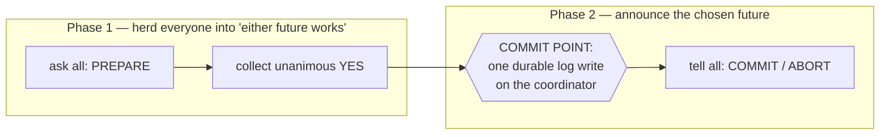
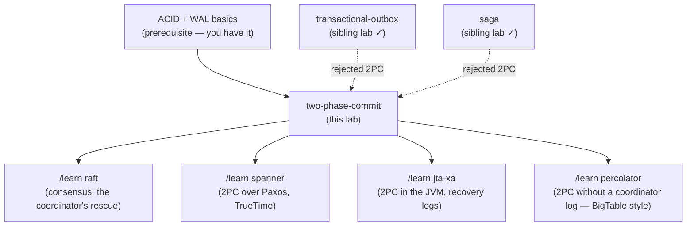

# Two-Phase Commit (2PC) — a learning lab

*Audience: a backend engineer who has never met this protocol. By the end you
should be able to walk every crash scenario, explain the blocking problem
and the commit point precisely, reason about XA in the JVM, and understand
why your other two labs called this "the road not taken" — and where it is
still the right road.*

**Lab contents**

| File | What it is |
|---|---|
| `README.md` | This document — the full story |
| `visualization.html` | Interactive simulator — step every message, crash any node between any two actions, watch locks block customers |
| `TpcLab.java` | Runnable simulation: coordinator + banks, durable logs, locks, timeouts, crash recovery |
| `TpcTest.java` | 12 scenario-named tests, `java TpcTest.java` |
| `EXERCISES.md` / `SOLUTIONS.md` | Predict / modify / debug exercises, answers separate |

Sibling labs this builds on:
[`../48-transactional-outbox/`](../48-transactional-outbox/README.md) (reliable
delivery without 2PC) and [`../47-saga/`](../47-saga/README.md) (multi-step
coordination without 2PC). Both reject 2PC; this lab shows exactly what
they rejected — and what they gave up by rejecting it.

---

## 1. WHY does this exist?

Sometimes one action must change data in two different systems and it is
catastrophic for only one change to happen: debit money at one bank and
credit it at another; pop a message from one store and record it in another.
Each system can promise all-or-nothing for *its own* changes, but nobody is
in charge of the pair. Two-phase commit exists to make **several independent
systems commit or abort as one**, by adding a referee and a strict two-round
conversation.

## 2. THE PROBLEM, as a story

Think of a wedding. Two people must be married **simultaneously** — a state
where one is married and the other isn't must never exist, not even for a
moment, not even if someone faints mid-ceremony.

The officiant can't just declare "you're married!" and hope: maybe one of
them was about to object. And the couple can't just each decide privately:
maybe one says yes and the other walks out — now one person considers
themselves married to someone who doesn't.

Notice what the real ceremony does. The officiant first asks EACH person,
one at a time: *"Do you take...?"* — and waits for both *"I do"*s. An
"I do" is not the marriage. It is a **binding promise to accept the
officiant's verdict**: having said it, you cannot leave; you stand there
and wait. Only after hearing yes from both does the officiant **pronounce**
— and the pronouncement, that single utterance, is the moment both become
married at once. Ask-then-pronounce. Two phases.

And the ceremony has a famous nightmare lurking in it: both have said
"I do"… and the officiant faints before pronouncing. Are they married? The
two of them **cannot decide** — the verdict existed only in the officiant's
head. They stand frozen at the altar until the officiant wakes. Hold that
image; it is the exact shape of 2PC's defining flaw.

## 3. THE NAIVE SOLUTION

Back to computers: move ₹500 from alice's account at Bank A to bob's at
Bank B. The obvious code:

```java
bankA.debit("alice", 500);    // commit #1
bankB.credit("bob", 500);     // commit #2  — and pray
```

Just do both, in some order. (Your outbox lab called this a **dual write**;
this is the same beast wearing a banking uniform.)

## 4. WHY IT FAILS, concretely

Crash between the two commits: alice's ₹500 is gone, bob never got it —
money destroyed. Reverse the order: bob is credited, then the debit fails
(alice's balance too low, or the process dies) — money created from air.
"Undo on failure" helps only if the undoer survives and the undo can't
itself fail; "retry" helps only if you can tell what already happened.
The two commits are independent decisions made at different times; any gap
between them is a window where the world can end up half-changed. What's
missing is a single **moment of joint decision**.

## 5. THE KEY IDEA

**Split "commit" into a promise and a verdict. First, every system is asked
to *prepare*: to durably guarantee "I can commit this, and I can also undo
it — whichever you say, even if I crash in between." Only when every system
has promised does a referee record one single, durable verdict — and that
one recorded verdict is the moment the whole transaction commits,
everywhere at once.** After that, telling everyone is mere bookkeeping.

## 6. TERMINOLOGY

- **Two-phase commit (2PC)** — the protocol above: a voting phase, then a
  decision phase. (No relation to "two-phase locking", a concurrency-control
  technique with a confusingly similar name.)
- **Coordinator** — the referee/officiant: collects votes, records the
  decision, announces it. Often a library or transaction manager inside
  your application server, not a separate box.
- **Participant** (or *resource manager*) — a system holding data: each
  bank, a database, a message broker.
- **Prepare** (phase 1 request) — "could you commit transaction T if
  asked?" Answering YES requires durably storing everything needed to go
  either way (undo + redo information) *before* answering.
- **Vote** — a participant's YES or NO. YES = the "I do": a binding,
  crash-surviving promise to await and obey the verdict. NO = veto; one NO
  aborts everyone. 2PC is **unanimous consent**, not majority.
- **Commit point** — the single instant the transaction commits: the
  coordinator's decision record hitting its durable log. Not when
  participants apply it — when the referee's pen lifts off the paper.
- **In doubt / uncertain** — the state of a participant that voted YES and
  hasn't heard the verdict. It may not commit, may not abort, may not
  release locks. This window is where all of 2PC's pain lives.
- **Blocking** — what an in-doubt participant does when the coordinator is
  unreachable: nothing, indefinitely, holding locks.
- **Presumed abort** — the standard optimization/rule: if the coordinator's
  log holds *no decision* for T, the answer is ABORT. Safe, because the
  verdict couldn't have reached anyone if it was never recorded.
- **XA** — the industry-standard API for 2PC (X/Open XA): what Java's JTA
  (`javax.transaction`), `XADataSource`, and "distributed transactions" in
  app servers speak.
- **Write-ahead log (WAL)** — each node's durable append-only journal;
  every promise and every verdict is a log record first, state change
  second. Recovery = re-reading your own log.

## 7. MENTAL MODEL

Carry this picture: **2PC narrows a multi-machine decision down to a single
disk write.** Phase 1 exists only to make that possible: it herds every
participant into a state where *both* futures (commit and abort) are fully
survivable, so the choice between the futures can be made unilaterally, by
one node, in one atomic log append. Everything before that write is
retractable; everything after it is inevitable. The cost of the narrowing:
everyone stands frozen — promises made, locks held — staring at one
machine's disk, until told which future they're in.



## 8. SEE IT MOVE — the interactive simulator

Open **`visualization.html`** (also published as an artifact). It shows the
coordinator and two banks, each with its **durable log on screen** — the
protocol *is* those three logs — plus account balances and lock badges. You
can:

- step through the transfer one message at a time,
- make a bank vote NO, or crash a bank before or after its vote,
- **crash the coordinator between any two actions** — especially between
  the votes and the announcement — and watch both banks freeze in-doubt,
- press "a customer asks for their balance" while locks are held,
- restart crashed nodes and watch log-driven recovery,
- or press **"run the whole story for me"** for a narrated tour.

The verdict banner always states, in plain English, whether money is safe,
in flight, or frozen — and *whose* log currently owns the truth.

## 9. THE ACTUAL MECHANISM, step by step

The transfer: ₹500, alice@BANK-A → bob@BANK-B. alice has ₹1000, bob ₹200.
Transaction id `txn-1`. Coordinator C (the travel… no — this time it's the
transfer service's transaction manager).

**Phase 1 — voting.**

1. C durably logs `BEGIN txn-1 [A: alice −500, B: bob +500]`, then sends
   `PREPARE txn-1` to A and B.
2. **BANK-A** checks: alice has ₹1000 ≥ 500 ✓. It **locks alice's row**,
   writes `⟨txn-1, PREPARED, alice, −500⟩` to its durable log — undo and
   redo info both implied — *flushes it to disk*, and only then replies
   **YES**. From this instant, Bank A has lost the right to change its
   mind, even across a crash: the log entry *is* the promise.
3. **BANK-B** does the same for bob's credit: lock, log, flush, **YES**.

**The commit point.**

4. C has unanimous YES. It writes `⟨txn-1, COMMIT⟩` to **its** durable log
   and flushes. **This disk write is the entire commit.** Before it: a
   crash anywhere means abort (presumed abort — no decision recorded).
   After it: the transaction is committed even if *nobody has been told
   yet* (the lab's `test_decision_log_write_is_the_commit_point` proves
   exactly this).

**Phase 2 — completion.**

5. C sends `COMMIT txn-1` to both banks. Each applies its change (alice
   1000→500; bob 200→700), logs `⟨txn-1, COMMITTED⟩`, **releases its
   locks**, and ACKs.
6. When all ACKs are in, C logs `END txn-1` and can forget the
   transaction.

Two round trips; roughly four durable log flushes on the critical path
(one per participant in phase 1, the decision, and participants' outcome
records). Locks held from step 2 until step 5 — including across every
network delay in between. That is the *happy* path.

```mermaid
sequenceDiagram
    participant C as Coordinator (log)
    participant A as BANK-A (log, locks)
    participant B as BANK-B (log, locks)
    C->>C: log BEGIN txn-1
    C->>A: PREPARE txn-1
    A->>A: lock alice; log PREPARED; flush
    A-->>C: YES
    C->>B: PREPARE txn-1
    B->>B: lock bob; log PREPARED; flush
    B-->>C: YES
    C->>C: log COMMIT ⟵ THE COMMIT POINT
    C->>A: COMMIT
    A->>A: alice 1000→500; log; unlock
    C->>B: COMMIT
    B->>B: bob 200→700; log; unlock
    C->>C: log END txn-1
```

## 10. FAILURE SCENARIOS — walk every crash point

The protocol's design rule: **at every possible crash instant, the durable
logs must contain enough truth to finish the job.** Check it hop by hop.

**(a) A participant votes NO** (bob's account frozen by compliance, or
insufficient funds). One NO → C logs ABORT → everyone aborts, locks
released, nothing changed. Run: `java TpcLab.java participant-votes-no`.

**(b) A participant crashes (or is unreachable) before voting.** C waits,
times out, counts silence as NO, aborts everyone reachable. **This timeout
is safe** — no decision existed, so nothing can have committed anywhere.
The crashed bank finds either nothing or no promise in its log on restart
— also fine. Run: `java TpcLab.java participant-crash-before-vote`.

**(c) A participant crashes just after voting YES.** Its YES may or may not
have arrived. Its log durably holds `PREPARED`. On restart it is **in
doubt**: it *re-acquires the lock* (the promise survives restarts!) and
must ask the coordinator for the verdict — it cannot infer it. Test:
`test_participant_recovers_in_doubt_and_asks_coordinator`.

**(d) Coordinator crashes before logging a decision** (during voting, or
after collecting votes but before the decision write). Its recovered log
has BEGIN but no verdict → **presumed abort**: it aborts the transaction
and tells everyone. Participants that were in doubt learn ABORT. Safe,
because the verdict that never hit the log can never have been sent.

**(e) Coordinator crashes AFTER logging COMMIT, before telling anyone.** ⚠️
The wedding nightmare. Both banks hold `PREPARED` in their logs, locks on
alice and bob, and wait. Consider Bank A's options:

- *Abort unilaterally?* The verdict COMMIT exists on C's disk. B might ask
  a recovered C, learn COMMIT, and commit. A aborted, B committed — the
  exact half-transfer 2PC exists to prevent.
- *Commit unilaterally?* In a different run, C died one instant *earlier*,
  before logging — verdict ABORT. Same local history at A, opposite correct
  answer.

The lab's experiment 6 (`two-possible-worlds`) makes this brutal and
concrete: **two runs in which Bank A's entire visible history is
byte-identical — voted YES, then silence — end with alice at ₹500 in one
world and ₹1000 in the other.** No local rule can pick right. So a
prepared participant **blocks**: locks held, every customer touching those
rows waits behind it, for as long as the coordinator is down. Minutes.
Hours. Run: `java TpcLab.java coordinator-crash-blocks-everyone`, then
`coordinator-recovery` to watch the only cure — the coordinator's return:

```text
    another customer reads alice at BANK-A -> BLOCKED (account 'alice' is
        locked by in-flight transaction txn-5 — come back later)
Coordinator restarts, reads its durable log, re-sends phase 2:
    BANK-A <- COMMIT: committed: alice now 500
```

**(f) Phase 2 message lost / duplicated.** C retries COMMIT until ACKed;
participants treat a repeated COMMIT as a no-op (the lab's `commit()` is
idempotent — same discipline as everywhere in your other two labs).

**(g) Cooperative termination (partial mercy).** An in-doubt participant
can ask its *peers*: if any peer already received the verdict, or never
got prepared at all (proving no unanimous YES existed), the answer spreads.
But in scenario (e) — all peers prepared, none informed — everyone is
equally in the dark, and everyone stays blocked. It shrinks the window; it
cannot close it.

## 11. CORRECTNESS — what is and isn't guaranteed

**Guaranteed (safety — and 2PC's safety is genuinely airtight):**
- **Atomicity**: no reachable history has one participant committed and
  another aborted. All-or-nothing, always, under any crash pattern.
- **Real isolation**: locks from prepare to decision mean nobody observes
  the in-between. Compare your saga lab's dirty-read experiment — the
  anomaly sagas accept is precisely what these locks forbid.
- **Durability of the verdict**: one log write, replayable forever.

**Explicitly NOT guaranteed (liveness):**
- **Progress while the coordinator is down after prepares.** Participants
  block, indefinitely, holding locks. 2PC sacrifices availability for
  atomicity; it cannot have both (this is the two-generals/FLP shadow —
  no protocol on an unreliable network can, but 2PC concentrates the
  fragility in one node).
- **Non-blocking behavior under two simultaneous failures** — even 3PC
  (a historical "fix") only handles single failures without partitions;
  real fixes replicate the *coordinator's decision* with consensus
  (Raft/Paxos), which is a different, heavier animal.

**Traded away:** availability (one machine's disk is everyone's fate),
latency (2 round trips + synchronous log flushes), throughput (locks held
across network hops), and universality (every participant must implement
prepare/redo/undo — most SaaS APIs, and Kafka's XA-less broker, never
will). **This trade is exactly what outbox and saga refuse**: they accept
eventual consistency and visible intermediate states to keep availability
and work with participants that only understand "do it".

## 12. THE CODE

`TpcLab.java`, ~280 lines of mechanism:

- `Bank.prepare` — the vote: check, **lock**, durably log `PREPARED`
  *before* answering YES. Knobs: `voteNo`, `crashBeforeVote`,
  `crashAfterVote` (a crashed bank becomes unreachable — `down`).
- `Bank.readBalance` — the outside world; raises `Blocked` on locked rows.
- `Bank.recover` — restart from the log; `PREPARED` without an outcome →
  in doubt: **relock and wait**; `askCoordinator` resolves it.
- `Coordinator.runTransfer` — phase 1, the decision write (crash knobs on
  both sides of it — the two sides *are* the two possible worlds), phase 2.
- `Coordinator.decisionFor` — presumed abort in four lines: no decision in
  the log ⇒ ABORT.
- `Coordinator.recover` — log-replay: any decided-but-not-ENDed transaction
  gets phase 2 re-sent.

What the same thing looks like in production Java (illustrative):

```java
// JTA/XA — the app server's transaction manager is the coordinator
@Transactional  // with two XADataSources enlisted
public void transfer() {
    jdbcA.update("UPDATE accounts SET bal = bal - 500 WHERE id='alice'");
    jdbcB.update("UPDATE accounts SET bal = bal + 500 WHERE id='bob'");
}   // commit() → XAResource.prepare() on both, then commit() on both
```

The annotation hides an entire coordinator, two XA drivers, and every
scenario in section 10 — which is exactly why XA incidents are so
confusing to debug from the outside.

## 13. EXPERIMENTS — break it yourself

```bash
java TpcLab.java happy-path                         # 2 round trips, 4 flushes
java TpcLab.java participant-votes-no               # one NO vetoes all
java TpcLab.java participant-crash-before-vote      # safe timeout
java TpcLab.java coordinator-crash-blocks-everyone  # the nightmare
java TpcLab.java coordinator-recovery               # the only cure
java TpcLab.java two-possible-worlds                # why blocking is forced
java TpcTest.java                                    # all 12 scenarios
```

## 14. PRODUCTION — what the lab omits and how real systems do it

| Lab simplification | Production reality |
|---|---|
| "Durable log" = a Python list kept alive | Real WALs with `fsync` — 2PC's latency cost is mostly these synchronous flushes; disk-flush tuning is XA tuning. |
| Coordinator is one object with one log | The single point of failure. Real deployments: transaction managers with recovery logs (Narayana, Atomikos, Bitronix in JVM land), or — the modern fix — **replicate the coordinator's decision via consensus**: Spanner runs 2PC *over Paxos groups*; each "participant" is itself a replicated state machine, so no single disk is anyone's fate. |
| In-doubt = wait for our coordinator | Real databases surface in-doubt transactions to *operators*: Oracle's `DBA_2PC_PENDING` + `COMMIT FORCE` / `ROLLBACK FORCE`, Postgres's `pg_prepared_xacts` after `PREPARE TRANSACTION` — the on-call human is the cooperative-termination protocol of last resort, and "heuristic commit/abort" (guessing) is the documented, atomicity-breaking emergency exit. |
| Locks = a dict | Row locks held across two network round trips — the throughput killer. This, not the crash stories, is why XA quietly disappeared from high-scale stacks: even when nothing fails, everything is slower. |
| Two participants, one transaction | Real coordinators interleave thousands; logs carry per-txn state machines; presumed-abort keeps the log small (only COMMIT decisions and prepares must be flushed; aborts can be lazy). |
| Everyone speaks the protocol | The adoption wall: participants must implement prepare/undo/redo + the XA API. Databases mostly do (Postgres, MySQL, Oracle, MQ brokers via JMS XA). Kafka, most REST/SaaS APIs, DynamoDB, S3 — do not, and never will. One non-XA participant in your flow and 2PC is off the table entirely — which is how most teams actually end up at outbox + saga. |
| — | Where 2PC is alive and well: *inside* systems, invisibly — Spanner and CockroachDB commit multi-shard transactions with (consensus-hardened) 2PC; XA between two databases you fully control in one datacenter remains legitimate and simple. The pattern died at the *microservice boundary*, not in the database engine room. |

## 15. EXERCISES

See `EXERCISES.md` — predict / modify / debug, answers in `SOLUTIONS.md`.
The debug tier includes a vote-before-log bug (the classic) and a
"helpful" timeout that destroys atomicity.

## 16. RELATED CONCEPTS — and when to choose which

- **Transactional outbox** ([sibling lab](../48-transactional-outbox/README.md))
  — when the "second system" only needs to *hear about* the change,
  eventually. No veto power, no isolation needed → don't pay for 2PC;
  commit locally + relay. This covers the vast majority of "I almost need
  a distributed transaction" cases.
- **Saga** ([sibling lab](../47-saga/README.md)) — when several services must
  each *change state* and business-level undo is possible. Trades 2PC's
  isolation for availability: compensations instead of locks, visible
  intermediate states instead of blocking. Choose sagas at service
  boundaries; choose 2PC only when a half-visible intermediate state is
  *unacceptable* and every participant speaks XA.
- **Three-phase commit (3PC)** — adds a pre-commit round so participants
  can decide without the coordinator after single clean failures. Broken by
  network partitions (two sides reach opposite verdicts), costs an extra
  round trip always; historically important, deployed almost nowhere.
  Know it as an interview answer, not a tool.
- **Consensus (Raft / Paxos)** — solves a different problem (many replicas
  agreeing on *one* value/log with majorities, no unanimity, no veto), but
  is 2PC's modern rescue: replicate the coordinator's decision so no single
  crash blocks anyone (Spanner = 2PC over Paxos). Rule of thumb: consensus
  = same data on many machines; 2PC = different data on many machines,
  changing together.

## 17. NEXT STEPS — knowledge map



Suggested order: `/learn raft` next — you have now personally watched a
single machine's disk freeze a whole system, which is the exact pain
consensus exists to remove; everything in Raft will feel motivated. Then
`/learn spanner` to see 2PC and consensus composed in production.

---

**Glossary recap:** coordinator · participant · prepare · vote · commit
point · in doubt · blocking · presumed abort · XA · WAL · cooperative
termination · heuristic decision. All defined in sections 6, 10 and 14.
