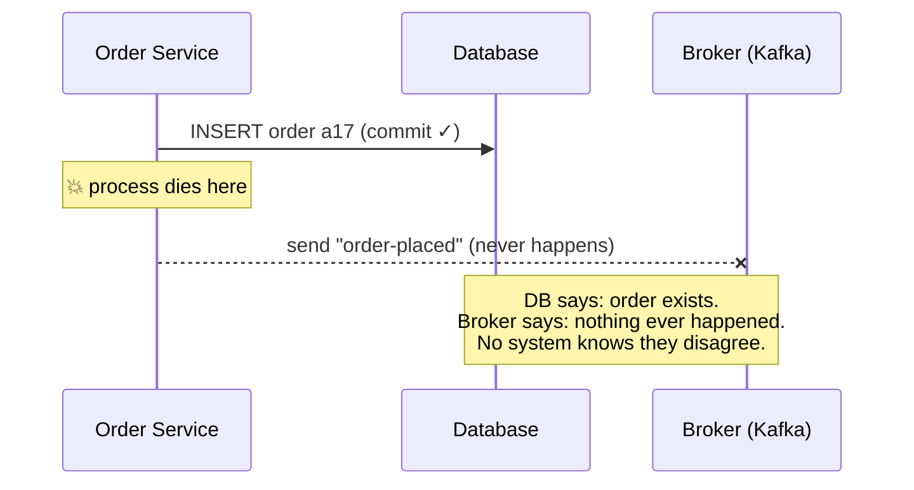
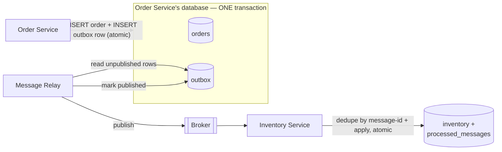
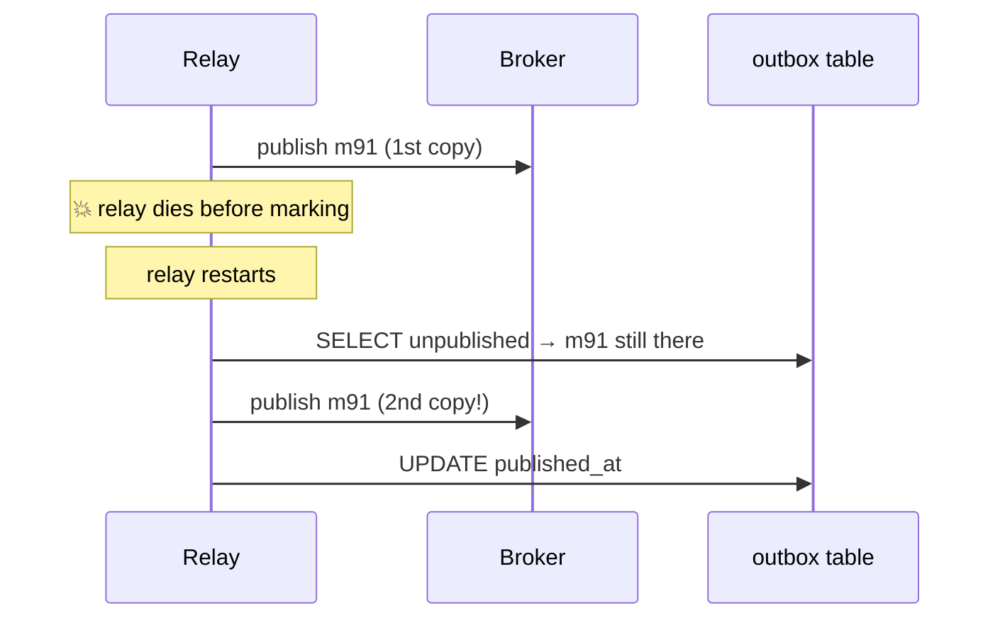
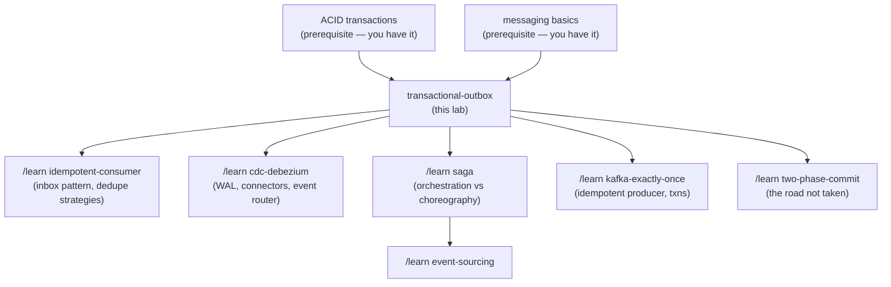

# The Transactional Outbox Pattern — a learning lab

*Audience: a backend engineer who has never met this pattern. By the end you
should be able to reason about its failure modes, argue for or against it in
a design review, and read the Debezium / microservices.io material fluently.*

**Lab contents**

| File | What it is |
|---|---|
| `README.md` | This document — the full story |
| `visualization.html` | Interactive simulator — crash any component at any step and watch what happens |
| `OutboxLab.java` | Runnable single-process simulation (real H2 transactions, simulated broker and crashes) |
| `OutboxTest.java` | Scenario-named tests, `java -cp ../lib/h2.jar OutboxTest.java` |
| `EXERCISES.md` / `SOLUTIONS.md` | Predict / modify / debug exercises, with answers separate |

---

## 1. WHY does this exist?

Modern backends are rarely one program. When something important happens in
one service ("a customer placed an order"), other services need to hear about
it ("reserve the stock", "send the confirmation email", "update analytics").
The outbox pattern exists because of one stubborn fact: **saving data in your
database and telling other systems about it are two separate physical acts,
and the world can crash between them.**

## 2. THE PROBLEM, as a story

Imagine you run a small mail-order shop with a paper ledger and a postal
service.

Every time a customer phones in an order, you must do two things:

1. **Write the order into your ledger** (so you don't forget it and can
   charge for it).
2. **Mail a letter to the warehouse across town** telling them to reserve
   the goods.

The ledger is on your desk. The postbox is down the street. There is no way
to do both in a single instant — you always do one first, then the other.

Now suppose you faint (shops crash too) at exactly the wrong moment:

- **Ledger first, then faint before mailing:** the order exists, the money
  will be charged, but the warehouse never hears about it. The customer
  waits forever. Worst of all, *nothing looks wrong* — your ledger is
  perfectly consistent, there's just a letter that never existed.
- **Mail first, then faint before writing the ledger:** the warehouse ships
  goods for an order your ledger says never happened. You gave away stock
  for free.

Either order of operations has a losing crash. That is the whole problem.

## 3. THE NAIVE SOLUTION: just do both ("dual write")

In code, the story above looks like this — and it is what almost everyone
writes first:

```java
@Transactional
public void placeOrder(Order order) {
    orderRepository.save(order);           // write #1: the database
    kafkaTemplate.send("order-placed",     // write #2: the message broker
                        order.toEvent());
}
```

This is called a **dual write** — writing the same logical fact to two
independent systems (a database and a message broker) with two independent
operations. It looks fine. It even passes every test you'll write, because
tests rarely crash between two adjacent lines.

> A tempting variation: "I'll send the Kafka message *inside* the database
> transaction, so it rolls back together!" It doesn't. Kafka is not your
> database. The `@Transactional` annotation controls the database connection
> only; the broker send is a network call to a different system that commits
> or fails on its own. (Worse: if the send happens inside the transaction and
> the transaction later rolls back, you've announced an order that doesn't
> exist.)

## 4. WHY IT FAILS, concretely

Walk the crash through with real values. Stock of `red-mug` is 10. A customer
orders 2.

1. `INSERT INTO orders (id, item, qty) VALUES ('a17', 'red-mug', 2)` — commits. Durable.
2. **The process dies.** (Deploy, OOM-kill, power loss, `kill -9` — pick one.)
3. The process restarts. The order `a17` is in the database. No event was
   ever sent, and — this is the key part — **no trace exists anywhere that an
   event *should have been* sent.** There is nothing to retry from.
4. Inventory still thinks stock is 10. The warehouse never ships. The
   customer emails support three days later.

Run it yourself:

```bash
java -cp ../lib/h2.jar OutboxLab.java dual-write-crash
```

```text
  CRASH: process died after DB commit, before publish
Process 'restarts' (new objects, same database file):
  orders table:        [('32685b6d', 'red-mug', 2)]
  broker log:          0 messages
```

Flip the order of the two writes and you just trade this failure for its
mirror image (event sent, order rolled back — a "phantom event"). Retrying
doesn't fix it either: you can't retry what you have no record of, and
retrying the *whole* operation double-charges the customer.



## 5. THE KEY IDEA

**Don't write to two systems. Write to one — your database — twice, in one
transaction: the business data AND the message you intend to send. Then let a
separate process reliably move the stored messages to the broker.**

In the shop story: instead of running to the postbox, you write the letter
and place it in an **outbox tray on your own desk, in the same pen-session as
the ledger entry**. A mail clerk comes by regularly, takes whatever is in the
tray, mails it, and stamps it "sent". If you faint, the letter is either in
the tray (will be mailed later) or was never written (and neither was the
ledger entry). No combination of faints loses a letter.

## 6. TERMINOLOGY

Now the professional vocabulary, each term in plain English:

- **Transactional outbox** — the pattern itself: store outgoing messages in
  a database table within the same transaction as the business change.
- **Outbox table** — a normal table in *your* database (typical columns:
  `id`, `aggregate_id`, `event_type`, `payload`, `created_at`,
  `published_at`) holding messages waiting to be sent.
- **Message relay** — the process that moves rows from the outbox table to
  the broker. Two common implementations: *polling publisher* and *log-based
  CDC* (both below).
- **Polling publisher** — a relay that repeatedly queries
  `SELECT ... WHERE published_at IS NULL` and publishes what it finds.
- **CDC (change data capture)** — reading the database's own write-ahead
  log / binlog (its internal journal of every committed change) to learn
  about new outbox rows without querying. **Debezium** is the standard
  open-source tool for this.
- **Dual write** — the anti-pattern: two independent writes to two systems
  hoping both succeed.
- **At-least-once delivery** — the guarantee this pattern gives: every
  message arrives one *or more* times. The "or more" is not sloppiness; it
  is mathematically unavoidable (section 10).
- **Idempotent** — an operation that is safe to apply twice; doing it again
  changes nothing ("set stock to 8" is idempotent, "subtract 2" is not).
- **Idempotent consumer / inbox pattern** — the receiving side's mirror
  trick: record each processed message-id in the consumer's own database, in
  the same transaction as the effect, and skip ids seen before.
- **Aggregate** — DDD term you'll meet in outbox docs: the business entity
  the event is about (the order). `aggregate_id` is used as the message key
  so all events for one order stay in order.

## 7. MENTAL MODEL

Carry this picture: **the outbox turns "send a message" into "commit a row",
and rows are the one thing a database never half-does.** After that, the
only remaining job is moving committed rows to the broker — which is safe to
retry forever, because the row remembers whether it was sent. Losing becomes
impossible; the residual (and acceptable) risk is sending twice.



## 8. SEE IT MOVE — the interactive simulator

Open **`visualization.html`** (also published as an artifact). It shows the
five boxes above with live state — orders table, outbox rows, broker log,
consumer's stock and dedupe table — and lets you:

- choose **dual write** or **outbox** as the strategy,
- **crash** the service or the relay at any of the dangerous instants,
- restart components and watch recovery,
- toggle the consumer between **naive** and **idempotent**,
- or press **"run the story for me"** and watch all four acts narrated.

The verdict banner always states, in one sentence, whether the system is
currently consistent and why. Recommended: play with it now, then read on.

## 9. THE ACTUAL MECHANISM, step by step

Same concrete case: stock 10, customer orders 2 × `red-mug`.

**Step 1 — the business transaction.** One database transaction:

```sql
BEGIN;
INSERT INTO orders (id, item, qty) VALUES ('a17', 'red-mug', 2);
INSERT INTO outbox (message_id, topic, payload, published_at)
VALUES ('m91', 'order-placed',
        '{"order_id":"a17","item":"red-mug","qty":2}', NULL);
COMMIT;
```

Atomicity is doing all the work here: both rows or neither. Note the
`message_id 'm91'` is generated *now, by the producer* — it will be the
dedupe key at the far end.

**Step 2 — the relay picks it up.** A polling relay runs, say, every 200 ms:

```sql
SELECT * FROM outbox WHERE published_at IS NULL ORDER BY seq LIMIT 100;
```

It finds `m91`, publishes it to the broker (with `aggregate_id 'a17'` as the
partition key), then:

```sql
UPDATE outbox SET published_at = now() WHERE message_id = 'm91';
```

**Step 3 — the consumer applies it.** The inventory service reads `m91` and,
in **one transaction of its own database**:

```sql
BEGIN;
INSERT INTO processed_messages (message_id) VALUES ('m91');  -- fails if seen
UPDATE inventory SET stock = stock - 2 WHERE item = 'red-mug';
COMMIT;
```

Stock: 10 → 8. Done.

The corresponding lab code: `placeOrderOutbox` and `Relay.pollOnce` in
`OutboxLab.java`, and the happy-path sequence:

```mermaid
sequenceDiagram
    participant S as Order Service
    participant DB as orders + outbox (one DB)
    participant R as Relay
    participant K as Broker
    participant C as Inventory Service
    S->>DB: BEGIN; INSERT order; INSERT outbox; COMMIT
    loop every poll interval
        R->>DB: SELECT unpublished rows
        R->>K: publish m91
        R->>DB: UPDATE outbox SET published_at
    end
    K->>C: deliver m91
    C->>C: BEGIN; record m91; stock 10→8; COMMIT
```

## 10. FAILURE SCENARIOS — walk every crash point

The honest test of the pattern: crash it everywhere and see what happens.

**(a) Service crashes before COMMIT.** Neither the order nor the outbox row
exists. The customer got an error and retries. Clean.

**(b) Service crashes after COMMIT, before any relay runs** — the exact
crash that killed dual write. Now the outbox row is durable. The relay (a
separate process) finds it on its next poll and publishes. The message was
*delayed*, never *lost*. Run it:
`java -cp ../lib/h2.jar OutboxLab.java outbox-survives-crash`.

**(c) Relay crashes after `SELECT`, before publish.** Row still unmarked;
next poll re-reads it. Nothing happened, nothing lost.

**(d) Relay crashes after publish, before `UPDATE ... published_at`.** ⚠️
This is *the* important one. The broker has the message; the outbox row
still says unpublished. The restarted relay publishes it **again**. The
broker now holds two copies of `m91`.

This gap cannot be engineered away: "publish to broker" and "mark row
published" are again two systems. You must choose which side of the gap to
err on — mark-then-publish loses messages on crash (at-most-once);
publish-then-mark duplicates them (at-least-once). The outbox pattern
chooses duplication, because duplicates can be handled and losses cannot.



Run it: `java -cp ../lib/h2.jar OutboxLab.java relay-crash-duplicate` — with a naive
consumer, stock ends at **6** instead of 8 (decremented twice):

```text
  broker log now holds 2 copies of the same message_id.
    consumer: applied message 683c3543 (red-mug x2) -> stock now 8
    consumer: applied message 683c3543 (red-mug x2) -> stock now 6
  final stock: 6 (correct answer: 8)
```

**(e) The fix for (d): the idempotent consumer.** The consumer keeps a
`processed_messages` table and inserts the message-id *in the same
transaction* as the stock update. Second copy of `m91` → the insert hits the
primary key → skip. Run: `java -cp ../lib/h2.jar OutboxLab.java idempotent-consumer` — stock
correctly ends at 8, with the duplicate reported as skipped. (Same-transaction
matters: if you recorded the id *after* applying, a consumer crash between the
two would re-apply on restart; if *before* in a separate transaction, a crash
between them would skip a message forever.)

**(f) Consumer crashes mid-processing.** Its transaction rolls back — both
the effect and the dedupe record. The broker redelivers; processing repeats
from a clean slate. Test: `test_idempotent_consumer_resumes_after_its_own_restart`.

**(g) Broker is down.** Relay's publish fails; it leaves rows unmarked and
retries with backoff. The outbox table absorbs the backlog — it's a durable
buffer. (Watch its depth; that's your lag metric.)

**(h) Relay is down for an hour.** Nothing is lost, everything is late.
Outbox converts a messaging outage from *data loss* into *latency*.

## 11. CORRECTNESS — what is and isn't guaranteed

**Guaranteed:**
- **No lost messages** — every committed business change eventually produces
  its message (assuming the relay eventually runs). This is the safety
  property.
- **No phantom messages** — a rolled-back transaction sends nothing, because
  the outbox row rolled back with it.
- **Per-aggregate ordering** (with care) — rows are relayed in commit order
  (`ORDER BY seq`), and using the aggregate id as the broker partition key
  keeps one order's events in sequence.

**Explicitly NOT guaranteed:**
- **Exactly-once delivery.** You get at-least-once. Any vendor slide saying
  "exactly-once delivery" across independent systems is really
  *at-least-once delivery + idempotent processing*, which produces an
  **effectively-once outcome**. That distinction is interview-grade.
- **Immediacy.** Consumers see events after a relay delay (poll interval or
  CDC lag). The system is *eventually* consistent; the readme of every
  outbox library says "within milliseconds", and every incident report says
  "the lag grew".
- **Global ordering across aggregates.** Two different orders' events may
  interleave arbitrarily.

**Traded away to get this:** latency (the relay hop), a table that needs
cleaning, operational surface (one more process to monitor), and the
obligation to make every consumer idempotent. That last one is not optional
fine print — **an outbox without idempotent consumers is a bug factory**,
as experiment 3 shows.

## 12. THE CODE

`OutboxLab.java` is deliberately small. Map of what's real:

- `OrderService.placeOrderDualWrite` — the anti-pattern, with a crash
  injection point between the two writes.
- `OrderService.placeOrderOutbox` — the pattern: both inserts are wrapped by
  one real H2 transaction, ended by a single `conn.commit()`.
- `Relay.pollOnce` — the polling publisher, with a crash injection point in
  gap (d).
- `InventoryService.consumeAll` — consumer with an `idempotent` flag; the
  dedupe insert, the stock update, and the offset advance share one
  transaction.

What a production Spring version of step 1 looks like (this snippet is
illustrative, not part of the runnable lab):

```java
@Transactional                                   // ONE local DB transaction
public void placeOrder(Order order) {
    orderRepository.save(order);
    outboxRepository.save(OutboxEvent.of(
        "order",  order.getId(),                 // aggregate type + id (key)
        "OrderPlaced", toJson(order)));          // event type + payload
    // no broker call here — the relay/Debezium handles publication
}
```

## 13. EXPERIMENTS — break it yourself

```bash
java -cp ../lib/h2.jar OutboxLab.java dual-write-crash      # act 1: silent loss
java -cp ../lib/h2.jar OutboxLab.java outbox-survives-crash # act 2: the fix
java -cp ../lib/h2.jar OutboxLab.java relay-crash-duplicate # act 3: the price (duplicates)
java -cp ../lib/h2.jar OutboxLab.java idempotent-consumer   # act 4: paying the price
java -cp ../lib/h2.jar OutboxTest.java                      # all 10 scenarios as tests
```

Run them from this directory (that is what `../lib/h2.jar` resolves against).
No build tool and no JUnit: H2 is the only dependency, and `java` compiles the
two source files on the fly. Each run starts by deleting its own `.mv.db`
files, so experiments are always repeatable.

Each experiment prints a narrated trace and a verdict; each maps to a
section-10 scenario. The interactive page runs the same four acts visually.

## 14. PRODUCTION — what the lab omits and how real systems do it

| Lab simplification | Production reality |
|---|---|
| Relay = polling loop you call by hand | Either a real polling publisher (with backoff, batching, `FOR UPDATE SKIP LOCKED` so multiple relay instances don't grab the same rows) or — more common at scale — **Debezium** tailing the database's write-ahead log, which sees outbox inserts with no polling and near-zero lag. Debezium ships a purpose-built **outbox event router** that reads your outbox table's columns and routes events to topics. |
| Outbox rows kept forever | The table must be pruned or it becomes your biggest table. Options: delete rows once marked published; or (a beloved Debezium trick) **insert and delete the row in the same transaction** — the WAL still contains the insert, so CDC still emits the event, and the table stays empty. |
| One relay, one producer instance | Many app instances all writing outbox rows (fine — it's just a table), and either one leader-elected relay or several using `SKIP LOCKED`. |
| Broker as an in-memory list | Kafka: choose the partition key = aggregate id for ordering; configure producer retries + `enable.idempotence=true` (that setting dedupes *broker-side retries only* — it does **not** replace your consumer-side dedupe, because a restarted relay is a new producer session). |
| Dedupe table grows forever | Real inbox tables get TTL'd: keep ids for longer than the maximum plausible redelivery window (days, not forever). Some consumers get idempotency for free instead — upserts, "set state to X" operations, or version checks (`WHERE version = 41`). |
| No monitoring | The two metrics that matter: **outbox lag** (oldest unpublished row's age) and **outbox depth**. Alert on both; a stuck relay looks exactly like a healthy quiet system until you measure lag. |
| No schema management | Payloads are contracts. Version them (schema registry, or an explicit `event_version` column) — consumers will meet old events replayed months later. |

**Off-the-shelf implementations** so you don't hand-roll: Debezium Outbox
Event Router (Kafka Connect), Spring Modulith's event publication registry
(a JVM-local outbox for application events), Eventuate Tram, MassTransit /
NServiceBus outbox (.NET), Sequin/pgmq-style Postgres tooling. Rolling your
own polling publisher is also genuinely fine for modest scale — it's ~50
lines, as this lab shows.

## 15. EXERCISES

See `EXERCISES.md` — three tiers (predict / modify / debug), answers in
`SOLUTIONS.md`. Attempt before peeking; the predict ones are runnable
against the lab.

## 16. RELATED CONCEPTS — and when to choose which

- **Two-phase commit (2PC/XA)** — the "make both systems commit together"
  alternative: a coordinator asks the DB and the broker to *prepare*, then
  tells both to *commit*. Gives atomicity but couples availability (a died
  coordinator leaves participants blocked holding locks), needs XA support
  in every participant (Kafka has no XA), and is slow. Outbox deliberately
  gives up "atomic across systems" for "atomic in one system + reliable
  relay". Modern microservice practice almost always prefers outbox.
- **Saga** — a *different layer*: outbox reliably delivers one event; a saga
  chains many local transactions across services with compensating actions
  when a later step fails ("order placed → payment failed → cancel order").
  Sagas are usually *built on top of* the outbox — each saga step publishes
  its events through one. Not rivals; a stack.
- **CDC on the business tables directly** (no outbox table) — let Debezium
  stream the `orders` table itself. Simpler, but your *table schema becomes
  your public event contract*, and intent is lost (an UPDATE row doesn't say
  *why* it changed). The outbox table is precisely the decoupling layer:
  explicit, versioned, intention-revealing events.
- **Event sourcing** — flips the relationship: the events *are* the store
  (state is derived by replay), so there's nothing to keep in sync and no
  outbox needed. Far bigger architectural commitment; choose it for the
  domain-modeling benefits, not just to avoid dual writes.
- **Kafka transactions** — atomic *across Kafka topics* (consume-process-
  produce), not across your database and Kafka. They solve a different
  problem and don't replace the outbox.

Rule of thumb: **database is the source of truth + others must hear about
changes ⇒ outbox.** Everything else is either a layer above it (saga), a
transport for it (CDC/Debezium), or a different world (event sourcing).

## 17. NEXT STEPS — knowledge map



Suggested order: `/learn cdc-debezium` (how the relay works at scale), then
saga (what you build on top — **sibling lab: [`../47-saga/`](../47-saga/README.md)**),
then two-phase-commit (the contrast — **sibling lab:
[`../45-two-phase-commit/`](../45-two-phase-commit/README.md)**). Other sibling
labs (`java-memory-model`, `java-virtual-threads`) are unrelated to this track.

---

**Glossary recap:** outbox table · message relay · polling publisher · CDC ·
Debezium · dual write · at-least-once · idempotent · inbox pattern ·
aggregate. If any of these doesn't ring a bell, section 6 defines them all.
