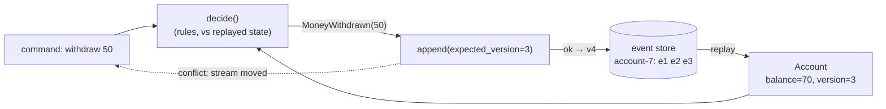
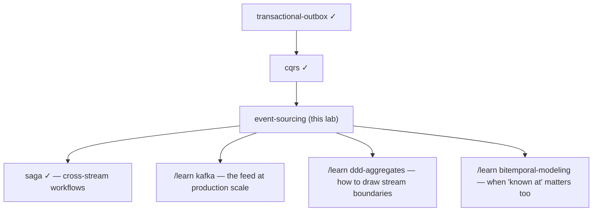

# Event Sourcing — a learning lab

*Audience: a backend engineer who has never met this pattern. By the end you
should reason about replay, optimistic concurrency, snapshots, and schema
evolution fluently — and know when NOT to event-source. Completes the
event-driven family: [transactional-outbox](../48-transactional-outbox/) (events
leave a service reliably), [cqrs](../51-cqrs/) (events feed read models),
[saga](../47-saga/) (events coordinate services). All quoted output is real,
from `java -cp ../lib/h2.jar EsLab.java`.*

**Lab contents**

| File | What it is |
|---|---|
| `README.md` | This document |
| `visualization.html` | Interactive: scrub an account through time; race two tellers; correct a mistake |
| `EsLab.java` | A bank whose ONLY database is an append-only event log (H2). Narrated demo: `java -cp ../lib/h2.jar EsLab.java` |
| `EsTest.java` | 12 scenario tests: `java -cp ../lib/h2.jar EsTest.java` |
| `BrokenEs.java` | The planted bug for exercise D1 |
| `EXERCISES.md` / `SOLUTIONS.md` | Predict / modify / debug, answers separate |

---

## 1. WHY does this exist?

Every ordinary database answers "what is true *now*?" and destroys, with
each UPDATE, the evidence of how it got there. Yet whole industries run on
the *how*: banks are audited on every movement, disputes hinge on what was
known when, debugging means "what sequence of things produced this state?".
Event sourcing exists for systems where the history is not a byproduct of
the data — it **is** the data.

## 2. THE PROBLEM, as a story

Ask a bank teller your balance. Does she look up a "balance box" holding one
number that gets scribbled over all day? Never — she'd have no answer when
you dispute it ("why is it 20? it was 70 yesterday!"). Real banks have kept
the answer for five centuries: a **passbook** — a list of every deposit and
withdrawal, in order, in ink. Your balance isn't *stored* anywhere; it's
what you get by *adding up the book*. The book explains itself: any past
balance, any dispute, any audit — just read up to that line. And nobody,
ever, erases a line: a wrong entry is fixed by writing a *correcting* entry
below it, so the book also remembers that the mistake happened.

Most software stores the balance box and throws away the passbook.

## 3. THE NAIVE SOLUTION

Store current state (`accounts.balance = 70`), and when history is needed,
bolt it on: an `audit_log` table written "as well", updated-at columns,
maybe database triggers copying old rows to a `_history` table.

## 4. WHY THAT FAILS

- **The log is a second-class copy, and copies drift.** Every write path
  must remember to write the log too; the one that forgets (a bulk script,
  a hotfix, a new endpoint) leaves history that disagrees with state — and
  since state is authoritative, the log quietly becomes fiction. (The
  [outbox lab](../48-transactional-outbox/) is entirely about one instance of
  this dual-write disease.)
- **It can't answer the past.** `balance=70` plus a partial log cannot
  reliably reconstruct "what was the balance when the fraud check ran?"
  The information was destroyed by UPDATE, and the log records what someone
  *chose* to record, not what happened.
- **Lost updates.** Two processes read balance 70, both subtract 50, both
  write back — last writer wins, money invented. Guarding this needs row
  locks or version columns — machinery the naive design bolts on late.
- **New questions have no past.** "How many users added an item then
  removed it?" — the events were never kept; the answer starts existing
  only from the day you begin recording it.

## 5. THE KEY IDEA

**Store the passbook, compute the box.** Persist every change as an
immutable, append-only event; make *that* the only source of truth; derive
current state — any state, at any point in time — by replaying events. What
was the bolt-on (the log) becomes the foundation; what was the foundation
(current state) becomes a disposable computation.

## 6. TERMINOLOGY

| Term | Plain-English meaning |
|---|---|
| **Event** | An immutable past-tense fact: `MoneyDeposited{amount: 100}`. Never edited, never deleted. |
| **Event store** | The database of events: append and read, no UPDATE, no DELETE. |
| **Stream** | One entity's events in order (`account-7`), each numbered by **version** 1,2,3… |
| **Aggregate** | The entity that guards its own rules (an account). Exists in memory only, rebuilt by replay. |
| **Replay / fold** | Rebuilding state by applying events in order: `state = fold(apply, events)`. |
| **`apply`** | How one event changes state. Pure, and **total** — it must accept every recorded event, because they already happened. |
| **`decide`** | Command → new events (or rejection). ALL validation lives here, against replayed state. |
| **Expected version / optimistic concurrency** | Append succeeds only if the stream is still at the version you loaded — the whole write-concurrency story. |
| **Compensating event** | The correcting entry: a new fact that undoes an earlier one's *effect* while keeping both on record. |
| **Snapshot** | A cached fold at version N, so loading replays only events after N. Pure optimization. |
| **Upcasting** | Upgrading old-schema events in memory, on read — history is never migrated. |
| **Projection** | A read model folded from events (the [cqrs](../51-cqrs/) lab's entire subject). |

## 7. THE MENTAL MODEL

> **Git for your business data.** An aggregate is a file; events are
> commits; current state is the checked-out working copy — derivable,
> disposable, never the truth. Time travel is checkout of an old commit;
> a snapshot is a shallow clone; expected-version append is push being
> rejected because someone pushed first — and the fix is the same: pull
> (reload), re-apply your intent (re-decide), push again. You never edit a
> committed line; you commit a revert.



## 8. SEE IT MOVE

- **Interactive page** — `visualization.html` (published copy:
  <https://claude.ai/code/artifact/b7e6a2f2-0460-4247-9537-a412cf3dd217>): an account's stream as a filmstrip you scrub through —
  drag to any version and watch the balance recompute; race two tellers;
  post a wrong deposit and correct it; drop a snapshot and see the replay
  cost fall. Stories narrate each scene.
- **The demo** — `java -cp ../lib/h2.jar EsLab.java`, scenes 1–7, real output quoted below.

## 9. THE ACTUAL MECHANISM

The universal write path — load → decide → append-if-unchanged:

1. **Load = replay.** `Account.load(store, "7")` reads stream `account-7`
   and folds: `AccountOpened → MoneyDeposited(100) → MoneyWithdrawn(30)`
   gives `balance=70.0, version=3`. Demo scene 1's output:
   `balance = 70.0 (computed by replaying 3 events; no balance column exists)`.
2. **Decide.** `decideWithdraw(50)` checks the rules against that replayed
   state and returns *proposed events* — it mutates nothing.
3. **Append with `expected_version=3`.** The store checks the stream is
   still at 3 (here: a `UNIQUE(stream, version)` constraint enforced in a
   transaction — in real stores, a conditional append). Still 3 → events
   become versions 4, 5, …; moved → `ConcurrencyConflict`.
4. **On conflict: reload, RE-decide, retry.** Not "retry the append" —
   re-run the *decision* against the fresh state (why this distinction is
   money: §10b).
5. **Reads** of "current state" in a pure design are replays too; at scale
   they're served by projections ([cqrs](../51-cqrs/)) and bounded by
   snapshots (scene 6: a 256-event stream cold-loads by replaying 256,
   snapshot-loads by replaying 56 — identical result, `270.0 == 270.0`).

And the one rule that keeps replay sound forever: **`apply` validates
nothing** — it must accept every event that was ever legally recorded, even
ones today's rules would refuse (test:
`unknown_event_types_are_tolerated_on_replay`; exercise M2 makes you break
this and watch history become unreadable).

## 10. FAILURE SCENARIOS

**(a) Lost update, prevented.** Demo scene 4, real output: two tellers load
version 3 (balance 70). Teller 1 withdraws 50 → OK. Teller 2's append:
`REJECTED — account-7: you loaded version 3, but it is now 4`.

**(b) The retry that must re-decide.** Teller 2 retries *properly* (reload
→ re-decide): the fresh balance is 20, so withdrawing 40 is now refused —
`insufficient funds: balance 20.0, requested 40.0`. The conflict wasn't an
inconvenience; it was the system handing you a chance to re-check the rules
against reality. Retrying by force instead — same events, newer version —
is the planted bug in `BrokenEs.java`: both withdrawals "succeed" and the
balance lands at **-30.0** with the overdraft rule never consulted.

**(c) The wrong fact.** A 500 deposit hits the wrong account. There is no
UPDATE or DELETE to reach for — the fix is a `DepositReversed` compensating
event (scene 5): balance restored, and the audit trail keeps *both* facts,
exactly like the teller's correcting line in ink.

**(d) Unbounded replay.** A 10-year account has a million events; loading
it per-command at O(history) eventually hurts. Snapshots cap it (scene 6);
they are pure cache — delete every snapshot and nothing is lost but time.

**(e) Old events meet new code.** 2019's `MoneyDeposited` had no `channel`
field. Never migrate the store; upcast on read (scene 7: a v1 event reads
back with `channel: 'branch'` — the historically-correct default). The
contract: events are forever, so every version ever written must stay
readable.

**(f) The GDPR collision.** "Right to erasure" vs "we never delete" is a
real legal conflict. Standard answers: keep personal data OUT of events
(store references), or **crypto-shredding** — encrypt personal fields with
a per-person key and delete the key to erase (exercise M3).

## 11. CORRECTNESS

**Guaranteed:** complete, ordered, tamper-evident history per stream —
audit is a property, not a feature; any past state reconstructible
(`asOfVersion`, test `state_can_be_reconstructed_as_of_any_past_version`);
no lost updates within a stream (conditional append); rejected commands
leave no trace; snapshots never change answers (test
`snapshot_state_equals_full_replay`).

**NOT guaranteed:** cross-stream (cross-aggregate) invariants — expected
version guards ONE stream; "transfer 50 between accounts atomically" needs
a [saga](../47-saga/) or a process manager, not a bigger transaction; current
state served from projections is eventually consistent (the [cqrs](../51-cqrs/)
window); storage is monotonically growing by design.

**Traded away:** the ability to read state with one indexed SELECT and to
forget anything cheaply. You pay with replay/snapshot machinery, upcasting
discipline, and event-model design skill (events must be *facts*, not
"row changed" diffs) — which is why event-source the subsystems where
history is the asset, not the whole system.

## 12. THE CODE

`EsLab.java`, top to bottom: `EventStore` (append-if-at-version, read with
upcasting, snapshots), `upcast`, `Account` (immutable record; `apply` = pure
fold step; `decide*` = rules), `handle` (the load→decide→append→retry
loop), `maybeSnapshot`. ~500 lines; every concept in §9–§10 is a named
thing you can point at.

## 13. RUN THE EXPERIMENTS

```bash
java -cp ../lib/h2.jar EsLab.java     # scenes 1–7, narrated
java -cp ../lib/h2.jar EsTest.java    # 12 scenario tests
java -cp ../lib/h2.jar BrokenEs.java  # the -30.0 balance (exercise D1)
```

Then break things: set `SNAPSHOT_EVERY = 5` and watch load costs; append a
`SomeFutureEventType` by hand and replay; make `apply` throw on overdraft
and re-run the tests (M2 tells you what you'll see).

## 14. FROM THIS LAB TO PRODUCTION

- **Stores**: purpose-built — EventStoreDB (streams, expected version,
  subscriptions native), Axon Server; or Postgres with an `events` table
  exactly like this lab's (very common, entirely respectable); Kafka alone
  is a feed, not an event store — per-stream conditional append is the
  missing piece.
- **Serving reads**: subscriptions push events to [cqrs](../51-cqrs/)
  projections; "current state" queries hit those, not replays.
- **Publishing**: the event store doubles as the outbox — downstream
  consumers tail the global sequence, so the
  [dual-write problem](../48-transactional-outbox/) never exists here.
- **Ops reality**: snapshot policies per aggregate size; upcaster suites
  with contract tests over *recorded* history; blue/green projection
  rebuilds; storage lifecycle (archive cold streams, never mutate).
- **Where it earns its keep**: ledgers, payments, trading, inventory,
  insurance claims, anything auditors visit. Where it doesn't: CRUD with no
  history requirement — the passbook of a shopping-cart-sessions table is
  landfill.

## 15. EXERCISES

[`EXERCISES.md`](EXERCISES.md) — predict a replay, break `apply`, shred a
key, and hunt the -30.0. Answers in [`SOLUTIONS.md`](SOLUTIONS.md).

## 16. RELATED CONCEPTS

| | Event sourcing | CRUD + audit log | Change data capture | Bitemporal tables |
|---|---|---|---|---|
| Source of truth | the events | current rows | current rows (log derived) | rows with validity intervals |
| History complete? | by construction | only what code remembered | physical changes, not intent | valid/known times, not causes |
| Past state | replay to any version | usually unrecoverable | replayable from log start | query by timestamp |
| Concurrency | expected-version append | row locks / version column | n/a | row locks |

**Versus its own family**: event sourcing decides what the *truth* is;
[cqrs](../51-cqrs/) decides how to *query* it (they compose: ES is unqueryable
without projections); the [outbox](../48-transactional-outbox/) exists for
systems whose truth is still state — ES makes it redundant; a
[saga](../47-saga/) coordinates *across* streams where expected-version cannot
reach.

## 17. NEXT STEPS



*Read next from the source: Greg Young's "Versioning in an Event Sourced
System" (free book — §10e as a whole discipline), the EventStoreDB docs, and
Fowler's "Event Sourcing" bliki entry.*
