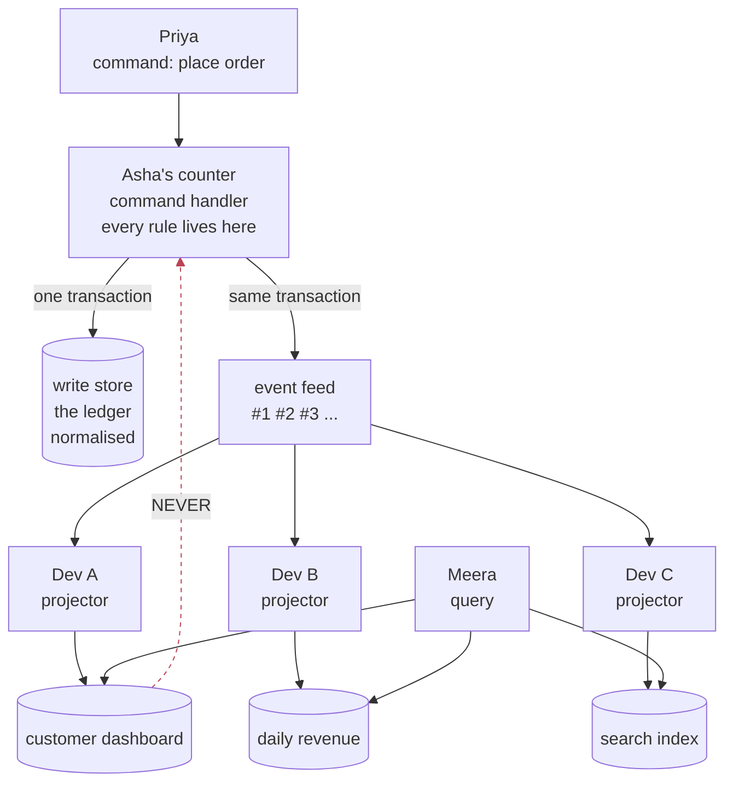
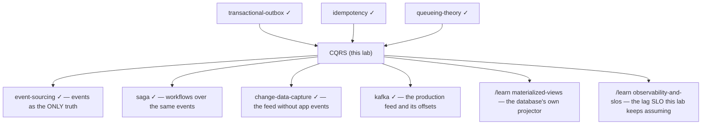

# CQRS — one guarded ledger, many chalkboards

> **Tell a friend:** Asha's shop keeps one ledger at the counter, and every sale
> goes into it under strict rules. Meera the manager keeps flipping back through
> that same ledger to add up the day's totals, and the queue at the counter
> grows while she does it. So Asha hires Dev, who reads the new entries every
> few minutes and copies the answers onto chalkboards that Meera reads instead.
> That is CQRS: one guarded ledger for changes, many cheap boards for questions,
> and a price paid in the boards always being a little behind. The one rule that
> keeps it safe is that nobody ever *decides* anything from a board.

The trainer is [`visualization.html`](visualization.html) — five panels, and
panel 1 is the one to open first. What this lab is made of, where every number
came from, and where it sits among your other labs are in
[section 17](#17-about-this-lab) at the end.

---

## 1. Why did checkout die when nobody touched checkout?

> **In one breath:** Asha's order service puts one queue in front of eight
> workers. One of Meera's reports holds a worker for most of a second. Priya's
> checkout write needs five milliseconds, and ends up waiting thirteen.

Start with the shape of the outage, because it is the reason the pattern exists.
It is also not the reason usually given.

Asha runs a retail order service. One Postgres, one connection pool of eight
workers. Checkout writes are small and fast. Each takes about 5 ms, and there
are 300 of them a second.

Do that arithmetic. It is 1.5 seconds of work arriving every second, spread over
eight workers. That is **19% utilisation**. The database is nearly idle, and
every dashboard says so.

Then Ben on the analytics team ships a merchandising page for Meera. It runs a
five-way join over orders, order_items, products and customers. It aggregates
by day. It takes about 800 ms, and it is called a handful of times a second.

Nothing about checkout changed. Not its code, not its traffic, not its hardware.
Read down the table below. The only thing moving is how many of Ben's reports
per second share the pool with Priya's order.

| Reports/s | Pool utilisation | Checkout mean | Checkout p99 | What Priya feels |
|---|---|---|---|---|
| 0 | 0.19 | 5.01 ms | **23 ms** | instant |
| 2 | 0.39 | 5.13 ms | **24 ms** | instant |
| 4 | 0.59 | 19.44 ms | **406 ms** | a hesitation |
| 6 | 0.79 | 161.24 ms | **1,590 ms** | "is this working?" |
| 8 | 0.99 | 5,412 ms | **13,192 ms** | she gives up and leaves |

Checkout's p99 goes from 23 ms to 1.59 seconds. That is **69×**. At eight
reports a second checkout is simply dead: thirteen seconds to place an order.

The mechanism is not mysterious, and it is not about CPU. There is one queue in
front of eight workers. An 800 ms report **occupies a worker for 800 ms**. A
5 ms checkout write that arrives while several workers hold reports waits behind
them.

Engineers call that **head-of-line blocking**, and you can read it straight off
the number. At 4 reports/s the checkout p99 is 406 ms. That is about half of one
report's service time, which is exactly the average wait behind a job you are
stuck behind.

Now the part that makes this a *pattern* and not just a capacity story. Two
completely different things are wrong here, and they need different fixes.

**One: two workloads with very different service times share one queue.** Your
[load-balancing](../59-load-balancing/) lab proved that pooling is a large win
when the work is *identical*. This is the same result read backwards. When the
work is not identical, sharing a queue means the short jobs inherit the long
jobs' latency.

**Two: the report recomputes, on every single view, an answer that changes only
when someone places an order.** The join is not slow because the database is
bad. It is slow because the schema is shaped for *recording a sale*, and Meera's
question is *how much did we sell today*. Those are not the same shape.

CQRS is the design that takes both of those seriously at once. Most explanations
lead with the second. The first is what actually gets it approved.

> **🔮 Predict, before §3.** You have the table above on a dashboard. Which
> would you reach for first: a read replica, a cache, or a materialised summary
> table? Write down which, and what you expect it to fix.
> <details><summary>Reveal</summary>
> All three are reasonable and §3 scores all three. If you said <em>read
> replica</em>, you are right about the table and §4 will show you what the
> table does not contain. If you said <em>cache</em>, you have chosen the one
> that helps least here. Meera's report is a different query every day, and the
> first view after every order still pays full price. If you said
> <em>materialised summary table</em>, you have already invented the pattern and
> §10.1 is your design written down.
> </details>

---

## 2. What are the two jobs one ledger is being asked to do?

> **In one breath:** The people who write into the ledger and the people who
> read out of it want opposite things. One wants rules and care. The other wants
> speed and totals. Only one of them minds being half a minute out of date.

The abstraction is easier to hold if you have a physical picture first, so put
the software down and walk into Asha's shop.

A busy shop keeps **one ledger** at the counter. Cashiers write every sale into
it: date, customer, each item, each price. They are careful. Prices are checked,
quantities cannot be negative, one entry per sale. The ledger is the truth, and
it is guarded.

Meera the manager reads that same ledger constantly. *Revenue so far today?
Which product is moving? How much has Priya spent this year?* None of those
answers are written anywhere in the ledger. Each one is found by flipping back
through pages and adding numbers up.

So the ledger is doing two jobs with opposite requirements. The last row is the
one to remember.

|  | The cashier's job | Meera's job |
|---|---|---|
| Needs | rules, one-at-a-time care, exact | speed, totals, convenient shape |
| Touches | one new entry | hundreds of old entries |
| Frequency | once per sale | many times per hour |
| If it is 30 seconds out of date | **unacceptable** — you would sell stock twice | fine, nobody notices |

Why does that last row matter more than the others? Because the two jobs do not
merely have different performance profiles. **They have different tolerances for
being wrong about time.**

That asymmetry is the entire opening for the pattern. A design that does not
exploit it has nothing to trade.

And now the shop's actual fix, which is what CQRS is.

Cashiers keep writing into the ledger, unchanged. But every few minutes Dev the
clerk walks over, reads the entries added since he last looked, and updates
**chalkboards** on the wall. `TODAY'S REVENUE: ₹12,400`. `TOP SELLER:
keyboards`. `PRIYA — 4 ORDERS THIS YEAR`.

Meera stops opening the ledger entirely. One glance at a board answers each
question. The boards are a few minutes behind. Everyone accepts that, and the
queue at the counter disappears.

Three properties of that arrangement are worth naming now, because everything
technical later is one of these three.

**The boards are derived.** Erase one and Dev can rewrite it from the ledger.
They hold no truth of their own.

**The boards are behind.** Always. Not sometimes, not under load — always, by at
least the time it takes Dev to walk over.

**Nobody makes a decision from a board.** The cashier checks stock in the ledger,
not on a chalkboard. Notice this one. It is doing more work than it appears to
be, and §11.2 is what happens when it is violated.

**Where this lab takes you.** Stop at any checkpoint and you still have
something whole.

| Layer | Sections | After it you can… |
|---|---|---|
| Beginner | 1–8 | tell the shop story, and say why a read replica is not enough |
| Intermediate | 9–10 | build the machine step by step, and price what each step cost |
| Engineering | 11–12 | reason about every failure, and say what is actually guaranteed |
| Production | 13–17 | operate it: what to monitor, what to rebuild, what to refuse |

---

## 3. What is the obvious solution, and why should you try it first?

> **In one breath:** Nobody sane invents CQRS while looking at §1's table. They
> add an index, then a cache, then a read replica. All three are good moves, and
> one of them fixes the table completely.

Faced with §1's table, no competent engineer invents CQRS. They do these, in
roughly this order, and they are all reasonable.

**Add indexes.** Correct first move, often sufficient, and cheap. Its limit is
structural. An index makes *finding* rows fast, but the merchandising query's
cost is in *joining and aggregating* them, and no index removes that. Every
index added for Meera's side is then maintained on Priya's side, on every write,
forever.

**Add a cache.** Also correct, also often sufficient. Its limit is that a cache
is a *guess* about what will be asked again, with invalidation as the price.
Your [caching](../11-caching/) lab covered where that guess goes wrong. A cache
also does nothing for the first request after every write.

**Add a read replica.** This is the strongest of the three and it deserves a
straight answer: **it fixes §1's table completely.** Move Ben's reports to a
replica and checkout gets its eight workers back and its 23 ms p99. If §1 were
the whole problem you would stop here, and many teams correctly do.

**Write cleverer SQL, or a materialised view.** Now you are close to the real
thing, and §10.1 comes back to it.

> **🔮 Predict.** The read replica has just fixed the contention. What is still
> wrong? Try to name it before reading on. Note that "the replica is slightly
> stale" is *not* the answer, because you are about to accept staleness in every
> design in this lab.
> <details><summary>Reveal</summary>
> Two things are still wrong and §4 takes them one at a time. If you said "the
> replica is stale", you named the <em>price</em> rather than the problem — and
> the interesting question is what you bought with it. If you said "the reports
> are still slow", you are close: the replica made them slow somewhere else
> instead of making them cheap. The word to reach for is <em>shape</em>.
> </details>

---

## 4. What survives the read replica, and why is that a failure?

> **In one breath:** The replica moved Ben's reports off Priya's queue and
> changed nothing else. The five-way join is still a five-way join. And you paid
> for staleness without buying anything with it.

Two things survive the read replica. Each one is a reason for a different half
of CQRS, and there is a third that no benchmark will ever show you.

### 4a. Did you pay for staleness and forget to spend it?

A read replica is asynchronously replicated. The moment you route Meera's
reports to it, her answers come from a slightly old copy of Asha's ledger.

Look at what that means. You have accepted exactly the property people cite as
the *reason not to* adopt CQRS. That property is "eventual consistency is too
hard". And in exchange you received the same schema, somewhere else.

That is the trade worth staring at. Staleness is the currency here. A replica
spends it and buys isolation. CQRS spends the same currency and buys isolation
**and** shape.

If you were willing to pay once, the only question left is whether you want the
second thing too.

### 4b. Which end of the shop is paying for the arithmetic?

Here is the arithmetic, and it is the whole economic case for the pattern. Ask
it in the shop first, in words, before any letters appear.

How many times a day does something in the shop *change*? That is the number of
sales. How many times a day does someone *ask a question*? That is the number of
times Meera looks. And how much work is one answer, computed the hard way by
flipping through the ledger?

Now the letters, each carrying its words for a while. Let **N** be the changes
per day. Let **R** be the reads per day. Let **J** be the cost of computing one
answer from the normalised schema, the hard way.

There are exactly two places to do that work.

Compute at **read** time and the total cost is **R · J**, which is reads per day
times the cost of one answer. You pay once per question asked.

Compute at **write** time and the total cost is about **N · J′**, which is
changes per day times the cost of *incrementally updating* a stored answer. You
pay once per change made.

So the deciding quantity is **R/N**, which is reads per change, and nothing
else. Not data volume. Not table size. Not "we're at scale now".

> **🔮 Predict.** Asha's shop takes 40,000 orders a day and Meera's dashboard is
> viewed a million times a day. Which end should pay? Now flip it: a million
> orders a day, a hundred thousand views. Same answer?
> <details><summary>Reveal</summary>
> No, and the flip is the point. The first case is 25 reads per change and
> projections win by 25×. The second is 0.1 reads per change and projections
> <em>lose</em> by 10×. If you said "projections always win at scale", the last
> row of the table below is written for you: scale is not the variable, the
> ratio is.
> </details>

Read the table with J = 40 ms. That is a model, not a measurement — the point is
the ratio, not the constant.

| Orders/day (N) | Dashboard views/day (R) | R/N | Read-time cost | Projection-time cost |
|---|---|---|---|---|
| 40,000 | 20,000 | 0.5 | 0.22 CPU-h/day | 0.44 CPU-h/day |
| 40,000 | 100,000 | 2.5 | 1.11 CPU-h/day | 0.44 CPU-h/day |
| 40,000 | 1,000,000 | 25 | **11.11 CPU-h/day** | **0.44 CPU-h/day** |
| 1,000,000 | 100,000 | 0.1 | 1.11 CPU-h/day | 11.11 CPU-h/day |

Read the last row carefully, because it is the row people skip. **A write-heavy
system with few reads is made worse by projections.**

CQRS is not a scaling technique that helps more the bigger you get. It is a bet
on a ratio, and the bet loses when the ratio is below 1.

And now the distinction the replica option obscures.

> **A read replica multiplies the number of machines paying R·J.
> A projection reduces R·J itself.**

Replicas *add capacity* to absorb the work. Projections *delete the work*. If
Meera's dashboard is called a million times a day, three replicas means three
machines each doing five-way joins a million times a day.

That is why "just add replicas" runs out. Not at some magic scale, but at the
point where reads times cost-per-answer exceeds what you are willing to buy
hardware for, over and over.

### 4c. What breaks that no benchmark can see?

There is a slower failure that no table in this lab will show you.

Once the write model is also the read model, display concerns leak into it. A
`total_amount` column denormalised so one screen is fast. A `last_order_at`
maintained inline. An order that grows six fields belonging to one of Meera's
reports.

Each of those is individually justified. Collectively they mean the one place
Asha's business rules must stay crisp is now also a view model. Every rule change
then has to reason about screens.

This one does not appear in any table in this lab, and in my experience it is
the reason teams that adopt CQRS say they would do it again. Flagging it as
judgement rather than measurement.

---

## 5. What is the real requirement, said in plain words first?

> **In one breath:** The code that changes things and the code that shows things
> want different shapes on different machines, and neither should be able to
> hurt the other. The showing side pays for that by being allowed to lag.

Everything above points at one requirement, and it is worth writing without any
vocabulary at all.

> **The code that changes things and the code that shows things should be able
> to use different data shapes, on different hardware, without either one being
> able to slow down or corrupt the other — and the showing side must be allowed
> to be slightly out of date, because that is the only thing we have to pay
> with.**

Three commitments hide in that sentence. Each one becomes a mechanism later.

**Different shapes.** So there must be more than one representation of the same
facts, and something must keep the second one current. That something is Dev.

**Neither can hurt the other.** So the coupling between them must be
asynchronous. And the moment it is asynchronous, they are not equal in time.

**Out of date is allowed.** Allowed *where*? That is the question this lab
spends the most effort on. The honest answer is not "on the read side". It is
narrower than that, and §6 states it.

---

## 6. What is the key idea, and what one rule licenses it?

> **In one breath:** Use one model for changes and a different model for
> questions. That is safe only because no change ever consults a question model.
> Break that one rule and staleness stops being a delay and becomes a bug.

The idea in two sentences:

> **Handle changes and questions with two different models. One model receives
> commands, enforces every rule, and records what happened; from that record,
> any number of query models are built, each shaped like one question, each
> rebuildable, each allowed to lag.**

That is CQRS. It fits on a napkin.

But stated that way it invites the mistake that ruins it. So here is the rule
that makes it safe, and it is the single most important sentence in this lab.

> ### The read model makes no decisions.
>
> It is allowed to be stale, denormalised, duplicated, wrong-shaped and
> disposable **precisely and only because nothing depends on it being right at
> any particular instant.** The moment a command consults a read model in order
> to decide whether to accept, the consistency window stops being a UX cost and
> becomes a correctness bug.

In the shop: Meera reads chalkboards all day and no harm comes of it. The
cashier at the counter never looks at a board before saying yes to a sale. She
looks at the ledger.

Everything else in this lab is either machinery that supports that rule, or a
measurement of what happens when it is broken. §11.2 breaks it on purpose and
counts the damage.

Notice what the rule does *not* say. It does not say the read side is
unimportant. It does not say it can be sloppy. It does not say staleness does
not matter.

It says the read side's staleness is *survivable* because it is never an input
to a decision. That is a narrow, checkable property. You check it by reading
your command handlers and asking one question: **does anything in here read from
a projection?**

Now the same shop drawn as a system. Read it top to bottom. Priya and Asha's
counter at the top, the ledger and its running list of facts under it, Dev's
boards below that, and Meera reading them.



The dashed arrow is the one that must not exist. Most of the failures in §11 are
that arrow drawn by accident.

---

## 7. Which terminology does this actually need, and which two words get confused?

> **In one breath:** Five words, and you have met all five in the shop already.
> Two of them look like each other and are not, and the confusion costs teams a
> year.

You have met most of these. The entries here are about the *distinctions*, not
the definitions. The full list is in §16.

### What is the difference between asking for a change and asking a question?

A **command** asks for a change. `PlaceOrder(ord-1, priya, [...])`. It is named
imperatively, it may be **rejected**, and it returns success or failure rather
than data.

A **query** asks a question. It changes nothing, and it is never rejected for a
business reason.

Why bother naming them? Because they have different *failure vocabularies*. A
command can fail because you are not allowed to do that. A query can only fail
because something broke.

Once you notice that, it is obvious they should not share a code path. It is
less obvious, and equally true, that they need not share a data model.

### CQS or CQRS — which one did your team actually adopt?

This is the confusion that costs people a year, so take the two apart slowly.

**CQS** is Command–Query Separation, from Bertrand Meyer in 1988. It is a rule
about *methods*. A method either changes state or returns a value, never both.
It applies inside one object, one model, one database. `list.pop()` violates it.

**CQRS** is Command Query Responsibility Segregation, from Greg Young around
2010. It is a rule about *models*. The object model you write through and the
object model you read through are allowed to be different objects, in different
stores, with different schemas.

CQRS is what happens when you take CQS seriously enough to notice the two sides
also want different *data*.

A team that splits its handlers into `PlaceOrderCommand` and `GetOrderQuery`
classes, keeps one schema, and announces it has adopted CQRS has adopted CQS.
That is a perfectly good thing to have adopted. It buys none of §1's table.

### Why is "read model" a slightly unfortunate name?

The **write model** is the one that validates commands and owns the business
rules. It is Asha's ledger and her counter. Normalised, transactional, one per
bounded piece of the domain.

The **read model** is a store shaped like one family of questions. It is one of
Dev's chalkboards. Denormalised, disposable, and there are usually several.

The name misleads because a read model is not a *view of* the write model. It is
a *separate stored answer*, maintained from the same facts. Think "chalkboard",
not "window".

### What is an event, what is a projection, and what is a bookmark?

An **event** is a fact that a command succeeded. `OrderPlaced(seq=17,
total=120.00)`. Past tense, immutable, and it carries a sequence number.

A **projection** is the code that consumes events and updates a read model. That
is Dev.

A **checkpoint** is the projector's bookmark. It says: *I have applied
everything up to sequence N.* It is the pencil mark Dev leaves in the ledger
margin so he knows where to start next time.

The checkpoint is the most under-rated of the three. It is what makes a
projector restartable. It is what makes duplicates detectable. It is what makes
lag measurable. In §10.5 it is half of the correctness argument.

Kafka calls it a consumer offset. Debezium calls it an LSN. It is the same
object.

### What exactly is the consistency window?

The **consistency window** is the time between an event committing on Asha's
side and becoming visible on one of Dev's boards. It is how far behind the board
is, right now.

It is not a constant. It is a distribution, and §10.2 gives it edges. Every
number in this lab that matters is a property of that distribution.

---

## 8. What are the mental models, in five objects and two promises?

> **In one breath:** One guarded ledger, many chalkboards, one clerk per board.
> Two promises hold it together: a sale and its announcement commit together,
> and replaying the announcements twice changes nothing.

### The simple model: what is the shop doing?

**One guarded ledger, many chalkboards, one clerk per board.**

Changes go through the counter, which checks the rules and writes the ledger.
Clerks copy from the ledger onto boards, each board pre-answering one question.
Everyone reads boards. Erase a board and a clerk rewrites it from the ledger's
history.

### The engineering model: what are the five objects?

State it as five objects and two invariants, because that is all it is.

| Object | What it holds | Who it is in the shop |
|---|---|---|
| Write store | Current state, normalised. The truth | Asha's ledger |
| Event feed | An ordered, append-only sequence of facts, each with a sequence number | the ledger read in order, newest last |
| Projector | A loop: read after checkpoint → apply → advance checkpoint | Dev |
| Read store | One denormalised table (or index, or document) per question | one chalkboard |
| Checkpoint | One integer per projector, per read model | Dev's pencil mark in the margin |

**Invariant 1, atomicity at the source.** A state change and its event commit
together or not at all. This is the
[transactional-outbox](../48-transactional-outbox/) guarantee. Without it the
feed can describe a write that was rolled back.

**Invariant 2, effectively-once application.** Applying the feed from sequence 0
to sequence N produces the same read-store state, regardless of how many times
any individual event was delivered. It also holds regardless of how many times
Dev crashed on the way.
§10.5 is entirely about buying this.

Given those two, one property follows. It is the property people mean when they
say "eventual consistency".

> Stop writing. Wait. Every read model converges to exactly what a from-scratch
> replay would produce.

Your [eventual-consistency](../28-eventual-consistency/) lab already established
what kind of promise that is. It is a **liveness** property. It promises about
the limit and says nothing about any present moment, and no finite observation
can falsify it.

That is why the rest of this lab measures the *window* rather than testing the
*promise*. The promise is not testable. The window is.

### Which shop word maps to which system word?

| Shop | System | Where you met it |
|---|---|---|
| The ledger | Write store + event feed | §2, the counter |
| The counter, where prices are checked | Command handlers — every business rule | §2, "the ledger is guarded" |
| A chalkboard | One read model | §2, `TODAY'S REVENUE: ₹12,400` |
| Dev walking over | The projector's poll | §2, "every few minutes" |
| "The board is 3 minutes behind" | The consistency window | §7, the last entry |
| Erasing and rewriting a board | A rebuild | §2, "erase one and Dev can rewrite it" |

### Where does the shop story lie to you?

Three places, and all three are load-bearing.

**Dev is not one clerk.** Real projectors run in parallel for capacity, and
parallel clerks can update a board out of order in a way one clerk never could.
§10.4 and §11.6.

**Chalk does not double-write.** A clerk who is interrupted and starts over does
not accidentally add today's revenue twice. Code does, and it is the most common
real corruption in this pattern. §10.5 and §11.7.

**The boards are not "a few minutes behind".** That phrase describes a
distribution with a tail, and the tail is where every incident lives. Replace
"a few minutes behind" in your head with "a random variable with a cliff in it".

Here are the three numbers that phrase is hiding, all from the canonical setup
described in §17.

| Figure | Value | What it means |
|---|---|---|
| Mean window | 297 ms | how far behind the board sits on an average day |
| p99 window | 545 ms | how far behind it sits for the unluckiest 1 read in 100 |
| Under §11.3's conditions | unbounded | there is no number at all, and no warning first |

> **Say it back.** You have finished the beginner layer. Without using the words
> *command*, *query*, *projection* or *eventual*, explain to a friend why Asha
> put chalkboards on the wall, and what it costs her.
> <details><summary>A good answer sounds like</summary>
> "There is one book at the counter and everyone needs it. The cashier needs to
> write one line in it. The manager needs to add up two hundred lines in it. So
> the manager kept blocking the queue. Now a clerk copies the totals onto boards
> on the wall every few minutes, and the manager reads a board. The cost is that
> a board is never quite current. It shows where the shop was a few minutes ago,
> not where it is."
> </details>

---

## 9. What should you open in the visualization, and what should you watch?

> **In one breath:** Five panels. Panel 1 is the window itself. Drag one slider
> and you will see the number this whole lab is about move.

Open [`visualization.html`](visualization.html). The five panels are in the order
the document uses them.

**Panel 1, the window.** The core exhibit. Drag the poll interval and watch the
lag distribution move. Switch to streaming and watch the floor collapse. Push
Asha's order rate towards Dev's capacity and watch §11.3's cliff appear all at
once.

**Panel 2, the stale read.** The same run, asked two questions. What fraction of
users like Priya see their own write missing? And how many orders get accepted
against stock that is already gone?

**Panel 3, the split.** §1's table, live. Drag Ben's report load across a shared
pool, then separate the pools.

**Panel 4, projection correctness.** The four crash combinations, and the
ordering experiment with a stalled worker, keyed and unkeyed.

**Panel 5, the rebuild.** Backlog, capacity and live load. Watch the catch-up
time go non-linear.

Each panel has a **Run this scenario for me** button that drives the sequence the
document describes. Panels 1, 2 and 4 ask you to predict before revealing.

---

## 10. What is the actual mechanism, built one forced step at a time?

> **In one breath:** Five designs. Each one is the simplest thing that could
> work after the previous one broke, and each break is a specific number you can
> read off a table.

This is the spine of the lab. We do not start at the final architecture. We
start at the simplest thing that could work, and each step is taken because a
specific thing went wrong.

### 10.1 — v1: what if Dev updates the boards inside the sale itself?

> The smallest possible split: one database, one transaction, and the boards are
> never behind at all.

Keep one database. Add a second set of tables shaped for reading. When a command
commits, update those tables **in the same transaction**. In the shop, Dev
stands at the counter and updates the boards before the cashier hands Priya her
receipt.

```
BEGIN;
  INSERT INTO orders ...;                          -- write model
  INSERT INTO order_items ...;
  INSERT INTO customer_dashboard (...) VALUES (...);   -- read model, inline
  UPDATE daily_revenue SET total = total + 120 WHERE day = '2026-09-01';
COMMIT;
```

This is often called **CQRS-lite**, and it deserves more respect than it gets.
Look at what it already has.

Meera's dashboard query is now `SELECT * FROM customer_dashboard WHERE
customer = 'priya'`. No joins, no aggregation. §4b's reads-times-cost-per-answer
is gone.

**The consistency window is exactly zero.** Every guarantee you had with one
model, you still have. Priya sees her own order the instant it commits. There is
no lag to monitor, no projector to restart, no rebuild to schedule.

It is one transaction, so there is no outbox, no feed, no checkpoint.

For a very large fraction of systems that think they need CQRS, this is the
correct final answer. Say so out loud in design reviews.

**What it costs.** The projection work is now on the write path. Same setup as
§1: checkout at 300/s, base write 5 ms, each read model adding 2 ms. First, what
happens to the work itself.

| Boards updated inline | Write service time | Pool utilisation | What the counter is now doing |
|---|---|---|---|
| 0 | 5 ms | 0.188 | records the sale only |
| 1 | 7 ms | 0.263 | sale, then one board |
| 2 | 9 ms | 0.338 | sale, then two boards |
| 3 | 11 ms | 0.413 | sale, then three boards |
| 5 | 15 ms | 0.563 | sale, then five boards |
| 8 | 21 ms | 0.788 | sale, then eight boards |

And second, what Priya feels while that happens. Note the last column: it is zero
the whole way down, and that is the prize.

| Boards updated inline | Checkout mean | Checkout p99 | Window | What Priya gets |
|---|---|---|---|---|
| 0 | 5.00 ms | 23 ms | 0 ms | instant, and the board is already right |
| 1 | 7.00 ms | 32 ms | 0 ms | still instant |
| 2 | 9.01 ms | 42 ms | 0 ms | still instant |
| 3 | 11.05 ms | 51 ms | 0 ms | a shade slower, still imperceptible |
| 5 | 15.44 ms | 70 ms | 0 ms | slower, still fine |
| 8 | 26.34 ms | 108 ms | 0 ms | noticeably slower, still exact |

That is a real cost but not a shocking one. Eight read models maintained inline
take checkout's p99 from 23 ms to 108 ms, and its utilisation from 19% to 79%.
If you have three read models and a comfortable pool, this is completely fine,
and you get a zero-width window for it.

> **🔮 Predict.** v1 has zero staleness and acceptable latency. What forces
> anyone to give that up? There are three answers and only one of them is about
> performance.
> <details><summary>Reveal</summary>
> The three are listed immediately below. If you said "it gets slow", you found
> the third and least important one. The two that actually force the change are
> about <em>where</em> the read store lives and <em>what happens when it is
> down</em> — neither of which is a speed problem.
> </details>

**What breaks it.**

1. **The read store cannot always be in your transaction.** The moment one of
   your read models is Elasticsearch, Redis, ClickHouse, or another service's
   database, there is no transaction that spans it. You would need a distributed
   transaction, and your [two-phase-commit](../45-two-phase-commit/) and
   [distributed-transactions](../46-distributed-transactions/) labs already
   established what that costs and why nobody does it here.
2. **Availability is now coupled the wrong way.** If the search index is down,
   checkout fails. You have made the least important component a dependency of
   the most important one. That is backwards, and it is not fixable within v1.
3. **Latency is coupled.** Row 8 above is fine at 21 ms. It is not fine when one
   read model's update occasionally takes 400 ms because of a lock or a remote
   call. That 400 ms is now inside Priya's checkout.

Points 2 and 3 are the same shape. **Synchronous coupling means the write path
inherits every read model's worst day.** That is the requirement v2 exists to
break, and breaking it creates every remaining problem in this lab.

### 10.2 — v2: what happens when Dev walks over on a timer?

> Write the fact down in the same transaction as the sale, and let Dev pick it
> up later. Asha's counter is now insulated. And the window is born.

Write the event to a feed inside the write transaction. That is the outbox
rule. Then let a separate process apply it later.

```
-- command side, one transaction
BEGIN;
  INSERT INTO orders ...;
  INSERT INTO events (seq, type, payload) VALUES (17, 'OrderPlaced', ...);
COMMIT;

-- projector, separately, forever
loop every 500ms:
    BEGIN;                                     -- on the READ store
      rows = SELECT * FROM events WHERE seq > :checkpoint ORDER BY seq LIMIT 100;
      for each row: apply(row);
      UPDATE projector_state SET checkpoint = :lastSeq;
    COMMIT;
```

Now checkout is insulated. Its transaction contains one extra small INSERT and
nothing else. The read models can be anywhere, in any technology, and can be
down without checkout noticing.

**And the consistency window is born.** Dev now naps between trips, and Priya's
order sits in the ledger unread for the length of the nap.

> **🔮 Predict.** Dev naps for 500 ms between trips. An order commits at a random
> moment. How long, on average, before it appears on the board? Guess before you
> look.
> <details><summary>Reveal</summary>
> About 250 ms of waiting for Dev to wake, plus the work itself, which lands the
> mean near 297 ms. If you said 500 ms you assumed every order arrives just as
> Dev falls asleep; on average an order arrives halfway through the nap. If you
> said "it depends on load", you are right about the second term and it is
> smaller than you think — see the formula below.
> </details>

Here is the window at the canonical load, first as the typical case.

| Projector | Mean window | p50 | What the typical reader sees |
|---|---|---|---|
| poll 100 ms | 65.1 ms | 65.2 | a board that is a blink behind |
| **poll 500 ms** | **297.2 ms** | 297.9 | the canonical setup, a third of a second behind |
| poll 1000 ms | 586.8 ms | 586.4 | over half a second behind |
| poll 2000 ms | 1160.9 ms | 1160.3 | more than a second behind |
| poll 5000 ms | 2513.0 ms | 2515.2 | two and a half seconds behind |

And then as the tail, which is where the incidents live.

| Projector | p95 | p99 | Max | What the unlucky reader sees |
|---|---|---|---|---|
| poll 100 ms | 110.1 | 116.6 | 129.9 | still under a seventh of a second |
| **poll 500 ms** | 522.1 | **544.9** | 577.3 | roughly one whole nap behind |
| poll 1000 ms | 1035.3 | 1079.0 | 1123.5 | a full second behind |
| poll 2000 ms | 2066.3 | 2147.1 | 2199.3 | two seconds behind |
| poll 5000 ms | 4655.8 | 4920.0 | 5198.2 | five seconds behind |

The structure is completely regular. Say the rule in words before the symbols.
**An order waits for half of Dev's nap. Then it waits while Dev works through
whatever piled up ahead of it. Then it waits for the board to be written.**

Three of those pieces have short names. The nap is the **poll interval**. How
busy Dev is, meaning his work arriving divided by his capacity, is **ρ (rho)**.
The work itself is one apply plus one checkpoint commit.

> **mean window ≈ (poll / 2) · (1 + ρ) + apply + checkpoint**

Three Greek letters run through the rest of this lab. Each is a thing in the
shop first, a sentence in words second, and a symbol only third.

| In the shop | In words | Symbol |
|---|---|---|
| how fast sales arrive at the counter | events committed per second | **λ (lambda)** |
| how fast Dev can work | events one projector can apply per second | **μ (mu)** |
| how busy Dev is | arrivals divided by capacity | **ρ (rho)** |

In words once more, because it is the formula the whole lab hangs on: half the
nap, stretched by how busy the clerk is, plus the time to do the work.

Why is the drain term ρ·poll? Because an event arrives at a uniformly random
point in the nap, so it waits **poll/2** on average. Then it waits for the
projector to chew through the events ahead of it in the same batch. At
utilisation ρ, that pile takes ρ·poll to clear.

Check it. At ρ = 0.96 the formula gives 250·1.964 = 491 ms, and the simulator
gives 491 ms.

Now read the practical consequence off that formula. **At low utilisation, which is
what a healthy projector looks like, the window is essentially poll/2 and
nothing else.**

Your consistency window is a config value you chose. Probably without thinking
about it. Probably by copying it from another service.

**Visibility is quantised.** Because the applies and the checkpoint share one
transaction, a whole batch becomes visible at one instant. Dev does not chalk one
number at a time; he steps back and the whole board changes at once.

So the window does not shrink smoothly toward zero for lucky events. Events
cluster at batch commits. That is why the p50 of 297.9 ms sits almost exactly at
the mean, and the p95 jumps to 522 ms. The distribution is closer to a sawtooth
than a bell.

### 10.3 — v3: what if you stop polling and just tell Dev?

> The formula says the whole window is the nap. So delete the nap.

Have the write side notify the projector. A `LISTEN/NOTIFY`, a broker push, a
long-lived CDC stream. Then let it apply events as they arrive, batching whatever
happens to be available. Asha rings a bell instead of letting Dev nap.

| Projector | Mean window | p99 | Capacity | What changed |
|---|---|---|---|---|
| poll 500 ms | 297.2 ms | 544.9 ms | 487.8/s | Dev naps, then works |
| **streaming** | **8.1 ms** | **15.5 ms** | 487.8/s | Dev is woken, then works |

**A 37× reduction in the mean window from deleting a timer.** And notice the
capacity column. **It did not change at all.**

That is the sentence to remember:

> Streaming fixes the *floor* of the window. It does nothing to the *ceiling*.

There is a nice secondary result hiding here, and it corrected an intuition I had
to abandon. I expected batching to trade latency for throughput. Bigger batches,
wider window. Under streaming it does not.

| Max batch | Capacity | Mean window | Actual mean batch | What this row shows |
|---|---|---|---|---|
| 1 | 142.9/s | 8.38 ms | 1.00 | one at a time, checkpoint cost dominates |
| 10 | 400.0/s | 8.12 ms | 1.04 | room for ten, still takes one |
| 100 | 487.8/s | 8.12 ms | 1.04 | the canonical setting |
| 2000 | 499.4/s | 8.12 ms | 1.04 | a huge ceiling that is never reached |

Raising the batch limit from 1 to 2000 changed capacity by 3.5× and the window
by nothing. Why? Because the batch is **opportunistic**. It takes whatever has
arrived, which at ρ = 0.08 is one event.

Batching only costs latency if you *wait* to fill the batch. And that waiting has
a name you already know. It is a linger timer, and **a poll interval is a linger
timer**. That is precisely why v2 cost 297 ms and v3 costs 8 ms. Same mechanism,
one lab apart.

So: set the batch limit high, and never add a fill-wait.

### 10.4 — v4: what breaks the moment there are eight Devs?

> Streaming fixed the floor. Capacity is still one clerk. Hire eight and one
> stall rewrites three orders permanently.

Capacity is still one projector's 487.8 events/s. When Asha's order rate
approaches that, the obvious move is more workers.

The obvious way to do it is wrong, and it fails so rarely that it will reach
production.

Hand events to N workers round-robin. Now consider one order. `OrderPlaced(ord-1)`
at t. `OrderCancelled(ord-1)` 50 ms later. Different workers. Normally the placed
event is applied first because it arrived first, and everything is fine.

Then one worker stalls. A GC pause, a slow read-store shard, a lock. One second.

> **🔮 Predict.** 20,000 orders over ten minutes, 8 workers, one single 1-second
> stall. How many orders end up permanently wrong on the board?
> <details><summary>Reveal</summary>
> Three. If you said zero, you assumed arrival order survives round-robin
> hand-off, and it does not survive one stalled worker. If you guessed hundreds,
> you overestimated: the damage needs two events for the <em>same</em> order to
> straddle the stall, which is rare. Three out of twenty thousand is 0.015%, and
> that rarity is exactly what makes it reach production.
> </details>

| Setup | Cancelled orders left looking alive | Max apply delay |
|---|---|---|
| 8 workers, round-robin, no stall | **0** | 4 ms |
| 8 workers, round-robin, one 1 s stall | **3** | 989 ms |
| 8 workers, **partitioned by order id**, one 1 s stall | **0** | 990 ms |

Three orders out of twenty thousand, 0.015%, where the CANCELLED event was
applied first and the later PLACED event overwrote it.

Those three orders are now **permanently** shown as active in the read model.
Not stale. Not eventually consistent. Wrong forever. And a rebuild recreates the
state correctly, so the two disagree and nobody knows why.

The fix is the one your [kafka](../53-kafka/) lab already taught. **Route by
key.** All events for one order go to the same worker, so they are applied in
order relative to each other. Events for *different* orders are still parallel.

The third row shows what that does. Zero corruption, and the stall turns into
990 ms of extra latency for that partition.

> **Partitioning by key converts a correctness failure into a latency failure.**
> That is the whole trade, and it is almost always the right one, because latency
> failures are visible and correctness failures are not.

One honest note on the numbers, because the raw sweep looks like it says
something it does not. Stalling *one* worker out of W corrupts fewer orders as W
grows: 8 at W=2, 3 at W=8, 1 at W=16.

That looks like "more parallelism is safer". It is not. One stalled worker out of
32 simply has a 1/32 blast radius. Let every worker stall once and the total is
flat.

| Workers | Total corrupted across one stall each | Avg per stall | What the row proves |
|---|---|---|---|
| 2 | 18 | 9.00 | few workers, big blast each |
| 4 | 23 | 5.75 | more workers, smaller blasts |
| 8 | 29 | 3.63 | the total has stopped moving |
| 16 | 29 | 1.81 | same total, halved per stall |
| 32 | 29 | 0.91 | same total again |

Flat from 8 workers up. Adding workers does not reduce your exposure. It divides
the same exposure into smaller pieces.

### 10.5 — v5: what happens when Dev is interrupted mid-board?

> This is the only step about being *right* rather than fast, and it cannot be
> skipped.

The projector dies mid-batch. It has applied 60 of 100 events and has not yet
committed its checkpoint. It restarts, reads from its old checkpoint, and applies
those 60 events **again**.

In the shop: Dev is halfway through chalking today's revenue when he is called
away. He comes back, sees his pencil mark still at the old entry, and adds the
same sales to the board a second time.

Whether that is harmless or catastrophic depends on two independent properties.

> **🔮 Predict.** Two protections are available: writing the board in a way that
> is safe to repeat, and moving the pencil mark in the same stroke as the
> chalking. You can have both, one, or neither. How many of the four combinations
> produce a wrong revenue number?
> <details><summary>Reveal</summary>
> Exactly one: neither. If you guessed two or three, you assumed the protections
> stack. They do not — each one alone closes the hole completely, and the matrix
> below shows three zeros and one 5.39%.
> </details>

Here is the full matrix. 200,000 events, batch 100, one crash per 1,000 applies,
210 crashes.

| Apply is idempotent? | Checkpoint in the same transaction? | Revenue error |
|---|---|---|
| yes | yes | **0.00%** |
| yes | no | **0.00%** |
| no | yes | **0.00%** |
| **no** | **no** | **+5.39%** |

**Either protection alone is sufficient. Having neither reports revenue 5.39%
too high.** And this is the part that makes it dangerous: nothing is broken, no
error is logged, no alert fires.

The number on Meera's board is simply wrong, and it drifts further every time
Dev restarts.

The two protections are genuinely different mechanisms, and you should know which
one you have.

**Idempotent apply** means re-applying an event is a no-op. This is a property of
*how you write the projection*, and it is mostly a matter of avoiding
accumulation.

```sql
-- NOT idempotent: applying twice double-counts
UPDATE daily_revenue SET total = total + 120 WHERE day = '2026-09-01';

-- idempotent: applying twice is the same as applying once
MERGE INTO customer_dashboard USING (...) ON (order_id = 'ord-1')
  WHEN MATCHED THEN UPDATE SET status = 'PLACED', total = 120.00
  WHEN NOT MATCHED THEN INSERT (...);

-- idempotent accumulation: guard with the sequence you have already applied
UPDATE daily_revenue SET total = total + 120, last_seq = 17
  WHERE day = '2026-09-01' AND last_seq < 17;
```

Upserts keyed by the aggregate's identity are naturally idempotent. **Counters
and sums are not**, and that is where the 5.39% came from. Any projection with a
`+=` in it needs the third form.

**Atomic checkpoint** means the applies and the checkpoint advance commit
together, so a crash rolls back both and the batch is simply retried. Dev chalks
the board and moves his pencil mark in one indivisible stroke.

This is available only when the checkpoint lives in **the read store**. You write
it to a `projector_state` table in the same database, in the same transaction. It
is the cheaper protection when you can have it, and §13.2 explains the very
common production situation where you cannot.

**The blast radius is the batch size.** With neither protection, the damage
scales directly with how much work a crash throws away.

| Batch size | Revenue error | What Meera's board says |
|---|---|---|
| 1 | +0.09% | essentially right |
| 10 | +0.49% | half a percent high, nobody notices |
| 100 | +5.39% | the canonical setting, visibly high |
| 500 | +32.92% | a third too high |
| 2000 | **+242.81%** | 3.4× the truth |

At batch 2000 the reported revenue is **3.4× the truth**. Same crash rate, same
events, same code. Only the batch size changed.

And there is a second, subtler batch limit that applies **even when you are fully
correct**. Every replayed event is itself exposed to the crash hazard, so a large
enough batch spends most of its time replaying.

Name the quantity in words first: **how many crashes you expect inside one
batch**. That is the batch size multiplied by the chance of crashing on any one
event. Written short, it is **B·h**.

| Batch | B·h (expected crashes per batch) | Wasted replay ÷ useful work |
|---|---|---|
| 100 | 0.10 | 0.05× |
| 500 | 0.50 | 0.33× |
| 1000 | 1.00 | 0.76× |
| 2000 | 2.00 | 2.43× |
| 5000 | 5.00 | **27.13×** |

At B·h = 5 the projector does 27 units of wasted work per unit of progress. It is
still perfectly correct, because the atomic checkpoint guarantees that. It just
barely moves.

Engineers call this a **poison batch**: a batch large enough that a crash within
it is likely, so it rarely completes, so it retries, so it crashes.

The governing quantity is the dimensionless product B·h, confirmed at two
independent hazard rates. Replay ratios were 0.13 / 0.29 / 0.70 / 1.96 at
B·h = 0.25 / 0.5 / 1 / 2, against 0.05 / 0.33 / 0.76 / 2.43 at the other rate.

Push it further and the projector stops being a projector. At B·h = 12, with batch 3,000 and one
crash per 250 applies, it had applied **1.5% of the feed** before a work budget
of 60× the useful work ran out. It was not slow. It had no forward
progress at all, and it would have stayed that way indefinitely.

**Keep B·h well under 1.** If your projector crashes once per thousand events,
batches of 100 are comfortable and batches of 5,000 are a trap.

Note that this is a *self-inflicted* failure mode. It is caused entirely by the
batch size you chose, and it gets worse exactly when the system is already
unhealthy, because that is when the crash rate rises.

### Checkpoint — what can you now explain?

You can now say what CQRS is. You can say why the split happens at all: §4's
isolation plus the reads-per-change ratio. You can say what the split costs: a
window whose mean is half the poll interval, stretched by utilisation.

You can say how to make the window small — stream, do not poll. You can say how
to add capacity without corrupting anything — partition by key. And you can say
what makes a projection correct under crashes: idempotent applies, or an atomic
checkpoint, and a batch size with B·h well under 1.

Here are the three numbers to carry out of this section.

| Number | Value | What it means |
|---|---|---|
| The window's width | 297.2 ms mean, 544.9 ms p99 | how stale a board is at the canonical setting |
| The window's formula | (poll/2)·(1 + ρ) + apply + checkpoint | half the nap, stretched by how busy Dev is |
| The window's floor without a timer | 8.1 ms mean, 15.5 ms p99 | what deleting the nap buys, at the same capacity |

> **Say it back.** You have finished the intermediate layer. Without using the
> word *idempotent*, explain to a friend why Dev writing "revenue = revenue +
> 120" is dangerous and writing "this order's total is 120" is not.
> <details><summary>A good answer sounds like</summary>
> "If Dev is interrupted and starts the same page again, the first sentence adds
> the same sale to the board twice. The board never recovers, because there is
> no record of what it already counted. The second sentence just says what the
> order's total is, so saying it a second time changes nothing. Anything that
> <em>adds</em> has to also remember how far it got."
> </details>

What remains is what happens on a bad day. And the failure that matters most is
not any of the above. It is the one in §11.2.

---

## 11. What do the failure scenarios actually look like?

> **In one breath:** Eight bad days. One of them costs money, three of them are
> invisible while they happen, and the graph everyone watches goes flat right up
> until it goes vertical.

### 11.1 — Why does Priya not believe her own order went through?

Priya places an order. The command returns OK. The browser redirects to "My
Orders" and queries the read model. The list is empty.

This is not a bug. It is the pattern working exactly as designed. Dev has not
walked over yet.

The only question is how often it happens, and the answer is worse than most
people guess. Read the table as: of everyone who places an order, what
percentage sees nothing when their page asks this many milliseconds later.

| Projector | after 100 ms | after 250 ms | after 500 ms | What Priya concludes |
|---|---|---|---|---|
| poll 5000 ms | 99.6% | 97.5% | 92.5% | "it did not save" |
| poll 2000 ms | 99.9% | 95.7% | 83.1% | "it did not save" |
| **poll 500 ms** | **89.4%** | **59.5%** | **9.5%** | "sometimes it does not save" |
| poll 100 ms | 15.0% | 0.0% | 0.0% | mostly fine, occasionally odd |
| **streaming** | **0.0%** | **0.0%** | **0.0%** | it always works |

With a 500 ms poll, a completely ordinary configuration, **89% of users see
their own order missing** if the page loads 100 ms later.

This is the number that generates the bug report titled "orders sometimes don't
save". Which is then not something anyone can make happen again on demand,
because by the time they look the window has closed.

The fixes, cheapest first.

1. **Render from the command result, not from a query.** The confirmation page
   already knows the order succeeded. It does not need to ask. This costs nothing
   and removes the entire class of problem for the most common screen.
2. **Stream instead of poll.** The table's last row: 0.0% at every think time.
   This is the highest-leverage change available, and it is a config decision,
   not an architecture one.
3. **Read-your-own-writes by waiting.** Return the event's sequence number from
   the command. Have that user's next query block until the projector's checkpoint
   passes it. Precise, costs a little latency for one user, and requires plumbing
   the sequence number through your API.
4. **Route that specific query to the write model.** Correct, and a legitimate
   escape hatch. But if you find yourself doing it for most screens, you have
   discovered that this subsystem did not want CQRS.

Now note what streaming does *not* fix. At higher load its own window grows, and
the honest limits of fix 2 are in this table.

| Condition | Mean window | p99 | Users seeing a stale page |
|---|---|---|---|
| streaming, canonical load | 8.1 ms | 15.5 ms | 0.0% at 100 ms |
| streaming at ρ = 0.92 | 89.6 ms | 197 ms | 87% of those querying 50 ms later |

One caveat on the first row, since it sets expectations: no network hop is
modelled there. Add a real broker and a real network and it is tens of
milliseconds, not zero. Still far inside any page load.

The window is never zero unless the projection is synchronous, which is v1.

### 11.2 — THE ONE THAT MATTERS: what happens when a command asks a chalkboard?

This is the failure the entire lab is built around. It is the one that turns a
latency property into lost money.

Omar writes an inventory check. It is the obvious thing to write.

```
handlePlaceOrder(cmd):
    sold = SELECT units_sold FROM product_stats WHERE sku = cmd.sku   -- READ MODEL
    if sold >= stock: reject("out of stock")
    ... accept, write, emit OrderPlaced ...
```

It reads beautifully. `product_stats` is fast, it is already there, it is what
the product page uses.

And it is a correctness bug. The read model is by construction behind. So **every
order that arrives inside the consistency window sees a stock level that has
already been spent.**

In the shop: the cashier glanced at the chalkboard instead of the ledger. The
board says one keyboard left. It has said that for three minutes, and eleven
people have bought it.

One unit left. Here is how many orders get accepted for it.

| Setup | Mean window | Mean oversells | p99 | Worst seen |
|---|---|---|---|---|
| λ=40/s, poll 2000 ms | 1160.9 ms | 46.66 | 97 | 117 |
| **λ=40/s, poll 500 ms** | 297.2 ms | **11.95** | **29** | **41** |
| λ=40/s, poll 100 ms | 65.1 ms | 2.61 | 9 | 15 |
| λ=40/s, streaming | 8.1 ms | 0.33 | 2 | 5 |
| λ=400/s, poll 500 ms | 456.5 ms | 182.54 | 325 | 385 |

**One unit of stock. Twelve orders accepted on average, forty-one in the worst
case.**

The expected count is exactly what you would derive by hand. It is the order rate
multiplied by the window. At 40 orders a second and a 297 ms window that is
11.87, against 11.95 in the run.

Now read the table for the lesson, because the lesson is not "the window was too
wide".

> Tightening the window from 2000 ms to streaming took the oversell from 46.66 to
> 0.33. It never reached zero — and it cannot, because there is always *some*
> window. **You cannot fix a decision made on stale data by making the data less
> stale. You can only move the decision.**

The fix is to put the check where the truth is. Back to the ledger.

```
handlePlaceOrder(cmd):
    BEGIN;
      UPDATE stock SET units = units - 1
        WHERE sku = cmd.sku AND units >= 1;   -- write model, conditional
      if rowsAffected = 0: rollback; reject("out of stock")
      INSERT INTO orders ...; INSERT INTO events ...;
    COMMIT;
```

One conditional write on the write model, and the oversell is exactly zero. At
any window, any load, any poll interval.

It is the same conditional-write move your
[optimistic-vs-pessimistic-locking](../10-optimistic-vs-pessimistic-locking/) and
[idempotency](../49-idempotency/) labs kept finding in different costumes.

**How to find this in an existing codebase.** Grep your command handlers for
reads of any projection table. Every hit is either a bug, or a deliberate,
documented decision that the staleness is acceptable for that rule. In my
experience most hits are neither. They are someone reaching for the convenient
table.

The read model may still *show* stock. Showing is fine. Deciding is not.

### 11.3 — Why is the lag graph flat right up until it is vertical?

You are monitoring projector lag, as everyone advises. Arjun is on call and this
graph is on his wall.

> **🔮 Predict.** Traffic rises steadily until Dev is 98% busy. How much does the
> lag graph move on the way there? Then traffic rises another 2%. Now how much?
> <details><summary>Reveal</summary>
> On the way to 98% it moves 1.7×, from 307 ms to 509 ms — almost nothing, on a
> graph you would call healthy. The next 2% multiplies it by 17×. If you expected
> the smooth M/M/1 hockey stick from your queueing lab, the reason it is flatter
> is below, and the reason it is more dangerous is the same reason.
> </details>

Here is what Arjun's monitor shows as the projector approaches saturation.

| ρ | λ | Mean window | p99 | What Arjun would call this |
|---|---|---|---|---|
| 0.10 | 49/s | 307 ms | 554 ms | healthy |
| 0.50 | 244/s | 384 ms | 697 ms | healthy |
| 0.80 | 390/s | 445 ms | 786 ms | healthy |
| 0.90 | 439/s | 463 ms | 797 ms | healthy |
| 0.95 | 463/s | 468 ms | 799 ms | healthy |
| 0.98 | 478/s | 509 ms | 840 ms | healthy, and one bad minute from ruin |
| 1.00 | 488/s | 731 ms | 1,334 ms | the first hint of trouble |
| **1.02** | **498/s** | **8,661 ms** | **16,538 ms** | the page fires, far too late |
| 1.05 | 512/s | 22,128 ms | 43,105 ms | boards minutes behind |
| 1.20 | 585/s | 89,448 ms | 176,383 ms | boards useless |

From ρ = 0.10 to ρ = 0.98, almost the entire operating range, the mean window
moves from 307 ms to 509 ms. **A 1.7× change while utilisation went up nearly
tenfold.**

Then a 2% further increase in traffic multiplies it by 17×. Past that it is not a
number at all. At ρ = 1.05 the backlog age was 14.3 s after 5 minutes, 29.0 s
after 10, 57.9 s after 20, and 118.2 s after 40.

It doubles when you double the run. That is what "unbounded" looks like when you
put a number on it instead of asserting it.

Why so much flatter than the M/M/1 curve you know from
[queueing-theory](../57-queueing-theory/)? Because a polling projector is a
**bulk-service** queue. It does not serve events one at a time as they arrive. It
sleeps, then drains everything at once.

Below capacity, the window is set by the sleep, not by the queue. So the queue's
growth is invisible until the drain no longer fits in one interval.

The operational conclusion is uncomfortable and worth stating plainly.

> **Projector lag is not a leading indicator of projector saturation.** By the
> time lag moves, you are already over capacity. You must monitor the projector's
> *utilisation*, meaning busy time ÷ wall time, as a separate signal.

That is the same lesson your [load-shedding](../58-load-shedding/) lab reached
about throughput. It saw 50.1/s during a total outage and 50.0/s during optimal
operation. The metric everyone watches is the one that cannot distinguish healthy
from doomed.

### 11.4 — What happens when the read store slows and no alarm knows?

Nothing changes about your traffic. The read store gets slower. A rebuilt index,
a noisy neighbour, a table that outgrew its cache. Applies go from 2 ms to 20 ms.

Dev has not changed. His handwriting has got slower. First, what that does to his
capacity.

| Apply cost | Capacity | ρ | What has happened to Dev |
|---|---|---|---|
| 2 ms | 487.8/s | 0.082 | loafing, the canonical setup |
| 5 ms | 198.0/s | 0.202 | comfortable |
| 10 ms | 99.5/s | 0.402 | working steadily |
| 15 ms | 66.4/s | 0.602 | busy |
| 20 ms | 49.9/s | 0.802 | one bad day from the cliff |
| 24 ms | 41.6/s | 0.962 | on the edge |
| ~25 ms | 40.0/s | 1.00 | he can no longer keep up at all |

And second, what it does to the window and to recovery.

| Apply cost | Mean window | p99 | Drain a 10,000-event backlog | What the same alarm means |
|---|---|---|---|---|
| 2 ms | 298 ms | 543 ms | **0.4 min** | a shrug |
| 5 ms | 361 ms | 618 ms | 1.1 min | a shrug |
| 10 ms | 465 ms | 750 ms | 2.8 min | a coffee |
| 15 ms | 610 ms | 1,493 ms | 6.3 min | a real wait |
| 20 ms | 1,777 ms | 3,388 ms | 16.9 min | an incident |
| 24 ms | 3,748 ms | 5,490 ms | **105.5 min** | a very long incident |
| ~25 ms | — | — | **never** | it will not recover on its own |

Two things to take from this.

First, a 12× slowdown in the read store moves you from 8% to 96% utilisation, and
puts you one small regression away from an unbounded window. **Your write traffic
never changed**, so nothing in your capacity planning saw it coming.

Second, look at the drain column against a typical alarm: *"page when the
projector is more than 10,000 events behind."* That threshold means 0.4 minutes
of catch-up on a good day and 105.5 minutes on a bad one. **A 264× difference in
what the same alarm means.**

This is exactly the trap your load-shedding lab named. Any threshold expressed in
units of *work* secretly encodes how long that work takes.

**Alarm on the age of the oldest unapplied event, not on the count.** Age is in
the unit your users experience and your SLA is written in. Count is in a unit
whose meaning drifts.

### 11.5 — Can two chalkboards ever agree with each other?

Meera's order page shows a list from the dashboard projection and a total from
the revenue projection. Each is individually eventually consistent. Together they
can show a combination that never existed in Asha's ledger.

> **🔮 Predict.** Two boards. Identical code, identical load, identical 500 ms
> poll. The only difference is that their timers happen to fire 250 ms apart. On
> what percentage of page loads do they disagree?
> <details><summary>Reveal</summary>
> 100%. If you said "a few percent", you were imagining that identical
> configuration means identical position in the feed. It does not: two
> independent clerks have two independent pencil marks, and there is no instant
> at which both are at the same entry.
> </details>

Same commit stream. Board A is always a 500 ms poll. Board B varies. First, how
often they disagree.

| Board B | B's mean window | Page loads where the two disagree |
|---|---|---|
| revenue board, poll 5 s | 2,506 ms | **100.0%** |
| identical 500 ms poll, timer offset 250 ms | 297 ms | **100.0%** |
| identical 500 ms poll, timer offset 50 ms | 298 ms | 86.7% |
| 500 ms poll, applies 5× slower | 467 ms | 31.1% |

And second, how far apart they are when they do. The gap is counted in events:
how many facts one board has seen that the other has not.

| Board B | Mean gap | p99 | Max | What the gap costs Meera |
|---|---|---|---|---|
| revenue board, poll 5 s | 90.6 events | 200 | 238 | a total that lags the list badly |
| identical 500 ms poll, timer offset 250 ms | 10.1 events | 18 | 25 | ten orders listed but not counted |
| identical 500 ms poll, timer offset 50 ms | 3.7 events | 26 | 34 | usually small, occasionally not |
| 500 ms poll, applies 5× slower | 21.5 events | 32 | 36 | disagrees rarely, badly when it does |

The second row is the one to sit with. **Two read models with identical
configuration, identical load, and identical code, differing only in when their
timer happens to fire, disagree on 100% of page loads.**

There is no tuning that fixes this. Independent projectors have independent
checkpoints, and there is no instant at which both are at the same place.

Consequences worth designing around:

- **Never compute a derived value by combining two read models.** The arithmetic
  will occasionally be visibly impossible: 5 orders listed, revenue for 4.
- If a screen genuinely needs two things consistent with each other, they belong
  in **one** read model, maintained by **one** projector. That is a real and
  common reason to denormalise more aggressively than feels comfortable.
- If they must stay separate, show them as separately-timestamped facts,
  such as "revenue as of 12:04:31", rather than as one coherent picture.

### 11.6 — Why is reordering permanent, and how would you ever see it?

Covered as a mechanism in §10.4. Here is what makes it a *failure* rather than a
design note.

Three orders in twenty thousand end up in a state Asha's ledger does not agree
with. Silently. With no error and no retry.

And it is permanent. The read model is not behind. It has converged to the wrong
value.

The detection story is the problem. Lag is zero. Error rate is zero.

The only thing that would catch it is a **reconciliation job**: something that
periodically compares a projection against a fresh replay, or against the write
model. Almost nobody has one. §13.4 says what to do about that.

### 11.7 — Why is a crash mid-batch worse than reordering?

Also covered mechanically, in §10.5. What makes it nastier than §11.6 is that it
is *cumulative*.

A reordering corrupts specific orders once. A non-idempotent accumulator
over-counts a little on **every** crash, forever, and the error only grows.

The 5.39% in §10.5 is 210 crashes' worth. Run for a year and the number is
unbounded, and there is no point at which anything alerts.

The tell, if you ever suspect it: **rebuild the projection into a second table
and compare.** A correct projection rebuilds to the same numbers. A drifting one
does not, and the difference is your accumulated error.

### 11.8 — What does "just rebuild it" actually cost?

"Read models are disposable, just rebuild them" is the pattern's proudest claim.
It is true. And it comes with a bill nobody computes in advance.

Rebuild time is not history divided by throughput. While you rebuild, live
traffic keeps arriving and must also be applied.

So say it in words first: **your rebuild speed is not Dev's speed. It is Dev's
speed minus the rate at which new sales arrive.** Written short, with H for the
history size:

> **rebuild time = H / (μ − λ)**

Here μ is Dev's capacity in events per second, and λ is the live arrival rate.
Replaying 50 million events at a capacity of 487.8/s gives this.

| Live λ | ρ | Rebuild time | What it means for a schema change |
|---|---|---|---|
| 40/s | 0.08 | 31.0 hours (1.3 days) | plan it for a weekend |
| 200/s | 0.41 | 48.3 hours (2.0 days) | plan it for a long weekend |
| 400/s | 0.82 | 158.2 hours (**6.6 days**) | it is a project, not a task |
| 450/s | 0.92 | 367.4 hours (15.3 days) | practically out of reach |
| 470/s | 0.96 | 780.1 hours (32.5 days) | out of reach |
| 488/s | 1.00 | **never finishes** | the schema can never change again |

The same rebuild is 31 hours on a quiet system and 6.6 days on a busy one. And
the busy one is 82% utilised, which most teams would call healthy.

Past ρ = 1 it does not complete at all. You have a read model you can never
recreate, which means a schema change you can never make.

> **🔮 Predict.** Your projector runs at ρ = 0.9 and you need to rebuild. What do
> you actually do? There are three real options.
> <details><summary>Reveal</summary>
> §13.6 gives all three. If your answer was "reduce λ", that is the one option
> that is <em>not</em> available — you cannot turn off Asha's shop to fix her
> chalkboard. The three that work are about running the rebuild beside the live
> one, running it with far more workers, or having less history to replay.
> </details>

---

## 12. What are you actually guaranteed, and what are you not?

> **In one breath:** You are guaranteed the rules are enforced once, in one
> place, and that every board can be rebuilt. You are not guaranteed that any
> board is current, that two boards agree, or that the window has a number.

**Guaranteed, given the two invariants of §8:**

- **Business rules are enforced exactly once, on the write side.** This is the
  guarantee that licenses everything else. The read side may be arbitrarily
  denormalised and duplicated *because it makes no decisions*.
- **Commands are atomic.** Rejected means no trace anywhere. Accepted means
  recorded and announced together.
- **Convergence.** Stop writing, wait, and every read model reaches exactly the
  state a from-scratch replay would produce. This holds provided applies are
  idempotent or checkpoints are atomic (§10.5), and provided per-key order is
  preserved (§10.4).
- **Rebuildability.** Any read model can be recreated from the feed. This is what
  makes read-side schema change cheap and read-store choice free.

**Not guaranteed:**

- **That a query reflects the write that just returned.** 89.4% of the time it
  does not, at a 500 ms poll (§11.1). Priya is right and the system is fine.
- **That two read models agree with each other.** 100% of the time they do not
  (§11.5). Meera's list and Meera's total are not one picture.
- **That the window is bounded.** It is bounded only while ρ < 1, and ρ is not
  visible in the lag metric (§11.3). Arjun's graph will not tell him.
- **Anything about write-side scale.** CQRS scales *reads* and *shapes*. Asha's
  counter scales by the usual means — partitioning, bigger boxes — and this
  pattern does not help it. Believing otherwise is §14.4.

**The assumptions all of that rests on:**

1. The outbox invariant holds: state and event commit together.
2. The feed preserves order per key, and the projector respects it.
3. Applies are idempotent, or checkpoints are atomic, and B·h is well under 1.
4. **No command reads a read model.** If this one is false, none of the above
   guarantees mean anything, because the system is now making decisions from a
   store that is defined to be behind.

**Traded away, permanently:** the `INSERT` then `SELECT` sees it programming
model.

That loss infects UX design. It infects integration testing, because every test
now needs to wait for a projector. It infects on-call, because every incident
starts with "is the projector behind?".

It does not go away with maturity. It is the price, and §14.7 is about pretending
otherwise.

> **Say it back.** You have finished the engineering layer. Without using the
> words *consistency* or *guarantee*, tell a friend the one thing that makes
> Asha's chalkboards safe, and the one thing that would make them dangerous.
> <details><summary>A good answer sounds like</summary>
> "The boards are safe because they only ever get looked at. Nobody uses one to
> say yes or no to anything. The moment a cashier checks a board before agreeing
> to a sale, everything changes. The board being a few minutes old stops being a
> small annoyance. It starts costing the shop stock it does not have."
> </details>

---

## 13. What does this look like in production, and what do you actually operate?

> **In one breath:** The arrow this lab drew is one of three real things, the
> bookmark may not be yours to keep, and the work that never ends is the
> monitoring rather than the split.

### 13.1 Where does the feed actually come from?

This lab drew an arrow between Asha's ledger and Dev. In production it is one of
three things.

**An outbox table polled or streamed by the application.** Simplest, and it keeps
the checkpoint in your own database. Which means the atomic checkpoint of §10.5
is available to you. Covered by
[transactional-outbox](../48-transactional-outbox/).

**CDC off the write database's log.** Debezium reading the Postgres WAL or the
MySQL binlog. No application change at all. Events describe row changes rather
than domain facts, which is a real semantic difference your
[change-data-capture](../52-change-data-capture/) lab covers in depth.

**A broker the command side publishes to**, usually Kafka. Usually fed by one of
the first two rather than written to directly. Writing to the database and the
broker separately is precisely the dual-write bug the outbox exists to prevent.

### 13.2 Why does Kafka take one of your two protections away?

This matters more than it sounds, and it is the most useful production fact in
this lab.

> **🔮 Predict.** §10.5 gave you two protections and said either one alone is
> enough. You move your feed to Kafka. How many do you still have?
> <details><summary>Reveal</summary>
> One, and you do not get to choose which. If you assumed both survive, the
> reason they do not is that one of them requires the bookmark to live in the
> same database as the boards, and Kafka keeps the bookmark itself.
> </details>

In §10.5, the atomic checkpoint worked because the checkpoint was a row in the
read store, written in the same transaction as the applies. Dev's pencil mark was
on the board's own frame.

**When your feed is Kafka, the checkpoint is a consumer offset, and it lives in
Kafka.** There is no transaction spanning your read store and
`__consumer_offsets`. So:

> A Kafka-fed projection is structurally the "non-atomic checkpoint" column of
> §10.5's matrix. **Idempotency is not optional for it — it is the only
> protection you have.**

Two consequences. First, if you are on Kafka, audit every projection for
accumulation and convert every `+=` to an upsert or a sequence-guarded update.

Second, there is a well-known way to buy the atomicity back. **Store the offset
in the read store yourself**, in the same transaction as the applies, and seek to
it on startup instead of using Kafka's committed offset. Kafka supports this
through `seek()` on partition assignment. Flink and Debezium do variants of it,
and it is the standard move for exactly-once sinks.

### 13.3 Which read stores can you actually use?

The freedom to pick a store per question is the practical payoff people actually
enjoy. Elasticsearch for search, Redis for hot dashboards, Postgres tables for
reports, ClickHouse for analytics. One feed, many stores.

Note the cost of each addition. Every store is another projector, another
checkpoint, another lag metric, and another entry in §11.5's disagreement table.

### 13.4 What should Arjun put on the dashboard?

In priority order, and the first is the one usually missing.

1. **Projector utilisation**, busy time divided by wall time. The only leading
   indicator of §11.3's cliff.
2. **Age of the oldest unapplied event**, per projector. Not event count
   (§11.4).
3. **Time since the projector last made progress.** This distinguishes "behind"
   from "dead". It is your [eventual-consistency](../28-eventual-consistency/)
   lab's point exactly: the delivery clause's death produces no event, so you
   must alarm on the machinery's heartbeat.
4. **Rebuild headroom**: capacity minus arrival rate, and the implied rebuild
   time for your current history size. Compute it quarterly, before you need it.
5. **Reconciliation residual**: periodically rebuild a projection into a shadow
   table and diff it. This is the only thing that catches §11.6 and §11.7. Almost
   nobody runs it. Everyone who has been burned once does.

### 13.5 How do real systems give a user their own writes back?

The sequence-number-and-wait approach from §11.1's third option has a standard
shape.

The command returns its event sequence. The client sends it back as a header or a
cookie. The query layer either waits for the projector's checkpoint to pass it,
or routes that one query to the write model.

This is the same mechanism as a session token for bounded staleness in a
replicated database. It is the same idea as your
[causal-consistency](../29-causal-consistency/) lab's session guarantees.

### 13.6 How do you rebuild at scale — the answer to §11.8?

Three real options, and you should know which one you have.

**Blue/green projections.** Build v2 into a new table alongside the live v1, from
sequence 0, while v1 keeps serving. When v2 catches up, flip reads. This is the
standard answer, and it is exactly the snapshot plus delta plus cutover protocol
from your [change-data-capture](../52-change-data-capture/) and
[partitioning-and-rebalancing](../36-partitioning-and-rebalancing/) labs.

**Parallel replay.** Rebuild with far more workers than the live projector uses.
The ordering constraint is per key, so replay parallelises well if you partition
by key. This is how you turn 6.6 days into hours, and it is why §10.4's keying
decision pays off twice.

**Reduce the history.** Snapshots, or a compacted topic, or simply not keeping
ten years of events for a projection that only needs ninety days.

The one thing you must not do is discover during an incident that the first
option takes six days.

### 13.7 Which frameworks do this, and where do you meet it?

Axon for Java, EventStoreDB, Marten and Lagom all package this.

Most production CQRS is not built on any of them. It is command handlers, an
outbox, a consumer, and idempotent upserts, exactly as drawn in §8.

If you are on Spring, the honest description of a typical implementation is
`@Transactional` command handlers writing an outbox table, Debezium or a
scheduled poller draining it, and `@KafkaListener` projections doing upserts.

Where you meet it in the wild: order management, where an "orders" page is almost
always a projection. Banking and ledger systems. Inventory. And anywhere an audit
trail and read scale have to coexist.

### 13.8 What did this lab deliberately leave out?

- **Event schema evolution.** Events outlive the code that wrote them, so
  rebuilds must be able to read five-year-old events. Versioned event types and
  upcasting are the standard answers. [event-sourcing](../50-event-sourcing/)
  covers them, and the concern is much sharper there.
- **Multi-tenancy and privacy.** Deleting a user's data from a write model is
  easy. Deleting it from a feed that is replayed forever is not.
- **Backpressure** between a fast write side and a slow projector, beyond "the
  window grows".
- **Exactly how to size a read store.** Treated here as a service with a fixed
  cost per apply, which is a real simplification.

---

## 14. Which common wrong models will you meet?

> **In one breath:** Eight sentences people say about CQRS that are not true.
> Three of them are confusions with a neighbouring idea, and five of them make
> teams adopt it for the wrong reason.

### 14.1 "CQRS is event sourcing" — is it?

No, and this is the most common conflation. It is the one that makes people think
CQRS is exotic.

**CQRS** says: read through a different model than you write through. The write
model in this entire lab stores **current state**, normal rows in normal tables,
and emits events as a *feed*. Delete the feed and Asha's ledger is still
complete and correct.

**Event sourcing** says: the events *are* the state. There is no current-state
table to fall back on. You derive state by folding the stream, as your
[event-sourcing](../50-event-sourcing/) lab covered.

They compose well. Event sourcing needs something like CQRS to be queryable at
all. But each stands alone, and **most production CQRS is not event sourced.**

If you take one thing from this section: you can adopt CQRS on Tuesday without
adopting event sourcing, and you probably should.

### 14.2 "CQRS means two databases" — does it?

No. It means two *models*.

§10.1's v1 is CQRS with one database, one transaction, and a zero-width
consistency window. It is the right answer more often than the full asynchronous
version.

The number of databases is a deployment detail chosen later, driven by §10.1's
three breaking points.

### 14.3 "CQRS means eventual consistency" — must it?

Only the asynchronous variant does. v1 is synchronous and has none.

The eventual consistency is a consequence of *decoupling*, not of *splitting the
model*. Conflating the two makes people reject the whole pattern because they
cannot afford the window, when the version without a window was available.

### 14.4 "CQRS scales writes" — does it help Asha's counter?

No. It scales reads and shapes.

The command side is untouched, and if anything v1 makes it slower. Look again at
§10.1's tables: 5 ms to 21 ms of service time for eight inline read models. A
team adopting CQRS to fix write throughput has misdiagnosed.

### 14.5 "The read model is a cache" — is a chalkboard a cache?

Superficially similar, structurally different. And the difference decides how you
operate it.

|  | Cache | Read model |
|---|---|---|
| Population | on demand, on miss | eagerly, from the feed |
| Correctness mechanism | invalidation (a guess) | replay (a derivation) |
| On a miss | falls back to the source | there is no fallback; a miss is *the answer* |
| Staleness | unbounded and unmeasured | a window you can measure and alarm on |
| Recovery | re-warm | rebuild deterministically |

The third row is the practically important one. A cache miss is a slow correct
answer. A read model miss is a **wrong answer**, and that is why projection
correctness in §10.5 needs the care it does.

### 14.6 "Make the window smaller and staleness stops mattering" — does it?

No, and §11.2's table is the counterexample.

Going from a 2 s poll to streaming took oversells from 46.66 to 0.33. That is a
140× improvement that is still not zero, and cannot be.

Narrowing the window changes the *probability* of a stale-data decision. It never
changes its possibility. Only moving the decision to the write model removes it.

This is the same shape as your
[distributed-locking](../43-distributed-locking/) lab's conclusion about
shortening a lease. It reduces the window, not the possibility.

### 14.7 "We'll adopt CQRS across the service" — should you?

No. CQRS is a per-subsystem decision. You take it where §4b's reads-per-change
ratio is high and the staleness is genuinely tolerable.

Applied uniformly, it imposes the window on subsystems that gain nothing. And
every one of those is a candidate for §11.2's bug, because the engineer working
there has no reason to have internalised why a chalkboard must not be consulted.

Start with CRUD. Adopt v1 where the shape war hurts. Adopt v2 and beyond only
where v1's three breaking points actually bite.

### 14.8 "Splitting the models is the hard part" — is it?

No. The split is a day's work.

The permanent work is everything in §13.4. Lag monitoring that measures age
rather than count. A utilisation metric nobody asked for. A rebuild rehearsed
before it is needed. And a reconciliation job that catches the two silent
corruptions.

Teams that fail at CQRS rarely fail at the split.

> **Say it back.** You have finished the production layer. A colleague says "we
> should do CQRS, we're getting big". Without using any of §16's vocabulary, say
> what you would ask them first, and what would make you say no.
> <details><summary>A good answer sounds like</summary>
> "I would ask how many times a day the data changes, and how many times a day
> someone looks at it. If people look far more often than things change, doing
> the work up front is cheap and worth it. If things change more often than
> people look, we would be doing more work, not less. And I would say no outright
> if anything in the code decides whether to accept an order by reading the
> summary tables — that has to move first."
> </details>

---

## 15. Where does this sit in the knowledge map?

> **In one breath:** Three labs had to come first. Six follow on. The two boxes
> people mistake this one for are event sourcing and caching.



**Prerequisites, all already learned:** transactional-outbox, idempotency,
queueing-theory.

**Commonly confused with:**

- *Event sourcing* — CQRS splits the model; event sourcing replaces the state
  with its history. §14.1.
- *CQS* — a rule about methods, not models. §7.
- *Read replicas* — same shape elsewhere; adds capacity rather than removing
  work. §4b.
- *Caching* — populated on demand and repaired by invalidation, not derived and
  repaired by replay. §14.5.

**Suggested next:**

```
/learn materialized-views      # the same projection idea, run by the database
/learn observability-and-slos  # this lab alarmed on four things and defined none
/learn ddd-aggregates          # what decides where a write model's boundary goes
```

---

## 16. GLOSSARY — what does every word mean, and where did you meet it?

> **In one breath:** Twenty-four words, grouped four ways: the two sides, the
> machinery between them, the numbers, and what keeps it correct. Each row says
> where in the shop you first met the thing.

Split by theme, in roughly the order the lab earns them.

**The two sides.**

| Term | Meaning | Where you met it |
|---|---|---|
| **Command** | A request to change state. Imperatively named, may be rejected, returns success/failure rather than data | §7, Priya placing an order |
| **Query** | A request for data. Changes nothing, never rejected for a business reason | §7, Meera asking a question |
| **CQS** | Command–Query Separation (Meyer, 1988): a *method* either changes state or returns a value, never both. About methods, not models | §7, the confusion that costs a year |
| **CQRS** | Command Query Responsibility Segregation (Young, ~2010): the model you write through and the model you read through may be different models in different stores | §6, the napkin definition |
| **Write model / command side** | The model that validates commands and owns every business rule. Normalised, transactional, authoritative | §2, Asha's ledger and counter |
| **Read model / query side** | A store shaped like one family of questions. Denormalised, disposable, derived. Usually several | §2, the chalkboards on the wall |

**The machinery between them.**

| Term | Meaning | Where you met it |
|---|---|---|
| **Event** | A past-tense, immutable fact that a command succeeded, carrying a sequence number | §7, `OrderPlaced(seq=17, total=120.00)` |
| **Event feed** | The ordered, append-only sequence of those facts. An outbox table, a CDC stream, or a broker topic | §10.2, the events table |
| **Projection / projector** | The consumer that reads events and updates a read model | §2, Dev walking over |
| **Checkpoint** | A projector's bookmark: the highest sequence it has applied. A Kafka consumer offset is one | §7, the pencil mark in the margin |
| **Poll interval** | How often a polling projector wakes. Sets the window's floor: mean ≈ (poll/2)(1+ρ) | §10.2, Dev's nap |
| **Streaming projector** | A projector notified of new events rather than waking on a timer. Collapses the floor, leaves capacity unchanged | §10.3, Asha ringing a bell |
| **Batch** | Events applied in one read-side transaction. Sets the crash blast radius | §10.5, the 5.39% table |

**The numbers.**

| Term | Meaning | Where you met it |
|---|---|---|
| **Consistency window** | Time between an event committing on the write side and being visible in a read model. A distribution, not a constant | §7, and given edges in §10.2 |
| **λ (lambda)** | Event commit rate | §11.3, the traffic that rises |
| **μ (mu)** | Projector capacity, `1000·batch/(batch·apply + ckpt)` events/s | §11.8, the rebuild formula |
| **ρ (rho)** | Projector utilisation, λ/μ. Bounded window requires ρ < 1 | §10.2, the term that stretches the nap |
| **B·h** | Batch size × per-event crash hazard. Expected crashes per batch; keep well under 1 or the projector replays more than it applies | §10.5, the poison batch |

**Correctness and operations.**

| Term | Meaning | Where you met it |
|---|---|---|
| **Idempotent apply** | Re-applying an event is a no-op. Upserts are; `+=` accumulations are not | §10.5, the first protection |
| **Atomic checkpoint** | Applies and checkpoint advance commit in one read-store transaction, so a crash rolls back both. Unavailable when the offset lives in a broker | §10.5, the second protection |
| **Effectively-once** | The combination of at-least-once delivery with an idempotent consumer. The achievable version of "exactly once" | §8, invariant 2 |
| **Read-your-own-writes** | The guarantee that a user sees their own change immediately, even while others see the old value | §11.1, Priya's empty order list |
| **Rebuild / backfill** | Recreating a read model by replaying the feed from sequence 0. Takes H/(μ − λ) | §11.8, the 6.6-day bill |
| **Blue/green projection** | Building a new version of a read model alongside the live one and cutting over when it catches up | §13.6, the first rebuild option |
| **Reconciliation** | Periodically rebuilding a projection into a shadow table and diffing, to catch silent divergence | §13.4, the check nobody runs |
| **CQRS-lite** | Synchronous projection inside the write transaction. Zero window, coupled latency and availability | §10.1, v1 |

---

## 17. About this lab

### What are the lab contents?

| File | What it is |
|---|---|
| `README.md` | This document — the whole story, with every figure sourced |
| `visualization.html` | **The Two Desks** — 5 panels. Move the poll interval and watch the window move; break a projector; run a rebuild |
| `EXERCISES.md` / `SOLUTIONS.md` | 8 rungs, reasoning only, answers kept separate |
| `_java-original/`, `_python-original/` | Earlier generations of this lab, kept for reference. They are not part of the lesson |

**No runnable code.** Everything above is a hand-worked trace, a diagram, a short
illustrative snippet, or a figure produced by the simulator embedded in
`visualization.html`. Where a snippet appears, it is there to be *read*, not
executed.

### Where does this sit in your other labs?

You have already built most of the machinery this lab needs. Nothing above is
re-taught. This is the refresher line, and the sentence that says what CQRS adds.

- **[transactional-outbox](../48-transactional-outbox/)** — how a state change
  and the announcement of that change get committed together. CQRS *assumes*
  this. If you do not have it, everything in this lab is built on sand. A read model
  updated from an event that does not correspond to a committed write is not
  stale. It is wrong.
- **[idempotency](../49-idempotency/)** — retries are mandatory, so duplicates
  exist, so every consumer must survive them. A projection is a consumer. §10.5
  is that lab's rule applied to one specific consumer, and it is where this lab's
  only *correctness* requirement lives.
- **[eventual-consistency](../28-eventual-consistency/)** — that lab ended by
  noting that CQRS and caching both talk about a "consistency window" without
  ever giving it edges. §10.2 gives it edges: a formula, a measured distribution,
  and the point at which it stops being finite.
- **[change-data-capture](../52-change-data-capture/)** — filed the same
  complaint from the other side, and is one of the two ways real systems build
  the event feed this lab draws as an arrow. §13.1 connects them.
- **[queueing-theory](../57-queueing-theory/)** and
  **[load-balancing](../59-load-balancing/)** — a projector is a server with a
  queue, so ρ = λ/μ governs it, and §11.3 is the ρ→1 cliff you already know,
  wearing a costume. §4 is the *pooling* result from the load-balancing lab run in
  reverse: pool identical work, separate dissimilar work.
- **[kafka](../53-kafka/)** — "each reader remembers its own position" is exactly
  a projector's checkpoint. §13.2 explains why Kafka's version of that position
  makes one of this lab's two safety mechanisms structurally unavailable.
- **[event-sourcing](../50-event-sourcing/)** — the neighbour CQRS is most often
  confused with. §14.1 draws the line properly. They are separable, and most
  production CQRS does not use event sourcing.
- **[saga](../47-saga/)**, **[caching](../11-caching/)**,
  **[isolation-levels](../08-isolation-levels/)** — appear in passing.

New here: the **cost of the split, measured**; the rule that decides whether the
split is legal at all; and the four ways projections silently corrupt.

### How were the numbers in this document produced?

Every figure above comes from a discrete-event simulator. The same simulator is
embedded in `visualization.html`, so you can reproduce any figure by opening the
page and setting the controls. The document and the page share one engine and
agree digit for digit.

**The model, stated so you can argue with it:**

- Commands commit to the write store as a Poisson process at rate **λ**. Each
  accepted command appends exactly one event, a sequence number and a commit
  timestamp, in the *same* transaction as the state change.
- A **projector** reads events after its checkpoint, applies each to a read
  store, then commits the checkpoint. One apply costs `applyMs`; committing the
  checkpoint costs `ckptMs`; one batch holds at most `batch` events.
- The applies and the checkpoint share one read-side transaction, so every event
  in a batch becomes visible **at the same instant**, at the batch commit.
  Visibility is quantised, not smooth. This matters in §10.2.
- Projector capacity is therefore **μ = 1000·batch / (batch·applyMs + ckptMs)**
  events per second.

**Canonical setup**, used wherever a figure does not say otherwise: λ = 40
events/s, applyMs = 2, ckptMs = 5, batch = 100, poll = 500 ms, 15 simulated
minutes. That gives **μ = 487.8 events/s** and **ρ = 0.082** — a projector
loafing at 8% utilisation, which is what a healthy one looks like.

**What was checked before any figure was believed:**

| Check | Expected | Measured |
|---|---|---|
| M/M/1 mean sojourn, ρ = 0.8, S = 80 ms | 400.0 ms | **399.1 ms** |
| M/M/4 mean sojourn, ρ = 0.8, S = 80 ms | 140.0 ms | **141.5 ms** (this lab's `queueing-theory` entry recorded 140) |
| Poll-mode window floor at negligible load | poll/2 + apply + ckpt | 107 → **108.3**, 257 → **263.3**, 507 → **520.1**, 1007 → **1040.4** ms |
| Capacity formula at batch = 1, 10, 100 | 142.9, 400.0, 487.8 /s | identical, and measured utilisation tracked ρ to within 0.01 across ρ = 0.08…0.96 |
| Lag at ρ > 1 must grow without bound | linear in run length | 14.3 → 29.0 → 57.9 → **118.2 s** as the run doubled four times |
| Idempotent + atomic projection under crashes | exactly 0% error | **0.00%** across 210 crashes |
| Key-partitioned projectors | exactly 0 reorderings | **0**, with the stall converted to 990 ms of delay |
| Blast-radius rule B·h, at two independent hazard rates | same curve vs B·h | replay/useful **0.13 / 0.29 / 0.70 / 1.96** at B·h = 0.25/0.5/1/2, matching the other rate's **0.05 / 0.33 / 0.76 / 2.43** at the same B·h |

Two things this simulator is **not**. It is not a database, and it is not proof
that Postgres, Kafka or Debezium behave this way. It is a model of the
*mechanism*. Wherever a claim is about a real product, it is sourced to that
product's documentation and marked as such.

Two further notes on figures quoted in the story. The streaming window of 8.1 ms
mean and 15.5 ms p99 in §10.3 and §11.1 models no network hop, so a real broker
adds tens of milliseconds. And §11.2's expected oversell count is derived by hand
as λ times the window, 11.87, against 11.95 in the run — the agreement is the
point, not the third digit.

### Who is in the story?

| Name | Role in the shop | Role in the system |
|---|---|---|
| Asha | owns the shop and guards the ledger | the write model and its command handlers |
| Meera | the manager who wants totals | every query and every dashboard |
| Dev | the clerk who copies onto the boards | the projector |
| Priya | the customer placing an order | the user in §11.1 who sees an empty list |
| Ben | the analyst who wanted a merchandising page | the reporting query of §1 |
| Omar | the engineer who trusted a chalkboard | the command handler bug of §11.2 |
| Arjun | on call when a board goes quiet | the operator of §11.3 and §13.4 |

---

## Sources and further reading

Primary and near-primary, for the claims this lab attributes rather than
measures:

- **Greg Young**, *CQRS Documents* (2010) — the original statement of the
  pattern, and the source of the CQS/CQRS distinction in §7.
- **Martin Fowler**, "CQRS" (bliki, 2011) — notably his warnings; §14.7 is
  essentially his position.
- **Bertrand Meyer**, *Object-Oriented Software Construction* (1988) — CQS.
- **microservices.io** — the CQRS and Transactional Outbox pattern pages.
- **Apache Kafka documentation** — consumer offsets, `seek()` on assignment, and
  the delivery-semantics discussion behind §13.2.
- **Debezium documentation** — CDC as a feed, and offset storage.

Everything with a number attached in this document came from the simulator in
`visualization.html` under the model stated in §17, not from any of the above.
