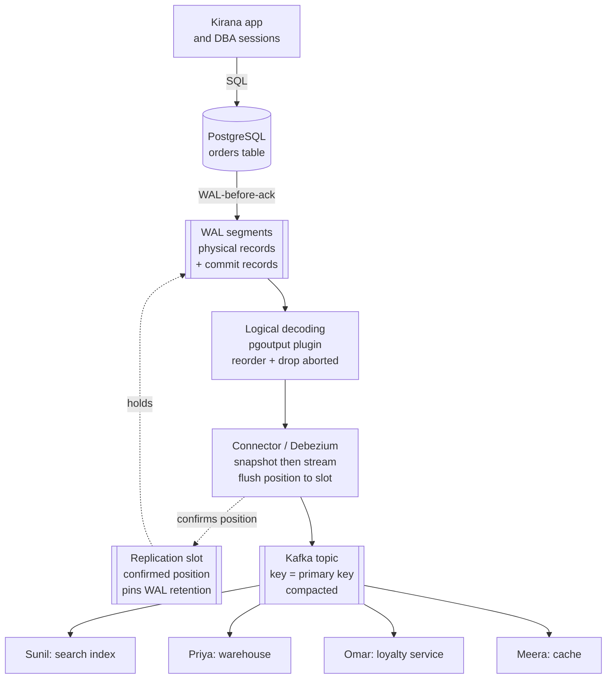
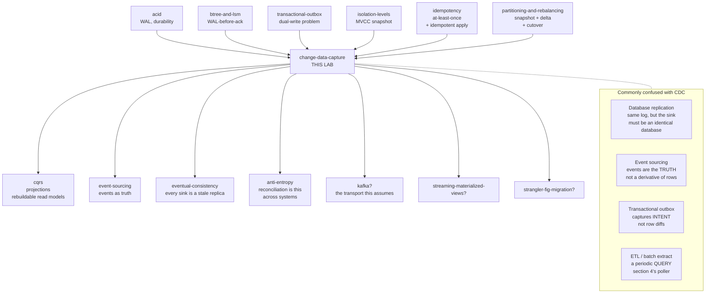

# Change Data Capture — reading the log the database already writes

> **Tell a friend:** Meera's shop has one till, and five people need to know what
> it did. They are Sunil at the whiteboard, Priya the accountant, Omar the
> loyalty clerk, Arjun the guard, and the card in the window. Each of them keeps
> walking over to peer into the cash drawer, and a drawer only shows what is in
> it *now*, so refunds vanish, cancellations linger, and nobody notices anything
> is wrong. All day that till has been printing a paper roll, in order, for the
> shop's own protection, and every change is already on it. Change data capture
> is the decision to stop peering into the drawer and start reading that roll
> from wherever you left off. One sentence carries the lab: a query captures
> data, a log captures change.

Run the poller and the log reader side by side in
[`visualization.html`](visualization.html), also published at
<https://claude.ai/code/artifact/8014f89b-38c0-44d4-a6ac-6dd215a0dfd5>. What
this lab is made of, where every number came from, and where it sits among your
other labs are in [section 17](#17-about-this-lab).

---

## 1. Why does one row have to reach five places at once?

> **In one breath:** One row in one table says what is true. Five other systems
> need to act on it, and not one of them can read that table. Somebody has to
> tell them, and getting that wrong is silent.

Meera runs **Kirana**, a grocery ordering app. When Asha places an order, one
row appears in one PostgreSQL table called `orders`. That table is the truth. If
the row says the order is paid, the order is paid.

The problem is that five other things in Meera's company need to know about that
row, and none of them is that table. Read the middle column first: it says who
gets hurt when the news does not arrive.

| Who needs to know | What it is, in software | What it does with the news |
|---|---|---|
| Sunil's whiteboard | an Elasticsearch **search index** | lets Asha find "the paneer order from last Tuesday" |
| Priya the accountant | a BigQuery **warehouse** | counts revenue for finance, to the rupee |
| Omar the loyalty clerk | another team's **loyalty service** | awards points when an order is paid |
| The card in the window | a **cache** in Redis | feeds the order-status screen, so it need not hit Postgres |
| Arjun the guard | a **fraud model** | watches status transitions as they happen |

None of these can simply read the `orders` table. Elasticsearch cannot join to
Postgres. BigQuery is in a different cloud. Omar's loyalty team is not allowed
credentials to Meera's database, and would not want them.

So somebody has to *tell* them.

Here is what goes wrong when nobody solves that properly, in the concrete.
Sunil's search box shows Asha an order that was cancelled an hour ago. Priya's
revenue number for March is ₹40,000 short, and nobody can say which orders are
missing. Omar's loyalty service awards Asha points for an order that was rolled
back and never existed.

And then the part that actually ends careers. The difference is *silent*.
Nothing errors. Nothing alerts. The numbers are simply wrong, they stay wrong,
and the person who eventually notices is a customer or an auditor.

That is the problem. Say it as one question and keep it in view for the rest of
the lab:

> **How does a change in one database reliably become an event in five other
> systems?** Without losing any change. Without inventing changes that never
> happened. And without the application having to remember to do anything.

---

## 2. Who keeps walking over to look in the cash drawer?

> **In one breath:** Forget databases. Meera has one till and five people who
> need to know what it did. They all try the same thing first, and the way it
> fails is the whole lesson.

Meera has a physical shop with one till, which is a cash register. All day, sales
happen. Asha buys paneer. Ben returns a broken egg tray. Asha's order is upgraded
from 1 kg to 2 kg of rice. Ben cancels.

Five people need to know what is happening at that till. You have already met
them, in software costume, in section 1. Here they are as people.

| Who | What they keep | What they need from the till |
|---|---|---|
| **Sunil** | a whiteboard of recent sales, out front | the list of what moved today, so customers can see it |
| **Priya** | the shop's books | the day's total, exactly, to the rupee |
| **Omar** | the loyalty card stamps | one stamp every time somebody *pays* |
| **Meera** | the card in the window: "12 orders today!" | a count that is not stale |
| **Arjun** | the security notebook | a *pattern* — paid, then refunded, then paid again in four minutes |

None of them can stand at the till all day. So how do they find out?

The obvious answer, the one every one of them will try, is this: **walk over
every few minutes and look in the cash drawer.**

Hold that thought. It is going to fail, and it is going to fail four times
without making a sound.

Before you go further, here is the shape of the climb, so you know where you are
at any point.

| Layer | Sections | After it you can… |
|---|---|---|
| Beginner | 1–9 | say why polling a table is not a change feed, and what CDC is |
| Intermediate | 10 | describe every step a real connector takes, and the failure each step prevents |
| Engineering | 11–12 | diagnose nine failure modes, and argue CDC versus outbox correctly |
| Production | 13 | name the settings, the products and the two lags you page on |

At each transition there is a checkpoint. It tells you what you can do if you
stop reading there, and what the next layer adds.

---

## 3. What do you try first, and what does each attempt still miss?

> **In one breath:** The first idea is to have the app announce every change
> itself. That breaks in a way you have already studied. The second idea is to
> ask the table what changed recently. That one looks like it works.

### 3.1 What if the application simply tells everybody?

When Meera's app writes the order row, it also publishes a message. In Java this
is the shape everybody writes first.

```java
// ILLUSTRATION ONLY — read it, don't run it. This is the shape of the bug.
@Transactional
public void payOrder(long orderId) {
    orderRepo.markPaid(orderId);              // 1. write to Postgres
    kafka.send("orders", new OrderPaid(orderId)); // 2. tell everybody
}
```

**You already know why this is broken.** It is the *dual-write problem*, and the
[transactional-outbox](../48-transactional-outbox/) lab took it apart in detail.

One-line refresher: those are two physical acts against two systems, the world
can crash between them, and no transaction spans both. Crash after step 1 and
the order is paid while nobody knows. Crash after step 2, or roll back after step
2, and five systems believe in a payment that never happened. A sent message
cannot be un-sent.

The outbox lab's fix was to write the row *and* the outgoing message in one local
transaction, then have a **relay** drain the outbox table. That works. Keep it in
your pocket. Section 12 compares it to what we build here, and the comparison is
not the one most people expect.

But notice what the outbox demands: **the application must remember.** Every code
path that changes an order must also write an outbox row. A migration script that
fixes 400 rows by hand writes nothing. A second service writing to the same table
writes nothing. A deletion issued by a database administrator at 2 a.m. writes
nothing.

So the outbox captures *what the application intended to announce*. That is only
ever as complete as the application's discipline.

Which raises the harder question — the one this lab exists to answer.

> Can we capture **every** change to a table, **including** the ones the
> application never thought to announce, **without changing the application at
> all**?

### 3.2 What if you just ask the table what changed recently?

Here is what everyone tries next, and it looks completely reasonable.

Give every order row a little stamp saying when it was last touched. In plain
words, that is a column holding the moment of the most recent change to the row.
Engineers write it `updated_at`.

```sql
-- ILLUSTRATION ONLY.
ALTER TABLE orders ADD COLUMN updated_at timestamptz NOT NULL DEFAULT now();
```

Then run a job that wakes up every 5 seconds and asks for everything stamped
later than the latest stamp it has already seen. That remembered value has a
name. It is the **high-water mark**: the largest stamp the job has processed so
far, and it only ever moves forward.

```sql
-- ILLUSTRATION ONLY. This query has three separate bugs in it.
SELECT * FROM orders
WHERE updated_at > :last_seen        -- the high-water mark
ORDER BY updated_at;
```

Ship it, and it appears to work immediately. You make a change, and five seconds
later Sunil's search index has it.

> **🔮 Predict.** You are Meera, watching this run for a week. Which of these
> five would you expect to notice first: a cancelled order that never leaves
> search, a payment that never reaches Omar, a revenue total that is short, a
> duplicate row, or a slow database?
> <details><summary>Reveal</summary>
> <b>The slow database</b>, and it is the least important of the five. Running
> one query 864,000 times a day is visible on a graph. The other four make no
> sound at all. If you guessed <em>the cancelled order</em>, you are right that
> it is the most obvious to a human — but only if a human happens to search for
> that order. That is why Meera's team found it eleven weeks later. Nothing in
> the system was going to tell them.
> </details>

This is the walk-over-and-look-in-the-drawer plan. It is the most common
change-feed design in the world, it is in production in thousands of companies,
and it is quietly wrong.

---
## 4. Why does polling lose data without ever raising an error?

> **In one breath:** A drawer only shows what is in it now. Five different things
> go wrong because of that, and four of them happen without a single error
> message, log line or moving metric.

Watch them one at a time. Every one is visible in **Tab 1** of
`visualization.html`, which runs the poller and a log reader side by side over
the same writes and counts what each one saw.

The five have short names. Keep them: the rest of the lab refers back to F-a
through F-e by name, and so do the exercises.

### 4.1 F-a — why can't a query see something that is gone?

Ben cancels. The row is removed by a `DELETE`.

The poller's question is "which rows exist and were stamped after my mark?" A
deleted row does not exist. It will not show up in any `SELECT`, at any
high-water mark, ever.

So Sunil's whiteboard keeps Ben's order forever. Priya keeps counting it.

**You have met this exact shape three times before.** In
[eventual-consistency](../28-eventual-consistency/), a delete implemented as
row-removal resurrects on every replica, because *absence cannot be propagated*.
In [anti-entropy](../38-anti-entropy/), the zombie: repair cannot tell "A deleted
it" from "C got a write A missed", so it copies the row back. In
[partitioning-and-rebalancing](../36-partitioning-and-rebalancing/), failure F9: a
delta log that records "dirty keys" instead of *operations* resurrects deletes at
cutover.

Same law, fourth costume:

> **Absence is not a value. A feed built from queries can only report what
> exists, and "gone" is not a thing that exists.**

The standard patch is a **soft delete**. Never remove the row; set a "this is
deleted" stamp instead, written `deleted_at`. That works, and it is a real design
choice. Read what it costs before you reach for it.

Every consumer must now understand your deletion convention. Every query
everywhere must filter it. The rows never leave. And it only works if *every*
writer obeys, which brings back exactly the discipline problem that made us
suspicious of the outbox in section 3.1. A `TRUNCATE`, which empties a whole
table at once, still vanishes silently.

### 4.2 F-b — why does a fast sequence look like one slow change?

Asha's order goes from pending, to paid, to refunded, in eleven seconds. Written
the way the status column actually holds it, that is
`PENDING → PAID → REFUNDED`.

The poller sleeps 30 seconds. It wakes up and sees one row, and that row says
`REFUNDED`.

Who is hurt by that, and who is not?

Meera's window card is fine. It only ever wanted the current count. **Arjun is
blind**: the pattern he was hired to watch for is precisely that sequence, and
the sequence is gone. **Omar never stamps a card**, because he never saw the
order pass through paid.

> **A poll returns state. A feed of states is not a feed of changes.** You can
> reconstruct state from changes. You cannot reconstruct changes from states.

That asymmetry is the one the [event-sourcing](../50-event-sourcing/) lab is built
on: store the passbook, compute the box. Polling stores the box.

This one has no patch. Polling faster shrinks the window and never closes it,
because two changes can always land inside one poll interval.

SQL Server makes this distinction an actual product boundary. **Change Tracking**
tells you *which rows changed*, net changes only. **Change Data Capture** gives
you *every change*. Two features, same vendor, and the reason they are two
features is this paragraph. That is sourced from Microsoft's SQL Server
documentation.

### 4.3 F-c — which poll picks up a transaction that commits late?

This is the deep one, and it is the reason this lab exists.

Before the reveal, hold one fact in your hand. In PostgreSQL, the function that
stamps "right now" into a row is fixed at the moment the *transaction started*,
not the moment the statement ran. Engineers write that function `now()`.

> **🔮 Predict.** A transaction begins at 10:00:00 and updates Asha's order,
> setting `updated_at = now()`, so the row's stamp becomes the transaction's
> start time. It then does some slow
> work and commits at 10:00:09. The poller runs every 5 seconds: at 10:00:05,
> then at 10:00:10. Which poll picks up Asha's row?
>
> <details><summary>Reveal</summary>
>
> **Neither. The row is skipped, permanently, and nothing reports an error.**
>
> If you said the 10:00:10 poll, you are assuming the stamp is written when the
> row becomes visible. It is not. It was written nine seconds earlier, and the
> mark has already walked past it.
>
> Step by step, with real values. The third column is the same step in symbols.
> The fourth is the poller's mark afterwards.
>
> | Time | What happens | In symbols | Mark afterwards |
> |---|---|---|---|
> | 10:00:00 | Transaction T begins. It sets order 7 to paid, and the row's new stamp is the transaction's start time. Nobody else can see the row yet, because T has not committed. | `UPDATE orders SET status='PAID', updated_at=now() WHERE id=7`, so the row carries `updated_at = 10:00:00` | 09:59:55 |
> | 10:00:05 | Poller asks for anything stamped later than its mark. T's row is invisible, so it is not returned. Other rows are, so the poller moves its mark. | `WHERE updated_at > 09:59:55` | **10:00:05** |
> | 10:00:09 | T commits. Row 7 becomes visible to everyone, still carrying the stamp it was given nine seconds ago. | the row says `updated_at = 10:00:00` | 10:00:05 |
> | 10:00:10 | Poller asks for anything stamped later than its mark. Row 7's stamp is **not** later. Not returned. | `WHERE updated_at > 10:00:05` | 10:00:10 |
> | forever | Row 7 is never returned again, because the mark only moves forward. | — | climbing |
>
> Asha's payment never reaches Sunil, Priya or Omar.
>
> The bug is not the clock, and it is not that particular stamping function.
> Swap in the one that reads the real wall clock at this instant,
> `clock_timestamp()`, and the window shrinks from "the whole transaction" to
> "the gap between the update statement and the commit". Still not zero. Still
> silent.
>
> Swap the timestamp for a plain counter and ask for rows numbered above the
> last one seen, which is `WHERE id > :last_id`. Identical bug. Counter values
> are also handed out at *write*
> time, so a transaction that grabs number 5000 and commits ten seconds later is
> skipped by a poller that already reached 5100.
>
> The generalization is worth memorizing:
>
> > **Any column the application writes is stamped at write time. Rows become
> > visible at commit time. A cursor over write-time values will skip every
> > transaction whose commit lands after the cursor has passed its stamp.**
>
> </details>

Is there a patch? Two partial ones, and it is worth knowing why neither is a fix.

**Lag the cursor.** Only poll up to thirty seconds ago. The ceiling in the query
becomes `now() - 30s`, on the theory that no transaction lasts 30 seconds. This
trades 30 seconds of latency for a *guess*.
The guess is wrong on the day a lock wait or a slow batch job runs for 45
seconds, which is exactly the day the data mattered.

**Ask the database what is still in flight.** PostgreSQL can tell you the oldest
transaction that has not finished yet, through
`pg_snapshot_xmin(pg_current_snapshot())`, so you can refuse to advance the
cursor past it. This is genuinely correct in principle, and it is a real
technique.

But notice what just happened. To make polling safe, you had to start reading the
database's internal transaction state. You are one step away from the idea in
section 6, and you are doing it the hard way.

### 4.4 F-d — what happens when two changes share the same instant?

Two transactions commit in the same millisecond. Both rows are stamped
`10:00:07.412`.

The poller returns one of them, because the page ended there. It records a mark
of `10:00:07.412`, and next time asks for anything *strictly later*, which is
`> 10:00:07.412`. The other row is gone.

Ask for anything *later or equal* instead, which is `>=`, and you re-deliver the
same row on every single poll, forever, until something else changes it.

So the polling designer must choose between losing rows and duplicating them. The
correct choice is "later or equal" plus consumers that survive duplicates. Notice
that, because **at-least-once is going to turn out to be the answer here too**,
for much better reasons.

### 4.5 F-e — why is the poll interval a dial with no good setting?

Poll every 100 ms and you run that query 864,000 times a day against your
production database, mostly to learn that nothing changed. On a big table with a
poor index, that is real load.

Poll every 5 minutes and Sunil's index is 5 minutes stale, and F-b eats nearly
every intermediate state.

There is no setting that is both cheap and fresh, because **the poller is
guessing when something happened, and the database already knows.**

### 4.6 Which of the five make a sound?

This is the table to remember. Read the last column: it is why this pattern is
the most expensive one on the list.

| Failure | In one line | What Meera would see | Does anything tell her? |
|---|---|---|---|
| **F-a** deletes | a query cannot return a row that is gone | cancelled orders live forever in search | **No** |
| **F-b** intermediate states | one poll sees one state, not the path | Omar never stamps, Arjun never sees the pattern | **No** |
| **F-c** late commits | the mark walks past a stamp that is not visible yet | one payment missing, chosen at random | **No** |
| **F-d** ties | strictly-later loses rows, later-or-equal repeats them | a row missing, or the same row forever | **No** |
| **F-e** the interval | cheap and stale, or fresh and expensive | slow database, or slow search | **Yes** — on a graph |

> **The score after section 4.** Polling loses deletes, loses intermediate
> states, silently skips late-committing transactions, must choose between
> losing and duplicating at ties, and cannot be both cheap and fresh. **Four of
> those five are silent.** No exception, no log line, no metric moves.

---

## 5. What do we actually need, before we invent anything?

> **In one breath:** Write down the shopping list in plain words first. Six
> things. Then notice that three of them are facts only the database knows about
> itself.

Everything after this section is the pursuit of these six properties.

| # | The requirement | Said plainly |
|---|---|---|
| 1 | **Changes, not states** | every individual change, including ones immediately overwritten |
| 2 | **Deletes included** | removal is an event, not an absence |
| 3 | **Commit order** | the order the database made things real, not statement order, not timestamp order |
| 4 | **Only committed changes** | a rolled-back transaction produces nothing at all |
| 5 | **Complete and resumable** | no gaps ever; after a crash the reader knows exactly where it stopped |
| 6 | **Zero application cooperation** | a manual update by a database administrator is captured as faithfully as the app's |

That last one deserves a sentence on its own. The truth is the table, not the
code path that happened to write to it.

Now look at the list again and notice something uncomfortable. Requirements 3, 4
and 5 are about the database's *internal* notion of commits and ordering. No
query you can write from the outside has access to that.

So either we give up, or we find something on the inside.

---
## 6. What if the perfect change feed already exists?

> **In one breath:** The thing we need has been running inside the database the
> whole time. It was not built for us. It was built so the database could survive
> a power cut, and that is exactly why it is trustworthy.

> **🔮 Predict.** Somewhere inside a PostgreSQL server there is already a
> durable, strictly ordered, complete, gap-free, replayable, resumable record of
> every single change ever made. It includes deletes. It includes changes the
> application never announced. What is it — and, more interestingly, *why* does
> it already exist?
>
> <details><summary>Reveal</summary>
>
> It is the **write-ahead log**, and it exists because of the **D in ACID**.
>
> If you guessed a table of audit rows, or a trigger, you have guessed something
> the application had to opt into. The answer is underneath the application, and
> nobody opts into it.
>
> Recall the mechanism from the [acid](../07-acid/) and
> [btree-and-lsm](../05-btree-and-lsm/) labs. Before the database modifies a data
> page, and before it answers "committed" to the client, it appends a description
> of the change to a sequential log and makes *that* durable. If the machine
> loses power one microsecond later, recovery replays the log and the change
> survives. `WAL-before-ack` was the phrase.
>
> Now read the six requirements from section 5 against that log, one by one.
>
> | The requirement | Why the log already has it |
> |---|---|
> | changes, not states | The log records *operations*. Three updates to one row are three records. It could not do recovery otherwise. |
> | deletes included | A delete is a change that must survive a crash, so it is in the log like any other. |
> | commit order | Recovery must not resurrect a rolled-back transaction, nor apply effects out of order. The log carries commit records and an ordering. |
> | only committed | Deciding this is recovery's whole job. The information is in the log by construction. |
> | complete, resumable | One gap and crash recovery would produce a corrupt database. Every record has a position, so "resume from here" is the log's native operation. |
> | zero app cooperation | The 2 a.m. manual update must survive a crash too. It is in the log. The application is not consulted. |
>
> **Six out of six.** Not because anyone designed that log for us. Because a log
> complete enough to survive a power cut is automatically complete enough to feed
> a search index.
> </details>

So here is the idea, in one sentence:

> **Change Data Capture (CDC): stop asking the database what its tables currently
> contain, and instead read the log the database already writes for its own crash
> recovery, turning each record into a change event other systems can consume.**

And here is the second sentence, which is the part people miss:

> The reason this is *trustworthy* rather than merely clever is that the
> database's own survival depends on that log being complete and correctly
> ordered. You are not building a change feed. You are **tapping one whose
> correctness is already load-bearing for something the vendor cares about far
> more than they care about your search index.**

That is the whole concept. Everything from here is the vocabulary, then the four
things that go wrong when you actually try it, then what the resulting machine
looks like in production.

---

## 7. Which words have you now earned?

> **In one breath:** Ten words, each one introduced only because section 6 just
> made it necessary. Every one is a thing in Meera's shop before it is a term.

Terms that arrive later in the lab are defined where they first appear, under the
same contract. All of them are collected in the glossary in section 16.

### 7.1 Why does "capture" not mean the same thing as "query"?

Watching a database's own change log, so that every insert, update and delete
becomes a message other systems can read — that is **change data capture**, and
CDC is the short form.

Precisely: it is a process that consumes a database's transaction log, decodes
each record into a row-level change event, and publishes those events in commit
order to a durable stream. A change event carries the table, the operation, the
row before, the row after, a position in the log, and some transaction metadata.

Why does the phrase exist at all? To name the distinction from *querying data*. A
query captures **data**. CDC captures **change**. The phrase was coined to make
it impossible to say "we'll just poll the table" and think you have said the same
thing. Section 4 is the argument for why the distinction is not pedantic.

Concretely: Asha's order 7 goes to paid, and the log records it at a position
written `16/B374D848`. That position has a name of its own, which arrives in
section 7.3. CDC turns the record into an event saying "table orders, operation
update, status was pending, status is now paid, at position `16/B374D848`".

This is the same job the [transactional-outbox](../48-transactional-outbox/)
relay does — get changes out of the database and into a broker. The source of
truth is the opposite one. The outbox reads a table the application wrote on
purpose. CDC reads a log the database wrote for itself.

### 7.2 What is the log called where you work?

The file the database appends to before changing anything, so that a crash cannot
lose work — that is the **write-ahead log**, written WAL for short.

Precisely: an append-only, sequentially written, durably flushed record of every
modification, ordered, and positioned.

The name carries the rule. "Write-ahead" names the *ordering constraint* that
makes it work. The log write must be durable **ahead of** the data page write,
and ahead of the client's acknowledgement. Drop the ordering and the file is just
a file.

You will meet the log under different names, because CDC tooling is
vendor-specific. The right-hand column is the bookmark each vendor gives you,
which section 7.3 is about.

| System | What the log is called | What a position is called |
|---|---|---|
| PostgreSQL | WAL (write-ahead log) | **LSN**, log sequence number, for example `16/B374D848` |
| MySQL / MariaDB | **binlog** (binary log), separate from InnoDB's redo log | file plus offset, or **GTID**, a global transaction id |
| Oracle | redo log | **SCN**, system change number |
| SQL Server | transaction log | LSN |
| MongoDB | **oplog**, which is a capped collection | **resume token** |
| DynamoDB | DynamoDB Streams | shard iterator, or sequence number |

One wrinkle is worth having straight, because it confuses everybody once.
**MySQL has two logs.** InnoDB's *redo log* is the crash-recovery log, and it is
physical and private. The **binlog** is a separate server-level log written for
replication, and it is the binlog that CDC reads. PostgreSQL has one log doing
both jobs.

That is why MySQL CDC requires you to *turn the binlog on* and configure its
format, while PostgreSQL CDC requires you to change the WAL's *verbosity*.
Different-shaped configuration, same underlying idea.

The log is how [acid](../07-acid/) keeps its A and its D. It is also why an LSM
tree's in-memory table is safe at all, as [btree-and-lsm](../05-btree-and-lsm/)
showed: the log was written first.

### 7.3 What is a bookmark into a log?

Sunil can say "I have read the roll down to line 4,182". That sentence is a
bookmark, and the log has one too.

Precisely: a **log position** is a monotonically increasing identifier of a
location in the log. It is comparable and durable, so that "everything strictly
after position P" is a well-defined, gap-free set. PostgreSQL calls it an **LSN**
and prints it like `16/B374D848`. Oracle calls it an SCN, MySQL a GTID, MongoDB a
resume token.

Why does this matter enough to have four vendor names? Because this single value
is what makes CDC *resumable*, and resumability is the property section 4's
polling cursor could not have.

Put the two side by side, because they look identical and behave nothing alike.
The high-water mark in section 4 was a bookmark over **application-written
values**. A log position is a bookmark over **the database's own commit
sequence**. The log position cannot skip a late-committing transaction, because
the position *is* the commit ordering rather than a proxy for it.

In use: the reader stores `16/B374D848`, then restarts, then asks the server to
stream from `16/B374D848`. It receives every commit after that point, in order,
with nothing missing.

You have seen this object before under another name. A projection's checkpoint
in [cqrs](../51-cqrs/) says "I have applied up to event N". That is exactly this
object, except that here the database issues the numbers.

### 7.4 Why does a byte patch need translating?

Physical means "copy my bytes exactly". Logical means "tell me which rows changed
and how".

PostgreSQL's WAL records are *physiological*. They say things like "on relation
16384, block 42, apply this tuple image". They reference on-disk layout, not
table and column names. **Physical replication** ships those records to a standby
that is byte-for-byte identical, and the standby replays them.

**Logical decoding** is a server feature that reads the same WAL, consults the
system catalogs, and reconstructs *row-level* events: table orders, update, here
is the row before and the row after. Written the way tools print it, that is
`table orders, UPDATE, before {...}, after {...}`.

The term exists to name the thing that makes CDC possible at all. A physical WAL
record is useless to Elasticsearch. It is a byte patch for a page that
Elasticsearch does not have. Everything valuable about CDC lives in the decoding
step.

In PostgreSQL the decoder is a plugin. The built-in one, used by most tools since
PostgreSQL 10, is **`pgoutput`**. The alternatives are `wal2json` and
`decoderbufs`.

There is one setting that switches the WAL from "enough to recover" to "enough to
decode". In words: set the log's detail level to logical. Written out, it is
`wal_level = logical` in `postgresql.conf`, and it requires a restart. It makes
the WAL bigger, because reconstructing a row change needs more information than
replaying a page patch does. That extra volume is CDC's standing tax on the
source database.

The replicas in [quorums-and-replication](../34-quorums-and-replication/) were
physical ones. A CDC consumer is a *logical* replica that happens not to be a
database.

### 7.5 What is a slot, and why is it the most dangerous object here?

A **replication slot** is a named bookmark **that the server promises to
respect**, by refusing to delete log the bookmark still needs.

Precisely: a persistent server-side object holding one consumer's confirmed
position. It pins log retention. The server will not recycle WAL segments beyond
the oldest slot's confirmed position, and will not vacuum away row versions the
slot may still need in order to decode. That confirmed position has a name you
will see on every dashboard: `confirmed_flush_lsn`.

Without a slot, CDC has no durability story. The WAL is recycled aggressively. It
is scratch space for recovery, sized for recovery, and it is not an archive. A
consumer offline for an hour would come back to find its position no longer
exists. The slot converts "the log happens to still be there" into "the log is
*guaranteed* still there".

Creating one is a single call:
`pg_create_logical_replication_slot('kirana_cdc', 'pgoutput')`. From that moment
the server keeps WAL for `kirana_cdc` until `kirana_cdc` confirms it has consumed
it.

Now the teeth, stated here because this is the single most common CDC outage.
That promise is unconditional. A slot whose consumer is dead does not expire. It
holds WAL forever, the disk fills, and **the production database stops accepting
writes.**

CDC's most dangerous property is that a broken *consumer* can take down the
*source*. Failure F1 in section 11 walks it through, and Tab 4 of the
visualization lets you cause it.

A slot is a lease that nothing revokes. Every warning in
[distributed-locking](../43-distributed-locking/) about leases held by dead
holders applies here, with one twist: the resource being held is disk space on
your primary.

### 7.6 Why does a stream alone leave you with nothing?

"Here is everything that exists right now" comes first. "And here is everything
that happens from now on" comes second.

The first is the **snapshot**, also called the initial load: a consistent read of
the current table contents, taken at a known log position. The second is the
**streaming** phase: the decoded log, from exactly that position onward.

Both are needed because the log only holds recent history. Meera's table has five
years of orders. The WAL has twenty minutes. Streaming alone gives Sunil an index
that knows about changes but not about the world.

Concretely: snapshot 4.1 million `orders` rows as of position `16/B300000`, then
stream from `16/B300000`.

You already own this protocol. Snapshot, plus a delta log, plus catch-up, is the
migration protocol from
[partitioning-and-rebalancing](../36-partitioning-and-rebalancing/). Version 3 in
section 10 shows they are the same protocol for the same reason.

### 7.7 What does a change event know about the old row?

What the row looked like before the change is the **before-image**. What it looks
like after is the **after-image**.

Precisely: they are the `before` and `after` payloads of a change event. An
insert has only an after. A delete has only a before. An update ideally has both.

*Ideally* is doing a lot of work in that sentence, which is why the term is worth
having. It lets you ask the question that matters — do I get the before-image,
and how complete is it? — instead of assuming.

In PostgreSQL the answer is controlled by a per-table setting called **`REPLICA
IDENTITY`**, in plain words "how much of the old row to write into the log". The
default, `REPLICA IDENTITY DEFAULT`, gives you only the primary key. Failure F7
in section 11 is what that costs.

Watch what it does to Ben's cancelled order. With the default setting, the delete
event is `{op: d, before: {id: 91, customer: null, status: null, total: null}}`.
The id is there. Everything else is `null`, and `null` here means *"not
captured"*, not *"was null"*. A consumer that cannot tell those apart will write
nulls into Priya's warehouse.

An event stream carrying only after-images can rebuild state, but it cannot
answer "what changed, and by how much", without keeping its own copy. That is the
same limitation [event-sourcing](../50-event-sourcing/) discusses from the other
side.

### 7.8 Who actually does all of this?

The **connector** is the program that does the work. In Meera's shop it is Dev,
the runner who reads the till roll and carries what he finds to the other four.

Precisely: the process that opens a replication connection to the source,
decodes, snapshots when needed, converts events to the sink's format, publishes
them, and periodically **commits its position** back to the source slot.
**Debezium** is the dominant open-source implementation, and it usually runs
inside **Kafka Connect**.

The word earns its place by naming an uncomfortable fact. This is a *separate
deployed process with its own failure modes*, not a database feature you switch
on. Its liveness, its lag, its restarts and its position-flushing are all things
you now operate. Half of section 11 is failures of Dev rather than failures of
the idea.

### 7.9 How can a stream of changes also be a complete picture?

Kafka can be told to keep, for each message key, at least the most recent value,
and to discard the older ones. That rule is **log compaction**. A **tombstone** is
a message with a key and a `null` value, which tells compaction to eventually
drop the key entirely.

Together they make a change stream double as a *complete snapshot of current
state*. Replay a compacted topic from the beginning and you get one message per
key, holding its latest value. That is why Sunil's index can be rebuilt from the
topic without going back to the source at all.

The tombstone exists because, once again, **absence cannot be represented by
omission**. That is F-a's law in its third appearance: you met it in
eventual-consistency, then in partitioning, and now here.

An LSM tombstone from [btree-and-lsm](../05-btree-and-lsm/) and a Kafka tombstone
are the same object solving the same problem. Both also have a retention deadline
you can violate.

### 7.10 What is lost when one transaction becomes five messages?

**Transaction boundaries** are the markers saying "these five row changes were
one transaction".

Precisely: begin and commit metadata carried alongside the row events. It holds
the transaction id, the total event count, and per-table counts.

Here is why it has to be carried explicitly. Fan five row events out to three
topics and twelve partitions, and the fact that they were **atomic at the source**
is destroyed unless something preserves it.

Asha's payment updated `orders` and inserted into `payments` in one transaction.
A downstream consumer reading two topics can absolutely see the payment before
the order. The transaction metadata is what lets a careful consumer buffer until
the transaction is complete. Most consumers do not, and mostly get away with it.
Failure F8 in section 11 is about when they do not.

---
## 8. What are the two pictures, and where does the friendly one lie?

> **In one breath:** The till prints a paper roll all day, for the shop's own
> protection. Everything the five people need is already on it. The picture is
> right about four things and wrong about four others, and the wrong four are
> where CDC gets hard.

### 8.1 What is already printing at the till?

Meera's till prints a continuous paper roll. Every sale, every refund, every
void, printed in order, as it happens.

The roll is **not printed for Sunil, Priya or Omar.** It is printed because Meera
needs to reconstruct the day if the cash drawer is stolen or the till is dropped.
It exists for **recovery**.

But look at what the roll *is*. A complete, ordered, gap-free record of every
change to the drawer. It includes the ones that were immediately reversed. It
includes the removals. It is written before the money moves. And it is numbered,
so anyone can say "I have read up to line 4,182."

So the five people stop walking over to look in the drawer, and start reading the
roll from wherever they left off. That is change data capture.

The cold-start problem is right there in the analogy too. The roll only goes back
to when the paper was last changed. A new accountant starting on Tuesday needs a
**count of the drawer**, which is the snapshot, *plus* the roll from that moment,
which is the streaming.

### 8.2 What does the same picture look like in software?

Read the diagram downward. The application writes only to Postgres and knows
nothing about any of the rest.



The WAL is written for durability. The decoder turns physical records into row
events. The slot is a promise not to delete log the connector still needs.

Note that the slot's arrow points *backwards*, from consumer to source. That
coupling is what makes failure F1 possible.

The connector emits events keyed by primary key. Consumers are independent. They
can be added, removed, or rebuilt without the application changing at all.

### 8.3 Which part of the shop is which part of the system?

Read this left to right. Every row is one object wearing two costumes.

| In Meera's shop | In the system |
|---|---|
| the paper roll | the write-ahead log |
| printed before the cash drawer opens | `WAL-before-ack` |
| line number on the roll | the log position, or LSN |
| the cash drawer's current contents | the table's current state |
| counting the drawer at 9 a.m. | the initial snapshot |
| "read the roll from line 4,182" | streaming from a log position |
| a clip on the roll saying "don't bin past here" | the replication slot |
| a "VOID" line, printed like any other | a tombstone, or a delete event |
| the roll is in shop-code, not English | physical records need logical decoding |

### 8.4 Where does the story lie to you?

Four places, and each one is a section of this lab.

**The roll only shows completed sales. The WAL does not.** This is the important
one. A real WAL contains records from transactions that are still open, and from
transactions that were **rolled back**. Nothing on a WAL record says "this one
counts". The decoder must buffer a transaction's changes and emit them only when
it sees the commit record. On an abort, it drops them entirely. Version 2 in
section 10 is this.

Imagine the till printing a line *the moment the cashier scanned an item*, before
the customer paid or walked out. Now the roll looks like the WAL, and Sunil's
whiteboard advertises sales that never happened.

**The roll is in commit order because the shop has one till. The WAL is not.**
Records from concurrently open transactions are interleaved in the file, in the
order the statements ran.

Trace it with positions. Transaction T1 writes records at positions 100 and 400.
T2 writes at 200 and commits at 300. T1 commits at 500. The correct output is
`T2 (commit at 300), then T1 (commit at 500)`, because that is the order they
became real. So the decoder
**reorders** by commit position. What you consume is in commit order. What is on
disk is not. PostgreSQL does this reordering for you, and that is a large part of
what logical decoding buys.

**Nobody throws the roll away while Priya is on holiday. The database absolutely
will.** WAL is recycled on a schedule sized for recovery, not for you. That is
why the slot exists, and why the slot's promise is dangerous rather than merely
useful. In the analogy, the shop would have to stop selling because the storeroom
is full of paper nobody has read. That is precisely failure F1.

**The roll says *why*: "REFUND — damaged eggs". The WAL does not.** The WAL says
the status column now reads `status: 'CANCELLED'`, and nothing else. The database
records
**what the rows now say**, never **what the business meant**.

This is the single most consequential limitation of CDC, and section 12 is built
on it. A row diff cannot tell you whether Ben cancelled, or a fraud rule
cancelled, or a batch job cancelled 14,000 orders because someone fat-fingered a
condition.

---

## 9. What should you watch in the simulator?

> **In one breath:** Open Tab 1 and watch two counters. One is the poller. One is
> the log reader. They start equal and they end apart, and the page tells you in
> a full sentence which failure moved them.

Open **`visualization.html`**, also published at
<https://claude.ai/code/artifact/8014f89b-38c0-44d4-a6ac-6dd215a0dfd5>. It has
four tabs, and each one exists to make one section of this lab visible rather
than merely stated.

Before the mechanism section, spend five minutes on Tab 1.

> **What to look at on Tab 1.** The middle column is the WAL, growing downwards
> with a position on every record. The right column has two consumers watching
> the same writes: a **poller** with a high-water mark, and a **log reader** with
> a log position. The bar at the bottom is the verdict. Press **"Run the five
> failures"**, then watch only two numbers — *changes the poller saw* and
> *changes the log reader saw*. They will diverge, and the event log will say in
> a full sentence which of section 4's five failures caused each divergence.

The other three tabs come up as the mechanism needs them.

| Tab | What it shows | Open it at |
|---|---|---|
| 2 — The Decoder | two interleaved transactions and a rollback, with a switch between decoder v1 (emit as decoded) and v2 (buffer to commit) | section 10, version 2 |
| 3 — Cold Start | three snapshot protocols, with writes happening *during* the snapshot | section 10, version 3 |
| 4 — The Slot | a log-retention disk gauge, a connector you can stop, and a switch for the periodic empty event | section 11, failure F1 |

Every scenario asks you to predict before it runs.

> ### ✅ Checkpoint — end of the beginner layer
>
> **You can now:** explain why polling a table is not a change feed, naming
> deletes, intermediate states and the late-commit skip. You can say what CDC is
> in one sentence. You can explain why reading the database's recovery log is
> trustworthy rather than a hack. In a design review you can say "we should CDC
> that table instead of polling it" and defend it.
>
> **You cannot yet:** build one, or debug one. You do not know what Dev the
> connector actually has to do between the WAL and the topic. The four things he
> does are all *fixes for failures*, which is what section 10 walks through.
>
> **Next, in section 10:** the mechanism, built the way you would build it,
> broken four times, and repaired each time. Every strange detail of a real CDC
> connector is the scar of one of those four breakages.

> **Say it back.** Without using the words *log*, *poll* or *capture*, explain to
> a friend why Priya's total for March can be wrong and nobody finds out.
> <details><summary>A good answer sounds like</summary>
> "She works from what is in the drawer when she looks. If a sale went in and
> came straight back out between two of her visits, she never sees either half.
> If a receipt is torn up, the drawer just has less money in it and no note
> saying why. She is not making a mistake, and nothing tells her she is missing
> anything, so she trusts her total and so does everyone else."
> </details>

---
## 10. How would you build the connector, and how does each version break?

> **In one breath:** We are going to build Dev's job for him, five times. Four of
> the first four are wrong. Every odd detail in a real CDC connector is the scar
> left by one of these breakages.

The rule for this section comes from
[partitioning-and-rebalancing](../36-partitioning-and-rebalancing/). Do not
present the finished machine. Present the version a competent engineer builds
first, break it with a concrete trace, and let the repair explain itself.

Throughout, the setting is Meera's orders table. It holds an id, a customer, a
status, the order total in paise, and the last-touched stamp from section 3.2.

```
orders(id bigint PK, customer text, status text, total_paise bigint, updated_at timestamptz)
```

Two rows to start with. Order 7 belongs to Asha and is pending at 48000 paise,
which the table holds as `(7, 'asha', 'PENDING', 48000)`. Order 91 belongs to Ben
and is pending at 12500 paise, held as `(91, 'ben', 'PENDING', 12500)`.

### 10.1 Version 1 — what if Dev just reads the roll aloud?

The design: open the WAL files, read records in order, publish each one to Kafka.

Here is a faithful sketch of what three consecutive PostgreSQL WAL records look
like in spirit. It is not byte-exact; the point is the *shape*.

```
LSN 16/B374D810  rmgr=Heap  op=HOT_UPDATE  rel=16384  blk=42  off=3
                 → new tuple image: <opaque 61 bytes>
LSN 16/B374D848  rmgr=Btree op=INSERT_LEAF rel=16391  blk=7   off=12
LSN 16/B374D890  rmgr=Xact  op=COMMIT      xid=90211  ts=2026-08-30 10:00:09
```

> **🔮 Predict.** You are Sunil's search index. You receive the first record
> above. What can you do with it?
>
> <details><summary>Reveal</summary>
>
> **Nothing at all.** Read what it says: relation 16384, block 42, offset 3, here
> are 61 bytes.
>
> If you guessed "index the tuple image", you have assumed the bytes carry column
> names. They do not carry anything but values.
>
> - `16384` is an internal number PostgreSQL calls an **OID**. It is not the
>   string `orders`. To learn that it means `orders`, you must read the catalog
>   table `pg_class`.
> - `blk=42, off=3` is a physical address in a file. It is meaningful only to a
>   replica whose files are byte-identical to the primary's.
> - The 61 bytes are a tuple in on-disk format. Column values are packed
>   according to the *current* table definition, with no column names, with a
>   null bitmap and alignment padding. Large values may have been replaced by
>   references to another table entirely, which is failure F9.
> - The second record is an index-page update. It is not a change to your data at
>   all. It is bookkeeping, and publishing it is pure noise.
>
> This is why **physical replication only works to an identical replica.** The
> standby can replay "block 42, offset 3, these bytes" because it has the same
> block 42. Elasticsearch does not have a block 42.
> </details>

**The repair is logical decoding.** Between the WAL and Dev sits a decoder that
knows the catalogs. It maps OID 16384 to `public.orders`. It unpacks the tuple
using the table definition. It drops the index-maintenance records, because they
are not logical changes. And it emits this:

```json
{"table": "public.orders", "op": "u",
 "after": {"id": 7, "customer": "asha", "status": "PAID", "total_paise": 48000},
 "lsn": "16/B374D810"}
```

Now the after-image is a row a search index can index.

Note one detail carefully. The decoder must consult the catalog **as of the time
the record was written**, not as of now. That point comes back in version 5, and
it hurts a lot in MySQL.

### 10.2 Version 2 — what if Dev calls out each line as he reads it?

The design: decode each record and publish immediately. Low latency, no
buffering, obviously correct. The log is in order, so the output is in order.

Watch it on a trace. Two transactions run concurrently. T1 is Asha paying. T2 is
Ben, who starts a cancellation, and then his session errors and rolls back.

| Log position | The record | What version 2 publishes | In symbols |
|---|---|---|---|
| `…D810` | T1 (transaction 90211) sets order 7 from pending to paid | update: order 7 is paid | `u {id:7, status:PAID}` |
| `…D830` | T2 (transaction 90212) sets order 91 from pending to cancelled | update: order 91 is cancelled | `u {id:91, status:CANCELLED}` |
| `…D850` | T2 inserts a refund of ₹125.00 against order 91 | create: refund 12500 on order 91 | `c {order:91, amount:12500}` |
| `…D870` | **T2 aborts**, which the log records as `ABORT` | nothing | — |
| `…D890` | T1 inserts a payment of ₹480.00 against order 7 | create: payment 48000 on order 7 | `c {order:7, amount:48000}` |
| `…D8B0` | **T1 commits** | nothing | — |

> **🔮 Predict.** Version 2 publishes each row event the instant it decodes it.
> What does Omar see, and what does Priya's refund report say at the end of this
> trace?
>
> <details><summary>Reveal</summary>
>
> Both of them see **Ben's cancellation and a ₹125 refund that never happened.**
>
> T2 rolled back. In the database, order 91 is still pending and there is no
> refund row. In every downstream system, order 91 is cancelled and Priya is
> reporting a refund.
>
> Worse: nothing will ever correct it. There is no "un-publish" record in the
> WAL. The abort record simply means those changes are dead, and version 2 has
> already shipped them. Requirement 4 from section 5, only committed changes, is
> violated silently and permanently.
>
> There is a second, quieter bug in the same trace. If you only spotted the
> refund, you missed it. T1's two events were published at `…D810` and `…D890`,
> with T2's events *interleaved between them*. So even for successful
> transactions, version 2's output is in **statement order**, not **commit
> order**. A consumer sees fragments of several transactions interleaved and can
> never tell where one atomic change ends. Requirement 3 is violated too.
> </details>

**The repair is to buffer per transaction, emit at commit, ordered by commit
position.** The decoder keeps one buffer per transaction id, in memory, spilling
to disk if it grows large. On a commit record, it flushes that transaction's
events in order, stamped with the commit position. On an abort, it **discards the
buffer** and emits nothing.

The correct output of the trace above is therefore, in full:

```
(nothing at all for T2 — it aborted)
u {id:7, status: PENDING→PAID}     lsn 16/B374D8B0   xid 90211
c {payments: order 7, 48000}       lsn 16/B374D8B0   xid 90211
```

Two events. Both stamped with the **commit** position. Adjacent, in the order
they happened inside the transaction, with nothing of T2's in between.

**This is what PostgreSQL logical decoding does for you by default, and it is
most of the value of the feature.** Two honest refinements follow.

The buffering is why one huge transaction creates a latency spike. Take a
ten-million-row update. Nothing can be emitted until the commit arrives, so CDC
lag for a 20-minute batch job is about 20 minutes, and then a flood. It also
means memory and disk pressure in the decoder. This is a real operational
characteristic, not a bug.

PostgreSQL 14 and later added an **opt-in** mode that streams in-progress
transactions before commit, switched on with `streaming = on`, along with
two-phase support, precisely to avoid that spike. It moves the problem rather than removing it. The consumer now receives
events that might be aborted, and must be told to discard them. Turn it on and
you have deliberately re-accepted version 2's problem in exchange for latency.
That behaviour is documentation-sourced; I have not run it.

### 10.3 Version 3 — what does a brand-new reader know about last year?

We now emit only committed changes, in commit order, decoded into row events.
Requirements 1, 2, 3, 4 and 6 from section 5 are met. Turn it on in production.

> **🔮 Predict.** The connector starts at 10:00 on a Tuesday, against a table
> with 4.1 million orders going back five years. Asha searches for her March
> order. What does she get?
>
> <details><summary>Reveal</summary>
>
> **Nothing.** Sunil's index is empty, and stays empty except for orders that
> happen to change after 10:00 on Tuesday.
>
> If you guessed "everything, after a delay", you have assumed the stream carries
> history. It does not. The stream gives you *changes from now*. It never
> mentioned the 4.1 million rows that were already there, because their changes
> happened years ago and that WAL was recycled long before you existed.
>
> This is requirement 5's other half. "Complete" does not only mean "no gaps
> going forward". It means the consumer eventually holds the whole truth.
> </details>

So we need an **initial snapshot**: read the current table, emit one event per
existing row, then start streaming.

Debezium marks those snapshot events with their own operation code, `r` for
*read*, so a snapshot row arrives stamped `op: r`. It is deliberately different
from the codes for create, update and delete, so a consumer can tell "this row
exists" from "this row just changed".

And here the trap opens. There are three ways to do the handover, and two of them
are wrong.

**Protocol A: snapshot, then start streaming from "now".**

```
10:00:00  begin reading orders …
10:03:40  … 4.1M rows emitted, snapshot done
10:03:40  start streaming from current LSN 16/C100000
```

Trace what happens to one row. At 10:01:15, while the snapshot's cursor is
somewhere around id 900,000, Asha pays for order **7**. The snapshot already read
and emitted that order, at 10:00:04, as pending.

- The snapshot emitted "order 7 exists and is pending" at 10:00:04, which in the
  stream is `r {id:7, status: PENDING}`.
- The change happened at 10:01:15 and sits in the WAL at position `16/C0A1234`.
- Streaming starts at `16/C100000`, which is **after** `16/C0A1234`.
- The payment event is never delivered. Order 7 is paid in the database and
  pending for Sunil, Priya and Omar — **forever**, or until someone re-snapshots.

**You have seen this exact failure before.** It is
[partitioning-and-rebalancing](../36-partitioning-and-rebalancing/)'s v1
copy-then-flip. That lab's words: it "silently shreds every acknowledged write
landing behind the copy cursor — no crash needed, protocol-design data loss."
Same protocol, same bug, different problem domain.

The generalization is worth carrying:

> **Any time you copy a live dataset while it is being written, the copy and the
> change stream must be joined at a *single agreed point*. The copy must be taken
> *as of* that point. Otherwise the gap between them is silent data loss whose
> size equals the copy duration.**

**Protocol B: lock the table, snapshot, unlock, stream.**

Take a table lock so nothing can change during the copy, so there is no gap.

Correct, and a production outage. The snapshot took 3 minutes 40 seconds. For 3
minutes 40 seconds nobody could place an order. On a 2 TB table it is hours.

Debezium's MySQL connector historically defaulted to a global read lock for
exactly this reason. The setting `snapshot.locking.mode` exists so you can refuse
it, and the option's existence is the fossil record of this problem.

**Protocol C: snapshot inside a repeatable-read transaction, at a known
position.**

This is the real answer, and it works because of a mechanism you already own from
[isolation-levels](../08-isolation-levels/): multi-version concurrency control. A
transaction at `REPEATABLE READ` sees a *snapshot* of the database as of its
start, unaffected by concurrent commits, and, critically, **without blocking any
writer**.

```
10:00:00  BEGIN TRANSACTION ISOLATION LEVEL REPEATABLE READ;
10:00:00  … record the current LSN, 16/C000000, as the handover point
10:00:00  SELECT * FROM orders;   -- sees the world as of 16/C000000, blocks nobody
10:03:40  COMMIT;
10:03:40  start streaming from 16/C000000
```

Now Asha's 10:01:15 payment is at position `16/C0A1234`, which is **after**
`16/C000000`, so it *is* streamed. And the snapshot's copy of row 7 was pending,
taken as of `16/C000000`, which is *before* the payment. The two pieces meet
exactly, with no gap.

They also **overlap** in one direction, which is the last piece. Any row that
changed between the transaction's start and the moment the snapshot's cursor
reached it is delivered twice. Order 7 arrives once from the snapshot, as
pending, and once from the stream, as paid — that is `r {status: PENDING}`
followed by `u {status: PAID}`.

That is **fine, and only fine because the events are keyed by primary key and
applied as upserts**. The later one wins and the state converges. Deliver them out
of order and you would end up with pending. Which brings us to version 4.

In practice the connector needs the snapshot transaction and the replication slot
to agree on that position. PostgreSQL provides exactly this. Creating a logical
slot exports a snapshot the reading transaction can adopt, so "the slot's
starting position" and "what the snapshot sees" are the same instant by
construction. That is documentation-sourced.

Debezium's `snapshot.mode` setting controls the whole behaviour. Read the middle
column first.

| Setting value | In words | When you want it |
|---|---|---|
| `initial` | snapshot, then stream. The default. | the ordinary first deploy |
| `never` or `no_data` | stream only, no snapshot | the sink is already populated by other means |
| `when_needed` | snapshot only if the stored position is unusable | recovery after an invalidated slot |
| `initial_only` | snapshot, then stop | a one-off bulk export |

### 10.4 Version 4 — what happens the moment Dev drops the roll?

Correct on paper. Now the connector process dies, because processes die.

Concretely. The connector emitted Asha's payment event to Kafka at 10:04:02. It
was going to flush its position, `16/C0A1234`, back to the replication slot at
10:04:05, because it batches those flushes — confirming every single event to the
source is expensive. At 10:04:03 the pod is evicted.

> **🔮 Predict.** The connector restarts at 10:04:30. Its last *confirmed*
> position is `16/C0A0000`, which is before Asha's payment. What happens, and
> what does Priya's revenue figure look like afterwards?
>
> <details><summary>Reveal</summary>
>
> The connector resumes from `16/C0A0000` and **re-delivers every event between
> there and where it actually got to**, including Asha's ₹480 payment. That
> payment is now in the topic twice.
>
> If you guessed "it resumes cleanly from where it stopped", you have assumed the
> emit and the confirm are one act. They are two.
>
> What the duplicate costs depends entirely on the consumer.
>
> | Consumer | What it does with the event | In symbols | Cost of doing it twice |
> |---|---|---|---|
> | Sunil's search index | overwrites the whole document for order 7 | `PUT /orders/7 {...}` | none — identical to doing it once |
> | Meera's cache | overwrites the whole value for order 7 | `SET order:7 {...}` | none |
> | Priya's warehouse | adds ₹480 to a running total | `INSERT INTO revenue ...`, or `UPDATE totals SET revenue = revenue + 480` | **March is now ₹480 too high**, and nothing errored |
> | Omar's loyalty service | awards points | — | Asha is paid twice |
>
> The duplicate is not the bug. **The duplicate is guaranteed.** It is the
> unavoidable consequence of "emit, then confirm" being two acts with a crash
> window between them. That is the dual-write problem again, now living inside
> the connector. Moving the confirm before the emit does not help; it converts
> duplicates into **losses**, which is strictly worse.
> </details>

There is no version of this that delivers exactly once, and you already know why
from [idempotency](../49-idempotency/). Exactly-once *delivery* is impossible.
What honest vendors mean by "exactly-once" is **at-least-once delivery plus
idempotent processing**.

So version 4 does not try. Instead it makes two commitments that let consumers be
idempotent cheaply.

**Every event carries the primary key as the message key.** For order 7, the key
is the id 7, written in Kafka terms as `key = {id: 7}`. This gives per-key
ordering for free, because all events for one key
hash to one partition and a partition is ordered. It also makes the natural
consumer operation an upsert, which is idempotent by construction. That is
[idempotency](../49-idempotency/)'s natural idempotency: you do not need a dedup
table if the operation is a blind overwrite of the whole value.

**Every event carries its source position.** In words: which log position this
change sat at, which transaction it belonged to, and when the source committed
it. Debezium writes those three as `source.lsn`, `source.txId` and
`source.ts_ms`.

Priya's running total cannot be naturally idempotent. It now has the tool to
become idempotent anyway. Store the last applied position, per key or per stream,
in the same transaction as the effect, and skip anything not greater.
That is precisely the idempotency lab's one-transaction shape, and its
Kafka-offset-stored-in-your-own-database pattern, verbatim.

So the design rule, which is the thing to remember from all of version 4:

> **CDC is at-least-once. Keyed upserts are safe by construction. Anything
> accumulative needs an explicit idempotency mechanism: an `+=`, an insert into a
> fact table, awarding points, sending an email. The log position carried in the
> event is what you build that mechanism from.**

Here is a real Debezium event, so the vocabulary lands on something concrete. It
is shortened; the actual envelope has more source fields.

```json
{
  "before": {"id": 7, "customer": "asha", "status": "PENDING", "total_paise": 48000},
  "after":  {"id": 7, "customer": "asha", "status": "PAID",    "total_paise": 48000},
  "source": {"db": "kirana", "schema": "public", "table": "orders",
             "lsn": 375211158, "txId": 90211, "ts_ms": 1788141609000,
             "snapshot": "false"},
  "op": "u",
  "ts_ms": 1788141609412
}
```

The operation field is one letter. Here is the whole alphabet.

| Code | In words | When you see it |
|---|---|---|
| `c` | create | a row was inserted |
| `u` | update | a row was changed |
| `d` | delete | a row was removed |
| `r` | read | the row existed when the snapshot ran |
| `t` | truncate | a whole table was emptied |

Two timestamps sit in that envelope and they are not the same thing. The one at
the top is when the *connector* processed the event. The one inside `source` is
when the *database committed* it. The gap between those two numbers is your CDC
lag, and it is the number you page on.

### 10.5 Version 5 — what happens when the table changes shape on Thursday?

The four repairs above give you a working connector. This last one is not a
repair of a *design* flaw. It is the thing that breaks CDC deployments in month
three.

On Thursday somebody ships a change adding a coupon-code column to orders:
`ALTER TABLE orders ADD COLUMN coupon_code text`.

In **PostgreSQL**, the decoder consults the catalog, so new events simply have a
coupon-code field. Your consumers must tolerate an unexpected field. That is a
schema-evolution problem rather than a CDC problem, and Avro or Protobuf with a
**schema registry** is the standard answer.

But note the hard boundary. **Schema changes are not delivered as events.**
Logical decoding emits row changes, not `ALTER TABLE`. Downstream systems whose
own schema must change, such as Priya's warehouse table, do not find out from the
stream.

In **MySQL** it is worse, and it is worth knowing because it explains a Debezium
component that otherwise looks bizarre. Binlog row events identify columns **by
position**, not by name. The names live in a separate mapping event, called
`TABLE_MAP`, and ultimately in the server's schema *at that moment*.

So to decode an event from last Tuesday, you need the schema **as it was last
Tuesday**. That is why the Debezium MySQL connector maintains a **database schema
history topic**: a durable record of every schema change it has seen. A connector
restarting from an old position can rebuild the historical schema and decode
correctly. Lose that topic and the connector cannot resume. It must re-snapshot.
That behaviour is documentation-sourced.

The general statement is the useful one:

> **A change event is only interpretable against the schema in force when it was
> written. A CDC pipeline therefore has two streams, data and schema, and the
> second one is easy to forget until you need to replay.**

> ### ✅ Checkpoint — end of the intermediate layer
>
> **You can now:** describe what a CDC connector actually does, in order. Decode
> physical to logical. Buffer per transaction and emit at commit. Snapshot at a
> known position inside a repeatable-read transaction, and stream from that same
> position. Key by primary key. Tolerate duplicates. You can say which failure
> each of those steps exists to prevent, and you can read a Debezium event and
> explain every field.
>
> **You cannot yet:** operate one. Everything above assumed the parts stay up.
> The next layer is what happens when they do not, including the failure where
> CDC takes down the database it is reading.
>
> **Next, in sections 11 and 12:** nine failure modes, then the invariants. What
> CDC guarantees, what it explicitly does not, and the one architectural question
> whose answer changes how you use it.

> **Say it back.** Without using the words *buffer*, *commit* or *transaction*,
> explain to a friend why Dev must not call out a line the moment he reads it.
> <details><summary>A good answer sounds like</summary>
> "The till prints a line as soon as the cashier scans something, before anyone
> has paid. Some of those customers walk out. If Dev shouts every line across the
> shop as he reads it, Sunil writes down sales that never happened, and there is
> no line later that says 'forget that one'. So Dev keeps each customer's lines
> together on a scrap of paper and only reads them out once he sees the customer
> actually pay."
> </details>

---
## 11. What does it look like when it goes wrong?

> **In one breath:** Nine ways this breaks. One of them takes down the database
> it was only supposed to read. Several of them look, from every dashboard you
> own, like a perfectly healthy system.

The nine keep their numbers, F1 through F9, and the rest of the lab refers to
them by number. Where the simulator can show one, the tab and the
scenario are named in the story.

### F1 — what happens when Dev stops coming to work?

Make it happen on Tab 4, with the scenario **"Stop the connector"**. Start the
connector, let traffic flow, then press **Stop connector** and keep the write
traffic running. In production this is a Kafka Connect pod that keeps crashing,
or a connector you paused on Friday for a migration and forgot.

Watch the WAL disk gauge. It climbs and never falls. At 100% the source database
stops accepting writes. In PostgreSQL, the directory holding the log is called
`pg_wal`, and running out of space in it is a PANIC-class condition. The database
goes down.

**The Kirana app is now offline because a search-index feeder crashed.**

The cause is section 7.5, and it is not a bug. A slot is an unconditional promise
to retain log until the consumer confirms it. The server cannot distinguish "this
consumer will be back in 30 seconds" from "this consumer's Kubernetes deployment
was deleted in March". So it retains, and retention is bounded only by disk.

Notice what survives. No change is ever lost. The guarantee holds perfectly, and
that is exactly the problem: the system chose completeness over the availability
of the source. Requirement 5 is upheld at the cost of the database being up.

Three things to do about it, in this order.

**Alarm on retained bytes, not on connector health.** The query asks each slot
how far the current end of the log is from what that slot has confirmed:

```sql
SELECT slot_name, active,
       pg_wal_lsn_diff(pg_current_wal_lsn(), confirmed_flush_lsn) AS retained_bytes
FROM pg_replication_slots;
```

Page on retained bytes growing, and separately on `active = false`, which is a
slot with nobody connected to it. Notice the shape of that alarm. It is
[partitioning-and-rebalancing](../36-partitioning-and-rebalancing/)'s rule again:
**alarm on the backlog's size and age, never on activity**, because the dangerous
state is silent.

**Set a ceiling on retention.** PostgreSQL 13 and later has a limit written
`max_slot_wal_keep_size`, in words "the most log I will hold for any one slot".
Past it, the server **invalidates the slot** instead of dying. That is a
deliberate, explicit trade. The database survives, and the connector can never
resume from its old position, so it must re-snapshot the whole table. That is a
bad day, and it is a much better day than an outage. Set it.

**Drop the slots you are not using.** Every abandoned experiment slot is a loaded
gun. The query `SELECT * FROM pg_replication_slots WHERE NOT active` should come
back empty and boring.

### F2 — how can a healthy connector fill the disk anyway?

Run it on Tab 4, scenario **"Quiet table, busy database"**, with the
heartbeat switched off. The connector is healthy, running and consuming. It is
configured to capture only the orders table. Orders gets one write an hour, while
the rest of the database is doing 3,000 writes a second.

> **🔮 Predict.** The connector is green in every dashboard. It has consumed
> every event it was asked to consume. Is the retained log growing?
> <details><summary>Reveal</summary>
> <b>Yes, at the full write rate of the whole database.</b> If you said no, you
> are assuming the slot tracks the tables the connector captures. It tracks the
> <em>log</em>, which carries every table.
> <br><br>
> Here is the mechanism. The connector confirms its position to the slot when it
> emits and flushes an event. Suppose every log record it decodes belongs to a
> table it was told to ignore. Then it emits nothing, so it flushes nothing, so
> the confirmed position never moves. Meanwhile the end of the log races ahead on
> all the other tables' traffic. The retained gap is the whole database's write
> volume, held open by a connector that is working perfectly.
> </details>

Turn the heartbeat on and the gauge drains.

Nothing here is lost or wrong. Only the availability of the source is at risk.
But your *connector health metrics are all green*, which makes this materially
harder to diagnose than F1.

The Debezium setting `heartbeat.interval.ms` exists for precisely this. In words:
how often to emit a periodic event that carries no data. That event gives the
connector an occasion to advance and flush its confirmed position even when
nothing interesting happened.

There is a second setting, `heartbeat.action.query`. In words: a statement the
connector runs against the source on each heartbeat, typically a tiny write to a
dedicated table. You need it when the captured tables are so quiet that even the
position needs something to move it.

If you take one operational fact from this lab into your next design review, take
this one: **a CDC connector on a low-traffic table in a high-traffic database
needs heartbeats, and the failure without them looks like a healthy system.**

### F3 — what if Dev never waits for the customer to pay?

Watch it on Tab 2. Switch the decoder to **v1, emit as decoded**, and run the
"Ben rolls back" scenario.

A cancellation and a ₹125 refund that do not exist in the database appear
downstream, and are never retracted. That is section 10.2 in the wild: the WAL
contains records for transactions that later abort, and "is this real?" is
decided by a commit record that arrives afterwards.

With PostgreSQL logical decoding you do not have to do anything about this. The
server buffers and drops aborted transactions for you.

The failure is only reachable three ways. You write your own WAL reader. Or you
set `streaming = on` for pre-commit streaming on PostgreSQL 14, and then
mishandle the abort signal. Or you use a tool that reads the log at a lower
level.

Ordering is still fine here. What is broken is *validity*. And note the direction
of the damage. CDC's other failures lose data. This one **invents** it, which is
worse, because reconciliation cannot find it. You can diff two sets to find what
is missing. A downstream record with no source is only findable if you diff in
both directions.

Mostly this is a "don't build your own" lesson. The relevant real settings are
Debezium's pre-commit streaming support, and one consumer-side setting in Kafka.
That setting means "do not show me records from transactions that have not
committed", and it is written `read_committed`. Same idea, one layer up.

### F4 — what happens to the bookmark when the primary dies?

This one is not simulated, because it needs two servers. In production it is the
ordinary event of a primary failing over to a standby.

Historically the standby is promoted, and the replication slot is not there,
because it lived only on the old primary. The connector reconnects and finds no
slot. Depending on configuration it then either fails hard, or **creates a fresh
slot and starts from "now"**.

That second outcome is protocol A from section 10.3 all over again. Every change
between the failover and the reconnect is lost, silently.

The reason is one sentence. A slot is server-local state about a consumer.
Physical replication ships the WAL, not the bookkeeping around it.

This gap has been actively closing over recent PostgreSQL versions. PostgreSQL 16
added logical decoding **on** standbys. PostgreSQL 17 added **failover slots**,
which are synchronized to standbys through a `failover` slot property and the
function `pg_sync_replication_slots()`. Both are documentation-sourced; I have
not run either.

Many production estates are older than both, so the practical rules stand. Know
what your failover does to the slot **before** the failover. Prefer a connector
configuration that fails loudly rather than silently creating a new slot. Treat
"connector started from a fresh slot" as a page, not an info log.

Managed services differ. AWS DMS, Aurora and Cloud SQL each have their own
answer, and "it's managed" is not one of them.

### F5 — why is Priya's total high when nothing errored?

See it on Tab 1, scenario **"Restart the connector"**, with the consumer
switched from *upsert by order id* to *add to a running total*.

Priya's revenue total for the day comes out higher than the sum of the orders.
Sunil's search and Meera's cache are unaffected.

The cause is section 10.4. Emit-then-confirm has a crash window, so at-least-once
is the only thing on offer. The *consumer's* operation decides whether that
matters.

Completeness and order are intact here. What breaks is any consumer whose apply
function is not idempotent. This is a **consumer-side** bug that presents as a
CDC bug, and the misattribution is common enough to say plainly: if your CDC
numbers are too high, look at the apply function before you look at the
connector.

Use keyed upserts wherever possible. Where that is impossible, use
[idempotency](../49-idempotency/)'s mechanism. Store the applied position, per key
or per partition, in the **same transaction** as the effect, and skip anything not
strictly greater.

For warehouses the standard shape is to land the raw stream in an append-only
staging table, then `MERGE` into the target keyed by primary key, with a "keep the
highest position" rule. That makes the whole pipeline idempotent at the merge
rather than at the ingest.

### F6 — which changes never reach the log at all?

Not simulated. This is a configuration and process failure, and it is the one
people misdiagnose most often.

Rows change in the database and no event is produced, ever. There are five
separate causes, and they are worth knowing individually.

**Statement-format binlogs in MySQL.** Set the binlog's format to statement
text, written `binlog_format = STATEMENT`, and the log stores the SQL text rather
than the resulting row images. A statement such as
`UPDATE orders SET priority = rand() > 0.5` is not reproducible from its text,
and there are no row images to emit. Debezium requires the row format,
`binlog_format = ROW`. You also want `binlog_row_image = FULL`, in words "put the
whole row in the log", because the `MINIMAL` setting stores only changed columns
plus the key, which quietly turns into F7.

**Unlogged tables in PostgreSQL.** A `CREATE UNLOGGED TABLE` skips the WAL by
design. It is faster and it does not survive a crash. It also cannot be captured.
Someone optimizing a "temporary" staging table can silently remove it from your
pipeline.

**Emptying a whole table.** A `TRUNCATE` was historically invisible. Modern
PostgreSQL decodes it, from version 11, if the publication includes the truncate
operation, and Debezium emits `op: t`. But a truncate event is not a per-row
delete. A consumer that handles create, update and delete, and ignores unknown
codes, will keep every truncated row forever. That is a *default-shaped* bug.

**Restores and bulk loads.** A `pg_restore`, a physical file copy, a replica
promotion, an `ALTER TABLE ... SET UNLOGGED` and back. Anything that changes data
by a route other than ordinary transactions.

**Schema changes.** No `ALTER TABLE` event is produced, as section 10.5 said. A
dropped column stops appearing, and nothing announces it.

Now state the invariant exactly, because it is narrower than people assume.
*Every change that goes through the log is captured.* It is not *every change*.
The first two causes above are the ones that make people believe CDC lost data,
when in fact the data never entered the pipe.

Two defences. First, assert the configuration rather than assuming it. Check
`wal_level` at startup. Check `binlog_format` and `binlog_row_image`. Check each
captured table's replica identity, and its `relpersistence`, which is the catalog
column saying whether the table is logged at all. That is a ten-line health check
that prevents a class of silent disaster.

Second, run a **periodic reconciliation**: a row count and checksum comparison
between source and sink, on a schedule.
[eventual-consistency](../28-eventual-consistency/)'s rule applies without
modification — the machinery's death produces no event, so you must probe for it.

Worth naming what that reconciliation *is*. It is
[anti-entropy](../38-anti-entropy/) pointed across two different systems instead of
across replicas of one. Same job: a background comparison that catches what the
main path silently missed. Same cost problem too, so borrow the same answer.
Compare hashes per key range, and fetch only the ranges that differ, rather than
dragging 4 TB across the network to diff it.

That lab's measured result carries over directly. The search cost for a single
difference is logarithmic, the disk scan is not, and the unit of transfer is the
range rather than the row.

### F7 — what is actually in the "before" of a delete?

Try it on Tab 2. Toggle the replica identity setting between `DEFAULT` and
`FULL`, and watch the before-image of an update and of a delete change shape.

> **🔮 Predict.** PostgreSQL, default settings. Ben's order 91 is deleted. What
> exactly is in the before-image of the delete event?
>
> <details><summary>Reveal</summary>
>
> ```json
> {"op": "d",
>  "before": {"id": 91, "customer": null, "status": null, "total_paise": null},
>  "after": null}
> ```
>
> Only the primary key is populated. Every other column is `null` — and `null`
> here means **"not captured"**, not **"the value was null"**. The two are
> indistinguishable in the payload.
>
> If you guessed "the whole row", you have assumed the log keeps the old row for
> your benefit. It keeps only what a logical *replica* needs in order to find the
> row to change, which is the key. It is a deliberate log-volume optimization,
> and it is exactly right for its intended purpose. CDC is a different purpose.
> </details>

Everything that needs the old value breaks. Priya's warehouse reversing an
aggregate on delete runs `revenue -= before.total_paise` and subtracts a null. An
audit log recording what a row used to say records nothing. A consumer computing
a diff has nothing to diff. Arjun's change-detection rule, which alerts when an
order goes from paid to refunded, needs `before.status` and does not have it.

And a consumer that blindly writes the before-image into an audit table writes a
row full of nulls that looks like real data.

The fix is `ALTER TABLE orders REPLICA IDENTITY FULL;`, which puts the whole old
row in the WAL. The price is real. Every update and delete now writes the entire
previous row to the log, so log volume rises with row width. On a wide table with
hot updates, that is a significant, measurable increase in write traffic and in
what the slot retains.

There is a middle option: `REPLICA IDENTITY USING INDEX some_unique_index`, which
logs the columns of one chosen unique index. Decide per table, deliberately, and
write down why.

The important part is that **this is a decision, and the default silently decides
it for you, in the direction that produces plausible-looking wrong data.**

### F8 — what happens to one transaction split across two topics?

Half of this is on Tab 1, scenario **"Two tables, one transaction"**. Watch the
log reader deliver both events *adjacent*, stamped with the same commit position
and the same transaction id. That adjacency is the thing this failure destroys,
and it is destroyed downstream of the simulation, inside the broker, which is why
the second half is not simulated here.

Asha's payment updated the orders table and inserted into the payments table, in
one transaction. Route the two tables to two topics for throughput, and Omar's
loyalty service, reading both, processes the payment insert first. It looks up
order 7 in its own copy, finds it still pending, and refuses to award points.
Nothing is retried, because nothing failed.

Per-key order is guaranteed, because all events for one key land in one partition
and a partition is ordered. **Order across keys, tables and topics is not
guaranteed and cannot be**, once events are distributed across partitions for
throughput. The atomicity that existed at the source is destroyed by the fan-out.

So invariant I3 in section 12 holds and source atomicity does not. This is not a
CDC defect so much as the price of partitioned parallelism. It is the same trade
[partitioning-and-rebalancing](../36-partitioning-and-rebalancing/) priced, and
the same reason cross-partition atomicity costs a distributed transaction.

Four options, in rough order of preference.

1. **Make the consumer tolerant.** Treat "the thing this refers to is not here
   yet" as *retry later*, not *reject*. Usually right, usually cheap.
2. **Co-locate.** Route related tables to one topic and key by the shared
   business key, with both orders and payments keyed by `order_id`. Then
   everything about order 7 is in one ordered partition. This is the partitioning
   lab's co-location dodge.
3. **Use the transaction metadata.** Debezium can emit a **transaction metadata
   topic** with begin and end markers and per-table event counts, so a consumer
   can buffer until a transaction is complete. Correct, and substantially more
   machinery.
4. **Don't fan out row tables at all.** Point CDC at an outbox instead, so one
   business event is one message and the question does not arise. Section 12.

### F9 — what is the placeholder that eats a real value?

Not simulated. It requires a large column value in PostgreSQL.

An order has a 40 KB notes column. Somebody updates only the status. The change
event's `after.notes` contains, instead of the note, the literal string
`__debezium_unavailable_value`. A consumer writes it to the sink, and a real
40 KB note is replaced by a magic string.

PostgreSQL stores oversized column values out of line. The technique is called
**TOAST**, for The Oversized-Attribute Storage Technique. If an update does not
change the oversized value, the WAL record does not repeat it. There is no need:
the existing out-of-line value is still valid. So the decoder genuinely does not
have the value, and must emit *something*. Debezium emits a placeholder you can
configure, through the setting `unavailable.value.placeholder`.

Ordering, completeness and validity are all fine here. What breaks is the
assumption that the after-image is a complete row. It is not. **The after-image
is "the row as far as the log knows", which for unchanged oversized columns is a
hole with a sign in it.**

Three answers. Configure the placeholder to something your consumers explicitly
check for and treat as "leave the existing value alone". Or set the replica
identity to full, which makes the old row available, at the log cost of F7. Or do
not put 40 KB blobs in a CDC-captured table. In practice the first and the third.

The lesson generalizes past TOAST: **always ask what a `null` or a default in a
change event actually means.** "Was null", "unchanged" and "not captured" are
three different facts that frequently share one representation.

### 11.10 Which of the nine are you actually looking at?

One table for all nine. Read the third column when you are on call: it says
whether anything is going to tell you.

| Failure | The symptom | Does anything alert? | Where the fix lives |
|---|---|---|---|
| **F1** slot fills the disk | source database stops accepting writes | yes, loudly, far too late | slot retention alarm, retention ceiling |
| **F2** quiet table, busy database | disk climbing, every connector metric green | **no** | heartbeat interval |
| **F3** aborted work published | downstream records with no source row | **no** | let the server buffer to commit |
| **F4** failover loses the slot | a silent gap around the failover | **no** | failover slots, or fail loudly |
| **F5** duplicates become wrong numbers | totals too high, search and cache fine | **no** | keyed upserts, or stored positions |
| **F6** changes never reach the log | sink drifts from source forever | **no** | config assertions, reconciliation |
| **F7** before-image is mostly null | audit rows and reversals full of nulls | **no** | replica identity, chosen per table |
| **F8** fan-out breaks atomicity | consumer sees the effect before the cause | **no** | tolerant consumers, or co-location |
| **F9** placeholder overwrites a value | a real 40 KB note replaced by a string | **no** | placeholder handling, or no blobs |

Eight of the nine are silent. That is the same shape as section 4, and it is why
the monitoring section of this lab is longer than the setup section.

---
## 12. What are you guaranteed, and what argument were the earlier labs saving?

> **In one breath:** Five promises hold. A long list of things you might assume
> does not hold. And underneath all of it sits one sentence that decides whether
> CDC is the right tool at all: the log knows what the rows now say, and it does
> not know what anybody meant.

### 12.1 What are the five promises?

Each one has a name, I1 through I5, and each one is *earned* by something earlier
in the lab rather than asserted.

**I1, log completeness.** Every change that goes through the source's transaction
log appears in the stream at least once. It is earned by the source's own
durability depending on that log being complete. Its boundary is F6: changes that
bypass the log, such as unlogged tables, statement-format binlogs and physical
restores, are outside this invariant. That is the most commonly misunderstood
edge in the whole topic.

**I2, commit-order delivery.** Events are delivered in the order the source
committed them. Not the order statements ran, and not by any timestamp. It is
earned by section 10.2's per-transaction buffering and commit-position ordering.
*This is the property section 4's poller could not have at any price.* It is also
why the late-commit skip, F-c, cannot happen here: the position **is** the commit
sequence, not a proxy for it.

**I3, per-key order end to end.** All events for one primary key arrive at the
consumer in source-commit order — *provided* the message key is the primary key
and one key maps to one partition. Break either condition, with a custom
partitioner, a different key, or a re-key in a stream processor, and this
invariant is gone. It is a *conditional* invariant, and the conditions are yours
to maintain.

**I4, at-least-once and never at-most-once.** The pipeline is biased towards
duplicates. There is no configuration that makes it exactly-once. That is not a
maturity gap in the tooling. It is [idempotency](../49-idempotency/)'s result,
unchanged.

**I5, convergence under replay.** Apply the stream from any valid starting
point, with keyed upserts, and you get the same final state as the source. A
valid starting point is a snapshot at some position, followed by the stream from
that same position. *This is the invariant
that makes rebuilds safe.* It is what turns [cqrs](../51-cqrs/)'s "disposable read
models, rebuild the projection" from a slogan into an operation you can actually
perform on a Tuesday afternoon.

### 12.2 What is explicitly not guaranteed?

| Not guaranteed | One sentence |
|---|---|
| Exactly-once | I4. Consumers are idempotent or they are wrong. |
| Order across tables | F8. Only per-key survives the fan-out. |
| Source atomicity | One source transaction becomes N independent messages. |
| A complete before-image | F7 — the default gives you the primary key and nothing else. |
| A complete after-image | F9 — unchanged oversized columns arrive as placeholders. |
| Schema changes | Section 10.5. They are not in the logical stream. |
| Freshness | CDC is asynchronous. Every consumer is a stale replica; [cqrs](../51-cqrs/)'s *consistency window* is the exact term, and CDC is how you measure it — the connector's processing time minus the source's commit time, or `ts_ms − source.ts_ms`. |
| Read-your-own-writes | Asha, who just saved an order and immediately searches for it, may not find it. Same problem and same fixes as CQRS: read the write model for that one screen, or block on the position. |
| The *reason* for a change | Read on. This is the big one. |

### 12.3 CDC or outbox — which one were the earlier labs pointing at?

Both patterns solve the dual-write problem. Both put a change into a broker
without a distributed transaction. Teams treat them as interchangeable and pick by
convenience.

> **🔮 Predict.** Ben's order moves to `status = 'CANCELLED'`. Omar's loyalty
> service reads the CDC event and sees the status went from pending to
> cancelled. Is that enough for Omar to decide what to do?
> <details><summary>Reveal</summary>
> <b>No, and not by a small margin.</b> If you said yes, you are assuming one row
> change means one thing. <b>Five completely different business events produce
> that identical diff</b>: Ben cancelled; the payment provider declined; a fraud
> rule auto-cancelled; a warehouse stock-out cancelled; a batch job cancelled
> 14,000 stale carts. Omar must award nothing for one of those, refund for
> another, and flag a third. The information he needs was in the application, and
> CDC watched the wrong layer to see it.
> </details>

They are not interchangeable, and the difference is one sentence:

> **CDC captures what the rows now say. The outbox captures what the business
> meant.**

Concretely, the CDC event for Ben's cancellation is this, and nothing more:

```json
{"op":"u","before":{"status":"PENDING"},"after":{"status":"CANCELLED"}}
```

That is the truth, and it is nearly useless to Omar, for the reason the predict
block just gave.

The outbox event, written deliberately by the code path that knew, is
`OrderCancelledByCustomer {orderId: 91, reason: "changed mind"}`. It carries
**intent**.

There is a second difference, about coupling, and it is the one that bites
organizationally.

> **CDC on a table makes that table's schema a public API.** And it does so for
> consumers the table's owner does not know exist. A column rename is a routine
> refactor to the owning team, and a production incident for three downstream
> teams. The outbox is an explicit published contract. The table is not.

So here is the rule, which is the practical takeaway of the whole lab.

| Use | When | Why |
|---|---|---|
| **CDC** | Replicating **your own** data into **your own** derived stores: search index, cache, read models, warehouse, data lake, a legacy database you must keep in sync, a service being strangled. | You own both ends, the schema coupling is internal, and "what the rows say" is exactly what a derived store wants. Zero application change is the decisive advantage, including for systems whose source you cannot modify. |
| **Outbox** | Publishing **business events** to **other teams**. | They need intent and a stable contract, not your column names. |
| **Both** | The hybrid: the application writes an outbox table in its transaction, and **CDC reads the outbox table**. | You get the outbox's intent and contract *and* CDC's relay. No polling loop to write, no `UPDATE ... SET processed = true` churn, log-based latency. This is Debezium's **outbox event router**, and it is the mainstream answer for a Java or Spring shop that already has an outbox. |

That last row deserves one more paragraph, because it retires an open question
from the outbox lab. That lab's relay was a **poller** over the outbox table. Ask
the section 4 question about it. Does the relay suffer the late-commit skip?

**No, and the reason is instructive.** The relay tracks *per-row state* rather
than a *position*. That state is a flag saying `processed = false`, or else the
row is deleted once sent. A row committed late simply shows up later, still
unprocessed, and gets sent.

So the high-water-mark bug is not a bug about polling. It is a bug about
**cursors over write-time values**. Which means: if you ever "optimize" an outbox
relay from `WHERE processed = false` to `WHERE id > :last_id`, you have
reintroduced F-c and will silently lose events. That is exercise 6.2.

> ### ✅ Checkpoint — end of the engineering layer
>
> **You can now:** name what CDC guarantees and what it does not. Diagnose the
> nine failure modes from their symptoms. And, the one that matters most in a
> design review, argue correctly about when CDC is the right tool and when it is
> a coupling trap wearing an integration costume.
>
> **What is left:** the actual products, the actual settings, and what an on-call
> engineer sees at 3 a.m.
>
> **Next, in section 13:** the production layer.

> **Say it back.** Without using the words *event*, *schema* or *contract*, tell
> a friend why Omar should not be reading Meera's till roll directly.
> <details><summary>A good answer sounds like</summary>
> "The roll says what the till did, in the shop's own shorthand. It does not say
> why. Omar has to know whether the customer changed their mind or the card was
> declined, and the roll shows the same line either way. And if Meera reorganises
> her shorthand next month, Omar's whole routine breaks, and she has no idea he
> was reading it."
> </details>

---
## 13. What do you actually operate in production?

> **In one breath:** Every box in the picture becomes a named product with named
> settings. The surprises are all in the first snapshot, and the dashboard needs
> two different lags on it, not one.

### 13.1 What does each part of the story become?

Read the middle column as "what you install", and the right column as "what you
then have to think about".

| In this lab | The real implementation | What that costs you |
|---|---|---|
| "read the WAL" | the log detail level set to logical, a **publication** naming the captured tables, a logical **replication slot**, and the `pgoutput` plugin | one slot per connector, monitored; publications scoped to the smallest useful set of tables |
| "the decoder" | PostgreSQL's own logical decoding, which runs server-side, or MySQL binlog parsing, which runs client-side inside the connector | the biggest architectural difference between the two: Postgres decoding costs the *source* CPU, MySQL parsing costs the *connector* |
| "Dev the connector" | **Debezium**, running in **Kafka Connect** in distributed mode, or embedded as the Debezium Engine, or inside **Flink CDC** | one Connect cluster with several connectors; each connector's snapshot phase is single-threaded and is the long pole on first deploy |
| "the topic" | one Kafka topic per table, such as `kirana.public.orders`, keyed by primary key, often **compacted** | plus a **schema history** topic for MySQL, an optional **transaction metadata** topic, a **heartbeat** topic, and a **signal** table for incremental snapshots |
| "the five people" | Kafka Streams, a Spring `@KafkaListener`, or a sink connector into Elasticsearch, JDBC or S3 | idempotent applies everywhere; warehouses land raw and merge |

The publication is the object that says which tables and which operations the
logical stream includes. Creating one looks like
`CREATE PUBLICATION kirana FOR TABLE orders`.

### 13.2 What changes when the source is not PostgreSQL?

Seven sources, seven different answers to the same three questions: what is the
log called, what is the position, and where does the sharp edge sit.

| Source | The mechanism | The sharp edge |
|---|---|---|
| **PostgreSQL** | logical decoding, a replication slot, the `pgoutput` plugin | the slot is the operational risk (F1 and F2); replica identity is the correctness risk (F7); changing the log level needs a restart |
| **MySQL / MariaDB** | the binlog, in row format, with full row images, and global transaction ids strongly preferred | the connector needs the schema history topic from section 10.5; global transaction ids make failover survivable in a way file-plus-offset does not |
| **MongoDB** | change streams over the oplog, with a **resume token** | the oplog is a *capped collection*, so it rolls over; a consumer offline longer than the oplog window gets `ChangeStreamHistoryLost` and must re-snapshot |
| **Oracle** | LogMiner, which is free-ish and slow, or XStream, which is fast and separately licensed | the licensing is a real architectural input; `SUPPLEMENTAL LOG DATA` is Oracle's F7 equivalent, and it must be enabled explicitly or your before-images are empty |
| **SQL Server** | CDC, where a capture job reads the transaction log into change tables you then query; or Change Tracking, which gives net changes only | note the shape: this is log-based capture *followed by polling*. Change Tracking is section 4's F-b as a supported product feature. Choose CDC if you need history |
| **DynamoDB** | DynamoDB Streams, with 24-hour retention, or Kinesis Data Streams for DynamoDB | `StreamViewType` chooses `KEYS_ONLY`, `NEW_IMAGE`, `OLD_IMAGE` or `NEW_AND_OLD_IMAGES` — F7 as an explicit menu, which is a better design than a silent default |
| **Cassandra** | CDC exists, based on per-node commit logs, and it is genuinely awkward | there is no cross-node ordering; the multi-writer, no-single-log architecture is exactly what makes CDC hard here |

That last row is worth keeping as the counterexample: **CDC is easy when there is
one authoritative ordered log, and hard when there is not.**

The MongoDB row deserves one more sentence, because it inverts something. The
oplog window is a **time**-bounded version of the slot's byte-bounded promise,
with the failure mode reversed. Mongo protects the database and sacrifices the
consumer. Postgres protects the consumer and sacrifices the database. Neither is
wrong. Know which one you are running.

On the consumer and framework side, four families. **Kafka Connect** offers sink
connectors into Elasticsearch, JDBC, S3 and BigQuery. **Flink CDC** skips Kafka
and sources directly into a stream job. **AWS DMS** is managed, and hides
Debezium-shaped complexity behind its own. And there are warehouse-native paths:
Snowflake Snowpipe with streams and tasks, and BigQuery Datastream.

### 13.3 What actually happens on the first day?

Here is the realistic first-deploy sequence, because the surprises are all in the
snapshot.

1. Set the log detail level to logical and restart the database. That is an outage
   window. Plan it.
2. Set the replica identity per captured table, deliberately, per F7.
3. Create the publication and the connector. The connector creates the slot and
   **immediately starts retaining log**.
4. The snapshot begins. For a 2 TB table this can run for hours, single-threaded,
   and **the slot is retaining log that entire time**. Before you press go,
   confirm your log volume can hold the whole database's write volume for the
   snapshot's duration, plus a safety factor. This is the number-one first-deploy
   incident.
5. Streaming begins, and lag drops from hours to milliseconds as it catches up.
   Watch the connector's "milliseconds behind source" figure come down. Debezium
   publishes it as `MilliSecondsBehindSource`.
6. Only now do you have a working pipeline. And only now can you meaningfully test
   a restart.

**Incremental snapshots** exist to fix step 4, and are worth knowing by name.
Debezium implements the **Netflix DBLog** approach.

Chunk the table. For each chunk, write a low **watermark** to the log, read the
chunk, write a high watermark, then reconcile the chunk against any log events
that fell between the two watermarks.

The result is a snapshot that runs **concurrently with streaming**, can be paused
and resumed, and can be triggered for one table at a time. You trigger it through
a **signal table**: an ordinary table the connector watches for operator
commands. No connector restart, and no re-snapshotting of everything. If you ever
need to re-sync one table out of forty, this is the feature you are looking for.
That is documentation- and paper-sourced.

### 13.4 What goes on the dashboard, and why each one?

Seven signals. The right-hand column is the reason each one is there.

| Signal | Threshold shape | The failure it catches |
|---|---|---|
| **Slot retained bytes** — the distance from the end of the log to what the slot has confirmed | absolute size, plus rate of growth | F1 and F2 — and it catches F2 *while the connector looks healthy*, which no connector-side metric does |
| **Slot showing inactive** | any, for more than N minutes | F1, early |
| **Milliseconds behind source**, from the connector's own metrics | p99, plus a hard ceiling | ordinary lag; a big batch transaction shows as a spike, per section 10.2 |
| **Connector restart count** | any nonzero rate | F5 — every restart is a duplicate window |
| **Snapshot progress and duration** | the trend in the estimate | step 4 above |
| **Source-to-sink reconciliation**: row counts and a checksum, on a schedule | any divergence | F6, and every silent-loss mode. This is [eventual-consistency](../28-eventual-consistency/)'s rule: the machinery's death produces no event, so you must actively probe |
| **Consumer lag** on each topic | per consumer group | a slow consumer, which is a different problem from a slow connector and is constantly confused with one |

The one to internalize: **the two lags are different and both matter.**

Slot lag says "how much log the source is holding for me". That is an
availability risk to the *database*. Consumer lag says "how stale Sunil's index
is". That is a correctness risk to the *user*. A dashboard with only one of them
is half a dashboard.

### 13.5 What did this lab leave out on purpose?

Six things, stated explicitly, with where real systems put each one.

**Security and multi-tenancy.** The replication user's privileges, encryption in
flight, and the fact that a CDC stream contains *every column*, including the ones
subject to GDPR. Column masking and filtering are a single-message-transform
concern. "We CDC'd the users table into the data lake including password hashes"
is a genuine incident class.

**The right to be forgotten.** A compacted topic retains the last value per key
forever. Deleting a customer from Postgres emits a tombstone, which eventually
removes the key. But every *prior* value for that key may still be in the topic
until compaction and `delete.retention.ms` have run.
[event-sourcing](../50-event-sourcing/)'s crypto-shredding answer applies here too.

**Backpressure and broker limits.** A ten-million-row transaction becomes ten
million messages at once. The largest message the broker accepts,
`max.request.size`, plus producer buffering and topic quotas, are all in play.
The
[work-pressure-and-deadlines](../61-work-pressure-and-deadlines/) lab's ρ/(1−ρ)
applies to the drain.

**Multiple connectors on one database.** Each one is another slot, another
retention promise, and another share of the logical-log tax.

**The same pattern applied to non-databases.** Kafka's own log, filesystem change
journals, git. The idea generalizes further than this lab goes.

**Performance numbers.** This lab measures nothing. Real throughput depends on row
width, transaction size, replica identity, network and sink. Do not take a number
from a blog post. Measure your own.

> ### ✅ Checkpoint — end of the production layer
>
> **You can now:** stand up a CDC pipeline and operate it. You know the settings
> that matter, in which order, on the first day. You know the seven signals on
> the dashboard and which failure each one catches. You know why the two lags are
> different and why you need both.
>
> **What is left:** doing it. Section 14 is where you go next.

> **Say it back.** Without using the words *slot*, *lag* or *retention*, explain
> to a friend why the shop can be forced to stop selling because Dev went on
> holiday.
> <details><summary>A good answer sounds like</summary>
> "Meera promised not to throw away any paper Dev has not read. Dev did not read
> any for four days, and the till kept printing the whole time. Now the storeroom
> is full of paper, there is nowhere to put the next roll, and the till will not
> take another sale. Nothing about Dev's job was urgent. The promise was the
> dangerous part."
> </details>

---
## 14. What should you practise?

> **In one breath:** Eight rungs, easiest first. Two of them are the ones that
> actually teach: the hand trace of the handover, and the planted flaws.

See **`EXERCISES.md`**, with answers in **`SOLUTIONS.md`**. Attempt a rung before
opening the answers; the whole value is in being wrong first.

The eight rungs are: explain, identify, predict, modify, trace by hand, spot the
planted flaw, handle a failure the design does not survive, and a production
design prompt.

Rung 5 is a nine-event hand trace of the snapshot-to-stream handover. Rung 6
plants three flaws, including the outbox-relay "optimization" from section 12.

---

## 15. Where does this sit, and what comes next?

> **In one breath:** Six earlier labs feed into this one, and five follow from it.
> Four other patterns get confused with CDC, and each confusion has a
> one-sentence cure.

Read the diagram downward. Above the middle box is what you already own. Below it
is what this lab unlocks. The dashed box is what people mistake it for.



### 15.1 What separates CDC from each thing it gets confused with?

**Against replication.** Replication ships changes to a *replica of the same
database*. CDC ships changes to *anything*, which is why the decoding step exists
and why replication does not need it.

**Against event sourcing.** In event sourcing the events **are** the truth, and
state is derived from them. In CDC the **rows** are the truth, and events are
derived from them. The arrow points the other way, which is why CDC events carry
diffs and event-sourcing events carry intent.

**Against the outbox.** Section 12. Row diffs against business intent, and
schema-as-API against a published contract.

**Against ETL.** ETL queries state on a schedule, and it is section 4's poller
with a bigger budget. CDC reads the log continuously. Modern "ELT" tools
increasingly use CDC underneath and keep the old name.

### 15.2 What is actually built on this?

The connectors and platforms: Debezium, Kafka Connect, Flink CDC, AWS DMS,
Google Datastream, Airbyte and Fivetran incremental syncs.

The stream engines and stores: Materialize, RisingWave, ksqlDB, Snowflake
Streams, DynamoDB Streams, MongoDB change streams, and Elasticsearch and
OpenSearch sync pipelines.

The ancestors: Netflix DBLog, and LinkedIn Databus. Databus was the original, and
it is worth reading about for the history.

And, underneath the marketing, essentially every "real-time data warehouse"
product on the market.

### 15.3 What should you learn next?

- `/learn kafka` — **the most-referenced unlearned concept across ten labs now**.
  This lab assumed its ordering, keying, partitions, compaction, tombstones and
  consumer groups without teaching them. This is the obvious next move.
- `/learn streaming-joins` or `/learn streaming-materialized-views` — what you do
  with the stream once you have it, and where F8's ordering problem becomes the
  central design question rather than a footnote.
- `/learn strangler-fig-migration` — CDC's other major use: keeping a legacy
  database and a new service in sync during a multi-year cutover, including
  bidirectional sync and the loop-prevention problem this lab did not touch.
- `/learn schema-evolution` — section 10.5 and the schema registry, properly.

---

## 16. Glossary — what does each word mean, and where did you meet it?

> **In one breath:** Thirty-nine words, in seven groups: what you knew already,
> the logs and bookmarks, the slot's promise, what an event carries, what keeps
> a stream usable, the operator's controls, and the settings that decide whether
> any of it works.

Grouped by theme rather than alphabetically, and within each group in the order
you met the thing in Meera's shop.

### 16.1 What did you know before CDC had a name?

| Term | One line | Where you met it |
|---|---|---|
| **dual-write problem** | Writing to a database and a broker are two acts with a crash between them; no transaction spans both. From [transactional-outbox](../48-transactional-outbox/). | section 3.1 |
| **high-water mark** | A poller's "largest value I have seen" cursor. It only moves forward, so it skips anything that becomes visible with an older stamp. | section 3.2, then F-c |
| **soft delete** | Marking a row deleted instead of removing it, so a query-based feed can see the deletion. Requires every writer's cooperation. | F-a |
| **change data capture (CDC)** | Reading a database's own transaction log and turning each record into a change event other systems consume. | section 6 |
| **write-ahead log (WAL)** | The durable, ordered log a database appends to before changing data and before acknowledging a commit. | section 6, the reveal |
| **binlog** | MySQL's server-level replication log. Separate from InnoDB's redo log, and the one CDC reads. | section 7.2 |

### 16.2 What are the logs and the bookmarks called?

| Term | One line | Where you met it |
|---|---|---|
| **oplog** | MongoDB's replication log, a capped (fixed-size, rolling) collection. | section 7.2, then 13.2 |
| **LSN / GTID / SCN / resume token** | Vendor names for a log position: a monotonic, durable bookmark into the log. | section 7.3 |
| **logical decoding** | Turning physical log records ("block 42, these bytes") into row-level events ("table orders, update, before and after"), by consulting the catalog. | section 7.4, then 10.1 |
| **pgoutput** | PostgreSQL's built-in logical decoding output plugin, since PostgreSQL 10. The alternatives are `wal2json` and `decoderbufs`. | section 7.4 |
| **publication** | The PostgreSQL object declaring which tables and which operations a logical stream includes. | section 13.1 |
| **replication slot** | A server-side, persistent consumer position that *pins log retention* — the source will not recycle log the slot still needs. | section 7.5 |

### 16.3 What does the slot promise, and what caps it?

| Term | One line | Where you met it |
|---|---|---|
| **`confirmed_flush_lsn`** | The position a slot's consumer has confirmed; the point past which log may be recycled. The thing you monitor. | section 7.5, then F1 |
| **`max_slot_wal_keep_size`** | PostgreSQL 13 and later: a ceiling on slot retention. Past it the slot is invalidated instead of the database filling its disk. | F1 |
| **snapshot (initial load)** | A consistent read of the current table contents, taken at a known log position. | section 7.6, then 10.3 |
| **streaming phase** | Consuming decoded log records from that position onward. | section 7.6 |

### 16.4 What is inside one change event?

| Term | One line | Where you met it |
|---|---|---|
| **before-image / after-image** | The row as it was before a change, and after it. | section 7.7 |
| **`REPLICA IDENTITY`** | The PostgreSQL per-table setting deciding how much of the old row goes into the log: `DEFAULT` (primary key only), `FULL` (whole row), `USING INDEX`, `NOTHING`. | section 7.7, then F7 |
| **connector** | The deployed process doing the capture — snapshot, decode, publish, confirm position. Dev, in the story. | section 7.8 |
| **Debezium** | The dominant open-source CDC connector suite, usually run inside Kafka Connect. | section 7.8 |
| **event envelope** | Debezium's message shape: before, after, source (position, transaction id, commit time, table), operation code, and the connector's own timestamp. | section 10.4 |
| **`op` codes** | `c` create · `u` update · `d` delete · `r` read (from snapshot) · `t` truncate. | section 10.4 |

### 16.5 What keeps a stream usable over time?

| Term | One line | Where you met it |
|---|---|---|
| **tombstone** | A keyed message with a `null` value, telling a compacted log that the key is gone. | section 7.9 |
| **log compaction** | Retention that keeps at least the newest value per key, turning a change stream into a rebuildable snapshot of current state. | section 7.9 |
| **transaction metadata** | Begin and end markers, plus per-table counts, published alongside row events so a consumer can reconstruct source atomicity. | section 7.10, then F8 |
| **schema history topic** | Debezium's durable record of schema changes, needed (especially for MySQL) to decode old events against the schema in force when they were written. | section 10.5 |
| **heartbeat** | A periodic connector event whose purpose is to give the connector an occasion to advance its confirmed position when the captured tables are quiet. | F2 |

### 16.6 What can an operator reach for?

| Term | One line | Where you met it |
|---|---|---|
| **`heartbeat.action.query`** | A statement the connector runs against the source on each heartbeat, to force log movement in a very quiet database. | F2 |
| **signal table** | A table the connector watches for operator commands — most usefully, "start an incremental snapshot of table X". | section 13.3 |
| **incremental snapshot** | Chunked, resumable snapshotting that runs concurrently with streaming, reconciled using low and high **watermarks**. From Netflix DBLog. | section 13.3 |
| **watermark (DBLog)** | A marker written to the log before and after reading a chunk, used to reconcile snapshot rows against concurrent changes. | section 13.3 |
| **TOAST** | PostgreSQL's out-of-line storage for oversized values. Unchanged oversized columns are absent from the log record and appear downstream as a placeholder. | F9 |
| **`__debezium_unavailable_value`** | The default placeholder for such an absent value. Not a real value; a hole with a sign in it. | F9 |

### 16.7 Which settings decide whether CDC works at all?

| Term | One line | Where you met it |
|---|---|---|
| **`binlog_format` / `binlog_row_image`** | MySQL settings deciding whether the binlog holds SQL text or row images, and how complete those images are. CDC needs `ROW` and wants `FULL`. | F6 |
| **unlogged table** | A PostgreSQL table that skips the WAL by design — faster, not crash-safe, and invisible to CDC. | F6 |
| **supplemental logging** | Oracle's equivalent of `REPLICA IDENTITY`. It must be enabled, or before-images are empty. | section 13.2 |
| **outbox event router** | Debezium's transform that reads an outbox table via CDC and republishes each row as a business event on its own topic — the hybrid of section 12. | section 12.3 |
| **consistency window** | The interval during which a derived store is behind the source. Read here as the connector's processing time minus the source's commit time. From [cqrs](../51-cqrs/). | section 12.2 |
| **reconciliation** | A scheduled comparison of source and sink, by counts and checksums — the only way to detect the silent losses of F6. It is [anti-entropy](../38-anti-entropy/) across two systems rather than across replicas of one. | F6, then section 13.4 |

---
## 17. About this lab

### What are the lab contents?

| File | What it is |
|---|---|
| `README.md` | This document — the whole story, with every claim sourced |
| `visualization.html` | Four tabs: the poller against the log reader, the decoder, the cold start, and the slot |
| `EXERCISES.md` / `SOLUTIONS.md` | 8 rungs, reasoning only, answers kept separate |

**Lab type:** a pattern, plus the storage mechanism underneath it. **No runnable
code** — a document, an interactive visualization and exercises. Where a snippet
appears, it is there to be *read*, not executed.

### How honest are the numbers in here?

This lab measures nothing itself. Every number in it is one of two things. Either
it is cited from one of your earlier labs, which is said explicitly at the point
of use. Or it is taken from vendor documentation, and named as such.

Where the text describes behaviour I have not personally executed, the sentence
says so. The one executable artifact is `visualization.html`.

### Where does this sit among your other labs?

Four earlier labs did most of the groundwork, and this lab treats their
vocabulary as known. If any of the four is fuzzy, skim its README first.

| From this lab | What you already know | Where it gets used here |
|---|---|---|
| [transactional-outbox](../48-transactional-outbox/) | The dual-write problem; a relay drains an outbox table; consumers must be idempotent. That lab mentioned CDC and Debezium in passing as an alternative relay. | section 3 (why not just dual-write), section 12 (CDC **against** outbox — the argument they were saving for you), section 13 (the hybrid that uses both) |
| [acid](../07-acid/) and [btree-and-lsm](../05-btree-and-lsm/) | Durability is bought by a **write-ahead log**: the change is written to a durable, ordered log *before* the page is changed and *before* the client is told "committed". | section 6 — this is the whole key idea |
| [idempotency](../49-idempotency/) | Retries are mandatory; duplicates are unavoidable; the fix is a key plus an atomic claim; and "exactly-once processing" means at-least-once delivery plus idempotent processing. | section 10.4, failure F5, section 12 |
| [partitioning-and-rebalancing](../36-partitioning-and-rebalancing/) | Moving live data means a consistent snapshot, plus a **delta log**, plus catch-up and cutover. The naive copy-then-flip shreds writes that land behind the cursor. | section 10.3 — CDC's cold start is that exact protocol, and this lab explains why it *has* to be |

### How was the visualization checked?

`visualization.html` is the only executable artifact in this lab. Its simulation
engine and its full user-interface path were checked headlessly, using
JavaScriptCore through `osascript -l JavaScript`, because there is no `node` on
this machine.

**147 engine checks plus 212 UI checks, which is 359 in total, all passing.**

The engine checks cover every scenario's outcome:

- the five failures producing exactly five losses and three wrong rows;
- the slow transaction skipped;
- two of three rapid changes lost;
- the tie;
- the delete surviving in the poller's index and not the reader's;
- restart duplicates over-counting an accumulating consumer, and not an
  upserting one.

They also cover decoder v1 against v2 — the phantom count, commit-order output,
transaction contiguity, and before-image completeness under both replica
identities.

All three cold-start protocols are checked. Protocol A loses exactly orders 2 and
4. Protocol B loses nothing and blocks 26 writer-seconds. Protocol C loses
nothing, blocks nobody, and produces exactly 4 duplicate keys, which corrupt the
index only when the consumer appends rather than upserts.

All four slot behaviours are checked: stop, quiet table, heartbeat rescue, and
keep-size invalidation, plus recovery draining. On top of that: reducer purity,
determinism across repeated runs, and step-back-then-replay equality on every tab.

The UI checks boot the real page code against a DOM shim. They assert that no
element id referenced by the JavaScript is missing from the markup. They render
every tab at every step of every option combination, which is 94 full sweeps. And
they click every control, including every scenario button crossed with every
prediction answer, verifying that correct and incorrect predictions each produce
the right reveal.

Everything in this README that is a claim about a real product's behaviour is
either sourced from that product's documentation, and says so, or cited from an
earlier lab, and says which. Nothing here was benchmarked.
