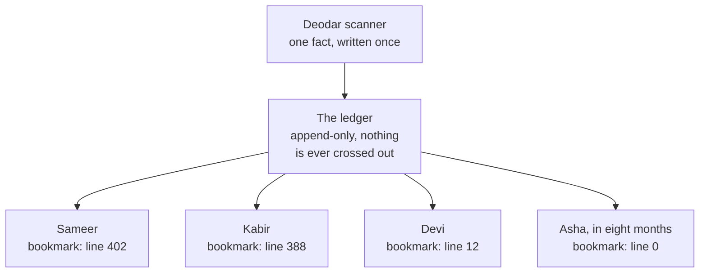

# Apache Kafka — stop deleting the messages, and everything else follows

> **Tell a friend:** In the town of Deodar, Arjun runs a parcel courier. Every
> scan of a parcel is one small fact, and four teams want that fact for four
> different reasons. The usual answer is a post office that hands each message
> to one person and then destroys it, so the second team never sees it. Kafka's
> answer is to stop destroying anything: write each fact once in a ledger that
> only grows, and let every reader keep its own bookmark. Once nobody deletes,
> replaying last year is free and a hundred audiences cost almost nothing, and
> the only price is that order now lives inside one ledger rather than across
> the whole town.

Keep [`visualization.html`](visualization.html) open beside this page; §9.5 maps
its four tabs onto the sections. §17 says what this lab is made of.

## 1. Why does one fact end up wanted by people you have not met?

> **In one breath:** Something true happens once. Several teams care about it,
> and some of those teams do not exist yet. Every older way of telling them made
> the teller keep the list of who cares, and that list changes far more often
> than the facts do.

Arjun's courier company scans a parcel. That scan is *one fact*. It is true from
the moment it happens, whether or not anybody is told.

Now ask who wants it. Billing wants it. Notifications wants it. Analytics wants
it. Fraud wants it. And in eight months, a team that does not exist today will
want it too.

Every pre-Kafka answer assumed the opposite. It assumed **the sender knows the
receivers**. An HTTP call knows its callee. A queue knows its consumer. A
database write knows its table. All three make the producer of the fact
responsible for the list of people who care about it.

That assumption fails in a specific, expensive way. **The list changes far more
often than the fact does.** And every change to the list is a change to the code
that emits the fact.

Six months in, the function that records "parcel scanned" is 400 lines long and
calls nine services. It is the most dangerous file in the company. Not because
scanning parcels got harder. Because *being interesting* got harder.

Kafka's answer is one sentence, and everything else in this lab is a consequence
of it:

> **Write the fact down once, in order, keep it, and let each audience read at
> its own speed and its own position.**

That sounds trivially obvious. It is not. It costs you the one thing every
previous messaging system considered its core service: the broker knowing who
has handled what. In exchange it buys three things those systems structurally
cannot offer. Replay. A brand-new consumer reading history. A hundred consumers
at zero extra write cost.

---

## 2. Who wants a parcel scan in Deodar, and can one rule serve them all?

> **In one breath:** Four teams want the same scan for four incompatible
> reasons. They disagree about how fast, about how far back, and about what a
> mistake costs. No single delivery policy is right for all four.

You already know the town of Deodar. You partitioned its library two labs ago,
and its noticeboards taught you eventual consistency. **Arjun** runs Deodar
Dispatch, a parcel courier. A parcel is scanned at each step of its journey:

```
parcel P-1001   09:02  PICKED_UP        (courier Nila, Cedar Street)
parcel P-1001   09:41  AT_HUB           (hub 3)
parcel P-1001   11:15  OUT_FOR_DELIVERY (courier Vikram)
parcel P-1001   12:30  DELIVERED        (signed: R. Sharma)
```

At peak, Deodar's scanners produce roughly 4,000 scans per second. Four teams
want them, and each team is one person you will meet again in every later
section of this lab.

**Priya** runs billing. She only cares about `DELIVERED`, because that is when
Deodar may invoice. **Sameer** runs notifications; he texts the customer on every
scan. **Devi** runs analytics; she models hub throughput and wants every scan
ever recorded. **Kabir** runs fraud; he watches for routes that are physically
impossible.

Read the last two columns of this table carefully. They are the whole design
brief.

| Team | Wants | Timeliness | A duplicate causes | A gap causes |
|---|---|---|---|---|
| **Billing** (Priya) | `DELIVERED` scans, to invoice | within minutes | double-charges a customer — serious | never invoices — very serious |
| **Notifications** (Sameer) | every scan, to text the customer | within seconds | annoying second text | customer thinks parcel is lost |
| **Analytics** (Devi) | every scan, forever, for hub-throughput models | hours is fine | slightly wrong average | model silently wrong |
| **Fraud** (Kabir) | every scan, to detect impossible routes | within a minute | harmless | missed fraud |

The four disagree about **latency**: Sameer needs seconds, Devi is happy with
hours. They disagree about **history**: Devi wants a year, Sameer wants the last
five minutes. And they disagree about **what a mistake costs**, which is the
column nobody thinks about until it bites.

And there is a fifth team that does not exist yet. In eight months **Asha** will
be asked to build a delivery-time prediction model, and her first question will
be: *"can I have last year's scans?"*

**Where this lab takes you.** Stop at any checkpoint and you still have
something whole. Read §1–§9 in one sitting. §10 is the machine, built in eight
refinements, each one forced by a failure in the one before. §11–§14 is what you
need before touching a production cluster.

| Layer | Sections | After it you can… |
|---|---|---|
| **Beginner** | 1–9 | explain what a log-based broker is, why it isn't a queue, and what an offset is |
| **Intermediate** | 10.1–10.6 | trace a record from producer to consumer, choose a partition key, explain acks, ISR and the high watermark, and predict what a config change does |
| **Engineering** | 10.7–12 | reason about duplicates, ordering, rebalances, transactions, and the nine ways this breaks — including the three that present as silence |
| **Production** | 13–14 | size a cluster, name the four metrics that matter, know when Kafka is the wrong tool, and refuse the six wrong models |

---

## 3. What if the dispatch office simply phones everybody?

> **In one breath:** The scanner calls all four teams itself. It is the first
> thing anyone writes, it is genuinely reasonable, and it makes the scanner the
> least reliable thing in the building.

This is the obvious solution number one. When a scan arrives, Arjun's scan
service calls each team's HTTP endpoint:

```
scan arrives → POST /billing/scan
             → POST /notifications/scan
             → POST /analytics/scan
             → POST /fraud/scan
             → return 200 to the scanner
```

Do not sneer at it. It is simple. It is synchronous, so you *know* it worked. It
needs no new infrastructure. Plenty of companies run it happily for years.

It then dies of three well-understood diseases, all of which you met in the
`microservices` lab, so we will move fast. The arithmetic is the interesting
part, so read the middle column.

| What breaks | The arithmetic | What Arjun sees |
|---|---|---|
| **Availability multiplies downwards** | four teams at 99.9% each give the scanner 0.999⁴ ≈ 99.6% | the scan endpoint is up only when all four teams are up; the scanner became the *least* reliable thing in the building by depending on everyone |
| **Latency adds** | the courier waits for the slowest of four calls, and `queueing-theory` says the busiest team contributes its **tail**, not its average | the courier's phone hangs on the worst call, not the typical one |
| **Every new audience edits the producer** | team five costs one code change, one review, one deploy | the deploy is of the most critical service in the company |

There is a subtler fourth problem, and it is the one that has no good answer.

Suppose billing succeeds and notifications times out. What now? Retry only
notifications, and you must now track per-callee state. Fail the whole scan, and
you are pretending a parcel was not scanned when it physically was. Return 200
and drop it, and you have silent data loss.

None of the three is right, because **you are trying to make a fact about the
physical world transactional with four network calls.** That is the dual-write
problem from `transactional-outbox`, wearing a different hat.

> **🔮 Predict:** *Arjun buys a second copy of every team's service, so no team
> is ever fully down. Does that fix the fourth problem?*
> <details><summary>Reveal</summary>
> No. Redundancy raises each team's availability, which helps the first disease
> and nothing else. The fourth problem is not about anyone being down. It is
> about a *partial* success: one call landed, another did not, and there is no
> way to undo the one that landed. If you said "add retries", ask what happens
> when the retry succeeds after the scan service has already returned 200 — you
> now have a duplicate, which is Priya's double-charge. Availability is not the
> disease here. Atomicity is.
> </details>

---

## 4. What if a proper message broker sits in the middle?

> **In one breath:** Arjun puts a pigeonhole board between the scanner and the
> teams. The scanner drops a note in; the board hands it to a team; the team
> says "done"; the board destroys the note. That last step is the whole story.

So Arjun does the correct next thing. He puts a **message broker** in the middle,
the classic kind that had existed for twenty years before Kafka.
Picture it as a **pigeonhole board** in the dispatch office.

The model is the one almost everyone means by the word "queue":

- the scanner drops a message into the board and is done, so the scanner is
  decoupled from the teams, which fixes every disease in §3;
- the board holds the message and hands it to a consumer;
- the consumer **acknowledges** it, and the board **deletes** it;
- if the consumer dies before acknowledging, the board hands the message to
  somebody else.

This is a good design. It is what RabbitMQ, ActiveMQ, SQS and JMS do. For "here
is a job, someone please do it", it beats Kafka to this day, and §13.7 says
exactly when to reach for it.

Now look again at the third bullet, because it is load-bearing:
**acknowledged means deleted.** The board's job is to track, for every single
message, whether it has been handled.

That one commitment produces four failures. Every one of them turns into a
design constraint of Kafka, so it is worth watching each one happen to Deodar.

---

## 5. How does the pigeonhole board break Deodar Dispatch?

> **In one breath:** Four ways. Two audiences fight over one note. A team that
> arrives late finds nothing. A retry scrambles a parcel's story. And the
> bookkeeping itself becomes the bottleneck.

### 5.1 Two audiences want one message — who gets it?

Sameer's notification service and Kabir's fraud service both subscribe to the
scan board. The scan `P-1001/PICKED_UP` arrives once. Sameer's consumer picks it
up and acknowledges. The board deletes it. **Kabir never sees it.**

The classic fix is *fan-out at the broker*: declare one queue per team, and have
the board copy each message into all four. This is exactly what an AMQP exchange
does. Count what that costs Deodar:

| What the board now does | At Deodar's peak | Why it hurts |
|---|---|---|
| stores 4 copies of every scan | 4 × 4,000 = 16,000 stored messages/sec | four times the disk and four times the write path |
| tracks 4 acknowledgements per scan | 16,000 tracked deliveries per second | each one is a small random-access state mutation |

And team five is now an *operations* change rather than a code change: declare a
queue, bind it. Better than §3. But it is still a change that must happen
**before** the first message team five cares about ever arrives.

### 5.2 What does Asha find when she asks for last year?

Eight months in, Asha's prediction-model team arrives. Her queue is created
today. It receives messages from today. The 300 million scans from before are
**gone** — not archived, not slow to fetch, *deleted*, because deletion was the
design.

The workaround everyone reaches for is to also write every scan to a database or
a data lake, and let latecomers read that instead.

Look at what Arjun has just built. The scan service writes to two places, which
is the dual write again. The two disagree during incidents. And "the stream" and
"the history" are now two systems, with two schemas and two sets of bugs.

### 5.3 Why does one retry scramble a parcel's story?

This is the failure that most surprises people, so trace it with real values.

Kabir's fraud consumer reads the board for parcel P-1001, whose four scans were
enqueued in order. It takes `PICKED_UP` (09:02) and starts work. Then its JVM
hits a long stop-the-world pause, the kind you measured in
`jvm-garbage-collectors`.

Meanwhile the same service takes `AT_HUB` (09:41) and `OUT_FOR_DELIVERY` (11:15)
on other threads, and finishes both. The `PICKED_UP` message times out unacked.
The board, doing exactly its job, **redelivers it**.

Kabir's service now sees, in this order:

```
AT_HUB (09:41) → OUT_FOR_DELIVERY (11:15) → PICKED_UP (09:02)
```

A parcel that was picked up *after* it went out for delivery. His
impossible-route detector fires on a parcel that is perfectly fine.

The cause is structural, not a bug. **A broker that redelivers on failure cannot
also preserve order**, because redelivery *is* reordering. You may have one or
the other, never both.

Classic brokers are task-oriented, so they chose redelivery. The usual mitigation
is one consumer, prefetch 1, no concurrency — which throws away all your
throughput to buy the ordering back.

### 5.4 Why is the bookkeeping itself the bottleneck?

Every message on the board is a small *mutable* record with a state machine
(`ready → delivered → acked → deleted`), and it lives per consumer.

That is random-access, read-modify-write work. It is precisely the access
pattern `btree-and-lsm` taught you is the expensive one.

This is why classic brokers are typically comfortable in the
thousands-to-tens-of-thousands of messages/sec range per broker. It is also why
they start hurting when the queue gets *deep*: millions of pending messages means
millions of live records to index, to page in, and eventually to rewrite.

> **🔮 Predict:** *Which of the four failures above would be fixed by simply
> buying a bigger broker machine?*
> <details><summary>Reveal</summary>
> Only 5.4, and only for a while. 5.1, 5.2 and 5.3 are consequences of the
> **semantics**: "acknowledged means deleted", and "the broker owns delivery
> state". No hardware changes semantics. If you guessed 5.3, notice that a faster
> machine makes the GC pause less likely but does not remove redelivery, and
> redelivery is the reordering. This is the moment to stop optimising and start
> questioning the model. It is exactly the moment LinkedIn was at in 2010 when
> they wrote Kafka.
> </details>

---

## 6. What does Arjun actually need? The real requirement

> **In one breath:** Strip the four failures down to what they demand, and you
> get six requirements. Three of them, taken together, force the design before
> you have written a line of it.

Arjun needs a thing where:

1. **The fact is written once**, and that one write serves every audience,
   present and future. This kills 5.1's write amplification and §3's fan-out.
2. **Reading does not consume.** Two hundred readers can read the same fact and
   none of them removes it for the others. This kills 5.1.
3. **Facts are kept for a declared time, not until handled.** History is the
   default, not a separate system. This kills 5.2, and it is Asha's answer.
4. **Order is preserved for facts about the same thing**, even under failure and
   retry. This kills 5.3, and it is Kabir's answer.
5. **Each reader's position is its own.** Sameer can be 2 seconds behind while
   Devi is 3 hours behind, and neither affects the other or the scanner.
6. **The broker's per-reader bookkeeping must be tiny**, so that adding readers
   is nearly free. This kills 5.4.

Now put requirements 2, 5 and 6 side by side, because together they leave no
choice at all.

If reading does not consume, the broker cannot track per-message state. If each
reader has its own position, that position must live somewhere. If the
bookkeeping must be tiny, that somewhere cannot be a big structure.

So **a reader's entire state must be a position — a single number.**

That is Kafka. The rest is engineering.

---

## 7. What if nobody ever deletes anything? The ledger and the bookmark

> **In one breath:** Throw away the pigeonhole board. Put a ledger in the
> dispatch office instead: a book where every fact is written on the next free
> line and nothing is ever crossed out. Each team keeps a bookmark saying which
> line it has reached.

> Replace the pigeonhole board with a **ledger**. The board was a pile of tasks
> the broker handed out and destroyed. The ledger is an append-only book where
> every fact is written on the next line. Each reader keeps a **bookmark**: the
> line number they have reached.

Two consequences follow, and both are worth saying out loud, because together
they *are* the shift.

**The broker gets simpler, not smarter.** It appends bytes to the end of a file,
and it serves byte ranges out of the middle. It does not know whether anyone
processed anything. When Sameer's service crashes, the ledger does not notice,
does not care, and has nothing to redeliver — because it never *delivered*
anything in the old sense. It answered a read.

**The consumer gets the responsibility.** "Where am I?" is now Sameer's problem,
not the ledger's. And as §10.8 shows, *when* he saves that bookmark decides
whether his system loses records or duplicates them. Kafka does not remove that
choice. It hands it to you, explicitly, in one config.

Here is the whole shape, before any of the machinery arrives:



Notice what the picture does *not* contain. There is no arrow from a reader back
to the ledger saying "done, you may delete this". That arrow was the whole of
the old design, and it is gone.

The engineer's name for this ledger is a **log**. Not the printf sense of the
word. The write-ahead-log sense, from `acid` and `change-data-capture`.

You have now met this same structure four times. The write-ahead log that makes
a database durable. The replication log that makes a follower a copy. The event
store in `event-sourcing`. The append-only segments of an LSM tree.

Kafka's insight was to notice that the thing databases hide *inside* themselves
is the most useful thing to expose *between* systems.

> **Say it back.** Without using the words *log*, *offset* or *broker*, tell a
> friend what changed between §4's pigeonhole board and §7's ledger, and why
> Kabir stopped missing Sameer's messages.
> <details><summary>A good answer sounds like</summary>
> "The old office gave each note to one person and then burned it, so whoever
> got there second got nothing. The new office writes every note into a book
> that nobody is allowed to tear pages out of. Reading a page does not use it
> up. So Kabir and Sameer both read the same page, each keeps their own
> bookmark, and neither can take anything away from the other."
> </details>

---

## 8. Which words do you now need, and what did each one cost?

> **In one breath:** A handful of words carry the rest of the lab. Each one
> names something you have already watched happen to Deodar, so meet the thing
> first and the word second.

Only the load-bearing terms live here. The rest arrive when the mechanism needs
them, and all of them are defined precisely in the glossary (§16).

**One line in the ledger is a record.** In the story it is one parcel scan. To
Kafka it is one immutable entry: `(key, value, timestamp, headers, offset)`.
Kafka does not care what the value is; it is bytes. People also call a record a
*message* or an *event*, and all three words mean the same line in the book.

**The thing written at the front of the line is the key.** The key is *not* an
identifier, however much it looks like one. Its single job is choosing which
ledger the record goes into (§10.3), and therefore which records it is ordered
against. `P-1001` is a good key. A UUID that is unique per scan is usually a bad
one, and §10.3 shows why.

**The name on the ledger's spine is the topic**, for example `parcel-scans`. A
topic is purely a name. The storage is the partitions underneath it. It is not a
queue, despite the shape of most tutorials.

**The actual append-only book is a partition.** A topic is a *set* of them.
Ordering exists **inside** a partition and nowhere else. That is the single most
important sentence in this lab, and §14.2 is the misconception it exists to
kill.

**The line number is the offset.** It starts at 0 and increases by one per
record, forever. The triple `(topic, partition, offset)` names a record uniquely
and permanently. Offsets are *not* comparable across partitions:
`partition-0/offset-500` and `partition-1/offset-500` have no relationship
whatsoever.

Here is the first group of words, with the section where you watched each thing
happen:

| Word | The thing in Deodar | Where you met it |
|---|---|---|
| **Record** | one parcel scan, written on one line | §2's scan trace |
| **Key** | `P-1001`, the parcel a scan is about | §5.3, when P-1001's story got scrambled |
| **Topic** | the name on the ledger's spine, `parcel-scans` | §7's ledger |
| **Partition** | one physical book that only grows | §7's ledger, split in §10.2 |
| **Offset** | the line number, permanent and per-book | §7's bookmarks |

The second group is the people and the places. **Producer** and **consumer** are
client libraries *in your application*, not servers. That surprises people, and
it matters: a surprising amount of Kafka's cleverness lives on the client side,
which is why Kafka client versions matter as much as broker versions.

**Retention** is the rule that stops the ledger growing forever. It is declared
per topic, and its default `retention.ms` is 7 days. Two things about it are
worth fixing in your head now.

The broker deletes by **age or size**, never by "everyone has read it". And a
consumer that falls behind by more than the retention period does not slow
anything down. It *loses data*, silently. §11.6 is that failure in full.

| Word | The thing in Deodar | Where you met it |
|---|---|---|
| **Producer** | the scanner's library that appends a scan | §2's scanner |
| **Consumer** | Sameer's library that reads from a position | §7's bookmark |
| **Broker** | the dispatch office server holding books | §4's board, replaced in §7 |
| **Cluster** | several such offices, working as one | §10.4's copies |
| **Retention** | how long before the ledger's old pages go | §5.2, Asha asking for last year |

> **Checkpoint — the beginner model is complete.** You can now explain what a
> log-based broker is and why it is not a queue. You cannot yet explain how it
> goes faster than one machine, survives a crash, or lets ten consumers share
> work. Those are §10's eight refinements, and each one is forced by a failure
> in the one before.

> **Say it back.** Explain to Priya, who runs billing and writes no code, why a
> brand-new team can read last month's scans out of Arjun's ledger but could not
> out of the pigeonhole board. Do not use the words offset, partition or
> retention.
> <details><summary>A good answer sounds like</summary>
> "The old office destroyed each note the moment someone collected it, so
> everything that happened before you joined is simply not there any more. The
> new office writes every note into a book and keeps the book for a set number
> of days, whether anybody read it or not. A new team just opens the book at
> page one. Nothing had to be saved for them in advance, because nothing was
> being thrown away."
> </details>

---

## 9. What is a topic really, and where does the picture lie to you?

> **In one breath:** Think of a newspaper archive: issues filed in order, kept
> for seven days, read by anyone who walks in. The picture is useful, and it
> lies to you in four specific places you need to know before it hardens.

### The newspaper archive — what does the simple model say?

A topic is a **newspaper**, and each partition is one **edition** printed
continuously. The broker is the archive. It files every issue in order and keeps
them for seven days.

Subscribers do not receive papers. They come to the archive and read from where
they left off, noting the page number as they go. A hundred subscribers cost the
archive nothing extra, because they are reading the same shelf.

Nobody's reading removes an issue. After seven days the archive sends the old
ones for pulping, whether or not anybody read them.

### The engineering model — what is actually on the disk?

```
topic "parcel-scans", 3 partitions, replication factor 3

  partition 0  [ 0 ][ 1 ][ 2 ][ 3 ][ 4 ][ 5 ]         ← leader on broker 1
  partition 1  [ 0 ][ 1 ][ 2 ]                        ← leader on broker 2
  partition 2  [ 0 ][ 1 ][ 2 ][ 3 ][ 4 ]              ← leader on broker 3
                 ↑              ↑
        group "analytics"    group "notifications"
        committed offset 1   committed offset 4
```

Four facts about that picture:

- a **partition** is a directory of segment files on one broker's disk, plus two
  copies elsewhere;
- writes go **only to the leader replica** of a partition, and followers pull
  from it;
- a record is bytes at a byte-offset in a segment file, found through a sparse
  index;
- a consumer's state is a small number per partition — and even that number
  lives in a Kafka topic (§10.8), so the broker still stores nothing bespoke.

### Which archive word maps to which Kafka word?

The shelf and the files first:

| Newspaper archive | Kafka |
|---|---|
| Newspaper title | topic |
| One continuously printed edition | partition |
| Issue number | offset |
| Seven-day shelf, then pulped | `retention.ms` |

Then the readers and the copies:

| Newspaper archive | Kafka |
|---|---|
| Reader's noted page number | committed offset |
| Reading room (any number of readers) | consumers, all reading the same files |
| Three archives in three towns, one authoritative | replication factor 3, one leader |

### Where does the archive story lie to you?

Read this before the analogy hardens. Four lies, each one a bug waiting for you.

1. **There is no single chronological "newspaper".** Three partitions are three
   independent editions. Record *X* in partition 0 and record *Y* in partition 1
   have **no defined order**, ever, even if X was produced an hour earlier. The
   archive analogy quietly suggests a global timeline. There isn't one.
2. **Readers are not passive.** A Kafka consumer *pulls*, in batches, on its own
   schedule. Nothing is pushed. This is why Devi being three hours behind cannot
   hurt the broker or the scanner. She simply asks less often. Compare the
   classic broker of §4, where a slow consumer makes the broker's backlog grow.
3. **The archivist has no idea who read what.** Not "does not tell you" — *does
   not know*. Consumer lag is computed by subtracting a number the consumer
   wrote down from a number the broker knows. Nobody tracked a delivery.
4. **Pulping is not "when everyone's done".** Retention is a clock, not a
   reference count. The archive throws away issues that nobody has read yet, on
   schedule. That is a *feature*, because it bounds storage. It becomes §11.6's
   failure when Devi's consumer is down for a long weekend.

> **🔮 Predict:** *Devi's analytics group is 3 hours behind. Sameer's
> notification group is 2 seconds behind. What does Devi's lag cost Sameer?*
> <details><summary>Reveal</summary>
> Nothing at all. They read the same files at different positions, and neither
> group's bookmark is visible to the other. If you said "the broker must hold
> three hours of extra state for Devi", you are still picturing the pigeonhole
> board: the broker holds the *records* anyway, for everyone, until retention
> expires. Devi's entire cost to the cluster is read bandwidth, and her records
> are old enough that they may come from disk rather than page cache. That is
> the one real cost, and it is small.
> </details>

---

## 9.5 What should you look at in the simulator?

> **In one breath:** Four tabs, four questions that prose answers badly. Open it
> now, before the mechanism, so the pictures are already moving in your head.

Open [`visualization.html`](visualization.html) in any browser. It is called
**"The Deodar Ledger"**, and each tab exists to answer one question:

| Tab | The question it answers | Read it alongside |
|---|---|---|
| **1 · The Log** | Where does a keyed record land, why do two consumer groups not interfere, and what *exactly* breaks when you add a partition? | §10.1–10.3 |
| **2 · Replication** | What do LEO, HW and ISR do during a slow follower and a leader crash — and which `acks`/`min.insync.replicas` combinations lose an acknowledged record? | §10.4–10.5 |
| **3 · Consumer Group** | What does a rebalance actually reassign, how much does eager cost versus cooperative, and where do duplicates come from? | §10.8, §10.10 |
| **4 · Retention & Compaction** | What does a late consumer see, and what does the cleaner really remove? | §10.9 |

Each tab has a **verdict line** under the controls. It says, in plain English,
what just changed and why.

Tabs 2 and 3 include a predict-then-run step: commit to an answer, then watch.
That step is the point. A prediction you got wrong is worth ten paragraphs you
agreed with. §17 says what the simulator is, and what it is not.

---

## 10. How is the machine actually built, one failure at a time?

> **In one breath:** Start with the simplest ledger that could possibly work.
> Break it. Fix it. Repeat eight times, and you have Kafka. Nothing here is
> invented for its own sake; every refinement is forced by the failure of the
> one before.

We build Kafka the way it was built: the simplest thing that could work, then
the failure that breaks it, then the fix.

### 10.1 Version 1 — why is one file on one machine already fast?

> **In one breath:** Arjun's first ledger is a single file. Producers append to
> the end, consumers read from a position, and it is far faster than "writes to
> disk" makes it sound.

Arjun's first ledger is one file, `parcel-scans.log`, on one machine. The
scanner appends. Sameer, Kabir, Devi and Priya read from a byte offset.

Look at §6's list. Requirements 1, 2, 3, 5 and 6 are already satisfied by this
trivial design. And requirement 4, order, is satisfied *completely*: there is
one file, so there is one order, and it is the order of arrival.

**Why this is fast, which is not obvious.** People assume "writes to disk" means
"slow", so it is worth being precise. Kafka's throughput is not magic. It is
four choices.

- **Sequential writes.** `btree-and-lsm` established the gap between sequential
  and random I/O — orders of magnitude, on both spinning disks and SSDs.
  Appending to the end of a file is the best case there is. It is *all* Kafka
  ever does on the write path.
- **The page cache does the caching.** Kafka keeps no in-process record cache of
  its own. It writes into the OS page cache and lets the kernel flush. A
  consumer reading recent records is served from RAM without Kafka doing
  anything clever. Importantly, those bytes never live in the JVM heap, which is
  why Kafka brokers run comfortably with modest heaps on enormous machines.
  (`jvm-garbage-collectors`: bytes you never put on the heap are bytes the
  collector never scans.)
- **Zero copy.** Serving a consumer is "send bytes 4,096–69,632 of this file to
  this socket". That is the kernel's `sendfile` path: no copy into user space,
  no deserialisation. Kafka never looks inside a record it is serving. One
  caveat worth knowing: TLS encryption forces the data back through user space,
  so `sendfile` no longer applies, and encrypted clusters give up this
  optimisation.
- **Batching.** Producers group records into batches and compress the batch as a
  unit. The batch stays compressed on disk and is sent compressed to consumers.
  Compression ratios are far better on a batch of similar records than on one
  record, and the CPU is spent once.

None of that is a trick. It is what you get by choosing an access pattern the
hardware likes, and then refusing to add cleverness on top of it.

> **🔮 Predict:** *One file on one machine. Deodar grows tenfold. Name the two
> different ceilings this design hits — and note that they are not the same
> ceiling.*
> <details><summary>Reveal</summary>
>
> **Ceiling 1 — the write side.** One partition lives on one machine: its disk
> bandwidth, its NIC, its CPU. You can buy a bigger machine exactly once.
>
> **Ceiling 2 — the read side, and this one no hardware fixes.** Records in a
> single log must be processed *in order* by the audience that cares about
> order. Kabir's fraud detector cannot run 20 threads over one log and keep
> parcel order. Even with infinite disk bandwidth, **one log means one ordered
> reader**.
>
> If you named only ceiling 1, you are still thinking about hardware. Ceiling 2
> is the interesting one, because it means the fix cannot be "make the log
> bigger". It has to be "have more logs". Which immediately raises the question
> that decides everything else: *which records go in which log?*
>
> </details>

### 10.2 Version 2 — what does splitting into many logs cost?

> **In one breath:** One topic becomes N independent books. You get parallel
> writing and parallel reading, and you immediately lose the thing you did not
> know you were relying on: a single global order.

A topic becomes **N independent logs**. Now N brokers write in parallel, and N
consumers read in parallel.

And instantly you have paid the price named in §9's four lies: **there is no
longer a total order.** Kafka does not try to hide this or soften it. The
guarantee is stated exactly, and it is the one you will quote for the rest of
your career:

> **Records are ordered within a partition. Across partitions, there is no
> order.**

So the design question is not "how do I keep ordering". It is **"what is the
smallest unit of my data that genuinely needs ordering?"**

For Deodar Dispatch that unit is the parcel. P-1001's four scans must stay in
sequence. P-1001 and P-2002 have nothing to do with each other and may
interleave freely.

That unit is called the **key**.

### 10.3 Which book does a parcel go into, and why the modulo you were warned about?

> **In one breath:** The producer, not the broker, picks the book. It hashes the
> key and divides by the number of books. Same parcel, same book, ordered
> forever — until somebody changes the number of books.

The producer computes the partition. In the Java client's default partitioner:

```
partition = murmur2(serialized_key) % number_of_partitions       // key present
```

Same key → same partition → same log → ordered, forever. Different keys spread
across partitions.

Trace it, with `parcel-scans` at 3 partitions:

```
P-1001 PICKED_UP        murmur2("P-1001") % 3 = 2   → partition 2, offset 40
P-2002 PICKED_UP        murmur2("P-2002") % 3 = 0   → partition 0, offset 88
P-1001 AT_HUB           murmur2("P-1001") % 3 = 2   → partition 2, offset 41
P-1001 OUT_FOR_DELIVERY murmur2("P-1001") % 3 = 2   → partition 2, offset 42
P-1001 DELIVERED        murmur2("P-1001") % 3 = 2   → partition 2, offset 43
```

P-1001's story is offsets 40 to 43 of partition 2, in order, permanently.

Now look at what Kabir just got. His detector can run three consumers in
parallel, one per partition, and *still* never see a parcel out of order,
because a parcel never spans partitions. §5.3's scrambled parcel cannot happen
here.

This is the trick that makes ordered parallel processing possible at all, and it
is worth sitting with. **Kafka did not solve "ordering versus parallelism". It
made you declare the granularity at which you need order, and then gave you
parallelism across that granularity.**

**When the key is null**, the producer has no ordering constraint to honour, so
it optimises for batching instead. The modern Java client uses **sticky
partitioning**: fill a batch for one partition, send it, then switch to another.
Older clients round-robined per record, which made batches small and throughput
worse; the change was KIP-480. Note the consequence. A null key means *no
ordering guarantee for anything*, which is fine for independent events and
catastrophic for a parcel's scan sequence.

**Now the modulo.** In `consistent-hashing` you established at length that
`hash(key) % n` makes every key's home depend on a global property, so that
changing `n` remaps almost everything. You learned the ring as the fix. Kafka
uses the modulo anyway. Why?

Because **the ring's fix does not apply here.** Consistent hashing moves *keys*
to new homes cheaply. But a Kafka partition is not a bucket you can rehash. It
is an ordered, immutable, append-only log, with consumers holding positions
inside it.

You cannot move record 41 of partition 2 into partition 3 without destroying the
offsets that every consumer, every committed bookmark and every replica depends
on. So Kafka makes the opposite trade:

> **Partition count is (effectively) permanent. You may increase it, but
> existing records never move, and from that moment a key may live in two
> partitions.**

Watch it hurt Deodar. Arjun increases `parcel-scans` from 3 to 4 partitions at
14:00. P-1001's scans from before 14:00 sit in partition 2 at offsets 40 to 43.
But `murmur2("P-1001") % 4` = 1, so scans from 14:01 onward go to partition 1.

A consumer of partition 1 may process `DELIVERED` while `OUT_FOR_DELIVERY` is
still unread in partition 2. **Ordering for that key is broken across the
boundary, permanently, with no error, no warning, and no way to repair it.**

This is the single most common self-inflicted Kafka wound. Three operational
rules follow from it:

- **over-provision partitions at topic creation**, and §13.3 says how to pick
  the number;
- if you must add partitions to a keyed topic, either accept a bounded window of
  disorder (often fine — pause producers, drain consumers, then add) or create a
  new topic and migrate;
- **never** add partitions to a compacted topic used as a table (§10.9) without
  a full rebuild, because the "latest value per key" invariant breaks the same
  way.

> **🔮 Predict:** *Devi points out that 80% of Deodar's scans come from 5 large
> retail customers, and suggests keying by `customer_id` instead of `parcel_id`,
> "so each customer's data stays together." What happens?*
> <details><summary>Reveal</summary>
>
> A hot partition, of exactly the kind you measured in
> `partitioning-and-rebalancing`. With 12 partitions and 5 heavy customers, at
> most 5 partitions carry ~80% of the traffic, and one of them probably carries
> 30% on its own.
>
> That partition's leader broker saturates while others idle. And here is the
> part people miss: **the consumer assigned to that partition becomes the lag
> bottleneck for the whole pipeline**, because a partition is consumed by
> exactly one member of a group (§10.10). You cannot add consumers to fix it.
> There is nothing to add them to.
>
> If you answered "it balances better because big customers get their own
> partition", you have the causality backwards. A partition is not sized to fit
> its customer. It is one of a fixed set, and a big customer simply lands on
> one.
>
> The general rule, straight from the partitioning lab: **choose the key by the
> ordering requirement, then check its cardinality and skew.** `parcel_id` has
> millions of values and near-uniform traffic. `customer_id` has hundreds, with
> a power-law distribution. Same topic, same code, completely different
> operational life.
>
> </details>

> **Checkpoint — you have the log.** You can now explain the log, offsets,
> partitions and keys. Everything so far assumed the broker never crashes. It
> does, and the next three refinements are entirely about that.

> **Say it back.** Tell Arjun, in one minute and with no jargon, why he must
> decide the number of books on the day he opens the ledger. Then tell him what
> it costs if he changes his mind next year.
> <details><summary>A good answer sounds like</summary>
> "Each parcel is assigned to a book by a sum that divides by the number of
> books. Change the number of books and the sum gives a different answer, so
> tomorrow's pages about a parcel go into a different book from yesterday's. The
> old pages cannot be moved, because everyone's bookmarks point into them. So
> for every parcel that was mid-journey, its story is now split across two books
> that nobody reads in step. Nothing warns you. It just quietly stops being in
> order."
> </details>

### 10.4 Version 3 — what does "written" mean when there are three copies?

> **In one breath:** One disk dies and P-1001's story is gone, so each book gets
> three copies. Now "written" splits into three different meanings, and the
> whole of Kafka's durability argument is about which one you were promised.

One machine holds partition 2. Its disk dies. P-1001's story is gone, along with
Devi's year of history.

Meet **Meera**, who runs Deodar's cluster. Her fix is the one from
`quorums-and-replication`, specialised: each partition gets **R replicas**
(typically 3) on different brokers. One is the **leader**, and all reads and
writes for that partition go to the leader. The others are **followers**.

One detail is worth noticing. Followers replicate by *sending the leader an
ordinary fetch request*, the same protocol consumers use. A follower is,
mechanically, a consumer that writes down what it reads.

Three numbers per replica govern everything that follows. Meet each as a thing
first, then as a sentence, then as its acronym.

| The thing on Meera's whiteboard | In words | The name |
|---|---|---|
| how far this copy has got | the next offset this replica will write | **LEO**, log end offset |
| the line below which every copy agrees | the highest offset that *every in-sync replica* has, and the limit of what consumers may read | **HW**, high watermark |
| the list of copies still keeping up | replicas that have fetched up to the leader's LEO within the last `replica.lag.time.max.ms` (default 30s) | **ISR**, in-sync replica set |

That third row hides something important. The in-sync test is a *time* lag, not
a message-count lag. A replica two million records behind but fetching hard is
still in-sync, because it is keeping up with the *rate*.

**Why can consumers not read above the high watermark?** Suppose the leader has
written offset 105 but only it has that record. If a consumer could read 105 and
the leader then died, the new leader (which has up to 104) would assign offset
105 to a *different, later* record.

A consumer would have read a record that never officially existed. Worse, the
offset would be reused for different content. The high watermark is the line
between "written on the leader" and "impossible to lose without losing every
copy". Kafka calls records below it **committed**.

That is a mechanism you have seen before under another name. The high watermark
is Kafka's **commit point**, and the ISR is a *dynamic* quorum rather than the
fixed majority of `quorums-and-replication`. That difference matters, and §12.4
is where it is paid for.

**How much of this does the scanner wait for?** That is the producer's `acks`
setting. In story terms it is Arjun deciding how many books must hold the scan
before the scanner is told "yes". It is the config people get wrong most often
after partition count.

| `acks` | The producer waits for | It survives | It costs |
|---|---|---|---|
| `0` | nothing (fire and forget) | nothing; you will not even learn about a failure | fastest; unbounded loss |
| `1` | the leader wrote to its log | the leader staying alive | one crash between write and replication loses acknowledged records |
| `all` (`-1`) | every replica **in the ISR** has it | any failure that leaves an ISR member alive | one extra round trip of latency |

**Since Kafka 3.0 the default is `acks=all`**, with idempotence on (§10.7). That
is the right default, and it reverses a decade of tutorials that say otherwise.

**And now the trap.** `acks=all` means *all in-sync replicas*, not *all
replicas*. Trace it on Meera's cluster:

```
partition 2, RF=3, acks=all, min.insync.replicas=1 (the default!)

10:00:00  ISR = {B1(leader), B2, B3}         healthy
10:00:12  B2 and B3 both fail
10:00:42  30s of replica.lag.time.max.ms elapse → leader shrinks ISR = {B1}
10:00:43  producer sends record R, acks=all
10:00:43  B1 writes R, and "all in-sync replicas have it" is TRUE — ISR is {B1}
10:00:43  producer receives SUCCESS
10:00:50  B1's disk fails
          → R is gone. The producer was told it was durable.
```

The ISR shrank to a single replica, and `acks=all` degraded silently to
`acks=1`. Nobody lied. The sentence "all in-sync replicas have it" was true.

The fix is the second half of the setting. In story terms it is the rule Meera
writes on the wall: *refuse the scan unless at least two books have it.* In
words, it is the smallest number of in-sync copies that must hold a record
before the broker may say yes. As a config key it is a *topic or broker*
setting, not a producer one:

```
min.insync.replicas = 2      # with RF=3 → tolerate one failure, refuse at two
```

With `min.insync.replicas=2`, the write at 10:00:43 fails immediately with
`NOT_ENOUGH_REPLICAS` instead of succeeding falsely.

**The durable configuration is `acks=all` AND `min.insync.replicas=2` AND
`replication.factor=3` — all three, or none of them.**

Notice what Meera just did. She chose unavailability over silent loss during a
partition. That is `cap-theorem`'s choice, made in two config lines per topic.
Kafka lets her make it differently for each topic, which is a genuinely nice
piece of design: Priya's billing topic and Devi's metrics topic need not answer
the question the same way.

> **🔮 Predict:** *RF=3, `min.insync.replicas=3`, `acks=all`. How many broker
> failures can this topic tolerate while still accepting writes?*
> <details><summary>Reveal</summary>
>
> **Zero.** Any single broker failure drops the ISR to 2, below `min.insync`,
> and every produce request fails.
>
> If you said "two, because there are three copies", you counted copies that can
> be *lost* rather than copies that must be *present*. RF=3 with min.insync=3 is
> the classic "maximum-durability" misconfiguration. It maximises the durability
> of what *is* written by making writing impossible the first time anything
> sneezes.
>
> The arithmetic to remember: **failures tolerated for writes = RF −
> min.insync.replicas.** So 3 − 2 = 1 is the standard production choice. If you
> want to survive two failures while still writing, you need RF=5 and
> min.insync=3 — which is `quorums-and-replication`'s majority, and precisely
> what Kafka's own internal controller quorum uses.
>
> </details>

### 10.5 What happens when the leader dies, and what is a leader epoch for?

> **In one breath:** The survivors must agree on what the book contains. Kafka
> got that wrong until 2017, in a way that lost acknowledged records, and the
> fix is an object you already own under seven other names.

The leader of partition 2 dies. The controller (§13.1) picks a new leader from
the ISR, and every remaining replica must now agree on what the log contains.

Followers can be at different LEOs, so the new leader's log may be *shorter*
than a surviving follower's. Records above the new leader's LEO were never
committed, because they were above the high watermark. So the rule is:
**followers truncate to match the new leader, then resume fetching.**
Uncommitted records are discarded, which is correct, because nobody was ever
told they were durable.

Here is where Kafka had a real, shipped, data-losing bug until 2017. The fix is
a concept you already own.

Kafka's followers originally truncated to their **high watermark** on becoming a
follower. But the high watermark propagates to followers one fetch round
*behind*: a follower learns the new value in the response to its next fetch.
That one-round lag is enough to lose data.

```
Setup: partition 2, replicas A (leader) and B. Both have offsets 0..9. HW = 9.

t1  A appends record X at offset 10.        A: LEO=11 HW=9
t2  B fetches, receives X, writes it.       B: LEO=11 HW=9   (B has not yet
                                             learned the HW moved to 10)
t3  A advances HW to 10 (all replicas have X).
t4  B crashes before its next fetch — so B never learns HW=10.
t5  B restarts. Rule: truncate to my HW (9). B drops X.  B: LEO=10
t6  A crashes before B re-fetches.
t7  B becomes leader with LEO=10, appends a *different* record Y at offset 10.
t8  A restarts as follower, truncates to its HW... and the two logs disagree
    about what offset 10 contains.
```

Record X was committed. The producer was told `acks=all` succeeded. And it is
gone, replaced by a different record at the same offset.

Two logs now permanently disagree about the content of one offset. That is worse
than loss. It is **divergence**, and every consumer that read X saw something
that no longer exists.

The fix, KIP-101 (Kafka 0.11, 2017), is the object `split-brain` told you has
seven names: a **leader epoch**. Every leadership change increments a monotonic
integer. Every record is stamped with the epoch of the leader that wrote it. Each
broker keeps a small `leader-epoch-checkpoint` file mapping epoch to first
offset.

On restart, a follower no longer guesses from its own stale number. It **asks**:

```
B → A:  OffsetsForLeaderEpoch(partition 2, my last epoch = 5)
A → B:  "epoch 5 ended at offset 10"
B:      truncate to exactly 10 — no more, no less
```

Truncation becomes a fact obtained from the authority, rather than an inference
from a stale local number.

Take the general lesson, because it recurs across a dozen labs. **A node must
sometimes decide how much of its own state is still valid after a leadership
change. That answer has to come from the new authority, and it has to be tagged
with a generation number.** Never inferred from a stale local one.

You have now met that object under seven names: Raft's term, ZAB's epoch,
CockroachDB's lease, the ownership epoch of `partitioning-and-rebalancing`, the
fencing token of `distributed-locking`, and here Kafka's leader epoch.

**And what if every in-sync copy is gone?** Suppose only an out-of-sync replica
survives. Meera has exactly two choices, and Kafka makes her declare which:

| Setting | What happens to the partition | What Meera chose |
|---|---|---|
| `unclean.leader.election.enable = false` (**the default**) | goes **offline** — no reads, no writes, until an ISR member returns | consistency, paid for in downtime |
| `unclean.leader.election.enable = true` | the stale replica is promoted and the partition returns instantly | availability, paid for with committed records that are **silently gone**, and offsets reused for new records |

That is `cap-theorem` again, per partition, as a boolean. Leave it `false` unless
you are handling a stream where a gap is genuinely cheaper than downtime. Some
metrics pipelines qualify. Nothing that bills anyone does.

### 10.6 What does the producer see when the network eats an acknowledgement?

> **In one breath:** The scanner sends a scan, the broker writes it, and the
> "yes" is lost on the way back. The scanner cannot tell that from "the scan
> never arrived", so it retries — and that is how duplicates are born.

Now zoom out to the client. Arjun's scan service sends a record, and the network
does what networks do:

```
producer → [record] → leader:  leader writes it at offset 41, sends ack
                               ← ack lost in the network
producer times out, retries    leader writes it AGAIN at offset 42
```

Partition 2 now contains P-1001's `AT_HUB` scan twice, at offsets 41 and 42.
Sameer texts the customer twice.

This is the `idempotency` lab's opening problem, verbatim: **the sender cannot
distinguish "my request was lost" from "the response was lost", so it must
retry, and retrying is how duplicates are born.**

Worse, retries can *reorder*. With multiple requests in flight, batch 1 may fail
and be retried while batch 2 succeeds. The log then holds batch 2 before batch 1.
You have lost the ordering guarantee §10.3 sold you, without touching the keys.

### 10.7 Version 4 — how does the broker recognise a repeat?

> **In one breath:** Give every batch a name the broker can check: who sent it,
> which generation of that sender, and which number in the sequence. A repeat
> is then obvious, and so is an out-of-order arrival.

The fix is the idempotency lab's answer, moved into the protocol: **give the
request a key that lets the server recognise a repeat.**

- On startup, the producer gets a **PID** (producer ID) and an epoch from a
  broker.
- Every batch carries `(PID, epoch, partition, sequence number)`, with the
  sequence increasing by one per batch per partition.
- The leader remembers the last 5 sequence numbers per (PID, partition). A batch
  whose sequence it has already seen is **acknowledged but not written**. A
  batch arriving with a sequence more than one ahead is rejected with
  `OUT_OF_ORDER_SEQUENCE_NUMBER`.

That buys two guarantees for the price of one.

**No duplicates from producer retries**, because the retry is recognised and
dropped. And **no reordering from retries**, because the strict sequence check
makes it impossible for batch *n+1* to land before batch *n*.

That second one is why up to `max.in.flight.requests.per.connection = 5` batches
can be in flight *and* ordering still holds. Before idempotence, ordering under
retries required `max.in.flight=1`, which cost you most of your throughput. The
idempotent producer is a throughput feature as much as a correctness one.

**Since Kafka 3.0, `enable.idempotence=true` is the default**, which also forces
`acks=all` and `retries=Integer.MAX_VALUE`. Modern defaults are the safe ones.
Most Kafka folklore predates them.

Be precise about the boundary, because §14.4 depends on it:

| The idempotent producer **does** stop | The idempotent producer **does not** stop |
|---|---|
| duplicates from a retry inside one producer session | duplicates from *your application* re-sending after its own restart |
| reordering from retries | duplicates when the producer restarts and gets a **new PID** |
| — | duplicates seen by the *consumer* after a rebalance (§10.8) |
| — | duplicated *side effects* — the text message Sameer already sent |

It de-duplicates a network conversation, not your business process. The business
process still needs `idempotency`'s idempotency key, applied at the point where
the effect happens.

> **Checkpoint — producer to broker is complete.** Scans are partitioned, keyed,
> replicated, durable by explicit config, and exactly-once *onto the log* within
> one session. Nothing so far has said how a consumer remembers where it is, or
> how ten consumers split the work. That is the second half of Kafka, and it has
> more failure modes than the first.

> **Say it back.** Explain to Sameer why the broker can throw away a repeated
> batch safely, but cannot throw away a repeated text message.
> <details><summary>A good answer sounds like</summary>
> "The broker gave the scanner a badge, and it numbers every packet it sends.
> So when packet 7 turns up twice, the broker knows it is the same packet and
> just says 'yes, got it' again. The text message has no badge and no number. It
> is an effect out in the world. The only place that can spot a repeat is the thing
> that sends texts, and it has to keep its own list of who it has already
> texted."
> </details>

---

### 10.8 Version 5 — where does the bookmark live, and when do you write it?

> **In one breath:** The bookmark cannot live inside the consumer, or a crash
> loses it. Kafka stores it as an ordinary record in an ordinary topic. Then it
> hands you one unavoidable choice: save the bookmark before you do the work, or
> after.

Sameer's notification consumer reads partition 2 from offset 40 to 43, texts
four customers, and crashes. It restarts. Where does it resume?

The bookmark must be **durable and outside the consumer process**. Otherwise
every restart replays from the beginning of retention.

Kafka's answer is pleasingly self-referential. The consumer **commits** its
offset by producing a record to an internal topic called `__consumer_offsets`,
keyed by `(group, topic, partition)`, whose value is "next offset to read". That
topic is compacted (§10.9), so it collapses to the latest bookmark per key and
stays small forever.

Notice what did *not* happen. The broker did not record a delivery. It received
an ordinary write to an ordinary topic. Requirement 6 from §6 survives intact.

**Now the choice.** Commit *before* processing, or *after*?

```
COMMIT BEFORE PROCESSING ("at-most-once")
  poll offsets 40..43 → commit 44 → crash while texting offset 42
  restart at 44. Customers for 42 and 43 are never texted. RECORDS LOST.

COMMIT AFTER PROCESSING ("at-least-once")
  poll offsets 40..43 → text all four → crash before committing
  restart at 40. Customers for 40..43 are texted AGAIN. DUPLICATES.
```

There is no third option available to a consumer whose side effects live outside
Kafka. This is not a Kafka limitation. It is the two-generals shape of the whole
field, and you have met it as at-most-once versus at-least-once in `idempotency`
and `transactional-outbox`.

**Kafka's default, and the only sane choice for almost everyone, is
at-least-once**, with duplicates neutralised at the point of effect: a dedup
table, an idempotency key, or natural idempotence.

Say the whole sentence whenever someone asks about delivery semantics:
*at-least-once delivery plus an idempotent consumer equals effectively-once
processing.*

**Auto-commit is a third, sneakier position.** In story terms it is Sameer
letting the library move his bookmark on a timer, whether or not he has finished
reading. In words: the client commits the offsets returned by the *previous*
poll, from inside `poll()`, every few seconds. As a config key that is
`enable.auto.commit=true` — the default! — with `auto.commit.interval.ms` at 5s.

So it commits records you may still be processing, which is a bounded
at-most-once window. And it *also* allows duplicates on a crash inside that 5s
window. It is the convenient option, and the one to turn off in anything that
matters.

**What if the committed offset is gone?** Devi's analytics consumer is off for a
long weekend. Retention is 7 days, but her lag was already 6 days. It restarts,
asks for offset 1,240,000, and that offset has been deleted.

The broker answers `OFFSET_OUT_OF_RANGE`, and the consumer applies
`auto.offset.reset`:

| Value | What the consumer does | What it costs Devi |
|---|---|---|
| `latest` (**the default**) | jumps to the end of the log | everything in between is **skipped silently**; her model is trained on a hole she cannot see |
| `earliest` | jumps to the oldest surviving record | everything in between is **reprocessed**, which for a non-idempotent consumer is a different disaster |
| `none` | throws an exception | loud, and usually correct for anything that bills |

This config is also what decides what a *brand new* group does on first start,
and that is the reading of it people actually know. Both readings share one
default, which is why "we deployed a new consumer group and it silently ignored
the last seven days of data" is a rite of passage.

> **🔮 Predict:** *Sameer turns `enable.auto.commit` off and commits by hand
> after each batch. He now believes he cannot lose a text. Is he right?*
> <details><summary>Reveal</summary>
>
> He is right about loss and wrong about duplicates, and he has probably not
> noticed the swap. Committing after processing is at-least-once: nothing is
> skipped, and a crash between the last text and the commit re-sends every text
> in that batch.
>
> If you said "he is right, it is now exactly-once", look for the third option
> in the trace above. There isn't one. The only way to stop the second text is
> to make the *texting* idempotent, which is a change in Sameer's service, not
> in his Kafka config.
>
> </details>

### 10.9 Version 6 — the log is not infinite, so what goes and what stays?

> **In one breath:** Deodar writes hundreds of gigabytes a day, so something
> must delete. Kafka offers two policies: throw away old pages by the clock, or
> keep only the latest page per parcel. The second turns a stream into a table.

Start with the arithmetic, because it is what forces the whole section.

| Quantity | Number | What it means |
|---|---|---|
| Deodar's peak scan rate | 4,000 scans/sec | how fast the ledger grows at the busiest hour |
| average record size | 400 bytes | one scan, serialised |
| raw write rate | ≈ 1.6 MB/s | bytes arriving at the leader |
| one day of scans | ≈ 138 GB/day | the topic's own growth |
| the same day with RF=3 | ≈ 414 GB/day | disk actually consumed across the cluster |

Something must delete.

**Physically**, a partition is a directory of **segment** files, whose default
size `segment.bytes` is 1 GiB. Exactly one of them is the **active segment**,
the one being appended to. The rest are closed and immutable.

Deletion happens by removing whole closed segments. Never by editing a file.
Never by removing one record. This is why "delete this one record" is not a
Kafka operation, and why GDPR erasure on a Kafka topic is a design problem
rather than an API call. (`event-sourcing` covered the crypto-shredding answer.)

**Two cleanup policies**, and they answer different questions.

`cleanup.policy=delete` is the default, and it is the *stream* policy. It drops
whole segments once every record in them is older than `retention.ms` (default 7
days), or once the partition exceeds `retention.bytes`. Kafka is a buffer of
recent history, and the size is bounded by a clock you choose.

`cleanup.policy=compact` is the *table* policy. It keeps, for every key, **at
least the most recent record**, forever. Older values for the same key are
eventually removed by a background **log cleaner**.

```
before compaction (offsets are permanent, gaps are normal):
  0:(P-1001,PICKED_UP) 1:(P-2002,PICKED_UP) 2:(P-1001,AT_HUB)
  3:(P-1001,DELIVERED) 4:(P-2002,AT_HUB)
after compaction:
  1:(P-2002,PICKED_UP)?  3:(P-1001,DELIVERED)  4:(P-2002,AT_HUB)
        └─ removed once superseded; offsets 0 and 2 are simply absent
```

A compacted topic is a **table**. Replay it from offset 0 and you have the
current value of every key that ever existed.

That is the log–table duality you met in `change-data-capture` and `cqrs`. It is
how `__consumer_offsets` stays small, how Kafka Connect stores connector state,
and how Kafka Streams backs its state stores.

**Deletion in a compacted topic is a `null` value — a tombstone.** It is kept for
`delete.retention.ms` (default 24h) so that a consumer reading through has a
chance to observe the deletion, then removed. Absence cannot be shipped: it is
the same result the partitioning lab reached. A gap is indistinguishable from
never-heard-of-it, so deletion must travel as a record.

Three things about compaction surprise people, and each one is a real incident.

1. **It is not deduplication, and it is not prompt.** The cleaner only processes
   *closed* segments. It only runs when a partition's "dirty ratio" exceeds
   `min.cleanable.dirty.ratio` (default 0.5, meaning half the log is stale). And
   `min.compaction.lag.ms` can hold records back deliberately. A consumer
   reading a compacted topic **will** see multiple values for a key. Compaction
   bounds growth; it does not give you a unique-key view.
2. **It is per-partition, so it is per-key only if the key picks the
   partition.** Adding partitions to a compacted topic scatters one key's
   history across two partitions, and the "latest value per key" invariant dies.
3. **`delete` and `compact` can be combined** as
   `cleanup.policy=compact,delete`, which compacts *and* still enforces
   retention. It is used when you want a table that also forgets — Kafka
   Streams' windowed state, for example.

### 10.10 Version 7 — how do ten consumers share the work without doing it twice?

> **In one breath:** Consumers that share a group name split the books between
> them, one book to one reader. Everything good and everything painful about
> Kafka's consumer side falls out of that single rule.

Sameer's single consumer cannot keep up with 4,000 scans/sec. He wants ten
consumer processes sharing the work, and he wants them not to do the same work
twice.

A **consumer group** is a set of consumers sharing a `group.id`. The rule is one
sentence, and every consumer-side property follows from it:

> **Each partition of a subscribed topic is assigned to exactly one consumer in
> the group at a time.**

Not each *record*. Each *partition*. That is why a slow record is never handed to
somebody else, so §5.3's reordering cannot occur here. It is why ordering per key
survives parallel consumption. And it is why the broker still tracks nothing per
record.

Three consequences are worth memorising, because interviews and incidents both
live here.

**Parallelism is capped by partition count.** With 12 partitions and 20
consumers, 8 consumers sit idle, holding no partitions and doing nothing. This
is the second reason partition count is your most important sizing decision
(§13.3).

**Groups are independent.** Sameer's group at offset 400,000 and Devi's group at
offset 12,000 read the same files with no interaction at all. That is
requirement 2 from §6, delivered. Adding Devi's group costs the cluster only
more read bandwidth, usually from page cache, so it is nearly free.

**A rebalance is not a data move.** Be careful here, because the word means
something very different in `partitioning-and-rebalancing`. *That* rebalance
copies terabytes between nodes. *This* one reassigns who reads what, and moves
zero bytes. Same word, different universe. Confusing them is §14.7.

**How is the group coordinated?** One broker acts as the **group coordinator**
for a group, chosen by hashing `group.id` onto a `__consumer_offsets` partition.
Members send **heartbeats** to it.

Two independent clocks decide whether a member is alive, and mixing them up is
the most common consumer misdiagnosis there is.

| The clock | Default | What it measures | It is blown when |
|---|---|---|---|
| `session.timeout.ms` | 45 s | time since the last **heartbeat**, sent by a background thread every `heartbeat.interval.ms` (3 s) | the process died, is network-partitioned, or is in a long stop-the-world GC pause |
| `max.poll.interval.ms` | 5 min | time between **`poll()` calls** on your application thread | your processing of one batch is too slow: the process is alive and heartbeating, but stuck |

A consumer that hangs for 90 seconds *processing* stays in the group, because
heartbeats continue, and gets kicked out at 5 minutes. A consumer whose process
is frozen for 50 seconds is kicked out at 45.

Different symptoms, different fixes. The first is "reduce `max.poll.records` or
speed up processing". The second is "fix your GC or your network".

**When membership changes, the group rebalances.** There have been three
generations of that protocol, and knowing which one you are running matters.

1. **Eager, the original.** *Everyone* revokes *all* partitions, then the leader
   computes a new assignment and everyone re-joins. It is a **stop-the-world
   pause for the entire group**, on every single membership change. Rolling-
   restart 10 consumers and you trigger up to 20 full pauses.
2. **Cooperative incremental** (KIP-429, Kafka 2.4, `CooperativeStickyAssignor`).
   Members keep the partitions that are not moving. Only the reassigned ones are
   revoked, in a second round. Consumers that aren't affected never stop.
3. **The new consumer group protocol** (KIP-848). The *broker* computes
   assignments and reconciles them incrementally with each member. There is no
   group-wide barrier and no client-side "group leader" at all. It is GA on the
   broker since Kafka 4.0, but as of **Kafka 4.3 the client default
   `group.protocol` is still `classic`**. You opt in with
   `group.protocol=consumer`, and 4.3 logs a warning telling you `classic` is on
   its way out.

**Static membership** (KIP-345) is the other half of the answer. In story terms
it is giving each of Sameer's ten machines a permanent name badge. In words: a
member with a stable instance identity that leaves and returns quickly keeps its
own partitions. As a config key it is `group.instance.id`, and a member that
returns within `session.timeout.ms` gets its **same partitions back with no
rebalance at all**. This is what makes rolling restarts of a large consumer
fleet cheap.

> **🔮 Predict:** *Devi's analytics group has 12 consumers on 12 partitions. One
> consumer's host has a 40-second network blip, and the group uses the eager
> protocol. How much processing does the group lose?*
> <details><summary>Reveal</summary>
>
> Far more than one consumer's share for 40 seconds — which is the answer most
> people give, and it is wrong by an order of magnitude.
>
> At 45s `session.timeout` the blip is *just* survivable. But if it tips over,
> the coordinator declares the member dead and triggers a rebalance in which
> **all 12 consumers revoke all 12 partitions** and stop. Nobody processes
> anything until the new assignment completes: typically seconds, but tens of
> seconds with large groups, slow `onPartitionsRevoked` handlers, or a group
> that must first commit offsets.
>
> Then the blipped consumer comes back and **rejoins**, triggering a *second*
> full-group rebalance. One flaky NIC on one host stopped a 12-machine pipeline
> twice.
>
> This is the entire motivation for cooperative rebalancing and static
> membership. It is also why "why did our lag spike to 4 minutes when nothing
> was wrong?" is usually answered by grepping consumer logs for `Revoking
> previously assigned partitions`.
>
> </details>

### 10.11 Version 8 — what does "exactly-once" actually cover?

> **In one breath:** Kabir reads a scan, writes an alert, and saves his
> bookmark. Three separate acts, and a crash between any two is a bug. Kafka can
> make all three atomic, as long as every one of them happens inside Kafka.

One case remains, and it is the one that made Kafka an application platform
rather than a pipe.

Kabir's fraud service is a **consume-process-produce** loop. It reads from
`parcel-scans`, computes, writes to `fraud-alerts`, and commits the input offset.
Three actions, and a crash between any two of them is a bug:

```
crash after writing the alert, before committing the offset
  → restart reprocesses the scan → duplicate alert
crash after committing the offset, before writing the alert
  → the scan is never reprocessed → missing alert
```

The idempotent producer of §10.7 cannot help, because these are two different
resources. What is needed is **atomicity across a set of partitions**, including
the `__consumer_offsets` partition holding Kabir's bookmark.

Kafka's answer arrived in 0.11 (2017), and the machinery should feel familiar
from `two-phase-commit` and `saga`:

- The producer declares a stable `transactional.id`. On `initTransactions()` a
  **transaction coordinator** assigns it a PID and **bumps its epoch**. That
  coordinator is a broker, selected by hashing the id onto the internal
  `__transaction_state` topic. The bump **fences** any older instance with the
  same id. A zombie
  that wakes from a GC pause and tries to write is rejected with
  `ProducerFenced`. That is the fencing token again, doing exactly what
  `distributed-locking` said it must.
- Records written during the transaction go into their real partitions
  immediately, marked as part of the transaction. The offset commit is sent to
  the *coordinator* via `sendOffsetsToTransaction`, and becomes part of the same
  transaction.
- `commitTransaction()` runs a two-phase commit. The coordinator writes the
  decision to `__transaction_state`. It then writes a **control record**, which
  is a commit or abort marker, into every partition the transaction touched.
- Consumers with **`isolation.level=read_committed`** never return records from
  open or aborted transactions. They read only up to the **LSO**, the last
  stable offset, which is the offset of the earliest still-open transaction.
  Aborted records are physically present in the log and filtered out by the
  client.

Two costs decide whether you should use any of this.

**Latency.** A `read_committed` consumer cannot advance past an open
transaction. One hung transactional producer stalls its consumers until
`transaction.timeout.ms` (default 60 s) aborts it. And `read_uncommitted` is
**still the client default in 4.3**, which has no such wait. So enabling
transactions on the producer changes nothing for consumers until you *also*
change the consumer.

**Scope.** This is the sentence to keep: **Kafka's exactly-once is exactly-once
*within Kafka*.** Read-from-Kafka → write-to-Kafka → commit-offset is atomic.
Read-from-Kafka → **charge a credit card** → commit-offset is not, cannot be,
and no configuration will make it so.

The moment an effect leaves Kafka, you are back to `idempotency`'s answer: an
idempotency key at the sink, or a transactional outbox on the way out.

Kafka Streams sets all of this up for you with one setting,
`processing.guarantee=exactly_once_v2`. That is why most people who use
exactly-once successfully are using Streams rather than assembling it by hand.

> **Checkpoint — the machine is complete.** Append-only logs, partitioned by
> key, replicated with an ISR and a high watermark. Fenced by leader epochs and
> written idempotently. Read by groups holding their own bookmarks. Bounded by
> retention or collapsed by compaction, and optionally transactional inside the
> cluster. Everything from here is what it looks like when it goes wrong.

> **Say it back.** Kabir asks you to promise that his fraud pipeline will never
> raise a duplicate alert and never call the police API twice. Which half of
> that can you promise, and why is the other half not yours to give?
> <details><summary>A good answer sounds like</summary>
> "I can promise the alert. Reading the scan, writing the alert and moving the
> bookmark all happen inside the same building, so they can be made one act that
> either all happens or none of it does. The police API is outside the building.
> If we crash after calling it, nobody in here knows the call happened. The only
> fix is for the call itself to carry a reference number the police side
> recognises as a repeat."
> </details>

---

## 11. What does it look like when it goes wrong?

> **In one breath:** Nine failures worth carrying into an on-call rotation.
> Three of them arrive as **silence**: no error, no alert, and dashboards that
> look correct. Those three are the ones to read twice.

Meera is on call for Deodar's cluster. Every scenario below is one of her nights.

### 11.1 The leader broker dies — why is that a non-event?

A broker holding the leadership of partition 2 stops. The controller (§13.1)
notices that the broker's session is gone. It picks a new leader from the ISR
for each partition that broker led, and propagates the new metadata.

Arjun's producers and Sameer's consumers get `NOT_LEADER_OR_FOLLOWER`, refresh
their metadata, and retry against the new leader. That is the whole event.

On Meera's screen it shows up as a latency spike of roughly seconds on the
affected partitions, `UnderReplicatedPartitions` above 0 until the dead broker
returns and catches up, and possibly a burst of producer retries.

Everything below the old high watermark survives. That is everything
acknowledged under `acks=all` with `min.insync.replicas ≥ 2`. Records that were
only on the dead leader are discarded by truncation, and no producer was ever
told those were durable.

The point of this scenario is how *boring* it is. With correct settings it is a
non-event, handled by client retries. Most so-called "Kafka outages" are really
this one, plus a client configured with `retries=0` or an unwisely short
`delivery.timeout.ms`.

### 11.2 How does a garbage-collection pause eject a healthy broker?

A follower hits a 20-second stop-the-world pause and stops fetching. It is the
exact failure mode you measured in `jvm-garbage-collectors`.

If the pause exceeds `replica.lag.time.max.ms` (30 s), the leader drops that
follower from the ISR. If the pause happens to the *leader* instead, its
controller session lapses and its partitions fail over. All of that for a
machine that is perfectly healthy 20 seconds later.

Meera sees `IsrShrinksPerSec` spike and then `IsrExpandsPerSec` recover. That
shape is the flap. With `min.insync.replicas=2` and RF=3, one flap is
survivable. Two overlapping flaps make producers fail with
`NOT_ENOUGH_REPLICAS`.

The lesson is one you already own: *the failure detector cannot distinguish slow
from dead*. That is `split-brain`'s central point, arriving in Kafka as ISR
flapping. It is also why Kafka brokers run modest heaps and lean on the page
cache. Fewer heap bytes means fewer long pauses, which means fewer false
ejections.

### 11.3 Why is an ISR of one the most dangerous green on the dashboard?

This is the first silent one.

Two of three replicas go slow. A degrading disk, a saturated NIC, a noisy
neighbour — the cause hardly matters. The ISR quietly becomes just the leader.
With the default `min.insync.replicas=1`, Arjun's producers keep receiving
successful `acks=all` acknowledgements that mean nothing at all. That is §10.4's
trace, happening for real.

Why does nobody notice? Because throughput is *fine*. Latency actually
*improves*, since there is nobody left to wait for. Nothing errors.

The only visible signal is `UnderReplicatedPartitions` and
`UnderMinIsrPartitionCount`, which is exactly why those two sit on every Kafka
runbook's alert list.

Ordering and offsets are intact throughout. Durability is gone. Deodar is one
disk away from losing acknowledged data, and the dashboard is green.

### 11.4 What does an unclean leader election destroy?

The second silent one, and the destructive one.

Every ISR member for a partition is down. `unclean.leader.election.enable` is
`true`. A stale replica is promoted at LEO 8,400, while the true log had reached
9,000.

Exactly 600 committed records vanish. New records then reuse offsets 8,400 to
9,000 with completely different content.

Consumers already past 8,400 hold offsets that now point at different records.
Consumers still behind will read a log with a hole in it. And in a compacted
topic, values silently revert to older ones.

Detection from the outside is almost nil. Downstream teams discover it as
reconciliation mismatches, days later.

### 11.5 Consumer lag is growing — what shape is it?

Lag is how far behind a group has fallen, counted per partition:
`lag = log end offset − committed offset`. It is the number
Kafka operators watch above all others, because it is the only place where "the
business is behind" becomes visible.

Read it per partition, never only in aggregate. The shape names the cause.

| The shape Meera sees | What it means | What actually helps |
|---|---|---|
| all partitions lag equally | the consumers are globally too slow | add consumers, up to the partition count, or make processing faster |
| one partition lags, the rest flat | a hot key (§10.3's prediction) or a poison record wedging one consumer | fix the key or the record; adding consumers changes nothing |
| lag sawtooths every few minutes | rebalances | grep for `Revoking previously assigned partitions` |
| lag flat and non-zero, throughput normal | an idle consumer holding a partition it never processes, or a stuck offset commit | find the member and restart or fix it |
| lag falls to zero suddenly and permanently | **not good news** — see the prediction below | investigate before celebrating |

**The queueing view.** From `queueing-theory`: consumers are servers with a
service rate. If the arrival rate exceeds it, lag grows without bound, and *no*
amount of patience fixes it. If arrival is 95% of capacity, lag is finite, but
recovery time from any blip is brutal, on the order of `1/(1−ρ)`. Size consumers
for the peak plus the catch-up rate you need, never for the average.

> **🔮 Predict:** *Devi's lag chart has been climbing for two days. This morning
> it is flat at zero and has stayed there. What happened?*
> <details><summary>Reveal</summary>
>
> Almost certainly not "the consumer caught up". Two days of climb does not
> reverse overnight without someone adding capacity.
>
> Either the consumer skipped ahead via `auto.offset.reset=latest` after its
> committed offset expired (§11.6), or someone reset the offsets by hand. In
> both cases the records between are unread and unreachable.
>
> If you said "great, the fix worked", you have just made the mistake this whole
> lab is trying to prevent. **A sudden green is the most dangerous green there
> is**, because a metric that measures "how far behind are we" reads zero both
> when you have caught up and when you have given up.
>
> </details>

### 11.6 What happens when retention outruns a consumer?

The third silent one, and the data really is gone.

Devi's consumer is down over a long weekend. `retention.ms` is 7 days and her
lag was already large. On restart, her committed offset no longer exists, and
`auto.offset.reset=latest` (the default) jumps her to the end.

What Meera sees is lag dropping to zero. The consumer runs perfectly. Dashboards
are green. Three weeks of model training later, somebody notices a hole.

Three defences, in the order you should apply them. Set
`auto.offset.reset=none` on anything that matters, so it fails loudly. Alert on
*lag as a fraction of retention*, rather than on lag alone. And remember the
Kafka-specific version of the rule: **retention is your recovery-time budget.**
If you cannot repair a broken consumer inside `retention.ms`, then
`retention.ms` is too short.

### 11.7 What does one poison record do to a partition?

One record cannot be deserialised or processed. A schema change, a corrupt
payload, a null that somebody swore was impossible.

Kabir's consumer throws. It restarts. It reads the same offset. It throws again.

Because there is no redelivery and no dead-letter concept in the broker, **the
partition stops advancing forever**, while its 11 siblings run perfectly. On the
dashboard it is exactly the "one partition lags, the rest are flat" signature
from §11.5, accompanied by a `CrashLoopBackOff`.

The fix is architectural, and it is on you. Kafka has no dead-letter queue, so
you build one: catch the failure, produce the offending record to
`parcel-scans.DLQ` along with its error and its original coordinates, commit the
offset, and move on.

Kafka Connect and Spring Kafka both ship this pattern. The broker does not — and
now you know why. A broker that knew which records had failed would be back to
per-message state, which is §5.4, which is the thing Kafka was built to escape.

### 11.8 How does a rebalance storm start?

It starts with something outside Kafka entirely. Processing gets slower than
`max.poll.interval.ms`, usually because a downstream API degrades.

Then the loop closes. A consumer is evicted mid-batch. Its partitions move to
already-busy peers. Those peers get slower and are evicted in turn.

With the eager protocol, every eviction stops the whole group. Throughput
collapses to near zero, and the group spends its life rebalancing rather than
consuming.

No data is lost, because offsets were either committed or not. But you will see
**duplicates**, since every eviction reprocesses whatever was uncommitted.

Five fixes, in order of effect:

1. reduce `max.poll.records`, so each batch is completable in time;
2. raise `max.poll.interval.ms` to a bound that reflects reality;
3. switch to `CooperativeStickyAssignor`, or to `group.protocol=consumer`;
4. give planned restarts a `group.instance.id`;
5. move slow I/O off the poll thread, using the pause/resume API rather than
   heartbeating a lie.

### 11.9 What stops a zombie producer that wakes up?

Kabir's transactional producer freezes, from a GC pause or container throttling.
Its orchestrator gives up and starts a replacement with the same
`transactional.id`. Then the original wakes up and tries to write.

Nothing bad happens, and that is the point. The coordinator bumped the producer
epoch when the replacement called `initTransactions()`. The zombie's writes are
rejected with `ProducerFenced`, and its in-flight transaction is aborted.

It is the fencing token from `distributed-locking`, working exactly as designed.
And it is the one protection that **requires** transactions: a plain idempotent
producer that restarts gets a *new* PID and is not fenced at all.

### Which of the nine are silent, and what survives each?

The three that arrive without an error are worth memorising as a group:

| Silent failure | What the dashboard says | What is actually lost |
|---|---|---|
| **11.3** ISR shrinks to one | throughput fine, latency improved | durability; you are one disk from losing acknowledged data |
| **11.4** unclean leader election | nothing at all | committed records, plus offset identity |
| **11.6** retention outruns a consumer | lag fell to zero | every record between the old bookmark and the log's head |

The other six announce themselves:

| Loud failure | The signal | What survives |
|---|---|---|
| **11.1** leader dies | `NOT_LEADER_OR_FOLLOWER`, brief latency spike | everything below the old high watermark |
| **11.2** GC pause ejects a broker | `IsrShrinksPerSec` then `IsrExpandsPerSec` | everything, unless two flaps overlap |
| **11.5** lag grows | the lag chart, per partition | everything; you are late, not wrong |
| **11.7** poison record | one partition flat, `CrashLoopBackOff` | everything, but the partition stops forever |
| **11.8** rebalance storm | throughput near zero, constant revocations | all data; you get duplicates, not loss |
| **11.9** zombie producer | `ProducerFenced` in the zombie's log | everything; this is the protection working |

---

## 12. What exactly does Kafka promise, and what does it refuse to promise?

> **In one breath:** Most Kafka arguments are two people using one word for
> different things. Here are the promises stated precisely, the non-promises
> stated just as precisely, and the one design decision that explains the shape
> of both lists.

### 12.1 What does Kafka guarantee?

Learn to state these as carefully as they are written.

1. **Per-partition order of writes.** Records appended to a partition are read
   by every consumer in the same order, with the same offsets, forever.
   *(Assumes no unclean leader election.)*
2. **Per-key order, given a stable partition count and a keyed producer.** All
   records with key `k` land in one partition, so they are ordered relative to
   each other. P-1001's four scans, in Kabir's hands, in sequence.
3. **Per-producer order within a partition**, even under retries, when
   `enable.idempotence=true` (the default since 3.0) with `max.in.flight ≤ 5`.
4. **Durability of committed records.** A record acknowledged under `acks=all`
   with `min.insync.replicas=m` survives up to `m−1` simultaneous broker
   failures, *provided* unclean leader election is off.
5. **At-least-once delivery to a consumer**, by default and in practice.
6. **Atomicity across partitions within one Kafka cluster** for transactional
   writes plus offset commits, observed by `read_committed` consumers.
7. **Immutability.** A record at `(topic, partition, offset)` never changes. It
   may be deleted wholesale by retention or compaction. It is never edited.

### 12.2 What does Kafka not guarantee?

1. **Any order across partitions.** No global order, no cross-partition
   timestamps, ever. Sameer cannot ask "what happened first" across two parcels.
2. **Order across a partition-count change** for a given key (§10.3).
3. **Exactly-once delivery.** Delivery is at-least-once. *Processing* can be
   exactly-once, only inside Kafka, only with transactions.
4. **Deduplication of application-level retries.** Two `send()` calls with the
   same payload are two records. Nothing looks at content.
5. **That an acknowledged record is on disk.** Kafka acknowledges when replicas
   have the record **in their page cache**, not after `fsync`, and
   `flush.messages`/`flush.ms` default to effectively never. Durability comes
   from *replication*, not from syncing. A simultaneous power loss across all
   replicas can lose acknowledged records; a normal process crash cannot,
   because the page cache survives it. This is a deliberate trade, and the thing
   to check before writing "durable" in a design doc. *(Contrast `acid`'s WAL,
   where durability meant exactly `fsync`.)*
6. **Delivery to a specific consumer.** There is no addressing. Consumers pull.
7. **Time ordering.** The `timestamp` field is producer-supplied by default
   (`message.timestamp.type=CreateTime`), so offsets and timestamps can
   disagree. Set `LogAppendTime` if you need broker-stamped times, at the cost
   of losing the original event time.

### 12.3 What is assumed underneath?

- **Non-Byzantine.** Brokers do not lie. A corrupt disk that returns wrong bytes
  is outside the model, and CRCs catch some of it, not all.
- **The failure detector is a timeout**, so slow is indistinguishable from dead
  (§11.2). `FLP` is the reason this cannot be fixed, only tuned.
- **Clocks matter only for retention and timestamps**, never for the correctness
  of ordering. Kafka orders by append, not by time. This is why Kafka needs
  nothing like Spanner's TrueTime.
- **The controller quorum is a real consensus group.** In KRaft mode, cluster
  metadata is itself a replicated log kept by a Raft quorum of controllers. It
  is the `raft` lab, running inside Kafka.

### 12.4 What is the one trade-off that explains Kafka's character?

Kafka's ISR is a **dynamic quorum**, unlike the fixed majority of
`quorums-and-replication`.

With RF=3 and majority quorums you need 2 acknowledgements, always. With the ISR
you need "all of whoever is currently keeping up", which is 3 acknowledgements
when healthy and 1 when degraded.

The benefit is real: a slow replica is *removed* rather than tolerated, so
latency tracks the healthy replicas instead of the median one. Meera's cluster
does not run at the speed of its sickest disk.

The cost is also real: the size of your durability guarantee is a runtime
variable. Which is precisely why `min.insync.replicas` exists. It is the floor
you place under a quorum that would otherwise shrink to nothing.

That one design decision explains most of Kafka's character. **It prefers to
keep running with fewer copies and make you declare the minimum, rather than to
stop whenever the ideal is unavailable.**

> **Checkpoint — the engineering model is complete.** You can now reason about
> duplicates, ordering, rebalances and transactions, and you can name the nine
> failures including the three silent ones. What is left is the gap between this
> lab's model and the cluster Meera actually operates.

> **Say it back.** Priya asks: "we set `acks=all`, so our billing events are
> safe, right?" Answer her in four sentences, without using the word ISR.
> <details><summary>A good answer sounds like</summary>
> "`acks=all` means every copy that is currently keeping up has the record. When
> copies fall behind they are struck off the list, and the list can shrink to
> one. At that point 'all copies have it' is still true and still means almost
> nothing. So we also set a floor of two, which makes the write fail loudly
> instead of succeeding falsely."
> </details>

---

## 13. What changes between this lab's model and Meera's real cluster?

> **In one breath:** The model you now hold is correct and incomplete. A real
> cluster adds a metadata quorum, tiered storage, security, quotas and a dozen
> knobs. Four decisions in this section are the ones that are expensive to
> change later.

### 13.1 What is a cluster made of, now that ZooKeeper is gone?

```
        ┌──────────────── KRaft controller quorum (3 or 5) ──────────────┐
        │  a Raft-replicated metadata log: topics, partitions, ISRs,     │
        │  leaders, configs, ACLs — the cluster's own source of truth    │
        └──────────────────────────┬─────────────────────────────────────┘
                                   │ metadata
     ┌───────────┐         ┌───────┴───┐         ┌───────────┐
     │ broker 1  │         │ broker 2  │         │ broker 3  │
     │ p0 leader │         │ p1 leader │         │ p2 leader │
     │ p1,p2 fol │         │ p0,p2 fol │         │ p0,p1 fol │
     └───────────┘         └───────────┘         └───────────┘
```

**ZooKeeper is gone.** For a decade Kafka kept cluster metadata in ZooKeeper,
whose protocol you learned in the `zab` lab. **KRaft** replaced it. The
controllers form a Raft quorum, and metadata becomes just another Kafka log that
brokers *consume*.

KRaft went production-ready in 3.3, and **ZooKeeper support was removed entirely
in Kafka 4.0** (March 2025).

Meera gets three wins from that. Fewer moving parts. Much faster failover with
large partition counts, because brokers cache metadata locally and apply deltas
instead of re-reading ZooKeeper. And one security model instead of two.

If you read a pre-2024 Kafka guide, mentally delete every ZooKeeper paragraph.

### 13.2 What did this lab leave out?

Every row here is a place where the teaching model is simpler than the thing
Meera operates. None of them changes the model's conclusions; all of them change
her week.

| Simplification here | Production reality |
|---|---|
| "the leader writes to its log" | records land in the page cache; `fsync` is rare and deliberate (§12.2.5) |
| "a consumer reads from the leader" | since KIP-392 a consumer may fetch from the **closest replica** (`client.rack`) to avoid cross-AZ transfer cost — a large real-money saving |
| "records are deleted after retention" | with **tiered storage** (KIP-405, shipped 3.6) old segments move to S3/GCS/Azure and stay readable; local disk holds hours, remote holds months |
| "a producer sends a record" | it batches by `linger.ms` (**default changed 0 → 5 ms in Kafka 4.0**) and `batch.size`, compresses, and pipelines up to 5 batches per connection |
| "a broker serves the request" | network threads + request handler threads + purgatory for delayed requests; `RequestHandlerAvgIdlePercent` is the saturation metric |
| "clients connect to the cluster" | `advertised.listeners`, multiple listeners per security protocol, and the #1 setup failure: clients bootstrap fine then fail because advertised hostnames are unreachable |
| no security | SASL/mTLS authentication, ACLs per topic/group, encryption in transit (which costs you `sendfile`) |
| no multi-tenancy | client/user **quotas** on produce/fetch/request rate — the load-shedding you would otherwise build by hand |
| one cluster | MirrorMaker 2 / Cluster Linking for geo-replication; **offsets are not identical across clusters**, which is why cross-cluster failover of consumers is genuinely hard |

### 13.3 How many partitions, and why can you not take it back?

Partition count sets your maximum consumer parallelism (§10.10) and is painful
to change (§10.3). It is the decision Arjun must get roughly right on day one.

The working method has four steps.

1. Measure or estimate **per-consumer throughput** `t`: records per second that
   one consumer instance can process, including its slowest downstream call.
2. Take the **peak arrival rate** `λ`, and add the catch-up headroom you want.
   Twice the peak is typical. Recall `queueing-theory`: with no spare capacity,
   recovery time is unbounded.
3. Compute `partitions ≥ 2λ / t`, then round up for future growth.
4. Sanity-check the other direction. Partitions are not free. Each one is files,
   memory and a replication stream on some broker, and each adds controller
   metadata and failover work. Modern KRaft clusters handle hundreds of
   thousands cluster-wide, but "one partition per customer" designs still die of
   it.

Run it for Deodar:

| Input | Value | Where it comes from |
|---|---|---|
| peak arrival rate `λ` | 4,000 records/s | §2's scan rate at the busiest hour |
| per-consumer throughput `t` | ~350 records/s | one consumer instance, including its slowest call |
| headroom multiplier | 2× | catch-up capacity, from `queueing-theory` |
| computed floor | 2×4000/350 ≈ 23 | the minimum that can keep up and catch up |
| chosen partition count | 24 or 32 | rounded up for growth |

Not 3, and not 1,000.

> **🔮 Predict:** *Arjun's board asks why the topic cannot start at 3 partitions
> and grow "when we need to, like a database". What is the one-sentence answer,
> and what is the second-order cost they have not thought of?*
> <details><summary>Reveal</summary>
>
> One sentence: a database can move a row to a new shard, but Kafka cannot move
> a record to a new partition without destroying the offsets everyone is holding
> (§10.3).
>
> The second-order cost is the one people miss. Growing later does not merely
> break ordering for in-flight parcels. It breaks it *silently and permanently*,
> with no error and no repair. And if the topic is compacted, the "latest value
> per key" invariant dies with it, so anything rebuilt from that topic is
> quietly wrong.
>
> If you answered "you can just pause producers", you are half right, and that
> is genuinely the standard mitigation. It works because it bounds the window of
> disorder, not because it prevents it.
>
> </details>

### 13.4 Which four metrics would you watch if you could only watch four?

1. **`UnderMinIsrPartitionCount`** — partitions currently unable to satisfy
   `min.insync.replicas`. Producers to them are failing, or about to. Page on
   it.
2. **Consumer lag, per group and per partition** — the business-level "how far
   behind are we", and the only one a product owner can read. Alert on *trend*
   and on *lag ÷ retention*, never on an absolute number.
3. **`UnderReplicatedPartitions` plus `IsrShrinksPerSec`** — durability erosion
   and flapping. This pair is §11.3's silent failure made visible.
4. **`RequestHandlerAvgIdlePercent`** — broker saturation. Below roughly 30% you
   are on `queueing-theory`'s cliff, and every latency percentile is about to
   move together.

After those four: `ActiveControllerCount`, which must be exactly 1 cluster-wide;
produce and fetch latency percentiles; disk free versus retention; and
`OfflinePartitionsCount`, which should be 0, because anything else means a
partition has no leader.

### 13.5 Which configs should Meera know by heart?

All defaults below are Kafka 4.3's. Producer side first:

| Config | Default (4.3) | Why you touch it |
|---|---|---|
| `acks` | `all` | durability; `all` needs `min.insync.replicas` to mean anything |
| `enable.idempotence` | `true` | dedup and ordering under retries; leave it on |
| `linger.ms` | `5` (was 0 before 4.0) | throughput versus latency, per producer |
| `compression.type` | `none` | `lz4`/`zstd` typically 3–5× less network and disk for JSON |

Topic and broker side, which is where durability actually lives:

| Config | Default (4.3) | Why you touch it |
|---|---|---|
| `min.insync.replicas` | **`1`** | the one durability default that is wrong for production — set 2 with RF=3 |
| `unclean.leader.election.enable` | `false` | keep it false unless a gap is cheaper than downtime |
| `retention.ms` | 7 days | your recovery-time budget, not just a disk knob |

Consumer liveness, the pair from §10.10 plus its main lever:

| Config | Default (4.3) | Why you touch it |
|---|---|---|
| `max.poll.records` | `500` | the main lever against `max.poll.interval` evictions |
| `max.poll.interval.ms` | 5 min | how long one batch may take before you are declared stuck |
| `session.timeout.ms` | 45 s | how long a *silent* consumer may be gone |

Consumer correctness, where the quiet disasters live:

| Config | Default (4.3) | Why you touch it |
|---|---|---|
| `auto.offset.reset` | `latest` | silent skipping versus loud failure; use `none` for critical consumers |
| `enable.auto.commit` | `true` | turn it off wherever correctness matters |
| `isolation.level` | `read_uncommitted` | must be `read_committed` for exactly-once to mean anything on the read side |
| `group.protocol` | `classic` | `consumer` opts into KIP-848; classic is deprecated-in-waiting |

### 13.6 What are the ecosystem pieces, in one line each?

- **Kafka Connect** — a cluster that runs source and sink connectors, so you do
  not write another "poll DB, push to Kafka" service. It is where **Debezium**
  (`change-data-capture`) lives.
- **Kafka Streams** — a Java library, not a cluster, for stateful stream
  processing. Its state stores are local (RocksDB) and backed by compacted Kafka
  topics, and it is the easiest correct way to get exactly-once.
- **Schema Registry** — versioned schemas plus compatibility rules. It is the
  answer to "what stops team five breaking every consumer with a field rename".
  It is not part of Apache Kafka.
- **Share groups (KIP-932)** — queue-style, per-record acknowledgement *inside*
  Kafka, so several consumers can share one partition and individual records can
  be re-delivered. Early access in 4.0, preview in 4.1, and reported
  production-ready in 4.2. This is Kafka growing a second, queue-shaped
  consumption model alongside the log-shaped one. Worth watching, because it
  removes the main reason to run RabbitMQ alongside Kafka.

### 13.7 When is Kafka the wrong answer?

Say this out loud in design reviews. It is the fastest way to be trusted with
the choice.

- **A task queue with per-message retry, priorities, delays or per-message
  acking.** That is RabbitMQ, SQS or Sidekiq shaped, and until share groups
  mature it is not Kafka shaped. Kafka's unit is the partition, not the message.
- **Request/response.** Kafka has no correlation, no addressing and no timeout
  semantics. Use RPC (`communication-protocols`).
- **Fewer than a handful of events per second, one producer, one consumer.** You
  are paying a cluster's operational cost for a database table and a poller.
- **Random access by key.** Kafka reads by offset or timestamp, never by key.
  "Give me parcel P-1001's current state" is a *table* question, and the answer
  is a compacted topic materialised into a database, or a Kafka Streams state
  store.
- **Very large payloads.** The practical message limit is about 1 MB
  (`message.max.bytes`). Put the blob in S3 and the pointer in Kafka.
- **Strict global ordering across everything.** That needs one partition, which
  caps you at one consumer and one machine. If you truly need it, you need a
  different design, not a bigger Kafka.

> **Checkpoint — the production model is complete.** You can size a cluster,
> name the four metrics, say what KRaft replaced, and refuse Kafka when the
> shape is wrong. One thing is left: the beliefs that survive all of this and
> still cause incidents.

> **Say it back.** Meera has one hour with a new engineer. Name the three
> settings you would make her check on every topic before anything else, and say
> what each one prevents.
> <details><summary>A good answer sounds like</summary>
> "Three copies of every book, a rule that at least two must hold a record
> before we say yes, and a refusal to promote a copy that has fallen behind.
> The first survives a dead disk. The second stops the promise 'it is saved'
> being true when only one copy exists. The third stops a stale copy being
> declared the truth and quietly deleting records we already told people about."
> </details>

---

## 14. Which beliefs about Kafka are wrong, and what kills each one?

> **In one breath:** Ten beliefs that sound right, are widely repeated, and
> cause incidents. Each one dies to a single small scenario, and the scenario is
> worth more than the correction.

### 14.1 "Kafka is a message queue" — what is the smallest thing that disproves it?

It feels right because Kafka sits between producers and consumers, and half the
documentation on the internet calls it one.

The smallest counterexample is two consumer *groups* on one topic. Sameer's
group and Kabir's group both receive every record. A queue that gives every
message to every reader is not a queue.

The correct model is the one you built in §7: Kafka is a **replicated,
partitioned, append-only log with consumer-held positions**. Consumption is a
*read*, not a *take*. Everything else follows from that single difference:
replay, multiple audiences, no redelivery, no dead-letter queue, no
priorities.

### 14.2 "Kafka guarantees ordering" — ordering of what, relative to what?

It feels right because Kafka *is* a log, and logs are ordered.

Take a topic with 2 partitions and no key. Produce A, then B. They land in
different partitions, and two consumers read them in either order.

Ordering is **per partition**, therefore **per key**, and only while the
partition count is unchanged. So when somebody says "we need ordering", the only
useful reply is *"ordering of what, relative to what?"* Kabir needed ordering per
parcel. He never needed it per town.

### 14.3 "acks=all means all replicas have it" — which replicas, exactly?

You already have the counterexample: §10.4's trace, where the ISR shrank to
`{leader}` and `acks=all` succeeded with one copy.

`acks=all` means *all currently in-sync replicas*, and that is a set which
shrinks under failure. `min.insync.replicas` is what puts a floor under it.
Three settings, or none.

### 14.4 "Exactly-once means my side effects happen once" — where does the transaction end?

It feels right because the feature is genuinely called exactly-once semantics.

Consume a scan, `POST /charge`, then crash before committing the offset. On
restart the scan is reprocessed and Priya's customer is charged twice. No Kafka
setting prevents this, because the charge is outside the transaction.

Exactly-once semantics is atomicity of *Kafka reads, Kafka writes and offset
commits*, within one cluster. Every effect outside Kafka needs `idempotency`'s
answer: an idempotency key at the sink.

### 14.5 "More partitions means more throughput" — what does a partition actually buy?

It feels right because partitions are the parallelism unit, so more of them must
be faster.

Now picture a topic with 5,000 partitions on a 3-broker cluster. Producer
batches fragment across many partitions, so batches are smaller, compression is
worse, and there are more requests. Each partition costs files and memory on a
broker. End-to-end latency rises, and failover has vastly more work to do.
Meanwhile consumer throughput is completely unchanged, if your consumers are the
bottleneck.

Partitions set a *ceiling* on consumer parallelism. Throughput is set by the
actual bottleneck, which is usually consumer processing or broker disk. Size
with §13.3, then stop.

### 14.6 "Adding consumers makes the group faster" — faster than what?

Take 12 partitions, 12 consumers, and one hot partition. Add 12 more consumers.
All 12 new ones sit idle, because there are no partitions left to assign them.
And the hot partition is exactly as slow as it was before.

Parallelism is `min(partitions, consumers)`, and within one partition it is
bounded by exactly one consumer. Skew is a key-design problem, not a scaling
problem. Devi's `customer_id` idea from §10.3 is the same mistake wearing a
different hat.

### 14.7 "Rebalancing moves data" — which rebalance do you mean?

It feels right because you learned rebalancing in
`partitioning-and-rebalancing`, where it moves terabytes.

A Kafka **consumer group rebalance** reassigns *which consumer reads which
partition*. Zero bytes move, and it takes milliseconds to seconds.

The operation that actually moves data is **partition reassignment**: moving a
replica between brokers, done with `kafka-reassign-partitions` or Cruise
Control. That is the partitioning lab's rebalance, throttled and slow.

Two different operations, and only one of them is what your consumer logs mean.

### 14.8 "Compaction removes duplicates" — when does the cleaner actually run?

Take a compacted topic where you write key `k` twice per second, and read it
back immediately. You see both values.

The cleaner runs on closed segments, past a dirty-ratio threshold, and never on
the active segment.

Compaction **eventually** keeps at least the latest value per key. It is a
storage-bounding policy, not a uniqueness constraint, and a consumer must be
idempotent regardless.

### 14.9 "Kafka is slow because it writes to disk" — or fast because it doesn't?

Both beliefs are wrong, symmetrically, and people hold them in the same
conversation.

Kafka writes every record to disk and is fast anyway. It only ever writes
**sequentially**. It serves reads from the **page cache** via `sendfile`. And it
moves **batches** rather than records. Nothing is held in the JVM heap for
caching.

The speed comes from the access pattern, not from skipping the disk. That is
precisely `btree-and-lsm`'s central result, applied to a network service.

### 14.10 "If we lose data we can increase the replication factor" — which loss?

Look at where Deodar's losses actually came from. §11.6's silent skip after
retention expiry. A consumer bug. An unclean leader election. RF=5 prevents none
of the three.

Four different defences guard four different failures:

| The defence | The failure it stops | The failure it does nothing about |
|---|---|---|
| replication factor | broker or disk failure | anything a consumer does |
| retention length | slow recovery, because it is your repair budget | a broker losing its disk |
| idempotent consumers | duplicates at the point of effect | records that were never read |
| schema compatibility | poison records from a field rename | a stale replica being promoted |

People reach for the first one because it is a single number in a config file.

### Which counterexample kills which belief?

The first five, in one place:

| The belief | The smallest case that kills it | What is true instead |
|---|---|---|
| Kafka is a queue (§14.1) | two groups both get every record | consumption is a read, not a take |
| Kafka guarantees ordering (§14.2) | 2 partitions, no key, A then B | order is per partition, therefore per key |
| `acks=all` means all replicas (§14.3) | §10.4's ISR of one | it means all *in-sync* replicas |
| exactly-once covers my API call (§14.4) | crash after `POST /charge` | atomicity stops at Kafka's edge |
| more partitions means more throughput (§14.5) | 5,000 partitions on 3 brokers | partitions cap parallelism, they do not create it |

And the second five:

| The belief | The smallest case that kills it | What is true instead |
|---|---|---|
| more consumers means faster (§14.6) | 24 consumers on 12 partitions | parallelism is `min(partitions, consumers)` |
| rebalancing moves data (§14.7) | a group rebalance moves 0 bytes | the data-moving one is partition reassignment |
| compaction removes duplicates (§14.8) | write key `k` twice, read immediately | it is eventual, and bounds storage only |
| Kafka is slow because it writes to disk (§14.9) | it writes everything and is fast | the access pattern is the whole story |
| raise RF to stop data loss (§14.10) | loss came from `auto.offset.reset=latest` | four failures need four different defences |

---

## 15. What did you already own, and what should you learn next?

> **In one breath:** Kafka is not a new idea. It is six ideas you already held,
> bolted together in an order that makes each one necessary. It is also the
> transport that half a dozen later labs quietly assume.

Everything Arjun built in Deodar came from labs you had already finished. Here
is the ledger of debts, and what they buy you next.

**Prerequisites you used:** `btree-and-lsm` (sequential I/O, segments, the log
as a storage engine) · `partitioning-and-rebalancing` (partition as unit, hot
keys, `hash % n`) · `quorums-and-replication` (leader/follower, stale replicas,
quorum arithmetic) · `split-brain` (epoch = fencing token; slow versus dead) ·
`idempotency` (at-least-once + dedup = effectively once) ·
`transactional-outbox` (the dual-write problem Kafka is usually the destination
of) · `queueing-theory` (why lag and utilisation behave as they do) ·
`jvm-garbage-collectors` (why brokers keep small heaps).

**Concepts this unlocks:** `event-sourcing` and `cqrs` gain their usual
transport; `change-data-capture` gains its usual sink, because Debezium writes
here; `saga` choreography is normally Kafka topics; `microservices`
event-driven integration is this lab.

**Commonly confused with:**

- **RabbitMQ / SQS** — broker-tracked per-message state, redelivery, per-message
  ack, priorities, no replay. Kafka has none of those, and offers replay,
  fan-out and per-partition order instead.
- **Pulsar** — the same log-based model, but storage is separated from serving
  (BookKeeper), which makes scaling and rebalancing cheaper at the cost of
  another system to run.
- **Kinesis** — Kafka's model as a managed service: shards ≈ partitions,
  sequence numbers ≈ offsets, 24h–365d retention.
- **A database** — Kafka has no random access by key, no queries, and no indexes
  beyond offset and timestamp. A compacted topic is *table-shaped*, not a table.
- **`partitioning-and-rebalancing`'s rebalance** — see §14.7.

**Ready to type:**

- **`/learn kafka-streams`** — the stateful half: KTable versus KStream, local
  state stores backed by compacted topics, windowing, and why exactly-once is
  easy there and hard by hand.
- **`/learn schema-evolution`** — Avro and Protobuf, compatibility modes, and
  the organisational problem Schema Registry solves. It is the missing defence
  in §14.10.
- **`/learn jepsen`** — asked for by nine labs and still unopened. You now hold
  a dozen consistency claims, including Kafka's, and Jepsen is how such claims
  get falsified.
- **`/learn load-shedding`** — quotas, backpressure, and the cliff
  `queueing-theory` proved exists.
- **`/learn observability`** — four labs assume it, and §13.4 is the
  Kafka-shaped slice of it.

---

## 16. Glossary — what does each word mean, precisely?

Grouped by theme rather than alphabetically, and within each group in the order
you met the thing in Deodar.

### The ledger and its parts

- **Log** — an append-only, ordered, immutable sequence of records. Kafka's only data structure.
- **Record** — `(key, value, timestamp, headers, offset)`; immutable once written. One parcel scan, in this lab.
- **Topic** — a named collection of partitions, such as Deodar's `parcel-scans`. A name, not a storage unit.
- **Partition** — one physical append-only log; the unit of ordering, parallelism, replication and assignment.
- **Offset** — a record's permanent integer position within its partition. Meaningless across partitions.
- **Key** — the record field that selects the partition (`murmur2(key) % partitions`), and therefore the unit of ordering. Not an identifier.
- **Sticky partitioning** — the null-key strategy of filling one partition's batch before switching, for better batching (KIP-480).
- **Segment** — a file holding a contiguous offset range; the unit of deletion. One per partition is "active" (being appended to) and never compacted.

### The people and the servers

- **Producer / consumer** — client libraries in your application, not servers.
- **Broker** — a server holding partitions and serving fetch/produce requests.

### Replication, and what "written" means

- **Replica / leader / follower** — copies of a partition; all reads and writes go to the leader; followers replicate by fetching, exactly like consumers.
- **LEO (log end offset)** — the next offset a replica will write; how far it has got.
- **High watermark (HW)** — the highest offset held by *all* in-sync replicas; the boundary of what consumers may read. Kafka's commit point.
- **Committed (record)** — replicated to all in-sync replicas, i.e. below the HW. Distinct from a *committed offset* (a consumer's bookmark) — one word, two meanings, constantly confused.
- **ISR (in-sync replica set)** — replicas that have fetched within `replica.lag.time.max.ms` (30 s). A *dynamic* quorum: it shrinks under failure, which is why `min.insync.replicas` must floor it.
- **`acks`** — how much replication a producer waits for: `0` / `1` / `all` (all *in-sync*, not all).
- **`min.insync.replicas`** — the minimum ISR size for `acks=all` to succeed; below it, produce fails with `NOT_ENOUGH_REPLICAS`. Default `1`, which is wrong for production.

### Failover, and the fencing that makes it safe

- **Truncation** — a replica discarding records above the new leader's log on failover; correct because those records were never committed.
- **Leader epoch** — a monotonic generation number per partition leadership; stamped on records, used via `OffsetsForLeaderEpoch` to truncate exactly. Kafka's name for the fencing token (KIP-101, fixing real divergence).
- **Log divergence** — two replicas permanently disagreeing about the content of one offset; the pre-KIP-101 bug, worse than loss.
- **Unclean leader election** — promoting an out-of-sync replica when the ISR is empty: availability bought with silent, unrecoverable data loss. Default off.

### The producer's own guarantees

- **Idempotent producer** — `(PID, epoch, sequence)` per partition lets the broker drop retried batches and reject out-of-order ones. Default on since 3.0; per-session only.
- **PID (producer ID)** — broker-assigned id for a producer session; a new session gets a new PID, which is why idempotence does not survive a restart.

### Consumers, bookmarks and groups

- **Committed offset** — the consumer's bookmark, stored as a record in the compacted `__consumer_offsets` topic.
- **At-most-once / at-least-once** — commit before processing (loses) versus after (duplicates). Kafka is at-least-once by default and by preference.
- **Effectively-once** — at-least-once delivery plus an idempotent consumer. The honest name for what most systems achieve.
- **`auto.offset.reset`** — what to do with no valid committed offset: `latest` (skip, default), `earliest` (reprocess), `none` (fail loudly).
- **Consumer group** — consumers sharing a `group.id`; each partition is assigned to exactly one member. Groups are independent readers of the same log.
- **Group coordinator** — the broker managing one group's membership and offsets.
- **Rebalance (consumer group)** — reassigning partitions to members. Moves **no data**. Eager (stop-the-world) → cooperative incremental (KIP-429) → broker-driven (KIP-848).
- **Static membership** — `group.instance.id`, letting a member restart within `session.timeout.ms` without triggering any rebalance (KIP-345).
- **`session.timeout.ms` vs `max.poll.interval.ms`** — two independent liveness clocks: "are you alive?" (heartbeat thread) versus "are you still processing one batch?" (your thread).
- **Consumer lag** — `log end offset − committed offset`, per partition. Read per partition; the shape names the cause.

### Keeping the ledger finite

- **Retention** — age- or size-based deletion of whole segments, independent of who has read them.
- **Log compaction** — retaining at least the latest value per key; makes a topic table-shaped. Eventual, segment-based, never touches the active segment.
- **Tombstone** — a record with a `null` value, meaning "this key is deleted"; retained for `delete.retention.ms` (24 h) so readers can observe the deletion.
- **Log–table duality** — a stream of keyed changes and a table of current values are the same information in two shapes; compaction is the conversion.

### Transactions and exactly-once

- **Transaction / transaction coordinator** — atomic multi-partition writes plus offset commits within one cluster, decided by a coordinator and marked with control records.
- **`transactional.id`** — a stable producer identity whose epoch bump fences zombies (`ProducerFenced`).
- **Control record** — an internal commit/abort marker written into each participating partition; filtered out by clients but consuming an offset, which is why offsets can appear to skip.
- **LSO (last stable offset)** — the read limit for `read_committed` consumers: the earliest still-open transaction. An open transaction stalls them.
- **`isolation.level`** — `read_uncommitted` (default) sees aborted and in-flight transactional records; `read_committed` does not.
- **Exactly-once semantics (EOS)** — atomic consume-process-produce **inside Kafka**. Never covers external side effects.

### What goes wrong, and what runs the cluster

- **Poison record** — a record that always fails processing, wedging its partition forever; needs an application-level dead-letter topic, since Kafka has none.
- **Rebalance storm** — the slow-processing → eviction → slower-peers → eviction feedback loop.
- **KRaft** — Kafka's built-in Raft metadata quorum; replaced ZooKeeper (production-ready 3.3, ZooKeeper removed in 4.0).
- **Controller** — the elected quorum leader owning cluster metadata: leader election, ISR changes, topic creation. `ActiveControllerCount` must be exactly 1.
- **Tiered storage** — offloading closed segments to object storage while keeping them readable (KIP-405, shipped 3.6).
- **Follower fetching** — consumers reading from the nearest replica via `client.rack` to avoid cross-AZ cost (KIP-392).
- **Quota** — per-client/user produce, fetch and request-rate limits; Kafka's built-in load shedding.
- **Share group** — KIP-932's queue-style consumption with per-record acknowledgement, allowing multiple consumers per partition. Early access 4.0 → preview 4.1 → production-ready 4.2.
- **Purgatory** — the broker structure holding delayed requests: a fetch waiting for `fetch.min.bytes`, a produce waiting for ISR acks.
- **`UnderMinIsrPartitionCount` / `UnderReplicatedPartitions`** — the two metrics that make §11.3's silent durability loss visible.

---

## 17. About this lab

Everything in this section is about the lab itself rather than about Kafka.

**Format (no-code).** This document, plus
[`visualization.html`](visualization.html) (four interactive simulators), plus
[`EXERCISES.md`](EXERCISES.md) and [`SOLUTIONS.md`](SOLUTIONS.md).

**Where the claims come from.** Four sources, and never code you have to run: a
hand-worked trace with real numbers, the simulator, a result measured in an
earlier lab, or a citation to Apache Kafka's own documentation. Config defaults
quoted above were checked against the **Kafka 4.3** documentation (May 2026).
Where a default changed recently, the version is named.

**What the simulator is and is not.** It animates *this lab's model* of Kafka at
a scale you can read: single-digit records and three brokers. The model it
animates is the state machine of LEO, HW and ISR, plus assignment and cleanup.
It is not a Kafka client, and it proves nothing about a real cluster. Where a
real broker's behaviour differs in a way that matters, this document says so in
text.

**Where this sits among your other labs.** Twenty-one earlier labs stopped at
Kafka's edge and named it as the next thing to learn, which is more than any
other topic in the map. You already owned almost every part of it before you
started:

- **the log itself** — `btree-and-lsm` taught you that sequential writes beat
  random ones by orders of magnitude, and that an append-only file plus
  background merging is a legitimate storage engine, not a compromise;
- **partitions** — `partitioning-and-rebalancing` taught you the partition as
  the unit of ownership and movement, hot keys, and why `hash % n` is usually a
  trap (Kafka walks into it deliberately; §10.3 says why);
- **replication** — `quorums-and-replication` gave you leader/follower, stale
  replicas, and the arithmetic of "how many copies must answer";
- **the epoch** — `split-brain` unified term = epoch = generation = fencing
  token into one object with seven names. Kafka calls it the **leader epoch**,
  and §10.5 shows the exact data-loss bug that forced Kafka to add it in 2017;
- **the dual-write problem** — `transactional-outbox` is the reason this lab
  exists at all, and Kafka is the destination that lab kept writing to;
- **at-least-once and dedup** — `idempotency` is the whole answer to Kafka's
  delivery semantics, and §10.7 is that lab's idempotency key, implemented in a
  network protocol;
- **why the last 10% of capacity costs so much** — `queueing-theory`, which is
  why a Kafka cluster at 90% disk-write utilisation behaves nothing like one at
  60%.

This lab is the assembly. Kafka is not a new idea. It is six ideas you already
hold, bolted together in an order that makes each one necessary.
