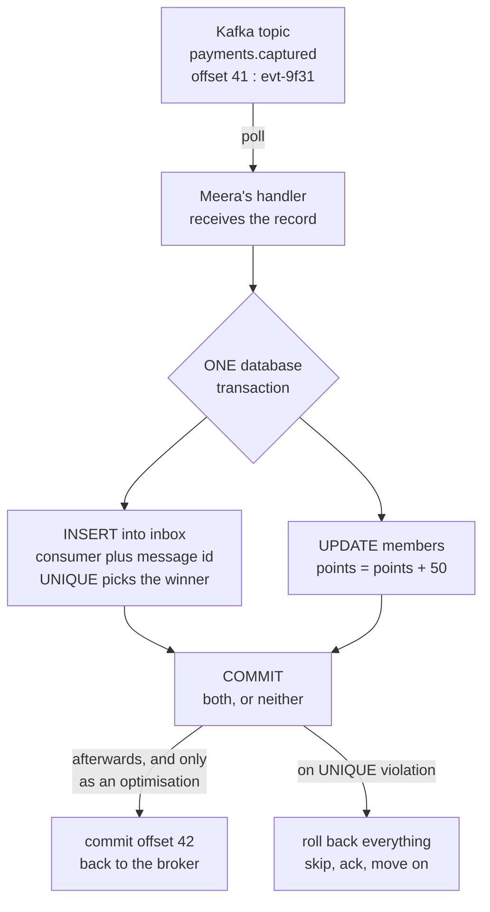

# The Idempotent Consumer — one effect per message, from a message that has no caller

> **Tell a friend:** Asha pays ₹2,000 once, and Meera's loyalty service gives
> her 50 points twice. Nothing crashed loudly and nothing was logged. The
> service simply read the same fact a second time, because a broker only ever
> promises "at least once". Everyone names the same fix: make the consumer
> idempotent. That is really three separate jobs. Give the message a name,
> record that you handled it in the same breath as handling it, and keep that
> record long enough. The third job is the one that fails in production. How
> long is long enough gets decided by Priya replaying a queue nine days later,
> not by anything in your code.

Keep [`visualization.html`](visualization.html) open beside this page; §9 maps
its four designs onto the five versions built in §10. §17 says what this lab is
made of and where its numbers come from.

---

## 1. Why does a message consumer inherit everyone else's uncertainty?

> **In one breath:** A consumer is handed facts by strangers. Any of those
> strangers can hand it the same fact twice. None of them will mention that
> they did.

You already own most of the parts for this lab.

The [idempotency](../49-idempotency/) lab built a three-part protocol. The
caller mints a key. The server claims that key atomically with the effect. The
server replays the stored response for a repeat. That lab also proved the claim
must be an `INSERT` under a `UNIQUE` constraint, never a check-then-act.

The [kafka](../53-kafka/) lab established the vocabulary this one leans on. A
**topic** is an append-only log, split into **partitions**. A **consumer group**
is a set of processes sharing that log. Each partition belongs to exactly one
member of the group at a time. Each group keeps one number per partition, its
**offset**, meaning "I have read up to here". Handing a partition from one
member to another is a **rebalance**.

That lab also showed the commit position is a forced choice with no third
option. Commit the offset before processing and you get at-most-once. Commit it
after and you get at-least-once.

The [transactional-outbox](../48-transactional-outbox/) lab ended, like eight
other labs, with the same sentence: *"…and therefore consumers must be
idempotent."*

So why a whole lab for the consumer?

Because a message consumer is not a request handler with a queue in front of
it. Three things are structurally different. Each one breaks a different part of
the protocol you already know.

**Nobody is calling you.** No caller mints a key on your behalf. No caller waits
for a response. So part 1 and part 3 of the idempotency protocol have no owner
at all. The name of the message has to come from somewhere else, and the first
two places engineers reach for are both wrong.

**The duplicate does not come from one place.** On an HTTP endpoint the
duplicate is a client retry, and it arrives seconds after the original. A
consumer's second copy can come from six other directions, and the gap can be
nine days. That spread of *redelivery age* turns out to be the entire story of
the hardest failure in this lab.

**Your bookkeeping lives in a second system.** Your effect lands in Postgres.
Your read position lands in Kafka. That is a dual write, in a lab series where
"dual write" has been the villain since the outbox. Whether it is a *dangerous*
dual write is worth answering precisely, because the popular answer ("store
offsets in your database") is often the wrong trade.

This lab opens up the slogan for the consumer specifically. By the end you
should be able to look at any consumer in your codebase and answer four
questions about it, in this order.

1. What names this message?
2. What makes the record of processing atomic with the effect?
3. How long must that record survive?
4. What would the operation do if the record were gone?

### Who is in this story?

Here is the cast for the whole lab. Keep them; every trace uses them, and every
failure belongs to one of them.

| Who | What they own | Where you meet them |
|---|---|---|
| **Asha** | She is member `M-77`. Her ₹2,000 payment is worth 50 points. | §2, and every trace after it |
| **Meera** | The `loyalty` service. Every version of the consumer in §10 is hers. | §3 onwards |
| **Arjun** | The `payments` service and the `relay` that ships its events. | §1, and §11 F3 |
| **Priya** | On call. She replays dead-lettered records nine days after an incident. | §10 v3, and §11 F5 |
| **Dev** | The database. He writes the cleanup job, then watches the table swell. | §10 v3, and §11 F10 |
| **Omar** | A second consumer, `notifications`, reading the same topic. | §10 v2, and §12 |

Ben runs the platform team. He arrives in §13 with a proposal, and §14 explains
why it is half right.

Now the moving parts they operate.

| Part | What it is |
|---|---|
| **`payments`** | Arjun's service. Captures a payment, writes an event to its outbox in the same transaction. |
| **`relay`** | Arjun's outbox poller. Reads unpublished outbox rows and sends them to Kafka. |
| **`payments.captured`** | A Kafka topic, 1 partition for now, so ordering is not yet a variable. |
| **`loyalty`** | Meera's consumer. One consumer group, `loyalty-v1`. |
| **`members`** | A Postgres table in the loyalty service. The row `M-77` is Asha. |
| **`evt-9f31`** | The event for payment `pay-8812`: ₹2,000, member `M-77`, worth **50 points**. |

Meera's whole loyalty handler is one line.

```sql
-- the effect: accumulative, therefore NOT naturally idempotent
UPDATE members SET points = points + 50 WHERE id = 'M-77';
```

That one line is the reason this lab exists. Suppose the effect were
`SET tier = 'GOLD'` instead. That is an *assignment*. Running it twice leaves
exactly the state that running it once leaves, and much of this lab would be
unnecessary. Adding is not like that. Adding remembers how many times it
happened.

### Where can a second copy of one fact come from?

Count the places. This is not a theoretical list. Every entry is a mechanism you
have already learned in an earlier lab.

Five of them are produced by machines. Read the last column first: it says
whether the second copy lands at the *same* address in the log or a *new* one,
and that column decides which designs in §10 survive.

| # | Who does it | What happens | Typical gap | Same address? |
|---|---|---|---|---|
| 1 | Arjun's `relay` | It crashed after `send()` returned but before it marked the outbox row published. On restart it publishes the row again. | seconds to minutes | new offset |
| 2 | Arjun's producer | A network retry inside one producer session resends the record. | milliseconds | new offset |
| 3 | Meera's consumer | It crashed after the `UPDATE` committed and before the offset commit. | seconds | same offset |
| 4 | A rebalance | The group re-assigns partition 0 while the consumer is half-way through a batch. | seconds | same offset |
| 5 | A retry topic | Spring Kafka's non-blocking retries republish the failed record to `payments.captured-retry-1`. | seconds to minutes | new offset, new topic |

Two of those five deserve a sentence each. Source 1 is the outbox lab's own
at-least-once guarantee, seen from the receiving end. Kafka now holds the same
*event* at two different offsets. Source 3 is the kafka lab's forced choice,
paid in full. Source 2 is mitigated by Kafka's idempotent producer, but only
within one producer session, and only inside the cluster.

The other two sources are produced by people. That difference is not a
curiosity. It is the reason §10 v3 fails.

| # | Who does it | What happens | Typical gap | Same address? |
|---|---|---|---|---|
| 6 | Priya | She re-injects 40,000 dead-letter records nine days after the incident that produced them. | days to months | new offset |
| 7 | Meera | She fixed a bug in the points calculation and reset the group to offset 0 on purpose. | any | same offsets, re-read |

Seven sources. Note two properties of that list, because the rest of the lab is
built on them.

The **time gap** between the original and the duplicate ranges over six orders
of magnitude. Milliseconds for source 2. Months for source 6.

The **identity** of the duplicate differs by source. In sources 3 and 4 it is
the *same record at the same offset*. In sources 1, 5 and 6 it is a *different
record, at a different offset, possibly on a different topic, carrying the same
business fact*.

> 🔮 **Predict:** suppose Meera keeps a table of every offset she has already
> processed, and skips anything already in it. Which of the seven sources does
> that table actually stop?

<details><summary>Reveal</summary>

It stops sources 3 and 4, the two where the *same record at the same offset*
comes back. Those are exactly the two it was designed for, which is why it feels
like a complete answer.

It does not stop sources 1, 5 or 6. Each of those puts the same fact at a *new*
offset, and a new offset is honestly new. Source 2 is usually handled for you
inside the cluster by Kafka's idempotent producer. Source 7 re-reads the same
offsets, so the table does suppress it — and that turns out to be a different
problem, waiting for you in §11 F6.

If you said "all of them, because the offset is unique", you have the right fact
and the wrong conclusion. Uniqueness of the address is not stability of the
name.

</details>

Any dedup scheme that only handles same-offset redelivery handles two of seven
cases. That is the trap in §10 v1, and it is extremely common in real code.

---

## 2. How does Asha end up with 100 points for one payment?

> **In one breath:** Meera's consumer adds the points, saves them, and dies one
> instant before it can write down how far it had read. When it restarts it
> reads the same event again and adds the points again.

Real values, ordered events. The consumer is the naive one everybody writes
first: poll, process, commit.

```
t=0     relay publishes evt-9f31            → topic offset 41
t=1     loyalty polls                        → gets [offset 41 : evt-9f31]
t=2     loyalty runs UPDATE members
          SET points = points + 50           → members: M-77 points = 50   ✅
t=3     loyalty COMMITs the DB transaction   → durable
t=4     ── the pod is evicted ──                (OOM, deploy, node drain, k8s)
                                                the offset commit never happened
t=5     new pod starts, joins group loyalty-v1
t=6     group coordinator reports committed offset = 41
t=7     loyalty polls                        → gets [offset 41 : evt-9f31]  again
t=8     loyalty runs UPDATE members
          SET points = points + 50           → members: M-77 points = 100  ❌
t=9     COMMIT, then commit offset 42        → all clean, nobody alerts
```

Nothing crashed *visibly*. No exception was logged at t=8. Meera's consumer did
exactly what it was told. Asha has 100 points for one ₹2,000 payment, and the
only evidence is a number in a row.

That last sentence is the shape of every failure in this lab. The damage is a
value, not an error.

> 🔮 **Predict before reading on.** The pod died between the database commit and
> the offset commit. Suppose Meera swaps the two lines. She commits the offset
> *first*, then runs the `UPDATE`. What is the worst thing that can now happen,
> and is it better or worse than what you just read?

<details><summary>Reveal</summary>

The window does not close. It inverts.

If the pod dies after the offset commit and before the `UPDATE`, the event is
gone. The group's position has already moved past 41. No future poll will ever
return it again. Asha gets **0 points**, permanently, and again nothing is
logged.

If you guessed "better, because a lost event is quieter than a wrong number",
you have the right instinct and the wrong conclusion. Quiet is the problem.

Which is worse depends on a property most teams never state out loud: **a
duplicate is detectable and repairable downstream; a silent loss is neither.**
You can reconcile 100 points against a payments ledger and find the double. You
cannot find a payment that produced *no* loyalty record by looking only at
loyalty. That asymmetry is why the entire industry standardised on at-least-once
delivery plus consumer-side deduplication. Not fairness. Not elegance.

</details>

**Where this lab takes you.** Stop at any of the four depth checkpoints and you
still have something whole.

| Layer | Sections | After it you can… |
|---|---|---|
| **Beginner** | 1–6 | say why the offset commit is not the fix, and name the three obligations hiding inside the word "idempotent" |
| **Intermediate** | 7–10 | build the mechanism five times, and replay in the simulator the trace that kills each version |
| **Engineering** | 11–12 | reason about the consumer's own failure catalogue, and state the guarantee and its two silent lapses |
| **Production** | 13–14 | wire it in Kafka, Spring, SQS, RabbitMQ and CDC, graph the right four things, and refuse the eight wrong models |

---

## 3. What if the consumer simply remembers what it has seen?

> **In one breath:** If the problem is that the consumer forgot, give it a
> memory. That instinct is right. Where you put the memory is where it goes
> wrong.

Meera writes the obvious thing.

```java
// loyalty consumer, attempt 1
private final Set<String> seen = new HashSet<>();

void onMessage(Record r) {
    if (seen.contains(r.eventId())) return;   // skip the duplicate
    awardPoints(r);                            // UPDATE ... points + 50
    seen.add(r.eventId());
}
```

The field named `seen` is her memory: the list of event names already handled.
This is the obvious solution, and it is a genuinely reasonable first attempt. It
*does* fix a real class of problem. Two deliveries within one process lifetime, back to back, are now
handled. She runs it in a test and the test passes.

> 🔮 **Predict:** Meera's test passes. Name the property of her test that makes
> it pass, and say which of the seven sources in §1 the test cannot express.

<details><summary>Reveal</summary>

The test runs in one process that never dies. Every source in §1 except source 2
involves either a process ending or a second process starting. A test that keeps
one object alive for its whole duration cannot express any of them.

If you said "the test is too fast", that is close but not the property. Speed is
not what saves the set. Living is.

</details>

---

## 4. Three ways that memory fails — which one is actually interesting?

> **In one breath:** The first two failures are about *where* the memory lives,
> and both are easy to fix. The third is about *when* the memory is consulted,
> and it is the one that survives every obvious fix.

**Way one: the memory is in the wrong place.** The set named `seen` is a field
on a heap, and that heap dies with the pod. The failure in §2 is precisely a pod
death. The set is empty at t=5. Every duplicate that matters survives the thing
that was supposed to remember it.

**Way two: the memory is per instance.** Meera scales the deployment to three
pods. Each pod has its own `seen`. A rebalance moves partition 0 from pod A to
pod B, and pod B has never heard of `evt-9f31`. Even a durable per-pod set would
not help. It is not durable *per partition*, and partitions move.

Both of those go away if the memory moves into the database.

```sql
SELECT 1 FROM processed_messages WHERE event_id = 'evt-9f31';  -- seen?
UPDATE members SET points = points + 50 WHERE id = 'M-77';     -- effect
INSERT INTO processed_messages(event_id) VALUES ('evt-9f31');  -- remember
```

**Way three: the memory is consulted in a gap.** You have met this exact shape
before. The idempotency lab called it check-then-act and killed it there. So
here is only what is *different* about it inside a consumer.

On an HTTP endpoint, the two racers are two client retries hitting two threads.
In a consumer, the two racers are **two consumer instances that both believe
they own partition 0**. That is not a rare interleaving. It is the ordinary
outcome of a rebalance. It lasts as long as the old owner's handler takes to
notice it has been fenced, which can be `max.poll.interval.ms`, five minutes by
default.

Watch the two pods interleave. Read the two columns as two clocks running at
once.

```
        pod A (old owner)                    pod B (new owner)
t=0     SELECT → not seen
t=1                                          SELECT → not seen
t=2     UPDATE points +50   (= 50)
t=3                                          UPDATE points +50   (= 100)
t=4     INSERT processed_messages            INSERT → unique violation, rolls back
```

Pod A is a **zombie**: still executing, already replaced. Now look at the shape
of the damage, because it is easy to miss. The `UNIQUE` constraint *did* fire.
It fired at t=4, which is after both `UPDATE` statements already landed.

A constraint only protects the statements inside the same transaction as the
violation. Here the check, the effect and the record were three separate
decisions. Only the last one was guarded.

This is the moment the lab's real subject appears. "Make the consumer
idempotent" sounds like one obligation. It is three, and they fail
independently.

---

## 5. What is "make it idempotent" really asking for?

> **In one breath:** Three promises, not one. Name the message. Record it in the
> same instant you act on it. Keep that record until the last possible duplicate
> has arrived.

Here is the real requirement, stated plainly. We will spend the rest of the lab
on these three lines.

> **R1 — Identity.** Every message must carry a name that stays the same across
> every path that can redeliver it.
>
> **R2 — Atomicity.** The record "I have processed this name" must become
> durable in the *same atomic act* as the effect it guards.
>
> **R3 — Memory.** That record must still exist when the duplicate arrives. The
> arrival time of the duplicate is not bounded by anything in your code.

R2 is the one you already know how to satisfy. It is the idempotency lab's
single-transaction claim. For a consumer whose effect is a local database write,
it is genuinely easy.

**R1 and R3 are the consumer's own problems.** They have no counterpart in the
HTTP case. Each of them has a popular answer that is wrong in a way that
produces no error message.

Map the three obligations onto the three failures you just watched.

| Obligation | The failure that violates it | Where you saw it | What it looks like |
|---|---|---|---|
| **R1 identity** | dedup on the address instead of the fact | §10 v1 | the same event applied twice at two offsets |
| **R2 atomicity** | check, then act, then record | §4 way three | two pods both pass the check, both add points |
| **R3 memory** | the record was deleted before the duplicate arrived | §10 v3 | a replay applies 40,000 facts a second time |

The rest of the mechanism section is those three obligations, in that order.

> **Checkpoint — the beginner layer ends here.** You can now explain why
> committing the offset is not a fix in either direction, and why a durable
> dedup table checked *before* the effect is still broken.

> **Say it back.** Without using the words *idempotent*, *offset* or
> *transaction*, explain to a friend why Asha ended up with 100 points, and why
> writing down "I did this one" in a table did not save her.
> <details><summary>A good answer sounds like</summary>
> "The service added her points, then died before it could write down how far it
> had got. When it came back it read the same thing again and added them again.
> Writing it in a notebook does not help on its own. Two copies of the service
> can both look at the notebook and both see nothing. Then both add the points,
> before either one has written anything down. The looking and the writing have
> to be one movement, not two."
> </details>

---

## 6. What is the one key idea underneath all of it?

> **In one breath:** Stop asking whether you have seen this *delivery*. Start
> asking whether this *fact* is already in your state, and write the answer down
> in the same commit that applies it.

A consumer becomes idempotent when it stops asking *"have I seen this
delivery?"* and starts asking *"has this **fact** already been applied to my
state?"* Then it records the answer in the same commit as the application.

Everything below is the consequence of taking two words literally: **fact**, and
**same commit**.

*Fact* is obligation R1. A delivery is a thing that happened to a wire. A fact is
a thing that happened in Arjun's payments service. They are not the same object,
and only one of them survives being sent twice.

*Same commit* is obligation R2. Not "immediately after". Not "in a transaction
that usually succeeds". The same commit, so that a database, not your code,
decides which of two racers wins.

Obligation R3 has no clever word. It is a duration, and §10 v3 is the story of
choosing it wrong.

---
## 7. Which four words does this lab have to earn?

> **In one breath:** Four new ideas. The first is a pair: where a copy arrived,
> versus what the copy says. Then the table that remembers, then how late a
> duplicate can be, then a trick that makes the memory problem disappear.

You already own *at-least-once*, *idempotency key*, *dedup window*, *offset*,
*consumer group*, *rebalance*, *DLQ*, and *effectively-once* from
[kafka](../53-kafka/) and [idempotency](../49-idempotency/). These four are new
here, and each one is earned by something that has already happened in the story.

### 7.1 Where a copy arrived, or what the copy says?

Arjun's `relay` sends `evt-9f31`. Kafka appends it and stamps it with an
address: this topic, this partition, this position. The address is
`payments.captured/0/41`.

Then the relay restarts and sends the same outbox row again. Kafka appends it a
second time and stamps a *different* address, `payments.captured/0/58`. Two
addresses. One fact.

Engineers call the address **delivery identity**: the triple
`(topic, partition, offset)`, assigned by the broker at append time, unique per
*append*. They call the name inside the record **message identity**: a value
carried in the record, assigned by the producer when the fact was created, and
identical across every append of that fact.

Why does the distinction need a name at all? Because a single business fact can
be appended more than once. A relay republish does it. A retry topic does it. A
mirrored cluster does it. Each append gets a fresh delivery identity.
Deduplicating on delivery identity therefore fails on exactly the sources that
produce duplicates *across* appends.

You have met message identity before without the name. The
[CDC](../52-change-data-capture/) lab's `source.lsn` is one. That field exists so
that a sink can key on what the record says, rather than on where it sat in the
stream.

### 7.2 What is an inbox, and why is it the outbox in a mirror?

Meera's table of facts she has already applied is called an **inbox table**. In
code it is usually called `processed_messages`. Precisely: a table keyed by
`(consumer, message_id)` with a `UNIQUE` constraint, written in the same
transaction as the effect.

Hold the outbox next to it. The outbox makes "I decided this" and "I told
someone" atomic. The inbox makes "I was told this" and "I acted on it" atomic.
Same trick, opposite direction, which is why the two labs read as mirror images.

Why does it work? Because it converts "did I already do this?" from a question
about your own past behaviour into a database constraint. A constraint is the
only place in the system where two racers get serialized for free.

### 7.3 How late can a duplicate be?

Priya's replay lands nine days after the incident. That gap has a name:
**redelivery age**, the maximum wall-clock interval between two deliveries of one
message identity, taken over every redelivery source your architecture has.

It needs a name for three reasons, and the third is the uncomfortable one. It is
the input to the only sizing decision in the whole pattern, which is how long the
inbox must remember. It is not a configuration value anywhere. And it is usually
set by a human running a dead-letter replay, rather than by software.

### 7.4 Can you remember everything with one number?

Instead of a list of everything seen, keep the highest number seen. That is
**watermark deduplication**, also called high-water-mark deduplication.

Precisely: per dedup scope, usually per entity key, store the largest
monotonically increasing sequence applied. Apply an incoming message only if its
sequence is strictly greater. Then advance the stored value in the same
transaction.

Why bother? Because it turns obligation R3 from a retention problem into no
problem at all. A number that only moves forward never needs pruning. The price
is that it demands monotone, per-key-ordered sequences.

It is the same move you have made twice before. It is `expected_version` in
[event-sourcing](../50-event-sourcing/), and `source.lsn` in
[CDC](../52-change-data-capture/), used defensively rather than for ordering.

Four ideas, five names, and the place in the story that earned each one.

| Word | The moment that earned it | Section |
|---|---|---|
| **Delivery identity** | Arjun's relay puts one fact at two offsets | §7.1 |
| **Message identity** | the id minted in the outbox row, unchanged by republication | §7.1 |
| **Inbox table** | Meera's `processed_messages`, written with the effect | §7.2 |
| **Redelivery age** | Priya's nine-day gap between incident and replay | §7.3 |
| **Watermark** | one number per member instead of a list of events | §7.4 |

---

## 8. What picture should you carry in your head?

> **In one breath:** A bouncer with a ledger. He recognises the guest by name,
> writes the name and opens the door as one movement, and never tears out a page
> while that guest can still come back.

Two mental models follow. The first is a picture you can hold. The second is the
same machine with the real names on it.

### Simple model — can one bouncer with a ledger do the job?

A club, one door, one bouncer, one ledger. A guest may only be let in once. The
bouncer must do three things, and they map exactly onto R1, R2 and R3.

He must **recognise the guest** by a name, not by which taxi they arrived in.
That is R1. The taxi is the offset. The name is the event id.

He must **write the name and open the door as one movement**. If he opens the
door and *then* writes, someone slips in during the pen stroke. That is R2, and
that pen stroke is the gap in §4.

He must **not tear out yesterday's page** while yesterday's guest can still come
back. That is R3, and Priya is yesterday's guest.

### Engineering model — what is inside the box, and what is outside it?

The same machine in real names. The important thing in this diagram is not what
is in the box. It is what is *not*.

```
                     ┌──────────────────────────────────────────────┐
 broker              │              consumer process                │
 ┌───────────┐       │                                              │
 │ offset 41 │──poll─┼─► handler(record)                            │
 │ evt-9f31  │       │      │                                       │
 └───────────┘       │      │  ┌──── ONE database transaction ───┐  │
       ▲             │      └─►│ INSERT inbox(consumer,msg_id)   │  │
       │             │         │        ▲ UNIQUE ⇒ arbitrates    │  │
       │             │         │ UPDATE members SET points+50    │  │
   commit offset ◄───┼─────────│ COMMIT                          │  │
   (after commit,    │         └─────────────────────────────────┘  │
    and only as an   │                                              │
    optimisation)    └──────────────────────────────────────────────┘
```

The same shape drawn as a flow, if that reads more easily:



Read the picture for one thing: **the offset commit is outside the box.** It is
not part of the correctness argument. It is an optimisation that stops you
re-reading records you have already suppressed. If it fails, you re-read, and
the inbox absorbs it.

That single observation dissolves a lot of anxiety about "the consumer's dual
write". We make it precise in §10 v2.

### Where does the story lie to you?

The bouncer is an entry point, not the model. He hides the two hardest facts in
the lab, so replace them now.

**There are two bouncers, not one.** Whenever a rebalance is in flight, two
processes are running, and both are convinced they are the only one. The ledger
is what makes them agree, not their belief about who owns the door. Any design
where the bouncer decides on something *he* remembers is broken under this fact.
The decision has to be a write that the ledger accepts or rejects.

**The guest can come back wearing a different wristband.** Republication gives
the same fact a new delivery identity. A ledger that records wristband numbers
will happily admit the same guest twice. That is §10 v1, in one sentence.

---

## 9. What can "The Second Delivery" show you that this page cannot?

> **In one breath:** This page tells you which designs fail. The simulator lets
> you break them yourself, one redelivery source at a time, and watch Asha's
> points move.

Open [`visualization.html`](visualization.html) now, or after §10 v2. It runs
Meera's loyalty consumer against the topic with four selectable designs. It also
lets you inject the four redelivery sources by hand.

The four designs on the page are the versions built in §10, one letter each.

| On the page | In §10 | What it stores |
|---|---|---|
| **A · no dedup** | the naive consumer of §2 | nothing at all |
| **B · dedup by offset** | v1 | `processed_offsets(topic, partition, offset)` |
| **C · inbox by event id** | v2 and v3 | `inbox(consumer, message_id)` plus a retention setting |
| **D · watermark per key** | v4 | one `last_seq` number on Asha's member row |

**What to look at.** The verdict line at the top says how many points Asha has
for *one* payment. Everything else on the page exists to explain that number.
The dedup store panel is the interesting one. Watch what goes into it under each
design, and in design C watch what the retention slider throws away.

**The question the page answers.** Each design suppresses some duplicates and
misses others. Which ones it misses depends entirely on which redelivery source
you inject. No design is safe against all four sources until you reach D, and
even D trades something away.

The four scenario buttons match this lab's four turning points: §2, §10 v1,
§10 v3 and §10 v4.

---
## 10. How do you build this, and why does each version die?

> **In one breath:** Five versions. Each one fixes how the last one died, and
> then dies of something new. The last death is the interesting one, because
> nobody is at fault.

Meera builds the consumer five times. Read them in order; each is a real design
that real teams ship, and three of the five are still shipping somewhere today.

---

### v1 — why not dedup on the offset?

The instinct is simple. Kafka already gives every record a unique address, so
use the address.

```sql
CREATE TABLE processed_offsets (
  topic     text,
  partition int,
  "offset"  bigint,
  PRIMARY KEY (topic, partition, "offset")
);
```

```
BEGIN;
  INSERT INTO processed_offsets VALUES ('payments.captured', 0, 41);
  UPDATE members SET points = points + 50 WHERE id = 'M-77';
COMMIT;
```

Obligation R2 is now satisfied. The record and the effect are one transaction.
The primary key arbitrates between two racers, instead of a `SELECT` doing it.

Run the §2 trace and the §4 zombie trace against this design. **Both are
fixed.**

```
t=8   second delivery of offset 41
      INSERT processed_offsets (…,41) → PK violation → transaction rolls back
      the UPDATE rolls back with it → M-77 stays at 50 points ✅
```

That is a real improvement, and it is where a great many production consumers
stop. Now break it.

> 🔮 **Predict:** Arjun's relay crashed after `send()` and republished the outbox
> row. Kafka now holds `evt-9f31` at offset 41 **and** at offset 58, and Meera's
> consumer has already processed 41. What does v1 do at offset 58?

<details><summary>Reveal</summary>

`INSERT INTO processed_offsets VALUES ('payments.captured', 0, 58)` succeeds.
Offset 58 has genuinely never been seen. The `UPDATE` runs. Asha has 100 points.

If you said "the primary key catches it", you are trusting the table to answer a
question it was never asked. The dedup table did its job perfectly, and the
outcome is still wrong. It knows every *delivery* it has consumed. It knows
nothing about which *facts* it has applied.

</details>

The same hole opens for three more sources. The retry topic has a different
topic name, so a different key. A mirrored or migrated cluster re-assigns
offsets, because they do not survive MirrorMaker. And any reprocess that
re-publishes records rather than re-reading them lands at new offsets too.

**v1's lesson is the lab's first main result.** Offsets are delivery identity.
Deduplication requires message identity, and only the producer can supply it.

Concretely, Arjun must put an id in the event at creation time. For an outbox
that id is the outbox row's id, minted inside the same transaction as the state
change.

```sql
-- in the payments service, one transaction
UPDATE payments SET status='CAPTURED' WHERE id='pay-8812';
INSERT INTO outbox(id, topic, key, payload)
VALUES ('evt-9f31', 'payments.captured', 'M-77', '{...}');
```

Republished later from the same row, that `id` is unchanged. That is the
property that makes it usable.

---

### v2 — what changes when you dedup on the message id?

Meera keys on what the record says, not on where it landed.

```sql
CREATE TABLE inbox (
  consumer   text  NOT NULL,      -- 'loyalty-v1'
  message_id text  NOT NULL,      -- 'evt-9f31'
  applied_at timestamptz NOT NULL DEFAULT now(),
  PRIMARY KEY (consumer, message_id)
);
```

```
BEGIN;
  INSERT INTO inbox(consumer, message_id) VALUES ('loyalty-v1','evt-9f31');
  UPDATE members SET points = points + 50 WHERE id = 'M-77';
COMMIT;                              -- on PK violation: roll back, skip, ack
```

Two details in that table definition are load-bearing, and both are routinely
missed.

**The `consumer` column is part of the key.** Three services consume
`payments.captured`, and one of them is Omar's `notifications`. Suppose all
three share one `inbox` table keyed only by `message_id`. The first service to
process an event then suppresses it for the other two. Omar's welcome message
never goes out, and nothing anywhere reports an error. Either key by
`(consumer, message_id)`, or give each consumer its own table. One table with a
compound key is usually better: one retention job, one dashboard.

**The `INSERT` comes first, before the `UPDATE`.** Not because ordering matters
to the database, because inside one transaction it does not. It matters because
putting the insert first makes the duplicate path cost one failed insert, rather
than a full effect plus a failed insert. On a hot partition that is the
difference between a cheap skip and a lock-contention incident.

Now re-run every trace so far. Read the last three rows: those are the sources
that defeat v1.

| Redelivery source | v1 | v2 |
|---|---|---|
| Crash before offset commit (§2) | ✅ suppressed | ✅ suppressed |
| Rebalance zombie (§4) | ✅ suppressed | ✅ suppressed |
| Relay republish, new offset | ❌ **double** | ✅ suppressed |
| Retry topic | ❌ double | ✅ suppressed |
| DLQ replay 9 days later | ❌ double | ✅ suppressed (for now — see v3) |

#### Is the consumer's dual write the same bug as the outbox's?

Meera's effect commits to Postgres. Her offset commits to Kafka. Two systems,
two writes, no atomicity between them. Given how much damage the dual-write
problem has done in this curriculum, this deserves a straight answer rather than
a reflex.

> 🔮 **Predict:** there are four ways a crash can land across those two writes.
> One of the four is genuinely bad. Before you read the table, say which one it
> is, and say whether Meera can make it unreachable.

<details><summary>Reveal</summary>

The bad one is: the database transaction did **not** commit, and the offset
commit **did**. The event is skipped forever, and nothing records that it was.

Meera can make it unreachable, and the way she does it is boring. She commits
the offset only after the database transaction returns. If you guessed the row
where the database commits and the offset does not, that row is the one the
inbox was built for: it is a re-read, absorbed silently.

</details>

Enumerate all four crash points.

| # | DB txn | offset commit | Consequence |
|---|---|---|---|
| 1 | ✗ | ✗ | Redelivered, processed. Correct. |
| 2 | ✓ | ✗ | Redelivered, **inbox suppresses it**. Correct. |
| 3 | ✗ | ✓ | **Event skipped forever. Data loss.** |
| 4 | ✓ | ✓ | Correct. |

Row 3 is the only bad one, and it is unreachable as long as you commit the
offset *after* the database transaction. That is exactly what
`enable.auto.commit=false` plus a manual ack after the handler returns gives
you. So:

> **The consumer's dual write is benign, because the second write is guarded by
> the first.** The inbox turns "the offset commit was lost" from a correctness
> problem into a performance problem: you re-read some records and throw them
> away.

This matters practically, because there is a popular alternative. Store the
offset in your own database, inside the same transaction as the effect. That
alternative is real and it is correct. It is also usually a worse trade than it
looks, for three reasons.

It *only* handles same-offset redelivery. It is v1 wearing a different hat, and
it inherits v1's blindness to republication. Teams adopt it believing it is
stronger than an inbox. It is strictly weaker.

It requires a `ConsumerRebalanceListener` that seeks to your stored offsets on
every partition assignment. You now own a piece of the group protocol.

And it is defeated by any deliberate replay, because your stored offset *is* the
thing you were trying to move.

**Rule:** you need offsets in your database only if you have decided not to keep
an inbox. Keeping both is coherent, and Spring's Kafka plus JPA chained
transaction managers effectively do. It buys nothing the inbox has not already
bought.

> **Checkpoint.** v2 is a correct idempotent consumer for a local, transactional
> effect. If Meera's handler only writes to one database, and her inbox never
> forgets, she is done. Most of the internet's advice ends here. The next two
> versions exist because "never forgets" is not a thing a table does.

---

### v3 — what happens when the inbox has to forget?

`payments.captured` carries 4,000 events per second. Put that through a
calendar and the table stops being a design.

| Interval | Rows in Meera's inbox | What it means |
|---|---|---|
| one second | 4,000 | one row per event, forever, by construction |
| one day | 345 million | more rows per day than the members table has, ever |
| one year | 126 billion | not a table any more, a countdown |

So Dev adds the obvious cleanup job.

```sql
DELETE FROM inbox WHERE applied_at < now() - interval '7 days';
```

Seven days sounds generous, and Dev's reasoning is good. Consumer restarts take
seconds. Rebalances take tens of seconds. Arjun's relay republishes within a
minute. Seven days is four orders of magnitude of headroom against every
duplicate anyone on the team has ever seen.

> 🔮 **Predict:** Diwali weekend. Meera's downstream tier-service is down for two
> hours, so 40,000 records land in the dead-letter queue. The incident is closed
> on Monday. Nine days later, during cleanup, Priya replays the DLQ to "get those
> members their points". What happens?

<details><summary>Reveal</summary>

Every one of the 40,000 events is now older than the retention window. Their
inbox rows were deleted on day 7 by Dev's job. To the consumer they are
brand-new facts, and they are applied a second time.

40,000 members get double points, in a single batch, at 3pm on a Tuesday, from
an operation whose entire purpose was to *repair* the incident.

Nothing errors. Priya's replay tool reports 40,000 successes.

If you guessed "the inbox suppresses them", you were right about the mechanism
and wrong about the timing. The inbox does suppress them — for seven days.

</details>

This is the most important failure in the lab, so state its lesson exactly.

> **The inbox's retention must exceed the maximum redelivery age — and
> redelivery age is set by human operational behaviour, not by any config file in
> your repository.**

There is no software setting anywhere that bounds "how long after an incident
might someone replay a dead-letter queue". Which produces an uncomfortable
conclusion. For the replay source and the deliberate-reprocess source, a
retention-based inbox is not a guarantee. It is a *bet*, and it is a bet whose
losing side is silent.

There are three honest ways to respond. They are listed in order of how much
they actually fix.

**Write the number down, and make it bigger than the replay you allow.** Set
retention explicitly longer than your stated maximum replay age, and put that
number in the runbook: "DLQ records older than 30 days must not be replayed;
regenerate them from source instead." This is cheap, and it converts a silent
failure into a documented policy. It is only as good as the human reading it.

**Give replays their own dedup scope.** Priya's replay run gets a fresh
`consumer` value, `loyalty-v1-replay-2026-09-01`. Crucially, the results of that
run are then *reviewed* rather than trusted. This is honest about what a replay
is. It is a deliberate reprocess, not a duplicate.

**Stop needing retention at all**, which is v4.

---

### v4 — can memory that never grows also never expire?

Change what is stored. Instead of a set of facts, keep one number per entity.

Arjun stamps each event with a per-key monotonically increasing sequence. For an
outbox this is easy. It is a per-aggregate counter incremented in the same
transaction, or the outbox row id when a single writer produces that key's
events in order.

```
evt-9f31  member M-77  seq 17  +50 points
evt-a044  member M-77  seq 18  +30 points
```

In words: this is Asha's seventeenth loyalty event, then her eighteenth. The
number belongs to Asha, not to the topic.

Meera stores the highest sequence she has applied, on Asha's own row.

```sql
CREATE TABLE members (
  id          text PRIMARY KEY,
  points      int  NOT NULL,
  last_seq    bigint NOT NULL DEFAULT 0    -- the watermark, IN the entity row
);
```

The whole dedup mechanism is now one extra line in the `UPDATE`.

```sql
BEGIN;
  UPDATE members
     SET points   = points + 50,
         last_seq = 17
   WHERE id = 'M-77'
     AND last_seq < 17;          -- the entire dedup mechanism, one predicate
COMMIT;
-- 0 rows updated ⇒ already applied (or superseded) ⇒ skip and ack
```

Read `last_seq < 17` as a sentence: *only apply this if the highest thing I have
already applied to Asha is older than event seventeen.*

Look at what just happened to the three obligations.

| Obligation | How v4 satisfies it | What it costs |
|---|---|---|
| **R1 identity** | `(key, seq)` is producer-minted, and survives republication exactly like an event id does | the producer must have a per-key counter |
| **R2 atomicity** | the guard is a `WHERE` clause on the row being modified: no second table, no second index, no extra write | nothing |
| **R3 memory** | *dissolved* — `last_seq` is one number per member and only moves forward, so it is never pruned | deliberate replay becomes hard, see below |

That middle row is the [optimistic-vs-pessimistic-locking](../10-optimistic-vs-pessimistic-locking/)
lab's conditional write, wearing yet another costume.

The third row is worth pausing on. There is no window any more, so Priya's
nine-day replay in v3 is suppressed correctly. Storage is now O(entities)
instead of O(messages): a few million rows instead of a hundred billion.

It also gives Meera something the inbox never did: **reorder safety**. Suppose
`seq 18` is processed before `seq 17`, because of a retry topic, a partition
change, or two concurrent handlers. Then `seq 17` is rejected by `last_seq < 17`
rather than applied out of order.

> 🔮 **Predict:** with v4 in place, Meera resets the consumer group to offset 0.
> She wants to reprocess the last month, because she has fixed a bug in the
> points calculation. What happens?

<details><summary>Reveal</summary>

**Nothing happens.** Every event in the topic has a sequence at or below the
watermark already stored on its member row. So every `UPDATE` matches zero rows.
The consumer runs at full speed through a month of data, logs nothing unusual,
commits offsets, and changes no state at all.

If you guessed "everyone's points are doubled", you have v2's failure in mind.
The watermark does not double anything. It does nothing at all, which is worse
to discover.

If the intent was "suppress duplicates", this is a triumph. If the intent was
"recompute everyone's points with the fixed formula", it is a silent no-op that
will be discovered by a customer.

</details>

That is v4's honest cost, and it is the mirror of v3's. **The same property that
makes a watermark retention-free makes a deliberate replay impossible without an
explicit reset.** A well-run system therefore ships a documented procedure for
both. "How to reprocess" is a first-class operation, not an improvisation.

The other three costs, stated plainly.

**It needs per-key ordered delivery.** With key-based partitioning
(`key = M-77`) Kafka gives you that per partition. Lose it and events arrive out
of order. You lose it by repartitioning, by parallelising a partition across
threads, or by routing through a retry topic. Out of order, the watermark does
not merely fail to dedup. It *discards* legitimate updates, which is worse than
a duplicate.

**It needs a monotone per-key sequence from the producer.** Not every producer
has one. CDC gives it free through `source.lsn`. A hand-written outbox needs a
counter added.

**It is per key and per stream.** Two different event types updating Asha's row
need either one shared sequence, or one watermark column each.

---

### v5 — what does a production consumer actually do?

No single design wins. A real consumer picks per handler, from four tools, in
this order of preference.

**1. Natural idempotency — use it whenever the operation allows.** If the effect
can be written as an *assignment* rather than an accumulation, then duplicates
need no dedup machinery at all.

```sql
UPDATE orders SET status = 'SHIPPED' WHERE id = 'ord-51';   -- idempotent
INSERT ... ON CONFLICT (id) DO UPDATE SET ...               -- idempotent
INSERT INTO shipment_events(event_id, ...) VALUES (...)      -- idempotent (PK)
```

Beware the standing trap: naturally idempotent is not the same as reorder-safe.
`SET status = 'SHIPPED'` applied after `SET status = 'DELIVERED'` moves the
order backwards, and no dedup scheme in this lab notices. Idempotence handles
duplicates. Versioning handles order. Locking handles concurrency. Three
orthogonal defences, and you frequently need two of them.

**2. Watermark — when events for a key are ordered and carry a monotone
sequence.** Cheapest, retention-free, reorder-safe. It is the default choice for
projections, read models, replicated caches and CDC sinks. Anything shaped like
"apply this stream of changes to this entity".

**3. Inbox table — when events are independent facts with no per-key order.**
"Send Asha a welcome email." "Award points for this specific payment." "Create a
shipment." This needs a documented retention at least as long as the maximum
redelivery age.

**4. Claim-first plus external effect — when the effect leaves the database.**
This is the [idempotency](../49-idempotency/) lab's v4 shape, unchanged. The
claim commits alone as `RUNNING`. The external call happens next, carrying *its
own* idempotency key. The outcome commits second. A reaper re-drives claims
stranded in `RUNNING`.

Nothing about being a consumer changes that shape, with one twist. The "caller"
who must not be left in doubt is now the broker's redelivery. A stranded
`RUNNING` claim will be re-driven by the redelivery itself, if you let it.

> **Checkpoint — the intermediate layer ends here.** You can now build the
> mechanism five ways and name the trace that kills each one.

> **Say it back.** Without using the words *inbox*, *watermark* or *retention*,
> explain to a friend why Meera's second design was correct on Monday and wrong
> nine days later, and why her fourth design has the opposite problem.
> <details><summary>A good answer sounds like</summary>
> "Her second design kept a list of everything it had already done, and it
> worked. But the list was getting enormous, so somebody started throwing away
> anything older than a week. Then a colleague re-sent some week-old work, the
> list had forgotten it, and it all happened twice. Her fourth design keeps one
> number per customer instead of a list, so it never forgets and never grows. The
> price is that when she genuinely wants to redo old work, the number says 'already
> done' and nothing happens at all."
> </details>

---
## 11. What breaks when you live behind a broker?

> **In one breath:** The general shape of duplicate handling is settled. Ten
> things still go wrong, and they go wrong because a broker sits in front of you
> rather than a caller.

These ten belong to the cast. Meera owns four of them, Priya one, Dev one, and
Arjun one. The rest are nobody's fault, which is the point.

### F1 — what if the pod dies between the effect and the offset commit?

Meera's pod is evicted. It happens for boring reasons: out of memory, a deploy, a
node drain. In a busy cluster it happens several times a week.

The database transaction committed. The offset commit did not. So the group's
position is still 41, and the next poll returns `evt-9f31` again. You would see
it in the consumer log as the same offset appearing twice.

Designs v2 and v4 suppress it. Design v1 also suppresses this particular shape,
because the offset is the same one — but v1 fails the moment the redelivery
arrives by republication instead. Nothing is lost here, because the offset never
advanced.

### F2 — what if two consumers own the same partition at once?

Meera's handler is slow today, because a downstream dependency is slow. It
exceeds `max.poll.interval.ms` (default 5 min). The group coordinator
declares the member dead and reassigns the partition — while the handler is
still running, and still holding a database connection.

Two consumers now execute the same message concurrently. That is the zombie
trace in §4, and it is not exotic. It is what a rebalance does for a living.

Only one thing saves Meera here: a conditional write at the database. The inbox
primary key does it. So does the `last_seq <` predicate. The loser's whole
transaction rolls back.

Three things do not save her. An in-memory check does not. A `SELECT` before the
effect does not. And, most importantly, no assumption that partition assignment
is exclusive. Assignment is exclusive from the *coordinator's* point of view. It
is never exclusive from the point of view of code already running.

In production this correlates with a long-tail dependency. The fix that removes
the cause is smaller batches, plus a `max.poll.interval.ms` above your p99.9
handler time. The fix that removes the *damage* is the conditional write.

### F3 — what if Arjun's relay publishes the same fact twice?

The relay sent the record, then crashed before it could mark the outbox row
published. On restart it sends again. Same fact, new offset.

Design v1 is defeated. Designs v2 and v4 hold.

Kafka's idempotent producer does not help here, and it is worth knowing why. It
deduplicates a `(PID, epoch, sequence)` conversation within one producer
session. A relay restart is a new session, so from Kafka's point of view this is
an honestly new record.

### F4 — what does a retry topic do to your ordering?

Spring Kafka's non-blocking retries publish a failed record to `…-retry-1` with
a backoff. Meanwhile the main partition carries on.

So `seq 17` is sitting in the retry topic while `seq 18` sails past on the main
topic and is applied first. Deduplication is not violated. Both events are
applied exactly once. The *order* is violated.

An inbox consumer produces `points = base + 30 + 50`, which is fine, because
addition commutes. An assignment consumer produces the wrong final status, which
is not fine.

What this teaches is a trade, not a bug. Non-blocking retries buy availability by
trading away per-key ordering. If your handler relies on order, blocking retries
are the correct choice — or a watermark that rejects the late one. Note what the
watermark's "rejection" now is. It is a deliberate drop, and you must be able to
explain it.

### F5 — what does Priya's replay do nine days later?

This is the §10 v3 incident, and it is the only failure in this lab whose cause
is a human with good intentions.

What you would see is a spike in successful applications where `applied_at` is
far away from `event_time`. That gap has a name: **event age at apply time**. It
is the metric that would have caught this before it became an incident. Almost
nobody graphs it.

### F6 — what if your own dedup defeats a repair you meant to run?

Meera resets the group to offset 0 after fixing a calculation bug. Design v2
skips everything with a primary-key violation. Design v4 skips everything below
the watermark.

Both are working exactly as designed. Both defeat the operation.

A reprocess is a different intention, so give it a different dedup scope. Use a
new `consumer` value, or reset the watermarks, or build a dedicated backfill path
that *computes* the answer rather than accumulating it. The general principle
from the idempotency lab holds here too: different intentions must not share a
key.

### F7 — what does a poison message do to a claim-first handler?

One record makes the handler throw every time. With blocking retries it
head-of-line-blocks the partition. Lag climbs on that partition while throughput
reads perfectly normal for every other one.

Here is the trap specific to this lab, and it is a natural instinct after reading
the idempotency lab. Suppose you "claim" the message by inserting into the inbox
in its **own** transaction, before doing the work. Then the failing message is
marked processed and will never be retried. You have converted a loud poison
message into a silent skip.

For a local effect, the inbox insert must be in the *same* transaction as the
effect, so that it rolls back with it. Claim-first is only correct when paired
with a `RUNNING` state and a reaper, which means only for external effects.

### F8 — what if the effect leaves the database?

The handler writes to Elasticsearch, or S3, or Redis, or an email provider.
There is no transaction to put the inbox row into, so obligation R2 cannot be
satisfied the easy way.

There are three responses, and which one you pick depends on what the sink will
accept.

Make the sink hold the dedup itself. An Elasticsearch document id equal to the
message id does it. So does `version_type=external` with the event's sequence as
the version, which is a watermark implemented by the sink.

Or use claim-first with a downstream idempotency key. Email providers and
payment APIs accept one.

Or, for a genuinely unkeyable sink, accept at-least-once, reconcile afterwards,
and publish the measured residual. That is the idempotency lab's "box G",
unchanged.

### F9 — what if two threads touch Asha's row at once?

Meera parallelises a partition across a thread pool for throughput. Two threads
process two *different* events for member `M-77` simultaneously.

> 🔮 **Predict:** Meera has the v2 inbox in place, and both events have distinct
> event ids. Does the inbox protect Asha's points here?

<details><summary>Reveal</summary>

No. Both inserts succeed, because the two ids really are different. Both threads
then read Asha's current points, add to it, and write back. One of the two
additions is overwritten and lost.

If you said "yes, the primary key protects her", you are asking the constraint a
question about *sameness* when the problem is about *timing*. Two different
facts arriving together is not a duplicate at all.

</details>

This is not a duplicate. It is a lost update, and deduplication does nothing
about it at all. She needs row locking or a version check, and she has just given
up per-key ordering as well, which brings F4 along for the ride.

Hold on to the distinction. Deduplication answers "is this the same fact twice?"
Concurrency control answers "are two different facts colliding?" Same table,
different problem.

### F10 — what happens when the inbox itself becomes the bottleneck?

Every message now costs an extra indexed insert, and Dev's inbox is the hottest
write target in the schema. Index bloat follows. Autovacuum pressure follows,
which the [mvcc-and-vacuum](../09-mvcc-and-vacuum/) lab covers. And the retention
`DELETE` ends up competing with the workload it exists to protect.

Dev has three moves. Partition the table by day and `DROP` partitions instead of
deleting rows: one metadata operation, rather than a hundred million row
versions. Prefer the watermark wherever the shape allows it. And never let the
retention job be the thing that discovers the table is too big.

### Which design survives which failure?

One table for all ten. The last column is the one to read twice: it says what
you would actually see on a dashboard.

| # | What goes wrong | Whose | Which design survives | What you would see |
|---|---|---|---|---|
| F1 | crash between effect and offset commit | Meera | v1, v2, v4 | the same offset twice in the log |
| F2 | rebalance zombie, two live handlers | Meera | v1, v2, v4 (conditional write only) | a burst of constraint violations |
| F3 | relay republication, new offset | Arjun | v2, v4 | nothing — v1 fails silently |
| F4 | retry topic reorders `seq 17` after `seq 18` | Meera | v4 rejects the late one | wrong final status, right total |
| F5 | DLQ replay past retention | Priya | v4, or v2 with longer retention | apply-time far from event time |
| F6 | deliberate reprocess suppressed | Meera | none — all of them suppress it | a replay that changes nothing |
| F7 | poison message, claim in its own transaction | Meera | v2 and v4 when the claim is in-transaction | lag on one partition only |
| F8 | non-transactional sink | Meera | none directly; the sink must hold it | duplicate documents or emails |
| F9 | two threads, two facts, one row | Meera | none — this is not deduplication | a total that is quietly too low |
| F10 | the inbox is the hottest table | Dev | v4 avoids the table entirely | vacuum lag and write latency |

---

## 12. What exactly is guaranteed, and how does it stop holding?

> **In one breath:** You get "the effect happens once" for one named message, in
> one consumer, against one database. Five assumptions hold that up, and two of
> them fail quietly.

**What is guaranteed**, for design v2 or v4 with a local transactional effect:

> For a given `(consumer, message identity)`, the effect is applied **at most
> once**. Because delivery is at-least-once, that adds up to **exactly once in
> effect**. Two consumers racing on the same message produce one application and
> one rolled-back transaction.

**What that guarantee rests on.** Each row below is an assumption, and each one
is a real place where production systems break.

| # | The assumption | How it breaks | Where you saw it |
|---|---|---|---|
| 1 | the producer mints a stable identity that survives republication | the id is generated at send time rather than at fact-creation time | §10 v1 |
| 2 | identities do not collide across different facts | someone uses a business key such as `orderId` for events that can legitimately repeat | §12, below |
| 3 | the dedup record and the effect are in one transaction, against one database | a second sink is added to the handler | §11 F8 |
| 4 | the dedup record outlives every redelivery | a retention job deletes it first | §11 F5 |
| 5 | the scope is per consumer | Omar's service shares the table | §10 v2 |

**What is not guaranteed, and never was.** Five things, and the first one is not
achievable by anybody, ever.

*Exactly-once delivery* is impossible, for the reason the
[idempotency](../49-idempotency/) lab established from the two-generals result.
What you have is at-least-once delivery plus at-most-once *application*.

*Ordering* is not guaranteed. Deduplication is order-blind. F4 and §10 v5 spell
out the separate mechanism you need.

*Protection against business duplicates* is not guaranteed either. Two
*different* events can describe the same real-world fact. A double-submitted
refund produces two event ids. Those are two identities, so both will be
applied. Deduplication is defined on identities. Only the producer knows which
two sends are one intention.

*Anything outside the transaction* is not covered. The email sent in the middle
of the handler was sent, whatever the transaction later decides.

*Safety of a replay* is not covered. Suppression is not safety, as §10 v4 and F6
both showed.

**The trade Meera made.** Every version above buys correctness with a write on
the hot path. That is an extra insert in v2, or an extra predicate and column in
v4, on every single message. It also buys a permanent operational obligation:
retention, or a documented reprocess procedure.

That is the cost of at-least-once. The alternative is not "no cost". The
alternative is at-most-once and silent loss.

> **Checkpoint — the engineering layer ends here.** You can now state the
> guarantee, name the five assumptions under it, and say which two lapse without
> an error message.

> **Say it back.** Without using the words *guarantee*, *atomic* or
> *assumption*, tell a friend what Meera can promise Asha, and what she cannot.
> <details><summary>A good answer sounds like</summary>
> "For one named event, in one service, writing to one database, Asha's points
> go up once and only once, even if the event turns up ten times. What Meera
> cannot promise is anything about order, anything about a second system she
> writes to in the same handler, and anything about two genuinely different
> events that describe the same real payment. And her promise quietly expires if
> somebody deletes the record of what she has already done."
> </details>

---
## 13. What does this look like in Kafka, SQS, RabbitMQ and CDC?

> **In one breath:** Four brokers, four different ways the duplicate arrives, and
> one dashboard. Every setting below quietly decides something you would rather
> decide on purpose.

Ben runs the platform team. He arrives with a proposal, and this section is what
Meera needs before she can answer him.

### Kafka and Spring — which knob decides what?

These are the pieces you will actually touch. Each one silently decides
something.

**`enable.auto.commit`.** The default is `true`, and that default is not
at-least-once. It commits on a timer *during* `poll()`. So what it means depends
on code far away from the setting. With inline processing it approximates a
coarse commit-after. Hand the batch to a thread pool and it becomes silent
at-most-once. Set it `false` and ack explicitly. The [kafka](../53-kafka/) lab
established this; it is repeated here because it is the single most common cause
of the F1 family in the wild.

**`@Transactional` on the `@KafkaListener` method.** This puts the inbox insert
and the effect in one transaction, which is exactly v2. The offset ack happens
after the method returns, outside that transaction. That is the correct and
intended arrangement. §10 v2's four-row crash table is why the gap is benign.

**`DefaultErrorHandler` with `DeadLetterPublishingRecoverer`.** Blocking retries,
then the dead-letter queue. It preserves order and blocks the partition.

**`@RetryableTopic`.** Non-blocking retries. It does not block, and it gives up
per-key ordering, which is F4. Choosing between these two handlers is choosing
between availability and order. There is no third option.

**Kafka transactions, sold as exactly-once semantics.** They make
read, process, write and commit-offset atomic **inside Kafka**. Read the next two
sentences twice, because they are Ben's whole answer.

If your consumer's output is another Kafka topic, exactly-once semantics is the
complete answer, and you need none of this lab. If your consumer writes to a
database, calls an API, or sends an email, it covers none of that, and you need
all of this lab.

That distinction is the single most valuable sentence to be able to say out loud
in a design review.

### SQS — how does a duplicate arrive here?

**Standard queues** are at-least-once by contract, and the duplicate arrives
through **visibility-timeout expiry**. If your handler outruns the timeout, the
message becomes visible again and a second worker takes it *while the first is
still working*.

That is F2's zombie, produced by a different mechanism, and it is far more
frequent than a Kafka rebalance.

**FIFO queues** offer a `MessageDeduplicationId` with a **5-minute** window. Read
that as one sentence: AWS deduplicates producer retries for you, and nothing
else. Every source in §1 with a gap longer than five minutes is still yours to
handle.

### RabbitMQ — can you trust the redelivered flag?

The `redelivered` flag on a delivery is a *hint*, not a guarantee. It can be
`false` on a genuine redelivery after a broker failover.

Never branch on it for correctness. Use it only for logging.

### CDC and Debezium sinks — why are these the easiest consumers?

This is the best-behaved case in practice, because the producer's identity
problem is already solved for you. Postgres gives `source.lsn`. MySQL gives the
binlog coordinate. Either one is a monotone per-source sequence, and records are
keyed by primary key.

So a sink that upserts by primary key and guards with `WHERE last_lsn < :lsn` is
v4, with no extra work. That is exactly what the
[change-data-capture](../52-change-data-capture/) lab meant by "convergence under
replay".

### The dashboard — which four lines would have caught this?

Four things are worth graphing, and only the first is commonly present.

| # | Metric | The question it answers | The shape that means trouble |
|---|---|---|---|
| 1 | consumer lag | are we keeping up? | the one everyone already has |
| 2 | duplicate suppression rate | is the dedup being exercised? | a spike, or a flat zero forever |
| 3 | event age at apply time | are we applying something ancient? | a sudden jump to days or weeks |
| 4 | inbox size and oldest-row age | can we still remember far enough back? | oldest row younger than your replay policy |

Row 2 needs a definition: it is inbox primary-key violations, or zero-row
watermark updates, counted per second. A steady low rate is healthy. A sudden
spike means a rebalance storm or a republish loop. A rate of exactly zero,
forever, means your dedup has never been exercised, and you do not know whether
it works.

Row 3 is `now() − event_timestamp` at the moment the effect commits. It is the
metric that catches F5 before it becomes an incident, and it is the one nobody
has.

Row 4 must be sized against a *written down* maximum redelivery age. Not against
disk.

### The runbook — which one sentence prevents the worst incident?

One sentence, in the dead-letter replay procedure, prevents this lab's worst
outcome. It is the sentence Priya did not have.

> *Before replaying dead-lettered records, confirm the records are younger than
> the consumer's inbox retention. Older records must be regenerated from the
> source of truth, not replayed.*

> **Checkpoint — the production layer ends here.** You can now wire this into
> four brokers, choose between availability and order deliberately, and name the
> graph that would have caught Priya's replay.

> **Say it back.** Ben says: "we are turning on exactly-once semantics
> platform-wide, so nobody needs an inbox any more." Answer him in three
> sentences, without using the words *atomic*, *transaction* or *semantics*.
> <details><summary>A good answer sounds like</summary>
> "That setting makes Kafka-to-Kafka work safe, and for those consumers you are
> right. Every consumer that writes to a database, calls an API or sends an email
> is doing something Kafka cannot take back, so its guarantee stops at the edge
> of the cluster. Those consumers still need to recognise a repeat fact and
> refuse it themselves."
> </details>

---

## 14. Which comfortable beliefs about this are wrong?

> **In one breath:** Eight things that sound right, and the smallest concrete
> case that kills each one.

**"We turned on the idempotent producer and exactly-once semantics, so consumers
don't need this."** This is Ben's proposal, and it feels reasonable because both
features carry "exactly once" in their marketing. The smallest thing that breaks
it: both features on, consumer writes to Postgres, pod dies between the database
commit and the offset commit. Redelivery, double points. The guarantee is
exactly-once *within the Kafka cluster*. The moment an effect leaves the cluster
it is at-least-once again.

**"Deduplicate on the offset."** Genuinely appealing, because the offset really
is unique. Arjun's relay republishes the same outbox row after a crash, and the
new offset is honestly new. Applied twice (§10 v1).

**"An inbox table gives exactly-once."** It gives at-most-once *application*,
given the five assumptions in §12. It stops giving it, quietly, when one of them
lapses. Most often that one is retention.

**"Check whether we've seen it, then process."** The gap between the check and
the write is not a rare interleaving. A rebalance produces two live processors as
a matter of routine (§4). Only a conditional write arbitrates.

**"Seven days of retention is plenty."** It is plenty for every duplicate a
machine produces. It is useless against the one a human produces. Redelivery age
is bounded by your operational practice, not by your software (§10 v3).

**"Idempotent means I can safely replay anything."** Replay is *suppressed*,
which is a different thing from safe. A reprocess intended to fix data will do
nothing at all, silently (§10 v4, and F6).

**"Our handler is `UPDATE … SET status='PAID'`, so it's idempotent and we're
done."** It is idempotent. It is also not reorder-safe, and non-blocking retries
reorder. Duplicates, ordering and concurrency are three problems with three
mechanisms (F4, F9).

**"The consumer's dual write is the same bug as the outbox's."** It looks
identical, and it is not. The consumer's failure mode is a lost offset commit,
which the inbox absorbs. The outbox's failure mode is a lost event, which nothing
absorbs. That asymmetry is the whole argument (§10 v2).

Eight beliefs, and where each one dies.

| The belief | Where it dies |
|---|---|
| exactly-once semantics removes the need | §13, and the first entry above |
| the offset is a good dedup key | §10 v1 |
| an inbox gives exactly-once | §12, five assumptions |
| check first, then process | §4, way three |
| seven days is plenty | §10 v3 |
| replay is safe because we are idempotent | §10 v4 and §11 F6 |
| assignment effects need nothing | §11 F4 and F9 |
| the consumer's dual write is the outbox bug | §10 v2 |

---

## 15. Where does this sit, and what should you learn next?

> **In one breath:** This is the knowledge map. Five labs feed into this one,
> three assume it, four things are routinely confused with it, and four next
> steps follow it.

**Builds directly on**

- [idempotency](../49-idempotency/) — the claim under a unique constraint, the
  check-then-act gap, and claim-first for external effects. This lab is that
  protocol with the caller removed and the redelivery sources multiplied.
- [kafka](../53-kafka/) — offsets, consumer groups, rebalance,
  `max.poll.interval.ms`, retry topics, DLQ, the idempotent producer, and
  exactly-once semantics.
- [transactional-outbox](../48-transactional-outbox/) — the inbox is its mirror
  image, and Arjun's relay is redelivery source number one.
- [optimistic-vs-pessimistic-locking](../10-optimistic-vs-pessimistic-locking/) —
  the watermark predicate is the conditional write again.
- [change-data-capture](../52-change-data-capture/) — `source.lsn` is a
  ready-made watermark, and CDC sinks are the easiest idempotent consumers there
  are.

**Related**

- [saga](../47-saga/), [cqrs](../51-cqrs/) and
  [event-sourcing](../50-event-sourcing/) — all three assume idempotent
  consumers. This is the mechanism they assumed.
- [mvcc-and-vacuum](../09-mvcc-and-vacuum/) — why a `DELETE`-based retention job
  on a hot table is a worse idea than partition-and-drop.
- [distributed-locking](../43-distributed-locking/) — the zombie consumer in F2
  is its expired-lease problem, and the answer is the same: do not trust
  ownership, guard the write.

**Commonly confused with**

| Thing | What it actually does | Why it is not this |
|---|---|---|
| *Idempotent producer* | deduplicates a producer's network retries inside one session | different layer, different lifetime |
| *Exactly-once semantics* | atomic read-process-write **within Kafka** | covers no effect that leaves the cluster |
| *Broker deduplication* (SQS FIFO, 5 minutes) | a producer-retry window | not a consumer guarantee |
| *Optimistic locking* | rejects a *stale* writer | deduplication rejects a *repeat* writer |

**Next steps**

- `/learn backpressure` — the consumer-side pressure this lab assumed away.
- `/learn schema-evolution` — the inbox survives a redeploy; does the payload?
- `/learn observability-slos` — "event age at apply time" needs somewhere to
  live.
- `/learn stream-processing-semantics` — windowing and joins, where dedup and
  ordering stop being separable.

---

## 16. GLOSSARY — what does each word mean exactly?

> **In one breath:** Every word this lab earned, in the order it appeared, with
> the place in the story it came from.

These four are about naming a message.

| Term | What it means | Where it happened |
|---|---|---|
| **Redelivery source** | any mechanism that can hand a consumer a second copy of one fact | seven of them, in §1 |
| **Delivery identity** | `(topic, partition, offset)`. Assigned by the broker, unique per append, *not* stable across republication | §7.1 |
| **Message identity** | an id carried inside the record, minted by the producer when the fact was created. Stable across every republication | §7.1 |
| **Accumulative versus assignment effect** | `points = points + 50` versus `status = 'PAID'`. The first is not naturally idempotent; the second is | §1, and §10 v5 |

These four are about remembering.

| Term | What it means | Where it happened |
|---|---|---|
| **Inbox table** | the consumer's `processed_messages`, keyed by `(consumer, message_id)`, written in the effect's transaction | §7.2, built in §10 v2 |
| **Redelivery age** | the maximum wall-clock gap between two deliveries of the same fact, across all redelivery sources. It sets the inbox's required retention | §7.3, and Priya's replay in §10 v3 |
| **Dedup scope** | the `consumer` component of the inbox key. Two consumers of one topic need two scopes; a deliberate reprocess needs a third | §10 v2, and §11 F6 |
| **Watermark deduplication** | storing the highest applied per-key sequence instead of a set of seen ids. Retention-free and reorder-safe; it requires per-key ordering and a monotone producer sequence | §7.4, built in §10 v4 |

These three are about what you can and cannot promise.

| Term | What it means | Where it happened |
|---|---|---|
| **Zombie consumer** | an instance still executing a handler for a partition the coordinator has already reassigned. Produces two concurrent writers | §4, and §11 F2 |
| **Event age at apply time** | `now() − event_timestamp` at the moment the effect commits. The metric that detects a replay outside the dedup window | §11 F5, and §13 |
| **Effectively-once, or exactly-once processing** | at-least-once delivery plus at-most-once application. The only honest form of "exactly once" that crosses a system boundary | §12 |

---

## 17. About this lab

**What this lab is made of.** This document · [`visualization.html`](visualization.html)
(interactive: "The Second Delivery") · [`EXERCISES.md`](EXERCISES.md) ·
[`SOLUTIONS.md`](SOLUTIONS.md). There is no runnable code here. Mechanisms are
shown as hand-worked traces in this document, and as a controllable simulator on
the visualization page.

**Where this sits among your other labs.** It assumes three of them and is
assumed by three more. §15 has the full map. The short version: read
[idempotency](../49-idempotency/) and [kafka](../53-kafka/) first, because this
lab uses their vocabulary without re-teaching it. The
[kafka-exactly-once](../55-kafka-exactly-once/) lab is the natural sequel: it is
the case where the effect stays inside Kafka, which is the one case this lab
tells you to stop worrying.

**How the numbers were produced.** Every figure in this lab is an illustrative
production shape, not a benchmark result. The 4,000 events per second on
`payments.captured` is the same rate the kafka lab used for Deodar's scanners,
kept deliberately so that the two labs size the same way.

The 345 million rows per day and 126 billion rows per year follow from that rate
by arithmetic. The 40,000 dead-lettered records and the nine-day gap are the
shape of a festival-season incident, rounded. Asha's ₹2,000 payment and 50
points exist so that a doubled value is obvious on sight.

**What the visualization checks.** The four scenarios on the page are the four
turning points of this document, and they run against the same rules the
document describes. Design B is §10 v1. Design C is §10 v2 with the retention of
§10 v3 attached to a slider. Design D is §10 v4.

**The depth layers.** The concrete problem in §2 through §6 is the beginner
layer. The terminology and the mechanism, §7 through §10, are the intermediate
layer. The failure catalogue and the correctness statement, §11 and §12, are the
engineering layer. Production and the wrong models, §13 and §14, are the
production layer. Each layer ends with a Say-it-back box.

**The exercises.** [`EXERCISES.md`](EXERCISES.md) has eight levels. Levels 1 to 5
check that you can operate the mechanism. Levels 6 to 8 check that you understand
why it is shaped the way it is. Several of them ask you to check an answer in the
simulator rather than trusting the prose, including this document's prose. Do
that.

**A note on the terminology in §7.** Four words are defined there and one more,
watermark, is built in §10 v4. They are introduced as things that happened in the
story first, and given their engineering names second. If a word appears in a
later section without its story, that is a defect in this document, not in your
memory.
