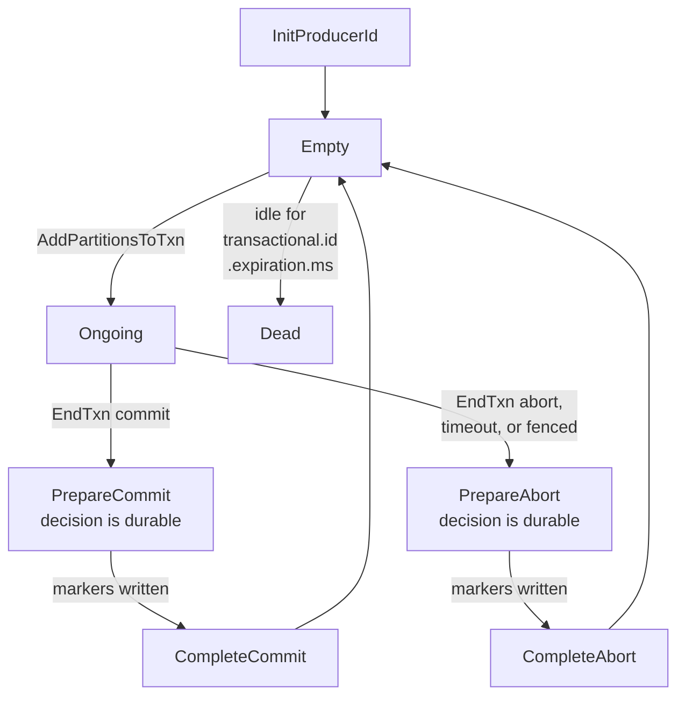

# Kafka Exactly-Once — nothing is ever undone, and the abort is a note in the margin

> **Tell a friend:** Meera works at Rupaya, which settles card payments for small
> shops. Her service reads three payments, writes two ledger lines and two payout
> rows, and then writes down how far it got. That is five separate acts, and a
> crash between any two of them either pays a shop twice or never pays it at all.
> Kafka's answer is strange. It writes everything down immediately, at real
> places in the log, before anybody has decided anything. Only afterwards does it
> append a slip saying "that lot counts" or "that lot does not." Nothing is ever
> taken back. Priya, who moves the money, is simply told to stop reading at the
> first line whose slip has not arrived yet. So the price of the whole trick is
> paid by the reader, in waiting.

Keep [`visualization.html`](visualization.html) open beside this page; §9 says
what to watch in it. §17 says what this lab is made of and where it sits.

## 1. Why does one small job turn into three separate acts?

> **In one breath:** A stream processor reads a fact, works something out, writes
> the answer, and then writes down how far it got. Those are separate acts. The
> machine can die between any two of them, and there is no order that saves you.

Meera runs the settlement service at **Rupaya**, a company that settles card
payments for small shops. Her service does the same three things forever, and so
does every stream processor you will ever write:

```
1. read a record from a topic
2. compute something and write the result somewhere
3. record that the input has been handled
```

Each of the three is durable on its own. Kafka can guarantee that a write lands
and stays landed. You learned exactly how in the `kafka` lab. Wait until every
in-sync copy holds the record (`acks=all`). Refuse the write unless at least two
copies are in sync (`min.insync.replicas=2`). And keep three copies in the first
place, which is replication factor 3.

But durable-on-its-own is not the property Meera needs. The three are three
separate physical acts. A process can die in either gap between them. There are
only two orders you can put them in, and both are wrong:

```
write output, then record progress     crash in the gap → the input is read again
                                        → the output is written twice
record progress, then write output     crash in the gap → the input is never re-read
                                        → the output is never written
```

This is not a Kafka problem. It is the same shape as the dual-write problem from
`transactional-outbox`, one hop further downstream. It is exactly the reason that
lab told you consumers must be idempotent.

What is new here is that Kafka can, for one specific and narrow case, genuinely
make the three acts atomic. Not by fusing them into one act. By making all three
*invisible* until they are all done.

That trick, its exact boundary, and the four years of bugs it took to get right,
are the whole lab.

---

## 2. What actually breaks in Rupaya's settlement run?

> **In one breath:** Meera's service turns three card payments into five records
> scattered over three machines. It needs all five to be true together. A crash
> in the middle does not produce an error. It produces a tidy set of books that
> agree with each other and are wrong.

Rupaya processes card payments for small merchants. Every captured payment lands
on a topic called `captures`. A service called **settlement**, which is Meera's service,
reads captures, takes Rupaya's 2% fee, and writes two things.

The first is a pair of double-entry lines to `ledger-entries`. **Arjun** runs
reconciliation and balances the books against those. The second is a payout row
to `merchant-payouts`. **Priya** runs the bank transfer job, which reads that
topic and actually moves money into a shop's account.

Hold on to those three people. Meera writes, Arjun reconciles, Priya pays. Every
failure in this lab is one of them getting something they should not have got.

Here is one batch. The service is consumer group `settlement`, reading `captures`
partition 3, currently positioned at offset 5000.

| `captures-3` offset | merchant | amount |
|---|---|---|
| 5000 | TeaHouse | ₹1,200 |
| 5001 | TeaHouse | ₹800 |
| 5002 | BookBarn | ₹2,500 |

The service polls those three, computes, and produces:

| destination | what |
|---|---|
| `ledger-entries-1` | three pairs of ledger lines, offsets 810, 811, 812 |
| `merchant-payouts-0` | TeaHouse ₹1,960 (offset 44), BookBarn ₹2,450 (offset 45) |

Then it commits offset **5003** for group `settlement`. Physically, that is a
record appended to `__consumer_offsets-12`, Kafka's own internal topic for "how
far has each group got". A committed offset is a record in a log, like everything
else. Remember that. §5 turns it into the whole design.

So: five appends across three partitions, which live on three different brokers.
Meera now needs all five to be true together, or none of them.

> **🔮 Predict.** The service crashes after writing the two payout rows but
> before committing offset 5003. It restarts. What does Priya's bank transfer job
> pay TeaHouse, and what does Arjun's ledger say? Commit to an answer before
> reading on.

<details><summary>Answer</summary>

On restart the group's committed offset is still 5000. The service reprocesses
captures 5000–5002 and writes everything again: ledger offsets 813–815, payout
offsets 46–47.

Priya's job reads `merchant-payouts` and has no idea any of this happened. It now
sees TeaHouse ₹1,960 twice. It pays ₹3,920 against ₹2,000 of captures.

Arjun's ledger is doubled too. So reconciliation does not even flag it. The books
balance perfectly against a payout that is twice too large.

If you guessed "reconciliation catches it", that is exactly the guess this lab
exists to break. Doubling *both* sides keeps them equal.

That last part is why this matters. The failure did not produce an error. It
produced a consistent, self-agreeing, wrong set of records.

</details>

**Where this lab takes you.** §1–§6 is the story. §10 is the machine, built in
six versions, each forced by a concrete failure in the one before. §11–§14 is
what you need before switching this on in production, including the reasons not
to.

| Layer | Sections | What you can do afterwards |
|---|---|---|
| **BEGINNER MODEL** | 1–6 | State the three-action problem, say why "just make it idempotent" is usually right and where it stops working, and state what a Kafka transaction actually makes atomic |
| **INTERMEDIATE MODEL** | 7–10.5 | Trace all nine protocol steps with real offsets, name every state of the coordinator, and predict exactly what a `read_committed` and a `read_uncommitted` consumer each see at every instant |
| **ENGINEERING MODEL** | 10.6–12 | Explain both fencing mechanisms and the zombie each one catches, reconstruct the KIP-890 bug from first principles, diagnose a hanging transaction, and state what is guaranteed under which assumptions |
| **PRODUCTION MODEL** | 13–14 | Configure EOS in Streams / Connect / Spring, price its real cost, name the metrics, know the one config default that silently disables the whole thing, and refuse the eight wrong models |

---

## 3. Can you fix it by choosing a different order?

> **In one breath:** There are only two orders. One pays a shop twice. The other
> never pays it and never tells anyone. You do not get to avoid the choice. You
> only get to choose which failure you can see.

The obvious response is that Meera put the acts in the wrong order. So try the
other one. Commit offset 5003 *first*, then write the outputs.

> **🔮 Predict.** With the order flipped, the service crashes in the gap. What
> does TeaHouse receive, and what would you have to run to discover that anything
> went wrong?

<details><summary>Answer</summary>

TeaHouse receives nothing, ever. And nothing anywhere records that a payment was
skipped.

The captures at 5000–5002 are now behind a committed offset. No consumer will
ever be handed them again. No scan will find them, because nothing marks them as
unhandled. The only marker was the offset, and the offset says "done".

If you guessed that a reconciliation job would catch it, look at what Arjun
actually compares. He balances ledger lines against payouts. Here neither exists.
The books balance at zero, and zero is a perfectly consistent answer.

</details>

This is the forced choice from the `kafka` lab, stated once more because it is
the floor everything else is built on.

| commit offsets | you get | you see |
|---|---|---|
| **before** processing | at-most-once | silent gaps |
| **after** processing | at-least-once | duplicates |

There is no third ordering. Two things go in a sequence, and you choose which one
is exposed.

So every real system chooses **at-least-once**. Duplicates are detectable and
repairable; silent gaps are neither. Then the system spends its entire
engineering budget on making the duplicates harmless.

---

## 4. Why not just make it idempotent?

> **In one breath:** Usually you should. Give each unit of work a name, claim the
> name atomically with the effect, and a replay does nothing. This section is
> about the three situations where that answer is not available at all.

You already know the real answer to duplicates. It is the `idempotency` lab. Give
each unit of work a key, make claiming the key atomic with the effect, and a
replayed duplicate becomes a no-op.

**Apply it to Priya's job and it works.** She can key on the id of the capture
plus the merchant. Engineers write that pair as `(capture_id, merchant)`. She
keeps a table of capture ids she has already paid, and inserts into it under a
unique constraint. TeaHouse gets paid once, no matter how many times Meera's
service writes the row.

That is a completely legitimate design, and a great many production pipelines are
built exactly this way. The `idempotent-consumer` lab is that mechanism in full:
identity, atomicity and memory, and the three ways each of them fails on its own.
Nothing here replaces it.

If you can do it, do it. It is simpler than everything that follows, and it
survives failures that transactions do not.

So why is there anything else? Three specific situations where it stops being
buildable. Rupaya hits all three.

### 4(a) What if the duplicate lands where nothing has a name?

Priya's case is easy because a payout row is *about* one capture. There is a
natural key sitting right there in the data.

Now add a stage that computes each merchant's rolling hourly total. Its output is
one row: `(TeaHouse, 14:00–15:00, ₹18,400)`.

If the upstream stage duplicated one capture, that number is wrong by ₹1,200. And
there is no key on the aggregate that would let a downstream reader notice,
because a sum has no identity. You cannot ask "have I already seen this ₹18,400?"
The question is meaningless.

Deduplication has to happen *before* the aggregation, or not at all. That is the
sentence to carry out of this section.

### 4(b) What if the dedupe store is itself a second system?

The `idempotency` lab's sharpest failure was keys in Redis and effect in
Postgres. That is a dual write, reintroduced at the exact point that was supposed
to solve it.

Now look at a stage in Meera's pipeline whose only output is another Kafka topic.
The effect *is* an append to a Kafka log. There is no database to put the key
table in.

You would have to add one, purely to defend a pipeline that otherwise needs no
state at all. You would be buying a second system to protect yourself from the
failure mode of having two systems.

### 4(c) What if you have to pay for it six times over?

Rupaya's pipeline is six stages long. Idempotency is a per-hop contract, which
is the `idempotency` lab's phrase. So six stages means six key stores.

Six retention policies. Six sets of dashboards. Six things to get wrong.

And the keys have to survive every transformation in between, which §4(a) has
just said they often cannot.

> **Say it back.** Without using the words *transaction*, *atomic* or *offset*,
> tell a friend why Meera cannot solve her problem the way Priya solved hers.
> <details><summary>A good answer sounds like</summary>
> "Priya pays one shop for one payment, so every job she does has a name, and she
> can keep a list of the names she has already handled. Meera's middle stages
> produce totals. A total has no name — you cannot look at ₹18,400 and ask
> whether you have seen it before. And her pipeline has six of those stages, so
> she would need six lists, each one a whole extra database to run and to get
> wrong."
> </details>

> **Checkpoint.** You can now say what problem exactly-once is for. It is *not*
> "duplicates are bad" — you already had an answer for that. It is "for a
> Kafka-to-Kafka stage, the answer you had costs more than the stage does, and
> for an aggregating stage it is not available at all." Next: what would actually
> have to be true to fix it at the source.

---

## 5. What exactly has to be true for Meera's batch?

> **In one breath:** State the requirement precisely and the design falls out of
> it. Meera does not need the five records to *exist* together. She needs them to
> become *visible* together. Those are different demands, and one of them is much
> cheaper.

Go back to the settlement batch and write down what must hold.

Five records were appended across three partitions:

```
ledger-entries-1     offsets 810, 811, 812     the work
merchant-payouts-0   offsets 44, 45            the work
__consumer_offsets-12  one record: group settlement, captures-3 → 5003
                                               the progress marker
```

The requirement is this one sentence:

> **Either every consumer of these topics eventually sees all five, or no
> consumer ever sees any of them.**

Two things in that sentence deserve attention, because most of the design falls
out of them.

### 5.1 Why does "sees" matter more than "exists"?

It says **every consumer sees**. It does not say every record exists.

The requirement is about *visibility*, not about *presence*. Arjun does not care
whether a byte is on a disk in a data centre. He cares whether his reconciliation
job is handed it.

That distinction is the crack the entire design goes through, and §6 walks
through the crack.

### 5.2 Why is the progress marker treated as one of the outputs?

Look at the third line of the list again. The bookkeeping record that says "input
handled" is in the set, alongside the real work, subject to the same
all-or-nothing rule.

That is the move that converts a three-action problem into a one-action problem.

And it works only because of something you learned two labs ago: in Kafka a
committed offset *is a record in a topic*. So it can be swept into the same
mechanism as the payout rows and the ledger lines.

In a broker that keeps per-consumer acknowledgement state in a database, you
could not do this at all. The progress marker would live somewhere the mechanism
cannot reach, and you would be back to a dual write.

Everything in §10 is machinery to deliver that one sentence.

---

## 6. If you cannot make the writes atomic, what can you make atomic?

> **In one breath:** Kafka gives up on making the five writes happen together.
> Instead it writes them immediately, wherever they really go, and publishes a
> decision afterwards. Readers who care about the decision refuse to read past
> the point where one is still missing.

Meera's five records live on three partitions on three brokers. To make five
appends atomic you would need all three brokers to agree, in one indivisible
step, to accept or reject.

That needs a distributed commit protocol. The `two-phase-commit` lab spent its
whole length on why that is expensive and how it blocks.

Kafka does something else. It is worth stating in one sentence before any detail:

> **The records are written immediately, unconditionally, to their real
> partitions at their real offsets. Afterwards, a decision is published. Readers
> who care about the decision refuse to read past the point where a decision is
> still missing.**

Sit with the consequences, because they are the whole lab.

### 6.1 What does a "rollback" actually remove?

Nothing. That is not a simplification; it is literally nothing.

Records from an aborted transaction are in the log, at permanent offsets,
replicated to every follower, consuming disk and retention, until retention
finally deletes them. Nothing is removed. Nothing is rewritten.

### 6.2 Where does the decision live?

**The abort is an append.** The decision is itself a record, appended after the
data, in each affected partition. Engineers call it a *control record*.

That is the second surprise. The thing that cancels the work sits *after* the
work, in the same log, at the next offset.

### 6.3 Who does the filtering?

Not the broker. **Filtering is the reader's job.**

The broker hands the aborted records to the consumer over the network. The
*client library* drops them before your application sees them.

Which means a client that does not ask for filtering gets everything. Hold that
thought for ten lines.

### 6.4 What does "undecided" cost?

It is a real state with a real cost. A reader who wants committed-only data, and
who reaches a record whose transaction is still open, has exactly one option:
wait.

That wait is the price of the whole design. §11 is largely about who ends up
paying it.

The simple version to carry around, and the sentence this lab is named after:
**Kafka does not have rollback. It has retraction, published after the fact,
which the reader is responsible for honouring.**

> **🔮 Predict.** Given only that paragraph: a transaction writes three records
> to `ledger-entries-1` at offsets 810–812 and then aborts. A consumer with
> default settings, one nobody has configured for transactions, polls that
> partition. What does its application code receive?

<details><summary>Answer</summary>

All three records, exactly as if they had been committed.

The consumer setting that decides this is called `isolation.level`, and it
defaults to **`read_uncommitted`**. The 4.3 consumer documentation is explicit
about what that means: *"If set to `read_uncommitted` (the default),
consumer.poll() will return all messages, even transactional messages which have
been aborted."*

If you guessed "nothing, because the transaction aborted", you have assumed the
broker does the filtering. It does not. §6.3 said the client does, and a client
that never asked never filters.

This is the single most common way an EOS deployment does nothing at all. A team
turns on transactions in the producer, verifies the producer side, ships it — and
every downstream consumer keeps reading aborted records, because nobody changed a
consumer config. §11.6 covers the symptom.

</details>

> **Say it back.** You have finished the beginner layer. Without using the word
> *transaction*, explain to a friend how Kafka manages to make five writes look
> like one.
> <details><summary>A good answer sounds like</summary>
> "It does not make them happen together. It writes them all straight away, in
> the real places, and then afterwards it writes one more little note saying
> whether that lot counts. Anyone who wants to be careful has to stop reading at
> the first line whose note has not turned up yet. So the writing was never
> atomic — only the looking was."
> </details>

---

## 7. Which six words do you now need, and what did each one cost?

> **In one breath:** You have felt the need for all six of these. Now they get
> their names. Minor terms are defined where they first appear and collected in
> the glossary at §16.

Six terms carry the rest of the lab. Read each little story first; the comparison
table at the end of the section is the map back.

### 7.1 What is the name of a job, rather than of a process?

Meera runs one settlement instance per input partition. The instance handling
`captures-3` is not special as a *process* — it gets restarted, redeployed, moved
to another node, killed by the autoscaler. What must never happen twice is the
*work*: settling `captures-3`.

So the thing Kafka needs a name for is the job, not the machine doing it.

That name is a string you configure on the producer, and it is called the
`transactional.id`. Meera sets hers with
`transactional.id = "settlement-" + partition`, so the instance for partition 3
carries `transactional.id = "settlement-3"`. Pod restarts, redeploys and node
failures all keep the same string.

The broker uses that string as the identity that gets fenced. When a producer
with `transactional.id = "settlement-3"` starts up, any *earlier* producer using
that same string is immediately invalidated, and any transaction it left open is
aborted.

Why does the distinction matter so much? Because if two machines are both
processing `captures-3`, Rupaya has a problem regardless of what the two
processes are called. So the identity has to be attached to the work assignment,
and it has to survive restarts.

A producer that generates a fresh id at startup fences nothing. A UUID, a
hostname with a random suffix, a Kubernetes pod name — with any of those, the new
instance's id does not match the old one's, so there is nobody to fence. §11.3
traces exactly what breaks.

This is `distributed-locking`'s lease name and `split-brain`'s
identity-being-fenced, wearing new clothes. The `transactional.id` is *who* gets
fenced. The next term is *how*.

### 7.2 How does the system know which holder of the name is current?

By a version number for "the current owner of this `transactional.id`."

In words: every time somebody new claims the name `settlement-3`, a counter goes
up, and everything that instance writes carries the counter. Engineers call the
counter the **producer epoch**.

Precisely: it is a monotonically increasing integer that the transaction
coordinator attaches to a `transactional.id`. Every write carries it. A write
arriving with an epoch lower than the coordinator's current one is rejected with
`ProducerFenced`, or with `InvalidProducerEpoch`.

Why bother? Because "start a new instance" and "the old instance is definitely
dead" are different statements, and only the first one is observable. You cannot
detect death. You can only make death irrelevant, by ensuring the presumed-dead
process can no longer act.

If you have read `split-brain`, this is the eighth costume of the same object:
term, epoch, generation, fencing token, lease version, `leader epoch`,
`ProducerEpoch`. Note carefully that this is a **different epoch** from Kafka's
*leader* epoch, which fences stale replica leaders. Same idea, different subject.

### 7.3 Who keeps the minutes?

Somebody has to remember that a run is open, which partitions it touched, and how
it ended. In the story that somebody is a duty supervisor. In Kafka it is a
broker, and the role is called the **transaction coordinator**.

Precisely: each `transactional.id` hashes onto one partition of the internal topic
`__transaction_state`, and the leader of that partition is that id's coordinator.

The coordinator owns the transaction's state machine. And here is the part that
matters in §10.4: it **records every state change as a record in that
partition**, which is an ordinary replicated Kafka log. Not a variable in memory.
A log entry.

This is `two-phase-commit`'s coordinator with one decisive difference, and §10.4
is entirely about that difference.

### 7.4 What does the decision physically look like?

It is a slip appended to a partition saying "everything from that producer, up to
here, counts" — or "does not count".

Engineers call it a **control record**, or a **transaction marker**. Precisely: a
record with a control bit set, containing a `COMMIT` or `ABORT` marker for a
specific producer id. It is written by the *broker*, on the coordinator's
instruction, into the ordinary log of each partition the transaction touched.

KIP-98 defines the encoding: *"a control message type of 0 indicates a COMMIT
marker, and a control message type of 1 indicates an ABORT marker."*

Why does the decision live inside the partition at all? Because it has to be
discoverable by a consumer that is reading one partition, on one broker, and
talks to nobody else. Putting the decision *in the partition* means a reader
needs no extra lookup, no coordinator round trip, and no distributed read.

The price is that markers occupy offsets. If Meera's transaction wrote 810, 811
and 812, the marker is at 813, and the next transaction's first record is at 814.

Her application never sees 813, because the client filters it out. So **the
offsets your code observes have gaps**. Any logic that assumes consecutive offsets is broken by
transactions, whether they commit or abort.

### 7.5 How far into a partition is it safe to read?

Up to the first record whose fate nobody has decided yet, and not one byte
further. That boundary has a name: the **last stable offset**, usually written
LSO.

Quoting the 4.3 consumer documentation: *"in `read_committed` mode,
consumer.poll() will only return messages up to the last stable offset (LSO),
which is the one less than the offset of the first open transaction."*

It is the pure expression of §6. Reading is allowed right up to the first record
whose fate is unknown.

Make it concrete with Arjun's topic. `ledger-entries-1` has a high watermark of
900, meaning 900 records are fully replicated. It also has an open transaction
that started at 810. So its LSO is 810.

| Reader | Can read up to | Records behind |
|---|---|---|
| a `read_uncommitted` consumer | 900 — the high watermark | 0 |
| a `read_committed` consumer | 810 — the LSO | **90**, none of which are in the open transaction |

That table is the source of most EOS operational pain. One stuck transaction
blocks the partition, not just the transaction's own records.

### 7.6 Does this consumer honour the retractions, or not?

That is the whole meaning of the sixth term. A consumer either agrees to stop at
the LSO and drop aborted records, or it does not. The switch is called
`isolation.level`, and it has two values.

`read_uncommitted` is **the default, still, in 4.3**. It returns everything,
including aborted records. `read_committed` returns only committed transactional
records and non-transactional records, and stops at the LSO.

Why does it default to the value that looks wrong? Because `read_committed` costs
latency, and the vast majority of topics have no transactional producers at all.
For those topics the two settings behave identically. Kafka declines to make
everyone pay for a feature most topics do not use.

The consequence is the one Rupaya keeps tripping over. **EOS is opt-in on both
sides, and the two sides are configured by different teams.** Meera owns the
producer. Priya owns the consumer.

### 7.7 The six words, in one map

Read the middle column as the story, the right column as where the term does its
damage.

| Word | In Rupaya's world | Where you meet it again |
|---|---|---|
| `transactional.id` | the name of the job "settle `captures-3`", not of Meera's pod | §10.6, §11.3 — a random one silently disables everything |
| producer epoch | the version number of whoever currently holds that name | §10.6, §10.8 — fences the frozen instance and the delayed record |
| transaction coordinator | the duty supervisor who keeps the minutes in a durable log | §10.4 — why this two-phase commit does not block |
| control record | the countersigned slip appended after the work | §10.5 — it occupies an offset, so offsets have gaps |
| last stable offset (LSO) | where Priya has to stop reading | §11.1, §11.5 — the stall, and the stall that never ends |
| `isolation.level` | whether Priya honours the slips at all | §11.6 — the default that voids the whole feature |

---

## 8. What picture should you carry, and where does it lie to you?

> **In one breath:** A clerk pins five notices to three boards, then a supervisor
> countersigns each board. Casual readers read everything. Auditors only act on
> countersigned notices, so they stop at the first notice with no countersign
> below it.

### 8.1 The clerk and the countersign

Meera has to post five notices to three different noticeboards around Rupaya's
building. There is no way to pin five sheets to three boards at one instant.

So the procedure is:

1. Before posting anything, Meera tells the **duty supervisor**, **Dev**, which
   boards she is about to use. Dev writes it in the **duty log**.
2. She walks around and pins all five notices. They are visible immediately.
   Anyone walking past can read them.
3. She returns and tells Dev she is done.
4. Dev **writes the decision in the duty log first**, as "settlement run 47:
   valid". Only then does he walk to each of the three boards. At each one he
   pins a small countersigned slip: *"everything from clerk 4711 above this line
   is valid."*
5. Dev writes "run 47 complete" in the duty log.

Two kinds of people read the boards. **Ben**, who runs fraud scoring, is a casual
reader: he reads every sheet as he passes, because a fast wrong signal is better
for him than a slow right one. **Priya** is an auditor: she is only allowed to
act on countersigned notices, because she moves real money.

So Priya, reading down a board, stops at the first notice that has no countersign
below it yet, and waits there.

If Meera collapses in step 2, Dev eventually notices the run has been open too
long. He goes and pins *"everything from clerk 4711 above this line is void"* to
each board. The notices stay on the boards, because nobody takes them down. But
Priya now skips them.

If **Dev** collapses, the duty log is the point. A replacement supervisor reads
it, sees "run 47: valid" with no "complete" line, and finishes walking the
boards. The decision was never in Dev's head.

### 8.2 What is each part of the story, really?

Three small tables instead of one long one. Read them in order: who the people
are, what gets written, and who reads it.

| In the story | In Kafka |
|---|---|
| Meera the clerk, identified by badge number | producer with a `transactional.id`, holding a PID and an epoch |
| the badge reissued to whoever holds the job now | epoch bump on `initTransactions()`; the previous holder is fenced |
| Dev the duty supervisor | transaction coordinator (a broker) |
| the duty log | a partition of `__transaction_state` — replicated, ordinary Kafka log |

| In the story | In Kafka |
|---|---|
| "about to use these boards" | `AddPartitionsToTxn` |
| the noticeboards | topic partitions on their leader brokers |
| the notices | ordinary records, tagged with PID + epoch, marked transactional |
| the countersigned slip | control record (`COMMIT` / `ABORT` marker) |
| "run 47: valid" written in the log, before walking | `PrepareCommit` written to `__transaction_state` — **the commit point** |

| In the story | In Kafka |
|---|---|
| "run 47 complete" | `CompleteCommit` |
| Priya the auditor | consumer with `isolation.level=read_committed` |
| where Priya has to stop | the last stable offset |
| Ben the casual reader | consumer with `isolation.level=read_uncommitted` (the default) |
| "this run has been open too long" | `transaction.timeout.ms` (default 60 s) |

### 8.3 Where does the analogy lie? Read this before it hardens

**First lie: notices can be taken down.** In a real building, someone eventually
clears the void notices off the board. Kafka never does.

Aborted records occupy their offsets, occupy disk, and were replicated to every
follower at full cost. They leave only when normal retention or compaction removes
the segment they live in.

So **you pay full price for work you threw away** — bandwidth, disk, and
replication. The abort costs *more* than the commit did, because it added the
marker on top.

**Second lie: the auditor can skip ahead.** A human auditor who found an
uncountersigned notice could look further down the board and come back.

Priya's `read_committed` consumer cannot. It is served nothing past the LSO. It is
not filtering a stream it can see; the broker will not send it. That is what makes
one stuck transaction a partition-wide stall rather than a per-record one.

**Third lie: the supervisor decides.** Dev *records* a decision that has already
been reached, and the recording is what makes it true.

If Dev collapses after writing "valid" but before pinning any slips, the run is
committed. The slips are a formality that a replacement will complete. There is no
moment after `PrepareCommit` at which the outcome can be changed by anyone,
including Meera.

This is exactly `two-phase-commit`'s "the decision is the coordinator's durable
write", and §10.4 shows why Kafka gets away with it where classic 2PC struggled.

**Fourth lie: the boards are the only place notices go.** The clerk model has no
way to represent the thing that makes this useful. One of the three boards *is
the progress record itself*.

Hold onto that. The transaction's atomicity includes "I have handled input
5000–5002", which is what turns duplicate-prevention into a property of the
pipeline rather than a property of each sink.

---

## 9. What should you watch in the simulator?

> **In one breath:** Open the page and step through one of Meera's settlement
> runs, one protocol message at a time. The one number that matters is the count
> under Priya's reader: what the outside world actually did.

Open [`visualization.html`](visualization.html) before reading §10. It shows one
settlement run at Rupaya, stepped one protocol message at a time.

Five things are on screen. Look at them in this order:

1. **The app, on the left.** Its producer state: `transactional.id`, PID, epoch,
   and which client call it is currently inside.
2. **The coordinator, centre top**, with its `__transaction_state` partition
   below it. Watch the *state name*. This is the state machine of §10.3, and every
   state change is a record appended to that log, not a variable in memory.
3. **The three partition logs, centre.** Records appear here **early** — during
   the produce steps, long before any decision. This is §6 made visible. Colour
   shows the record's transactional status; the marker is the wide slip at the
   end.
4. **The LSO line** on each partition log. Watch when it moves. It does not move
   when records are written. It moves when a marker lands.
5. **The two readers, on the right.** Identical except for `isolation.level` —
   Priya's and Ben's. The counter under each one, *"payout rows the bank job has
   acted on"*, is the whole point of the lab. It is what the outside world
   actually did.

The single most useful habit: **before each step, say out loud what Priya's
`read_committed` reader is allowed to see, then step.** If you can predict that
number for the whole run, you understand the protocol.

Two controls are worth using immediately. *Abort instead of commit* — watch that
nothing is deleted. And *Crash: coordinator, after PrepareCommit* — watch the
decision survive.

---

## 10. How is the machine built, one failure at a time?

> **In one breath:** Six versions. Each one is broken by a specific failure, and
> the next version is the fix. If you can name the failure that produced each
> piece, you understand the design. If you memorise the final protocol, you do
> not.

### 10.1 Version 1 — why not just flip a flag when you are done?

This is the simplest idea that could possibly work. Meera's producer writes all
five records with a `pending` flag. When the batch is done, it goes back and
flips each flag to `committed`.

It dies at once, twice over.

**It requires mutating a written record.** The log is append-only. That is not a
policy; it is the reason `btree-and-lsm` said sequential writes win, and the
reason segment files can be memory-mapped, replicated by byte range, and served
with `sendfile`.

Going back to flip a bit in offset 810 means random writes into sealed segments,
and re-replicating them. The entire performance argument for Kafka evaporates.

**And it needs the flip to be atomic across three brokers anyway.** Even if you
could mutate records, "flip the flag on `ledger-entries-1`, `merchant-payouts-0`
and `__consumer_offsets-12` at one instant" is precisely the distributed atomic
update we were trying to avoid.

Version 1 does not solve the problem. It renames it.

**The requirement this reveals:** the decision must be expressible as an *append*,
and the reader must be able to find it without leaving the partition.

### 10.2 Version 2 — what does the real protocol do, offset by offset?

This is the real protocol. Here is Meera's whole settlement run, with real
offsets.

Starting state: `ledger-entries-1` has a log-end offset of 810,
`merchant-payouts-0` is at 44, `__consumer_offsets-12` is at 9001. The app's
`transactional.id` is `settlement-3`.

> This trace is the protocol as KIP-98 defined it, and as every broker before 4.0
> ran it. Kafka 4.0 changed two steps for efficiency and one for correctness;
> §10.8 covers exactly what changed and why. Learn this version first. The newer
> one is an optimisation of it, and the old shape is still what runs whenever an
> older client connects.

**Step 1 — `initTransactions()`.** The producer hashes `settlement-3` onto a
partition of `__transaction_state`. There are 50 of them by default, which is the
broker setting `transaction.state.log.num.partitions = 50`. It asks for that
partition's leader with `FindCoordinator`, then sends `InitProducerId`.

Dev, the coordinator, assigns **PID 4711, epoch 0** and appends to
`__transaction_state-17`:

```
{ transactionalId: settlement-3, pid: 4711, epoch: 0, state: Empty }
```

That write is replicated like any other Kafka write. It obeys
`transaction.state.log.replication.factor = 3` and
`transaction.state.log.min.isr = 2` — the durable-configuration trio from the
`kafka` lab, applied by default to Kafka's own bookkeeping.

If a *previous* producer had used `settlement-3`, this is where it dies. The epoch
is bumped past whatever it holds, and any transaction it left open is aborted.
That is the fencing of §10.6.

**Step 2 — `beginTransaction()`.** Nothing happens on the network. This call sets
a flag inside the producer object.

**The coordinator does not know a transaction has begun.** That is not a detail.
It is why step 3 exists.

**Step 3 — the first `send()` to `ledger-entries-1`.** Before the records go
anywhere, the producer sends `AddPartitionsToTxn(ledger-entries-1)` to the
coordinator, which appends:

```
{ pid: 4711, epoch: 0, state: Ongoing, partitions: [ledger-entries-1] }
```

**This is when the transaction's clock starts.** The 4.3 producer documentation is
explicit: *"The start of the transaction is set at the time that the first
partition is added to it."*

Not `beginTransaction()`. If Meera's code calls `beginTransaction()` and then
spends four minutes fetching reference data before its first `send()`, none of
those four minutes count against `transaction.timeout.ms`.

**Step 4 — the produce.** Three records are appended to `ledger-entries-1` at
offsets **810, 811, 812**. Each carries PID 4711, epoch 0, a sequence number, and
a bit marking it transactional.

Stop here and notice what is now true:

- the records are durably in the log, replicated, past the high watermark;
- Ben's `read_uncommitted` consumer **can read them right now**;
- Priya's `read_committed` consumer is stopped dead at 810, the LSO;
- and no decision exists anywhere.

**Step 5 — `merchant-payouts-0`.** A new partition, so another
`AddPartitionsToTxn` goes first. The coordinator's partition set becomes
`[ledger-entries-1, merchant-payouts-0]`. Then the produce: offsets **44, 45**.

**Step 6 — `sendOffsetsToTransaction(offsets, groupMetadata)`.** Two messages, and
they go to two different brokers:

- `AddOffsetsToTxn(groupId = "settlement")` goes to the **transaction
  coordinator**, which adds `__consumer_offsets-12` to the partition set;
- `TxnOffsetCommit` goes to the **group coordinator**. That is the broker that
  owns the `settlement` group — a different role, and usually a different machine.
  It appends the offset record to `__consumer_offsets-12` at offset **9001**,
  marked transactional exactly like the payload records.

This step is where "record that the input was handled" becomes just another
output inside the set. The `groupMetadata` argument matters enormously, and §10.7
is entirely about it.

**Step 7 — `commitTransaction()`.** The producer sends `EndTxn(commit)`. The
coordinator appends:

```
{ pid: 4711, epoch: 0, state: PrepareCommit, partitions: [3 partitions] }
```

**This is the commit point.** Once that record is replicated to
`transaction.state.log.min.isr` replicas, the run is committed. Not "will probably
commit". Committed.

Every broker, the producer, and every network link involved can now fail, and the
outcome is still commit.

**Step 8 — the markers.** The coordinator sends `WriteTxnMarkers` to the leader of
each of the three partitions. Each broker appends a control record:

```
ledger-entries-1       offset 813    COMMIT(pid 4711)
merchant-payouts-0     offset 46     COMMIT(pid 4711)
__consumer_offsets-12  offset 9002   COMMIT(pid 4711)
```

The moment `ledger-entries-1`'s marker lands, that partition's **LSO jumps from
810 to 814**. Every waiting `read_committed` consumer is released. Priya's job
receives 810, 811 and 812, silently skips 813, and its next position is 814.

**Step 9 — `CompleteCommit`.** The coordinator appends the final state to
`__transaction_state-17` and forgets the transaction. Meera's
`commitTransaction()` call returns.

Read the trace once more with one question in mind: *at which step did the outside
world's behaviour change?*

Answer: step 8, and only step 8 — and only for readers who asked. Steps 1–7 are
all invisible to `read_committed` consumers, and steps 4 and 5 are fully visible
to `read_uncommitted` ones.

> **🔮 Predict.** The producer completes step 7, so `PrepareCommit` is durably
> written. Then the *producer process* is killed instantly. It never comes back.
> What happens to the five records?

<details><summary>Answer</summary>

They commit. All five.

The producer is not a participant in the decision. It is the *client* that
requested one. After `EndTxn` is accepted and `PrepareCommit` is durable, the
coordinator drives steps 8 and 9 on its own. Whether the producer is alive to hear
the answer changes nothing.

If you guessed "the transaction aborts because nobody is there to commit it", you
are still picturing the producer as a participant that has to vote. It voted
already, in step 7, and the vote was written down.

The producer's death costs exactly one thing: Meera's application does not learn
that its commit succeeded. On restart it will reprocess from the last *committed*
offset — which, because the offset commit was inside the transaction, is 5003. It
resumes correctly at 5003 and the batch is not redone.

This is the payoff. Compare it to the §2 crash, which was at the same place in the
sequence and produced a double payout to TeaHouse.

</details>

### 10.3 What states does the coordinator move through?

Dev's minute book has a small number of possible entries. The coordinator's state
for a `transactional.id` is one of these, and every transition is an append to
`__transaction_state`:



<details><summary>The same machine as a plain-text wall chart</summary>

```
                    InitProducerId
                          │
                          ▼
                      ┌───────┐
        ┌────────────▶│ Empty │◀───────────┐
        │             └───┬───┘            │
        │                 │ AddPartitionsToTxn
        │                 ▼                │
        │            ┌─────────┐           │
        │      ┌─────│ Ongoing │─────┐     │
        │      │     └─────────┘     │     │
        │ EndTxn(commit)     EndTxn(abort) / timeout / fenced
        │      │                     │     │
        │      ▼                     ▼     │
        │ ┌──────────────┐   ┌─────────────┐
        │ │ PrepareCommit│   │ PrepareAbort│      ◀── the decision is durable here
        │ └──────┬───────┘   └──────┬──────┘
        │        │ markers written  │ markers written
        │        ▼                  ▼
        │ ┌───────────────┐  ┌──────────────┐
        └─│ CompleteCommit│  │ CompleteAbort│
          └───────────────┘  └──────────────┘

                     transactional.id expires
                              │
                              ▼
                          ┌──────┐
                          │ Dead │
                          └──────┘
```

</details>

Three things to take from the diagram, rather than memorise.

**The `Prepare*` states are the only interesting ones.** Everything before them is
reversible; nothing after them is. A coordinator that recovers and finds a
`Prepare*` state has exactly one job: finish writing markers. It does not need to
ask anybody anything.

**There is no voting phase.** In `two-phase-commit`, the coordinator asks
participants "can you commit?" and they answer. Here the coordinator tells
partition leaders to write a marker and they do.

**A partition leader cannot refuse a marker.** There is nothing for it to refuse:
the data is already appended, and it holds no locks and no conflicting state. This
is why the protocol is 2PC-shaped but missing half of 2PC's problems.

**`Dead` is not a failure state.** It is expiry. A `transactional.id` that has been
silent for `transactional.id.expiration.ms` is forgotten, freeing coordinator
memory. The default is **604800000 milliseconds, which is 7 days**.

If Meera's app then restarts with that id, it simply gets a fresh PID. The
relevance is capacity: an application that mints a new `transactional.id` per run
accumulates state on the coordinator for a week per id, which is a real way to
fall over.

### 10.4 Why does this two-phase commit not block?

> **In one breath:** Classic 2PC blocks because a participant that has voted yes
> is stuck holding locks until the coordinator comes back. Kafka's participants
> never vote, its coordinator's memory is a replicated log, and the only waiting
> left is done by readers, who can afford it.

This is the section to remember when the topic comes up in an interview or a
design review, because it generalises far beyond Kafka.

The `two-phase-commit` lab's central complaint went like this. After a participant
votes YES it is in an uncertain state. It must hold its locks and can neither
commit nor abort.

If the coordinator dies at that moment, the participant blocks **for as long as
the coordinator is gone, with no timeout that is safe to apply**. It cannot guess,
because guessing wrong breaks atomicity. That is 2PC's blocking problem, and it is
not fixable within 2PC.

Kafka's protocol has the same two phases and does not have that problem, for three
separate reasons that stack.

**1. Participants never enter an uncertain state, because they never vote.** A
partition leader that has accepted transactional records holds no locks, blocks no
readers of other data, and has made no promise it might have to keep.

Its log is append-only and already correct. The outstanding question is only how a
*reader* should interpret a range of it. There is no state a broker is stuck in.

**2. The coordinator's memory is a replicated log, so the coordinator is
recoverable.** The classic protocol's coordinator is a process holding a decision.
If it dies, the decision is inaccessible until it returns.

Kafka's coordinator holds nothing. Every state transition is a record in an
ordinary Kafka partition with replication factor 3. Coordinator failover is a
*partition leader election*, which Kafka already does in milliseconds, followed by
replaying the log to rebuild the in-memory map.

`two-phase-commit` told you the fix for a blocking coordinator was to replicate
the coordinator's state. Kafka gets it for free, because replicating a log is the
only thing it does.

**3. Where waiting does happen, it is bounded and voluntary.** Somebody does still
wait. Priya's `read_committed` consumer is stuck at the LSO.

But that wait is bounded by `transaction.timeout.ms`. The default is 60 s, capped
by the broker's `transaction.max.timeout.ms`, whose default is 900000 ms, which is
15 min. An abandoned transaction is unilaterally aborted by the coordinator on a
timer.

And the wait is voluntary. Ben's `read_uncommitted` consumer, on the same
partition, never waits at all.

> **The transferable idea.** 2PC blocks when a participant must hold a decision it
> cannot resolve. Kafka moved the uncertainty **out of the writers and into the
> readers**. Readers can be given a timeout, a fallback and a choice. A reader
> that waits too long is merely stale. A writer that waits too long is holding
> locks that stop everyone else.
>
> When you meet a distributed commit problem in any system, this is the question
> worth asking first: *can the uncertainty be pushed to the reading side?* If the
> answer is yes, you get a much cheaper protocol.

**What this costs, stated honestly.** The LSO stall is not free and it is not
local. §11.1 traces a 60-second stall that hits every consumer of a shared topic,
including applications with no connection to the transaction at all.

Kafka traded a bad blocking property for a milder one. It did not eliminate
blocking.

---

### 10.5 Version 3 — what does the reader have to do, and why is abort not undo?

> **In one breath:** The broker cannot afford to strip aborted records out of what
> it sends. So it sends them, plus a list of which ones to ignore, and the client
> library drops them. Nothing is ever deleted, and offsets stop being
> consecutive.

Version 2 is complete from Meera's point of view. Now take Priya's.

Her `read_committed` consumer fetches from `ledger-entries-1`. The partition
contains, physically:

```
offset  808  ordinary record (no transaction)
offset  809  ordinary record
offset  810  txn record   pid 4711 epoch 0     ← aborted transaction
offset  811  txn record   pid 4711 epoch 0     ← aborted transaction
offset  812  txn record   pid 4711 epoch 0     ← aborted transaction
offset  813  ABORT marker pid 4711
offset  814  txn record   pid 4711 epoch 1     ← committed transaction
offset  815  COMMIT marker pid 4711
offset  816  txn record   pid 5002 epoch 0     ← still open
```

The consumer must deliver 808, 809 and 814, nothing else, and must stop at 816.

**How the filtering actually works.** The broker does not remove the aborted
records from the response. It cannot do so cheaply.

The data is served from the page cache in whole batches, in log order, by byte
range. That is precisely what makes Kafka fast: `sendfile`, zero copy, no
per-record work on the broker. Rewriting the response per consumer would destroy
it.

So the broker does two things instead. It truncates the response at the LSO, and
it attaches a list.

KIP-98 defines the field. The fetch response carries
`AbortedTransactions => [PID FirstOffset]` — every aborted transaction that
overlaps the byte range being returned. Kafka maintains this list per segment in a
small on-disk index alongside the log, a `.txnindex` file, so producing it is a
lookup rather than a scan.

**The client does the rest.** The consumer library reads the aborted list, tracks
which PIDs are in an aborted transaction at each point in the stream, and discards
their records before your `poll()` returns. It also discards the control records
themselves. Priya's application sees 808, 809, 814.

Three consequences are worth holding on to, and all three surprise people in
production.

**Consequence 1: aborted data crosses the network.** Every `read_committed`
consumer downloads every aborted record and throws it away.

A pipeline with a high abort rate is paying full fetch bandwidth for data no
application will ever see, multiplied by the number of consumer groups on the
topic. Abort rate is a bandwidth metric, not just a correctness metric.

**Consequence 2: offsets are not consecutive, for anyone.** Markers occupy
offsets, 813 and 815 above. Aborted records occupy offsets too, 810 to 812.

An application that consumed 809 and then 814 has not lost anything. But code that
computes `expectedNext = lastSeen + 1`, tests that assert exact offsets, and "gap
detector" monitoring built on a non-transactional topic will all misfire the day a
transactional producer starts writing to it.

**Consequence 3: nothing is reclaimed by aborting.** The three aborted records sit
in the segment, replicated to every follower, occupying disk and retention, until
normal deletion or compaction removes the whole segment.

An abort is strictly more expensive than a commit: same data, plus a marker. There
is no version of "roll back to save the write."

> **🔮 Predict.** The still-open transaction at offset 816 belongs to a completely
> different application. It is Ben's fraud-scoring service, which also writes to
> `ledger-entries`. It has hung: its process is frozen and it will never call
> commit or abort. Meanwhile Meera's settlement service keeps working perfectly
> and keeps writing new committed transactions to offsets 817, 818, 819…
>
> What does Rupaya's downstream `read_committed` reader see?

<details><summary>Answer</summary>

Nothing after 815. Ever, until Ben's frozen transaction is resolved.

The LSO is *"one less than the offset of the first open transaction"*, which here
is 816. And the LSO is a property of the **partition**, not of a producer or an
application.

Meera's own perfectly healthy committed records at 817 and beyond are on the far
side of somebody else's undecided one, and are unreachable.

If you guessed that Meera's records get through because her transactions
committed, you have attached the LSO to the writer. It is attached to the log.

Two things follow:

- **A transaction's blast radius is the partition, not the producer.** Sharing a
  topic between a transactional application and anything else makes their latency
  a shared fate. This is a real argument for not mixing transactional and
  non-transactional producers on the same topic.
- **Ben's frozen producer will be timed out** after `transaction.timeout.ms`, so
  in the ordinary case this resolves in 60 seconds. §11.5 covers the case where it
  does not resolve at all, which is the failure that motivated four years of
  protocol work.

</details>

> **Say it back.** You have finished the intermediate layer. Explain to a friend,
> without the word *filter*, why a record that was cancelled still costs Rupaya
> disk, bandwidth and money.
> <details><summary>A good answer sounds like</summary>
> "Cancelling does not rub anything out. The three lines are still on the page,
> still copied to three machines, still taking up space until the whole page is
> thrown away by age. And when Priya asks for that part of the log, the machine
> posts her the cancelled lines too, plus a note saying which ones to ignore. She
> pays the postage on rubbish."
> </details>

### 10.6 Version 4 — what if the old instance is not dead, only asleep?

> **In one breath:** A frozen process wakes up 90 seconds later and tries to
> commit a transaction from a job it no longer owns. You cannot detect that it was
> dead. You can only make sure its writes are refused.

Everything so far assumes there is only one producer per job. Remove that
assumption.

Meera's settlement instance for `captures-3`, call it **A**, is
mid-transaction. Records at 810 to 812 are written; nothing is decided. Then A's
JVM enters a stop-the-world pause.

(`jvm-garbage-collectors` measured exactly this. A badly tuned heap can produce
multi-second pauses, and a swapping or throttled container can produce much longer
ones.)

While A is frozen:

```
t+0s    A pauses mid-transaction. Records 810-812 are in the log, undecided.
t+45s   A misses heartbeats. session.timeout.ms (45 s) expires.
t+45s   The group coordinator evicts A and rebalances captures-3 to instance B.
t+46s   B starts from the last committed offset, 5000, and reprocesses.
t+50s   B writes its own records: 813, 814, 815.
t+90s   A's pause ends. A has no idea any time has passed.
        A calls commitTransaction() on the transaction it began 90 seconds ago.
```

Without protection, A's commit succeeds. Records 810 to 812 become visible, and so
do B's. TeaHouse is paid twice.

The offset commit races too. The batch may end up recorded as handled at 5003 by
both, or A's stale offset commit may *move the group backwards*.

This is exactly the problem `distributed-locking` and `split-brain` are about, and
the fix is the one those labs proved is the only one that works.

**The fix: the `transactional.id` is fenced, not the process.**

When B starts, its producer has the same `transactional.id`, `settlement-3`. Its
`initTransactions()` sends `InitProducerId` to the coordinator, which:

1. **bumps the epoch** for `settlement-3` from 0 to 1;
2. **aborts A's open transaction** — it writes `PrepareAbort`, then `ABORT` markers
   to `ledger-entries-1` at 813, which pushes B's records to 814 to 816, then
   `CompleteAbort`.

Now A wakes up and sends `EndTxn(commit)` with epoch 0. The coordinator's current
epoch is 1. The response is `ProducerFenced`.

The Java client treats this as fatal. The producer object is permanently unusable
and the application must close it. Any produce A had in flight is rejected the
same way.

**A cannot do damage, and nobody had to determine that A was dead.** That is the
whole point, and it is worth saying in the general form one more time, because it
is the single most reusable idea in distributed systems:

> You cannot detect that a process has died. You can only make its continued
> existence harmless, by attaching a generation number to the *right to act* and
> refusing anything that carries a stale one.

**The mistake this makes possible.** All of that depends on A and B agreeing on
the string `settlement-3`.

Suppose the application sets `transactional.id = UUID.randomUUID().toString()`
at startup. Or it embeds a pod name, a start timestamp, or a container id. Then
B's id is not A's id. No epoch is bumped. A is not fenced. A's transaction is not
aborted.

You get every problem above, *plus* a transaction that stays open until it times
out. §11.3 covers the symptoms; it is the most common EOS misconfiguration there
is.

### 10.7 Version 5 — what if the zombie has lost the partition, not the producer?

> **In one breath:** Fencing a producer and fencing the right to record progress
> for a partition are different jobs. The first design solved it by making one
> producer per partition, which was unbearable. The second sends the consumer's
> group generation along with the offsets.

Version 4 fences a producer. It does not fence *the right to commit offsets for a
partition*, and those are different things.

Look again at the timeline. Suppose A and B do use different `transactional.id`s.
Or, more subtly, suppose one process handles several input partitions with one
producer.

A's transaction includes an offset commit for `captures-3`. Between A beginning
that transaction and A committing it, the group rebalanced and `captures-3` moved
to B. A's offset commit is now a stale writer updating the progress of a partition
it no longer owns.

The producer epoch cannot catch this, because A is not fenced. From the
transaction coordinator's point of view, A is a perfectly valid producer doing
perfectly valid work.

What A has lost is not its producer identity but its *group membership*, and the
group coordinator is the only broker that knows.

**How the original design avoided the problem: by making it impossible.**

The first version of EOS ran from Kafka 0.11 through 2.4. It is retroactively
called **eos-alpha**, or **EOS v1**. It required the `transactional.id` to be a
static encoding of the input partition. Literally `myapp-captures-3`.

Then "the producer for `captures-3`" and "the owner of `captures-3`" were the same
identity by construction, and producer fencing covered both.

The cost was brutal. A single application instance consuming 40 partitions needed
**40 producers**, each with its own `transactional.id`, its own coordinator
registration, its own network connections, and its own transactions.

And every rebalance created *new* `transactional.id`s that had to be initialised
from scratch, so rebalances became expensive as well as disruptive. The KIP-447
summary puts it plainly: *"an application instance couldn't reuse a single
thread-safe producer instance, but had to create one for each input partition."*

**The fix — KIP-447, Kafka 2.5, called eos-v2 or eos-beta.** Stop trying to solve a
group-membership problem with a producer identity. Instead, send the group
membership *with the offsets*, and let the group coordinator do its own fencing.

That is what the second argument in this call is:

```java
producer.sendOffsetsToTransaction(offsets, consumer.groupMetadata());
```

`ConsumerGroupMetadata` carries the consumer's `member.id`, its
`group.instance.id` and its `generation.id`. That last one is the one that
matters. It is the group's rebalance generation number.

The `TxnOffsetCommit` request carries them to the group coordinator, which compares
the generation to its current one and **rejects a commit from a stale
generation**.

So there are now **two independent fencing mechanisms**, catching two different
zombies. Read the last column as "which sleeper wakes up".

| | fenced by | held by | catches |
|---|---|---|---|
| **producer epoch** | transaction coordinator | `transactional.id` | an old *producer instance* still writing records |
| **group generation** | group coordinator | consumer group | an old *partition owner* still committing offsets |

With both in place, one producer can serve many input partitions, and one process
needs one `transactional.id` for its lifetime rather than one per partition. That
is the entire reason EOS became practical.

**Where you meet this today.** Kafka Streams' `processing.guarantee` accepts
exactly two values in 4.3: `at_least_once`, which is the default, and
`exactly_once_v2`. The valid-values list in the documentation is
`[at_least_once, exactly_once_v2]`.

The v1 and beta modes were deprecated by KIP-732 and **removed in 4.0**. There is
nothing left to choose. Spring Kafka 3.x likewise supports only `EOSMode.V2`.

If you find `exactly_once` or `exactly_once_beta` in a config file, it is from
before 4.0 and will now fail validation.

### 10.8 Version 6 — what happens when a message arrives from the past?

> **In one breath:** A record can sit in the network for seconds, arrive after its
> own transaction was cancelled, and be adopted by the *next* transaction from the
> same producer. It took the Kafka project four years to close that hole
> properly.

Version 5 was the state of the art from 2020 to 2024, and it had a bug that took
that long to close properly. It is the best failure in the lab, because you can
derive it yourself from what you already know.

Two facts you already have:

1. Records are appended to a partition **before** any decision exists (§6).
2. A transaction's records are recognised by their **PID and epoch** — and in
   version 5, a normal commit does **not** bump the epoch.

> **🔮 Predict.** Given only those two facts: a producer sends three records for
> transaction T1, but one produce request stalls in the network. T1 aborts. The
> producer then begins T2 and writes to the same partition. The stalled request
> finally arrives. What does the broker do with it, and what does a
> `read_committed` consumer eventually see? Commit to an answer — this one is
> genuinely derivable, and it took the Kafka project four years to close.

<details><summary>Answer</summary>

The broker appends it, and the consumer eventually sees it as **committed data
from an aborted transaction**.

The record carries PID 4711, epoch 0. The partition currently has an open
transaction for PID 4711, epoch 0 — because T2 has the same PID, and the commit did
not bump the epoch.

Nothing in the record says *which* transaction it belongs to, so nothing can
distinguish it. When T2 commits, its marker covers every undecided record from
that producer in that partition, including this one.

If you guessed the broker rejects it as stale, you have assumed the record carries
a transaction identifier. Before KIP-890 it did not. It carried a producer
identifier, and both transactions had the same one.

Exactly-once is violated by the mechanism whose whole job is to enforce it. The
trace below walks it with timings, and then the two-part fix.

</details>

Now the network does what networks do.

```
t+0     Txn T1. AddPartitionsToTxn(ledger-entries-1). Produce 3 records.
        Two land. The third request stalls somewhere in the network.
t+2s    The client gives up on the stalled request and aborts T1.
        ABORT markers are written. LSO advances. T1 is over.
t+3s    The same producer begins T2. Same PID 4711, same epoch 0.
        AddPartitionsToTxn(ledger-entries-1) again. Produces records.
t+4s    The stalled T1 request finally arrives at the broker.
```

The broker sees a transactional record with PID 4711, epoch 0, for a partition
that currently has an open transaction for PID 4711, epoch 0. It appends it. When
T2 commits, that record from the aborted T1 is **committed by T2's marker**.

A record that was explicitly aborted is now durably visible to every
`read_committed` consumer. Exactly-once is violated by the mechanism whose entire
job is to enforce it.

**The second variant is worse, because it never resolves.** Suppose T2 does *not*
touch `ledger-entries-1`.

The delayed record is appended to a partition that has no open transaction for it
and never will. No marker for PID 4711 is ever coming. The LSO for that partition
stops at that record's offset and **stays there forever**.

This is a **hanging transaction**. KIP-890 describes it as *"hanging transactions
where the last stable offset (LSO) fails to update, blocking log cleanup and
read_committed consumers."*

There is no timeout that saves you. From the coordinator's point of view there is
no transaction: nothing timed out, nothing is open, nothing is wrong. The partition
is simply stuck.

The same thing happens if a buggy or non-Java client produces to a partition it
never added to the transaction.

**Fix, phase 1 — verification, server-side, and it works with old clients.** Before
appending a transactional record, the partition leader asks the transaction
coordinator one question: *is this partition genuinely part of an open transaction
for this PID and epoch?*

If not, the append is rejected with `INVALID_TXN_STATE`. This is implemented as an
`AddPartitionsToTxn` request with a `verifyOnly` flag.

It closes the hanging-transaction variant completely, for every client version,
and it is on by default: `transaction.partition.verification.enable = true` in
4.3.

It does **not** close the first variant. A delayed record from T1, arriving while
T1's own partition is legitimately open again in T2, passes verification — the
partition really is in an open transaction for that PID and epoch. Nothing
distinguishes the two transactions, because nothing in the record identifies which
one it belongs to.

**Fix, phase 2 — give every transaction its own identity.** This is transaction
version 2. Bump the producer epoch on **every** commit and abort, not only on
init. The `EndTxn` response returns the new epoch for the producer to use next.

Now T1 is epoch 0 and T2 is epoch 1. KIP-890's own sentence is the whole idea:
*"each transaction can be identified by (producer id, epoch)"*. And so *"messages
from previous transactions will be fenced because they will have an older
epoch."*

The delayed T1 record carries epoch 0 against a current epoch of 1, and is
rejected.

**Where this stands today.** The 4.3 Transaction Protocol page states that *"the
protocol is automatically enabled on the server since Apache Kafka 4.0"*. It is
controlled by the `transaction.version` feature flag, with `=2` selecting the new
protocol, settable at cluster creation with the storage tool or dynamically with
the features tool.

Producers from 4.0 onward pick it up without a restart. The documentation says:
*"a producer will not upgrade mid-transaction, but on the start of the next
transaction after it becomes aware of the server-side upgrade"*. Downgrades work
the same way in reverse.

**Two things changed that you will notice operationally.**

First, `AddPartitionsToTxn` moved to the server. Instead of the client adding the
partition and the broker separately verifying it, the broker adds it. One round
trip instead of two.

Second, and this one shows up in dashboards: the old client-side 20 ms retry
backoff for `CONCURRENT_TRANSACTIONS` is gone, and the server now retries
internally.

The documentation says this plainly: *"this can result in higher produce latencies
reported on these requests. The transaction end to end latency … does not increase
overall with this change. The time just shifts from client-side backoff to being
calculated as part of the produce latency."*

If you upgrade to 4.0+ and your produce latency percentiles step up while
end-to-end latency is flat, this is why. The new knobs are
`add.partitions.to.txn.retry.backoff.ms` and
`add.partitions.to.txn.retry.backoff.max.ms`.

> **Checkpoint.** The machine is complete. A coordinator whose memory is a
> replicated log. Records written before any decision. A decision published as an
> append into each partition. Readers who stop at the last undecided record. Two
> fencing mechanisms for two different zombies. And a per-transaction epoch, so
> that a message from the past cannot join the present. Every piece answers a
> failure you have now seen. The rest of the lab is what it looks like when it
> goes wrong, what it costs, and where its boundary is.

---

## 11. What does it look like when it goes wrong?

> **In one breath:** Eight failures. Three of them are silent: no error, no
> alarm, nothing in a log. Those three are the ones that reach production.

**Asha** is Rupaya's on-call platform engineer. She is the one who gets paged, and
she is the one who has to tell Meera, Arjun and Priya what happened. Everything in
this section is written from her chair.

Read this table first as a map, then read the eight stories. The right-hand column
is what it costs Rupaya, not what it costs the protocol.

| # | The failure | What Asha sees | What survives | What it costs |
|---|---|---|---|---|
| 11.1 | producer dies mid-transaction | a latency cliff with no errors | atomicity — no partial settlement | up to 60 s of stall for every reader of those partitions |
| 11.2 | coordinator dies | a brief LSO stall during a broker restart | atomicity, in every case | a leader election plus a log replay |
| 11.3 | random `transactional.id` | duplicates while EOS "is on"; id count climbing | **nothing** | at-least-once, with extra latency and cost |
| 11.4 | rebalance takes the partition | ordinary rebalance noise | exactly-once, fully | the batch is done twice; aborted records cost disk |
| 11.5 | hanging transaction | one group's lag rising forever | correctness | that partition, for `read_committed`, indefinitely |
| 11.6 | `isolation.level` never changed | nothing at all | **nothing** | worse than not using EOS |
| 11.7 | transaction outlives its timeout | repeated aborts, no progress | correctness | the pipeline can stop moving entirely |
| 11.8 | consumer commits its own offsets | rare, unreproducible data loss | partially — the outputs, not the pairing | silent gaps under load |

### 11.1 What happens when the producer dies mid-transaction?

Meera's service writes 810 to 812 into `ledger-entries-1` and 44 to 45 into
`merchant-payouts-0`. Then the pod is killed for running out of memory, before
`commitTransaction()`.

The thing for Asha to watch is not settlement's own dashboard. It is the LSO of
both partitions, and the lag of *every* consumer group on those topics.

```
t+0     Records durable at 810-812 and 44-45. Coordinator state: Ongoing.
        ledger-entries-1 LSO frozen at 810. merchant-payouts-0 LSO frozen at 44.
t+0..60 Producers keep appending. HW advances. LSO does not.
        Every read_committed consumer of either topic is stalled.
        Every read_uncommitted consumer is completely unaffected.
t+60    transaction.timeout.ms expires (measured from the first
        AddPartitionsToTxn, not from beginTransaction()).
        Coordinator writes PrepareAbort, then ABORT markers into both
        partitions, then CompleteAbort.
t+60    LSO jumps to the current HW. Stalled consumers are released and
        receive a burst — everything written in the last 60 seconds at once.
```

Why does it work like that? §10.4. The uncertainty was moved to the readers, and
the bound on their wait is the transaction timeout.

What is preserved is complete: no downstream ever saw a partial settlement. The
ledger and payout rows for that batch were never visible, together or separately.

What is lost is up to 60 seconds of latency, for *every* `read_committed` consumer
of *every* partition the dead transaction had touched — including applications with
no relationship to settlement at all. That is the partition-scoped blast radius of
§10.5.

Asha sees a latency cliff, not an error. Nothing logs a failure. A graph steps up
by 60 seconds and steps back down.

If Rupaya's service level objective is a 99th-percentile latency of 5 seconds, one
crashed transactional producer per hour ruins it, and nothing in the error
dashboards will explain why.

The mitigation is two-sided. Set `transaction.timeout.ms` to the smallest value
that safely exceeds your worst-case processing time. And keep transactional
producers off topics shared with latency-sensitive consumers.

### 11.2 What happens when the coordinator dies, at five different moments?

The broker leading `__transaction_state-17` fails, or is restarted during a rolling
upgrade. Dev, in the story, collapses.

What Asha should watch is whether the transaction's outcome changes. It never
does. Read the middle column as what the replacement finds in the minute book.

| Coordinator dies… | New coordinator replays `__transaction_state-17` and finds | It then |
|---|---|---|
| before `PrepareCommit` | `Ongoing` | leaves it; the timer eventually aborts it |
| after `PrepareCommit`, before any marker | `PrepareCommit` | re-sends `WriteTxnMarkers` to all partitions |
| after some markers, not all | `PrepareCommit` | re-sends to all; partitions that already have the marker ignore the duplicate |
| after all markers, before `CompleteCommit` | `PrepareCommit` | re-sends (all ignored), then writes `CompleteCommit` |
| after `CompleteCommit` | `CompleteCommit` | nothing — the transaction is finished |

It works because the decision was never in the coordinator's memory. It was in a
replicated log. Failover is a partition leader election plus a log replay, and
there is no state that only the dead broker knew.

Atomicity is preserved in every row. The outcome is fixed at `PrepareCommit`, and
no failure after that point can change it.

What is delayed is marker writing. It pauses for the duration of the leader
election, plus the replay of that `__transaction_state` partition. That is why the
coordinator's own load time is instrumented, as
`kafka.server:type=transaction-coordinator-metrics,name=partition-load-time-max`.

Asha sees a brief LSO stall during a rolling broker restart, which is normal and
self-healing. It becomes abnormal if the load times are large — which happens when
`__transaction_state` has grown because of too many live `transactional.id`s. See
§13.4.

### 11.3 What if the `transactional.id` is random? Silent, and it disables everything

The application sets `transactional.id` from something instance-scoped: a UUID,
`HOSTNAME`, a pod name, a start timestamp.

This is extremely easy to do accidentally, because a per-instance id is the
*correct* answer for almost every other identifier in a distributed system.

Asha's two tells are the number of distinct `transactional.id`s in
`kafka-transactions.sh --list`, and `ProducerIdCount` on the brokers.

```
Instance A: transactional.id = settlement-a3f91e...   epoch 0
A pauses mid-transaction. Records 810-812 undecided.
Group evicts A; B takes captures-3.
Instance B: transactional.id = settlement-7c02bb...   epoch 0 (a NEW id)
  → the coordinator has no reason to touch A's id
  → A is not fenced
  → A's transaction is not aborted
B reprocesses and writes 813-815. Commits.
A wakes up and commits its own transaction successfully.
```

Records 810 to 812 and 813 to 815 are both committed. The batch is settled twice,
and the offset commits from both transactions race. Every mechanism in §10.6 was
present, and none of it fired.

Fencing is by name. Two different names are two different jobs, and the system is
behaving exactly as configured. It believes two independent jobs are running,
because that is what you told it.

Nothing that EOS was supposed to give Rupaya is preserved. Meera has at-least-once
with extra latency and extra cost.

Asha sees duplicates in a pipeline where EOS is configured and enabled. Plus the
diagnostic tell: a `transactional.id` count that grows with every deploy and never
shrinks. Each abandoned id lingers for `transactional.id.expiration.ms`, **7 days**
by default.

If a team reports duplicates under EOS, list the transactional ids first. That
single command usually ends the investigation.

The rule is short. The `transactional.id` must be a deterministic function of the
work assignment. Something shaped like `"<app>-<input-topic>-<partition>"`, or
under EOS v2 `"<app>-<task>"`. And it must be identical across restarts. Kafka
Streams derives it for you, which is a genuine reason to prefer Streams over
hand-assembled EOS.

### 11.4 What happens when a rebalance takes the partition mid-transaction?

This is ordinary group membership change: a deploy, a scale-up, or a
`max.poll.interval.ms` breach, while a transaction is open.

The consumer's partition-revoked callback aborts the open transaction. The offsets
were inside it, so they are not committed. The new owner starts from the last
committed offset and reprocesses the batch. Its output goes into a fresh
transaction; the abandoned one's records are aborted and filtered.

Under EOS v2 the stale owner is caught by the *group generation* check of §10.7
even if it somehow reaches the commit. A `TxnOffsetCommit` from an old generation
is rejected by the group coordinator.

Exactly-once is preserved, fully. This is the designed path, not a degradation.

What is lost is work. The batch is done twice, once thrown away, and the aborted
records still cost disk and replication. Under heavy rebalancing, EOS quietly amplifies
the cost of every rebalance. The `kafka` lab's rebalance storm is the picture to
hold.

### 11.5 What is a hanging transaction, and why does no timer save you?

This is §10.8's second variant. A transactional record lands in a partition that
has no corresponding open transaction, so no marker will ever be written for it.

On brokers older than the verification fix, a delayed produce request or a buggy
client is enough to cause it.

> **🔮 Predict.** Ben's fraud service produced one record to `ledger-entries-1`
> that the coordinator has no record of. Nobody notices for six hours. What is the
> *first* graph that moves, and what does the disk usage on those brokers do?

<details><summary>Answer</summary>

The first graph to move is the gap between the partition's high watermark and its
LSO. The high watermark keeps climbing; the LSO does not move at all.

Disk usage on those brokers grows past what retention should allow, because log
cleanup cannot reclaim a segment behind an undecided record.

If you guessed "consumer lag alerts fire first", they will fire — but only for
`read_committed` groups, and only after they have fallen far enough to breach a
threshold. The LSO gap moves immediately, from the first second.

</details>

Three signals together are the signature Asha should learn:

1. one partition's **LSO stops advancing while its high watermark keeps
   advancing** — the gap grows without bound;
2. `read_committed` consumer lag on that partition climbs linearly forever, while
   `read_uncommitted` consumers on the same partition are perfectly healthy;
3. **log cleanup stops reclaiming that partition** — disk usage on those brokers
   grows past what retention should allow.

Why does it not time out? There is no transaction to time out. The coordinator has
no record of this partition being in a transaction for that producer. Nothing is in
`Ongoing`; nothing is late; every internal timer is idle.

It is resolved by hand, with the tool KIP-664 added:

```
kafka-transactions.sh --list                          all known transactions
kafka-transactions.sh --describe --transactional-id X state, PID, epoch,
                                                       timeout, partitions
kafka-transactions.sh --find-hanging --broker-id N     scan a broker
kafka-transactions.sh --abort ...                      force the marker
```

Note what the tool can and cannot do: **abort only, never commit.** There is no
safe way to decide that an orphaned record should count, so the only recovery is to
declare it void.

Correctness is preserved: no aborted data becomes visible. What is lost is
availability of that partition for `read_committed` consumers, indefinitely, until
someone runs the tool.

For Asha this is the classic 3am page. One consumer group's lag rises forever, the
topic looks completely healthy from every other angle, and restarting the consumer
changes nothing.

Reaching for `--find-hanging` early saves hours. On 4.0+ brokers with verification
on, this failure should not originate any more. But it persists in clusters that
have not upgraded, and a partition that is *already* hanging stays hanging after
the upgrade, until it is aborted manually.

### 11.6 What if nobody ever changed `isolation.level`? Silent, and total

The producer side of EOS is turned on and tested. Meera ships it.

The downstream consumers belong to a different team, a different repository, or a
third-party sink connector, and nobody changes their config.

Nothing changes at all. `read_uncommitted` is still the default in 4.3, and it
returns aborted records to the application exactly as if they had been committed.

Every abort delivers its discarded work downstream as real data. Every timed-out
transaction, every fenced zombie, every rebalance-triggered abort in §11.4.

This is the worst failure in the lab, for a reason worth stating carefully. The
system reports success everywhere. Producer metrics show transactions committing.
There is no error, no lag, no alarm.

And the failure is *worse than not using transactions*, because §11.4 shows that
EOS deliberately creates aborted records on every rebalance — records that would
never have existed in an at-least-once design.

So here is the check. When someone says "we have exactly-once", the only useful
first question is: *show me the consumer's `isolation.level`.*

Then follow the topic downstream and ask the same question of every hop, including
sink connectors and anything not written in Java.

### 11.7 What if the batch legitimately takes longer than the timeout?

A processing batch outruns `transaction.timeout.ms`. A slow enrichment call, a
large batch, a GC pause, a throttled container — any of them will do it.

The coordinator aborts the transaction underneath the still-alive producer. The
producer's eventual `commitTransaction()` fails. On 4.0+ with transaction version 2
the epoch has moved, so the producer is fenced and must be recreated. The batch is
reprocessed.

If this is systematic rather than occasional, the application makes no forward
progress at all. Every batch aborts, is retried, and aborts again.

The constraint on `transaction.timeout.ms`, whose default is 60000 ms, is
two-sided. It must be:

- **larger** than the worst-case wall-clock time from your first `send()` to your
  `commitTransaction()`, including GC pauses and slow external calls;
- **smaller** than the broker's `transaction.max.timeout.ms`, whose default is
  900000 ms, or 15 minutes. Otherwise `InitProducerId` fails outright with
  `InvalidTxnTimeoutException`;
- and **as small as you can stand**, because it is also the worst-case stall you
  are imposing on every `read_committed` consumer of every partition you touch
  (§11.1).

Note the interaction with `max.poll.interval.ms`, which is 5 minutes by default.
The two measure overlapping but different things.

By default the consumer is allowed to take five minutes over a batch that the
transaction coordinator will abort after one. Long-processing applications get this
pair wrong in both directions.

### 11.8 What if the consumer commits its own offsets?

`enable.auto.commit` is left at its default, which is **`true`** in 4.3, with a
5-second interval.

The consumer's background thread commits offsets *outside* the transaction. So the
offset can advance while the transaction that produced the corresponding output is
later aborted. Or the offset can advance for a batch whose transaction has not
committed yet.

The atomicity of §5 is broken at exactly the point that made the whole design work.
The progress marker is no longer one of the outputs.

It is easy to miss because the pipeline still mostly works. It fails only in the
window between an auto-commit and an abort. So it produces occasional,
unreproducible data loss under load and during rebalances, which is the hardest
possible signature to debug.

The rule is not optional. Under EOS: `enable.auto.commit=false`, the application
never calls `consumer.commitSync()` or `commitAsync()`, and offsets move only via
`producer.sendOffsetsToTransaction(...)`.

Kafka Streams and Spring Kafka's listener container both enforce this for you.

---

## 12. What exactly is promised, and what is refused?

> **In one breath:** Kafka promises that a set of appends becomes visible all
> together or not at all, and that only one producer holds a job at a time. It
> promises nothing about your code, nothing outside Kafka, and nothing to a
> consumer that did not opt in.

### 12.1 What is guaranteed?

Five promises. The first is the one everything else exists to support.

**Atomic visibility of a set of appends.** For a set of records written across any
number of partitions inside one transaction, every `read_committed` consumer
eventually sees all of them or none of them. The offset commit for the input is one
of those records, which is what makes a read-process-write loop atomic.

**Durability of the decision at `PrepareCommit`.** Once that record is replicated
to `transaction.state.log.min.isr` replicas, which is 2 of 3 by default, the
outcome is settled. No subsequent failure of any broker or the producer can change it.

**At most one live producer per `transactional.id`.** Enforced by epoch, checked on
every write.

**At most one live offset-committer per group generation.** Enforced by the group
coordinator via `ConsumerGroupMetadata`, under EOS v2.

**Under transaction version 2, at most one live transaction per producer.** The
per-transaction epoch means a record from a previous transaction cannot be adopted
by the current one.

### 12.2 What is not guaranteed?

Six refusals. Each one has bitten somebody at a company like Rupaya.

**Anything outside Kafka.** Not the database write, not the HTTP call, not the
email, not the file. This is not a limitation to be engineered around. It is the
definition of the feature. The transaction is a set of appends to Kafka logs.

**That your processing function runs once.** It does not. Under EOS your code may
process the same input any number of times — every abort in §11.1, §11.4 and §11.7
is a reprocessing.

What is guaranteed is that the *effects* of the losing attempts never become
visible. If your processing function has side effects, EOS does not touch them.

The precise term for what you get is **exactly-once delivery of the outputs**. Or,
in Spring Kafka's careful phrasing, a `read → process → write` sequence where read
and process are at-least-once and only the write is exactly-once.

**Ordering across partitions.** Unchanged by transactions. Ordering still exists
inside a partition and nowhere else, exactly as the `kafka` lab said.

**Freedom from duplicates for `read_uncommitted` consumers.** They see everything,
including work that was aborted. A single unconverted consumer downstream voids the
guarantee for that path (§11.6).

**Bounded latency for `read_committed` consumers.** Their staleness is bounded only
by `transaction.timeout.ms`, and only if the transaction is properly tracked. §11.5
is the case where it is not.

**Deduplication of records the producer itself sent twice.** If Meera's code calls
`send()` twice for the same logical fact inside one transaction, both are
committed. The transaction is atomic, not idempotent. That remains the
`idempotency` lab's job.

### 12.3 Which assumptions is all of this standing on?

Six, and five of them are things a human has to get right.

- **`transactional.id` is stable across restarts and unique across concurrent
  workers.** Violated in §11.3, and nothing detects the violation.
- **Every consumer that matters uses `read_committed`.** Violated in §11.6.
- **Offsets move only through the transaction.** Violated in §11.8.
- **Processing time fits inside `transaction.timeout.ms`.** Violated in §11.7.
- **Durability is Kafka's ordinary durability.** Transactions inherit every caveat
  from the `kafka` lab, including the big one: Kafka acknowledges when replicas hold
  the record in page cache, not after `fsync`. A committed transaction survives
  process crashes; a simultaneous power loss across the ISR is a different question,
  and transactions do not change that answer.
- **The clocks involved are only used for timeouts.** No correctness property here
  depends on clock agreement — a welcome contrast with `google-spanner`.

### 12.4 What is the one sentence to remember?

> Kafka gets multi-partition atomicity without a blocking commit protocol by
> writing first and deciding afterwards. The cost is paid entirely by readers who
> want committed-only data. They cannot see past the oldest undecided record in
> the partition. And the data they will eventually discard is written,
> replicated, stored, and transmitted to them anyway.

Every operational property in §11 is a restatement of that sentence.

> **Say it back.** You have finished the engineering layer. In your own words,
> tell a friend what Rupaya gets and what Rupaya still has to build itself.
> <details><summary>A good answer sounds like</summary>
> "Inside Kafka, Meera's five writes appear together or not at all, and only one
> copy of her job can be writing at a time. That is all. The moment anything
> leaves Kafka, Kafka has no opinion. Priya's bank transfer, a database row, an
> email: for every one of those, Rupaya still needs a key and a list of what it
> has already done. And Meera's code itself may run five times on the same input;
> only one run's writing is allowed to show."
> </details>

---

## 13. What changes between this lab's model and Asha's real cluster?

> **In one breath:** Three ways to get exactly-once, and only one of them makes
> you assemble it by hand. Then the price, the metrics, and the six situations
> where the honest answer is "do not turn this on".

### 13.1 Which of the three routes should Rupaya take?

Read the right-hand column as the list of things that become your fault.

| Route | You configure | You are responsible for |
|---|---|---|
| **Kafka Streams** | `processing.guarantee=exactly_once_v2` | almost nothing — ids, offsets, state stores and fencing are derived for you |
| **Kafka Connect** (source connectors) | `exactly.once.source.support` on the worker | connector-level `transaction.boundary`; the sink side is a different problem |
| **Plain producer/consumer**, incl. Spring Kafka | everything in §10 | `transactional.id` scheme, `enable.auto.commit=false`, `sendOffsetsToTransaction` with group metadata, fencing-exception handling, timeout budgeting |

The honest advice: **if the pipeline is Kafka-to-Kafka, use Streams.** Every
failure in §11.3, §11.7 and §11.8 is a mistake Streams does not let you make.

The hand-assembled route is for when you need EOS inside an application that is
already something else — a Spring Boot service with its own lifecycle. In that
case Spring Kafka's listener container removes most of the same footguns.

### 13.2 What does one Kafka Streams setting actually change?

One setting turns it on:

```properties
processing.guarantee=exactly_once_v2
```

Valid values in 4.3 are exactly `[at_least_once, exactly_once_v2]`. Two things it
changes are worth knowing before you flip it.

**It requires three brokers by default.** The 4.3 documentation says so directly:
*"exactly-once processing requires a cluster of at least three brokers by default
… for development you can change this, by adjusting broker setting
`transaction.state.log.replication.factor` and `transaction.state.log.min.isr`."*

A single-broker docker-compose will fail to start the application, and the error
message points at the internal topic rather than at your setting.

> **🔮 Predict.** Meera flips `processing.guarantee` to `exactly_once_v2` on a
> Streams job that was running happily. Nothing else changes. One other setting
> silently takes a different default. Which one, and by how much?

<details><summary>Answer</summary>

`commit.interval.ms`. It defaults to **30000** under `at_least_once` and to **100**
under `exactly_once_v2`. That is a factor of **300**.

If you guessed "the batch size" or "the linger", those are unchanged. The changed
one is the commit interval, and it is not a typo.

It is the single biggest performance consequence of the switch: a transaction every
100 ms per task, each one writing a marker into every output partition and every
changelog partition it touched.

It is tuned that way because under EOS the commit interval *is* your end-to-end
latency — nothing downstream is visible until the transaction commits. Raising it
trades latency for throughput and marker overhead, and it is the first knob to
reach for if EOS costs more than you expected.

</details>

Streams also runs its state-store changelogs inside the same transactions. That is
what makes EOS meaningful for stateful operations — the aggregation problem of
§4(a). That is the case where transactions genuinely have no substitute.

### 13.3 What can Kafka Connect do, and what can it never do?

Exactly-once for **source** connectors arrived in Kafka **3.3**, via KIP-618. The
framework atomically writes the source records and the connector's source offsets,
and fences zombie tasks.

It is opt-in per worker, through `exactly.once.source.support`, and the connector
must declare support. `transaction.boundary` controls whether a transaction spans a
poll, a connector-defined interval, or is driven by the connector itself.

The **sink** side is not symmetric and never can be. A sink connector's output is by
definition outside Kafka, so its guarantee depends entirely on the destination
system's own idempotency. §13.6 is that discussion.

### 13.4 What does this look like in a Spring Boot service?

Here are the pieces, at the level you need in order to recognise them in a
codebase:

```properties
spring.kafka.producer.transaction-id-prefix=settlement-
spring.kafka.consumer.isolation-level=read_committed
spring.kafka.consumer.enable-auto-commit=false
```

Setting `transaction-id-prefix` causes Spring Boot to create a
`KafkaTransactionManager`. Wiring that into the listener container changes its
behaviour to the EOS loop.

That loop is: begin a transaction before invoking your listener, let any
`KafkaTemplate` sends inside the listener join it, call `sendOffsetsToTransaction`
on success, and abort plus reposition the consumer on exception.

Spring Kafka 3.x supports **only** `EOSMode.V2`. The alpha and beta modes are gone,
matching KIP-732.

The prefix matters for the reason §11.3 gave. Spring appends a suffix derived from
the assigned partition, so that the resulting `transactional.id` is stable per unit
of work rather than per process. Do not put anything instance-specific in the
prefix.

**The question every Spring developer asks next**, and the honest answer:

> *"Can I put my JPA repository save inside the same transaction?"*

No. You can *nest* the two transaction managers so that the database commits and
then Kafka commits. Spring Kafka has historically offered a
`ChainedKafkaTransactionManager` for exactly this, and the reference documentation
now records that *"the `ChainedKafkaTransactionManager` is now deprecated, since
version 2.7."*

It was deprecated because it never delivered what its name suggested. Nesting gives
you an **ordering**, not atomicity. If the database commits and the Kafka commit
then fails, the record is reprocessed and the database write happens twice.

There is still a window. You have only chosen which side of it to be on.

The real answer for database-plus-Kafka is the one you already own:
`transactional-outbox` on the way out of the database, and `idempotency`'s key on
the way into anything that is not Kafka. §13.6 completes the map.

### 13.5 What does EOS actually cost Rupaya?

Five costs, in the order they usually bite.

1. **Marker amplification.** Every transaction writes one control record into
   *every* partition it touched. A Streams application with a 100 ms commit
   interval, 24 output partitions and 12 changelog partitions writes ~360 markers
   per second per task. Markers are small, but they are appends, replications, and
   index entries.
2. **Round trips per transaction.** `AddPartitionsToTxn` once per new partition,
   then `AddOffsetsToTxn`, `TxnOffsetCommit` and `EndTxn` — all amortised over the
   transaction's size. **Transaction size is therefore the main throughput dial**:
   the same number of records in ten times fewer transactions costs roughly a tenth
   of this.
3. **Reader staleness.** Nothing is visible downstream until the transaction
   commits, so your commit interval becomes a latency floor for the entire
   downstream pipeline.
4. **Wasted writes on abort.** Every aborted transaction paid the full price of
   producing, replicating and storing records nobody will ever read — and every
   `read_committed` consumer will download them anyway.
5. **Coordinator state.** Every live `transactional.id` occupies coordinator memory
   and space in `__transaction_state` for `transactional.id.expiration.ms`, which
   is 7 days, after its last activity. An id-per-run design is a slow-motion
   capacity incident.

### 13.6 Which tool belongs on which hop?

This is the whole point of having done four labs. Given a hop, the tool is
determined. Read the middle column as the answer and the right column as where to
go and learn it.

| Hop | Tool | Lab |
|---|---|---|
| **Kafka → Kafka** (read, process, write, commit offset) | transactions / EOS | this one |
| **database → Kafka** | transactional outbox, or CDC | `transactional-outbox`, `change-data-capture` |
| **Kafka → database** | at-least-once delivery + an inbox or watermark, committed in the same transaction as the effect | `idempotent-consumer` |
| **Kafka → external API** | idempotency key the API honours; claim-first if it does not | `idempotency`, `idempotent-consumer` |
| **Kafka → external API with no key support** | at-most-once or at-least-once, chosen deliberately; reconcile afterwards | `idempotency`, `saga` |
| **multi-service business transaction** | saga with compensations | `saga` |

**And there is a new entry, since Kafka 4.1: Kafka as a participant in somebody
else's two-phase commit.**

KIP-939 added `transaction.two.phase.commit.enable` — a broker config, default
`false`, with a matching producer config. It also added
`Producer#prepareTransaction()`, and an `initTransactions(boolean keepPreparedTxn)`
overload that lets a restarting producer *keep* a prepared transaction instead of
aborting it.

Together these let an **external** transaction coordinator hold Kafka in a prepared
state and decide the outcome later. Flink's checkpoint coordinator is the flagship
consumer, via FLIP-319.

The producer config names the hazard itself:
*"If set to true, then the broker is informed that the client is participating in
two phase commit protocol and transactions that this client starts never expire."*

**Never expire.** The timeout that bounds every `read_committed` consumer's wait in
§11.1 is switched off.

A prepared transaction whose external coordinator dies blocks the partition until a
human intervenes. That is `two-phase-commit`'s original blocking problem,
deliberately re-admitted, in exchange for genuine cross-system atomicity.

Which is why it is off by default, and why it is meant for frameworks with their
own durable coordinator, not for application code.

So the honest 2026 answer to "can I have Kafka and my database commit atomically?"
is this. The protocol now supports it, but only if something else is playing the
coordinator role properly, and you should be very sure you want to re-introduce a
blocking coordinator before you do. For an ordinary service, the outbox is still
the answer.

### 13.7 Which settings should you know by heart?

Four small tables instead of one long one. In each, the right-hand column says what
the number or value actually means for Rupaya.

Meera sets these on the producer:

| Setting | Default | What it means |
|---|---|---|
| `transactional.id` | none | set it, stably, per unit of work (§11.3) |
| `enable.idempotence` | `true` | on by default since 3.0; required for transactions |
| `acks` | `all` | required for idempotence; a conflicting value disables it |
| `transaction.timeout.ms` | 60000 | clock starts at first `AddPartitionsToTxn`, not `beginTransaction()` |
| `transaction.two.phase.commit.enable` | `false` | 4.1+; disables transaction expiry — read §13.6 first |

Priya sets these on the consumer, and both defaults are traps:

| Setting | Default | What it means |
|---|---|---|
| `isolation.level` | **`read_uncommitted`** | the default that silently voids EOS (§11.6) |
| `enable.auto.commit` | **`true`** | must be `false` under EOS (§11.8) |

Asha owns these on the brokers:

| Setting | Default | What it means |
|---|---|---|
| `transaction.max.timeout.ms` | 900000 | ceiling on the producer's request |
| `transactional.id.expiration.ms` | 604800000 (7 d) | how long an idle id occupies coordinator state |
| `transaction.state.log.replication.factor` | 3 | why EOS needs 3 brokers |
| `transaction.state.log.min.isr` | 2 | durability floor for the decision itself |
| `transaction.state.log.num.partitions` | 50 | how `transactional.id`s spread over coordinators |
| `transaction.partition.verification.enable` | `true` | KIP-890 phase 1; cluster-wide dynamic |
| `transaction.abort.timed.out.transaction.cleanup.interval.ms` | 10000 | how often timed-out transactions are swept |

And these two live at the cluster and framework level:

| Setting | Where | Default | What it means |
|---|---|---|---|
| `transaction.version` | cluster feature flag | 2 on 4.0+ | KIP-890 phase 2; set with the storage or features tool |
| `processing.guarantee` | Streams | `at_least_once` | the only other value is `exactly_once_v2` |
| `commit.interval.ms` | Streams | 30000 → **100** under EOS | the 300× change of §13.2 |

### 13.8 Which metrics and tools does Asha actually need?

All of these are in the 4.3 monitoring reference. Read the right-hand column as
"what a bad value is telling you".

| Metric | What a bad value means |
|---|---|
| `kafka.server:type=transaction-coordinator-metrics,name=partition-load-time-max` and its `-avg` twin | how long a coordinator takes to rebuild state after a leader change; rising means `__transaction_state` has grown, usually from too many live `transactional.id`s (§11.3, §13.5) |
| `kafka.server:type=AddPartitionsToTxnManager,name=VerificationFailureRate` | the KIP-890 verification path; a sustained non-zero rate means clients are producing to partitions the coordinator does not think are in a transaction — a client bug or a delayed-request problem |
| `kafka.server:type=AddPartitionsToTxnManager,name=VerificationTimeMs` | the latency verification adds to every first-produce-to-a-partition |
| `kafka.server:type=ReplicaManager,name=ProducerIdCount` | producer ids held per broker; a steadily climbing count is the §11.3 signature |
| per-partition **(high watermark − LSO)**, derived | normal transactional traffic keeps this small and oscillating; monotonic growth is §11.5, and it is the only early warning you get |

On the verification rate, the documentation is worth quoting because it stops you
paging on noise: *"in steady state 0, but transient errors are expected during rolls
and reassignments of the transactional state partition."*

The producer-side timers are `txn-init-time-ns-total`, `txn-begin-time-ns-total`,
`txn-send-offsets-time-ns-total`, `txn-commit-time-ns-total` and
`txn-abort-time-ns-total`. The ratio of abort time to commit time is Rupaya's
cheapest "how much work am I throwing away" signal.

The derived one, high watermark minus LSO per partition, is the one worth
alerting on. Nothing else will tell you about §11.5.

And learn `kafka-transactions.sh` before you need it: `--list`, `--describe`,
`--find-hanging --broker-id N`, and `--abort`.

### 13.9 When is EOS the wrong answer?

Six situations. In each of them the honest engineering decision is to leave it off.

- **The effect leaves Kafka.** Then the guarantee does not apply and the complexity
  is pure cost. Use `idempotency`.
- **The sink is already idempotent.** A keyed upsert into a database or a compacted
  topic makes duplicates harmless for free. Do not buy a guarantee you already have.
- **Latency matters more than duplicates.** Metrics, logs, telemetry, clickstream:
  the LSO stall is a worse problem than the occasional duplicate record.
- **The topic is shared with latency-sensitive consumers you do not control.** Your
  transaction duration becomes their 99th-percentile latency (§10.5, §11.1).
- **You cannot guarantee a stable `transactional.id`.** Without it, EOS is off while
  looking on (§11.3). This is a real constraint in some orchestration setups.
- **You are on brokers older than 3.6 and cannot upgrade.** You are exposed to
  §10.8's hanging transactions, with no verification and no per-transaction epoch.

---

## 14. Which beliefs about exactly-once are wrong, and what kills each one?

> **In one breath:** Eight beliefs, each of which feels right for a reason. For
> each one there is a small concrete thing that destroys it. Read the table, then
> read the eight short stories.

| The belief | The smallest thing that kills it | What is true instead |
|---|---|---|
| 14.1 my code runs once | a 60 s timeout, an abort, a reprocess | your function is at-least-once; only the winning attempt's writes show |
| 14.2 abort is a rollback | read the partition with `read_uncommitted` after an abort | abort is an append plus a client-side filter |
| 14.3 the producer is enough | §11.6 — the consumer default | EOS is a property of a whole path |
| 14.4 any unique string will do as an id | §11.3 — a fresh id fences nobody | it names a job, not a process |
| 14.5 these are ACID transactions | two writers interleave freely in one partition | you get A and D; no C, no I |
| 14.6 it is just slower | a consumer that saw records in milliseconds now waits for a commit | the cost is latency and coupling, not CPU |
| 14.7 a hanging transaction times out | §10.8's orphan — no timer is running | it needs a human and a tool |
| 14.8 it is off by default because it is experimental | it has run at very large scale since 2017 | it is off because it is expensive and half-dangerous |

### 14.1 "Exactly-once means my code runs once"

This feels right because the name says exactly-once.

The smallest counterexample: a transaction times out at 60 s, aborts, and the batch
is reprocessed. Meera's processing function has now run twice on the same input. If
it increments a counter in an external cache, that counter is wrong.

What is true instead: the guarantee is about the *visibility of outputs written
into Kafka*, not about the number of times your function executes. Your function
runs at-least-once, always. Only the winning attempt's Kafka writes become visible.

### 14.2 "Abort is a rollback"

This feels right because every database you have used implements abort as undo, and
the API is even called `abortTransaction()`.

The smallest counterexample: produce three records, abort, then read the partition
with `isolation.level=read_uncommitted`. All three records are returned, at their
original offsets, from disk.

What is true instead: an abort is an **append**, plus a filter that the *client*
applies. The append is a marker saying "the records above from this producer do
not count". Nothing is removed, no space is reclaimed, no offsets are freed, and
every byte was replicated at full cost.

It is not a rollback, and it is not a `saga` compensation either. A compensation is
a new business action that reverses an effect that really happened. An abort ensures
the effect never becomes visible in the first place.

Three different things. Mixing them up leads to designs that assume storage is
reclaimed, or that downstream systems need compensating.

### 14.3 "Turning it on in the producer is enough"

This feels right because transactions are a producer API. That is where the code
change is.

The smallest counterexample: §11.6. `isolation.level` is `read_uncommitted` by
default in 4.3, so an untouched consumer reads aborted records as real data.

What is true instead: EOS is a property of a *path*, and every hop on the path has
to opt in. One consumer, one sink connector, one non-Java client left on the default
voids the guarantee for everything downstream of it.

### 14.4 "The transactional.id is just a name, any unique string will do"

This feels right because "unique identifier" is what you want for almost everything
else in a distributed system, and a UUID is the reflexive answer.

The smallest counterexample: §11.3. A fresh id per process means the old process is
never fenced, so two instances commit overlapping work and both succeed.

What is true instead: it is the name of a *job*, and its whole function is that a
new holder can invalidate the previous one. Uniqueness across concurrent workers,
stability across restarts. Getting this wrong disables the feature without any error
anywhere.

### 14.5 "Kafka transactions are ACID transactions"

This feels right because the API is `begin` / `commit` / `abort`.

The smallest counterexample: two transactions producing to the same partition
interleave freely. There is no isolation between concurrent writers, no conflict
detection, no read-your-writes, and no way to read a value and act on it atomically.

What is true instead: compared with `acid`, you get **A** and **D**. **A** is
atomic visibility of a set of appends. **D** is Kafka's ordinary durability, with
the page-cache caveat included.

You do not get **C** in any application sense, and you do not get **I** as
`isolation-levels` defines it. `read_committed` is a *visibility* rule for completed
transactions, not a concurrency-control mechanism. There are no locks and no aborts
due to conflict, which is exactly why §10.4's protocol can be non-blocking.

### 14.6 "Transactions make the pipeline slower but nothing else changes"

This feels right because the trade-off is usually stated as throughput versus
correctness.

The smallest counterexample: a consumer that used to see records milliseconds after
they were produced now sees them only when the transaction commits — and, if a
producer hangs, not for 60 seconds. Meanwhile every downstream consumer downloads
aborted records it will discard.

What is true instead: the cost is mostly **latency and coupling**, not CPU. Your
commit interval becomes a downstream latency floor. Your transaction duration
becomes the worst-case stall for every co-tenant on those partitions. And offsets
stop being consecutive.

### 14.7 "A hanging transaction will time out eventually"

This feels right because everything else in Kafka has a timeout, and §11.1 really is
resolved by one.

The smallest counterexample: §10.8's orphan. A transactional record sits in a
partition for which the coordinator has no open transaction. No timer is running,
because nothing is open.

What is true instead: timeouts resolve transactions the coordinator *knows about*.
An orphaned record is invisible to every timer and requires
`kafka-transactions.sh --find-hanging` and a manual abort. Alert on
(high watermark − LSO) growing monotonically; nothing else will tell you.

### 14.8 "EOS is off by default because it is experimental"

This feels right because it defaults to off, and the history is full of KIPs fixing
bugs in it.

The smallest counterexample: it has been in production at very large scale since
2017, and the 4.0 protocol work was a hardening, not a rewrite.

What is true instead: it is off by default because it is **expensive for topics that
do not need it and dangerous when only half-configured**. The `read_committed`
default alone would impose LSO tracking and staleness on every consumer in every
cluster.

The right reading of the KIP history is the opposite of "unstable". A subtle
protocol got four years of careful attention, and now identifies every transaction
uniquely.

> **Say it back.** You have finished the production layer. Tell a friend the one
> question you would ask a team that claims to have exactly-once, and say why that
> question and not another.
> <details><summary>A good answer sounds like</summary>
> "I would ask to see the reader's setting, not the writer's. Turning it on where
> the records are written is the obvious half and it changes nothing on its own.
> If the people reading the topic never agreed to honour the cancellation slips,
> they are still being handed the cancelled work. And it is worse than before,
> because switching this on actually creates cancelled work every time the team
> deploys."
> </details>

---

## 15. What did you already own, and what should you learn next?

> **In one breath:** This lab borrowed a fencing token from one lab, a coordinator
> from another, and a dual-write problem from a third. Here is the map back, the
> five things it is constantly confused with, and where to go next.

### 15.1 Which labs does this one stand on?

- `kafka` — the log, offsets, partitions, ISR, high watermark, consumer groups, and
  the idempotent producer that transactions extend.
- `two-phase-commit` — the protocol shape, and the blocking problem that §10.4 is
  entirely about avoiding.
- `idempotency` — the answer for every hop that leaves Kafka, and the reason §4
  exists.
- `idempotent-consumer` — the consumer-side mechanism in full. Its scope and this
  lab's are exactly complementary: it covers every redelivery source *except* the
  one a Kafka transaction removes, and this lab covers the one hop it declines.
- `transactional-outbox` — the same dual-write problem on the inbound side; §13.6
  places both.
- `split-brain` / `distributed-locking` — the fencing token, appearing here twice
  for two different zombies.
- `saga` — compensations, contrasted with aborts in §14.2.
- `acid` / `isolation-levels` — the vocabulary §14.5 uses to say what a Kafka
  transaction is not.

### 15.2 What is this constantly confused with?

- **The idempotent producer.** That is per-partition deduplication of a *network
  conversation* between one producer and one broker. Transactions are atomicity
  across *many* partitions, plus offsets. Idempotence is a prerequisite for
  transactions and is on by default; transactions are not.
- **`read_committed` and a database's READ COMMITTED isolation level.** Same words,
  different universes. Kafka's is a visibility filter on completed transactions; a
  database's is a concurrency-control level. `isolation-levels` has the real
  definitions.
- **The leader epoch and the producer epoch.** Both are fencing tokens, both are
  called "epoch", and they fence completely different subjects — a stale replica
  leader versus a stale producer instance.
- **Compaction and abort.** Compaction eventually removes superseded values by key.
  Abort removes nothing, ever.
- **A rebalance and a transaction abort.** A rebalance triggers aborts (§11.4).
  They are cause and effect, not the same event.

### 15.3 Where should you go next?

In the order that builds on this most directly:

- `/learn kafka-streams` — the framework that makes everything in §10 automatic,
  plus state stores, changelogs and the windowing that §4(a) said needs
  transactions.
- `/learn flink` — the other major answer to exactly-once, built on distributed
  checkpoints rather than a transaction coordinator, and the flagship consumer of
  KIP-939.
- `/learn debezium` — CDC as the industrial form of `transactional-outbox`, and the
  standard way to get database changes into Kafka without dual writes.
- `/learn stream-processing-semantics` — watermarks, windows, and what
  "exactly-once" means when time itself is a variable.
- `/learn xa-transactions` — the classic cross-system 2PC that §13.6's KIP-939 is a
  careful, narrow re-admission of.

---

## 16. Glossary — what does each word mean, precisely?

> **In one breath:** Every term, in six themed groups rather than one long list.
> Each group names the section where the thing happened, so you can walk back to
> the story it came from.

### 16.1 The problem, and who is allowed to act (§1, §7.1, §7.2, §10.6)

**Three-action problem** — read, write output, record progress. Three separate
physical acts with no atomic ordering that survives a crash in either gap.

**`transactional.id`** — a producer-side string naming a *unit of work*. The
identity that gets fenced. Must be stable across restarts and unique across
concurrent workers.

**Producer id (PID)** — an internal numeric id the coordinator assigns to a
`transactional.id`. Records carry it so their transaction can be identified.

**Producer epoch** — a monotonically increasing generation number for the current
holder of a `transactional.id`. Writes carrying a stale epoch are rejected with
`ProducerFenced` / `InvalidProducerEpoch`. Under transaction version 2 it is bumped
on every transaction, not just on init.

**`ProducerFenced` / `InvalidProducerEpoch`** — the errors a stale producer
receives. Fatal for the Java producer; the object must be closed.

**Zombie** — a process that is still running and still acting after the system has
concluded it is gone. Two kinds matter here: a stale producer instance and a stale
partition owner.

### 16.2 The brokers that keep the minutes (§7.3, §10.2, §10.7)

**Transaction coordinator** — the broker leading the `__transaction_state` partition
that a given `transactional.id` hashes to. Owns the transaction state machine and
records every transition as a log record.

**`__transaction_state`** — the internal topic holding coordinator state. 50
partitions, replication factor 3, min ISR 2 by default. Being an ordinary
replicated log is what makes coordinator failover cheap.

**Group coordinator** — a different broker role, owning a consumer group's
membership and committed offsets. Under EOS v2 it performs the second fencing
check, on group generation.

**`ConsumerGroupMetadata`** — `member.id`, `group.instance.id` and `generation.id`,
passed to `sendOffsetsToTransaction` so the group coordinator can reject offset
commits from a stale generation. The mechanism KIP-447 is built on.

### 16.3 The requests that make up one transaction (§10.2)

**`AddPartitionsToTxn`** — the request registering a partition with the coordinator
before the first write to it. **Starts the transaction timeout clock.** Moved
server-side under transaction version 2.

**`AddOffsetsToTxn` / `TxnOffsetCommit`** — the pair that pulls the consumer offset
commit into the transaction: one to the transaction coordinator, one to the group
coordinator.

**`EndTxn`** — the request carrying commit or abort. Triggers `PrepareCommit` /
`PrepareAbort`.

**`PrepareCommit` / `PrepareAbort`** — the coordinator's durable record of the
decision. **The commit point**: after this, no failure changes the outcome.

**`WriteTxnMarkers`** — the coordinator's instruction to each partition leader to
append a control record.

### 16.4 What lands in the partition, and what the reader does (§7.4, §7.5, §10.5)

**Control record / transaction marker** — a `COMMIT` or `ABORT` record appended into
each participating partition. Occupies an offset. Filtered out by the client, which
is why observed offsets have gaps.

**Last stable offset (LSO)** — one less than the offset of the first open
transaction in a partition. `read_committed` consumers are served nothing beyond it.
A property of the partition, not of a producer.

**`isolation.level`** — consumer setting. `read_uncommitted` (**the default**)
returns everything including aborted records; `read_committed` returns only
committed and non-transactional records, up to the LSO.

**Aborted transaction index** — the per-segment on-disk index (`.txnindex`) that
lets a broker cheaply return the `AbortedTransactions` list in a fetch response so
the client can filter.

### 16.5 The eras of the feature (§10.7, §10.8, §13.6)

**EOS v1 (eos-alpha)** — the original design requiring one `transactional.id` per
input partition, hence one producer per partition. Removed in 4.0.

**EOS v2 (KIP-447, Kafka 2.5)** — one producer for many input partitions, using
consumer group metadata for the second fencing check. The only mode that still
exists.

**Transaction version 2 (KIP-890, on by default from 4.0)** — the protocol variant
that bumps the producer epoch on every transaction so that `(pid, epoch)` uniquely
identifies a transaction, and moves `AddPartitionsToTxn` server-side.

**Transaction verification** — KIP-890 phase 1. The broker asks the coordinator
whether a partition is genuinely in an open transaction before appending.
`transaction.partition.verification.enable`, default `true`.

**KIP-939 two-phase commit (Kafka 4.1)** — `prepareTransaction()`,
`initTransactions(keepPreparedTxn)` and `transaction.two.phase.commit.enable`, which
let an external coordinator decide a Kafka transaction's outcome. Disables
transaction expiry, and therefore re-admits `two-phase-commit`'s blocking problem on
purpose.

### 16.6 Timers, stuck things, and honest names (§11.5, §11.7, §13.2)

**Hanging transaction** — a transactional record in a partition for which no marker
will ever be written. The LSO stops advancing permanently; no timeout applies.
Resolved manually with `kafka-transactions.sh --find-hanging` and `--abort`.

**`transaction.timeout.ms`** — how long a transaction may stay open before the
coordinator aborts it. Default 60 s, capped by the broker's
`transaction.max.timeout.ms` (15 min). Also the worst-case stall it imposes on
`read_committed` consumers.

**`transactional.id.expiration.ms`** — how long an idle `transactional.id` occupies
coordinator state before moving to `Dead`. Default 7 days.

**`processing.guarantee`** — the Kafka Streams switch. `at_least_once` (default) or
`exactly_once_v2`. Also silently changes `commit.interval.ms` from 30000 to 100.

**Effectively-once** — the honest name for what most systems deliver: at-least-once
delivery plus idempotent processing. Kafka's EOS is the special case where the
idempotent processing is provided by the broker, and only for effects that stay
inside Kafka.

---

## 17. About this lab

> **In one breath:** What this lab is made of, which labs it assumes, and how
> every number in it was established.

### 17.1 What is this lab made of?

This is a no-code lab: this document, plus
[`visualization.html`](visualization.html), which is a step-by-step transaction
protocol simulator, plus [`EXERCISES.md`](EXERCISES.md) and
[`SOLUTIONS.md`](SOLUTIONS.md).

Every behaviour here is shown by a hand-worked trace with real offsets, by the
simulator, or by a citation to Apache Kafka's own documentation and KIPs. Never by
code you have to run.

Config defaults were checked against the **Kafka 4.3** documentation, last modified
May 2026. Where a value or feature changed recently, the version is named and the
evidence is given.

### 17.2 Where does this sit among your other labs?

The `kafka` lab ended with a sixty-line sketch of transactions, at §10.11 there.
It left one warning: *"Kafka's exactly-once is exactly-once within Kafka."*

That warning is correct, but it is not understanding. It tells you the boundary
without telling you the machine, and you cannot debug a boundary.

You already own every part you need:

- **the log, offsets, partitions, the high watermark, consumer groups** — from
  `kafka`. Nothing about them is re-taught here; they are used as vocabulary.
- **the idempotent producer**, meaning the PID, the epoch and the per-partition
  sequence number — from `kafka` §10.7. This lab starts exactly where that stops,
  and §4 explains precisely why it cannot be stretched further.
- **the dual-write problem** — `transactional-outbox`. This lab is the other half
  of that story. The outbox solves *database → Kafka*; transactions solve
  *Kafka → Kafka*; §13.6 explains why nothing solves *Kafka → database* and what you
  do instead.
- **the idempotency key** — `idempotency`, and its Kafka-side sibling
  `idempotent-consumer`. Between them they are the answer whenever an effect leaves
  the cluster. §4 shows both where they win and the specific shape of pipeline where
  they stop being buildable. `idempotent-consumer` lists *"we enabled EOS so
  consumers are covered"* as a wrong model. This lab is the other side of that
  sentence. It says what EOS genuinely does cover, and why the coverage stops
  exactly where it does.
- **two-phase commit and its blocking problem** — `two-phase-commit`. Kafka's
  protocol *is* 2PC, and §10.4 is entirely about why this one does not block the way
  that lab's did. That contrast is the most transferable idea in the lab.
- **the fencing token** — `split-brain` / `distributed-locking`. It appears here
  twice, in two different places, for two different zombies (§10.6, §10.7).
- **compensations instead of rollback** — `saga`. §14.2 explains why an abort is not
  a rollback and is not a compensation either; it is a third thing.

If any of those names are cold, skim that lab's knowledge-map entry first. This lab
does not re-teach them.

### 17.3 How was every number established?

Every version number, default, and quoted sentence in this lab was checked against
these sources, not recalled:

- Apache Kafka 4.3 documentation — [Transaction Protocol](https://kafka.apache.org/43/operations/transaction-protocol/),
  [Producer Configs](https://kafka.apache.org/43/configuration/producer-configs/),
  [Consumer Configs](https://kafka.apache.org/43/configuration/consumer-configs/),
  [Broker Configs](https://kafka.apache.org/43/configuration/broker-configs/),
  [Kafka Streams Configs](https://kafka.apache.org/43/configuration/kafka-streams-configs/),
  [Monitoring](https://kafka.apache.org/43/operations/monitoring/)
- [KIP-98 — Exactly Once Delivery and Transactional Messaging](https://cwiki.apache.org/confluence/display/KAFKA/KIP-98+-+Exactly+Once+Delivery+and+Transactional+Messaging)
- [KIP-447 — Producer scalability for exactly once semantics](https://cwiki.apache.org/confluence/display/KAFKA/KIP-447:+Producer+scalability+for+exactly+once+semantics)
- [KIP-664 — Provide tooling to detect and abort hanging transactions](https://cwiki.apache.org/confluence/display/KAFKA/KIP-664:+Provide+tooling+to+detect+and+abort+hanging+transactions)
- [KIP-890 — Transactions Server-Side Defense](https://cwiki.apache.org/confluence/display/KAFKA/KIP-890:+Transactions+Server-Side+Defense)
- [KIP-939 — Support Participation in 2PC](https://cwiki.apache.org/confluence/display/KAFKA/KIP-939:+Support+Participation+in+2PC)
- [KIP-618 — Exactly-Once Support for Source Connectors](https://cwiki.apache.org/confluence/display/KAFKA/KIP-618:+Exactly-Once+Support+for+Source+Connectors)
- [Spring Kafka reference — Exactly Once Semantics](https://docs.spring.io/spring-kafka/reference/kafka/exactly-once.html)
  and [Transactions](https://docs.spring.io/spring-kafka/reference/kafka/transactions.html)
- [WarpStream — Kafka Transactions Explained (Twice)](https://www.warpstream.com/blog/kafka-transactions-explained-twice),
  used only for the reader-side filtering mechanics, corroborated against KIP-98.

### 17.4 What in here is inference rather than documentation?

Two things, and they are marked as inference deliberately.

The KIP-939 shipping version, Kafka 4.1, was established by diffing the 4.0 and 4.1
broker-config pages, since the upgrade notes do not name the config. That is the
dating note §13.6 refers to.

The marker-amplification arithmetic in §13.5, the ~360 markers per second per
task, is arithmetic on documented defaults rather than a measured benchmark.

### 17.5 Who is in the story?

One cast, carried from §2 to the end.

| Name | Role at Rupaya | Which side of the protocol |
|---|---|---|
| Meera | owns the settlement service | the producer, and the clerk of §8 |
| Priya | runs the bank transfer job | the careful reader, `read_committed` |
| Arjun | runs reconciliation on the ledger | the second careful reader |
| Ben | runs fraud scoring | the fast reader, `read_uncommitted`, and the hung producer of §10.5 |
| Dev | duty supervisor in the §8 story | the transaction coordinator |
| Asha | on-call platform engineer | the one paged by every failure in §11 |
